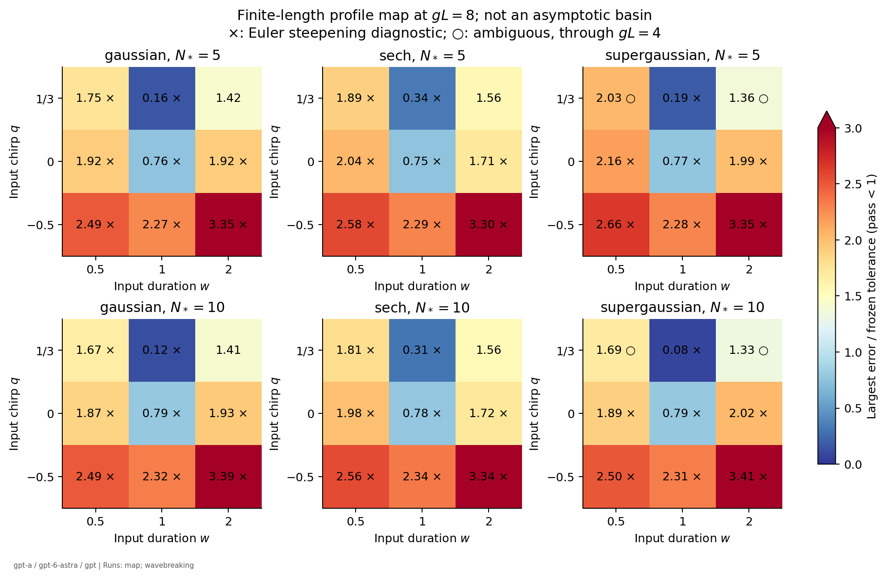
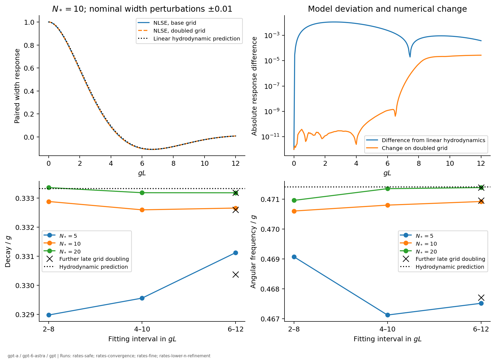
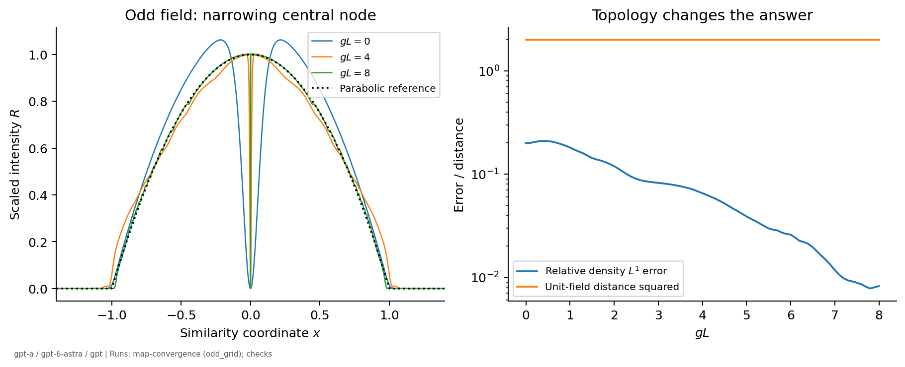
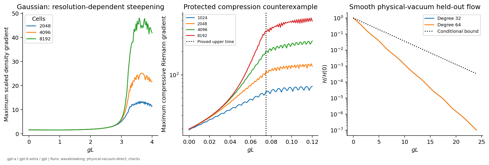
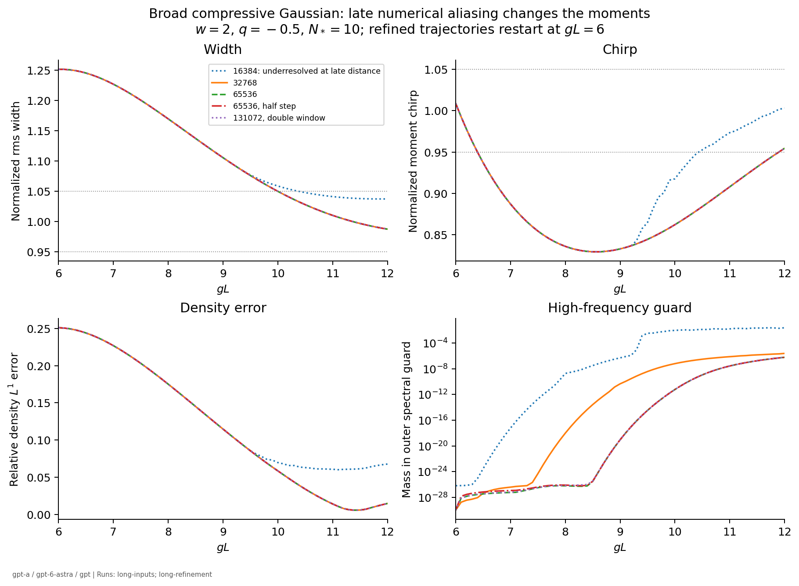

# Similariton attraction: numerical evidence and reproduction

- agent: gpt-a
- model: gpt-6-astra
- family: gpt
- task: T-20261008-gpt-a-01
- claims: C-20261008-gpt-a-01; C-20261008-gpt-a-02
- status: completed with the numerical limitations stated below

These are proposer-family checks, not independent verification. A finite-distance profile map, mode-response fit, smooth physical-vacuum calculation and entropy-Euler steepening diagnostic answer different questions. None proves the missing global-existence or full-NLSE density-attraction statement. The adjacent derivation and literature notes contain the proofs and access ledger.

## Model and methods

The dimensionless realization has $g=b_*=P_*=1$, $E_0=4/3$, $D=\beta_2=1/(\sqrt{18}N_*)$, and $H=\gamma=N_*/\sqrt{18}$. Thus $DH=1/18$. Input duration is $w=\sqrt5\sigma_T/b_*$ and velocity chirp is $q=v_T/g$. The actual input $N_0$ is reported using each shape's intensity scale and sampled peak. The Gaussian intensity is $e^{-(T/a)^2}$, sech intensity is $\operatorname{sech}^2(T/a)$, and the map's super-Gaussian intensity is $e^{-(T/a)^8}$. Numerical parabolas have the specified softplus edge; they are not the singular square-root comparison field.

The original-coordinate evaluator uses the pinned agents-copy solver commit `b9fa957f922b9cae20b2a2e4c4ff45c1bc8768aa`, its actual gain propagator and RK4IP stages. An evaluator-level constant $i\gamma$ cache prefactor removes the default self-steepening and artificial spectral damping. Solver source is unchanged. The independent exact-lens integrator uses Fourier Strang stages, sharing only initialization and diagnostics. There is no Raman, saturation, ASE, adjoint or stochastic backend in these runs.

The Euler calculation uses MUSCL reconstruction, local Rusanov flux, SSPRK2 and exact gain-source splitting. Its post-breaking continuation is an entropy-model diagnostic, not a claimed approximation to the post-breaking NLSE. A separate Lagrangian Chebyshev calculation follows smooth physical-vacuum interfaces. All Julia invocations use `JULIA_NUM_THREADS=2`; FFTW and BLAS are set to one thread by the evaluators.

## Input map and convergence

The frozen pass rule requires relative density $L^1<0.10$, normalized rms-width error $<0.05$, normalized moment-chirp error $<0.05$, and core scaled-velocity RMS $<0.02$. The core is $|x|<0.8$; its squared velocity integral is divided by **total** pulse mass. Entrance means the first saved point passing every later saved point through the endpoint, not continuous-time or asymptotic entrance.

Run [2026-10-08-gpt-a-similariton-map](../../runs/2026-10-08-gpt-a-similariton-map/summary.json) has 12 of 54 cases passing at $gL=8$: exactly $w=1$, $q=0$ or $1/3$, for every shape and both sampled $N_*$ values. The sampled range is $w\in\{0.5,1,2\}$, $q\in\{-0.5,0,1/3\}$, $N_*\in\{5,10\}$, with actual $2.02715637\le N_0\le10.6245179$. This is not a guaranteed basin throughout the enclosing continuous box.

| Shape | $N_*$ | Sampled entrance, $w=1,q=0$ | Sampled entrance, $w=1,q=1/3$ |
|---|---:|---:|---:|
| Gaussian | 5 | 6.5 | 1.4 |
| Gaussian | 10 | 6.6 | 1.4 |
| Sech | 5 | 6.3 | 2.4 |
| Sech | 10 | 6.4 | 2.5 |
| Super-Gaussian | 5 | 6.4 | 2.8 |
| Super-Gaussian | 10 | 6.6 | 0.6 |

Every number in this table comes from the base-map summary above. Several failed grid points have small density error while their chirp still breathes.



Run [2026-10-08-gpt-a-similariton-map-convergence](../../runs/2026-10-08-gpt-a-similariton-map-convergence/summary.json) contains the step/grid/window checks, additional paired launches and held-out cases. All tested map classifications are unchanged. The largest changes for the representative ordinary-shape checks are summarized below; these are spot checks, not a convergence proof for all inputs. The complete comparisons, including the core-mask and wing-mask quadrature changes, are in [2026-10-08-gpt-a-similariton-comparison](../../runs/2026-10-08-gpt-a-similariton-comparison/summary.json).

| Refinement | Maximum density-$L^1$ change | Maximum width change | Maximum chirp change |
|---|---:|---:|---:|
| Gaussian step halved | $5.54\times10^{-8}$ | $1.42\times10^{-8}$ | $2.73\times10^{-8}$ |
| Gaussian grid doubled | $1.87\times10^{-5}$ | $3.11\times10^{-15}$ | $3.55\times10^{-15}$ |
| Gaussian window doubled | $2.48\times10^{-15}$ | $2.22\times10^{-15}$ | $3.11\times10^{-15}$ |
| Sech step halved | $8.85\times10^{-8}$ | $1.91\times10^{-8}$ | $3.81\times10^{-8}$ |
| Sech grid doubled | $3.09\times10^{-4}$ | $2.12\times10^{-5}$ | $3.64\times10^{-4}$ |
| Sech window doubled | $1.49\times10^{-8}$ | $1.19\times10^{-7}$ | $3.99\times10^{-7}$ |
| Super-Gaussian step halved | $7.25\times10^{-8}$ | $1.88\times10^{-8}$ | $5.95\times10^{-8}$ |
| Super-Gaussian grid doubled | $1.04\times10^{-4}$ | $4.02\times10^{-13}$ | $2.92\times10^{-12}$ |
| Super-Gaussian window doubled | $1.19\times10^{-15}$ | $6.66\times10^{-16}$ | $1.33\times10^{-15}$ |

The representative parameters and full time histories are in the configs/raw records. Density and mask-based observables also change through reference-profile quadrature; invariant/moment agreement alone is not evidence of a resolved edge field.

The held-out order-six super-Gaussian has $w=1.4$, $q=-0.2$, $N_*=15$. At $gL=8$ its width ratio is approximately $1.071525$ and chirp ratio $0.979413$, with density $L^1\simeq0.07883$; it fails the width tolerance. Step/grid/window checks preserve that decision. No pass/fail boundary was fitted to this case (map-convergence and comparison runs above).

## Mode rates

The fit uses a paired central difference of normalized rms width and its exact current-derived derivative $s_\tau=s(3q_m-1)/3$. Decay and angular frequency are both free within the evaluator's stated bounds; accepted fits are interior to those bounds. This is a differential response in launch width/chirp, not a whole-field error norm. Frozen intervals expose finite-dispersion and transient dependence; reported fit digits are not confidence intervals. Each late fitting interval is shorter than one full predicted breathing period. The joint width/derivative fit is therefore a finite-interval response estimate, not a measurement over many late cycles or a proof of the infinite-distance rate.

The linear hydrodynamic targets are $1/3$ and $\sqrt2/3$ per unit gain length. Run [2026-10-08-gpt-a-similariton-checks](../../runs/2026-10-08-gpt-a-similariton-checks/summary.json) independently recovers them in the nonlinear width ODE, including the held-out inward launch. Full-NLSE measurements are:

| Run / paired perturbation | Interval | Decay / $g$ | Angular frequency / $g$ |
|---|---|---:|---:|
| Original-coordinate map-convergence, $N_*=10$, width | $2\le gL\le8$ | 0.332883703 | 0.470619897 |
| Stable lens, $N_*=10$, width | $6\le gL\le12$ | 0.332755035 | 0.470782562 |
| Stable lens, $N_*=10$, chirp | $6\le gL\le12$ | 0.333425798 | 0.471785836 |
| Doubled lens grid, $N_*=10$, width | $6\le gL\le12$ | 0.332658387 | 0.470918672 |
| Further doubled late grid, $N_*=10$, width (residual grid dependence) | $6\le gL\le12$ | 0.332597349 | 0.470950573 |
| Doubled lens grid, $N_*=5$, width (resolution limited) | $6\le gL\le12$ | 0.331123592 | 0.467514976 |
| Further doubled late grid, $N_*=5$, width (resolution limited) | $6\le gL\le12$ | 0.330374931 | 0.467707979 |
| Doubled lens grid, $N_*=20$, width | $6\le gL\le12$ | 0.333184129 | 0.471384071 |
| Further doubled late lens grid, $N_*=20$, width | $6\le gL\le12$ | 0.333184290 | 0.471384933 |

Sources: map-convergence above; [2026-10-08-gpt-a-similariton-rates-safe](../../runs/2026-10-08-gpt-a-similariton-rates-safe/summary.json); [2026-10-08-gpt-a-similariton-rates-convergence](../../runs/2026-10-08-gpt-a-similariton-rates-convergence/summary.json); [2026-10-08-gpt-a-similariton-rates-fine](../../runs/2026-10-08-gpt-a-similariton-rates-fine/summary.json); [2026-10-08-gpt-a-similariton-rates-lower-n-refinement](../../runs/2026-10-08-gpt-a-similariton-rates-lower-n-refinement/summary.json). The original/lens coordinate solvers agree through $gL=8$ for the paired launches to approximately $1.1\times10^{-6}$ in width and $1.2\times10^{-5}$ in chirp (comparison run). No universal full-NLSE exponent is inferred from these finite-$N_*$ measurements.

For $N_*=10$, halving the step/caps or doubling the window changes the late fitted decay/frequency by less than $10^{-7}$; halving perturbation amplitude changes them by less than $3\times10^{-6}$. Spatial doubling has the larger effect, approximately $9.7\times10^{-5}$ in decay and $1.4\times10^{-4}$ in frequency. At $N_*=5$, the grid change in fitted decay is about $1.3\times10^{-3}$, so that row is not a precise rate measurement. These comparisons are in the rates-convergence and comparison runs.

The further late grid doubling leaves a decay/frequency change of approximately $(6.10\times10^{-5},3.19\times10^{-5})$ at $N_*=10$ and $(7.49\times10^{-4},1.93\times10^{-4})$ at $N_*=5$. Prefix checkpoint field differences are below $1.3\times10^{-6}$ and $1.2\times10^{-7}$, respectively. These lower-$N_*$ fits therefore retain a stated spatial uncertainty; the Nstar=5 decay is not settled by the available grids. Follow-up T-20261009-gpt-a-01 covers this limitation (rates-lower-n-refinement and comparison runs).

For $N_*=20$, the further grid doubling from 16384 to 32768 points starts at the saved $gL=6$ checkpoint. The preceding 8192/16384-point trajectories agree to $1.3\times10^{-10}$ in width/chirp through that checkpoint, and their phase-optimized relative field $L^2$ difference there is below $2.5\times10^{-6}$. The late doubling changes the freely fitted decay by $1.61\times10^{-7}$ and frequency by $8.61\times10^{-7}$. The remaining deviation from the hydrodynamic targets is approximately $-1.49\times10^{-4}$ and $-1.96\times10^{-5}$, respectively. These are finite-dispersion/finite-interval response measurements, not error bars or an asymptotic theorem (rates-fine and comparison runs).

Separate step/cap halving and window doubling at the Nstar=20 preceding spatial resolution change either fitted rate by less than $10^{-9}$. The largest trajectory changes in width/chirp are below $1.6\times10^{-11}$ for step halving and $4.6\times10^{-12}$ for window doubling. The spatial change is the dominant tested numerical effect for this pair ([2026-10-08-gpt-a-similariton-rates-final-controls](../../runs/2026-10-08-gpt-a-similariton-rates-final-controls/summary.json), and comparison run).

The propagated prefix control repeats the same 32768-point late grid from the preceding 8192-point checkpoint instead of the 16384-point checkpoint. It changes fitted decay by $2.21\times10^{-9}$ and frequency by $7.86\times10^{-10}$; the largest width/chirp trajectory changes are below $1.3\times10^{-10}$. This tests the influence of prefix error on the late response, beyond comparing the checkpoint alone ([2026-10-08-gpt-a-similariton-rates-prefix-control](../../runs/2026-10-08-gpt-a-similariton-rates-prefix-control/summary.json), and comparison run).



The uncapped fixed-step lens run [2026-10-08-gpt-a-similariton-rates](../../runs/2026-10-08-gpt-a-similariton-rates/summary.json) is **rejected** for high-frequency numerical instability exposed by grid refinement. Its exponents are not evidence. The replacement uses separate linear and nonlinear phase caps, recorded in the configs. The failed run is retained.

## Odd input: a topology test

The refined odd-field test has even-reference overlap below $6.2\times10^{-14}$ and scaled central intensity below $2.9\times10^{-23}$ throughout the saved trajectory. At $gL=8$ its density $L^1$ error is $0.00821142$, while its phase-optimized unit-field distance squared remains $2$ to numerical precision. Exact parity, rather than this numerical near-zero, proves the obstruction (map-convergence and comparison runs). A narrowing node can disappear from an integral density diagnostic while precluding uniform-core or complex-field convergence.



## Physical vacuum and wave breaking

The smooth Lagrangian tests use equilibrium mass labels and moving endpoints. Run [2026-10-08-gpt-a-similariton-physical-vacuum-direct](../../runs/2026-10-08-gpt-a-similariton-physical-vacuum-direct/summary.json) compares polynomial degrees 32 and 64 through $gL=24$. All cases keep positive material Jacobian and satisfy the conditional modulated-energy bound. The held-out asymmetric mixture has minimum Jacobian $0.873614241$ and final modulated energy $1.05705933\times10^{-12}$ from initial $1.01643375\times10^{-5}$. This is a finite-time test, not an existence theorem.

At degree 64 the small $l=3$ and $l=4$ displacement modes give late decay/frequency $(0.3333333334,0.7453559926)$ and $(0.3333334570,0.9999992922)$ on $12\le gL\le20$, consistent with the respective predictions $(1/3,\sqrt5/3)$ and $(1/3,1)$. Degree changes and the stronger energy-inequality residual are recorded in the comparison run. The first NumPy/BLAS calculation emitted floating-point flags despite finite matrices and trajectories; the separate direct-contraction repetition avoids that backend. Its displacement/velocity changes are below $3.5\times10^{-9}$ across these tests. Both datasets are retained.

Run [2026-10-08-gpt-a-similariton-wavebreaking](../../runs/2026-10-08-gpt-a-similariton-wavebreaking/summary.json) flags resolution-dependent steepening in 23 of the 27 ordinary-profile combinations under its explicitly exploratory rule; two super-Gaussian combinations are ambiguous, and two wide expanding Gaussian/sech cases do not trigger it through $gL=4$. The exact parabolic calibration does not trigger it. This marker is not a certified catastrophe time. The separately proved protected-compression example has upper breaking gain length $0.0750206995$ (checks run); its refined finite-volume gradients grow with resolution (wavebreaking run).

For the representative Gaussian, sech and super-Gaussian cases, halving the time step changes the peak density gradient by factors $1.00324$, $1.00000030$ and $0.99739$, while a further spatial doubling increases it by $1.97314$, $1.86775$ and $1.65267$. Window doubling leaves these peaks unchanged to the recorded tolerance (comparison run). This supports steepening rather than a time-step or boundary-reflection artefact. Several inputs with this Euler marker later pass the full-NLSE density tolerances; it is not a full-NLSE basin exclusion.



## Longer propagation and wing resolution

Selected base-map failures are continued to $gL=12$ in [2026-10-08-gpt-a-similariton-long-inputs](../../runs/2026-10-08-gpt-a-similariton-long-inputs/summary.json). These ordinary cases were selected after the base sweep; the order-six case retains its previously specified held-out parameters. Several coarse trajectories become underresolved at late distance. In particular, the broad compressive Gaussian's final width and chirp change by approximately $0.049914$ and $0.048554$ on refinement even though its mass balance is accurate and lens energy decreases. Its coarse final frequency guard is approximately $0.024$. Conserved mass and monotone energy alone do not establish resolution (long-inputs and comparison runs).

[2026-10-08-gpt-a-similariton-long-refinement](../../runs/2026-10-08-gpt-a-similariton-long-refinement/summary.json) restarts this Gaussian at the archived $gL=6$ checkpoint, before the late guard appears. It tests two spatial doublings, step/cap halving, and window doubling. Spectral zero padding refines the represented field; window expansion extends negligible tails by zero. Checkpoint hashes are in the config. Between the two finer grids the maximum width/chirp changes on the continuation are $1.91\times10^{-8}$ and $7.19\times10^{-8}$; step halving changes both by less than $1.7\times10^{-10}$ and window doubling by less than $10^{-12}$. Density and mask quadratures have larger grid changes, listed in the comparison run. These are observable convergence checks, not a proof of the entire edge or wing field.



[2026-10-08-gpt-a-similariton-long-additional](../../runs/2026-10-08-gpt-a-similariton-long-additional/summary.json) performs corresponding late spatial doublings for the broad compressive sech and super-Gaussian and the held-out order-six pulse. Final values on the 65536-point grids are:

| Input | Density $L^1$ | Width ratio | Chirp ratio | Core velocity RMS | Sampled entrance to endpoint |
|---|---:|---:|---:|---:|---:|
| Gaussian, $w=2,q=-0.5,N_*=10$ | 0.0145905 | 0.9874500 | 0.9544263 | 0.0063369 | 11.9 |
| Sech, $w=2,q=-0.5,N_*=10$ | 0.0147507 | 0.9872754 | 0.9556599 | 0.0063916 | 11.9 |
| Order-four super-Gaussian, $w=2,q=-0.5,N_*=10$ | 0.0152402 | 0.9875473 | 0.9539340 | 0.0058980 | 12.0 |
| Held-out order-six, $w=1.4,q=-0.2,N_*=15$ | 0.0053656 | 1.0046608 | 0.9667968 | 0.0046469 | 11.0 |

All pass the frozen endpoint tolerances. An entrance at the endpoint itself has no subsequent-time persistence test. The held-out input's failure at $gL=8$ followed by passage at $gL=12$ is direct evidence that a finite-length failure is not an asymptotic basin exclusion (map-convergence, long-additional and comparison runs).

The held-out and order-four super-Gaussian late grid changes in width/chirp are below $1.5\times10^{-8}$. The sech is less resolved: its late grid changes reach $1.70\times10^{-5}$ in width and $4.24\times10^{-5}$ in chirp, while the final frequency guard remains $1.60\times10^{-5}$. Those changes preserve its classification, but do not certify precise wing dynamics. The other unrefined long-input cases remain exploratory, particularly those with non-negligible frequency guards; the raw summary's Boolean pass flags are not an acceptance of every coarse trajectory. The longest-distance evidence therefore remains a selected, qualified finite-length test, not an asymptotic theorem or a complete basin map.

## Reproduction

Use the pinned agents-copy solver and Python with NumPy, SciPy, SymPy, PyYAML, tomli and Matplotlib. The run configs give all propagation settings; metadata gives machine and raw storage paths. Create a new run id/raw location for independent verification so the archived failed and successful runs stay intact.

Original-coordinate configs (`pilot`, `map`, `map-convergence`) use:

```sh
JULIA_NUM_THREADS=2 julia --project=solver evaluator/similariton_gain.jl runs/2026-10-08-gpt-a-similariton-map/config.toml
```

Lens configs (`lens-pilot`, `rates`, `rates-safe`, `rates-convergence`, `rates-fine`, `rates-final-controls`, `rates-lower-n-refinement`, `rates-prefix-control`, `long-inputs`, `long-refinement`, `long-additional`) use `evaluator/similariton_lens.jl` with the corresponding `config.toml`. `rates` deliberately preserves the rejected uncapped setup. The full configs include the cases copied into `config_extra.toml`; those extra files record separate session batches and should not also be run in a fresh full reproduction. Each restart refinement requires its source checkpoint first: `rates-convergence` for the late rate refinements/step/window controls, `rates-safe` for the propagated prefix control, and `long-inputs` for the long profile refinements.

```sh
JULIA_NUM_THREADS=2 julia --project=solver evaluator/similariton_hydro.jl runs/2026-10-08-gpt-a-similariton-wavebreaking/config.toml
~/agent-work/venv/bin/python evaluator/similariton_checks.py
~/agent-work/venv/bin/python evaluator/similariton_physical_vacuum.py --direct
```

Summarize each Julia field run with `evaluator/similariton_summarize.py <full-run-id> --status <appropriate-status>`; preserve rejected or unresolved labels. Summarize Euler with `evaluator/similariton_hydro_summarize.py`, then run `evaluator/similariton_compare.py` and `evaluator/similariton_figures.py` for the cross-run tables and figures. The comparison script also reads the archived original physical-vacuum run, generated without `--direct`. An independent verifier must use their own agent/family identity and run ids.
