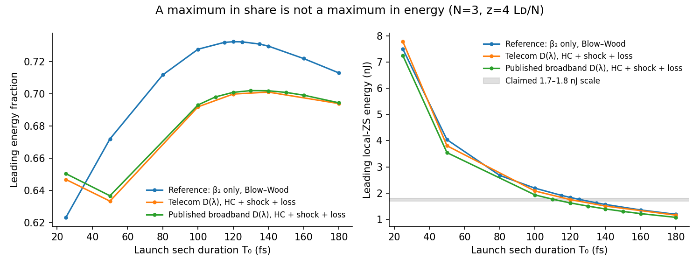
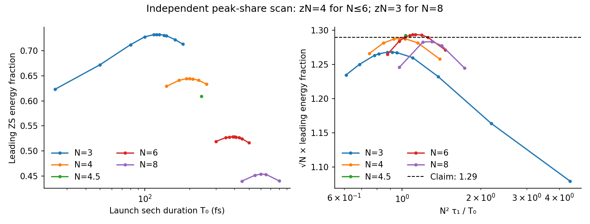

# Independent audit of Raman transfer and the proposed energy ceiling

This is the independent verdict. Registered additional controls that have
not finished at this verdict are identified below; they are not represented
as completed evidence. Post-commit material and subsequent controls are
recorded separately. Clean context is released only after this report's
completed-verdict commit.

## Verdict

The verdict is **fail for the claim as written**. The physical-units
corollary confuses the maximum *fraction* with a maximum *energy*. The exact
fixed-N derivative and independent numerical counterexamples refute the
predicted maximum in a duration scan. The empirical reference-model peak
fraction survives the checks completed here. It should be separated from
an energy ceiling and from a controlled asymptotic theorem.

All numerical results in this report belong to run
[`2026-10-16-gpt-c-raman-audit`](../../runs/2026-10-16-gpt-c-raman-audit/).
Case names below identify its per-case JSON files. Configurations, numerical
summaries and source code are in git; fields and other raw outputs are under
`~/analytical-nl-discovery-data/2026-10-16-gpt-c-raman-audit/`.

## Restatement, assumptions and clean context

The reference problem launches q=N sech(t) into a scalar, single-mode,
constant-beta2 Raman GNLSE. It asks for the fraction of launch energy in
the reddest separated soliton after transfer stabilizes. The proposed laws
are a linear weak-Raman excess, a duration optimum tracking Raman spectral
structure, and a peak fraction proportional to N^(-1/2). The dimensional
corollary evaluates energy at that duration.

The model fixes anomalous beta2, constant gamma, deterministic propagation,
no loss, no shock, a periodic time window and the Blow-Wood response.
Additional assumptions needed for measurement are successful separation,
a unique relevant leading pulse, a resolved discrete eigenvalue, and a
propagation interval with stable transfer. For a dispersive physical model,
local ZS content is an approximate diagnostic; there is no exact global
integrable scattering partition. A physical prediction additionally needs
spectral support inside the dispersion model's useful band, a specified
output distance, and a specified energy or photon-number objective.

At this independent verdict, my repository reading was limited to the
permitted claim and problem cards, evaluator, solver documentation,
repository instructions, task metadata and cited run config/meta information.
The external implementation sources needed for the independently chosen
Raman and dispersion models are listed in `SOURCES.md`; they were not a
duplicate novelty search. I have not opened proposer run
scripts, explorations, logs, PR descriptions or branch history, or gpt-b's
novelty report. Filenames printed by the required stack merge were not
opened. No conversations from other projects were accessed.

The independently chosen held-out point N=4.5,T0=240 fs was committed
before computation in this report. Its predicted interval was
sqrt(N) f1 in [1.20,1.38]. Later edge extensions and convergence controls
were recorded in their own configuration files before execution. They
were chosen to test identified limitations, not used to calibrate the
reference prediction.

## Decisive attack: share optimum versus energy optimum

At fixed N and carrier,

$$E_1(T_0)=\frac{2N^2|\beta_2|}{\gamma}\frac{f_1(T_0)}{T_0}.$$

The units of |beta2|/(gamma tau1) are energy. The dimensional conversion
is sound, but it does not supply an extremum. At a differentiable interior
share maximum with positive f1,

$$E_1'(T_0^*)=-E_1(T_0^*)/T_0^*<0.$$

An energy stationary point instead requires T0 f1'=f1. This remains true
when higher-order dispersion changes f1: launch energy at fixed N still
scales as 1/T0. The numerical counterexamples do not require this
smoothness assumption.

Independent N=3 results at zN=4 are:

| T0 (fs) | Reference BW/beta2 energy (nJ) | Published D(lambda), HC, shock and loss (nJ) | Cases |
|---|---:|---:|---|
| 140 | 1.56559 | 1.39498 | `bw_N3_T140`, `measured_hc_s1_N3_T140` |
| 100 | 2.18602 | 1.92848 | `bw_N3_T100`, `measured_hc_s1_N3_T100` |
| 50 | 4.03724 | 3.54294 | `bw_N3_T50`, `measured_hc_s1_N3_T50` |
| 25 | 7.48916 | 7.23874 | `bw_N3_T25`, `measured_hc_s1_N3_T25` |

The 25-fs reference result has not completed transfer at zN=4, and the
physical 25-fs pulse is the most demanding envelope-model extrapolation.
The counterexample does not depend on it: the 50-fs physical result already
exceeds the claimed ceiling substantially. Its temporal-gate energy is
3.58276 nJ, consistent with the local-ZS estimate, and the leading spectrum
has fraction 0.999988 in 1200-2300 nm (`measured_hc_s1_N3_T50`).
The independent grid/window/step checks are reported below.

For the 50-fs physical case, the *whole field* has 98.8206% of its energy
in 1200-2300 nm, although the leading pulse is almost entirely in that
band (`physical_occupancy.json`). Its radiation therefore tests an
extrapolation of the fitted dispersion. This is disclosed separately from
the leading-pulse support. A further T0=80 fs, fixed-length control was
registered in `physical_inband_cases.json` to test a less broadband input;
it was not used to choose the original counterexample.

A second comparison uses exactly the same physical fibre length,
0.663372 m: the 100-fs case at zN=4 gives 1.92848 nJ, while the 50-fs case
at zN=16 gives 3.29942 nJ (`measured_hc_s1_N3_T100` and
`measured_hc_s1_N3_T50_fixed130cm`). Both checkpoints are clean. Thus the
energy increase is not an artefact of changing physical length when zN is
held fixed.

At the additionally planned 1.3-m endpoint, the original 50-fs run has
temporal-edge occupancy 0.0236 and is excluded. Its registered doubled-window
repeat, `conv_measured_wide_N3_T50_fixed130cm`, has not run at this verdict.
This endpoint is not needed for the clean matched-length comparison above.

The appropriate name is **leading-soliton energy at the share-optimal
operating point**, with the output distance and model stated. It is neither
an absolute energy ceiling nor an optimum at fixed laser energy or spectrum.
The proposal's statement is preserved on its card; the correction belongs
in its regime and audit trail.

This figure compares fields at the stated output distance. Its short-pulse
points are not assertions of saturated content or of a universal envelope
model at arbitrarily short duration.

## Reference peak law and held-out predictions

The independent scans reproduce the approximate peak-share curve. Resolved
points near the sampled maxima, and the frozen extrapolation points, are:

| N | T0 (fs) | zN | f1 | sqrt(N) f1 | Case |
|---|---:|---:|---:|---:|---|
| 2 | 60 | 16 | 0.855676 | 1.21011 | `bw_N2_T60_long` |
| 3 | 120 | 4 | 0.732207 | 1.26822 | `bw_N3_T120` |
| 4 | 200 | 4 | 0.644155 | 1.28831 | `bw_N4_T200` |
| 4.5 | 240 | 4 | 0.609344 | 1.29261 | `bw_N4.5_T240` |
| 5 | 280 | 4 | 0.578885 | 1.29443 | `bw_N5_T280` |
| 6 | 390 | 4 | 0.528315 | 1.29410 | `bw_N6_T390` |
| 7 | 500 | 4 | 0.487558 | 1.28996 | `bw_N7_T500` |
| 8 | 600 | 3 | 0.453853 | 1.28369 | `bw_N8_T600` |
| 10 | 870 | 3 | 0.401301 | 1.26902 | `bw_N10_T870` |
| 12 | 1176 | 2.5 | 0.361775 | 1.25323 | `conv_fine_N12_T1176` |
| 16 | 1875 | 2 | 0.305441 | 1.22177 | `conv_fine_N16_T1875` |

Local three-point duration fits give T0*=61.24,124.52,198.49,290.92,388.07,
619.04 fs for N=2,3,4,5,6,8, at zN=16,8,4,4,4,3 respectively. Their
$y^*=N^2\tau_1/T_0^*$ lies in [0.797,1.261]. The fitted duration exponent
is 1.6663, versus the stated empirical 1.62; the maximum relative
deviation from $21\,\mathrm{fs}\,N^{1.62}$ is 5.13%, within the card's
6% accuracy (`summary.json`, `reference_duration_scaling`). The local
brackets are recorded there and are not confidence intervals. This does
not prove global unimodality. N=7 and 10 are single near-peak points;
N=12 and 16 are extrapolation checks, not a continuation of the tighter
1.27-1.30 range to all N.

The N=12 and 16 central verifier points pass [1.20,1.38] on a 131072-point
grid, with stable content over preceding clean checkpoints. Neighbouring
durations are checked separately; a finite scan does not prove a global
maximum. These are tests of the mathematical constant-beta2 equation.
Their red shifts are outside a physical SMF-28 interpretation.

For Hollenbeck-Cantrell, the largest sampled zN=4 shares give sqrt(N) f1
of 1.25191, 1.27212 and 1.27447 for N=3,4,6, respectively
(`constant_hc_s0_N3_T140`, `constant_hc_s0_N4_T200`,
`constant_hc_s0_N6_T400`). All pass the frozen [1.20,1.38] interval.
This changes response shape, rather than merely rescaling its time axis.
The own N=4.5 held-out point also passes. The N=5 frozen excesses at
T0=100,200,280 fs are 0.38124, 0.56236 and 0.60801; the prescribed
T0=340 versus 200/560 ordering also passes. The N=7 point and both N=8
fractions at 600/800 fs pass their frozen intervals; the latter 800-fs
value is 0.440486. N=10 gives sqrt(N) f1=1.26902.
`frozen_checks.json` records all selected checkpoints, metrics, intervals
and pass flags. These checks do not revive the older predictions that the
proposer had already refuted.

## Weak-Raman limit

For N=2, the measured exponent of the excess is **1.00648** using the
strictly clean zN=64 checkpoints over T0=800-6400 fs. Including the later
saturation diagnostics gives **1.00733**, with local exponents 1.01558,
1.00495 and 1.00225, against the predicted 1 (`asym_diagnostics.json`).
The corresponding coefficient approaches the quoted value:

| N | T0 (fs) | zN | excess | c_N | Cases |
|---|---:|---:|---:|---:|---|
| 2 | 800 | 64 | 0.00906800 | 4.96213 | `asym_wide_N2_T800` |
| 2 | 1600 | 64 | 0.00448529 | 4.90883 | `asym_wide_N2_T1600` |
| 2 | 3200 | 128 | 0.00223497 | 4.89203 | `asym_wide_N2_T3200` |
| 2 | 6400 | 128 | 0.00111574 | 4.88439 | `asym_wide_N2_T6400` |

The two late checkpoints retain global temporal-edge flags of 2.99e-6
and 1.09e-6 from weak radiation. They are not relabeled strictly clean.
At a common 8192-cell shooting mesh, doubling the propagation window
changes their leading shares by 1.37e-9 and -2.18e-8. Their excess changes
from zN=64 to 128 are below 0.21%. The clean-only and late-diagnostic fits
above make this boundary sensitivity explicit, rather than suppressing
the flags. The coefficient is not flat to 0.3% over the entire duration
range; the shortest point retains a finite-parameter correction.

The original clean N=4 results over 800-3200 fs give exponent **1.00913**.
Extending to 6400 fs gives **1.15614**, with final local exponent
**1.53055** and coefficients 78.26, 72.85, 77.27, 53.50. The wide-window
continuation and a finer-grid, tighter-tolerance repetition of the last
point were incomplete at the independent-verdict commit; subsequent
results are recorded below. This coefficient was not used as the decisive
refutation (`asym_N4_T6400`, `summary.json`). A mean slope
close to one does not establish a constant $c_N$ with relative remainder
$O(\tau_R)$. The finite scan can test the stated regime; it cannot prove
or disprove an infinite-limit expansion outside that regime.

Wrapped data are retained but excluded. In `asym_N2_T800`, zN=128 has
maximum temporal-edge occupancy 0.75682 and a spurious share 0.76416,
whereas its earlier zN=64 share is 0.756801. The wide repetitions retain
the same time spacing and refine the shooting mesh separately.

## Physical efficient-point energy and validity

The physical runs use the published broadband SMF-28 dispersion fit in
Boilard et al., DOI 10.1038/s41598-022-08329-3, arXiv:2109.13366,
**full text**. The Table 3 fit is integrated twice in angular frequency,
retaining all orders and its actual launch beta2. The resulting launch
values are beta2=-20.0993 ps^2/km and beta3=0.124670 ps^3/km. A separate
telecom zero-dispersion model is matched to the card's beta2=-21.7 ps^2/km
and has beta3=0.127975 ps^3/km (`physics_calibration.json`). The two
models are kept distinct. Neither is a measurement of the PI's fibre.

Both use HC Raman, the shock multiplier, gamma0=1.3/(W km), and uniform
attenuation 0.2 dB/km. The published fit's numerical extension outside
800-3000 nm is not treated as evidence; occupied spectra are checked
against the supported near-infrared band. Source access and exact
coefficients are recorded in `SOURCES.md` and `config.yaml`.

At zN=4, the refined largest sampled physical shares occur near T0=130,
210 and 375 fs for N=3,4,6. Their energies are 1.50252, 1.43459 and
1.45102 nJ (`measured_hc_s1_N3_T130`, `measured_hc_s1_N4_T210`,
`measured_hc_s1_N6_T375`). These are numerical operating points, not
laboratory-certified constants or energy ceilings. The share maxima are
broad: moving along a nearly flat share plateau changes energy through
1/T0. A local three-point quadratic interpolation gives the following
comparison (`summary.json`, `peak_fits_at_fixed_zN`). The brackets are
sampled durations, not confidence intervals, and interpolated quantities
are not new forward runs.

| N | Reference T0* (fs) | Reference E at T0* (nJ) | Published-dispersion T0* (fs) | Physical E at T0* (nJ) | Physical bracket (fs) |
|---|---:|---:|---:|---:|---|
| 3 | 121.78 | 1.80654 | 134.09 | 1.45690 | 120,130,140 |
| 4 | 198.49 | 1.73352 | 208.24 | 1.44672 | 200,210,220 |
| 6 | 388.07 | 1.63618 | 378.08 | 1.43921 | 350,375,400 |

Thus the nearly N-independent efficient-point scale survives this model
change over these sampled N values, while the quoted 1.7-1.8 nJ is not
preserved quantitatively. The dimensionless spectral-occupancy limits
below delimit this conclusion; a gamma(omega) or spool calibration remains
necessary for a laboratory prediction.

The sampled physical efficient points have N in {3,4,6}, zN=4,
$\tau_R^{HC}\in[0.00657,0.01896]$, $s\in[0.00219,0.00633]$,
$\delta_3=\beta_3/(6|\beta_2|T_0)\in[0.00275,0.00796]$ and
$\alpha L\le2.15\times10^{-4}$. Their fractional carrier red shifts are
0.0478-0.0950 and local |beta2| is 1.40-1.89 times its launch value.
Global energy outside 1200-2300 nm is below 1.1e-12; the local dispersion
variation over one rms pulse bandwidth is at most 0.101. Local-ZS and
temporal-gate energies agree within 0.279%, and loss-corrected photon-norm
drift is below 9.8e-8 (`regime_metrics.json`). These are bounds for the
sampled points and their measured diagnostic quality, not a proof over
the entire Cartesian box of those parameters.

Energy and photon fractions must be distinguished. With shock, energy
continues to fall during red shift even after photon transfer stabilizes.
Consequently the physical share optimum depends on output distance and
on which fraction is optimized. Constant mode area and constant gamma0
remain assumptions; wavelength-dependent mode area, measured attenuation,
noise and jitter are not included.

The tight shock check is sensitive to the observable. With the card's
unscaled ZS proxy, the photon-proxy changes at (N,T0)=(4,200),(6,400) are
-0.0500% and -0.2273%, reproducing the card. With the locally normalized
ZS energy they are +0.6040% and +0.7774%; direct gated photon fraction gives
+0.4621% and +0.6034% (`shock_measurement.json`). Thus the sub-1% physical
statement survives these cases, but the 0.25% statement is a property of
the specified proxy, not the actual gated photon fraction.

The distinction has a simple check. An ideal local soliton
$q=A/\sqrt g\,\mathrm{sech}(At)$ has energy $2A/g$, while applying the
unscaled ZS formula to it gives the ratio $2\sqrt g-g$ to that energy.
Dividing this proxy by g does not remove that bias. No proposer code was
needed to reproduce or explain the discrepancy.

## Independent implementation and numerical audit

`independent.py` implements Fourier RK4IP with adaptive step doubling,
accepting two half steps, plus explicitly fixed-step comparisons.
NumPy w is minus physical detuning times T0, so positive w denotes red
shift. Raman transforms are analytic, including the Gaussian-damped HC
modes. They are checked against time-domain quadrature at 0.25 fs
(`physics_calibration.json`); this avoids undersampling a short response
on a long-pulse grid. HC parameters come from DOI
10.1364/JOSAB.19.002886, **full text**, Eq. 9 and Table 1.

`zs_shoot.c` implements an independent two-sided Evans determinant for the
focusing ZS system with exact midpoint-cell transfer matrices and root
refinement. A census of resolved temporal peaks chooses the reddest
valid eigenvalue, not automatically the tallest peak. Carrier removal
precedes interpolation. The local physical normalization uses
q sqrt(g/b), with b=|beta2(local)|/|beta2(launch)| and g=omega/omega0;
the inferred local energy is 4 eta b/g. Gate energy and changes of the
extraction window quantify radiation overlap. This does not assert an
exact nonlinear spectrum for the full higher-order equation.

Calibration includes exact sech and chirped-sech ZS tests with shooting
mesh refinement, a fundamental NLSE soliton (relative field error
2.00e-8 at z=4), and a direct Gordon-moment test of the red-shift sign and
factor. The latter relative errors are 0.003845, 0.0009585 and 0.0002394
as T0 doubles from 400 to 1600 fs (`calibration.json`,
`physics_calibration.json`). Gordon DOI 10.1364/OL.11.000662 was accessed
at **abstract only** level; the coefficient 8 T_R/(15 T0) was independently
obtained by integrating the sech intensity-gradient moment.

Without shock, the reference equation conserves integral |q|^2. With
shock it conserves the spectral norm weighted by 1/(1-w/(omega0 T0));
uniform loss adds its known exponential decay. The physical invariant
check removes that decay. Quantum-defect energy loss is not integration
error. Nonpositive optical-frequency occupancy is reported separately.

Grid, doubled-window, step-halving and nonlinear band-edge-filter controls
are retained in `quality_metrics.json`. The completed reference step
controls change f1 by less than 2e-7 at N=4,T0=200 fs.
For the physical (N,T0)=(3,50),(4,200),(6,400) cases, finer grid, doubled
window and a tolerance reduction from 2e-8 to 1e-10 change f1 by at most
8.42e-7, 1.53e-10 and 1.88e-7, respectively (the `conv_measured_*` cases).
A hard nonlinear cutoff at 0.7 of Nyquist changes the N=6,T0=400 fs share
by about 3.1e-5. This is a controlled band-edge sensitivity test; it does
not assume an undocumented repository filter has an identical shape.

Extraction controls are in `extraction_checks.json`: symmetric half-widths
from 0.5 to 2 times the census gate and shooting meshes from 1024 to 4096
cells. For widths 0.75-2, the 4096-cell reference N=4,T0=200 fs share varies
by 1.41e-6; the physical N=3,T0=50 fs share varies by 3.61e-5. At N=16,
the clean fine-grid point varies by 2.37e-6. The 25-fs reference field has
larger overlap sensitivity (about 5e-4 in share); it is not used to certify
a saturated peak or the physical model. This is far too small to repair
the energy-ceiling counterexample, which also holds for 50 fs.

A separate pinned-repository-solver cross-check used Float64 fixed-step
RK4IP, with the same N=4,T0=200 fs,zN=3 input and shock. Both fields were
measured by the independent ZS extractor. The analytic-response Python
field differs by relative norm 0.008043 and leading share 4.4493e-5.
Changing only its response discretization to the unnormalized causal
sampled kernel reduces those differences to 2.1329e-7 and 2.2649e-9.
That kernel's DC value is 0.99911928. Normalizing it does not match.
This isolates Raman sampling rather than a propagation discrepancy
(`library_comparison.json`, `library_case.json`,
`library_sampling_cases.json`). No proposer code was consulted.

Failure preservation: `conv_smf_fine_N3_T25` stopped while serializing a
nonfinite secondary-peak bandwidth diagnostic after saving the forward
field. Its leading diagnostic was finite. The retry represents undefined
diagnostics as null; it did not change the forward equation. The original
partial report and field remain. Late aliased high-N checkpoints and
wrapped long-distance checkpoints also remain. A small conserved-norm
error alone is not a resolution certificate.

Only one heavy process runs at a time, with a memory-pressure check before
each launch/case. Larger grids are explicit convergence tests of the
reported high-N aliasing or a doubled window. No dense ZS matrices or full
propagation histories are kept in memory.

## Signed-off scope, blockers and work not performed

I would retain an empirical reference-model peak-fraction and peak-position
statement on the explicitly sampled, separated and converged cases. The
near-peak checks use $N\in\{2,3,4,4.5,5,6,7,8,10\}$ and
$\tau_R\in[0.00168,0.0244]$, with the peak-position subset and its $y^*$
bounds specified above. This is a list of checked points and interpolation
brackets, not a guarantee on every point in that parameter box. The
separate N=12,16 and HC predictions pass their stated candidate-point
intervals. The physical efficient-point scope is limited by the explicit
dimensionless bounds and model assumptions in its section above.

The blocking failure is the energy maximum. A further unresolved blocker
to a positive asymptotic certification is the claimed pointwise controlled
remainder for N>=3. Laboratory calibration and wavelength-dependent mode
area remain necessary for a precise physical energy prediction. The
additional N=4 grid/tolerance check, the optional long fixed-length window
repeat, the remaining outer-boundary runs and the first-compression premise
check do not block the already converged energy counterexample. Their
status is recorded rather than treated as a pass.

The exact fixed-N derivative is the relevant optimality attack within the
TL-sech input class. No adjoint mask optimizer was run for this claim:
masks leave that input class, and the counterexample is already inside
it. Thus this audit makes no assertion about input-shaping headroom or
adjoint convergence. It also does not establish Gaussian-launch
universality, arbitrary-oscillator universality, a global N=16 optimum,
or jitter/noise laws. Power and duration can set N without an inaccessible
fine-tuned parameter relation; keeping N fixed deliberately changes
launch energy.

No duplicate claim-02 novelty search was performed. It is assigned to
gpt-b. Its report was reserved for review after the independent verdict
was committed; that review is recorded in the post-commit note below.
The empirical exponents are not analytically derived
here; a coordinate rescaling alone supplies no new law.

## Post-commit review and subsequent controls

The completed independent verdict was committed and pushed as
`143cc58cd167f32b4edc88b7f007d23ab2dd641c` before clean context was released.
After that commit I read gpt-b's delegated novelty report in
[PR #52](https://github.com/nrivera494/analytical-nl-discovery/pull/52),
`docs/review-2026-10-16-gpt-b-raman-transfer-energy-novelty.md`, at commit
`ce021d7683e48b9257a53e47567badc7db4894cf`. I did not merge that branch or
read the proposer's run scripts. Its conclusions do not change the fail
verdict or any independent numerical result.

The delegated review classifies the Raman-enhanced fission and response-width
mechanism as partly published, with the precise fits and their robustness
requiring separate assessment. It also independently identifies the distinction
between energy and share maxima. Its relevant primary references include
Kormokar et al., DOI 10.1364/JOSAB.478975, arXiv:2301.02945; Judge et al.,
DOI 10.1364/JOSAB.26.002064; Pant et al., DOI 10.1364/JOSAB.27.001894; and
Tikan et al., arXiv:1701.08527v1. Access level for each here: **not accessed
by gpt-c; gpt-b reports full text**. These are attributed review findings,
not an additional literature search or independent source verification.
The first-compression premise was already registered for a numerical check
before this review was read; any executed check below is post-commit evidence.

After the same commit I inspected the pinned solver's
`src/backend/fft_utils.jl` and nonlinear-prefactor construction in
`src/mmgnlse_solver.jl`. The subsequent `solver_window_*` controls reproduce
that fixed nonlinear frequency window with bins reversed for the independent
code's opposite Fourier convention. Its one-sided damping leaves the red
half undamped; it cannot certify a resolved red spectral edge. This control
does not modify the solver or the default independent propagation. Source
inspection also confirms the unnormalized sampled Raman kernel already
identified by the independent field comparison. No proposer implementation
was opened to obtain these findings.

Follow-up numerical coefficient work is T-20261016-gpt-c-01; calibrated
physical efficient-point energy is T-20261016-gpt-c-02. These complement
T-20261016-gpt-b-01 (uniform-limit derivation), T-20261016-gpt-b-02
(response-width and compression mechanism), and T-20261016-gpt-b-03
(matched experimental observables and bracketed peak tests) in PR #52.

The completed aliasing control is explicit in `post_controls.json` and
`quality_metrics.json`. At N=8,T0=400 fs,zN=3, the 16384-, 32768- and
65536-point grids give f1=0.41779310, 0.43062783 and 0.43062811,
respectively (`alias_N8_T400_n*`). The coarse grid has maximum spectral-edge
fraction 0.3720 despite mass drift only 1.53e-7. The two finer grids agree
in share to 2.8e-7 at this clean checkpoint. Their later zN=4 checkpoints
have temporal-edge occupancy about 0.434 and are excluded even though their
shares agree. At N=8,T0=600 fs,zN=3 the analogous coarse and fine shares are
0.38872494 and 0.45385361. Thus neither a small invariant drift nor agreement
between two grids certifies freedom from a shared window error.

Additional near-peak samples bracket the own held-out point: the local
N=4.5 fit on T0=220,240,260 fs gives T0*=241.82 fs and sqrt(N)f1=1.29263
at zN=4 (`summary.json`). Adding the 57.5-fs N=2 point tightens its bracket
to 57.5,60,62.5 fs and gives T0*=61.235 fs; the duration exponent remains
1.66632 and the largest deviation from the stated rounded position formula
is 5.133%. These refinements do not change the original held-out prediction
or its pass result. Scaling both response times and T0 by two reproduces
the N=4,T0=200-fs share exactly to the stored precision
(`rescale_bw_N4_T400_scale2`, `frozen_checks.json`). This is a dimensional
symmetry check, not independent evidence for response-shape universality.
Likewise beta2 and gamma drop out of the reference dimensionless equation
at fixed N and response/T0; rescaling their physical values at fixed
dimensionless inputs reproduces the same reference dynamics.

The lower-bound extension `edge_N2_T12800` has c2=4.875789 at zN=256,
with the leading share differing by 4.8e-9 from zN=128. Its largest
temporal-edge fraction is 3.14e-7, below the acceptance threshold. This is
an additional continuation beyond the submitted duration range, not a new
full grid-convergence certificate or a replacement for the original N=2
exponent fit. The short-duration extension `edge_N3_T12.5` is not uniformly
separated: its zN=6 checkpoint fails the peak-overlap gate. These edge runs
are retained without extending the signed-off regime. The N=4,12800-fs
continuation was intentionally stopped before a saved checkpoint to preserve
time for the physical and accuracy controls; the 25600-fs case was not run.

The N=4,T0=6400 fs accuracy controls subsequently completed. With half the
time spacing and tolerance tightened from 1e-10 to 1e-11, the zN=32 share
is 0.442846534 (`asym_fine_N4_T6400`). The doubled-window result at the
same distance is 0.442846527: a difference of 6.54e-9. Relative to the
original run, the finer check changes the share by 2.38e-7
(`quality_metrics.json`). The doubled-window continuation reaches zN=64
with f1=0.442846237 and c4=53.49544; its edge diagnostics remain acceptable.
Thus the coefficient drop from the 3200-fs point is not removed by these
grid, window, integration or saturation checks. The extended-range exponent
is still about 1.15614, versus predicted 1. This strengthens the stated
finite-range limitation; it does not by itself disprove an expansion in an
unreached infinite-duration limit or explain the dependence on breather phase.

The less broadband physical counterexample also completed its doubled-window
check. At the same N=3 and physical length 1.3 m, the published-dispersion,
HC, shock and loss model gives:

| T0 (fs) | Local-ZS energy (nJ) | Direct gated energy (nJ) | Case |
|---|---:|---:|---|
| 140 | 1.394986 | 1.398365 | `measured_hc_s1_N3_T140_fixed130cm` |
| 100 | 1.877929 | 1.882116 | `measured_hc_s1_N3_T100_fixed130cm` |
| 80 | 2.230797 | 2.235635 | `conv_wide_measured_N3_T80_fixed130cm` |

The 80-fs run has global spectral fraction 0.999994901 in 1200-2300 nm;
the leading-pulse fraction is 0.999999967. Doubling the time window removes
the original 4.14e-6 temporal-edge flag: the wider run has maximum temporal
edge fraction 1.22e-17. Its leading energy changes by only 1.1e-11 nJ.
This provides a clean matched-length counterexample with substantially
stronger spectral support than the original 50-fs example
(`post_controls.json`, `physical_occupancy.json`). It still tests the stated
physical model, not a calibrated PI fibre sample or a model-independent
laboratory energy prediction.

The 80-fs grid and integration repetitions then completed. Doubling the
grid at fixed window changes the final local-ZS energy by 7.35e-10 nJ.
The wider-window run with tolerance 1e-11 gives 2.230797376 nJ, differing
from the 1e-9 wider-window result by 1.45e-8 nJ; its maximum time-edge
fraction is 4.69e-19 (`conv_fine_measured_N3_T80_fixed130cm`,
`conv_tight_measured_N3_T80_fixed130cm`, `quality_metrics.json`). The
energy difference between the matched input durations is much larger than
these numerical sensitivities.
