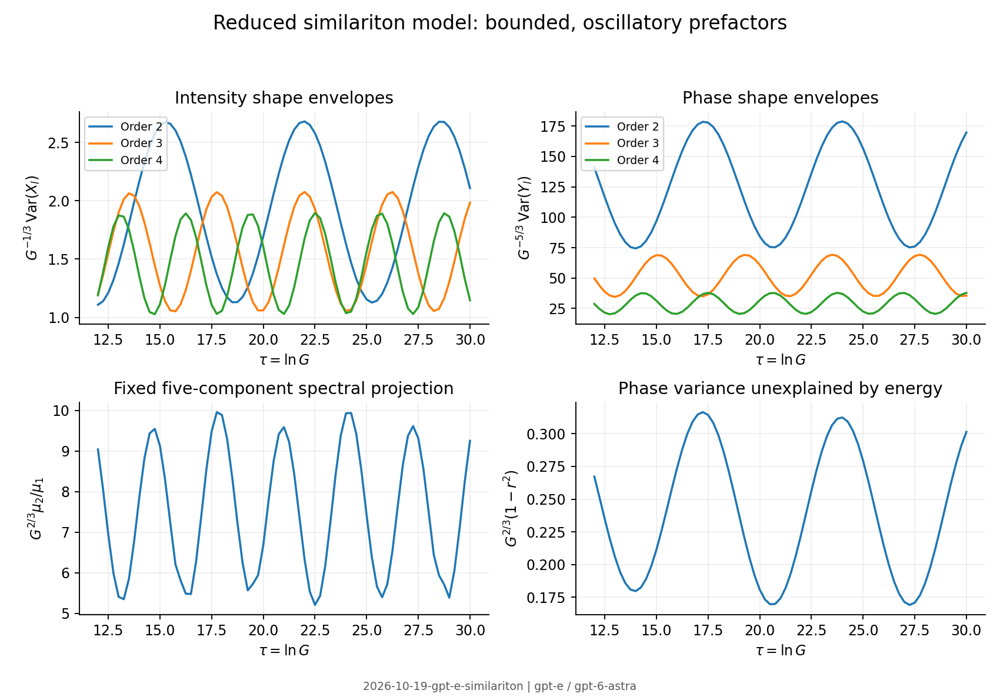

# Clean-context adversarial audit

The reduced-model variance envelopes, finite spectral projection and
phase–energy deficit survive. I do not sign off on a uniform sharp-edge
full-field error, an all-mode covariance limit, or an unrestricted assertion
that ASE precludes squeezing. These exclusions are essential to the verdict.

Every numerical result below is from run
`2026-10-19-gpt-e-similariton`, including its configuration, summary and
retained failed numerical attempts. No proposer notes, cited run folders,
reviews, logs, explorations, result folders or branch history were read
before committing the three audit reports.

## Restatement and assumptions

In the leading hydrodynamic model of a scalar normally dispersive Kerr
amplifier, fixed low-order shape coordinates of a parabolic mean pulse have
photon-normalized intensity and phase variance envelopes proportional to
$G^{1/3}$ and $G^{5/3}$. Their prefactors oscillate in log gain. In the
specified orthonormal spectral subspace through Legendre order four, the
second-to-first covariance eigenvalue ratio is of order $G^{-2/3}$. The
unexplained fraction of matched-mode phase variance after regression on
energy has the same envelope power.

Assumptions are bright-field linearization, coherent input, scalar field,
instantaneous Kerr response, positive quadratic dispersion, flat unsaturated
gain and white symmetrically ordered ASE. The reduced leading model keeps
intensity-quadrature noise. Its covariance is not a complete quantum state.
The sharp parabolic edge, regular-flux hydrodynamic boundary condition,
fixed low mode order and stationary-phase frequency map are additional
restrictions. Photon number must satisfy $\Phi_{NL}^2/N_0\ll1$; a fixed
lower photon count cannot justify arbitrarily high gain. The omitted phase
noise requires a specified edge regularization before any error estimate.

## Cheap attacks and independent construction

I discretized $\partial_\xi[(1-\xi^2)\partial_\xi]$ with a zero-flux
finite-volume operator, then integrated the full low-mode covariance with
the non-diagonal ASE source metric. The time-dependent width and chirp
were independently integrated for both asymptotic and unchirped launches.
The output spectral projection is explicitly orthonormal on the numerical
grid. It is not an eigenvalue computation in unnormalized Legendre
coefficient coordinates.

With $\tau=\ln G$, rescale the shape variables to
$(G^{1/3}n_l,\varepsilon_0G^{-1/3}p_l)$. On the self-similar asymptote the
homogeneous block has zero trace and eigenvalues
$\pm i\sqrt{l(l+1)/2-1}/3$ for $l\ge2$. Its propagator is bounded and
oscillatory. The rescaled intensity ASE source decays as $e^{-\tau/3}$;
its integrated covariance is finite. Positive initial/source covariance
therefore yields bounded nonzero variance envelopes. Restoring the photon
normalization gives the stated powers, not convergence to constant
prefactors. This is an elementary consequence of the reduced block; the
physical content is its relation to measurable readouts and its accuracy.

The full-field solver checks the gain noise normalization against
$C_{AA}=G+(2n_{sp}-1)(G-1)$. Its maximum relative discrepancy is
$3.56\times10^{-12}$. The corrected reduced phase coefficient
$C_{PP}/(G\Phi_{NL}^2)$ is 3.52150, 3.56061 and 3.55567 at
$\tau=12,18,30$, respectively, approaching $32/9$ for $n_{sp}=1$.
This supports the already corrected $G^{7/3}$ power.

## Envelope and counterexample tests

For $\Gamma=\sqrt{18}$, $n_{sp}=1$, asymptotic launch and
$12\le\tau\le30$, the normalized intensity variances for orders two,
three and four range over [1.10859, 2.68116], [1.05198, 2.07606] and
[1.02726, 1.89515]. The corresponding normalized phase variances range
over [74.3630, 178.805], [34.6001, 69.2254] and [20.2929, 37.9072].
The powers divided out are $G^{1/3}$ and $G^{5/3}$, respectively.
The normalized spectral ratio ranges over [5.20983, 9.95537], and the
normalized phase–energy deficit over [0.169078, 0.316571], after
multiplication by $G^{2/3}$.

Finite-window fits can be misleading: over $12\le\tau\le18$ the
second-order intensity and phase slopes are 0.37889 and 1.78186, while
the spectral-ratio and deficit slopes are -0.63898 and -0.58963. These
are oscillatory-envelope data, not contrary asymptotic exponents. Raw
dense curves are preserved outside git, with selected checkpoints and
envelope diagnostics in the run summary.

The reduced sweep includes both launches, $\Gamma=0.5,1,\sqrt{18},10$
and the beyond-bound value 12, as well as $n_{sp}=1,1.5,2$. Mathematical
envelope probes beyond $\tau=12$ do not extend the card's physical
high-gain validity domain. A bounded differential-evolution search over
$0.5\le\Gamma\le10$, $12\le\tau\le18$, unchirped launch, minimizes
the normalized phase deficit. Its smallest value is 0.115630 at
$\Gamma=0.753445$, $\tau=17.94975$ (`optimization.json`). No vanishing
prefactor was found. The search exhausted its evaluation budget; it is
not a global positivity proof.

## Full-field attack and artefacts

A newly written Fourier NLSE solver propagates the exact tangent and
transpose of its split substeps. Backward contractions include both input
vacuum quadratures and distributed ASE. It tests modest gains, the small
dispersion boundary and smaller values, sharp and smoothed edges, and
chirped and unchirped seeds. The mean field and noise are not taken from
the reduced equations.

At $\varepsilon_0=0.05$, $\Gamma=\sqrt{18}$, $\tau=2$, the sharp
chirped seed gives matched phase variance 381.890 against reduced
380.709 and phase–energy deficit 0.0962260 against 0.0940833. The
unchirped seed gives 607.714 against 606.721 for the phase variance.
Seed chirp changes finite-gain prefactors; it does not invalidate the
reduced envelope interpretation.

The raw second-order shape moment is less reliable. For the sharp
chirped seed its variance rises from 1.54430 on the baseline grid to
1.62752 after doubling temporal resolution, then to 1.69251 after also
doubling the window at the finer resolution. The phase shape moment
shows particularly strong window sensitivity as newly resolved tails
wrap around the periodic domain. The matched phase readout remains
stable to about $3.3\times10^{-4}$ relative. Step halving changes the
baseline intensity shape variance by only $1.8\times10^{-7}$ relative;
small step error alone would have missed the edge problem.

Two implementation failures were identified and retained. First, raw
midpoint Legendre projection leaked the much larger energy mode into
shape coordinates at high gain; numerical orthonormalization removes
that artefact. Second, the continuum product rule is not an identity
for the periodic discrete derivative. The current-moment gradient must
use $i\varepsilon_0[\xi D\psi+D(\xi\psi)]$, not a continuum
product-rule simplification. All final full-field results use the exact
discrete gradient. The remaining sharp-edge dependence is not repaired
by that correction and cannot support a uniform remainder estimate.

In the reduced model, increasing cells from 256 to 1024 changes the
spectral ratio by $2.50\times10^{-4}$ relative at $\tau=18$.
Increasing retained modes from eight to sixteen changes it by
$6.2\times10^{-12}$; tighter integration tolerance has a similar small
effect. These checks separate low-mode convergence from the singular
full-field edge issue.

The unchanged pinned Julia solver supplies a second implementation via
its discrete RK4IP adjoint and an independently integrated ASE source.
At the same modest-gain point, its three matched-mode variance
contractions agree within $2.4\times10^{-5}$ relative on the first
step count and $2.2\times10^{-6}$ after step halving. The mean-field
comparison remains about $3.4\times10^{-5}$, reflecting the finite
reference discretization. This is a selected-readout check, not an
independent optimization of all field modes.

## Relaxed assumptions and regime exclusions

Smoothing the parabolic density edge over dimensionless width 0.02 is
a physically realizable relaxation of the ideal launch. The chirped
second-order intensity variance becomes 1.461735; doubling resolution
changes it by $1.15\times10^{-6}$ relative and doubling the window by
$2.8\times10^{-9}$. The corresponding phase moment is also stable.
This demonstrates that the sharp-edge convergence failure matters, and
that a regularized experimental seed is tractable. It does not establish
a universal smoothing-independent coefficient. Both seed chirps and
the longer modest-gain case are retained in the run.

Adding regularized phase-quadrature vacuum and ASE to the reduced model
changes the spectral ratio by 6.3–10.2 percent across the tested
cutoffs/resolutions. This is a sensitivity test, not a validated
$\varepsilon_0^2\ln(1/\varepsilon_0)$ expansion. The apparent
small-$\varepsilon_0$ improvement of amplitude-only full-field moments
at a fixed grid does not prove a uniform continuum error either.

A short complete-ASE amplifier at $\tau=0.2$ gives a matched-mode
minimum 0.436717, below the vacuum value. This independently confirms
why the old unconditional no-squeezing sentence must remain superseded.

## Prior work and fine tuning

Searches used `"similariton" "quantum noise" "shape"`,
`"similariton" "shape fluctuations" noise`, `"parabolic" "amplifier"
"phase-sensitive" noise Legendre`, and `"similariton" "noise"
"Wabnitz" 2007`, followed by primary-source title searches.

- Kruglov, Peacock, Harvey and Dudley, DOI
  [10.1364/JOSAB.19.000461](https://opg.optica.org/josab/abstract.cfm?uri=josab-19-3-461):
  **abstract only**. The parabolic self-similar background and its wings
  are established prior work.
- Wabnitz, DOI
  [10.1109/LPT.2007.893823](https://iris.uniroma1.it/handle/11573/1214370):
  **abstract only**. An analytical model of similariton attraction is
  prior work. Without its full text I cannot rule out overlap in the
  deterministic attraction rate.

No exact antecedent for the specified finite-projection ASE envelope
law was located in this limited search. This is not exhaustive novelty
certification. The Legendre spectrum and the width attraction rate
alone are not new results. A chirped parabolic approximation and finite
gain can be set experimentally; the envelope does not require exact
asymptotic launch. Perfect sharp edges and unlimited flat gain are
idealizations, and material-specific departures need separate work.

## Verdict and blockers

**Pass with reduced regime.** I sign off on the leading hydrodynamic
fixed-order variance envelopes for $l=2,3,4$, the specified orthonormal
five-component spectral ratio, and the reduced phase–energy deficit,
with the card's small-dispersion, strong-chirp and brightness conditions.
The parameter samples above support the finite reduced model; extrapolation
in gain is a mathematical envelope statement, not a validated amplifier
at arbitrarily large gain. Modest-gain full-field checks support matched
phase/energy readouts and demonstrate the importance of edge regularization.

The generic P6 full-moment accuracy promise is outside this sign-off and
must be marked unverified alongside the uniform edge remainder. I could
not establish convergence of sharp-edge raw shape moments, a full-field
spectral eigenvalue law at high gain, an all-mode quantum covariance
limit, or the physical error exponent. Gain bandwidth, saturation,
Raman, higher-order dispersion and nonlinear noise beyond the bright-field
linearization were not propagated. Those are blockers to a broader
claim; they do not refute the narrowed reduced-model assertions.

## Post-commit record

All three clean-context reports were committed at `e3fd2d9` before reading
the repository priorities, automation policy, or log template. Subsequent
main-branch synchronization and claim-card edits did not change this verdict.
No proposer derivation notes or cited prior run archive was read. Follow-up
work is recorded in T-20261019-gpt-e-04.

Figure: run `2026-10-19-gpt-e-similariton`; generated from the
auditor's recorded data after sealing the reports.
