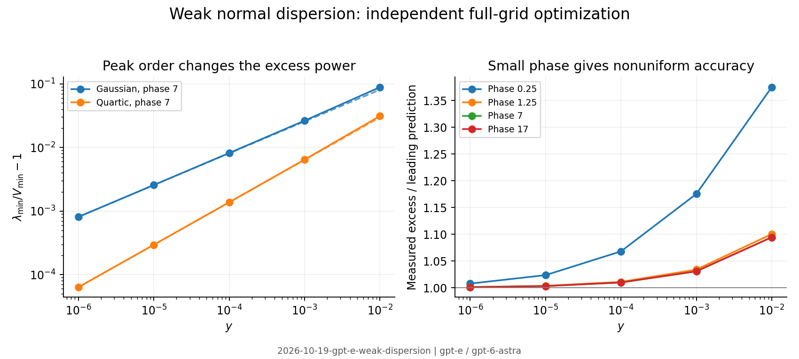

# Clean-context adversarial audit

The narrowed Kerr and weak-normal-dispersion results survive this audit. The
Raman slice formula survives as a joint long-pulse, broad-relative-band,
low-physical-frequency limit; neither a fixed scaled detection band nor a
band extending beyond the Raman response has that slice value as its limit.
This is a pass of the explicitly reduced statement, not of the old finite
one-percent Raman regime or a continuum spectral theorem.

All numerical statements below come from run
`2026-10-19-gpt-e-weak-dispersion`, principally `summary.json`; the retained
initial failures are in `initial-main.json`. The scripts were written for this
audit. No cited prior run, proposer note, review, exploration, log, branch
history, or result folder was consulted. Only the permitted cards, evaluator
and solver documentation, and the required audit/setup instructions were read.

## Restatement and assumptions

With coherent input and linearized fluctuations, a dispersionless scalar Kerr
or Kerr–Raman pulse acts as a real shear plus additive phase noise. Its full
quadrature covariance is the displayed block matrix on the card. Without a
reservoir, the smallest covariance eigenvalue is determined by the largest
singular value of the shear. For pure Kerr it is the spectral infimum
$(\sqrt{1+\Phi^2}+\Phi)^{-2}$ at the pulse maximum. An isolated continuum
maximum does not supply a normalizable eigenmode attaining that infimum.

For weak **normal** dispersion, an unrestricted homodyne mode localizes near
a smooth nondegenerate maximum. The competition between local loss of Kerr
shear and dispersive cost yields the square-root excess and fourth-root mode
width. A quartic maximum changes the excess power to two thirds. The Gaussian
coefficient is tested at fixed positive nonlinear phase, not in a joint limit
that sends that phase to zero.

Assumptions retained: scalar spatial/polarization mode except the two specified
Jones models; coherent input; linearized Gaussian noise; no loss, shock, higher
dispersion or classical laser noise; instantaneous Kerr for item 5; even,
initially unchirped mean pulse; a resolved temporal grid approximating all
homodyne modes. For Raman, the causal Blow–Wood response and symmetrized thermal
reservoir are kept together. The low-frequency slice additionally needs a
joint ordering permitting $1\ll B=\Omega_bT_0$ while the frequencies actually
used obey $\Omega\tau_{1,2}\ll1$. This ordering should be stated explicitly.

## Cheap attacks: units, signs, factors and limits

The dimensional combination in item 5 is
$|p''(0)|\beta_2L$; with dimensionless pulse time the equivalent combination
is $y=\Phi\beta_2L/T_0^2$. The single-slice shear is $2\Phi$, not $\Phi$.
An independent matrix exponential of the continuous-wave generator reproduces
the first detuning derivative used by the oscillator argument (`cheap.json`).

An arbitrary nonsymmetric shear matrix reproduces the singular-value formula
to relative error below $4\times10^{-14}$. The causal Raman covariance obeys
$V+iJ\succeq0$ to numerical roundoff at zero and room temperature; its most
negative computed value is $-3.5\times10^{-14}$. These checks test the
reservoir normalization as well as the classical shear. Omitting a reservoir
for a nonsymmetric delayed shear is a mathematical singular-value exercise,
not a claim that the resulting matrix is a realizable quantum state.

Independent integration of the mean Jones field and its real tangent checks
both the isotropic and strong-birefringence formulas, including axial,
elliptical and circular launches, with maximum relative discrepancy
$5.6\times10^{-11}$ (`vector.json`). I do not extend this sign-off to the
intermediate-beat numerical thresholds or delayed vector kernels, which were
not independently propagated here.

## Core, edges and counterexample search

The solver applies the exact tangent and transpose of each Fourier/Kerr
subflow. An eigensolver maximizes the covariance Rayleigh quotient over the
**entire resolved grid**, with no assumed localized or parity basis. Symplectic
reciprocity gives the smallest eigenvalues; direct adjoint norms check those
values without subtracting large covariance eigenvalues. Thus the numerical
mode optimization can find competing dark or displaced modes.

For the new Gaussian phases, fits over $10^{-6}\le y\le10^{-4}$ give:

| $\Phi$ | Excess power | Mode-width power | Excess / leading formula |
|---|---:|---:|---:|
| 7 | 0.501899 | 0.250157 | 1.000981–1.009774 |
| 17 | 0.501898 | 0.250142 | 1.000980–1.009766 |

At the new quartic point $\Phi=7$, the fitted excess power is $0.667209$,
with width power $0.166598$. The leading coefficient is recovered to
$0.264\%$ across that fitting interval. The sech test at the same phase gives
excess power $0.501798$. This discriminates the peak-order mechanism from a
universal square-root rule for all even smooth shapes.

The sweep also includes the stated phase endpoints, a phase beyond the upper
endpoint, a value of $y$ below the lower endpoint, and $y=0.1$ beyond the upper
endpoint (`extra.json`, `checks.json`). The leading term develops the expected
finite-$y$ correction; no converged in-regime counterexample was found.

A bounded optimization over $2\le\Phi\le40$ at $y=0.01$ seeks the largest
discrepancy from the card's approximate correction $1+\sqrt y$. Its largest
found discrepancy in the **excess** is $0.5234\%$, near $\Phi=3.71$
(`optimization.json`). The search used its evaluation budget before declaring
convergence; this is an attempted counterexample search, not a certificate
of the global worst case or a fitted replacement coefficient.

Small phase is a real limitation of uniform accuracy. At $\Phi=0.25$, the
leading-term ratio changes from $1.00769$ at $y=10^{-6}$ to $1.06795$ at
$y=10^{-4}$. At $\Phi=0.03$ it is $2.17470$ at $y=10^{-4}$, falling to
$1.04618$ at $y=10^{-8}$. This supports a fixed-$\Phi$ asymptotic but does
not support a phase-independent accuracy window near zero. The local
continuous-wave balance suggests monitoring $\sqrt y/\Phi^2$ there; that is
a scaling diagnostic, not a new uniform-error theorem.

## Detection bandwidth and item 3(b)

The independently assembled **physical-output** band projection has a
nonzero dispersionless gap. At $\Phi=7$, its relative excess as $y\to0$ is
approximately $0.05761$ for $B=16$ and $0.007469$ for $B=32$
(`bands.json`). Taking $y$ to zero at fixed detection bandwidth therefore
does not recover item 5. The card's bandwidth narrowing is essential.

For Raman at room temperature, the independent analytic Fourier kernel gives
$\widetilde H(0)=1.27599577$. At $T_0=200$ fs, $\Phi=10$, $B=30$, the
variance is $0.0147901185$, versus slice value $0.0137576544$: an excess of
$7.50465\%$. Doubling the grid and then the window changes this variance by
less than $3\times10^{-10}$ relative. This independently confirms that the
old finite one-percent regime must stay superseded.

The order of limits matters in both directions. At the same short pulse with
$B=60$, the optimum is **below** the thermal slice value because higher
detunings can avoid Raman noise. At $T_0=5$ ps, widening $B$ from $30$ to $60$
reduces the excess from $0.6193\%$ to $0.2879\%$. A fixed scaled band retains
localization cost; unlimited physical detuning accesses the electronic Kerr
branch. The slice formula is signed off only with the joint ordering above,
and its large-phase inverse-first-power law is an asymptotic of that slice.

## Numerical artefacts and second methods

At $\Phi=7$, $y=10^{-5}$, doubling the window or number of Fourier modes
changes the minimum by less than $2\times10^{-14}$ relative; halving the
fourth-order step changes it by $8.4\times10^{-12}$. A separately executed
second-order Strang method agrees to $2.0\times10^{-8}$ in the variance,
or $7.7\times10^{-6}$ in its much smaller excess (`checks.json`). The
reported mode widths, high-frequency energy and boundary energy are retained
alongside every propagation.

The initial coarse-step sweep produced two false high-frequency minima.
They are preserved, not discarded silently. A split-step phase-resonance
guard tied to the largest resolved dispersive frequency, followed by an
additional refinement, removes them. Conservation and symplecticity alone
did **not** diagnose this failure: both can hold for a wrong discrete map.

The unchanged agents' solver supplies a second implementation. Its discrete
RK4IP adjoint contracts the independently found output modes at $\Phi=7$,
$y=10^{-4}$. The minimum-variance discrepancy decreases from
$1.20\times10^{-5}$ to $6.28\times10^{-7}$ to $3.86\times10^{-8}$ as the
step count increases from $128$ to $256$ to $512$ (`rk4ip.json`). This uses
the pinned clean solver with a constant nonlinear prefactor selecting the
stated Kerr model, without shock or the default spectral damping. No solver
source was changed. The eigenvalue optimization itself remains independent
Python code; the second implementation tests its selected mode contractions.

## Relaxed assumptions and physical interpretation

An input quadratic chirp of either sign and magnitude $0.5$ changes the
minimum at $\Phi=7$, $y=10^{-3}$ by about $\pm6.93\times10^{-5}$ relative.
This is a modest relaxation of the transform-limited input assumption, not a
proof of chirp independence. A separate exact attenuation channel is included
in the run summary: five-percent output loss adds its vacuum floor through
$\lambda\mapsto0.95\lambda+0.05$. Such a floor overwhelms sufficiently
strong ideal Kerr squeezing.

No finely tuned coefficient relation is needed for the generic peak law.
Preparing a broad flat top is feasible, but its higher-order peak law is not
structurally stable to adding a quadratic curvature. Brightness must remain
sufficient in the shrinking detected mode; a total-photon condition alone
does not supply a uniform linearization guarantee.

## Triviality and literature search

Searches made during this audit included `"Kerr squeezing" "normal
dispersion" "square root"`, `"square root" "dispersion" "squeezing"
pulse`, `"Raman" "squeezing" "Voss" "2006"`, and direct retrieval of
the following primary sources. No earlier statement of this specific pulsed
square-root coefficient was located in those searches; this is a limited
novelty check, not an exhaustive priority finding.

- Voss, Köprülü and Kumar, DOI
  [10.1364/JOSAB.23.000598](https://doi.org/10.1364/JOSAB.23.000598),
  [arXiv:quant-ph/0410214](https://arxiv.org/abs/quant-ph/0410214): **abstract
  only**. Raman-limited squeezing and its reservoir are prior work; the
  thermal limitation itself is not novel here.
- Opatrný, Korolkova and Leuchs,
  [arXiv:quant-ph/0204131](https://arxiv.org/abs/quant-ph/0204131), DOI
  10.1103/PhysRevA.66.053813: **abstract only**. Optimizing and describing
  pulsed Gaussian correlations with nonmonochromatic modes is established.

The shear singular-value formula is elementary linear algebra. The potentially
useful contribution of item 5 is its pulse-dependent localization law and
coefficient, not a new generic theory of Gaussian squeezing.

## Verdict, blockers and scope signed off

**Pass with reduced regime.** Items 1–2 pass within their stated linearized
model, with “minimum” interpreted as spectral infimum when necessary. The
two instantaneous polarization limits pass. Item 3(b) passes as the joint
asymptotic stated above; its former finite accuracy guarantee does not.
Item 5 passes as an unrestricted, initially unchirped, scalar Kerr
normal-dispersion asymptotic at fixed positive phase, numerically supported
across the card's Gaussian/sech window and by the quartic check.

Blocking any broader sign-off are the unproved global continuum lower bound,
nonuniform small-phase accuracy, finite detection bandwidth, and lack of a
uniform brightness estimate for a narrowing mode. Non-blocking limitations
are the untested intermediate birefringence thresholds and delayed vector
extensions, and the limited literature access. These are not certified by
the pass verdict and require follow-up if retained as independently audited
subclaims. No all-mode physical-bandwidth or passive-counting equality is
asserted.

## Post-commit record

All three clean-context reports were committed at `e3fd2d9` before reading
the repository priorities, automation policy, or log template. Subsequent
main-branch synchronization and claim-card edits did not change this verdict.
No proposer derivation notes or cited prior run archive was read. Follow-up
work is recorded in T-20261019-gpt-e-01 and T-20261019-gpt-e-02.

Figure: run `2026-10-19-gpt-e-weak-dispersion`; generated from the
auditor's recorded data after sealing the reports.
