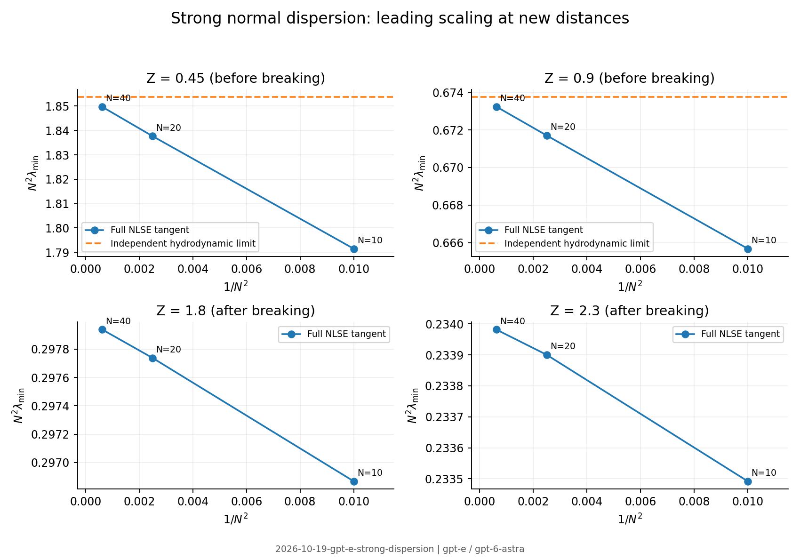

# Clean-context adversarial audit

The optical scaling survives the independent tests, with the card's
post-breaking interpretation retained as numerical evidence and a conditional
statement. One further correction is necessary: existence of regular block
limits alone does not imply a relative second-order remainder. The rate of
convergence of the amplitude-to-scaled-phase block must be specified.

All numbers in this report are from run
`2026-10-19-gpt-e-strong-dispersion`. The solver is newly written audit code
shared with `2026-10-19-gpt-e-weak-dispersion`, not code imported from any prior
cited run. No proposer notes, reviews, run folders, branch history,
explorations, logs, or result folders were read before the audit reports were
committed.

## Restatement and assumption ledger

For an unchirped Gaussian in a scalar, lossless, instantaneous-Kerr fibre with
positive second-order dispersion, hold $Z$ fixed while increasing $N$.
The conjectured best homodyne variance is asymptotic to
$\Lambda(Z)/N^2$. Before breaking, $\Lambda$ is the inverse squared norm
of the amplitude-to-scaled-phase tangent map of smooth defocusing
hydrodynamics. After breaking it must instead be defined through the full
NLSE tangent family, subject to existence and dominance assumptions.

Coherent input and bright-field linearization are essential. Raman response,
its reservoir, loss, higher-order dispersion and shock are absent. The
unrestricted homodyne minimum is distinct from a photon-counting readout.
The passive limit is a covariance compression to the hyperplane orthogonal
to the mean phase direction. The equality of that minimum to the second
eigenvalue is empirical for this Gaussian family; parity alone is insufficient.

The conditional matrix argument also needs uniform bounds in its chosen
function space or resolved finite-dimensional sector. The existence of
finite-grid matrices does not establish a white-continuum estimate. Past
breaking there is no smooth Euler tangent map to continue through the shock.

## Cheap attacks and a counterexample to insufficient hypotheses

The independent normalization gives $\Phi=NZ$ and propagation equation
$u_s=-i(Z/N)u_{tt}/2+iNZ|u|^2u$. Consequently the weak-dispersion variable
is $y=Z^2$. The small-$Z$ coefficient is the same localization mechanism as
item 5 of the companion claim, rather than a separate result.

Consider the exactly symplectic shear
$M_\varepsilon=\left(\begin{smallmatrix}1&0\\
(1+\varepsilon)/\varepsilon&1\end{smallmatrix}\right)$.
It has the advertised block structure and regular limits, with
$C_\varepsilon=1+\varepsilon\to1$. Nevertheless
$\lambda_{\min}=\varepsilon^2[1-2\varepsilon+O(\varepsilon^2)]$.
The relative deficit drops approximately by two, not four, under successive
doublings of $N$ (`theorem.json`). This refutes the generic implication if
“regular limits” means merely smooth convergence in $\varepsilon$.

A sufficient repair is to require
$C_\varepsilon=C_0+O(\varepsilon^2)$ in operator norm,
$\sigma_1(C_0)>0$, and uniformly bounded $A_\varepsilon,B_\varepsilon,
D_\varepsilon$ in the stated sector. For
$\varepsilon M_\varepsilon$, the leading squared singular-value block is
$C_0C_0^{\mathsf T}$. The order-$\varepsilon$ terms are off-diagonal
between that block and its zero complement, so they shift its nonzero
eigenvalues only at second order. Symplectic reciprocal pairing then gives
the desired relative second-order remainder. A sign or a numerical bound on
its coefficient still does not follow.

This constructed matrix is **not** an optical counterexample. It identifies
an additional hypothesis required for the stated theorem. The optical
pre-breaking data remain compatible with an even-order expansion.

## Independent numerical attack

The Fourier solver propagates the full real tangent and its exact transpose.
An unrestricted matrix-free eigensolver maximizes the covariance Rayleigh
quotient. Its reciprocal gives the minimum variance, checked independently
by the adjoint norm of the squeezed output mode. No Hermite basis, guessed
localized profile, parity restriction, or fitted coefficient enters this
optimization. A separate amplitude-to-scaled-phase operator computes $C_N$.

For the passive limit, I optimize the **actual constrained covariance**. If
$h$ is the normalized global phase direction, the inverse of its compression
is represented on $h^\perp$ by
$V^{-1}-V^{-1}hh^{\mathsf T}V^{-1}/(h^{\mathsf T}V^{-1}h)$.
The largest eigenvalue of this operator yields the passive minimum. This
tests the card's equality rather than assuming it from an odd eigenvector.

New fixed-$Z$ families were selected before computing them. The initial
grid gives:

| $Z$ | $N^2\lambda_{\min}$, $N=10$ | $N=20$ | $N=40$ |
|---|---:|---:|---:|
| 0.45 | 1.791487 | 1.837657 | 1.849675 |
| 0.90 | 0.665683 | 0.671706 | 0.673236 |
| 1.80 | 0.296868 | 0.297738 | 0.297938 |
| 2.30 | 0.233492 | 0.233900 | 0.233982 |

The smallest-$N$ point at $Z=0.45$ is deliberately below the card's
$\Phi\ge5$ threshold. The post-breaking rows are new distances, rather
than rechecks of the previously highlighted point. Higher-resolution and
step-refinement replacements are recorded in `checks.json` and take
precedence over the initial grid when assessing small differences.

An independently integrated **zero-dispersion hydrodynamic tangent**, on a
complete collocation basis, gives $\Lambda(0.45)=1.853725031660$ and
$\Lambda(0.90)=0.673749049676$. These are not fits to the NLSE data. Relative
deficits at the latter distance are $1.19720\%$, $0.303293\%$ and
$0.0760843\%$, with fitted power $-1.98796$. The corresponding coefficient
$c$ is $0.9697$, $0.9827$, $0.9861$. At the former distance the fitted power
is $-1.97084$, with the stated below-threshold point included. The separate
hydrodynamic grid and window checks are retained, including small negative
tail densities from spectral truncation; the refined coefficients agree
despite those tail errors. This is a low-spectrum convergence check, not a
positivity-preserving global Euler solver or a continuum proof.

The optimized passive variance equals the second covariance eigenvalue to
$1.1\times10^{-11}$ relative in the tested unchirped cases. The first three eigenvectors alternate even,
odd, even parity. This confirms the equality for the tested family without
turning parity into a proof about all even pulses or all distances.

A bounded optimization over $0.5\le Z\le2.4$ at $N=10$ sought a
passive variance below the second eigenvalue. The smallest relative
difference found was $-2.88\times10^{-13}$ at $Z=1.73970$, consistent
with roundoff (`optimization.json`). The search exhausted its evaluation
budget and does not prove the equality over the interval.

## Regime edges, convergence, and relaxed assumptions

The run includes the low-$Z$ boundary at the minimum nonlinear phase, the
low-$N$ boundary, the upper stated distance, a distance beyond it, and a
point below the nonlinear-phase threshold (`edges.json`). The refined
post-breaking checks double the temporal window, halve the step, and
increase the number of Fourier modes. The high-$N$ post-breaking cases
receive their own grid refinement because their mean spectra have wider
tails than the pre-breaking cases.

The checks also propagate quadratic input chirps of both signs. At $N=20$,
$Z=0.9$, chirps $+0.5$ and $-0.5$ change the minimum by $+1.128\%$ and
$-1.125\%$, respectively. These are a physical relaxation of the
transform-limited launch assumption. Output attenuation can be included
exactly as $\lambda\mapsto\eta\lambda+1-\eta$; a fixed loss floor prevents
an indefinitely decreasing measured variance. Neither effect is absorbed
into a purported universal Kerr coefficient.

At $N=20$, $Z=2.3$, doubling the grid or window changes the minimum by less
than $8\times10^{-13}$ relative, and the finer fourth-order step changes it
by $5.8\times10^{-12}$. A second-order Strang calculation agrees to
$1.9\times10^{-8}$. The more demanding $N=40$ refinements change the minima
by $2.04\times10^{-7}$ at $Z=1.8$ and $7.69\times10^{-7}$ at $Z=2.3$;
these refined values are used in the summary. Their initially visible
high-frequency spectral tails are resolved by the finer grid.

The unchanged agents' solver provides an independent discrete-RK4IP adjoint
check at $N=20$, $Z=0.9$. Relative discrepancies of the minimum-mode
contraction decrease from $3.24\times10^{-8}$ to $1.96\times10^{-9}$ under
step halving. The second-mode discrepancies are smaller. This checks the
selected output modes of the Python optimization; it does not import or
reuse the Python tangent in the Julia implementation (`rk4ip.json`).

## Triviality, prior work, and fine tuning

Searches included `"semiclassical" "defocusing" "quantum fluctuations"
squeezing`, `"semiclassical" "squeezing" "Gaussian" "normal
dispersion"`, `"Jin" "Levermore" "McLaughlin" 1999 defocusing
semiclassical`, and `"Braunstein" "Squeezing as an irreducible resource"
2005`. The searches did not locate this particular Gaussian-pulse coefficient
curve. They do not establish exhaustive novelty.

- Braunstein, DOI
  [10.1103/PhysRevA.71.055801](https://doi.org/10.1103/PhysRevA.71.055801),
  [arXiv:quant-ph/9904002](https://arxiv.org/abs/quant-ph/9904002): **abstract
  only**. Symplectic singular values and irreducible squeezing under passive
  optics are established machinery.
- Jin, Levermore and McLaughlin, *The semiclassical limit of the defocusing
  NLS hierarchy*, DOI
  [10.1002/(SICI)1097-0312(199905)52:5<613::AID-CPA2>3.0.CO;2-L](https://onlinelibrary.wiley.com/doi/abs/10.1002/%28SICI%291097-0312%28199905%2952%3A5%3C613%3A%3AAID-CPA2%3E3.0.CO%3B2-L):
  **abstract only**. The defocusing semiclassical limit is prior work; its
  existence is not itself a proof about this noise-operator norm.
- Krylov, Bergman and Lai, *Photon-number squeezing in the normal-dispersion
  regime*, DOI 10.1364/OL.24.000774, [author-institution
  copy](https://ir.lib.nycu.edu.tw/server/api/core/bitstreams/8124aab0-6dea-4500-84de-f94ee70025c8/content):
  **full text, targeted read of the experiment and linearized/adjoint
  equations**. Normal-dispersion squeezing is established experimentally;
  this claim concerns an optimized coefficient and scaling, not the first
  occurrence of the effect.

The Gaussian launch and independent controls of energy, duration and length
do not require an inaccessible parameter relation. A strictly zero Raman
reservoir and zero detection loss are model idealizations; the ideal lower
bound should not be advertised as a directly attainable silica noise level.

## Verdict and limitations

**Pass with reduced regime.** Sign-off covers the ideal Gaussian family in
the independently converged parameter samples, its observed pre-breaking
second-order approach, the constrained-readout equality at those samples,
and the new post-breaking numerical evidence for the leading scaling. The
generic theorem is signed off only after adding the operator-norm rate
assumption above. The post-breaking statement remains conditional on a
full-NLSE tangent limit and subdominance of the remaining blocks.

Not established are a continuum operator estimate, the existence or rate of
that post-breaking operator limit, a universal post-breaking correction
power, or a theorem that the passive optimum is always the second mode.
The sign and bound on the correction coefficient remain empirical. Raman,
shock, and a complete material-specific loss model were not propagated in
this audit. These limits block broader claims, not the reduced numerical
scaling signed off here.

## Post-commit record

All three clean-context reports were committed at `e3fd2d9` before reading
the repository priorities, automation policy, or log template. Subsequent
main-branch synchronization and claim-card edits did not change this verdict.
No proposer derivation notes or cited prior run archive was read. Follow-up
work is recorded in T-20261019-gpt-e-03.

Figure: run `2026-10-19-gpt-e-strong-dispersion`; generated from the
auditor's recorded data after sealing the reports.
