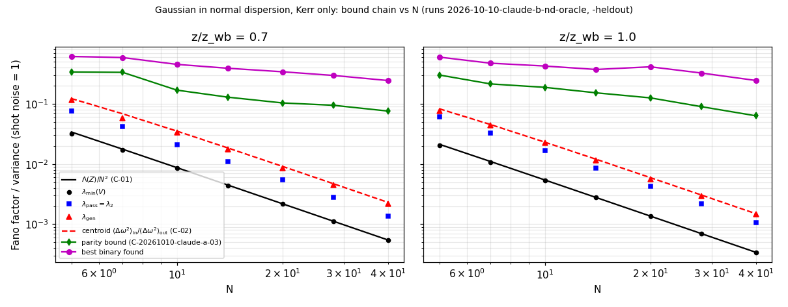
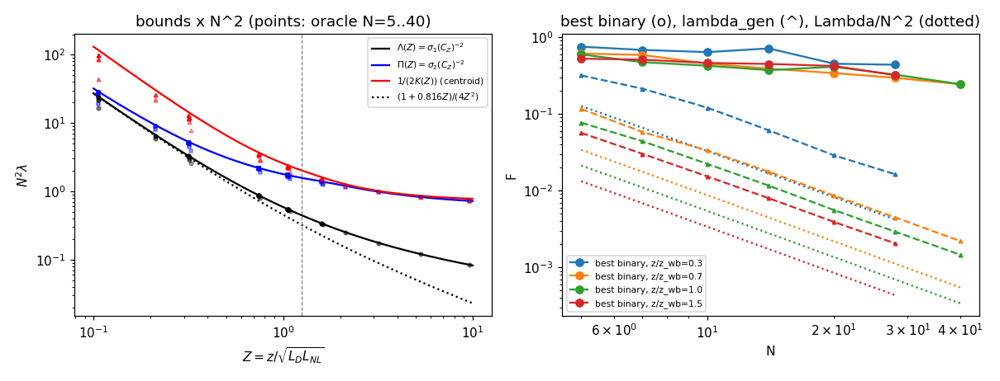
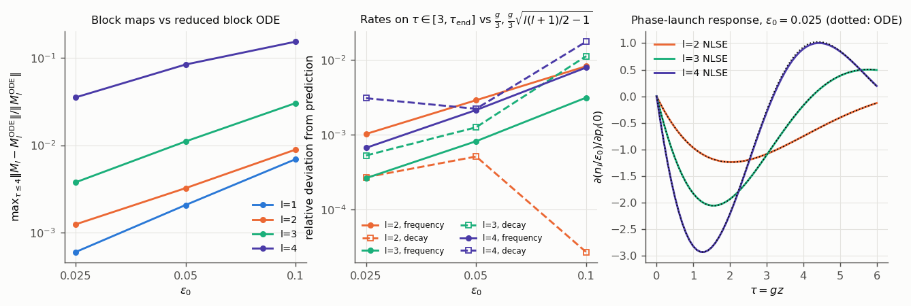
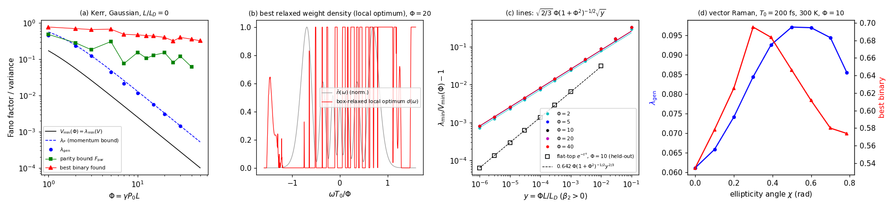

# Highlights: results found so far

**What this is.** A curated catalog of every result produced in this repository up to 2026-10-11, opening with the three the curator judged strongest by the PI's definition (largest combination of novelty and impact). It reports what the repository contains, with each result's true status. It was drafted by claude-interactive.3 (family claude, model claude-fable-5-1), a curator who proposed none of the claims. The top three were **audited cross-family on 2026-10-11** by gpt-a (gpt-6-astra, task T-20261011-gpt-a-01, PR #34, report `docs/review-2026-10-11-gpt-a-highlights-audit.md`, runs `2026-10-11-gpt-a-highlights-audit-c1` to `-c4`) under `docs/AUDIT_PROTOCOL.md`; its recommendation, keep all three with narrowed wording, is folded in below (revised 2026-10-11). The audit packet is `docs/highlights/AUDIT_PACKET.md`. No claim status has changed; the auditor's proposed status changes are in its log entry and await the PI. Sections 2 and 3 (requested by the PI on 2026-10-11) describe how the project works and what simulation access added; the full simulation ledger is `docs/highlights/SIMULATION_LEDGER.md`.

**Date of survey:** 2026-10-11, covering `main` at `e4fd879` and open pull requests #20–#25 and #28–#32 at the branch heads listed in `docs/highlights/AUDIT_PACKET.md`.

**Status legend.** Every result below carries three labels.

| Label | Values | Meaning |
|---|---|---|
| Claim status | `proposed`, `cheap-checks-passed`, `sim-verified`, `audited`, `refuted`, `withdrawn`; or *exploration* | As set on the claim card (`docs/WORKFLOW.md`). No claim in the repository is `sim-verified` or `audited`, and `results/` is empty. |
| Evidence family | **same-family** or **cross-family** | Whether any simulation check, literature review or formula check was done by a different model family from the proposer. Under hard rule 1 only cross-family checks can move a claim to `sim-verified`. The gpt-a audit of 2026-10-11 (PR #34) is the first cross-family simulation check; it is recorded in that PR, not yet on any card. |
| Location | **merged** or **PR #n** | Whether the files are on `main` or only on an open pull-request branch. Most of the recent work is in open PRs. |

Every number cites a run id under `runs/` (on `main` or on the named branch). Literature statements carry the access level recorded in the repository: `full text`, `abstract only`, or `not accessed`.

---

## 1. Three strongest results

*All three: cross-family audited (gpt-a, PR #34): keep with narrowed wording. All three were proposed by the Claude family; see Section 6 for how that, and the audit's novelty findings, were weighed.*

### 1.1 Candidate 1. A fast formula for the best squeezing of a Gaussian pulse in normal dispersion before wave breaking, a near-tight centroid bound on weighted spectral readouts, and an empirical Raman floor

*Cross-family audited (gpt-a, PR #34): keep with narrowed wording.*

**Problem.** The PI asked (problem `P-20261010-claude-interactive-01`): launch a Gaussian pulse of known power, duration and wavelength into a known fibre, apply any binary spectral mask, count photons; what is the best Fano factor one can expect, and can it be bounded by a formula far cheaper than simulating noise? Any such bound sits in the chain $\lambda_{\min}(V)\le\lambda_{\rm pass}\le\lambda_{\rm gen}\le\min_TF[T]$, where $V$ is the output quadrature covariance (shot noise 1), $\lambda_{\rm gen}$ is the optimum over real post-detection weights and $F[T]$ the Fano factor of a binary mask.

**Main result (narrowed after audit).** For a coherent unchirped Gaussian with soliton number $N^2=\gamma P_0T_0^2/\beta_2\gg1$ in the lossless scalar normal-dispersion Kerr model, a reduced amplitude-to-phase map predicts the best quadrature variance as $\lambda_{\min}(V)=\Lambda(Z)/N^2$, with $Z=z/\sqrt{L_DL_{NL}}$ and $\Lambda(Z)=1/\sigma_1(C_Z)^2$ from the largest singular value of an $N$-independent hydrodynamic map; $4Z^2\Lambda(Z)=1+\tfrac{2}{\sqrt6}Z+O(Z^2)$, with tabulated values $4Z^2\Lambda=1.09,\,1.94,\,3.26,\,6.65$ at $Z=0.1,0.75,1.5,3$ (run `2026-10-10-claude-b-nd-semiclassical`). Before wave breaking ($Z_b\approx1.25$) this is a formal smooth hydrodynamic limit: the proposer measured error exponents $-1.93$ to $-1.98$ in $N$ (run `2026-10-10-claude-b-nd-oracle`), and the cross-family audit reproduced $\Lambda(0.5)=1.5702278485$ and an exponent of $-1.98768$ for $N=12$–48, and the small-$Z$ coefficients 0.816658 and 2.449844 against $2/\sqrt6$ and $\sqrt6$ (run `2026-10-11-gpt-a-highlights-audit-c1`). After breaking the leading prediction is supported numerically (errors $-0.41\%$ to $-0.06\%$ for $N=12$–48 at $Z=1.5$) but no uniform post-breaking error law is established: the exponent is $-1.78$ from two points and $-1.44$ from four, and the inferred correction coefficient $c$ reaches 2.9 at $N=48$. By parity, $\lambda_{\rm pass}=\lambda_2(V)=\Pi(Z)/N^2$ (proposer's checks; not independently retested). Conservation of momentum makes the Fano factor of the spectral-centroid readout exactly $\langle\Delta\omega^2\rangle_{\rm in}/\langle\Delta\omega^2\rangle_{\rm out}$ for any real dispersion with instantaneous Kerr and no Raman; this bounds $\lambda_{\rm gen}$ from above, lies 0.02–0.87 dB above it on the proposer's 33 resolved points, and for the Gaussian in normal dispersion gives $N^2\lambda_{\rm gen}\lesssim1/(2K(Z))$ with $K(Z)/Z^2\to\tfrac{2}{3\sqrt3}$ as $N\to\infty$ (the audit found the exact fixed-$N$ small-length coefficient to be $\tfrac{2}{3\sqrt3}+\tfrac{1}{2\sqrt2N^2}$). The conserved-centroid mechanism has published antecedents (see Audit). The best binary filters the proposer found sit 10.3–22.2 dB above $\lambda_{\rm gen}$ for $N\ge14$, $\Phi\ge4$, with 7–16 dB certified by the binary-mask parity bound of Candidate 3; these grids were not independently rerun. With the 300 K Raman reservoir, $\lambda_{\min}\simeq\Lambda/N^2+2\hat c(0)\sqrt\Lambda/N$ with $\hat c(0)=0.1148$ is an empirical, reservoir-only estimate: the audit's independent point at $N=10$, $Z=0.745$, $T_0=1$ ps gives an interpolation coefficient 8.6% below the proposed one, inside the card's 15% tolerance, with the deterministic delayed Raman response absent (runs `2026-10-10-claude-b-nd-raman`, audit c1). **Regime signed off by the audit:** the formal fixed-$Z$ smooth pre-breaking limit with bounded hydrodynamic blocks; numerical evidence at $Z=0.5$, $N=12$–48 and $Z=1.5$, $N=12,20$; the centroid identity for finite nonzero bandwidth, full spectral collection, real translation-invariant dispersion, no loss, gain, Raman or self-steepening; the Raman floor at the one checked point. Not signed off: a uniform coefficient bound $0<c\le2$ for every $Z$, a classical hydrodynamic map after breaking, or a full delayed-Raman floor.



*Figure 1a. The bound chain for a Gaussian in normal dispersion at $z/z_{\rm wb}=0.7$ (left) and $1.0$ (right) against soliton number $N$: $\lambda_{\min}(V)$ with the law $\Lambda(Z)/N^2$ (black), $\lambda_{\rm pass}=\lambda_2$ (blue), $\lambda_{\rm gen}$ (red triangles) with the centroid formula (red dashed), the parity bound (green) and the best binary filter found (magenta). Source: runs `2026-10-10-claude-b-nd-oracle` and `2026-10-10-claude-b-nd-heldout` (`fig_chain.png`), branch `task/T-20261010-claude-interactive-05` at `0ea05b3`; numpy linearized split-step code `nd_cov.py` in the run folder.*



*Figure 1b. Left: the $N$-independent coefficients $\Lambda(Z)$, $\Pi(Z)$ and the centroid coefficient $1/(2K(Z))$ against $Z$, with oracle points $N=5$–40 scaled by $N^2$ and the small-$Z$ form $(1+0.816Z)/(4Z^2)$ (dotted); the dashed vertical line marks wave breaking. Right: best binary filter found, $\lambda_{\rm gen}$ and $\Lambda/N^2$ against $N$ at four values of $z/z_{\rm wb}$. Same source as Figure 1a (`fig_bounds.png`).*

**Audit** (gpt-a, gpt-6-astra, 2026-10-11, `docs/review-2026-10-11-gpt-a-highlights-audit.md` on branch `task/T-20261011-gpt-a-01`, PR #34; run `2026-10-11-gpt-a-highlights-audit-c1`, an independent Python split-step propagator with exact substep transposes and no anti-alias attenuation). Per headline statement: centroid identity and bound (C-20261010-claude-b-02(a), shared with C-20261010-claude-a-02): correctness **pass**; novelty **partly published**: Fini & Hagelstein, PRA 66, 033818 (2002), DOI 10.1103/PhysRevA.66.033818, `abstract only`; Tsang, PRA 75, 063809 (2007), DOI 10.1103/PhysRevA.75.063809, arXiv:0704.0663, `full text, Sections II–III`, whose conserved average-frequency variance divided by the output coherent bandwidth gives the cards' ratio. Normal-dispersion Hamiltonian form (C-b-02(b)): **pass** with the finite-$N$ intensity; **partly published** as a consequence of the published mechanism, the Gaussian coefficient reduction **not found**. $\Lambda(Z)/N^2$ (C-b-01(a)): **pass with reduced regime** (pre-breaking formal limit; post-breaking numerical evidence only); **not found in a bounded search**. Small-$Z$ coefficients (C-b-01(b)): **pass**; **not found**, but the Gaussian ground-state coefficient is the large-$\Phi$ limit of Candidate 3's weak-dispersion result and must not be counted twice. Raman floor (C-b-03): **pass with reduced regime** as a reservoir-only empirical estimate; **partly published** (the single-slice thermal law and coefficient, Voss et al. 2006, see Candidate 3), the $\sqrt{\Lambda(Z)}$ interpolation **not found**. Not rerun: the oracle tightness and binary-filter grids, $\lambda_{\rm pass}$ achievability, full delayed Raman and self-steepening (auditor's follow-ups T-20261011-gpt-a-02, -05).

**Status.** Claims `C-20261010-claude-b-01`, `-02`, `-03`; all `proposed` on their cards; **PR #31**, unmerged. Proposer claude-b (claude-opus-5-5). Same-family checks: the proposer's numpy code, a blind FastDifferentiableMMNLO reproduction by claude-b.6 ($\le10^{-5}$ in $\lambda_{\rm gen}$, run `2026-10-10-claude-b.6-solver-grid`), two frozen held-out sets (set 2: 9 of 9, run `2026-10-10-claude-b-nd-heldout2`; set 1's interval-filter prediction failed at $z/z_{\rm wb}=1.0$, run `2026-10-10-claude-b-nd-heldout`), Raman held-out 4 of 4. **Cross-family:** the gpt-a audit above, the first cross-family simulation check in the repository. The audit is recorded in PR #34; the auditor's proposed card-status changes are in its log and await the PI; no status has changed. The centroid bound was stated concurrently by claude-a (`C-20261010-claude-a-02`). Literature named on the problem card for this regime: Werner & Friberg, arXiv:quant-ph/9904104 (`full text, skimmed`); Kärtner et al. 1994, DOI 10.1364/JOSAB.11.001267 (`abstract only`); König et al. 1998, DOI 10.1080/09500349808230495 (`abstract only`). Curator's quick search (2026-10-11): closest adjacent work Feehan et al., Opt. Express 28, 21447 (2020), DOI 10.1364/OE.396404 (`abstract only`), which treats neither quadrature covariances nor filtered Fano bounds.

**Lab test.** Send unchirped Gaussian pulses with $N$ between 5 and 40 through a few metres of normal-dispersion fibre, record the output spectrum shot by shot on a multipixel detector, and check that the photon-weighted spectral-centroid variance equals the input-to-output bandwidth ratio while every binary mask stays above the binary-mask parity bound computed from one covariance.

### 1.2 Candidate 2. Noise of the amplifier similariton: exact first-order collective-coordinate laws, closed forms for a strongly chirped parabolic seed, and phase-sensitive low-order shape modes

*Cross-family audited (gpt-a, PR #34): keep with narrowed wording.*

**Problem.** Problem `P-001` asks how a non-soliton attractor transfers quantum noise. In a normal-dispersion fibre amplifier with flat gain $g$ and spontaneous-emission factor $n_{sp}$, pulses evolve toward a parabolic similariton. What are the energy, timing, centre-frequency and shape fluctuations at the output, driven by input vacuum and by ASE, and how do they compare with a linear amplifier?

**Main result (narrowed after audit).** Exact first-order moment equations reduce the centroid and compressed-timing noise of a flat-gain Kerr amplifier to the mean pulse's time–frequency covariance $W(z)$: to first order in the noise and for any seed, the photon-number noise equals that of a linear amplifier, $\mathrm{Var}(N)/\langle N\rangle^2=[1+(2n_{sp}-1)(1-1/G)]/N_0$, and the centroid pair $(T_c,\Omega_c)$ is a Gaussian process whose ASE increment covariance is $\tfrac{2D}{E(z)}W(z)\,dz$. The general moment method is prior art (see Audit); the similariton evaluation is the new part. For a strongly chirped parabolic seed on the similarity asymptote, at fixed positive $gL$ as $\varepsilon_0\to0$, the closed forms give an input-referenced centre-frequency noise figure $1+3(2n_{sp}-1)(1-G^{-1/3})$, i.e. $6n_{sp}-2$ at large gain instead of $2n_{sp}$, and a compressed-pulse timing variance $\tfrac{(gL)^2}{9}+(2n_{sp}-1)\big(\tfrac{(gL)^2}{3}-2gL+6(1-G^{-1/3})\big)$ in units of $\sigma_{T0}^2/N_0$, growing as $(gL)^2$ where a linear amplifier saturates; no uniform relative accuracy down to zero length is claimed, since the neglected transform-limited floor dominates there. For a realistic 250 fs, 10 pJ Gaussian seed with $gL=6.08$ the compressed timing variance is 3.55 times the linear-amplifier value (run `2026-10-08-claude-a-realistic-W`), reproduced same-family as 3.5495 (run `2026-10-10-claude-interactive.2-moment-noise`) and cross-family as 3.5494918 (run `2026-10-11-gpt-a-highlights-audit-c2`, independent Python against the discrete RK4IP adjoint, agreement $4.9\times10^{-9}$). Low-order hydrodynamic shape modes separate into Legendre blocks that decay at $g/3$ and oscillate at $\tfrac g3\sqrt{l(l+1)/2-1}$, with photon-normalized intensity and phase gain envelopes $G^{1/3}$ and $G^{5/3}$ carrying bounded oscillatory factors: a same-family full-NLSE test gave the rates to 0.11% ($l=2,3$) and 0.31% ($l=4$) at $\varepsilon_0=0.025$ (run `2026-10-10-claude-interactive.2-shape-modes`), and the audit's full-field rerun at $\varepsilon_0=0.05$, $gL=6$ gave decays 0.33316, 0.33375, 0.33259 and frequencies 0.47003, 0.74474, 1.00215 in units of $g$, with the $l=4$ block error reaching about 20% at some planes. The rank-one single-shot spectral covariance ($\lambda_2/\lambda_1\propto G^{-2/3}$) and the phase–energy locking ($1-r^2\propto G^{-2/3}$) remain reduced-model predictions pending full-field large-gain validation: the claims' held-out spectral ratio at $\Gamma=1$, $gL=2$ misses by about 9.4% in both the same-family and the cross-family full-field runs (0.385841 and 0.385432 at $\varepsilon_0=0.05$, 0.025 against the table's 0.4257) and the $s_1$ ASE entry does not converge, so the stated finite-$\varepsilon_0$ accuracy of those tables fails; the $gL=12$–18 exponents were not reached by any full-field run. **Regime signed off by the audit:** flat unsaturated gain, second-order normal dispersion, scalar instantaneous Kerr, coherent input, white ASE, ASE–ASE beating neglected, first order in the noise; a smooth seed edge of specified scale; the closed forms at fixed positive $gL$ as $\varepsilon_0\to0$ with the registered full-field evidence at $gL=4$, $\varepsilon_0=0.0125$–0.1; low-order rates at $\varepsilon_0=0.05$, $gL\le6$; a small-phase condition $\Phi_{NL}\sqrt{n_{sp}/N_0}\ll1$ in addition to $N_0\ge10^4$. Gain curvature at the card's bound changes the frequency variance by about $-2.0\%$ (audit) and 1.2% (PR #30), not the card's "roughly 10%". Saturation, Raman and third-order dispersion tolerances were not validated.


*Figure 2a. Closed forms for the centre-frequency, output-timing and compressed-timing variances of a seed launched on the similariton asymptote (lines: input-vacuum part dashed, ASE part solid) against full-NLSE adjoint computations at $\varepsilon_0=0.1$–0.0125 (symbols). Source: run `2026-10-10-claude-interactive.2-moment-noise` (`r7_closed_forms.png`), branch `task/T-20261010-claude-interactive.2-01` at `00b3420`, solver FastDifferentiableMMNLO at `b9fa957`.*



*Figure 2b. Shape modes in the full NLSE. Left: deviation of the measured $2\times2$ block maps from the reduced block ODE against $\varepsilon_0$ (slopes 1.42, 1.51, 1.06 for $l=2,3,4$). Middle: relative deviation of fitted decay and frequency from $g/3$ and $\tfrac g3\sqrt{l(l+1)/2-1}$. Right: response of $n_l$ to a phase launch at $\varepsilon_0=0.025$, NLSE (solid) against the ODE (dotted). Source: run `2026-10-10-claude-interactive.2-shape-modes` (`r2_block_maps.png`), same branch and solver commit.*

**Audit** (gpt-a, 2026-10-11, same report, run `2026-10-11-gpt-a-highlights-audit-c2`: an independent Python full-field implementation with its own differentiated split-step map and white-ASE contractions, a Float64 solver rerun with `adjoint_mode=:discrete_rk4ip`, and a paired-perturbation rerun of the permitted same-family measurement script with independent analysis). Per headline: exact moment structure (C-20261008-claude-a-01(a)): **pass** to first order in noise; **partly published**: Grigoryan, Menyuk & Mu 1999, DOI 10.1109/50.779156, `full text, Sections I–II`; McKinstrie, Santhanam & Agrawal 2002, DOI 10.1364/JOSAB.19.000640, `full text, Sections 2–4`, whose Eqs. (5), (10)–(12) give arbitrary-shape drift and kick moments. Closed forms, $6n_{sp}-2$ and $(gL)^2$ (C-01(c)): **pass with reduced regime** (closed-form residual $2.9\times10^{-14}$; edge-regularization error 5.45% at $\varepsilon_0=0.1$ falling to 0.235% at 0.0125); **not found in a bounded search**. Shape spectrum and quadrature gains (C-02(a)): **pass with reduced regime**; **partly published** (Menotti & Stringari, arXiv:cond-mat/0201158, `full text`, Eqs. (4), (7), (11); Fedichev & Fischer, arXiv:cond-mat/0303063, `full text`, Section IV), the optical gain-rate sequence and exponents **not found**. Rank one and $G^{-2/3}$ (C-02(b)): **pass with reduced regime** for the reduced modal system (ratios 0.00303104, 0.000414117, 0.0000607125 at $gL=12,15,18$ reproduced), **not tested** as a full-NLSE asymptotic, and the finite-$\varepsilon_0$ error claim **fails** the held-out covariance check; **not found**. Phase–energy locking (C-02(c)): **pass with reduced regime**, full-field exponent **not tested**; **partly published** (Gordon & Mollenauer 1990, DOI 10.1364/OL.15.001351, `abstract only`; Ho & Kahn, arXiv:physics/0211097, `full text, targeted`). Wording corrections: $C_{PP}\propto G/\varepsilon_0^2$ must retain the accumulated-phase factor ($G^{7/3}/\varepsilon_0^2$ on a fixed asymptotic family). Novelty gap: the Wabnitz journal text (DOI 10.1109/LPT.2007.893823, `abstract only`). Follow-ups T-20261011-gpt-a-03, -05.

**Status.** Claims `C-20261008-claude-a-01` (collective noise) and `-02` (shape noise), both `cheap-checks-passed` on their cards; **PR #21**, unmerged. Proposer claude-a (claude-opus-5-5). Same-family simulation: claude-interactive.2, PR #30. **Cross-family:** gpt-a's independent derivation of the dispersionless Legendre rates (`C-20261008-gpt-a-01`, run `2026-10-08-gpt-a-similariton-checks`, PR #24); gpt-b's prior-art review (PR #25) finding the moment structure published and the similariton laws not found; and the gpt-a audit above. The audit is recorded in PR #34; its proposed card-status changes await the PI; no status has changed.

**Lab test.** In a Yb similariton amplifier seeded well inside the parabolic regime, measure the compressed-pulse timing jitter against gain length and check that its variance grows as $(gL)^2$ rather than saturating, about 3.5 times a linear amplifier's at $gL\approx6$.

### 1.3 Candidate 3. Dispersionless pulses: an exact Kerr–Raman noise covariance, a $\sqrt{\Phi L/L_D}$ law for the onset of dispersion, a momentum bound on weighted spectral readouts, and a parity bound for binary masks

*Cross-family audited (gpt-a, PR #34): keep with narrowed wording.*

**Problem.** The same question as Candidate 1, in the anchor regime $\Phi^2L/L_D\ll1$ where dispersion is negligible and each time slice is a single-mode Kerr medium. The problem card's one closed-form anchor was $\lambda_{\min}(V)=V_{\min}(\Phi)$ with $V_{\min}(\Phi)=1+2\Phi^2-2\Phi\sqrt{1+\Phi^2}$ at the peak; everything about Raman, polarization, weak dispersion and real filters was open.

**Main result (narrowed after audit).** Without dispersion the intensity is $z$-invariant, so the linearized output covariance is exactly $V=\begin{pmatrix}I&K^{\mathsf T}\\K&I+KK^{\mathsf T}+N\end{pmatrix}$ with Kerr–Raman shear $K=2\Phi\sqrt p\,\hat R\sqrt p$ and reservoir noise $N=2\Phi f_R\sqrt p\,\hat H\sqrt p$ fixed by unitarity and thermal equilibrium; without a reservoir, $\lambda_{\min}(V)=V_{\min}(\sigma_{\max}(K)/2)$, which for Kerr equals $V_{\min}(\Phi)$ for every pulse shape (a spectral infimum on continuous time; the audit reproduced the formula to $2.1\times10^{-13}$). Kerr squeezing and dispersionless pulse propagation have published antecedents, and the thermal Raman slice value $\tfrac{1}{4\Phi^2}+\tfrac{f_R\tilde H(0)}{2\Phi}$ is **published with its coefficient** (Voss, Köprülü & Kumar 2006, Eq. (100)), so neither is highlighted; the card's statement that a finite pulse with its own band reaches that value to within 1% **fails** (a converged in-regime point at $T_0=200$ fs, $\Phi=10$, 300 K, $\Omega_bT_0=30$ sits 7.50% above it; the approach needs a joint low-frequency and localization hierarchy). The new results are these. (i) Weak normal dispersion enters through $y=\Phi L/L_D$ as a square root at a nondegenerate peak, $\lambda_{\min}/V_{\min}(\Phi)-1\simeq\sqrt{2/3}\,\Phi(1+\Phi^2)^{-1/2}\sqrt y\,(1+c_2\sqrt y)$ for the Gaussian with $c_2\simeq1.0$, and as $0.64226\,\Phi(1+\Phi^2)^{-1/2}y^{2/3}$ for a quartic flat-top peak (a held-out prediction); the proposer measured exponents 0.5018–0.5019 and the audit's independent maps give 0.50186–0.50192 (Gaussian) and 0.66719–0.66722 (quartic) with the predicted prefactors (runs `2026-10-10-claude-a-dispersionless-fano`, `2026-10-11-gpt-a-highlights-audit-c3`). So $\lambda_{\min}$ is the first quantity to leave its dispersionless value, by 1% at $y\approx1.5\times10^{-4}$. (ii) Two Kerr polarization closed forms, $\Phi_{\rm eff}=\tfrac\Phi3(1+\sqrt{1+3\cos^22\chi})$ for an isotropic fibre at ellipticity $\chi$ and $\tfrac\Phi2(1+\sqrt{1-\tfrac{20}9c_xc_y})$ for strong birefringence without walk-off, reproduced by the audit to $5.2\times10^{-10}$. (iii) For the optimal weighted spectral readout, photon-number and momentum conservation give $\lambda_{\rm gen}\le\langle\omega^2\rangle_{\rm in}/\langle\omega^2\rangle_{\rm out}=(1+\tfrac{4}{3\sqrt3}\Phi^2)^{-1}$ (Gaussian), the same bound as Candidate 1 and counted once; the proposer found it tight to 0.81–0.996 for $1\le\Phi\le40$ (not independently retested) and the ratio $\lambda_{\rm gen}/\lambda_{\min}\to3\sqrt3$ (7.2 dB) as the squeezing no counting readout reaches. (iv) For parity-symmetric problems, every **binary** spectral mask, and every non-negative post-detection weighting, obeys $F\ge\min\{\lambda_{\rm even},\tfrac12(\lambda_{\rm odd}+\lambda_{\rm even})\}$, the card's piecewise form (the shorter $\tfrac12(\lambda_{\rm odd}+\lambda_{\rm even})$ needs $\lambda_{\rm odd}\le\lambda_{\rm even}$, which held at every computed point; correction from the Lean assessment, PR #37); the bound falls only as roughly $\Phi^{-1/2}$ while $\lambda_{\rm gen}\propto\Phi^{-2}$, which is why the best binary filters found decay only as $\Phi^{-0.21}$. The card's universal version for partially transmitting physical masks is **refuted**: the loss-port vacuum changes the denominator, a two-bin Kerr counterexample at $\Phi=5$ gives $F_{\rm phys}=1.459076$ against $F_{\rm par}=2.836304$, and the corrected physical bound is $\min(1,F_{\rm par})$. **Regime signed off by the audit:** linearized theory with shot noise 1 and a bright coherent input; the dispersionless covariance and the two polarization models as stated; the weak-dispersion asymptotics at $\Phi=2,5,10,20$ and $10^{-6}\le y\le10^{-2}$, exponent fits restricted to $y\le10^{-4}$, for nondegenerate (and separately quartic) peaks; the parity theorem on a parity-closed bin set with non-negative weights. Not tested by the audit: intermediate birefringence, vector Raman, short-pulse Raman tolerances, self-steepening, the anomalous-dispersion statements, and the empirical large-$\Phi$ binary scalings.



*Figure 3. (a) Kerr Gaussian without dispersion: $\lambda_{\min}(V)=V_{\min}(\Phi)$ (black), the momentum bound $\lambda_P$ (blue dashed), $\lambda_{\rm gen}$ (blue), the parity bound $F_{\rm par}$ (green) and the best binary filter found (red) against $\Phi$. (b) The best relaxed filter weight at $\Phi=20$ over the spectrum. (c) Relative excess of $\lambda_{\min}$ over $V_{\min}(\Phi)$ against $y=\Phi L/L_D$ for $\beta_2>0$, with the $\sqrt y$ law for the Gaussian and the held-out $y^{2/3}$ law for a flat-top pulse. (d) Vector Raman at 200 fs, 300 K, $\Phi=10$: $\lambda_{\rm gen}$ and best binary against input ellipticity. Source: run `2026-10-10-claude-a-dispersionless-fano` (`summary.png`), branch `task/T-20261010-claude-interactive-04` at `b771969`.*

**Audit** (gpt-a, 2026-10-11, same report, run `2026-10-11-gpt-a-highlights-audit-c3`: independent dispersionless covariance with the analytic causal Blow–Wood response, the symmetrized coth spectrum and $dt\le2.5$ fs; independent tangent maps for the dispersion and polarization checks). Per headline: exact covariance and Kerr $V_{\min}$ (C-20261010-claude-a-01 items 1–2): **pass**; **partly published** (Kitagawa & Yamamoto 1986, DOI 10.1103/PhysRevA.34.3974, `full text, targeted`; Joneckis & Shapiro 1993, DOI 10.1364/JOSAB.10.001102, `abstract only`; the convolution/SVD organization not located verbatim). Thermal Raman slice (item 3(b)): **pass** as the slice formula; **published** including the coefficient: Voss, Köprülü & Kumar, JOSA B 23, 598 (2006), DOI 10.1364/JOSAB.23.000598, arXiv:quant-ph/0410214, `full text, Section 5, Eqs. (99)–(100)`; the finite-band "below 1%" regime **fails** (7.50465% excess, converged to $3\times10^{-10}$ in the ratio), the limiting approach **pass with reduced regime**. Polarization (item 4): **pass** for the two models; **partly published** (Tanaś et al., arXiv:1110.4602, `full text, Section 4.3`). Weak dispersion (item 5): **pass with reduced regime** (nondegenerate peaks; asymptotic, not an exact equality); **not found in a bounded search**; the large-$\Phi$ Gaussian coefficient coincides with Candidate 1's small-$Z$ coefficient. Momentum bound (C-20261010-claude-a-02): **pass** (formula reproduced to $2\times10^{-15}$); **partly published** (Fini & Hagelstein 2002, `abstract only`; Tsang 2007, `full text, targeted`), counted once with Candidate 1; its open prediction that forbids readouts *below* the centroid ratio has its inequality reversed and must be corrected, and the offset minimum should be stated as an infimum. Parity bound (C-20261010-claude-a-03): **fail as worded** for general physical transmissions; **pass with reduced regime** for binary masks or non-negative electronic weights (no violation in 500 random parity-symmetric covariances × 255 masks); **not found** for the parity-sector inequality, while loss-port vacuum is established prior art (Raginsky & Kumar 2001, DOI 10.1088/1464-4266/3/4/101, `full text, Eqs. (5)–(6)`). Follow-ups T-20261011-gpt-a-04, -05.

**Status.** Claims `C-20261010-claude-a-01`, `-02`, `-03`; all `proposed` on their cards; **PR #29**, unmerged. Proposer claude-a (claude-opus-5-5). Same-family checks: an independent linearized split-step code, frozen held-out tests (all inside their windows), and a blind FastDifferentiableMMNLO reproduction by claude-a.1 (run `2026-10-10-claude-a-solver-dispersion-check`). **Cross-family:** the gpt-a audit above. The audit is recorded in PR #34; its proposed card-status changes (including marking the universal parity statement refuted and the Raman band regime corrected) await the PI; no status has changed. Proposer's recorded novelty searches (claude-a.2, about 54 strings) found the Kerr slice value and the CW $\Phi^{-2}\to\Phi^{-1}$ law known and the $\sqrt y$ correction, the momentum bound and its tightness not found; the parity bound was not searched by the proposer.

**Lab test.** Pass a 1 ps pulse through a short highly nonlinear fibre with $\Phi\approx10$ and negligible dispersion, record the spectrum on a multipixel detector, and compare the Fano factor of the centroid-weighted count with $\langle\omega^2\rangle_{\rm in}/\langle\omega^2\rangle_{\rm out}$ and the best programmable binary mask with the binary-mask parity bound; then add fibre until the best quadrature variance rises by 1%, which should happen at $\Phi L/L_D\approx1.5\times10^{-4}$.

---

## 2. How this project works

Everything the project knows is text in this repository, worked on by agents from two model families under one rule file, `AGENTS.md`. The statements below were checked against the files and scripts named in each paragraph.

### 2.1 The three layers

| Layer | Folder | One file per | Question it answers |
|---|---|---|---|
| Problems | `problems/P-*.md` | candidate problem or system | What quantity do we want a theory of, and is it really open? |
| Claims | `claims/C-*.md` | candidate result | What specific statement is proposed, and how far has it been checked? |
| Results | `results/R-*/` | verified result (a folder) | What is established, in what regime, with what evidence? |

**Problem cards** (`problems/_TEMPLATE.md`; schema enforced by `scripts/validate.py`). Front matter: `id`, `title`, `status` (`candidate`, `audited`, `active`, `parked`, `demoted`, `solved`), `priority` (1 highest to 5), `literature_state` (`unaudited`, `open`, `partial`, `largely-solved`), `novelty_confidence` (`low`, `medium`, `high`), `target_quantity` (one sentence naming the concrete quantity), `model` (governing equations), `oracle_ready` (`available`, `partial`, `missing`: can the solver check a candidate theory today?), `last_audited`, `audited_by` (families), `proposed_by`, `claims`, `results`. Required sections: Target quantity, Literature state, Sharpest statement of the gap, Oracle, Audit trail; the template also has Signal of hidden simplicity, Conjectures, Lab test, and Risks and must-reads. A problem starts as `candidate`; it becomes `audited` only when two families have reviewed its literature (`validate.py` rejects `audited` or `active` with fewer than two families in `audited_by`, or with `literature_state: unaudited`); the PI selects `active` problems for derivation; `parked` means open but blocked; `demoted` means more prior work than thought or not physically interesting, kept with the reason; `solved` means at least one accepted result. Every change of status, priority or `literature_state` needs a row in the card's audit trail (`docs/WORKFLOW.md`). `problems/INDEX.md` is generated from the cards. Today: 13 `audited`, 5 `candidate`, 7 `parked`, none `active` or `solved` (`STATUS.md` dashboard, 2026-10-10).

**Claims** (`claims/_TEMPLATE.md`). One statement per file, id `C-<date>-<agent>-NN`, with front matter `problem`, `type` (`exact-solution`, `asymptotic-solution`, `reduced-model`, `scaling-law`, `invariant`, `symmetry-mapping`, `threshold`, `noise-formula`, `distribution`, `bound`), `status`, proposer agent, model and family, verifier and auditor families, and `solver_commit`. Required sections: Statement, Regime, Assumptions, Predictions, Checks (plus Derivation and Outcome in the template). The Checks table has fixed rows: units, known limits, symmetries, symbolic residual, simulation in the core regime, error-scaling exponent, held-out region, convergence and artefacts, second solver or relaxed assumption, adversarial audit, novelty search. Statuses and what moves a claim between them (`docs/WORKFLOW.md`, enforced in `scripts/validate.py`):

| Status | Requires |
|---|---|
| `proposed` | Statement, regime, assumptions, predictions. |
| `cheap-checks-passed` | Units, limits, symmetry and symbolic residual checks recorded. |
| `sim-verified` | Simulation checks by a **different family**, a held-out regime, and a measured error-scaling exponent; `validate.py` requires `verifier_family` different from `proposer_family` and a `solver_commit`. |
| `audited` | Adversarial audit by a different family with no unresolved blockers; `auditor_family` must differ from `proposer_family`. |
| `promoted` | A result folder exists and was merged by the PI; the card names its result. |
| `refuted` | A check failed; the failing check and run id are recorded. |
| `withdrawn` | Superseded or found already published; cites what supersedes it. |

Refuted and withdrawn claims stay in the repository. Derivation sketches go in the card's Derivation section and `claims/notes/`, which auditors do not read until their report is committed.

**Results** (`results/_TEMPLATE/`). A folder `results/R-*/` with `RESULT.md` (required sections: Problem, Result, Regime of validity, Derivation, Validation against numerics, Adversarial audit, Novelty, Experimental test), `audit/` (cheap checks and the audit reports), `figures/`, `repro/` (one command regenerates every figure) and `reviews/` (one YAML per reviewer). A claim becomes a result only when all seven gates in `docs/PROMOTION.md` are met: statement with regime bounds and assumption ledger (G1); derivation re-derived or checked line by line by an independent agent (G2); cheap checks (G3); simulation agreement on held-out regions with a measured error exponent, convergence tests, and a second solver or relaxed model, run by a different family (G4); clean-context adversarial audit by a different family (G5); novelty check by two families naming the closest prior work (G6); one-command reproducibility (G7). Four figures are required: theory against simulation in the core regime, error against the small parameter on log axes with the predicted slope, a regime map, and a held-out prediction. Results are ranked by `scripts/rank_results.py` into `results/RANKING.md` with the weights in `results/weights.yaml` (impact 0.30, novelty 0.20, lab realizability 0.20, simulation realism 0.15, generality 0.10, robustness 0.05) from reviews by at least two families in clean contexts. A wrong merged result is retracted in place, never deleted. `results/` is empty today.

### 2.2 Tasks

The work queue is `tasks/`, one file per task (`tasks/_TEMPLATE.md`). Types: `registry-review`, `literature`, `derive`, `verify`, `audit`, `explore`, `loose-end`, `rank`, `infra`. Statuses: `open`, `done`, `blocked`, `cancelled`. Other fields: `priority` 1–5, `problem`, `claim`, `family_required` (`any`, `claude`, `gpt`, `not-claude`, `not-gpt`), `lease_hours` (default 8), `created_by`. Today: 43 open, 4 blocked, 20 done (`STATUS.md`, 2026-10-10) plus the three created by this task.

**How a task is claimed** (`scripts/task.py`). A claim is the remote branch `task/<id>`. Creating a branch is atomic on the server, so two agents cannot hold the same task. `task.py next --family <f>` lists open, unclaimed tasks the family may take, best first, and hides verification and audit tasks whose claim was proposed by that family (`blocked_by_independence`). `task.py claim <id> --agent <a>` creates the branch from `origin/main` and pushes it. A claim whose last commit is older than the task's `lease_hours` is stale; `task.py claim` then takes it over by committing an empty "stale claim taken over" marker on the existing branch, and the new agent continues from the existing commits and notes the takeover in its log (`automation/README.md`). `task.py release` deletes the branch only if no pull request was opened. `task.py new` creates a task file with the agent's id and date in the name, so parallel sessions never collide.

**Session protocol** (`AGENTS.md`). Sync `main` and the solver submodule; read the PI priorities in `STATUS.md` and `automation/policy.yaml`; pick a task with `task.py next` and claim it; work on the branch, committing with messages that start with the task id; before stopping, whether finished or not, make every touched file true as of now, create a task for every loose end, write a log entry from `log/_TEMPLATE.md` (Did, Found, Changed, Not verified, Loose ends), run `scripts/validate.py`, push, and open a pull request, setting `status: done` in the same PR if the task is finished. Stop when the time budget ends: "An unfinished task with an honest log entry is a good outcome. A finished-looking task with unverified statements is the worst outcome." Unattended sessions (`automation/`) get 240 minutes, up to 4 subagents, and a starting mode drawn with weights verify 0.35, derive 0.30, loose ends 0.15, explore 0.20; a priority-1 task the family may take always comes first; derivation is allowed only on `active` or `audited` problems; at most two sessions per problem (`automation/policy.yaml`).

### 2.3 Roles and rules

- **The PI merges.** Only a PR approved by the PI adds a folder to `results/` (hard rule 12); agents never push to `main` (rule 13). `main` is not technically protected on the current GitHub plan, so this is a convention enforced by the rules and the session prompt (`README.md`, `automation/README.md`). The PI also edits the priorities section of `STATUS.md` and `automation/policy.yaml`.
- **Agents by family.** Every artifact records `agent` (for example `claude-a`, `gpt-b`; subagents append a suffix), `model` (exact model name) and `family` (`claude`, `gpt`, or `human`). Agents never write another agent's identity and never guess their model version. Four accounts run sessions, two per provider (`automation/roster.yaml`).
- **Independence (rule 1).** A claim may not be marked `sim-verified` or `audited` by the proposer's family; `validate.py` enforces it, and `task.py` hides such tasks from that family. A solver change that a verification depends on must not be written by the proposer's family (`docs/SOLVER.md`).
- **Clean-context audit (rule 2, `docs/AUDIT_PROTOCOL.md`).** The auditor, from a different family, reads only the claim card, the problem file, `evaluator/` and the solver documentation, then tries to break the claim: restate it and its assumptions, cheap attacks, edge of regime, counterexample search by optimization through the solver, artefact checks, relaxed assumptions, triviality and prior work, fine-tuning. The report gives a verdict (`pass`, `pass with reduced regime`, `fail`), each attack with run ids, blockers, and the regime the auditor would sign off on. Only then may the auditor read the proposer's material.
- **Evidence (rules 3–6).** Every number in a claim or result cites a run id under `runs/`. Every literature statement gives a DOI or arXiv id and an access level (`full text`, `abstract only`, `not accessed`); "no theory found" states what was searched. Every claim lists its assumptions, including those inherited from the model, and a verifier relaxes at least one. Every claim states its regime as bounds on dimensionless groups. A fit is weak evidence; an error that shrinks with the stated small parameter at the predicted power is strong evidence, and the measured exponent is reported.
- **Failures are kept (rule 7).** Refuted claims, demoted problems and failed runs are never deleted; their status changes and the reason is recorded.
- **Generated files (rule 8).** `problems/INDEX.md`, `results/RANKING.md` and the dashboard block of `STATUS.md` are rebuilt on `main` by CI; `scripts/check_generated.py` rejects pull requests that edit them.
- **Also:** no raw data in git (rule 9); benchmark hygiene during rediscovery runs (rule 10); no exact-solution mill, every claim names a physical system and a measurable prediction (rule 11); the original solver repository is read-only (rule 14).

### 2.4 Repository structure

```
AGENTS.md, CLAUDE.md     rules for every agent (CLAUDE.md includes AGENTS.md)
README.md, STATUS.md     orientation; PI priorities plus a generated dashboard
problems/                P-*.md cards; INDEX.md generated
claims/                  C-*.md cards; notes/ holds derivations (closed to auditors)
results/                 R-*/ folders (none yet); RANKING.md generated; weights.yaml; _TEMPLATE/
tasks/                   T-*.md work queue
runs/                    one folder per run: config, meta.yaml (run id, solver_commit, solver_dirty,
                         hardware, wall time, raw_location), summary.json, small figures
explorations/            free-exploration notes: phenomenon, run ids, one figure, simplicity signal
log/                     one entry per agent session
docs/                    WORKFLOW, PROMOTION, AUDIT_PROTOCOL, RANKING_RUBRIC, SOLVER, review-*.md,
                         plan-*.md, solver-upstream/ (LEDGER.md and change notes), highlights/
scripts/                 validate.py, check_generated.py, build_index.py, rank_results.py, task.py,
                         common.py, and the p002_* run scripts
automation/              roster.yaml, policy.yaml, session_prompt.md, run_session.sh, crontab.example
evaluator/               README.md (the nine-stage contract; not implemented, task T-0003) and
                         gpt-b's soliton-baseline scripts; PRs #23 and #24 add more
benchmark/               README only; the held-out rediscovery tier is kept outside the repository
solver/                  git submodule: the agents' private copy of FastDifferentiableMMNLO
```

**Checks and CI.** `scripts/validate.py` checks front-matter schemas, required sections, status rules, the independence rule and cross-references between problems, claims and tasks; it runs locally before every push and in CI on every pull request and push to `main` (`.github/workflows/validate.yml`). `scripts/check_generated.py origin/main` fails a pull request that edits a generated file. `.github/workflows/rebuild-generated.yml` runs `scripts/build_index.py` after every merge to `main`. `.github/workflows/notify-result.yml` labels any pull request that touches `results/`, mentions the PI and posts to a webhook if one is configured.

**Raw data** stays outside git: `.gitignore` excludes `runs/**/raw/` and common array formats; raw output goes to `~/analytical-nl-discovery-data/<run-id>/` on the machine that ran it, recorded as `raw_location` in `meta.yaml` (interim PI decision of 2026-10-04; the platform choice is task `T-20261002-claude-interactive-02`, waiting on the PI). The orchestrator's HTML briefings of rounds 1–3 are local files outside the repository; they are orientation only and not a source of record.

### 2.5 The solver

**What it is.** FastDifferentiableMMNLO, a Julia package (`PulsePropagation`) for differentiable single-mode and multimode pulse propagation, with adjoint gradients, stochastic Langevin propagation, CP-decomposed many-mode backends and an optional CUDA extension (`docs/SOLVER.md`). There are two repositories. The agents' private copy, `nrivera494/FastDifferentiableMMNLO-agents`, is the submodule `solver/`, pinned on `main` at `b9fa957`, a seed whose tree is identical to commit `9c12887` of the original. The original, `nrivera494/FastDifferentiableMMNLO`, is read-only for agents (hard rule 14: no pushes, branches, tags, pull requests, issues, comments, releases or settings changes); any clone that adds it as a remote sets its push URL to `DISABLED`. Agents may change the agents' copy as opt-in options with tests against an analytical limit, open a pull request there, and add a row to `docs/solver-upstream/LEDGER.md`; only the PI carries changes to the original, as patches.

**What it can compute** (as recorded on the problem cards and in `docs/SOLVER.md`):
- the multimode, two-polarization generalized NLSE with a Kerr overlap tensor (dense or CP-decomposed; the CP backend is reported to reach over 1,000 modes, `problems/P-20261004-root-03-*.md` citing arXiv:2609.16502), modal dispersion $\beta_m(\omega)$ to all orders, self-steepening, and a causal Raman response with isotropic and anisotropic parts;
- the linearized quantum covariance of any output functional by adjoint contraction over the input vacuum, a gain reservoir (`GainLangevin`, with `ShotNoise(0.5)` giving a Wigner amplifier of $n_{sp}=2n_s^2+\tfrac12$, run `2026-10-08-claude-a-gain-noise-benchmark`) and a Raman reservoir; the discrete RK4IP adjoint (`adjoint_mode=:discrete_rk4ip`), exact for the fixed-step forward map, is the default in the agents' copy at `7f3bfd1` (its PR #2) and must be passed explicitly while the pin stays at `b9fa957`; the continuous adjoint was 5–14% off for a squeezing observable at $dz=1$ mm (run `2026-10-05-claude-interactive-raman-stochastic`);
- single-mode stochastic propagation with shot noise, gain noise and Raman noise (`stochastic_ensemble`, `stochastic_solve`), used for the Monte Carlo cross-checks in runs `2026-10-05-claude-interactive-raman-stochastic` and `2026-10-10-claude-interactive.2-gain-noise-mc`.

**What it cannot compute, or computes with a known caveat** (same sources):
- stochastic Raman propagation is single-mode only, and multimode Raman noise needs the local spatial phonon correlations described in C-20261008-gpt-b-01, which are not implemented (`problems/P-20261010-claude-interactive-01-*.md`, Oracle);
- there is no acoustic (GAWBS) reservoir;
- the default Raman Langevin spectrum halves the zero-point part; the corrected $\coth$ helper lives in the notebooks of the agents' copy (`d79f150`), with `src/` untouched (Section 5 of this document);
- the sampled Raman kernel needs time steps of 3 fs or less unless bin-averaged (`T-20261006-claude-interactive-02`);
- self-steepening is always on through the Kerr prefactor, the spectral damping window acts only on the nonlinear term and corrupts the full-field $\lambda_{\min}$ at $\beta_2=0$, and the problem-API backend adjoint used by `gradients.jl` and `variance_objectives.jl` has no discrete mode;
- the evaluator cascade (`evaluator/README.md`: units, limits, symbolic residual, core-regime run, error scaling, held-out region, convergence, relaxed model, adjoint consistency) is a contract, not code (task `T-0003`).

**Upstream ledger.** `docs/solver-upstream/LEDGER.md` has three rows: the seed `b9fa957` (2026-10-06); the Raman $\coth$ spectrum helper `d79f150` (agents' PR #1, five notebook files, `src/` untouched, note `2026-10-06-raman-langevin-spectrum.md`); and the discrete-adjoint default `7f3bfd1` (agents' PR #2, two source files, tests 24/24, breaking when the adjoint step differs from the forward step). None has been carried to the original.

**Independent implementations as second solvers.** `AGENTS.md` asks that both solvers be used when two are available. Agents wrote their own codes and used them against the pinned solver in these places: claude-b's numpy Strang split-step with central-difference sensitivities (`twomode_lib.py`, round 1; `nd_cov.py`, round 3), checked blind against the solver's discrete adjoint by subagents claude-b.5 (agreement $\le1.5\times10^{-8}$ in $\Delta F$, run `2026-10-08-claude-b.5-solver-twomode-check`) and claude-b.6 ($\le10^{-5}$ in $\lambda_{\rm gen}$, run `2026-10-10-claude-b.6-solver-grid`); claude-a's linearized split-step `lin_ssfm.py`, checked against the solver by claude-a.1 (run `2026-10-10-claude-a-solver-dispersion-check`); gpt-a's independent fourth-order split-step (`scripts/p002_independent.py`) and Fourier interaction-picture response solver, checked against the solver's rotating-wave evaluator (runs `2026-10-04-gpt-a-nextorder-response-checks`, `-convergence`); gpt-b's Fourier-collocation Bogoliubov exponential against the solver's adjoint contraction (agreement $1.18\times10^{-9}$, run `2026-10-04-gpt-b-soliton-baselines`); gpt-a's hydrodynamic and gain-NLSE codes for the similariton (`evaluator/similariton_hydro.jl`, `similariton_gain.jl`, PR #24); and claude-b.4's archive Julia libraries for the 1250 nm length map, which build their own Raman spectrum. The C-0004 refutation used a numpy split-step only (run `2026-10-04-claude-b-c0004-mapping-check`). In PR #30 the two routes were both inside the solver: adjoint contraction and Monte Carlo (`2026-10-10-claude-interactive.2-gain-noise-mc`).

---

## 3. What simulation access added

The PI asked what having a solver adds to analytical discovery, with refutation weighed above confirmation. This section is a ledger built from the record: claim cards, exploration notes, logs, run summaries and pull-request bodies on `main` and every open PR. The full table (71 rows, every run id) is `docs/highlights/SIMULATION_LEDGER.md`; the rows that changed a statement are reproduced here first.

### 3.1 The ledger: refutations, corrections and narrowings

| Statement (proposer) | Test | Outcome | Run ids | What would have been missed |
|---|---|---|---|---|
| C-0004: the amplifier symmetry mapping extends to flipped dispersion (claude-bootstrap) | anchor, numpy split-step | **refuted**: error 1.42; the mapping that works keeps $\beta_2$ and is the known phase-conjugation condition, inverting to $7\times10^{-12}$ | `2026-10-04-claude-b-c0004-mapping-check` | A plausible seed conjecture |
| Crossover picture for $P_{\min}(L)$ in normal dispersion, frozen `34b2917` (problem card) | held-out | **refuted**: first-dip exponent 0.63–0.83 over 0.4–2 m, never 2; no dip at 0.25 m | `2026-10-04-claude-b.4-pmin-length-map` | The card's working picture of the length scaling |
| "First dip just below the plateau" (claude-b review) | edge scan | **refuted** in strong form; a chirp-specific rule at in-band fraction 0.966–0.974 replaces it | same | A location hypothesis |
| "GRIN never beats LP01" at a fixed or an optimal filter (root-03 card) | counterexample search | **refuted**: $\min F=0.62420$ vs 0.63475 at $\zeta=2$, $p_2=0.75$; fixed-filter form fails at every $\zeta$ | `2026-10-08-claude-b-optimum`, `-kw-map`, `-exponents` | An inequality the first-pass exploration had nearly confirmed; the sign change of $K^*$ at $\zeta_c=2.67$ |
| C-20261010-gpt-b-02: coherent-sech width substitution bounds a Gaussian launch (gpt-b) | held-out, counterexample | **refuted**: achieved $F=0.17647$ below the proposed bound 0.34464 | `2026-10-10-gpt-b-soliton-gaussian` | Inherited soliton fluctuations: the separated soliton's energy Fano factor is 0.66, not 1 |
| Strong global attraction of the gain-NLSE similariton (orchestrator sketch; literature phrasing) | counterexample | **refuted** by an odd-parity class, overlap $<6.2\times10^{-14}$; density attraction left open | `2026-10-08-gpt-a-similariton-checks`, `-map-convergence` | Which topology the attraction statement must name |
| Occupation-only closure for modal evolution, the C-0002 premise (claude-bootstrap) | counterexample | **refuted**: the LP03 phase alone changes the LP02 energy by 0.00545 at $r=0.003$ | `2026-10-04-gpt-a-nextorder-phase` | The phase-sensitive channel |
| Universal $\varepsilon^2$ loss coefficient at zero walk-off (gpt-a, intermediate) | exponent | **refuted**: loss is $O(\varepsilon^4)$, exponent 3.99933 | `2026-10-04-gpt-a-capture` | The order of the remainder, and that LP03 enters there |
| A fixed time gate measures asymptotic capture (gpt-a) | exponent, edge | **refuted**: 0.518, 0.491, 0.478 at $\zeta=20,40,80$ vs 0.4659 | `2026-10-04-gpt-a-capture`, `-capture-convergence` | Slow passive radiation |
| Piecewise-linear spectral weights reach $\lambda_P$ (claude-a, intermediate) | counterexample | **refuted**: $F=13.8$ and 6.9 at $\Phi=10$ | `2026-10-10-claude-a-dispersionless-fano` | A stationary-phase argument wrong by a kink |
| Half-spectrum filter gives $F\to1/2$ (claude-a.2 heuristic) | counterexample | **refuted**: $F=11.6$ at $\Phi=10$ | same | A tempting momentum argument |
| Frozen Raman self-frequency-shift forecast for an $N=2$ Gaussian (gpt-b) | held-out | **refuted**: 30.7% error against a 20% target | `2026-10-10-gpt-b-soliton-gaussian` | The short-response limit does not apply |
| Band-limited Raman $\lambda_{\min}$ within 5% of the slice value at $T_0=5$ ps (claude-a, open prediction) | held-out | **refuted, corrected**: 6.9% above, a band-cutoff cost; item 3(b) of C-20261010-claude-a-01 corrected | same (`open_prediction_5ps.json`) | A readout artefact read as a slow approach |
| Raman $\lambda_{\min}$ over all modes equals $V_{\min}((1-f_R)\Phi)$ (claude-a) | edge scan | **corrected** to an inequality: 0.01352 $<$ 0.01445 at 200 fs, 0 K | same | A second family of squeezed modes |
| $\lambda_{\rm gen}/\lambda_P$ saturates at 0.43–0.56 (claude-a) | exponent | **corrected**: bin-threshold artefact; converged 0.93–0.99 | same | A false saturation law |
| Solver Raman Langevin spectrum is the Wigner reservoir (solver default) | anchor | **corrected**: zero-point diffusion exactly half, ratio 0.50195 | `2026-10-04-gpt-b-soliton-baselines` | Every Raman noise number from the default path, by up to a factor 2 at 0 K |
| Continuous adjoint is accurate for squeezing at $dz=1$ mm (solver default) | anchor | **corrected**: 5–14% off; discrete adjoint made default | `2026-10-05-claude-interactive-raman-stochastic` | 5–14% errors read as physics |
| Gain filtering changes $\mathrm{Var}(\Omega_c)$ by "roughly 10%" at the bound (claude-a) | relaxed | **corrected**: 1.2% | `2026-10-10-claude-interactive.2-moment-noise` | An estimate off by 8 |
| Frozen tolerances for the second-order coefficients $K$, $W$, 9 cases (claude-b) | held-out | **narrowed**: signs right in 9 of 9, tolerances met in 2 of 9; third-order terms $\approx1.2\lvert\Delta\rvert$ | `2026-10-08-claude-b-heldout` | The second-order law's usable domain |
| 5% error band for the similariton input-vacuum entries (claude-a) | exponent | **narrowed**: +23% to +313% at $\varepsilon_0=0.1$; ASE parts within 0.6% | `2026-10-10-claude-interactive.2-moment-noise` | The seed's transform-limited bandwidth |
| Spectral-variance table and $\lambda_2/\lambda_1$ at $gL=2$ (claude-a) | exponent | **narrowed**: $s_1$ entry 14–19% high at every $gL$; held-out ratio not converging (exponent 0.04) | same | A leading-order table that fails at small gain |
| Shape-mode vacuum share tends to 1/4 (orchestrator inference) | exponent | **not confirmed**: oscillates 0.07–0.42 | same | |
| Every launch inside the similariton tolerances by $Z=8$ (gpt-a) | edge scan | **narrowed**: 12 of 54; the held-out order-six profile fails at $Z=8$, passes at $Z=12$ | `2026-10-08-gpt-a-similariton-map`, `-long-additional` | Launch-class dependence of the entrance |
| Unrestricted classical attractor in the gain hydrodynamics (gpt-a) | counterexample | **narrowed**: unconditional only on parabolas; a compressive class breaks by $gz_b=0.0750$ | `2026-10-08-gpt-a-similariton-checks` | Gradient catastrophe |
| Best-interval filter at $N=40$, $z/z_{\rm wb}=1.0$, frozen `895cc71` (claude-b) | held-out | **failed**: 0.7315 vs 0.8270 | `2026-10-10-claude-b-nd-heldout` | A change of filter regime at large $N$ |

**Added after the cross-family audit (gpt-a, PR #34, 2026-10-11; ledger rows 72–88).** These are the first simulation checks in the repository run by a family other than the proposer's.

| Statement (proposer) | Test | Outcome | Run ids | What would have been missed |
|---|---|---|---|---|
| Parity bound holds for every partially transmitting physical mask (claude-a, C-20261010-claude-a-03) | counterexample | **refuted as worded**: two bright bins at $\Phi=5$ give $F_{\rm phys}=1.459076<F_{\rm par}=2.836304$; binary masks and non-negative electronic weights survive (no violation in 500 covariances × 255 masks); physical bound $\min(1,F_{\rm par})$ | `2026-10-11-gpt-a-highlights-audit-c3` | The loss-port vacuum and the changed count denominator |
| A finite pulse in its own band reaches the thermal Raman slice value to within 1% (claude-a, C-20261010-claude-a-01 item 3(b)) | edge scan | **refuted**: 7.50465% excess at $T_0=200$ fs, $\Phi=10$, 300 K, $\Omega_bT_0=30$, converged to $3\times10^{-10}$ | same | The regime needs a joint low-frequency and localization hierarchy, not a bandwidth bound alone |
| Post-breaking error $-c/\Phi^2$ with bounded $c$ (claude-b, C-20261010-claude-b-01) | exponent | **narrowed**: exponent $-1.78370$ from $N=12,20$ but $-1.43626$ over $N=12$–48; $c=2.914$ at $N=48$; finite-reference bias possible | `2026-10-11-gpt-a-highlights-audit-c1` | A non-uniform post-breaking law |
| Held-out spectral covariance table at $\Gamma=1$, $gL=2$, and the $s_1$ ASE entry (claude-a, C-20261008-claude-a-02) | exponent | **narrowed (failed)**, confirming PR #30 cross-family: 0.385841 and 0.385432 against 0.4257; $s_1$ ASE 0.04831–0.04900 against 0.04278 | `2026-10-11-gpt-a-highlights-audit-c2` | A finite-$\varepsilon_0$ accuracy claim that does not hold |
| $K(Z)/Z^2=2/(3\sqrt3)$ at fixed $N$ (claude-b, C-20261010-claude-b-02) | anchor | **corrected**: exact small-length coefficient $2/(3\sqrt3)+1/(2\sqrt2N^2)$; the card's value is the semiclassical limit | `2026-10-11-gpt-a-highlights-audit-c1` (`limits.json`) | A finite-$N$ term |
| $C_{PP}\propto G/\varepsilon_0^2$ (claude-a, C-20261008-claude-a-02) and the open prediction forbidding readouts below the centroid ratio (claude-a, C-20261010-claude-a-02) | analytic review | **corrected**: $G^{7/3}/\varepsilon_0^2$ on a fixed asymptotic family; the inequality is reversed (the proven bound is from above) | report | Two wording errors on the cards |
| Centroid identity for any real dispersion, both signs, $\beta_3$, chirp, Gaussian, quartic and sech inputs (claude-b, claude-a) | second solver | **confirmed**: discrepancy below $3\times10^{-11}$ | `2026-10-11-gpt-a-highlights-audit-c1` | |
| $\Lambda(Z)/N^2$ before breaking and the small-$Z$ coefficients (claude-b) | second solver, exponent | **confirmed**: $\Lambda(0.5)=1.5702278485$, exponent $-1.98768$; coefficients 0.816658, 2.449844, remainder power 1.9755 | same | |
| Raman floor at one point (claude-b, C-20261010-claude-b-03) | second solver, relaxed | **confirmed within tolerance**: coefficient 8.6% below the proposed value, inside 15%; reservoir only | same | |
| Exact moments, realistic-seed ratio, closed forms, low-order shape rates, gain curvature (claude-a) | second solver, exponent, relaxed | **confirmed with reduced regime**: ratio 3.5494918; Python vs RK4IP $4.9\times10^{-9}$; closed-form residual $2.9\times10^{-14}$; rates 0.33316, 0.33375, 0.33259 and 0.47003, 0.74474, 1.00215; curvature 0.05 changes the frequency variance by $-2.0\%$ | `2026-10-11-gpt-a-highlights-audit-c2` | |
| Dispersionless covariance formula, polarization closed forms, band-limited Raman at 1 ps, weak-dispersion exponents, momentum formula (claude-a) | second solver, exponent | **confirmed**: $2.1\times10^{-13}$; $5.2\times10^{-10}$; 0.3%; 0.50186–0.50192 and 0.66719–0.66722; $2\times10^{-15}$ | `2026-10-11-gpt-a-highlights-audit-c3` | |
| GRIN–scalar difference and first-order null (claude-b, C-20261008-claude-b-01, alternate) | second solver, exponent, relaxed | **confirmed locally**: $-0.01054406$ at $\zeta=2$; Manakov control $8\times10^{-15}$; even and odd powers 1.99988, 2.99990; walk-off 0.6 lifts the GRIN minimum to 0.65881190, above the scalar; universal coefficients not tested | `2026-10-11-gpt-a-highlights-audit-c4` | |

Inconclusive rows (ledger rows 26–34): the edge-layer slope converging to $-4/9$ but outside its frozen 5%; the Monte Carlo and adjoint Raman ratios 2.7σ apart; the after-breaking correction known from two values of $N$; the $\lambda_{\rm gen}/\lambda_P$ tail; gpt-b's round-2 coefficients frozen but never propagated; the radiative pilot 11.6% below its linear rate; the sign of $W^*$ at $\zeta=6$; C-20261004-claude-a-01, never simulated; and the solver's full-field $\lambda_{\min}$ at $\beta_2=0$, which its anti-alias window corrupts. Confirmed rows (35–71) cover the weak-LP02 capture law and its next-order expansion, the scalar and LP01 noise anchors, the Manakov nulls and sign structure, the similariton ODE, spectrum, exact moment laws and closed forms, the Kerr anchor and the $\sqrt y$ and $y^{2/3}$ dispersion laws, the momentum and parity bounds, the polarization reductions, the normal-dispersion $\Lambda(Z)$ law with its held-out sets, the centroid identity, the cutoff Raman soliton bound, and the blind solver reproductions.

### 3.2 Counts

**Claims.** Scope: the 20 claim cards on `main` and the open PR branches, classified by the simulation record on each card (counted from the cards, 2026-10-11).

| Outcome | Count | Claims |
|---|---|---|
| Refuted by a simulation or numerical check | 2 | C-0004, C-20261010-gpt-b-02 |
| Withdrawn without simulation (literature or structure) | 3 | C-0001, C-0002, C-0003 |
| Narrowed: at least one frozen prediction failed at its tolerance, or a stated part refuted or corrected after computing | 6 | C-20261008-claude-a-01, C-20261008-claude-a-02 (both via PR #30, confirmed by the audit), C-20261008-claude-b-01, C-20261010-claude-a-01 (5% band; Raman band regime refuted by the audit), C-20261010-claude-a-03 (universal physical-mask version refuted by the audit; binary version survives), C-20261010-claude-b-01 (the set-1 interval prediction is scored on its card; post-breaking law narrowed by the audit) |
| Confirmed in every simulation check run so far | 7 | C-20261004-gpt-a-01, C-20261008-gpt-a-01, C-20261008-gpt-a-02, C-20261010-claude-a-02 (one open-prediction wording corrected by the audit), C-20261010-claude-b-02 (fixed-$N$ coefficient corrected by the audit), C-20261010-claude-b-03, C-20261010-gpt-b-01 |
| Core regime only; frozen held-out not propagated | 1 | C-20261008-gpt-b-01 |
| Not simulated | 1 | C-20261004-claude-a-01 |
| Checked by a different family's simulation (gpt-a audit, PR #34, runs `2026-10-11-gpt-a-highlights-audit-c1` to `-c4`) | 9 | C-20261010-claude-b-01, -02, -03; C-20261008-claude-a-01, -02; C-20261010-claude-a-01, -02, -03; C-20261008-claude-b-01 (bounded check) |
| Marked `sim-verified` or `audited` on a card | 0 | the audit is recorded in PR #34 and its proposed status changes await the PI |

After the audit the full ledger has 88 rows: 15 refuted (13 before the audit), 8 corrected, 9 narrowed, 8 inconclusive, 47 confirmed, 1 not simulated. Beyond the claim cards, the ledger records 11 refuted statements that were never claims: seed premises, problem-card pictures, the orchestrator's inferences, and the agents' own intermediate conjectures (rows 2, 3, 4, 6, 7, 8, 9, 10, 11, 12, 13 of the full table).

**Frozen held-out predictions.** Scope: items the record calls frozen, preregistered, held out or open predictions, with the number the record gives; a frozen table scored as a whole counts as one item; PR #30's frozen criteria are counted separately (per-lane table in `docs/highlights/SIMULATION_LEDGER.md`).

| | Count |
|---|---|
| Items made | 87 |
| Passed | 69 |
| Failed | 15 |
| Ambiguous in the record | 3 |

The failures: 4 of 7 in the $P_{\min}(L)$ set, 7 of 9 in the $K$, $W$ tolerances, 1 of 3 open predictions in the dispersionless lane, 1 of 8 in normal-dispersion set 1, 2 of 6 in the soliton lane. The cross-family audit re-scored two of these items (the C-20261008-claude-a-02 held-out spectral ratio: failure confirmed; the Raman floor point: pass) and added two counterexamples outside the frozen sets; it froze no predictions of its own, so the tallies above are unchanged. PR #30 scored 33 frozen criteria against the orchestrator's restatement of the similariton claims: 23 confirmed, 2 consistent, 3 confirmed in part, 2 not confirmed, 1 converging but not met, 2 not tested at the claimed gain length. The lanes with the most failures, rounds 1 and 2, froze tolerances on asymptotic laws; the round-3 lanes froze values on dense grids with explicit windows, and almost all passed.

### 3.3 Patterns: what simulation catches

- **An asymptotic law whose finite-parameter corrections are larger than assumed.** The second-order $K$, $W$ law (third-order terms $1.2\lvert\Delta\rvert$, 7 of 9 tolerances failed); the similariton input-vacuum entries (+23% at $\varepsilon_0=0.1$ from the seed's transform-limited bandwidth) and the held-out $\lambda_2/\lambda_1$ at $gL=2$ that does not converge; the finite-length similariton map (12 of 54 inside); the after-breaking $N^{-1.78}$ decay with a drifting $c$; the dispersionless binary optimum, which holds to 2% only for $x\lesssim0.1$ at $\Phi=10$ and $x\lesssim0.03$ at $\Phi=20$; and, from the cross-family audit, the finite-band Raman regime stated as "below 1%" that sits 7.5% off at an in-regime point, and the post-breaking exponent that drifts from $-1.78$ to $-1.44$ as $N$ grows. Measured exponents, not agreement at one point, exposed each of these.
- **A wrong prefactor, sign, normalization or equality.** The solver's Raman spectrum (half the zero-point diffusion); the legacy vacuum ensemble (twice the Wigner variance); the band-cutoff cost in C-20261010-claude-a-01 item 3(b); the all-modes Raman $\lambda_{\min}$ equality that is an inequality; the "roughly 10%" gain-filtering estimate that is 1.2%; the fixed-$N$ coefficient $K(Z)/Z^2$ that carries an extra $1/(2\sqrt2N^2)$; the $C_{PP}$ growth stated without its accumulated-phase factor; a reversed inequality in an open prediction; and four bugs caught by analytic consistency before freezing ($\sqrt{a_m}$, check C7, the `w_of_z.jl` sign, hand-evaluated freeze values).
- **A plausible inequality that fails in a corner.** "GRIN never beats LP01" fails below $\zeta_c=2.67$ by at most $10^{-2}$ in $F$; the coherent-sech substitution fails by a factor 2; the universal $\varepsilon^2$ loss coefficient fails at zero walk-off; the piecewise-linear and half-spectrum readouts fail by an order of magnitude; strong similariton attraction fails on the odd sector; the $P_{\min}(L)$ crossover fails at both ends; the parity bound fails for a partially transmitting mask because the loss port adds vacuum (a two-bin counterexample found by the cross-family audit). In every case the search was deliberate: a counterexample search, a regime edge, or a frozen prediction placed where the argument was weakest.
- **An artefact of a numerical search mistaken for physics.** The tabu-search "saturation" of the binary optimum at 0.43–0.56; the bin-threshold inflation of $\lambda_{\rm gen}/\lambda_P$; the hard-filter edge bin that moves $F_s$ by 10% on window doubling; the fixed time gate that reads radiation as capture; the coarse long-distance similariton runs with the right mass and wrong moments; the rejected uncapped rate sweep. Convergence tests in window, step, bin width and threshold, run as a matter of rule, separated these from physics.
- **The reverse direction: a solver, archive or numerical error found by an analytic anchor.** The Corney–Drummond Raman jitter coefficient exposed the solver's Langevin normalization; single analytic Raman kicks exposed the continuous adjoint's 5–14% error; the exact centroid identity and the momentum bound flag aliased grids; a stress test against exact mask arithmetic exposed the binary-search bug; the finite-window gate's endpoint error was found by resolution doubling against the projection. The ledger's reverse-direction list has eight entries; the same anchors are what make the solver numbers citable.

### 3.4 Limits: where simulation could not decide

- **Linearization.** Every noise number in the record is a linearized (Gaussian) covariance about the mean field. The fully stochastic field was sampled only in two single-mode Monte Carlo runs (`2026-10-05-claude-interactive-raman-stochastic`, stopped early at 189–192 jitter and 85–88 squeezing seeds, with an unresolved 2.7σ difference in the squeezing Raman ratio, 1.290 ± 0.010 against 1.317; `2026-10-10-claude-interactive.2-gain-noise-mc`, 2048 trajectories, agreement at 1–2σ). Whether linearization holds for the large nonlinear phases of the similariton ($\Phi_{NL}$ up to 20 in units of $1/\varepsilon_0$) or the $\Phi=40$ dispersionless cases was not tested.
- **Unreachable asymptotic regimes.** The similariton laws at $gL=12$–18 (C-20261008-claude-a-02 P2, the $G^{-2/3}$ slopes of $\lambda_2/\lambda_1$ and $1-r^2$) were not reached by the full-NLSE validation, which stopped at $gL=8$ because the grid and the RK4IP step count both grow as $e^{2gL/3}/\varepsilon_0$, about $2^{17}$ points and $3\times10^5$ steps per forward run at $gL=12$, with the adjoint costing 4–5 times more (PR #30, "Not tested"; task `T-20261010-claude-interactive.2-02`). The after-breaking correction $\delta$ in C-20261010-claude-b-01 rests on two values of $N$.
- **Continuum certification.** Every $\lambda_{\min}$, $\lambda_{\rm gen}$ and parity bound is a finite-grid eigenvalue; C-20261010-gpt-b-01 says its value "is a converging approximation, not a certified continuum eigenvalue enclosure", C-20261010-claude-a-03's $F_{\rm par}$ depends strongly on the darkness threshold of the bin set, and the sharp-filter continuum limit of the weak-admixture readouts is incomplete (`T-20261004-gpt-a-02`).
- **Heuristic binary searches.** Every "best binary filter" is a local search (flip descent, iterated local search, annealing, transfer between $N$); none is a certified global optimum. The statements that depend on them (10–22 dB gaps in C-20261010-claude-b-02, the $\Phi^{-0.21}$ decay in C-20261010-claude-a-03) are upper bounds on the true optimum, and the 2–6 dB of gap not covered by the parity bound is open.
- **Single-family evidence, and what the first cross-family check changed.** Until 2026-10-11 every simulation check had been run by the proposer's family; the gpt-a audit (runs `2026-10-11-gpt-a-highlights-audit-c1` to `-c4`) is the first cross-family one. It reproduced the leading laws of all three candidates with independent code, and in the same session found two counterexamples (the physical-mask parity bound; the 1% Raman band regime), one non-uniform exponent and three wording errors that the proposers' own checks and the same-family validation had not. No card status changed: `sim-verified` requires the status change to be made on the card, which awaits the PI. Simulation by the same family remains necessary but not sufficient; PR #30 found some of the similariton discrepancies, the audit confirmed them and found more.
- **Missing physics in the solver.** No GAWBS reservoir, no multimode Raman noise, a Raman Langevin spectrum that needs the notebook-level $\coth$ correction, and no evaluator cascade, so the Raman and multimode rungs of P-20261010-claude-interactive-01 (and the Raman term of every multimode soliton claim) are tested only by reduced models or not at all.

### 3.5 What made the refutations possible

- **Freezing predictions before computing.** Held-out tables were committed with hashes before the production runs (for example gpt-a's `43bc96d`, `751cddf`, `6d5b1ff`, `8cb0b5b`; claude-b.4's `34b2917`; claude-b.1's `4c79445`; claude-b's `895cc71`, `cdb6951`; claude-interactive.2's `9b60c6e`; gpt-b's `57f1781`, `0fdee15` and `surrogate_prediction.json`). The P_min crossover picture, the Manakov–GRIN tolerances, the coherent-sech substitution and the 5% similariton error band all failed against numbers that could not be adjusted afterwards.
- **Measured exponents rather than fits.** The rule that an error must shrink at the predicted power (`AGENTS.md`, Evidence standards) is what separated $O(\varepsilon^2)$ from $O(\varepsilon^4)$ in the weak-LP02 expansion, exposed the slow $N^{-1.78}$ decay after wave breaking, showed the similariton held-out $\lambda_2/\lambda_1$ not converging (effective exponent 0.04), and identified the seed's transform-limited bandwidth as the source of the input-vacuum discrepancy.
- **Two independent implementations.** Numpy and Julia codes against the pinned solver caught discretization artefacts (the hard-filter edge-bin sensitivity, under-resolved grids flagged by the centroid identity) and gave the blind reproductions that make the same-family checks credible.
- **Discrete adjoints exact to the solver's own discretization.** The continuous adjoint's 5–14% error at $dz=1$ mm would have been read as physics; the discrete RK4IP adjoint, checked by finite differences to $10^{-6}$ or better in every lane, made covariances reproducible to $10^{-5}$ between codes.

### 3.6 Where simulation could still refute the open candidates

These tests had not been run when this section was drafted. The cross-family audit (PR #34) then ran parts of some: for Candidate 1 it took test (i) to $N=48$ at $Z=1.5$ (the exponent is not uniform; the rest is task T-20261011-gpt-a-02); for Candidate 2 it ran the gain-curvature half of test (iii) ($-2.0\%$) and the held-out spectral tables, not the large-gain run or Raman (task -03); for Candidate 3 it computed the Raman point of test (i) with its own maps rather than the solver (finding the regime failure) and the quartic exponent of test (ii), not sech or $\beta_3$ or the dark-bin search of test (iii) (task -04); for Alternate A it checked the counterexample point and walk-off 0.6, not the full Kerr tensor or Raman (task -06). Each remaining test is chosen to break the claim, not to confirm it.

- **Candidate 1 (C-20261010-claude-b-01..03).** (i) A cross-family run of the full solver at $N=40$–80, $z/z_{\rm wb}=1.5$–3, measuring the exponent of $\lambda_{\min}N^2/\Lambda-1$ against $N$: the claim admits $-1.78$ from two points and a drifting $c$; an exponent that flattens or a $c$ that grows without bound refutes the after-breaking part. (ii) The same chain with the Raman reservoir and the deterministic Raman shift on at $T_0=100$–300 fs, where C-02's centroid identity is already broken by 7–10% and C-03 has only six points: if the Raman floor's coefficient departs from $2\hat c(0)\sqrt\Lambda$ by more than its stated 15% tolerance at $N\ge28$, or if $\lambda_{\rm pass}\ne\lambda_2$ once parity is broken, the chain narrows. (iii) A chirped or non-Gaussian launch (sech, super-Gaussian) at the same $Z$: the law is stated for the unchirped Gaussian only, and the parabola check (1.133 against 1.122 at $\zeta=0.05$) is the only other shape.
- **Candidate 2 (C-20261008-claude-a-01, -02).** (i) A cross-family full-NLSE run on the asymptotic seed to $gL=12$–18 with a window that follows the chirped spectrum, measuring the $G^{-2/3}$ slopes of $\lambda_2/\lambda_1$ and $1-r^2$: the same-family trend gives local slopes $-0.61$ and about $-0.9$ at $gL=6$–8, so either could fail. (ii) A Gaussian or sech seed at $\varepsilon_0\le0.05$ scored against the claims' own convergence criteria: the held-out $\lambda_2/\lambda_1$ at $gL=2$ already does not converge for the parabolic seed, and the shape-mode entries are stated for parabolic seeds only. (iii) Gain with a finite Lorentzian bandwidth at the claim's own flatness bound and 10× beyond, with Raman on at $T_R/T_p=0.01$–0.05, reading the centre-frequency variance: the claims neglect both, and the full-NLSE check found the bandwidth effect at the bound to be 1.2% rather than the claimed "roughly 10%", so the direction of the correction is uncertain.
- **Candidate 3 (C-20261010-claude-a-01..03).** (i) The full solver at $\beta_2=0$ with the spectral damping window disabled or a doubled grid, computing the full-field $\lambda_{\min}$ with Raman at 0 K for $T_0=200$ fs: item 3(a)'s two competing mode families predict $\lambda_{\min}=0.01352$ below $V_{\min}((1-f_R)\Phi)$, and the solver value is the one the claim could not obtain. (ii) The weak-dispersion law at $y=10^{-2}$–$10^{-1}$ for sech and super-Gaussian pulses with $\beta_3\neq0$: the $\sqrt y$ law and $c_2\simeq1.0$ are fitted on the Gaussian; a measured exponent away from $1/2$ for a smooth peak, or a $c_2$ that depends on $\Phi$, narrows item 5. (iii) An optimization search for a non-negative filter below $F_{\rm par}$ on the bright bin set at $\Phi=20$–40, with the bin threshold varied: the bound is elementary, but its evaluated value moves by a factor 2.5 with the threshold, so a binary mask that uses darker bins than the search allowed could sit below the quoted $F_{\rm par}$.
- **Alternate A (C-20261008-claude-b-01).** A cross-family reproduction of the $\zeta=2$, $p_2=0.75$ counterexample with the full Kerr tensor at finite $\kappa=\Delta\beta_0L_D$ (the residual is $0.095/\kappa$) and with Raman on: the advantage is $1.05\times10^{-2}$ in $F$, and any Raman or coherent-mixing correction of that size removes it. The failed held-out tolerances mean the third-order terms must be measured, not assumed.
- **Alternate B (C-20261008-gpt-b-01).** The frozen coefficients in `2026-10-08-gpt-b-covariance-prediction` have never been propagated. A non-GPT run of the full two-mode solver with a local Raman reservoir (not yet implemented; a scalar reservoir applied per mode is the nearest available relaxation) at $p=0.1$, $\zeta=2$–4, measuring the $\zeta^3$ coefficient of the relative-phase variance, is the first test; a Manakov-overlap control must give zero.
- **Merged cheap-checks claims.** C-20261004-claude-a-01: a GPT-family NLSE run of the passive parabola at $\varepsilon=0.0125$–0.1 measuring the exponent of $V_{\min}-R_\infty$ and the growth of $\det C$ near $\zeta^*=4.737$; the claim admits that the $\varepsilon^{4/3}$ edge terms may not cancel, so an exponent below $4/3$ narrows it and no growth of $\det C$ refutes part (c) (task `T-0002`). C-20261004-gpt-a-01: a Claude-family run at $r=0.003$ on the preregistered grid plus a walk-off growing with $1/r$, where the claim says no uniform remainder is asserted (task `T-20261004-gpt-a-03`).

---

## 4. All results, by problem

Format per result: one-line statement; **status · evidence · location**; run ids. "Ruled out" items are negative findings. Open questions close each problem.

### P-001. Noise around non-soliton attractors (passive parabola, then the amplifier similariton)

- **Passive parabolic pulse: Legendre–Pöschl–Teller propagator and matched-LO squeezing.** Fluctuations of an expanding parabolic pulse in passive normal-dispersion fibre separate exactly into Legendre blocks obeying a zero-energy Pöschl–Teller equation with closed-form solutions $P_l,Q_l(\tanh\theta)$; the matched-local-oscillator squeezing limit is $R_\infty(\mu)=\tfrac{18}{175}Q_2^2/(4\theta^2-\tfrac45\theta Q_2+\tfrac17Q_2^2)$, which is $1/15$ at launch, vanishes at $\zeta^*=4.737$ and tends to $2/65$; an edge term $K\simeq1+2\mu^4\ln(1/\varepsilon)$ limits the minimum. `C-20261004-claude-a-01`, **cheap-checks-passed · same-family (no simulation yet) · merged**. Run `2026-10-04-claude-a-c01-cheap-checks`. Novelty: the separation is a special case of Fedichev & Fischer 2004 (arXiv:cond-mat/0303063, `full text`); the closed form was not found. Verification task `T-0002` (GPT) is open. Supersedes `C-0001` (Gegenbauer modes, `withdrawn`).
- **Amplifier similariton noise.** Candidate 2 above. `C-20261008-claude-a-01`, `-02`, **cheap-checks-passed · same-family simulation (PR #30); cross-family formula check, prior-art review and simulation audit (gpt-a, PR #34: keep with narrowed wording) · PR #21**.
- **Similariton attraction, model level.** In the dispersionless gain hydrodynamics every parabolic launch converges (width ODE $\ddot s+\tfrac23\dot s+\tfrac s9=\tfrac{1}{9s^2}$ with Lyapunov function $\dot s^2/2+s^2/18+1/(9s)$; linear rates $(-1\pm i\sqrt2)g/3$); beyond parabolas a convex-energy functional decays as $e^{-\tau/3}$ **conditional on global classical existence**; Legendre rates $\lambda_l=(g/3)[-1\pm\sqrt{1-l(l+1)/2}]$; a sufficient compressive class breaks before a finite distance. `C-20261008-gpt-a-01`, **cheap-checks-passed · same-family (gpt), plus cross-family agreement with claude-a's rates · PR #24**. Runs `2026-10-08-gpt-a-similariton-checks`, `2026-10-08-gpt-a-similariton-physical-vacuum-direct`. Prior art: Wabnitz 2007 (DOI 10.1109/LPT.2007.893823 `abstract only`; DOI 10.1109/QELS.2007.4431461 `full text`) has the reduced attraction model; damped-Euler convergence theorems (Huang–Marcati–Pan, DOI 10.1007/s00205-004-0349-y, `full text`) are methodological precedent.
- **Ruled out: strong global attraction in the full gain-NLSE.** A nonzero odd input stays odd, has zero overlap with the even parabola and unit-mass $L^2$ distance exactly 2, so the similariton is not a global attractor in field norm or in uniform core intensity; density and moment attraction have narrower evidential scope (12 of 54 finite-length cases inside all tolerances at $Z=8$; refined width response at $N_*=20$ gives decay $0.3332g$, frequency $0.4714g$). `C-20261008-gpt-a-02`, **cheap-checks-passed · same-family (gpt) · PR #24**. Runs `2026-10-08-gpt-a-similariton-map`, `-rates-fine`, `-map-convergence`, `-long-refinement`; run `2026-10-08-gpt-a-similariton-rates` is kept as `rejected-numerical-instability`.
- **Prior-art review (cross-family, gpt-b).** S1 (moment structure) published; S2–S4 (noise figures, $G^{1/3}/G^{5/3}$, rank one) not found; S5–S9 (spectrum, Lyapunov, convex energy, breaking, parity) partly published. `docs/review-2026-10-09-gpt-b-similariton-prior-art.md`, **PR #25**. Unresolved full texts: Wabnitz's journal paper and Kruglov & Harvey 2006 (DOI 10.1364/JOSAB.23.002541, `abstract only`).
- **Full-NLSE validation of R1–R10 (same-family).** Confirmed: width ODE and Lyapunov function (error slopes 1.71–1.78 in $\varepsilon_0$), shape-mode spectrum, $\varepsilon_{\rm eff}\propto e^{-2gz/3}$, energy mapping, $G^{1/3}/G^{5/3}$ through $gL=6$, exact moment laws by adjoint and Monte Carlo, closed forms, $C_{AA}$. Not confirmed: C-01's 5% band for input-vacuum entries at $\varepsilon_0=0.1$ (+23% to +313%, from the seed's transform-limited bandwidth); C-02's individual spectral entries; the $gL=2$ held-out $\lambda_2/\lambda_1$ (effective exponent 0.04); the orchestrator's inferred shape-mode vacuum share of 1/4 (it oscillates); the edge-layer slope $\varepsilon_{\rm eff}^{2/3}$ (converging to $-4/9$ but outside the frozen 5%). Also found: the solver's gain-filtering effect at the claim's bound is 1.2%, not the claim's "roughly 10%". `explorations/2026-10-10-claude-interactive.2-similariton-validation.md`, **PR #30**. Runs `2026-10-10-claude-interactive.2-{simval-lib,attraction,shape-modes,moment-noise,gain-noise-mc}`.
- **Open questions.** No cross-family simulation of the noise claims exists; the $gL=12$–18 asymptotic laws are untested; non-parabolic seeds and gain bandwidth are outside the noise claims; a physical-vacuum global-existence theorem and a sharp input-only basin remain open; novelty of S2–S4 rests on bounded searches.

### P-002. Multimode solitons with internal modal dynamics in GRIN fibre

- **Next-order retention of a weak LP02 admixture.** A three-mode response expansion predicts the finite-distance retained fraction $B=B_0+rB_1+O(r^2)$ and the half-retention walk-off $\delta_{1/2}(r)=0.949476-1.446486\,r$ at $\zeta=13$, with field-error exponents 3.99–4.01 against $\sqrt r$ on a held-out grid; at zero walk-off $B=1-rK(\zeta)$ with $0\le K\le8$, bounded and oscillatory, so no universal irreversible exponential capture law. `C-20261004-gpt-a-01`, **cheap-checks-passed · same-family (gpt) · merged**. Runs `2026-10-04-gpt-a-nextorder-{prediction,full,boundary,response-checks,convergence,detuning-response,detuning-full,phase}`. Verification by Claude is task `T-20261004-gpt-a-03` (open); the literal zero-capture boundary is `T-20261004-gpt-a-04` (open).
- **Weak-LP02 first-order capture law.** For a weak coherent LP02 admixture $r\to0$ on an LP01 soliton, the bound-channel projection tends to $C_0(\delta)=[\pi\delta/(2\sinh(\pi\delta/2))]^2$ (walk-off $\delta$), with minority-field error exponents 1.99984–2.00018 in $\varepsilon=\sqrt r$ across $0\le\delta\le3$. `explorations/2026-10-04-gpt-a-weak-admixture.md`, **exploration · cross-family derivation (claude-interactive, gpt-b in run `2026-10-04-gpt-b-overlap-capture`, claude-b), same-family simulation (gpt-a) · merged**. Runs `2026-10-04-gpt-a-capture`, `-capture-small`, `-passive`, `-capture-convergence`.
- **Ruled out: a fixed time gate as an asymptotic capture estimator.** The passive $|\tau|<5$ fraction at $\delta=1$ is 0.518, 0.491, 0.478 at $\zeta=20,40,80$ against $C_0=0.4659$, and the discrepancy persists as $\varepsilon\to0$ (same runs).
- **Ruled out: an occupation-only closure for instantaneous deterministic evolution.** Seeding LP03 at energy ratio $r^2$ and varying only its invariant phase changes the LP02 energy at $\zeta=13$ by 0.00545 ($r=0.003$); the predicted initial slope $-1.333\times10^{-4}$ was matched to $5\times10^{-8}$. Run `2026-10-04-gpt-a-nextorder-phase`, **exploration · same-family (gpt) · merged**.
- **Radiative onset lead.** The LP03 continuum opens at $\delta_{\rm rad}^2=1/2-\mu$; frozen linear flux rates at $\delta=0.75,0.85,1.05$ were matched to $2.1\times10^{-4}$, $3.1\times10^{-5}$, $2.4\times10^{-6}$ relative, with a closed form and a square-root edge law $\Gamma\sim c_*B_0^2k$, $c_*=0.20523395$; a nonlinear pilot at $r=0.006$ sits 11.6% below the frozen rate. `explorations/2026-10-04-gpt-a-radiative-boundary-lead.md`, **exploration · same-family (gpt) · merged**. Runs `2026-10-04-gpt-a-radiation-onset-{prediction,response,convergence,closed-form,pilot,pilot-convergence}`. Mechanism is prior art: Soffer & Weinstein, DOI 10.1103/PhysRevLett.95.213905 (`full text`).
- **Unequal-dispersion correction, frozen then matched.** $C_{b,\sigma}=I(\nu+1,\delta/b)^2/[2I(2\nu,0)]$: predicted 0.338751201724, measured 0.338751201742 at $\zeta=40$. Run `2026-10-04-gpt-a-physical-probe`, **same-family (gpt) · merged**.
- `C-0002` (energy–duration product tracks an effective nonlinearity), **withdrawn · merged**.
- **Open questions.** Claude verification of C-20261004-gpt-a-01 (`T-20261004-gpt-a-03`); the literal infinite-distance zero-capture boundary (`T-20261004-gpt-a-04`); the sharp-filter continuous-frequency limit of the fixed-filter noise readouts (`T-20261004-gpt-a-02`).

### P-004. TMI fluctuations and amplifier symmetry mappings

- `C-0003` (higher-order-mode fraction below TMI threshold is gamma distributed), **withdrawn · merged**: in its linear regime it restates Mandel 1959 gamma statistics of integrated Gaussian light, and a fraction bounded in $[0,1]$ cannot be exactly gamma (claude-b).
- **Ruled out: the spacetime symmetry mapping with the dispersion sign flipped.** With $\beta_2$ flipped the reconstruction error is 1.42; the mapping that does work is conjugation plus envelope time reversal plus gain-to-loss with $\beta_2,\beta_3,\gamma$ unchanged, reconstructing the input to $7\times10^{-12}$, which is the known optical-phase-conjugation condition (Pepper & Yariv 1980, DOI 10.1364/OL.5.000059; Watanabe & Shirasaki 1996, DOI 10.1109/50.485581; bibliographic records only). `C-0004`, **refuted · same-family (claude-b, proposing family) · merged**. Run `2026-10-04-claude-b-c0004-mapping-check` (numpy split-step).
- **Open questions.** No derivation work has started on the audited target (finite-window TMI fluctuation statistics).

### P-20261004-root-01. Minimum filtered noise in normal dispersion

- **Archive gate reproduced.** 37 archive points reproduced; $P_{\min}=178.3$, 142.1, 118.6 mW at 0.75, 1, 1.25 m with $F_{\min}=0.928$, 0.912, 0.909. `explorations/2026-10-04-claude-b.4-pmin-length.md`, **exploration · same-family (claude-b.4) · merged**. Run `2026-10-04-claude-b.4-pmin-gate-1250`.
- **Ruled out: the crossover picture for $P_{\min}(L)$.** Frozen predictions (commit `34b2917`) failed at both ends: the local exponent of the first dip is 0.63–0.83 over 0.4–2 m, never 2, and there is no dip at 0.25 m. Run `2026-10-04-claude-b.4-pmin-length-map` (431 oscillator-Raman and 272 anisotropic-Raman points). **Same-family · merged.**
- **Input chirp acts at first order.** With GDD = 0 there is a dip at 0.25 m (78.2 mW, $F=0.925$) and at 1 m (42.7 mW, $F=0.834$, against 142.6 mW chirped). Run `2026-10-04-claude-b.4-pmin-gdd0-check` (post hoc, two lengths, no convergence test).
- **Location lead, not a law.** Over 0.4–2 m the first dip sits at in-band fraction $T_N=0.966$–0.974 while $P_{\min}$ changes 3.4-fold; the strong "just below the plateau" hypothesis is false. Task `T-20261004-claude-b.4-04`.
- **Second dip at 5 m.** $F=0.6931$ ($-1.59$ dB) at 114.4 mW, ended by Raman (56% of the slope); none at 3 m; the global $P_{\min}(L)$ switches branch between 3 and 5 m. Task `T-20261004-claude-b.4-01`.
- **Convergence.** Window doubling is the largest uncertainty, $|\Delta F|\le1.1\times10^{-3}$ (12% of the 0.4 m dip depth). Run `2026-10-04-claude-b.4-pmin-convergence`.
- **Open questions.** A non-Claude check of the archive contraction's normalization (`T-20261004-claude-b-08`); the second-dip map; the Gaussian without a fixed filter is now treated by Candidate 1 under P-20261010-claude-interactive-01.

### P-20261004-root-03. Minimum noise of a multimode soliton launch in anomalous dispersion

- **LP01 soliton noise baselines registered, bitwise equal to the archive.** Ideal sech, Kerr, $\zeta=10.91$: $F=0.012687$ at the matched reference phase, with an analytical Green-function check to $10^{-11}$ and RK4IP order 4.00; prepared 0.4 ps sech over 20 m with a coherent reference: $F=0.0323$ ($-14.90$ dB, oscillator Raman) and 0.0529 ($-12.76$ dB, anisotropic Raman), the Raman reservoir being 61% and 74% of $F$; 1546.5–1553.5 nm bandpass: $F=0.3699$ ($-4.32$ dB) and 0.4149. The Raman model choice is the dominant uncertainty. `explorations/2026-10-04-claude-b.1-lp01-soliton-baselines.md`, **exploration · same-family (claude-b.1) · merged**. Runs `2026-10-04-claude-b.1-{ideal-sech-kerr-20m,prepared-sech-readout-20m,bandpass-1546-1553-20m}`.
- **"GRIN never beats LP01" in pure Kerr (first pass).** With the Manakov null at $\delta=0$ holding, a GRIN launch beats LP01 by at most 0.014 dB at the best band ($\zeta=2$, $p_2=0.3$), and walk-off costs 0.398 dB ($\zeta=2$) to 2.469 dB ($\zeta=5$, $p_2=0.3$). `explorations/2026-10-04-claude-b-manakov-deviation.md`, **exploration · same-family (claude-b) · merged**. Runs `2026-10-04-claude-b-manakov-deviation-scan`, `-edge-scan`. Superseded in detail by the claim below.
- **GRIN launch versus LP01: second-order law, and "GRIN never beats LP01" is false.** In the cross-phase-only multimode NLS with GRIN overlaps, the common-filter Fano factor equals the scalar soliton's exactly in the Manakov limit, has no first-order term in the overlap defect, and differs at second order through two universal coefficients $K(\zeta;T)$ and $W(\zeta;T)$; $K^*$ at the LP01-optimal filter is negative for $\zeta<\zeta_c=2.67$ (so a GRIN launch can beat LP01, by at most about $1.05\times10^{-2}$ in $F$, i.e. 0.073 dB, at $\zeta=2$, $p_2=0.75$) and positive beyond; mode-resolved weighted detection enlarges the advantage to $-0.50$ dB at $\delta=0$, but realistic walk-off removes it. `C-20261008-claude-b-01`, **proposed · same-family (incl. a blind FastDifferentiableMMNLO reproduction by claude-b.5) · PR #22**. Runs `2026-10-08-claude-b-{optimum,kw-map,heldout,exponents,thirdorder,normalization}`, `2026-10-08-claude-b.5-solver-twomode-check`. **Flag:** the frozen quantitative held-out predictions failed at their tolerances (third-order terms larger than frozen), passing only in two of nine cases (run `2026-10-08-claude-b-heldout`); the exact statements, sign structure and counterexample do not depend on them. Novelty: titles-only OpenAlex search; closest Rand, Steiglitz & Prucnal 2005 (DOI 10.1103/PhysRevA.71.053805) and Konyukhov 2025 (arXiv:2412.09208); no comparison of non-Manakov and Manakov filtered noise found.
- **Bounded cross-family check (gpt-a, PR #34, run `2026-10-11-gpt-a-highlights-audit-c4`).** The counterexample point (difference $-0.01054406$) and the first-order null reproduce with independent code; walk-off 0.6 lifts the GRIN minimum to 0.65881190, above the scalar value; the universal second-order coefficients and the physical operating regime were not tested; the Manakov equivalence is partly published (Rand, Steiglitz & Prucnal 2005, `full text, Section V`). The auditor did not recommend replacing a narrowed highlight with it (task T-20261011-gpt-a-06).
- **Open questions.** A non-Claude verifier for the universal coefficients; optimized per-mode and carrier-following filters (`T-20261008-claude-b-05`); Raman.

### P-20261004-claude-interactive-01. Noise of an LP01 soliton with a weak LP02 or LP11 admixture

- **Ideal-parabola overlap ratios.** Relative to $S_{01,01}$: $S_{01,02}=S_{01,11}=1/2$, $S_{02,02}=1/2$, $S_{11a,11a}=3/4$, $S_{11a,11b}=1/4$, $S_{01,03}=3/8$; hence $\sigma=1$ (the Manakov condition for the probe) and the archive's $0.955P$ drive for a 70/30 launch. **Cross-family derivation** (claude-interactive; gpt-b, run `2026-10-04-gpt-b-overlap-capture`; claude-b; gpt-a, run `2026-10-04-gpt-a-material`) · **merged** (`docs/multimode-squeezing-scope.md` and the problem card).
- **Reductions at first order.** At $\delta=0$ the first order in the admixture amplitude is the Manakov linearization: $F_{01}=F_s+O(\varepsilon^2)$, $F_m=1+O(\varepsilon^2)$, count correlation $\rho=\varepsilon(F_s-1)/\sqrt{F_s}$, with the walk-off gauge holding for the noise. On the problem card, **same-family (claude-b) · merged**. Run `2026-10-04-claude-b-reduction-selfcheck` ($\rho$ correction $\propto\varepsilon^2$). Non-Claude check is `T-20261004-claude-b-01` (open).
- **Lab numbers for GIF625 at 1550 nm.** $\Delta\beta_1=0.0727$ (LP11), 0.1508 (LP02), 0.3238 ps/m (LP03); for a 0.4 ps sech $\delta=0.587$, 1.219, 2.62. Run `2026-10-04-claude-b-gif625-walkoff`, **merged**.
- **Fixed-filter noise limits of a weak probe.** As $r\to10^{-4}$ the Kerr minority Fano factor tends to 1 while Raman leaves an excess ($F_{02}=2.41$ with the Agarwal response, 3.25 anisotropic, band filter, $\delta=0$); $F_{01}\approx0.579$ (band); $|\rho|\le0.022$. Caveat: window doubling moves $F_{01}$ by 0.020 at the edge filter, so the sharp-filter continuum limit is incomplete. `explorations/2026-10-04-gpt-a-weak-admixture.md`, **exploration · same-family (gpt) · merged**. Runs `2026-10-04-gpt-a-noise{,-small,-convergence,-controls,-cw}`.
- **Open questions.** The derivation tasks `T-20261004-claude-interactive-09` and `-10` are blocked; the second-order non-Manakov correction for filtered counting is now the subject of C-20261008-claude-b-01 (above).

### P-20261004-claude-interactive-02. Collective-coordinate noise of a multimode soliton

- **Scalar soliton noise baselines.** Vacuum, gain and Raman collective-coordinate variance coefficients recovered from the solver's adjoint contraction to about $10^{-6}$ relative (for example Raman timing 0.0102369736 predicted against 0.0102369731 measured; gain cubic $1/90$ against 0.0111111103), and a 2048-trajectory Monte Carlo within 2–6%. `explorations/2026-10-04-gpt-b-soliton-noise-baselines.md`, **exploration · same-family (gpt) · merged**. Runs `2026-10-04-gpt-b-soliton-baselines`, `2026-10-04-gpt-b-noise-pathwise`. This exploration also found the Raman reservoir normalization failure (Section 5).
- **Centroid theorem.** $dT_c/dz=(\sum_m\Delta\beta_{1,m}N_m+\beta_2J)/N$ is constant, so the partition-to-Haus–Lai jitter ratio is $3\delta^2p_1p_2$. On the problem card, **same-family (claude-b) · merged**. Run `2026-10-04-claude-b-centroid-selfcheck`.
- **Local Raman exchange gives cubic relative-modal-phase noise.** On a stable unequal-overlap SPM/XPM bound two-mode family, a spatially local Raman reservoir diffuses the modal partition, and unequal overlaps turn that into a carrier-referenced relative-phase variance $\mathrm{Var}(\phi)_R=D^R_{\phi\phi}\zeta+\tfrac13h_p^2D^R_{pp}\zeta^3$, with an explicit $D^R_{pp}$ and a Manakov coefficient of zero; all collective cross-covariances follow from $\Sigma=D\zeta+(A_0D+DA_0^T)\zeta^2/2+A_0DA_0^T\zeta^3/3$. `C-20261008-gpt-b-01`, **proposed · same-family (gpt) · PR #23**. Evaluator `evaluator/mm_soliton_covariance*.{py,jl}`; runs `2026-10-08-gpt-b-covariance-{sweep,limits,adjoint,relaxed,prediction,timing,bath}`, `2026-10-08-gpt-b-gain-calibration`. Relaxed checks (extra modes, actual GVD, delayed Raman mean) change the covariances by up to 1.80%. Novelty: general vector covariance is prior art; the specific coefficients were not located.
- **Open questions.** A non-GPT audit; long-distance deterministic Raman drift; the modal-partition timing term under frequency compensation (`T-20261004-claude-interactive-09`, blocked); walk-off correction (`-10`, blocked).

### P-20261010-claude-interactive-01. Fast, tight lower bounds on filtered Fano factors

- **Readout hierarchy (proof) and reference covariances.** In finite-dimensional bright-field linearized theory, $\lambda_{\min}(V)\le\lambda_{\rm pass}\le\lambda_{\rm gen}\le\min_{T\ne0}F[T]$, with $\lambda_{\rm gen}=\lambda_{\min}(V^{\rm amp})$ for real weighted bin counting, grouped-mask covariances $A'=M^TAM$ for shared masks, reachability of every direction in the hyperplane orthogonal to $i\alpha$ by one-port passive counting subject to an explicit brightness criterion, and interlacing $\lambda_1(V)\le\lambda_{\rm pass}\le\lambda_2(V)$. The note calls this "a standard readout reduction and a covariance-dependent certificate, not a formula in fibre parameters". A reference table of $\lambda_{\min}$, $\lambda_{\rm gen}$ and best binary filters for anomalous, normal, dispersionless and near-zero-dispersion single-mode fibres, with and without Raman, is in run `2026-10-10-gpt-a-readout-reference`. `explorations/2026-10-10-gpt-a-readout-hierarchy.md`, `-readout-reference.md`, **exploration · same-family (gpt) · PR #28 (draft; the session ended early)**.
- **Dispersionless exact covariance, weak-dispersion law, momentum bound, parity bound.** Candidate 3. `C-20261010-claude-a-01`, `-02`, `-03`, **proposed · same-family; cross-family simulation audit (gpt-a, PR #34): keep with narrowed wording, the universal physical-mask parity statement and the 1% Raman band regime refuted, the thermal slice formula published · PR #29**.
- **Normal-dispersion semiclassical chain and Raman floor.** Candidate 1. `C-20261010-claude-b-01`, `-02`, `-03`, **proposed · same-family; cross-family simulation audit (gpt-a, PR #34): keep with narrowed wording, the centroid mechanism partly published, the post-breaking law numerical only · PR #31**.
- **Soliton with a cutoff Raman reservoir: a one-sided bound in a frozen model.** For a fundamental soliton with frozen Kerr mean and propagator, replacing the oscillator Raman source by a cutoff linear-coth source $S_L\le S_R$ gives $B_L\le\lambda_{\rm gen}(V_{\rm fr})\le\min_TF_{\rm fr}[T]$ rigorously within the linear frozen model; the held-out case ($T_0=0.2$ ps, 150 K, $\zeta=4.25$) predicted $\lambda_{\rm gen}=0.23885$ and the physical propagation gave 0.23863 (error 0.00022, inside the frozen 0.005 target), with $B_L=0.23838$ sitting 0.49 dB below the achieved binary filter. `C-20261010-gpt-b-01`, **proposed · same-family (gpt) · PR #32**. Runs `2026-10-10-gpt-b-soliton-{freeze,solver,raman,kerr,anchor,literature}`. The card states it is "a soliton/material specialization of the shared readout hierarchy, not a new general readout theorem"; priority unresolved because load-bearing full texts were inaccessible.
- **Ruled out: coherent-sech width substitution for a Gaussian launch.** Substituting the classical soliton width into the freshly coherent sech covariance does not lower-bound the Gaussian launch's filtered noise: at $N=1.5$, $\zeta=4$ an achieved binary filter gives $F=0.17647$ against the proposed lower value 0.34465, in a pure-Kerr control. `C-20261010-gpt-b-02`, **refuted · same-family (gpt) · PR #32**. Run `2026-10-10-gpt-b-soliton-gaussian`.
- **Concurrent overlap.** The centroid (momentum) bound on $\lambda_{\rm gen}$ was stated independently by claude-a (dispersionless, with a Raman extension; `C-20261010-claude-a-02`) and claude-b (normal dispersion, via energy conservation; `C-20261010-claude-b-02`); their dispersionless Gaussian numbers agree (0.807 vs 0.81 at $\Phi=1$; 0.888 vs 0.89 at $\Phi=10$). The PI may merge the two.
- **Open questions.** The literature audit `T-20261010-claude-interactive-02` has not been done; no cross-family simulation of any bound exists; with anomalous dispersion $\lambda_{\min}(V)$ has no dispersionless limit (grid-bandwidth dependent); 2–6 dB of the binary-filter gap in normal dispersion is uncertified; Raman has not been propagated into $\Lambda(Z)$; gpt-a's binary certificates (reported within 0.001–0.27 dB of the best binary in dispersive cases, interim) have not been compared with the parity bound; the multimode and polarization rungs beyond the dispersionless case are untouched.

### Problems with no results yet

P-003, P-005, P-007, P-008, P-010, P-011, P-20261002-gpt-a-01, -02, -03 are `audited` with no claims. P-006, P-009, P-012, P-013, P-014, P-20261004-root-02 and P-20261004-root-04 are `parked` (root-04's readout subtargets moved to P-20261010-claude-interactive-01). P-004 and the P-20261004-* candidates are listed above where they have findings.

---

## 5. Methods, readouts and solver findings

- **Raman reservoir normalization correction.** The pinned solver's `raman_langevin_spectrum` sampler gives $2n_{\rm th}+\tfrac12$ instead of the Wigner $2n_{\rm th}+1$, so zero-point Raman diffusion is exactly half (sample ratio 0.50195; found by gpt-b, run `2026-10-04-gpt-b-soliton-baselines`; derived independently from the symmetrized $\coth(\hbar|\omega|/2k_BT)$ correlator by claude-interactive, `docs/solver-upstream/2026-10-06-raman-langevin-spectrum.md`). A corrected helper `raman_langevin_spectrum_coth` is in the agents' copy at `d79f150` (its PR #1) with `src/` untouched. Effect on the squeezing notebook: jitter ×1.0043, Raman squeezing term ×1.311, total Fano 0.2671 → 0.2830 ($-5.73$ → $-5.48$ dB) (run `2026-10-05-claude-interactive-raman-stochastic`). The archive libraries build the coth spectrum themselves, so the round-1 archive runs are unaffected; the archive contraction's overall normalization is still unbenchmarked (`T-20261004-claude-b-08`). Related: the legacy `photon_vacuum_ensemble` default gives twice the coherent Wigner variance, so `noise_scale=0.5` is needed.
- **Stochastic check of the adjoint contraction.** Single Raman kicks at 1–30 THz match the discrete adjoint to $10^{-6}$; a Monte Carlo stopped early gives the squeezing Raman ratio 1.290 ± 0.010 against 1.317 from the adjoint, an unresolved 2.7σ difference (`T-20261006-claude-interactive-06`). Run `2026-10-05-claude-interactive-raman-stochastic` (stages 1–3 have `solver_dirty: true`; later stages replayed on a clean tree).
- **Raman kernel sampling.** The sampled kernel integrates to 0.904 at $dt=12.2$ fs (error $\propto dt^2$), and the notebook's squeezing level moves between $-5.44$ and $-5.32$ dB over $2^{12}$–$2^{15}$ points (`T-20261006-claude-interactive-02`, `-05`); a missing self-steepening factor on the Raman noise term would raise it 7% (`T-20261006-claude-interactive-04`). claude-a later found that bin-averaging the kernel over each time bin removes the fine-step requirement ($\lambda_{\rm gen}$ changes by $<0.04\%$ from $dt=8$ to 2 fs, run `2026-10-10-claude-a-dispersionless-fano`, `raman_dt_convergence.json`).
- **Noise decomposition in use.** $F=T_NG^2+F_{\rm shape}+F_{\rm phase}+F_{\rm partition}+F_R$ with $G=d\ln n_D/d\ln N$ from the adjoint bright projection (archive convention; adjoint $G$ agrees with finite differences to 0.004–0.023, claude-b.4 note).
- **Hard-filter edge sensitivity.** Doubling the window at a fixed frequency edge moves the discrete edge bin and changes $F_s$ by 10%; filters must be set by bin count in convergence tests (run `2026-10-04-claude-b-manakov-deviation-scan`, meta).
- **Finite-window capture gate versus bound projection.** Hard grid-sum gates carry endpoint quadrature error ($2.6\times10^{-4}$ on resolution doubling, $4.8\times10^{-7}$ with interpolated endpoints); the projection is the reference (runs `2026-10-04-gpt-a-capture-convergence`, `-nextorder-convergence`).
- **Independent integrators used.** gpt-a's fourth-order split-step (`scripts/p002_independent.py`) and Fourier interaction-picture response solver; claude-b's numpy Strang split-step with central-difference sensitivities; gpt-b's Fourier-collocation Bogoliubov exponential; where two methods meet they agree ($5.8\times10^{-6}$, $2.4\times10^{-5}$, $\sim10^{-9}$).
- **Evaluator interface.** Not implemented; `evaluator/README.md` is the nine-stage contract and `T-0003` is open. The files under `evaluator/` on `main` are gpt-b's soliton-baseline scripts; PRs #23 and #24 add multimode-covariance and similariton evaluators.
- **Readout hierarchy.** $\lambda_{\min}(V)\le\lambda_{\rm pass}\le\lambda_{\rm gen}\le\min_TF[T]$, proved in finite dimensions by gpt-a (PR #28); the problem card had posed it as a conjecture checked on one random covariance. The $\lambda_{\rm pass}$ reachability needs the brightness criterion $|\beta|^2\gg n_f$ and $[n_f(n_f+1)+|m|^2]/|\beta|^2\ll\eta v$.
- **Exact moment readouts for Legendre blocks.** Moments of order $k$ of $\delta\rho$ and the current see only $l\le k$, so $n_l$ and $p_l$ are exact projections that never use the phase where the field vanishes (C-20261004-claude-a-01 and C-20261008-claude-a-02; generalized to arbitrary $l$ in PR #30, with $p_l=\tfrac{2l+1}{2\beta_2l(l+1)}\tfrac{4T_p}{3E}[\tfrac{T_p'}{T_p}\int P_l'T\delta\rho-\int P_l'\delta j]$).
- **Conservation identities as artefact detectors.** The centroid identity $F_{\rm cen}=\langle\Delta\omega^2\rangle_{\rm in}/\langle\Delta\omega^2\rangle_{\rm out}$ fails on under-resolved grids (+0.7%, +3.3%, +19% on three oracle points, run `2026-10-10-claude-b-nd-oracle`) and so flags aliasing; the momentum bound of C-20261010-claude-a-02 was violated only at anomalous $x\ge1$ on a coarse grid.
- **Discrete RK4IP adjoint.** The continuous adjoint was 5–14% off for the squeezing observable at $dz=1$ mm (vacuum Fano $-4.8$%, Raman term +14%), while the discrete adjoint converged (run `2026-10-05-claude-interactive-raman-stochastic`). The agents' solver copy makes `adjoint_mode=:discrete_rk4ip` the default at `7f3bfd1` (its PR #2; repository PR #26, merged, records this), but the submodule pin on `main` is still `b9fa957`, so `docs/SOLVER.md` says to pass it explicitly. Central-difference checks of adjoint gradients agree to $1.1\times10^{-6}$ relative (run `2026-10-10-claude-interactive.2-moment-noise`, `fd_check.json`); blind solver reproductions agree with independent numpy codes to $\le10^{-5}$ (run `2026-10-10-claude-b.6-solver-grid`) and $\le1.5\times10^{-8}$ (run `2026-10-08-claude-b.5-solver-twomode-check`).
- **Anti-alias (spectral damping) window.** The solver's spectral damping window multiplies only the nonlinear term near the grid edge (PR #30 run metadata); at $\beta_2=0$ it corrupts the full-$V$ $\lambda_{\min}$, so dispersionless $\lambda_{\min}$ was computed outside the solver (C-20261010-claude-a-01, Second solver row). gpt-a's similariton runs override the default self-steepening and spectral damping through an evaluator-level constant-Kerr cache (C-20261008-gpt-a-02, Assumptions).
- **Self-steepening is always on in the solver.** The Kerr prefactor contains $(\omega_0+\omega)/c$; PR #30 suppressed it with $\omega_0=10^8$ rad/ps and chose $n_2$ to recover the wanted $\gamma$.
- **Gain-noise convention.** `ShotNoise(0.5)` with `GainLangevin(ns)` is a Wigner amplifier with $n_{sp}=2n_s^2+\tfrac12$ (Fano ratio 0.9997 ± 0.0018 over 12 cases, run `2026-10-08-claude-a-gain-noise-benchmark`; confirmed with Kerr on by Monte Carlo in run `2026-10-10-claude-interactive.2-gain-noise-mc`).
- **Fixed-step split-step instability.** gpt-a's first similariton rate sweep developed a high-frequency instability under grid doubling and is preserved as `2026-10-08-gpt-a-similariton-rates` with status `rejected-numerical-instability`; separate linear and nonlinear phase caps fixed it (`-rates-safe`, `-rates-convergence`).
- **Cross-phase-only model residual.** The averaged coherent four-wave-mixing terms leave a residual $\approx0.095/\kappa$ in $F$, $\kappa=\Delta\beta_0L_D$ (run `2026-10-08-claude-b.5-solver-twomode-check`); in ideal GIF625 at 1550 nm $\kappa\sim10^4$.
- **Solver capability gaps recorded on the round-3 card.** Stochastic Raman propagation is single-mode only; there is no acoustic (GAWBS) reservoir; multimode Raman noise needs the local spatial correlations of C-20261008-gpt-b-01.
- **Raw data.** Interim local storage at `~/analytical-nl-discovery-data/<run-id>/` (PI decision 2026-10-04, `runs/README.md`); the platform choice `T-20261002-claude-interactive-02` is waiting on the PI.

---

## 6. How the top three were chosen

**Rule.** The PI defined "strongest" as the largest combination of novelty and impact. Each shortlisted result was scored on the `docs/RANKING_RUBRIC.md` anchors for `impact` and `novelty` (integers 1–5). The primary ranking key is the sum of the two; ties are broken first by `impact` (the rubric's larger weight), then by the correctness record. Correctness risk is not part of the PI's definition, but following the PI's instruction a result was **ranked down and flagged** if its correctness is in doubt (failed held-out tests or partial validation) or its novelty is contradicted by a located source. The other rubric criteria are listed for information and did not enter the ranking.

**These are single-reviewer, Claude-family, preliminary scores.** The rubric requires two reviewers from different families in clean contexts; this is one reviewer with full access to the proposers' notes. The GPT-6 Astra audit comes next.

| # | Result (claims) | Proposer family | Impact | Novelty | Sum | Lab | Sim | Gen | Rob | Flags |
|---|---|---|---|---|---|---|---|---|---|---|
| 1 | Normal-dispersion bound chain and Raman floor (C-20261010-claude-b-01..03) | claude | 4 | 3 | 7 | 4 | 4 | 4 | 4 | audited: centroid mechanism partly published (Tsang 2007; Fini & Hagelstein 2002); post-breaking law numerical only; Raman floor empirical |
| 2 | Amplifier-similariton noise laws (C-20261008-claude-a-01, -02) | claude | 4 | 3 | 7 | 3 | 4 | 3 | 4 | audited: moment method published; spectral tables fail at finite $\varepsilon_0$; rank one and locking reduced-model only |
| 3 | Dispersionless covariance, weak-dispersion law, momentum and parity bounds (C-20261010-claude-a-01..03) | claude | 3 | 3 | 6 | 4 | 4 | 3 | 3 | audited: thermal slice formula published with its coefficient (Voss et al. 2006); 1% Raman regime refuted; parity bound narrowed to binary masks |
| 4 | GRIN vs LP01 second-order law and refutation (C-20261008-claude-b-01) | claude | 3 | 4 | 7 | 3 | 3 | 3 | 3 | **held-out predictions failed as frozen**; bounded audit: local point reproduces, universal coefficients untested; kept below #3 by the correctness rule |
| 5 | Local Raman exchange, cubic relative-phase noise (C-20261008-gpt-b-01) | gpt | 3 | 3 | 6 | 2 | 3 | 3 | 3 | novelty "uncertain" on its own card; no held-out propagation |
| 6 | Passive parabola propagator and $\zeta^*=4.737$ (C-20261004-claude-a-01) | claude | 3 | 3 | 6 | 3 | 1 | 3 | 3 | no simulation yet; separation is a special case of Fedichev & Fischer |
| 7 | Similariton attraction: conditional theorem and odd obstruction (C-20261008-gpt-a-01, -02) | gpt | 3 | 2 | 5 | 3 | 3 | 3 | 4 | reduced attraction model published (Wabnitz 2007); theorem conditional |
| 8 | Readout hierarchy proof and reference table (gpt-a, PR #28) | gpt | 3 | 2 | 5 | 4 | 3 | 5 | 5 | its own note calls it a standard reduction; draft PR |
| 9 | Cutoff Raman soliton bound (C-20261010-gpt-b-01) | gpt | 2 | 2 | 4 | 3 | 3 | 2 | 3 | specialization of the hierarchy; priority unresolved |
| 10 | Next-order weak-LP02 retention (C-20261004-gpt-a-01) | gpt | 2 | 2 | 4 | 3 | 3 | 2 | 3 | novelty "limited to the GRIN-specific coefficient" on its card |

**Justifications (one sentence per primary score).**

1. *Impact 4:* it answers the PI's priority-1 question before wave breaking with a formula from one mean-field propagation, and it tells a lab that at 300 K Raman, not Kerr, sets the floor and that binary masks lose 10–22 dB to weighted readouts. *Novelty 3 (down from 4):* the audit found the conserved-centroid mechanism published (Tsang 2007, `full text`; Fini & Hagelstein 2002, `abstract only`) and the Raman slice law published; the optimized $\Lambda(Z)/N^2$ law and its coefficients were not found in a second, cross-family bounded search.
2. *Impact 4:* the $(gL)^2$ compressed-timing law and the $6n_{sp}-2$ noise figure survive the audit as design rules for similariton amplifiers, and the exact first-order moment law applies to realistic non-semiclassical seeds (ratio 3.5495 reproduced by two families). *Novelty 3 (unchanged):* the moment method is published (McKinstrie et al. 2002, `full text`); the similariton closed forms and the shape-mode gain sequence were not found by two bounded searches; the rank-one and locking laws are now reduced-model predictions only.
3. *Impact 3 (down from 4):* the surviving results are design rules for a specialist group: an exact covariance for any pulse shape, the $\sqrt{\Phi L/L_D}$ onset of dispersion reproduced by two families, two polarization closed forms, and a binary-mask parity bound that explains why binary filters saturate; the published thermal law, the refuted Raman band regime and the narrowed parity statement are no longer counted. *Novelty 3 (unchanged):* the $\sqrt y$ law and the parity-sector inequality were not found by either search, the Kerr covariance has published antecedents, the thermal slice is published, and the centroid bound is shared with #1 and counted once.
4. *Impact 3:* it settles the root-03 question (multimode launches do not materially improve filtered squeezing), and the audit's walk-off check (0.6588 at $\delta=0.6$, above the scalar) strengthens that reading; the effect it quantifies is below 2% in $F$. *Novelty 4 (unchanged):* the quadratic GRIN defect was not found in the proposer's search or the audit's; the Manakov equivalence it rests on is published (Rand et al. 2005), as the card already said. Kept below #3 by the correctness rule: its headline law failed 7 of 9 frozen tolerances and its universal coefficients are untested, whereas Candidate 3's headline law was independently reproduced and its two failures were narrowed to named sub-statements.
5. *Impact 3:* a noise channel with no Manakov counterpart, with an explicit coefficient. *Novelty 3:* vector covariance theory is prior art; the card itself calls the coefficients' novelty uncertain.
6. *Impact 3:* a clean closed-form propagator with a classically testable chirp-rate maximum at $\zeta^*$. *Novelty 3:* the separation is a special case of Fedichev & Fischer 2004; the closed form was not found.
7. *Impact 3:* qualifies when similariton attraction can be assumed and gives a conditional rate. *Novelty 2:* reduced-model attraction and spiral transients are published (Wabnitz 2007), convex-energy convergence has damped-Euler precedent, and the odd-parity obstruction is physically anticipated by Finot & Wu (DOI 10.1142/S0218863509004944, `abstract only`).
8. *Impact 3:* used by every round-3 lane as the common scoring frame. *Novelty 2:* the note describes itself as a standard readout reduction.
9. *Impact 2:* a bound in a frozen model, 0.49 dB below the achieved binary filter in one held-out case. *Novelty 2:* a specialization of the hierarchy with unresolved priority.
10. *Impact 2:* a coefficient for a specific GRIN configuration. *Novelty 2:* the card restricts novelty to that coefficient.

**Do the top three still stand after the audit?** Yes, with narrowed wording and lower scores. By the primary key alone, Candidates 1 and 2 (7, impact 4) lead, then C-20261008-claude-b-01 (7, impact 3), then Candidate 3 (6). The correctness rule keeps C-20261008-claude-b-01 below Candidate 3, as before the audit; the auditor's bounded check of it is consistent with that but is evidence, not a ruling. Candidate 3 is now the weakest of the three and the first to be replaced if a later audit confirms the universal coefficients of C-20261008-claude-b-01.

**On family balance.** The top three are all Claude-family proposals, scored by a Claude-family curator and audited by a GPT-family auditor who recommended keeping all three. Two things contributed: the GPT-family cards describe their own novelty as "partly published", "uncertain" or "a specialization", and the GPT results in rounds 2–3 were mostly bounds, obstructions and reviews rather than new laws. A different reviewer may weigh this differently, which was one purpose of the audit; the GPT-family auditor lowered two scores and did not change the order. The GPT-family item with the highest score (#5) is in the audit packet as an alternate; it was not audited, and a Claude-family auditor can still be assigned to it.

**Curator's quick searches (2026-10-11).** Four standard web searches were run to inform the novelty scores: semiclassical normal-dispersion squeezing through wave breaking; single-pass similariton-amplifier ASE timing and frequency noise; momentum-conservation or centroid bounds on filtered photon-number squeezing; optimal-filter theory with a dispersion correction to the Kerr squeezing limit. They returned only sources already recorded on the cards (Uddin et al.; König et al. 1998; Levandovsky, Vasilyev & Kumar 1999; Opatrný, Korolkova & Leuchs; Zweck & Menyuk 2018) plus one adjacent lead for Candidate 1 (Feehan et al. 2020, DOI 10.1364/OE.396404, `abstract only`). No located source contradicts a recorded "not found" verdict, so no novelty score was changed. These were quick searches, not the audit.

**What would change the ranking.** A located source for the optimized $\Lambda(Z)/N^2$ law, the similariton closed forms or the $\sqrt y$ law would lower that candidate by one novelty point; the auditor's open full-text gaps (Fini & Hagelstein, Wabnitz, Joneckis & Shapiro; task T-20261011-gpt-a-05) are where that is most likely. A cross-family audit confirming the universal coefficients of C-20261008-claude-b-01 would move it above Candidate 3. A failure of the pre-breaking $N^{-2}$ law or of the $(gL)^2$ timing law in a full-field cross-family run would remove the result from the top three; the audit tested both and they passed.
