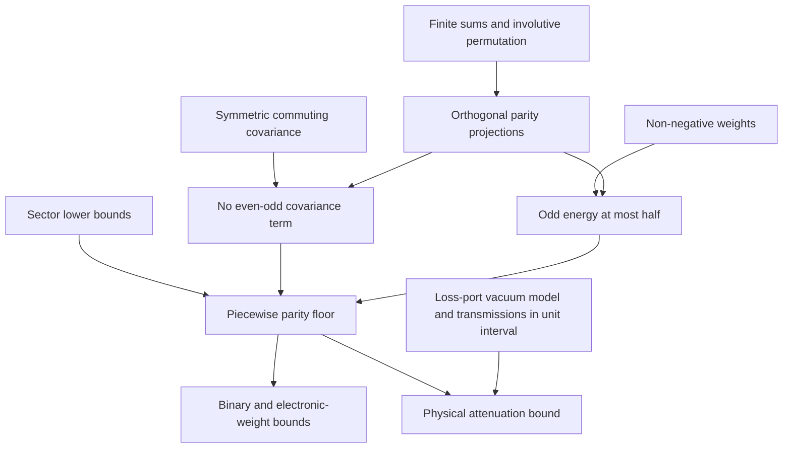
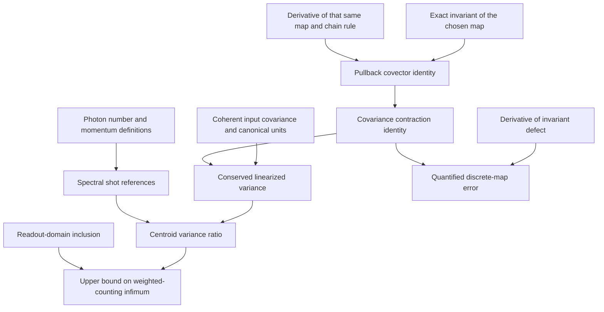

# Lean assessment of the filtered-Fano results

Start with the finite-bin parity bound, including physical attenuation, and the
differentiated-conservation lemma behind the centroid identity. Both have useful
statements whose proofs do not require a formal NLSE solver. The shear covariance
and polarization reductions are also practical algebraic targets. The
semiclassical and weak-dispersion laws need substantial mathematical work before
Lean can verify the physical asymptotic claims. The optimized Raman interpolation
is empirical and should not be packaged as a theorem.

This assesses highlighted results 1 and 3, not amplifier-similariton result 2. It
is a feasibility assessment, not another audit, a proof, or a promotion. The
accepted wording in the audit takes precedence over the original cards. The
shared centroid statement is counted once. The readout hierarchy and binary
certificates are dependencies from GPT-family draft PR #28; formalizing them
would be a second verification layer for GPT work, **not cross-family
verification**. No claim or problem card is changed.

All Lean below is an **unchecked sketch**. No Lean toolchain, elan, lake, or
Mathlib checkout was installed or downloaded. Source inspection does not establish
that a sketch elaborates. No numerical experiment was performed. Exact algebraic
constants below are not measured values; effort ranges are planning estimates,
not run results.

## Summary and priority

L0 means finite-dimensional/algebraic; L1 means continuum spaces and operators at
fixed parameters; L2 means a limit with quantified hypotheses; L3 means empirical
content, not a proved theorem. Effort is in person-weeks for a developer already
comfortable with Lean and analysis, with mathematical statements settled. Ranges
share infrastructure and should not be added mechanically. Research prerequisites
make the continuum estimates substantially less reliable.

By expected value and feasibility, the order is: **parity/attenuation**, then
**centroid via differentiated conservation**, then **shear and polarization**,
then the **GPT hierarchy/certificate dependency**, then the **conditional
scaled-block law**, then **standalone oscillator lemmas**. The thermal slice is a
small auxiliary target within the shear work. Full continuum and asymptotic
transfer proofs rank below those finite or reduced-model targets until their
mathematical prerequisites are settled. The empirical Raman interpolation and
fits are not theorem targets; certified conditional inequalities are the useful
replacement. This is a planning judgment, not a numerical score.

| Statement | Level | Key assumptions | Mathlib status | Effort | Value | Recommendation |
|---|---|---|---|---|---|---|
| Parity lower bound and attenuation correction | L0; optional L1 | Symmetric covariance commuting with an involutive bin permutation; non-negative weights; positive denominator; sector ordering retained | Finite sums, Hermitian forms and PSD available; application lemmas needed | L0: 1–2; L1: 2–4 additional | High: catches mask, denominator and sector-order scope errors | **First target** |
| Centroid identity via a differentiated invariant | L0 core; L1 conservation | Exact invariant of a differentiable map, its exact derivative, coherent covariance, full readout | Matrix products and Fréchet chain rule available; no NLSE conservation package located | L0: 1–3; conditional L1: 4–8; proving the PDE flow: 16–40+ | High: separates conservation of a model from conservation of its discretization | **Second target**, with residual version |
| Readout hierarchy and binary certificates, GPT dependency | L0; optional L1 | Correct shot metric, bright support, stated passive network class, exact PSD certificate | Spectral/Rayleigh infrastructure available; specialized compression/certificate lemmas needed | Hierarchy: 1–3; certificates: 2–4 additional; L1: 3–6 additional | High, reusable; not new cross-family evidence | Shared foundation; prioritize certificate soundness over optimization code |
| Dispersionless shear covariance and its smallest eigenvalue | L0; L1 spectral infimum | Coherent input; linearized shear; independent bath; bounded kernel for L1 | Block matrices, PSD, spectral theorem available; shear-specific spectrum proof needed | L0: 2–4; L1: 4–8 additional | High: fixes transpose, normalization, infimum/attainment | Next algebraic target |
| Kerr polarization reductions | L0 per time slice; L1 multiplication operator | The two specified instantaneous vector models, common envelope, no walk-off | Small matrix algebra and real square roots available | L0: 1–3 after shear; L1: 2–4 additional | Good: checks effective-phase factors and model boundaries | Follow shear; no intermediate-birefringence claim |
| Thermal Raman slice formula | L0 exact; L2 scalar limit | Non-negative phase and bath coefficient; white low-frequency slice | Elementary real analysis sufficient | L0: 1; L2: 1–2 additional | Good normalization regression, limited novelty | Small auxiliary target |
| Finite-pulse approach to thermal slice | L1/L2 conditional; finite tolerances L3 | Joint temporal localization and low-frequency hierarchy; kernel and spectral error control | Fourier/operator building blocks; no ready convergence theorem located | 8–16+ after a mathematical proof; no reliable upper estimate now | Moderate: prevents repeating the refuted bandwidth regime | Derive the regime first |
| Symplectic scaled-block implication for the leading $N^{-2}$ law | L0 algebra plus L2 finite-matrix limit | Symplectic maps; bounded scaled blocks; operator-norm convergence; nonzero limiting $C_Z$ | Symplectic group and asymptotic notation available; reciprocal-spectrum bridge needed | 3–6 | High for exposing missing uniformity, conditional on dynamics | Good second-stage target |
| Actual pre-breaking hydrodynamic $\Lambda(Z)/N^2$ law | L1/L2 | Smooth flow, correct weighted spaces, uniform tangent-map limit, resolved modes | No matching semiclassical nonlinear-PDE/tangent theorem located | 16–40+ and prior mathematical work | Potentially high; high risk | Do not begin with a full PDE proof |
| $\lambda_{\rm pass}=\lambda_2$ and $\Pi$ identification | L0 conditional; L2 physical ordering; observed equality L3 | Odd minimizer plus a lower bound on the constrained even sector | Rayleigh compression possible; no automatic equality from parity | L0: 1–2; physical premise: research unresolved | High scope value | State only conditionally until even-sector bound is proved |
| Small-$Z$ coefficients $2/\sqrt6$, $\sqrt6$ | L1 oscillator; L2 transfer to $C_Z$ | Nondegenerate peak, low-energy localization, controlled remainder, order of limits | Oscillator-related material exists; no complete transfer theorem located | Oscillator: 2–4; transfer: 12–24+ | High mathematical interest, low near-term feasibility | Prove a paper-level remainder first |
| Weak-normal-dispersion square-root law | L1 oscillator; L2 physical law | Fixed positive $\Phi$, $y\downarrow0$, nondegenerate isolated peak, resolved shrinking mode | Analysis building blocks; no covariance-edge asymptotic theorem located | 12–24+ after settling the analysis | High, but a research project | Separate exact oscillator lemma from unproved reduction |
| Quartic-peak exponent | L1 scaling; L2 physical law; decimal coefficient L3 | Quartic rather than quadratic peak; same localization/remainder requirements | Scaling and integrals possible; certified quartic ground-state value not located | Scaling: 2–4; physical transfer: 12–24+ | Useful test of scope; not a universal square root | Use a symbolic ground-state constant |
| Post-breaking extension, binary power fits, tightness tables | L3 | Specific runs and grids only | Can formalize a conditional enclosure, not infer an asymptotic law | Certificate infrastructure: 2–6; no theorem estimate for the empirical law | Limited without certified numerical inputs | Preserve as evidence, not theorem statements |
| Normal-dispersion Raman interpolation | L3; L0/L1 covariance inequalities | Given reservoir on Kerr-only mean/tangent; no deterministic delayed response | PSD propagation/finite sums available; stochastic framework not the missing derivation | Algebraic noise bounds: 1–3; interpolation: no justified proof estimate | Low for proving the fitted law; useful for bounds | Do not formalize the interpolation as an identity |

## Inputs and evidence boundary

The following objects were read through `git show origin/<branch>:<path>`; no
checkout of another work lane was used. These are repository sources, not
external literature claims.

| Source | Pinned commit | Role |
|---|---|---|
| `origin/main` | `e4fd87932f816c66c4cc21392df5f5181baf39fb` | Session base and workflow |
| `task/T-20261011-gpt-a-01`, `docs/review-2026-10-11-gpt-a-highlights-audit.md` (PR #34) | `b0ec81427ee6fb9b789e3ec98793895acf61130a` | Accepted narrowing and independent evidence |
| `task/T-20261011-claude-interactive.3-01`, `docs/HIGHLIGHTS.md` (PR #33) | `8f6a14c1e2f9329ceb8aa570d3712fd54be5ec1b` | Headline inventory; not stronger than the audit |
| `task/T-20261010-claude-interactive-03`, `explorations/2026-10-10-gpt-a-readout-hierarchy.md` (PR #28, draft) | `2a406511ac1f558fdbe87080dae67d00646299e5` | GPT-family hierarchy and certificates |
| `task/T-20261010-claude-interactive-04`, C-20261010-claude-a-01, -02, -03 and C-a-01 derivation note (PR #29) | `b771969d725b136585501c581350f965c8eb2433` | Dispersionless, polarization, weak-dispersion, momentum and parity mathematics |
| `task/T-20261010-claude-interactive-05`, C-20261010-claude-b-01, -02, -03 and semiclassical exploration (PR #31) | `05ba3dd1e39b2f3791c4265d9676c8472b21687a` | Semiclassical blocks, centroid Hamiltonian reduction and Raman interpolation |

The existing numerical evidence remains evidence from runs
`2026-10-11-gpt-a-highlights-audit-c1` and
`2026-10-11-gpt-a-highlights-audit-c3`, together with the proposer runs
`2026-10-10-claude-b-nd-semiclassical`, `2026-10-10-claude-b-nd-oracle`,
`2026-10-10-claude-b-nd-raman`, and
`2026-10-10-claude-a-dispersionless-fano`. Nothing here recertifies their
floating-point output. The audit's failed partial-mask and finite-pulse Raman
claims remain failed; this assessment does not restore them.

The accepted narrowing fixes the physical scope; a formal statement must also
quantify its mathematical hypotheses. The distinction is:

| Statement | Explicit in the accepted scope | Additional obligations made explicit here |
|---|---|---|
| Parity | Binary optical masks or non-negative electronic weights; attenuation correction | Positive denominator, exact covariance/reflection commutation, both sector orderings, canonical bins |
| Centroid | Coherent input, lossless momentum-conserving model, complete readout; classical spectrum only within linearization | Invariance and derivative of the same discrete map; continuum domains, boundary terms, bounded tangent map in the shot metric |
| Dispersionless and polarization | Linearized coherent propagation; specified scalar or vector Kerr models; Raman slice distinguished from finite pulse | Kernel boundedness and bath uncertainty; spectral infimum versus attained minimum; common envelope and averaging assumptions |
| Semiclassical | Formal smooth pre-breaking limit; post-breaking support is numerical | Norm topology, nonzero limiting block, rate/uniformity hypotheses, limit order, and the unproved constrained even-sector ordering |
| Weak dispersion | Normal dispersion and the Gaussian/nondegenerate-peak formal asymptotic | Low-mode remainder and exterior control; shrinking-mode resolution; fixed phase versus a further large-phase limit |
| Raman | Published thermal slice; finite-pulse tolerance excluded; normal-dispersion interpolation is reservoir-only and empirical | Joint frequency/pulse/temperature window; fixed-bath versus weak-bath limit; bath coercivity or optimizer perturbation bound |
| GPT readout dependency | Finite-dimensional hierarchy and binary certificates with its reachability qualifications | Explicit binary domain in the chain, nonempty bright support, exact/interval input certificates and a continuum error bridge |

## Common model: what a finite proof would actually mean

### Canonical bins and shot normalization

Choose a finite set of **orthonormal complex optical modes**, indexed by $I$.
For quadrature-based spectral sampling with positive quadrature weights $w_i$,
the canonical amplitudes are $\alpha_i=\sqrt{w_i}\,a(\omega_i)$, not unweighted
samples. Thus $\sum_i|\alpha_i|^2$ approximates the photon integral. A normalized
top-hat bin is an orthonormal mode; identifying its integral with a point sample
is a separate quadrature approximation. A finite set of modes is not an exact
representation of every field inside a detector bin.

Set $x_i=\delta a_i+\delta a_i^\dagger$,
$p_i=(\delta a_i-\delta a_i^\dagger)/i$, and $r=(x,p)$. With
$[r_j,r_k]=2i\Omega_{jk}$,
$$\Omega=\begin{pmatrix}0&I\\-I&0\end{pmatrix},\qquad
V_{jk}=\tfrac12\langle r_jr_k+r_kr_j\rangle,\qquad V_{\rm vac}=I.$$
The physical uncertainty hypothesis is **$V+i\Omega\succeq0$ over complex
vectors**, not $V\succeq I$. A squeezed state can have ordinary eigenvalues below
one. Real symmetry and $V\succeq0$ suffice for most Rayleigh bounds, but do not
establish quantum admissibility. Mathlib's `Matrix.J` is $-\Omega$; its sign
convention must be recorded explicitly (source M3 below). For real $V$, changing
the sign of $i\Omega$ complex-conjugates the uncertainty matrix, so positivity is
equivalent, but commutator formulas must use one convention consistently.

For a deterministic linearized lossless Hamiltonian model, take a real map $S$
with $S\Omega S^T=\Omega$ and coherent covariance $V=SS^T$ as modelling
hypotheses, unless the finite Hamiltonian and its derivative are also proved.
For a reservoir use $V=SV_{\rm in}S^T+Y$. Independence gives covariance addition;
$Y\succeq0$ alone does not guarantee preservation of quantum uncertainty. A
sufficient uncertainty-preservation hypothesis is
$Y+i(\Omega-S\Omega S^T)\succeq0$ in these units. Treat the bath spectrum and
commutator as input data until their relation is proved.

### Counting and the idealizations it makes

Write $b_i=|\alpha_i|$, $D=\operatorname{diag}(b_i^2)$, and let $E$ embed the
spectral amplitude quadratures in real phase space. Its columns are orthonormal.
Then $A=E^TVE$ and $\Sigma=D^{1/2}AD^{1/2}$. Linearized counting assumes
$\delta n_i=b_iX_i$ and neglects quadratic fluctuation counts. Real electronic
weights $w$ have shot reference $w^TDw$, **not** their possibly zero or negative
weighted mean. Their normalized variance is not in general a photon-number Fano
factor. A binary optical mask has $T_i^2=T_i$, making those two normalizations
coincide.

Exactly dark bins must be removed before $D^{-1/2}$ is used; they can remain in
the full field covariance. Near-dark modes are not the same as dark modes. Fixed
total brightness does not make every increasingly localized optimizing mode
bright. For the exact Gaussian count model the additional spontaneous population
and quadratic-count variance in PR #28 can be bounded; that does not prove the
Gaussian propagation approximation itself.

The hypotheses above lose non-Gaussian corrections, pump depletion outside the
linearized model, uncollected modes and hardware restrictions. Kerr/Raman,
polarization, higher-order dispersion and detector efficiency are model choices,
not consequences of matrix positivity. Gaussianity is unnecessary for the
leading covariance inequalities; it is needed for Wick-based exact count
corrections.

### Passing to continuum is a new theorem

For fixed parameters one can formulate the Rayleigh statements on a real Hilbert
space such as $L^2(\mathbb R;\mathbb R^2)$, using a bounded self-adjoint covariance
form and a bounded invertible symplectic operator. Vacuum covariance is the
identity quadratic form. It should not be silently treated as an $L^2$-valued
white-noise random vector with finite second moment: summing unit variances over
an orthonormal basis gives an infinite second moment. A cylindrical-noise or CCR
form formulation avoids that false assumption. Existence of an infinite-mode
quantum state or an implementable Fock-space evolution is separate work.

Compression of a continuum covariance to canonical mode pairs preserves
uncertainty. Compressing a deterministic map and then declaring it symplectic
does not: modes outside the subspace can carry correlations. In general
$PSS^*P\ne(PSP)(PSP)^*$. Likewise, a certificate after discarding bins lower-bounds
only filters supported on the retained bins. It is not a lower bound on all
continuum masks.

To transfer a theorem, specify isometric embeddings, frequency/time cutoffs,
quadrature normalization, treatment of boundary and Nyquist modes, and a topology
strong enough for the optimized quantity. Operator-norm control gives a direct
Rayleigh error bound; pointwise convergence of matrix entries or convergence on
individual smooth test functions does not control an infimum over moving modes.
The amplitude-error transfer bounds in PR #28 also require uniform relative
control in faint bins, or an explicit lower bound on detected brightness.

## Parity bound: precise theorem and correction

Let $A$ be a real symmetric matrix and $R$ an orthogonal involutive permutation of
the retained bin set, with $AR=RA$. Assume sector lower bounds
$$v^TAv\ge e\|v\|^2\quad(Rv=v),\qquad
v^TAv\ge o\|v\|^2\quad(Rv=-v).$$
For a nonzero non-negative vector $y$ define
$$F_w(y)=\frac{y^TAy}{\|y\|^2},\qquad
B_{\rm par}=\min\{e,(e+o)/2\}.$$
Then **$F_w(y)\ge B_{\rm par}$**. Choosing $e,o$ as the sector eigenvalue minima
recovers the claim card. The theorem can first be proved with lower-bound
hypotheses, avoiding eigenvalue enumeration and handling a trivial odd sector.

The proof is finite algebra: $y_\pm=(y\pm Ry)/2$ are orthogonal, the cross
covariance vanishes, and
$\|y_+\|^2-\|y_-\|^2=\langle y,Ry\rangle\ge0$. Thus the odd fraction lies in
$[0,1/2]$. Minimizing $e+(o-e)f$ on that interval gives the displayed minimum.
No purity, coherent input, symplectic structure or quantum uncertainty is needed
for this mathematical implication. Those assumptions only establish that the
chosen $A$ is the covariance for the optical system.

**Scope exposed by formalization.** The highlights shorten the formula to
$(e+o)/2$. That requires $o\le e$; the original card correctly includes the other
branch. If $e<o$ and an even non-negative vector attains $e$, the shortened bound
fails. This can occur in an admissible covariance: take positive even/odd
amplitude eigenvalues $1\le e<o$, and append identity phase covariance. The full
covariance is at least the vacuum covariance. This is an exact symbolic
counterexample schema, not a new numerical run.

For an optical attenuator with $0\le T_i\le1$, $n_i\ge0$,
$D_T=\sum_i T_in_i>0$, $y_i=T_i\sqrt{n_i}$, and independent loss-port vacuum,
$$F_{\rm phys}=1+\frac{y^T(A-I)y}{D_T}
=1+r(F_w(y)-1),\qquad r=\frac{\|y\|^2}{D_T}\in[0,1].$$
Therefore **$F_{\rm phys}\ge\min(1,B_{\rm par})$**. For binary $T$, $r=1$ and
the stronger $B_{\rm par}$ bound holds. Non-negative electronic weights have no
upper-transmission restriction and use $F_w$ directly. The loss-port formula,
not a bare non-negative-transmission assumption, is the physics bridge.

At L1 replace $R$ by measure-preserving frequency reflection on real $L^2$, use
an exactly commuting bounded self-adjoint operator, and replace minima by
spectral infima. Non-negative functions still have
$\langle y,Ry\rangle\ge0$. Partial attenuation requires $n\in L^1$, measurable
$T\in[0,1]$, and a nonzero finite transmitted mean. An approximately symmetric
computed covariance needs an explicit error term. For example, replacing $A$ by
$(A+RAR)/2$ costs at most $\|A-RAR\|/2$ in any unit Rayleigh quotient. Neither
even intensity alone nor a small measured commutator is exact parity.

This proof catches weight sign, sector ordering, omitted vacuum noise and empty
denominators. It does not predict the sector minima, the empirical binary-mask
power fits, or how accurately a laboratory covariance respects reflection.

## Centroid: a conserved quantity, its derivative, and its readout

### L0 invariant lemma

Let $f:\mathbb R^{2m}\to\mathbb R^{2m}$ be differentiable at a mean field $a$,
$M=Df(a)$, and let a differentiable scalar quantity $Q$ satisfy $Q\circ f=Q$ in
a neighborhood of $a$. Write $h_{\rm in}$ and $h_{\rm out}$ for its gradients
at $a$ and $f(a)$, in consistent quadrature units. The chain rule gives
$$M^Th_{\rm out}=h_{\rm in}.$$
Consequently, for any input covariance $V_{\rm in}$,
$$h_{\rm out}^TMV_{\rm in}M^Th_{\rm out}
=h_{\rm in}^TV_{\rm in}h_{\rm in}.$$
With coherent input $V_{\rm in}=I$, the conserved linearized variance is
$\|h_{\rm in}\|^2$. Symplecticity is not needed for this lemma. It is needed to
identify a noiseless quantum tangent map in canonical coordinates.

For spectral amplitudes take
$\mathcal N(a)=\sum|a_i|^2$, $P(a)=\sum\omega_i|a_i|^2$ and
$Q=P-\bar\omega\mathcal N$, where
$\bar\omega=P(a)/\mathcal N(a)$ is a fixed launch mean frequency. Assume $f$
preserves both $\mathcal N$ and $P$. In the quadrature convention above,
$h=(\operatorname{Re}[(\omega-\bar\omega)a],
\operatorname{Im}[(\omega-\bar\omega)a])$; the gradient in unscaled complex
amplitude coordinates is $2h$, and that common factor cancels. Its squared norm
is the coherent shot reference $\sum(\omega_i-\bar\omega)^2|a_i|^2$.
With positive finite input/output spectral variances and full collection,
$$F_{\rm cen}=
\frac{\sigma_{\omega,\rm in}^2}{\sigma_{\omega,\rm out}^2},\qquad
\lambda_{\rm gen}\le F_{\rm cen}.$$
This is an **upper** bound on the optimized weighted-counting minimum. It does
not forbid a readout below the centroid value. A narrowing chirped spectrum can
give $F_{\rm cen}>1$ without violating conservation. Optimizing an additional
frequency offset may give only an infimum; a finite minimizing offset is not
guaranteed.

An especially useful extension exposes numerical defects. If
$Q\circ f-Q=r_Q$, let $e$ be its derivative covector in the same quadrature
units; in unscaled complex-amplitude coordinates $e=\tfrac12\nabla_a r_Q$.
Then $M^Th_{\rm out}=h_{\rm in}+e$, and for coherent input $V=MM^T$,
$$|h_{\rm out}^TVh_{\rm out}-\|h_{\rm in}\|^2|
\le2\|h_{\rm in}\|\|e\|+\|e\|^2.$$
A small invariant residual at one mean field does **not** bound its derivative.
Nor is a continuous adjoint automatically the transpose derivative of a
discrete propagator.

### Which split-step map conserves momentum?

For exact continuum subflows with periodic boundaries or sufficient decay, the
unitary Fourier propagator $e^{ihD(\omega)}$, with real $D$, preserves
$\mathcal N$ and $P$. The pointwise Kerr flow
$a\mapsto e^{i\gamma h|a|^2}a$ changes momentum by a constant multiple of
$\int\rho\rho'$, which vanishes by the boundary condition. Their exact
composition therefore preserves both, and differentiating that composition
proves the tangent identity for any step size. This does not assert exact
conservation of the **total NLSE Hamiltonian** by the split composition.

An ordinary finite pseudospectral collocation step is different. The nodewise
Kerr map is symplectic and preserves the sampled norm, but its nonlinear
Hamiltonian is only invariant under cyclic grid shifts. Aliased Fourier
quartets conserve the frequency index modulo the grid size, not the real
frequency-weighted sum defining physical momentum. Thus a generic collocation
split step does **not** exactly conserve that momentum. No discrete product rule
can be assumed to repair this.

For example, on a three-mode grid with indices $-1,0,1$, the collocation
Hamiltonian contains $a_1^2\bar a_0\bar a_{-1}$ and its conjugate. Translation
$a_k\mapsto e^{ik\theta}a_k$ multiplies that monomial by $e^{3i\theta}$.
It is invariant under grid shifts, but not under arbitrary translations. This
symbolic aliasing example requires no numerical run.

An exact Hamiltonian Fourier-Galerkin model with unaliased frequency sums has
continuous translation symmetry and can preserve the quadratic momentum. Its
nonlinear flow is generally not the usual nodewise exponential. For a particular
finite solver, prove the chosen invariant for its actual map or retain the
residual $e$ above. Symplecticity alone is insufficient. Grid convergence checks
in audit run `2026-10-11-gpt-a-highlights-audit-c1` are empirical evidence, not
an exact invariant proof for every collocation grid.

### L1 continuum and exact quantum versions

A conservative first continuum statement can assume a classical solution and
its differentiable flow already exist. Use a real self-adjoint
translation-invariant dispersion operator $D(-i\partial_t)$, constant real Kerr
coefficient, no loss, gain, bath or self-steepening, and periodic or vanishing
boundary terms. Require enough Sobolev regularity to differentiate the mass and
momentum integrals and move the dispersion operator between factors; Schwartz
data/solutions on the interval are a simple stronger hypothesis. Require finite
nonzero second spectral moment and differentiability with respect to launch data
in a space in which the readout functional is continuous. "Any real dispersion"
does not remove the domain and commutation requirements for an unbounded
multiplier.

The tangent map must also have a bounded extension and adjoint in the physical
$L^2$ shot metric used for the covariance. Differentiability in a stronger
Sobolev norm alone does not identify coherent noise with identity covariance in
that norm. The covariance is a quadratic form on admissible readout covectors,
not a claim that continuum vacuum noise is an $L^2$ random vector.

Mass/momentum conservation then supplies the same derivative theorem on the
chosen real Hilbert or Banach space. Proving global NLSE existence, smooth
dependence and all integration-by-parts/domain facts is a much larger L1 project.
Picard–Lindelöf for finite ODEs does not automatically supply that PDE theory.

An exact quantum statement instead assumes a well-defined unitary evolution
commuting with the photon number and momentum observables on appropriate
domains, and a coherent input with finite variance. It conserves $\operatorname{Var}Q$
without Gaussian linearization. Its output shot reference uses the **quantum mean
spectrum**. Replacing that by the classical mean field is an extra approximation,
not an identity at arbitrary length or brightness. This exact quantum version
is not needed for the first Lean target. The published antecedent relevant to
this distinction is Tsang, DOI `10.1103/PhysRevA.75.063809`, arXiv `0704.0663`,
access **full text, targeted Sections II–III**, equations (20), (34), (42) [P1].

### Hamiltonian and dispersionless specializations

For the unchirped Gaussian in the normalized, second-order **normal-dispersion**
NLSE, let $E=\int\rho_0$, $Q_z=\int\rho_z^2$, and
$K_N(Z)=(Q_0-Q_z)/E$. Conservation of
$\int|u_t|^2+N^2\int|u|^4$ gives
$$F_{\rm cen}=(1+2N^2K_N(Z))^{-1}.$$
At L0 the implication is algebra once these integral identities are hypotheses;
at L1 prove the Hamiltonian identity with the stated boundary and regularity
conditions. The actual finite-$N$ intensity belongs in $K_N$. Replacing it by a
hydrodynamic profile $K_0$ is L2. The fixed-$N$ small-$Z$ expansion accepted by
the audit is
$$\frac{K_N(Z)}{Z^2}=\frac{2}{3\sqrt3}
+\frac{1}{2\sqrt2N^2}+O_N(Z^2).$$
The expansion coefficients are symbolic; its numerical checks are in run
`2026-10-11-gpt-a-highlights-audit-c1`. A Lean theorem would need a Taylor
remainder and control of the required solution derivatives; the audit supplies
neither. The second term cannot be dropped before taking the semiclassical
limit. Third-order or anomalous dispersion does not preserve this same
Hamiltonian reduction, even though the basic momentum identity survives.

For real dispersionless launch amplitude $\sqrt p$, define
$I_1=\int|(\sqrt p)'|^2>0$, $I_2=\int p(p')^2<\infty$. Then
$$F_{\rm cen}=I_1/(I_1+\Phi^2I_2).$$
This is L1 differentiation/Parseval plus integral algebra; the Gaussian reduces
to $(1+4\Phi^2/(3\sqrt3))^{-1}$. It remains an upper bound on
$\lambda_{\rm gen}$, not a proof of asymptotic tightness or of a limiting gap to
$V_{\min}$. Those stronger optimization statements need separate lower bounds.

## Dispersionless covariance, physicality and polarization

### L0 shear theorem

For $K\in\mathbb R^{m\times m}$ with $m\ge1$ and symmetric
$N_R\succeq0$, suppose
$X_{\rm out}=X_{\rm in}$,
$Y_{\rm out}=Y_{\rm in}+KX_{\rm in}+\eta$, with input covariance $I$ and a
centered independent bath of covariance $N_R$. Then
$$V=\begin{pmatrix}I&K^T\\K&I+KK^T+N_R\end{pmatrix}.$$
This covariance identity follows from linearity and independence, not from a
proof of the optical model. With $N_R=0$, orthogonal changes of basis associated
with singular vectors of $K$ reduce $V$ to blocks
$\left(\begin{smallmatrix}1&s\\s&1+s^2\end{smallmatrix}\right)$. Therefore
$$\lambda_{\min}(V)=v(\|K\|_2/2),\qquad
v(x)=(\sqrt{1+x^2}-x)^2\quad(x\ge0).$$
This holds algebraically for nonsymmetric $K$ as well. But the shear
$S=\left(\begin{smallmatrix}I&0\\K&I\end{smallmatrix}\right)$ is symplectic
only when $K=K^T$. Deleting the bath from a causal nonsymmetric Raman shear need
not describe a quantum channel.

The uncertainty condition can be made particularly concrete. A Schur complement
with upper block $I$ gives, in the $\Omega$ convention above,
$$V+i\Omega\succeq0\quad\Longleftrightarrow\quad
N_R-i(K-K^T)\succeq0.$$
It is not enough to assume that $N_R$ is real PSD. The stated symmetrized Raman
spectrum must supply this stronger condition. This is a useful future
normalization theorem. A classical random phase with only a covariance does not
by itself prove the reservoir commutator relation.

### L1 Kerr anchor and kernel assumptions

For the scalar instantaneous Kerr model,
$K=2\Phi M_p$ where $M_p$ multiplies by a measurable bounded intensity profile
$0\le p\le1$ with $\operatorname{ess\,sup}p=1$ and $\Phi\ge0$. On real
$L^2\oplus L^2$, the covariance is a bounded multiplication operator and
$$\inf_{\|h\|=1}\langle h,Vh\rangle=v(\Phi).$$
For a unique isolated peak this is normally an **infimum**, not an eigenvalue
attained by a normalizable delta-localized mode. A finite grid attains its
smallest eigenvalue; its identification with the continuum infimum is a
separate approximation. A fixed finite detector bandwidth generally raises the
accessible value. The high-phase statement
$\Phi^2v(\Phi)\to1/4$ is an elementary L2 scalar limit after rationalizing $v$.
It does not prove a bright detector can follow the optimizing localization.

For Raman the continuum formula uses
$K=2\Phi M_{\sqrt p}\widehat R M_{\sqrt p}$ and
$N_R=2\Phi f_R M_{\sqrt p}\widehat H M_{\sqrt p}$. State boundedness and domains
of the convolution operators, real adjoints, positivity of the spectral density,
and the commutator/thermal relation explicitly. A normalized causal response and
the equilibrium coth spectrum are modelling axioms unless derived separately.
An asymptotic white slice is not the full frequency-dependent bath.

### The two polarization models

For an isotropic instantaneous Kerr tensor, in the circular basis let
$c_\pm\ge0$, $c_++c_-=1$, with a common profile $p$. The slice shear is
$$K_{\rm iso}=\frac{4\Phi p}{3}
\begin{pmatrix}c_+&2\sqrt{c_+c_-}\\2\sqrt{c_+c_-}&c_-\end{pmatrix}.$$
Taking $c_\pm=(1\pm\sin2\chi)/2$ gives
$$\Phi_{\rm eff}=\frac\Phi3
\left(1+\sqrt{1+3\cos^2(2\chi)}\right).$$
For the averaged strong-linear-birefringence, no-walk-off model, with
$c_x,c_y\ge0$, $c_x+c_y=1$, the corresponding shear is
$$K_{\rm bir}=2\Phi p
\begin{pmatrix}c_x&\tfrac23\sqrt{c_xc_y}\\
\tfrac23\sqrt{c_xc_y}&c_y\end{pmatrix},$$
giving
$$\Phi_{\rm eff}=\frac\Phi2
\left(1+\sqrt{1-\tfrac{20}{9}c_xc_y}\right).$$
The L0 theorem is an exact eigenvalue/singular-value calculation for these
matrices followed by the shear theorem. The isotropic matrix can have a negative
eigenvalue; one must compare its magnitude before selecting the largest
singular value. The L1 extension is the common-envelope multiplication-operator
infimum. The physical reduction assumes the indicated vector Hamiltonian or
already-averaged equations. Proving strong-birefringence averaging from an
oscillatory vector NLSE is another L2 theorem with a beat-length and walk-off
regime. Intermediate birefringence, vector Raman, changing polarization across
the pulse, and a general Manakov model are not supplied by these two formulas.

### Thermal slice: exact formula versus asymptotic shorthand

Let $d\ge0$ and $\Phi\ge0$; in the card's bath convention,
$d=f_R\widetilde H(0)/2$. The slice covariance is
$$V_d=\begin{pmatrix}1&2\Phi\\2\Phi&1+4\Phi^2+4d\Phi\end{pmatrix},$$
whose smaller eigenvalue is
$$s_d(\Phi)=1+2\Phi(\Phi+d)-2\Phi\sqrt{1+(\Phi+d)^2}.$$
This is an L0 theorem. With
$D=\sqrt{1+(\Phi+d)^2}+\Phi+d$, a useful exact rationalization is
$s_d=D^{-2}+2dD^{-1}$. Hence for fixed $d$,
$$s_d(\Phi)=\frac d\Phi+
\frac{1/4-d^2}{\Phi^2}+O_d(\Phi^{-3}).$$
For $d=0$ the leading order is $1/(4\Phi^2)$; for $d>0$ it is $d/\Phi$.
The highlights' sum $1/(4\Phi^2)+d/\Phi$ is not the exact two-term expansion at
fixed nonzero $d$. It is useful leading-order/weak-bath shorthand, and should be
labelled that way. This is another limit-order issue that a precise statement
exposes. The exact slice formula is published: Voss, Köprülü and Kumar,
DOI `10.1364/JOSAB.23.000598`, arXiv `quant-ph/0410214`, access **full text,
targeted Section 5, equations (99)–(100)** [P2].

Applying the slice to a finite pulse requires a joint window
$T_0^{-1}\ll\Omega_{\rm mode}\ll
\min(\Omega_{\rm response},k_BT/\hbar)$, with quantitative meanings for both
inequalities and the actual optimizing mode. Increasing detector bandwidth
alone does not establish it. At zero temperature this thermal hierarchy changes;
one cannot obtain the full zero-point limit by setting $d=0$ in a thermal-only
approximation. The refuted finite-band tolerance in audit run
`2026-10-11-gpt-a-highlights-audit-c3` remains excluded.

## Readout hierarchy and binary certificates: dependency, not new audit

For $A=E^TVE$, $E^TE=I$, and positive $b_i$, weighted counting is exactly the
Rayleigh optimization of $A$. Put
$g=(i\alpha)_R/\|\alpha\|$, assume $\alpha\ne0$, and define the ideal passive
domain $\mathcal H=g^\perp$. Since the amplitude subspace lies in $\mathcal H$,
domain inclusion gives
$$\lambda_{\min}(V)\le\inf_{h\in\mathcal H,\|h\|=1}h^TVh
=\lambda_{\rm pass}\le\lambda_{\rm gen}\le
\min_{T\in\{0,1\}^I\setminus\{0\}}F[T].$$
Here the masks are binary, and the retained bins have positive mean. For physical
partial attenuation the last inequality must instead use
$F_{\rm phys}\ge\min(1,\lambda_{\rm gen})$. For example, a single bright mode
with amplitude variance $c>1$ and transmission $0<t<1$ has
$F_{\rm phys}=1+t(c-1)<c=\lambda_{\rm gen}$; optimizing partial transmission
can give only an infimum as the detected mean tends to zero. A proof should first use
Rayleigh lower bounds or nonempty unit spheres, then connect them to eigenvalues.
It must not apply a conditionally complete infimum lemma to an empty set.

Physical reachability needs the PR #28 qualifications: arbitrary photon-number
preserving mode unitaries, no added coherent reference, and adequate brightness
in the selected port. A dark minimizing direction can be a formal infimum
without being attainable at fixed pulse energy. A stationary frequency-preserving
network obeys a phase constraint in each frequency block and can have a larger
minimum. Appending vacuum ancillas can lower a noisy one-port infimum to
$\min(1,\lambda_{\rm pass})$. These are distinct optimization domains.

Two useful L0 certificate targets from the dependency are:

- **Eigenvector certificate.** With at least two retained bright bins, for a unit
  lowest eigenvector $v_1$, lowest two
  eigenvalues $\lambda_1\le\lambda_2$, and
  $\rho_b=\max_T(\sum b_iv_{1i}T_i)^2/(\sum b_i^2T_i)$,
  $F[T]\ge\lambda_2-(\lambda_2-\lambda_1)\rho_b$. Degeneracy makes the
  improvement vanish; a single-bin model is handled directly. The prefix-search characterization of $\rho_b$ is a
  separate finite combinatorial theorem, with strictly positive $b_i$ and
  nonempty masks.
- **Dual certificate.** If $u_T=b\odot T/\sqrt{\sum b_i^2T_i}$,
  $u_T^TKu_T\ge0$ for all masks, and $A-K-BI\succeq0$, then $F[T]\ge B$.
  The moment inequalities and triangle cuts in PR #28 construct such $K$ from
  non-negative multipliers. This direct implication is a better first target
  than formalizing the numerical optimizer.

A floating-point eigenvalue, an arbitrary subtracted margin, or a numerical
Cholesky success is not a Lean proof of $A-K-BI\succeq0$. Exact rational LDL
certificates or interval enclosures must bridge computed data to the real-matrix
theorem. Mean-field discretization error is a further bridge. Formalizing these
dependencies is useful, but cannot be described as a new independent Claude/GPT
review of their mathematics.

## Semiclassical law: the algebra is easier than its PDE hypotheses

Set $\varepsilon=1/N>0$, fix $Z>0$, and write a family of real symplectic maps in
canonical quadratures as
$$M_\varepsilon=
\begin{pmatrix}A_\varepsilon&\varepsilon B_\varepsilon\\
C_\varepsilon/\varepsilon&D_\varepsilon\end{pmatrix}.$$
Suppose $A_\varepsilon,B_\varepsilon,D_\varepsilon$ are uniformly bounded and
$C_\varepsilon\to C_0\ne0$ in operator norm. In a fixed finite dimension,
symplectic singular-value reciprocity gives
$\lambda_{\min}(M_\varepsilon M_\varepsilon^T)=\|M_\varepsilon\|^{-2}$.
Since $\varepsilon M_\varepsilon\to
\left(\begin{smallmatrix}0&0\\C_0&0\end{smallmatrix}\right)$,
$$\frac{\lambda_{\min}(V_\varepsilon)}{\varepsilon^2}
\longrightarrow\|C_0\|^{-2}=\Lambda(Z).$$
This is an attractive L2 **conditional finite-matrix theorem** built on L0
symplectic algebra. Nonzero $C_0$ is essential. Invertibility of $C_0$, a full-rank
block, and simplicity of its largest singular value are not needed for this
leading value limit. Spectral isolation becomes relevant to eigenvector
selection and detailed perturbation coefficients. The canonical covariance must
be used: scaling the phase by $\varepsilon$ changes its shot metric, so identity
covariance cannot be assigned afresh in the hydrodynamic coordinates.

A norm estimate on $\varepsilon M_\varepsilon-L_0$ gives an explicit leading
error using $|\|X\|-\|Y\||\le\|X-Y\|$ and a positive lower bound on
$\|C_0\|$. In particular, if $c=\|C_0\|>0$ and
$\|\varepsilon M_\varepsilon-L_0\|\le\delta<c$, then
$$\frac1{(c+\delta)^2}\le
\frac{\lambda_{\min}(V_\varepsilon)}{\varepsilon^2}
\le\frac1{(c-\delta)^2}.$$
One can take an upper bound on $\delta$ from
$\|C_\varepsilon-C_0\|+
\varepsilon(\|A_\varepsilon\|+\|D_\varepsilon\|)+
\varepsilon^2\|B_\varepsilon\|$. These are Euclidean operator norms, not an
unspecified norm instance on a matrix type. Bounded blocks plus convergence alone
give an $o(1)$ relative remainder, not the empirical correction coefficient.

There is a useful sharper elementary estimate:
$$\|C_\varepsilon\|^2\le\|\varepsilon M_\varepsilon\|^2
\le\|C_\varepsilon\|^2+
\varepsilon^2(\|A_\varepsilon\|^2+\|D_\varepsilon\|^2)
+\varepsilon^4\|B_\varepsilon\|^2.$$
The lower bound tests vectors in the first input block. For the upper bound,
bound each block by its operator norm and then bound the resulting scalar
matrix's operator norm by its Frobenius norm. Thus bounded other blocks and
$\|C_\varepsilon\|^2=c^2+O(\varepsilon^2)$, $c>0$, already imply
$\lambda_{\min}(V_\varepsilon)=\varepsilon^2/c^2+O(\varepsilon^4)$.
This value estimate needs neither singular-value simplicity nor convergence
rates for $A,B,D$. An explicit enclosure for $\|C_\varepsilon\|^2-c^2$ gives
explicit error constants. The signed correction coefficient and its empirical
bound still require more than symplecticity.

At L1, the same leading-value reasoning can be phrased for bounded invertible
symplectic operators on a Hilbert space with an orthogonal complex structure,
using spectral infima rather than an assumed list of eigenvalues. But this does
not establish that the hydrodynamic amplitude-to-phase operator has those
properties. Its function spaces, weighted norms in the pulse tails, domain of
derivatives, and bounded tangent flow have to be supplied. An $N$-independent
matrix on a fixed grid is not automatically an $N$-independent continuum map.

For the physical L2 claim, fix a compact pre-breaking interval separated from
both $Z=0$ and gradient catastrophe if uniform constants are desired. Prove
uniform mean-field and tangent-map estimates in the stated norm. Specify how the
grid resolves the growing carrier phase and the shrinking optimal modes. Strong
convergence on fixed smooth vectors is insufficient for optimizing over
$N$-dependent vectors. Gaussian tails also make an unqualified positive-density
hydrodynamic hypothesis problematic. No source inspected supplies these missing
estimates for this claim.

A physical asymptotic family must independently retain small fluctuations
relative to its mean, including the phase-to-photon-number ratio
$\Phi/\sqrt{N_{\rm ph}}$ and the fluctuation population in the optimizing
readout. Increasing $N$ does not prove those model-validity conditions.

After breaking, the classical dispersionless linearized flow used to define
$C_Z$ is not available without an extension and a proof of its relevance. The
central-mode interpretation and the finite-$N$ comparisons in runs
`2026-10-10-claude-b-nd-semiclassical` and
`2026-10-11-gpt-a-highlights-audit-c1` remain L3 evidence. A theorem conditioned
on a certified norm enclosure of a computed covariance would be honest, but
would not prove the post-breaking asymptotic law.

### Parity does not by itself give the passive second eigenvalue

Let $g$ be even and decompose $V$ into even and odd sectors. For nontrivial
relevant sectors (omitting an empty sector from the minimization),
$$\lambda_{\rm pass}=
\min\{\lambda_{\rm odd},\lambda_{\rm even\;restricted\;to\;}g^\perp\}.$$
Thus an odd eigenvector is an admissible trial direction, giving an **upper**
bound on $\lambda_{\rm pass}$. This argument proves
$\lambda_{\rm pass}=\lambda_2(V)$ if the odd minimum is the second full
eigenvalue and the constrained even-sector minimum is no smaller. The card
itself says the latter ordering is not proved.
The headline's "by parity" is therefore insufficient. This is a scope gap even
after the audit's narrowing; the observed equality is not a general algebraic
consequence. Interlacing supplies bounds, not this equality.

### Small-$Z$ coefficients

The formal reduced operator near the Gaussian peak uses
$C_Z/(-2Z)\simeq I-H_Z$, with
$H_Z=t^2-(Z^2/6)\partial_t^2$. Its harmonic-oscillator levels are
$(2j+1)Z/\sqrt6$. If the reduction and remainder are controlled on the relevant
low modes with an $O(Z^2)$ error in the normalized singular values, inversion
gives
$$4Z^2\Lambda=1+\frac{2}{\sqrt6}Z+O(Z^2),\qquad
4Z^2\Pi=1+\sqrt6 Z+O(Z^2).$$
The oscillator spectrum is an L1 target; the transfer to the nonlocal covariance
map is L2. A differential approximation involving an unbounded operator is not
automatically a uniform operator-norm Taylor expansion. One needs localization,
control of the low-energy spectral subspace, exclusion of other competing modes,
and an explicit remainder or a justified little-$o$ estimate. The second
coefficient also needs the passive-sector ordering just discussed if it is
advertised as a passive readout law. Take $N\to\infty$ at fixed pre-breaking $Z$
before $Z\downarrow0$, or prove a joint regime. A fit to reduced matrices does
not justify exchanging those limits.

An $o(Z)$ transfer error suffices to identify the linear coefficients, but gives
only $o(Z)$ remainders in the displayed normalized quantities; it does not prove
the stated $O(Z^2)$ remainder.

## Weak normal dispersion: exact oscillator lemma, conditional optical law

Fix $\Phi>0$ and let $y=\Phi\beta_2L/T_0^2\downarrow0$ with $\beta_2>0$.
For the Gaussian the narrowed statement is
$$\frac{\lambda_{\min}(V_y)}{v(\Phi)}-1
=\sqrt{\frac23}\frac{\Phi}{\sqrt{1+\Phi^2}}\sqrt y+o(\sqrt y).$$
This is an L2 claim, not an exact finite-interval formula. For an isolated
nondegenerate maximum with $p(0)=1$, $p'(0)=0$, $p''(0)<0$, the formal correction
is the ground energy of
$$a\,t^2+b\,(-\partial_t^2),\qquad
a=\frac{\Phi|p''(0)|}{\sqrt{1+\Phi^2}},\quad
b=\frac{\Phi^2\beta_2L}{3\sqrt{1+\Phi^2}}.$$
On normalized Schwartz functions, integration by parts in
$\|\sqrt b\,f'+\sqrt a\,tf\|^2\ge0$ proves energy at least $\sqrt{ab}$;
a Gaussian attains equality. That is an exact L1 theorem with a short mathematical
proof. It does not prove that the NLSE covariance reduces to that functional.

The remaining hypotheses must control the local expansion of the pulse, the
small-dispersion tangent flow, the rotation to the squeezed branch, localization
away from the peak, and the remainder uniformly on the optimizing mode. A
coercive exterior bound and low-energy quadratic-form estimates are more
plausible than a global operator-norm expansion containing an unbounded
derivative. A paper-level proof of those conditions is not present in the
inspected derivation. The numerical support is in
`2026-10-10-claude-a-dispersionless-fano` and
`2026-10-11-gpt-a-highlights-audit-c3`.

The optimal temporal width scales as $T_0y^{1/4}$. Consequently the continuum
limit requires $\Delta t/(T_0y^{1/4})\to0$ and adequate dual bandwidth, as well
as a sufficiently large window. At any fixed finite grid, a covariance family
that is $C^1$ at $y=0$ has a smallest-eigenvalue change of $O(y)$ by the Rayleigh
norm bound, even with degeneracy. A nonzero square-root term therefore requires
the nonuniform continuum limit. A fixed detector bandwidth or fixed photon budget can also stop the
localization. Formalization would force those noncommuting limits to be stated.
The overlap with the semiclassical small-$Z$ result uses $y=Z^2$ and a further
large-$\Phi$ limit; uniformity in $\Phi$ is not supplied by a fixed-$\Phi$ law.

If $1-p(t)\sim\kappa|t|^{2m}$ with $\kappa>0$, the effective functional is
$b\|f'\|^2+A\kappa\||t|^mf\|^2$,
$A=2\Phi/\sqrt{1+\Phi^2}$. Exact dilation of this L1 model gives ground energy
$$e_{2m}\,b^{m/(m+1)}(A\kappa)^{1/(m+1)},$$
where $e_{2m}$ is the infimum for $-\partial_t^2+|t|^{2m}$. Thus the quadratic
peak has exponent $1/2$ and the quartic peak exponent $2/3$ **in the reduced
functional**. Transfer to the physical covariance is still L2. Keep $e_4$
symbolic unless a certified numerical enclosure is supplied; the decimal
quartic coefficient in the card comes from the registered run, not an exact
constant proved in this assessment. The fitted next coefficient and binary
large-phase power laws remain L3. "Every smooth even pulse" is too broad.

## Raman interpolation: what can and cannot be proved

The normal-dispersion estimate is
$$\lambda_{\min}\simeq\frac{\Lambda(Z)}{N^2}
+\frac{2\widehat c(0)\sqrt{\Lambda(Z)}}{N}.$$
An eventual L2 target would be
$\lim_{N\to\infty}N\lambda_{\min}(N,Z)
=2\widehat c(0)\sqrt{\Lambda(Z)}$ at a specified fixed $Z$ and pulse/bath
scaling. That limit has not been established. The proposed contribution decays
with $N$; "floor" here does not mean a positive constant as $N\to\infty$.
Its second coefficient was inferred from simulations of bath injection on a
Kerr-only mean and tangent map. The deterministic delayed-Raman response is
excluded. This is L3, including any claim of an exact large-$N$ prefactor or a
universal floor. It is not made into a theorem by taking the approximation as a
hypothesis. The existing evidence is in
`2026-10-10-claude-b-nd-raman` and
`2026-10-11-gpt-a-highlights-audit-c1`.

Useful L0/L1 replacements are possible. For a specified mean/tangent propagator
and independent bath with covariance injection $B(s)C(s)B(s)^*$, define
$$Y(L)=\int_0^L S(L,s)B(s)C(s)B(s)^*S(L,s)^*\,ds\succeq0.$$
In finite dimensions this is an ordinary matrix integral, or an exact finite
sum for prescribed kicks. Then
$\lambda_{\min}(V_K+Y)\ge\lambda_{\min}(V_K)+\lambda_{\min}(Y)$, and a
normalized Kerr minimizer $v_K$ gives the upper bound
$\lambda_{\min}(V_K+Y)\le\lambda_{\min}(V_K)+v_K^*Yv_K$.
The upper bound is not an equality: added noise can move the minimizing mode.
A continuum spectral infimum need not have a minimizing vector. There the
always-valid trial bound is
$\inf_{\|h\|=1}\langle h,(V_K+Y)h\rangle\le
\langle v,V_Kv\rangle+\langle v,Yv\rangle$ for each unit $v$; use approximate
Kerr minimizers and control their bath contractions before taking a limit.
A nonzero lower floor requires a coercive bath bound on all competing directions;
PSD alone permits a nullspace. A perturbation formula needs a gap and a smallness
condition relative to that gap. No such argument for the optimized empirical
prefactor is provided by the claim.

One need not formalize Brownian paths or Itô integration to prove these
deterministic covariance implications, if the covariance propagation formula is
an explicit modelling axiom. Proving that formula from a stochastic field model
would add adaptedness, integrability, stochastic integration and reservoir
normalization obligations. It would still not validate silica's kernel, omitted
delayed response, or the empirical interpolation.

## Library evidence and source checks

Checks were made on 2026-10-12 by gpt-a and the delegated read-only researcher
gpt-a.3, both `gpt-6-astra` at Max. The parent also checked the central
matrix/derivative APIs and spot-checked the external and continuum findings.
**D** means the rendered declaration and its hypotheses were inspected; **S**
means source definitions/statements and proof text were inspected. Neither means
compilation or an audit of every transitive axiom. Search snippets and Zulip
announcements were used as leads, not as evidence that a declaration exists.

The Mathlib documentation's inspected source links point to
[`4e6064a4a3a617a3ba6739b50152b02e4d6ad3ea`](https://github.com/leanprover-community/mathlib4/tree/4e6064a4a3a617a3ba6739b50152b02e4d6ad3ea).
For example, the [matrix spectral source](https://github.com/leanprover-community/mathlib4/blob/4e6064a4a3a617a3ba6739b50152b02e4d6ad3ea/Mathlib/Analysis/Matrix/Spectrum.lean)
and [symplectic source](https://github.com/leanprover-community/mathlib4/blob/4e6064a4a3a617a3ba6739b50152b02e4d6ad3ea/Mathlib/LinearAlgebra/SymplecticGroup.lean)
were opened at that revision. External `main`/`master` links below are the
versions displayed during inspection. No local package integration was attempted.
Software documentation/source has no DOI requirement; the physics papers are
listed separately with identifiers and access levels.

| ID / topic | Located declarations and source | What this supplies; what remains |
|---|---|---|
| M1: Hermitian matrices and spectrum | **D/S:** `Matrix.IsHermitian` in [Matrix/Hermitian](https://leanprover-community.github.io/mathlib4_docs/Mathlib/LinearAlgebra/Matrix/Hermitian.html); `Matrix.IsHermitian.spectral_theorem`, `.eigenvectorBasis`, `.eigenvalues₀`, `.eigenvalues₀_antitone` in [Matrix/Spectrum](https://leanprover-community.github.io/mathlib4_docs/Mathlib/Analysis/Matrix/Spectrum.html) | Finite spectral decomposition and an orthonormal eigenbasis are available. `eigenvalues₀` is **descending**, not smallest-first. Applications must supply finite/nonempty dimensions where minima are used. |
| M2: PSD, order and block positivity | **D:** `Matrix.PosSemidef`, `Matrix.PosSemidef.dotProduct_mulVec_nonneg`, `.conjTranspose_mul_mul_same`, and `Matrix.PosDef.fromBlocks₁₁` in [Matrix/PosDef](https://leanprover-community.github.io/mathlib4_docs/Mathlib/LinearAlgebra/Matrix/PosDef.html); `Matrix.le_iff` and `Matrix.nonneg_iff_posSemidef` in [Matrix/Order](https://leanprover-community.github.io/mathlib4_docs/Mathlib/Analysis/Matrix/Order.html) | Quadratic-form positivity, congruence and a Schur-complement criterion are available. The block declaration's actual namespace is `Matrix.PosDef`, despite the module introduction's shorthand. The Loewner order uses the `MatrixOrder` scope; do not confuse it with entrywise order. No automatic optical uncertainty model follows. |
| M3: symplectic group | **D/S:** `Matrix.J`, `.J_transpose`, `.J_squared`, `Matrix.symplecticGroup`, `SymplecticGroup.mem_iff`, `.mem_iff'`, `.fromBlocks_mem_iff`, `.inv_eq_symplectic_inv` in [SymplecticGroup](https://leanprover-community.github.io/mathlib4_docs/Mathlib/LinearAlgebra/SymplecticGroup.html) | The source defines $J=\left(\begin{smallmatrix}0&-I\\I&0\end{smallmatrix}\right)$. Group/block identities support reciprocity proofs. A bridge from these identities to the Euclidean singular-value extrema is still needed; Williamson is a separate question below. |
| M4: Rayleigh extrema and singular values | **D/S:** `ContinuousLinearMap.rayleighQuotient`, `LinearMap.IsSymmetric.hasEigenvalue_iInf_of_finiteDimensional` and its `iSup` counterpart in [InnerProductSpace/Rayleigh](https://leanprover-community.github.io/mathlib4_docs/Mathlib/Analysis/InnerProductSpace/Rayleigh.html); `LinearMap.singularValues`, `.singularValues_antitone`, `.singularValues_nonneg`, `.hasEigenvalue_adjoint_comp_self_sq_singularValues` in [SingularValues](https://leanprover-community.github.io/mathlib4_docs/Mathlib/Analysis/InnerProductSpace/SingularValues.html) | Enough endpoint spectral infrastructure for the hierarchy. Singular values are descending and zero-indexed. These declarations alone are not a ready theorem for every constrained compression or a complete SVD interface. Domain inclusion can be proved directly without Courant–Fischer. |
| M5: differentiated invariants | **D:** `HasFDerivAt.comp` in [FDeriv/Comp](https://leanprover-community.github.io/mathlib4_docs/Mathlib/Analysis/Calculus/FDeriv/Comp.html) and `HasFDerivAt.unique` in [FDeriv/Basic](https://leanprover-community.github.io/mathlib4_docs/Mathlib/Analysis/Calculus/FDeriv/Basic.html) | These are the core calculus dependencies for the centroid sketch. The invariant, map derivative, observable derivative and physical normalization still have to be supplied. |
| M6: Plancherel and the continuum metric | **D:** `MeasureTheory.Lp.fourierTransformₗᵢ`, `.norm_fourier_eq`, `.inner_fourier_eq`, and `SchwartzMap.toLp_fourier_eq` in [Fourier/LpSpace](https://leanprover-community.github.io/mathlib4_docs/Mathlib/Analysis/Fourier/LpSpace.html) | An $L^2$ linear isometry equivalence and inner-product preservation are available. This does not establish an NLSE flow, a continuum Gaussian random vector with identity covariance, or convergence of a numerical grid. |

The broader survey found the following. It distinguishes Mathlib support from
external developments and from definitions that only state an interface.

| Topic | Exact located support and how checked | Scope / limitation |
|---|---|---|
| **Courant–Fischer / min–max** | **S, external SLT:** `LinearMap.IsSymmetric.eigenvalues_eq_courantFischerMaxMin_succ` and `LinearMap.IsSymmetric.eigenvalues_eq_courantFischerMinMax_sub` in [SLT/MatrixInfra/CourantFischer.lean](https://github.com/YuanheZ/lean-stat-learning-theory/blob/main/SLT/MatrixInfra/CourantFischer.lean#L934). Inspected the sup/inf definitions too. | Finite-dimensional `RCLike` inner-product spaces; descending eigenvalues, subspace dimensions `i+1` and `n-i`. **Not located in the specified Mathlib searches.** External compatibility remains unchecked. |
| **Interlacing** | **S, external example:** `Goldbach.cauchy_interlacing_rank1` in [GoldbachProof/CauchyInterlacing.lean](https://github.com/nextsense-io/goldbach-lean4/blob/master/GoldbachProof/CauchyInterlacing.lean#L175). | Bounds the second-smallest eigenvalue of a real diagonal-minus-rank-one matrix below by a diagonal lower bound. The file explicitly removed its full-chain claim. General principal-submatrix interlacing **not located in specified Mathlib searches**. |
| **Williamson normal form** | **S:** inspected [Mathlib/LinearAlgebra/SymplecticGroup.lean](https://github.com/leanprover-community/mathlib4/blob/4e6064a4a3a617a3ba6739b50152b02e4d6ad3ea/Mathlib/LinearAlgebra/SymplecticGroup.lean), plus targeted Mathlib/Physlib searches. | Williamson decomposition and a usable symplectic-eigenvalue normal-form theorem **not located**. The checked group API does not supply that decomposition. |
| **Matrix exponential** | **D/S:** `NormedSpace.exp`; `Matrix.exp_diagonal`, `Matrix.exp_conjTranspose`, `Matrix.exp_add_of_commute`, `Matrix.exp_neg`, `Matrix.exp_conj` in [MatrixExponential.lean](https://github.com/leanprover-community/mathlib4/blob/4e6064a4a3a617a3ba6739b50152b02e4d6ad3ea/Mathlib/Analysis/Normed/Algebra/MatrixExponential.lean). **D:** [`hasDerivAt_exp_smul_const`](https://leanprover-community.github.io/mathlib4_docs/Mathlib/Analysis/SpecialFunctions/Exponential.html#hasDerivAt_exp_smul_const). | Good support for constant finite-matrix generators. Addition requires commuting operands. The scalar-parameter derivative works in noncommutative Banach algebras; nearby `hasFDerivAt_exp` requires a commutative algebra. |
| **Picard–Lindelöf / uniqueness** | **S:** `IsPicardLindelof.exists_eq_forall_mem_Icc_hasDerivWithinAt₀`, local-flow variants, and `ODE_solution_unique` in [ODE/ExistUnique.lean](https://github.com/leanprover-community/mathlib4/blob/4e6064a4a3a617a3ba6739b50152b02e4d6ad3ea/Mathlib/Analysis/ODE/ExistUnique.lean#L65). | Local Banach-space ODE existence under explicit Lipschitz, continuity, boundedness and interval conditions. Applying this to a PDE requires proving those hypotheses in the chosen function space. |
| **Grönwall** | **D:** `norm_le_gronwallBound_of_norm_deriv_right_le`, `dist_le_of_approx_trajectories_ODE_of_mem`, `dist_le_of_trajectories_ODE` in [ODE/Gronwall](https://leanprover-community.github.io/mathlib4_docs/Mathlib/Analysis/ODE/Gronwall.html). | Directly useful for finite ODE error bounds. Checked statements use constant growth/error parameters and explicit trajectory containment assumptions. |
| **Fourier normalization** | **D/S:** [`Real.fourier_eq'` and `Real.fourierInv_eq'`](https://leanprover-community.github.io/mathlib4_docs/Mathlib/Analysis/Fourier/FourierTransform.html#Real.fourier_eq'). | Forward kernel is $e^{-2\pi i\langle x,\xi\rangle}$, inverse has the positive sign, using volume. Angular-frequency conventions require rescaling. The $L^2$ isometry results are listed in M6. |
| **Sobolev / PDE** | **D/S:** `TemperedDistribution.MemSobolev`, `SchwartzMap.memSobolev`, `TemperedDistribution.MemSobolev.fourier_memL1`, and derivative/multiplier results in [Distribution/Sobolev](https://leanprover-community.github.io/mathlib4_docs/Mathlib/Analysis/Distribution/Sobolev.html). | Fourier/Bessel-potential infrastructure exists. Ready-to-use Strichartz estimates or an NLSE well-posedness package **not located in specified Mathlib searches**. Linear mapping lemmas do not establish nonlinear evolution. |
| **Hermite conventions and orthogonality** | **D:** Mathlib [`Polynomial.hermite`](https://leanprover-community.github.io/mathlib4_docs/Mathlib/RingTheory/Polynomial/Hermite/Basic.html) is probabilists’, $He_{n+1}=xHe_n-He_n'$; [Hermite/Gaussian](https://leanprover-community.github.io/mathlib4_docs/Mathlib/RingTheory/Polynomial/Hermite/Gaussian.html) supplies Gaussian-derivative identities. **S, Physlib:** `Polynomial.physHermite`, `Polynomial.physHermite_orthogonal`, `Polynomial.physHermite_norm` in [PhysHermite.lean](https://github.com/leanprover-community/physlib/blob/master/Physlib/Mathematics/SpecialFunctions/PhysHermite.lean#L371). | Physlib uses $H_{n+1}=2xH_n-H_n'$ and proves weighted orthogonality with weight $e^{-x^2}$, including squared norm $2^n n!\sqrt\pi$. Probabilists’ weighted orthogonality **not located in the checked Mathlib files/searches**. |
| **Legendre convention** | **D/S:** `Polynomial.shiftedLegendre`, `Polynomial.factorial_mul_shiftedLegendre_eq`, `Polynomial.shiftedLegendre_eval_symm` in [ShiftedLegendre](https://leanprover-community.github.io/mathlib4_docs/Mathlib/RingTheory/Polynomial/ShiftedLegendre.html). | Convention satisfies $n!Q_n=D^n[x^n(1-x)^n]$; hence $Q_1=1-2x$, computed from its definition. Weighted/integral orthogonality **not located in this file or targeted searches**. |
| **Asymptotics** | **D/S:** `Asymptotics.IsBigO`, `Asymptotics.IsLittleO`, their `.of_bound` lemmas in [Asymptotics/Defs](https://leanprover-community.github.io/mathlib4_docs/Mathlib/Analysis/Asymptotics/Defs.html); `.trans` and mixed transitivity in [Asymptotics/Basic](https://leanprover-community.github.io/mathlib4_docs/Mathlib/Analysis/Asymptotics/Basic.html). | Filter-based norm comparisons provide the bookkeeping. Transporting matrix error into eigenvalue error still requires a quantitative spectral perturbation inequality; asymptotic notation alone supplies none. |
| **Gaussian measures / covariance** | **D:** `ProbabilityTheory.multivariateGaussian`, `ProbabilityTheory.covarianceBilin_multivariateGaussian`, `ProbabilityTheory.covariance_eval_multivariateGaussian` in [Gaussian/Multivariate](https://leanprover-community.github.io/mathlib4_docs/Mathlib/Probability/Distributions/Gaussian/Multivariate.html#ProbabilityTheory.covariance_eval_multivariateGaussian). | Covariance identification assumes `S.PosSemidef`. For non-PSD `S`, the definition collapses to a Dirac measure. These are classical Gaussian measures, not a quantum Gaussian-state theorem. |
| **Brownian motion** | **D/S, Mathlib:** `ProbabilityTheory.IsPreBrownianReal`, `ProbabilityTheory.IsBrownianReal` in [BrownianMotion/Basic](https://leanprover-community.github.io/mathlib4_docs/Mathlib/Probability/BrownianMotion/Basic.html). **S, external:** `ProbabilityTheory.brownian`, `ProbabilityTheory.isBrownianReal_brownian`, `ProbabilityTheory.covariance_brownian` in [BrownianMotion/Gaussian/BrownianMotion.lean](https://github.com/RemyDegenne/brownian-motion/blob/master/BrownianMotion/Gaussian/BrownianMotion.lean#L528). | Distinguish Mathlib’s predicates from the checked external construction. The latter includes continuity and covariance $\min(s,t)$. |
| **Itô integration / formula** | **S, external:** `ProbabilityTheory.IsRiemannStieltjesExtension` and `ProbabilityTheory.IsStochasticIntegral` in [StochasticIntegral.lean](https://github.com/RemyDegenne/brownian-motion/blob/master/BrownianMotion/StochasticIntegral/StochasticIntegral.lean#L54). | These specify properties an integral must satisfy; this file does not construct the general integral or prove Itô’s formula. A completed formula **not located in specified searches**. The checked [Zulip status discussion](https://leanprover-community.github.io/archive/stream/509433-Brownian-motion/topic/Status.20of.20the.20project.html) is historical development context, not evidence of completion. |
| **Physlib oscillator / CCR** | **S:** [`QuantumMechanics.position_commutation_momentum`](https://github.com/leanprover-community/physlib/blob/master/Physlib/QuantumMechanics/Operators/Commutation.lean#L138); `QuantumMechanics.OneDimension.HarmonicOscillator.eigenfunction_orthonormal` in [Eigenfunction.lean](https://github.com/leanprover-community/physlib/blob/master/Physlib/QuantumMechanics/HarmonicOscillator/OneDimension/Eigenfunction.lean#L260); `schrodingerOperator_eigenfunction` in [TISE.lean](https://github.com/leanprover-community/physlib/blob/master/Physlib/QuantumMechanics/HarmonicOscillator/OneDimension/TISE.lean#L174), in that same oscillator namespace. | CCR is proved on Schwartz functions. [Completeness](https://github.com/leanprover-community/physlib/blob/master/Physlib/QuantumMechanics/HarmonicOscillator/OneDimension/Completeness.lean#L425) takes Plancherel explicitly. General oscillator Hamiltonian essential self-adjointness remains an [`informal_lemma`](https://github.com/leanprover-community/physlib/blob/master/Physlib/QuantumMechanics/HarmonicOscillator/Basic.lean#L312). |
| **Physlib quantum information / Gaussian support** | **S:** [`MState`, `MState.psd`](https://github.com/leanprover-community/physlib/blob/master/QuantumInfo/States/Mixed/MState.lean#L53), [QuantumInfo/Channels/CPTP.lean](https://github.com/leanprover-community/physlib/blob/master/QuantumInfo/Channels/CPTP.lean); [`InnerProductSpace.gaussian`](https://github.com/leanprover-community/physlib/blob/master/Physlib/Mathematics/InnerProductSpace/Gaussian.lean#L158). | Finite density matrices/CPTP maps and Gaussian Schwartz functions are present. Quantum Gaussian covariance, symplectic covariance and Williamson packages **not located in checked sources/searches**. |

The negative findings are bounded by searches for `Courant`, `CourantFischer`, `Courant-Fischer`, `interlacing`, `Williamson`, Hermite orthogonality, shifted-Legendre integrals, `Strichartz`, nonlinear Schrödinger, and Itô integration across Mathlib docs/GitHub and Lean Zulip. The source survey additionally inspected both Mathlib spectrum files, the symplectic file, relevant polynomial/probability files, and Physlib/QuantumInfo import inventories. They are **not claims of universal absence**.

The [Zulip SVD discussion](https://leanprover-community.github.io/archive/stream/217875-Is-there-code-for-X%3F/topic/Singular.20Value.20Decomposition.html)
was read as a development lead; a discussed or open PR is not a merged API.
Likewise, the Brownian discussion does not establish completed Itô calculus.
The negative findings above mean **not located within those searches**, not
proved absent from all Lean projects. In particular, symplectic group support
must not be reported as Williamson support, and a Brownian predicate must not be
reported as a construction of stochastic integration.

The requested PhysLean/HepLean line of work was followed to the current
[Physlib repository](https://github.com/leanprover-community/physlib), whose README
was inspected. Its core, PhyslibAlpha and QuantumInfo components have distinct
roles. The oscillator's explicit `plancherel_theorem` hypothesis is visible in
its source; its comment that Plancherel is not in Mathlib is stale relative to
M6. Removing that hypothesis still requires an actual interface proof, not just
a renamed import. The general oscillator Hamiltonian's `informal_lemma` must
not be counted as a kernel-checked essential-self-adjointness theorem.

Version integration is unresolved. The inspected
[Physlib manifest](https://github.com/leanprover-community/physlib/blob/master/lake-manifest.json)
pins Mathlib `v4.34.1`, commit
`d13f23b723b8a846827a245b89c10fc7d3f11612`; the
[SLT manifest](https://github.com/YuanheZ/lean-stat-learning-theory/blob/main/lake-manifest.json)
pins `v4.32.0`, commit `81a5d257c8e410db227a6665ed08f64fea08e997`.
These differ from the inspected documentation revision. The first pilot should
choose a single PI-approved pin and verify every imported dependency there.
It does not need to import all these projects.

For L2 statements, `Asymptotics.IsBigO` and `IsLittleO` are suitable only after
choosing the filter and norm. Use $N\to\infty$ or a one-sided positive-parameter
limit explicitly. Uniformity over $Z$ or $\Phi$ is an additional quantified bound,
not a consequence of a pointwise `IsBigO`. An explicit constant and threshold are
stronger deliverables than an existential big-$O$ witness. None of this notation
proves a remainder estimate for the optical operator.

Physics literature used in this assessment:

| ID | Located source and identifier | Access and use |
|---|---|---|
| P1 | M. Tsang, *Decoherence of quantum-enhanced timing accuracy*, [DOI 10.1103/PhysRevA.75.063809](https://doi.org/10.1103/PhysRevA.75.063809), [arXiv:0704.0663](https://arxiv.org/abs/0704.0663) | **Full text, targeted Sections II–III.** The [PDF](https://arxiv.org/pdf/0704.0663) was opened and equations (20), (34), (42) inspected. They supply coherent frequency variance and its lossless conservation. Mapping that to the cards' output-shot-normalized centroid ratio is the assessment's inference; the paper's displayed propagation equation does not prove every real-dispersion extension. |
| P2 | P. L. Voss, K. G. Köprülü and P. Kumar, *Raman-noise induced quantum limits for $\chi^{(3)}$ nondegenerate phase-sensitive amplification and quadrature squeezing*, [DOI 10.1364/JOSAB.23.000598](https://doi.org/10.1364/JOSAB.23.000598), [arXiv:quant-ph/0410214](https://arxiv.org/abs/quant-ph/0410214) | **Full text, targeted Section 5.** The [PDF](https://arxiv.org/pdf/quant-ph/0410214) was opened and equations (99)–(100) inspected for the low-detuning thermal slice. They are not a finite-pulse convergence theorem or a proof of the normal-dispersion interpolation. |

This is not a new literature-priority search. No inaccessible paper is used to
support a mathematical or library assertion. The existing audit remains the
source for the broader novelty assessment.

## First formal targets: unchecked sketches

These are **unchecked Lean 4 statement sketches**, using Mathlib types and
locally proposed definitions. The `sorry` bodies are intentional placeholders;
none is a proof. Imports, coercions and theorem signatures still need an actual
Lean check after the PI chooses a toolchain. The public spectral API orders
`eigenvalues₀` in descending order, so the sketches avoid silently treating index
zero as the smallest eigenvalue.

### First target: parity and physical attenuation

**Unchecked sketch.**

```lean
-- UNCHECKED SKETCH: proposed definitions and statements, not verified code.
import Mathlib

noncomputable section

namespace FilteredFano

open scoped BigOperators

variable {ι : Type*} [Fintype ι] [DecidableEq ι]

def sqNorm (x : ι → ℝ) : ℝ := ∑ i, (x i) ^ 2

def qform (A : Matrix ι ι ℝ) (x : ι → ℝ) : ℝ :=
  ∑ i, x i * (A.mulVec x) i

def reflect (r : ι ≃ ι) (x : ι → ℝ) : ι → ℝ :=
  fun i => x (r i)

def parityFloor (evenLower oddLower : ℝ) : ℝ :=
  min evenLower ((evenLower + oddLower) / 2)

theorem parity_lower_bound
    (r : ι ≃ ι) (hr : Function.Involutive r)
    (A : Matrix ι ι ℝ) (hA : A.IsHermitian)
    (hcomm : ∀ x, A.mulVec (reflect r x) = reflect r (A.mulVec x))
    (evenLower oddLower : ℝ)
    (he : ∀ x, reflect r x = x →
      evenLower * sqNorm x ≤ qform A x)
    (ho : ∀ x, reflect r x = -x →
      oddLower * sqNorm x ≤ qform A x)
    (y : ι → ℝ) (hy : ∀ i, 0 ≤ y i) :
    parityFloor evenLower oddLower * sqNorm y ≤ qform A y := by
  sorry

def maskVector (n T : ι → ℝ) : ι → ℝ :=
  fun i => T i * Real.sqrt (n i)

def transmitted (n T : ι → ℝ) : ℝ := ∑ i, T i * n i

def physicalFano (A : Matrix ι ι ℝ) (n T : ι → ℝ) : ℝ :=
  1 + (qform A (maskVector n T) - sqNorm (maskVector n T)) /
    transmitted n T

theorem attenuation_lower_bound
    (A : Matrix ι ι ℝ) (n T : ι → ℝ) (B : ℝ)
    (hn : ∀ i, 0 ≤ n i)
    (hT : ∀ i, 0 ≤ T i ∧ T i ≤ 1)
    (hden : 0 < transmitted n T)
    (hB : ∀ y : ι → ℝ, (∀ i, 0 ≤ y i) →
      B * sqNorm y ≤ qform A y) :
    min 1 B ≤ physicalFano A n T := by
  sorry

end FilteredFano
```

`parity_lower_bound` deliberately has no nonzero-vector hypothesis: the
homogeneous inequality is valid at zero. The Rayleigh corollary divides only
after proving `0 < sqNorm y`. `attenuation_lower_bound` is a generic consequence
of any non-negative-weight bound, so it also applies to later certificates. The
binary corollary uses `T i = 0 ∨ T i = 1` to prove
`sqNorm (maskVector n T) = transmitted n T`, recovering $B$ rather than
$\min(1,B)$.

Required lemmas, in proof order:

1. Reindexing a finite sum by `r` preserves the dot product; involutivity makes
   reflection self-adjoint and squares it to the identity.
2. The even/odd projections sum to $y$, are orthogonal, and lie in their stated
   sectors. A symmetric commuting $A$ has zero cross quadratic term.
3. For $y\ge0$, $\langle y,Ry\rangle\ge0$, hence even energy is at least odd
   energy. Fixed bins, including a possible zero-frequency bin, need no exception.
4. Combine sector lower bounds with the energy split; minimize the affine
   function on the allowed odd fraction, retaining both sector orderings.
5. For attenuation, prove $0\le\sum T_i^2n_i\le\sum T_in_i$, then the
   convex-combination bound. For binary masks prove equality of denominators.
6. Connect sector eigenvalues to the lower-bound hypotheses through the spectral
   theorem, with nonempty-sector conditions if eigenvalue minima are used.
7. Optionally add the covariance perturbation bound for approximate parity and
   an exact-data PSD certificate wrapper.



Physics mapping: $A$ is the amplitude covariance in the selected, normalized
spectral bins; `r` reflects the bin labels; $y=T\sqrt n$ is the counting
direction. The first proof is independent of the propagation model. The
attenuation formula is supplied by the loss-port model. This target catches both
the audited partial-mask failure and the highlights' omitted sector-order case.
It does not certify a simulated $A$ or its physical assumptions.

### Second target: differentiated invariant and covariance contraction

**Unchecked sketch.**

```lean
-- UNCHECKED SKETCH: uses FilteredFano.qform defined above.
namespace FilteredFano

variable {ι : Type*} [Fintype ι] [DecidableEq ι]

theorem covariance_of_preserved_covector
    (M Vin : Matrix ι ι ℝ) (hin hout : ι → ℝ)
    (hinv : M.transpose.mulVec hout = hin) :
    qform (M * Vin * M.transpose) hout = qform Vin hin := by
  sorry

variable {E : Type*} [NormedAddCommGroup E] [NormedSpace ℝ E]

theorem derivative_of_invariant
    (f : E → E) (Q : E → ℝ) (x : E)
    (M : E →L[ℝ] E) (qIn qOut : E →L[ℝ] ℝ)
    (hf : HasFDerivAt f M x)
    (hQin : HasFDerivAt Q qIn x)
    (hQout : HasFDerivAt Q qOut (f x))
    (hInv : Q ∘ f = Q) :
    qOut.comp M = qIn := by
  sorry

end FilteredFano
```

The second statement uses global equality for a simple first interface; a later
version needs equality only near `x`. The matrix theorem is purely algebraic and
does not require `Vin` to be positive. Positivity and the stochastic/quantum
interpretation enter when it is used as a covariance statement. The derivative
wrapper uses continuous linear functionals, avoiding an undefined gradient on a
general Banach space. Finite Euclidean coordinates identify those functionals
with the covectors in the first theorem.

Required lemmas and decisions:

1. Transpose/matrix-vector/dot-product compatibility, giving the covariance
   contraction identity by substitution.
2. Chain rule and uniqueness of Fréchet derivatives, giving
   `qOut.comp M = qIn` from the invariant.
3. Real-coordinate derivatives of
   $\mathcal N=\sum|a_i|^2$ and $P=\sum\omega_i|a_i|^2$, including the common
   quadrature normalization factor.
4. Preservation of $\mathcal N,P$ under composition; prove this for the selected
   finite map, or accept it explicitly as a hypothesis. Do not substitute a
   claim about continuous NLSE invariants for this step.
5. Coherent covariance contraction and positive input/output bandwidths;
   conservation of the mean photon number cancels the common normalization.
6. The centroid weight belongs to the real counting domain, so its Rayleigh
   quotient upper-bounds the domain infimum.
7. Differentiate an invariant defect and prove the Cauchy–Schwarz residual
   bound. This is the preferred extension for a real numerical solver.



Physics mapping: set $Q=P-\bar\omega\mathcal N$ and use full spectral collection.
The formal core is reusable for any differentiable invariant and covariance.
Proving classical continuum conservation or exact quantum commutators is a later
layer, not concealed in the first theorem's name. A proof of this core would
secure the inequality direction and normalization and make the solver's precise
conservation obligations reviewable.

## Follow-up work and limits of this assessment

The new tasks keep each unresolved obligation visible:

| Task | Scope |
|---|---|
| [T-20261012-gpt-a-02](../../tasks/T-20261012-gpt-a-02-formalize-finite-bin-parity-and-attenuat.md) | First Lean pilot: piecewise parity, binary masks, physical attenuation; await the PI's toolchain decision |
| [T-20261012-gpt-a-03](../../tasks/T-20261012-gpt-a-03-formalize-conserved-covector-centroid-id.md) | Differentiated conservation, centroid normalization, actual-map and derivative-defect obligations |
| [T-20261012-gpt-a-04](../../tasks/T-20261012-gpt-a-04-formalize-shear-covariance-and-polarizat.md) | Shear spectrum, reservoir uncertainty, polarization, exact thermal slice and its limits |
| [T-20261012-gpt-a-05](../../tasks/T-20261012-gpt-a-05-resolve-semiclassical-block-and-passive-.md) | Conditional block theorem, passive-sector ordering, continuum topology and pre-breaking assumptions |
| [T-20261012-gpt-a-06](../../tasks/T-20261012-gpt-a-06-prove-the-weak-dispersion-localization-r.md) | Localization and spectral remainders for weak dispersion and small distance; symbolic quartic constant |
| [T-20261012-gpt-a-07](../../tasks/T-20261012-gpt-a-07-certify-covariance-inputs-and-binary-bou.md) | Exact/interval PSD witnesses and discretization/mean-error transfer for binary certificates |
| [T-20261012-gpt-a-08](../../tasks/T-20261012-gpt-a-08-bound-raman-optimization-and-thermal-sli.md) | Variational Raman bounds, optimizing-mode changes and a valid finite-pulse thermal-slice regime |

The first task is an assessment recommendation, not an installation performed or
authorized in this session. No Lean proof or executable Lean file is delivered.
The sketches have not been elaborated, and library declarations were inspected
through live documentation/source rather than tested together in a pinned local
environment. The report does not establish physical model validity, numerical
error enclosures, continuum discretization convergence, asymptotic uniformity,
post-breaking dynamics, or the Raman interpolation. Those limitations remain
even if the first algebraic theorems are subsequently proved.
