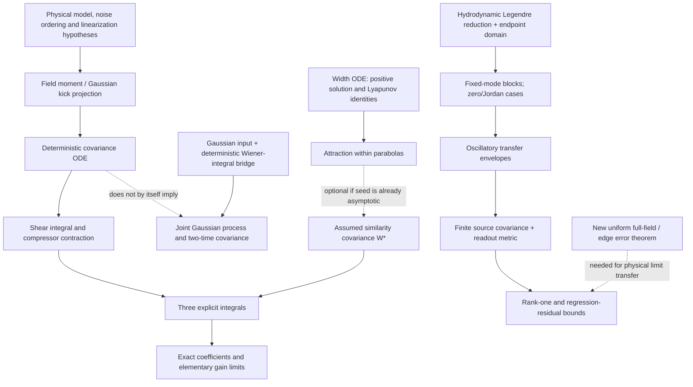

# Lean assessment: amplifier-similariton noise

The best first target is a deterministic covariance calculation: prove the centroid propagator, then the explicit frequency, output-timing and compressed-timing integrals. This can certify the normalizations and coefficients without developing stochastic calculus or proving a hydrodynamic limit. The next target is the fixed-mode Legendre block, including its exceptional modes and the meaning of its oscillatory gain envelopes. A proof of either target would be conditional on a specified physical model.

This assesses the **narrowed wording accepted in PR #34**, not another audit, a Lean proof, or a claim promotion. Every Lean block below is an **unchecked sketch**. No Lean toolchain, elan, lake, or Mathlib checkout was installed or downloaded. No new simulation or numerical algebra check was performed. Scientific numerical evidence is attributed to existing runs; symbolic constants and planning estimates are not simulation measurements.

## Source boundary and family independence

These repository sources were read with `git show origin/<branch>:<path>`. Their revisions define the assessed statements.

| Source | Revision | Material used |
|---|---|---|
| [PR #34](https://github.com/nrivera494/analytical-nl-discovery/pull/34), `task/T-20261011-gpt-a-01` | `b0ec81427ee6fb9b789e3ec98793895acf61130a` | [Audit report](https://github.com/nrivera494/analytical-nl-discovery/blob/b0ec81427ee6fb9b789e3ec98793895acf61130a/docs/review-2026-10-11-gpt-a-highlights-audit.md), Candidate 2 and limitations |
| [PR #33](https://github.com/nrivera494/analytical-nl-discovery/pull/33), `task/T-20261011-claude-interactive.3-01` | `8f6a14c1e2f9329ceb8aa570d3712fd54be5ec1b` | [Highlights](https://github.com/nrivera494/analytical-nl-discovery/blob/8f6a14c1e2f9329ceb8aa570d3712fd54be5ec1b/docs/HIGHLIGHTS.md), revised Candidate 2 |
| [PR #21](https://github.com/nrivera494/analytical-nl-discovery/pull/21), `task/T-20261008-claude-a-01` | `1f766ac814b39705697cfd108e5d6d3f32bb0667` | C-20261008-claude-a-01 and -02; [derivation](https://github.com/nrivera494/analytical-nl-discovery/blob/1f766ac814b39705697cfd108e5d6d3f32bb0667/claims/notes/C-20261008-claude-a-derivation.md) |
| [PR #24](https://github.com/nrivera494/analytical-nl-discovery/pull/24), `task/T-20261008-gpt-a-01` | `1e4d02fddc688343e9f614ff162f2e12e9c8a5d4` | C-20261008-gpt-a-01 and -02: width, exceptional modes and endpoints |
| [PR #30](https://github.com/nrivera494/analytical-nl-discovery/pull/30), `task/T-20261010-claude-interactive.2-01` | `00b3420eae8d47091ea792d2669b331960c09f5e` | [Validation note](https://github.com/nrivera494/analytical-nl-discovery/blob/00b3420eae8d47091ea792d2669b331960c09f5e/explorations/2026-10-10-claude-interactive.2-similariton-validation.md), distinguished from a full-field large-gain theorem |
| Assessment base | `e4fd87932f816c66c4cc21392df5f5181baf39fb` | Repository policy and task/validation interfaces |

A GPT formalization of the Claude noise claims would be cross-family mathematical checking. Review of the physical-to-formal translation would still be needed. GPT formalization of gpt-a's width/attraction claims is a **second verification layer for GPT work**, not an independent-family audit. The Legendre reduction appears in both families' work: its Claude noise application can receive cross-family checking, while borrowing the GPT endpoint and exceptional-mode analysis does not independently verify that GPT analysis. PR #30 is Claude-family validation of Claude claims; PR #34 supplies the cross-family audit. No card status changes follow.

## Summary and priority

L0 means finite-dimensional algebra, including a fixed finite modal or grid model. L1 adds real-variable calculus, continuum functions/operators, or probability without a singular/asymptotic limit. L2 adds a limit with its quantifiers and error control. L3 denotes empirical content, not an established theorem. A finite-dimensional ODE has an L0 state space but still needs L1 calculus.

Effort ranges are **planning estimates in person-weeks for a Lean-capable contributor**, not measured runs or additive commitments. They assume a PI-approved, pinned Mathlib environment and exclude installation. Shared lemmas make later targets cheaper. Exact library sources are recorded below.

| Statement | Level | Key hypotheses | Library status | Effort estimate | Value and recommendation |
|---|---|---|---|---|---|
| Photon-number noise equals linear amplification | L0 covariance algebra; L1 scalar ODE | Bright-signal first order; flat gain; Wigner source; coherent input | Exponential calculus and integration suffice | 1–2 | High normalization value; first package |
| Centroid covariance and compressor contraction | L0 shear; L1 covariance ODE | Deterministic finite $W$; integrable source; no boundary flux; fixed compressor | Matrices, derivatives and integrals; application lemmas needed | 2–4 | Highest reusable value; first package |
| Parabolic-seed frequency and both timing closed forms | L1 explicit integrals; L2 elementary limits | Prescribed asymptotic $W_*$; positive gain; input reference | Elementary calculus; no stochastic library needed | 1–2 after reduction | Best first completed theorem |
| Gaussian-process assertion | L1 probability | Jointly Gaussian input/noise; independence; deterministic square-integrable kernels | Gaussian foundations exist; integral/process bridge needs work | 4–8 beyond deterministic package | Later stage; covariance alone is insufficient |
| Legendre blocks, determinant and roots | L0 polynomial/matrix algebra; L1 ODE | Given hydrodynamic background; admissible modes; $l\ge1$ for elimination | Algebra/ODE foundations; optical reduction is new | 1–3 for fixed modes | Second recommended package |
| $G^{1/3},G^{5/3}$ quadrature-gain envelopes | L2 | Fixed $l\ge2$; exact asymptote; fixed normalization; oscillations | Matrix exponential/asymptotic language; bounds to supply | 2–4 after blocks | High scope value; prove envelopes |
| Spectral rank one and ratio $O(G^{-2/3})$ | L0 covariance; L2 at fixed cutoff | Full source Gram matrix; positive energy variance; shape-block bound; $L^2$ metric | Spectral/Rayleigh tools; local block bound needed | 3–6 after blocks | Reduced-system theorem only |
| Phase/energy locking $O(G^{-2/3})$ | L0 Schur complement; L2 | Positive variances; retained phase coefficient; residual bound; small phase noise | Covariance algebra and asymptotics | 3–6 with modal work | No full-field implication |
| Width Lyapunov identity | L0 rational algebra; L1 chain rule | Positive width and width ODE | Basic calculus | Less than 1 | Cheap dependency; GPT second layer |
| Global attraction within parabolas | L1 ODE continuation; L2 convergence | Positive initial width; finite velocity; compact positive-width sublevel | ODE/Grönwall foundations; continuation proof to assemble | 2–5 | Useful dependency; GPT second layer |
| Continuum Legendre reduction/completeness | L1 | Explicit domain; regular displacement/finite energy or zero flux | Polynomial/analysis foundations; endpoint theory not assumed | 4–8 | Separate from finite polynomial checks |
| Full-field error and large-gain transfer | L2, unresolved | Smooth edge family; uniform remainders; joint gain/noise/cutoff regime | No ready-made amplifier theorem located | Research task; no reliable bounded estimate | Defer |
| Solver agreement, fitted exponents and finite-$\varepsilon_0$ tables | L3 | Registered runs and implementation | Exact certificates could be checked under supplied error bounds | Separate certification project | Evidence, not Lean theorems |

## Modelling axioms and what they omit

Expose these hypotheses rather than hide them in a definition called “amplifier.” “Explicit” means explicit in the narrowed audit/highlight wording; “additional” identifies mathematical obligations left implicit.

| Hypothesis | Status and use | What the idealization loses |
|---|---|---|
| Scalar, single-polarization mean; instantaneous Kerr; constant second-order dispersion | Explicit | Multimode/polarization coupling, Raman, self-steepening and higher dispersion |
| Frequency-flat, constant, unsaturated power gain $g>0$ | Explicit | Filtering/saturation change drift and noise; arbitrary gain is not an experimental regime |
| Deterministic noise-free mean with positive energy | Explicit; regularity additional | Stochastic feedback on the mean; covariance calculus does not prove mean-field existence |
| Integrable moment densities and vanishing flux terms | Additional | Clipped detection or arbitrary periodic/discrete derivatives need not preserve centroids |
| First-order field/readout linearization; coherent input; symmetric ordering | Explicit | ASE–ASE beating, nonlinear noise and exact finite-photon statistics |
| Gaussian circular ASE independent of Gaussian input, with specified strength | Gaussianity/independence must be explicit | Covariance does not determine the law; colored/non-Gaussian reservoirs need another theorem |
| Continuum white noise used through square-integrable test-function projections | Additional | Time-white noise is not an ordinary $L^2$ random field; use finite modes or weak/cylindrical noise |
| Complete moment readout, or a discretization proved to preserve its identities | Additional | A finite-grid theorem does not prove continuum convergence |
| Parabolic hydrodynamics; exact exponential width for the closed forms | Explicit | No arbitrary-input attraction or full-field approximation theorem |
| Specified smooth edge family for a physical field | Explicit after narrowing; uniform bounds additional | A sharp square-root parabola has divergent derivative energy |
| Lossless compressor $D_c=-C_L/\sigma_{\omega L}^2$ with positive denominator | Explicit; denominator additional | Mean rms-duration optimization is not necessarily timing-jitter optimization |
| Fixed cutoff, endpoint domain, source Gram matrix and covariance metric | Partly explicit | No completeness, trace-class control or uniform high-mode estimate |
| Small phase fluctuations throughout a large-gain interpretation | Explicit after audit | Fixed photon number alone does not justify $G\to\infty$ |

The mathematical identities can use weaker signs than physical gain noise. For example $b=2n_{sp}-1\ge0$ makes the covariance source positive; a conventional phase-insensitive amplifier has $n_{sp}\ge1$. The weaker covariance condition alone does not establish physical realizability.

## Exact first-order moment laws

### Deterministic core

The underlying mean equation is the scalar gain NLSE

$$A_z=-i\frac{\beta_2}{2}A_{TT}+i\gamma|A|^2A+\frac g2A.$$

At the field level, circular Gaussian increments are specified weakly by
$\mathbb E[d\eta(T)d\eta(T')^*]=D\delta(T-T')\,dz$ and zero unconjugated covariance. Coherent input uses the corresponding symmetric covariance $(\hbar\omega_0/2)\delta(T-T')$, also interpreted through test functions. The physical parabolic reduction assumes $\beta_2,\gamma>0$; the abstract centroid shear theorem permits any real $\beta_2$. Deriving the first-order projected laws from this model requires the regularity, boundary and readout assumptions below. Taking those projected laws as hypotheses makes the proposed first pilot substantially smaller.

Write $E(z)=E_0e^{gz}$, $N_0=E_0/(\hbar\omega_0)>0$, $b=2n_{sp}-1$, and $D=g(n_{sp}-1/2)\hbar\omega_0$. Fix the frequency convention

$$\bar\Omega=-\frac{\operatorname{Im}\int A^*A_T\,dT}{E},\qquad
\bar T=\frac{\int T|A|^2\,dT}{E}.$$

Here $N_0$ always means photon number. The GPT full-NLSE dependency also uses the symbol $N_0$ for a semiclassical/soliton number; a formal development must give those different names.

For a sufficiently regular decaying mean field define

$$u_T=(T-\bar T)A,\qquad u_\Omega=(i\partial_T-\bar\Omega)A,\qquad
W_{jk}=E^{-1}\operatorname{Re}\int u_j^*u_k\,dT.$$

Then $W_{TT}=\sigma_T^2$, $W_{T\Omega}=C$, and $W_{\Omega\Omega}=\sigma_\omega^2$, including the amplitude-derivative contribution. This real Gram matrix is positive semidefinite. Sufficient hypotheses include $A_T,TA\in L^2$, finite positive energy, enough additional smoothness/decay to differentiate the flux identities, and integrable $z$ dependence. A Schwartz mean trajectory is a convenient strong starting assumption, not a proved global NLSE existence result.

Let $S(z)$ be the covariance of the *first-order centroid fluctuations*, not the optical $W(z)$. Put

$$B=\begin{pmatrix}0&\beta_2\\0&0\end{pmatrix},\quad
P(t)=\begin{pmatrix}1&\beta_2t\\0&1\end{pmatrix},\quad
Q(z)=\frac{2D}{E(z)}W(z)=\frac{gb}{N_0}e^{-gz}W(z).$$

**Proposition M.** For continuous $Q:[0,L]\to\mathbb R^{2\times2}$, $L\ge0$, the covariance initial-value problem

$$S'=BS+SB^{\mathsf T}+Q,\qquad S(0)=W(0)/N_0$$

has the unique solution

$$S(L)=\frac1{N_0}P(L)W(0)P(L)^{\mathsf T}
+\int_0^LP(L-z)Q(z)P(L-z)^{\mathsf T}\,dz.$$

For integrable $Q$ the solution is absolutely continuous and the derivative identity holds almost everywhere. Start with continuous $Q$. Entrywise, the symmetric system is triangular:

$$S_{\Omega\Omega}'=Q_{\Omega\Omega},\qquad
S_{T\Omega}'=\beta_2S_{\Omega\Omega}+Q_{T\Omega},\qquad
S_{TT}'=2\beta_2S_{T\Omega}+Q_{TT}.$$

The compressor readout is

$$\operatorname{Var}(\delta T_{\rm comp})=(1,D_c)S(L)(1,D_c)^{\mathsf T}.$$

This is deterministic calculus; positivity follows from positive initial/source matrices. It proves neither physical source normalization, field-to-moment projection, nor Gaussianity. At L0 independent finite kicks give the exact recurrence $S_{k+1}=P_kS_kP_k^{\mathsf T}+Q_k$; its continuous-model limit is another statement.

**Proposition N.** If $V_N(0)=N_0$ and

$$V_N'=2gV_N+gbN_0e^{gz},$$

then, for $G=e^{gL}$,

$$V_N(L)=N_0G^2[1+b(1-G^{-1})]
=GN_0[1+2n_{sp}(G-1)].$$

The relative-variance denominator is the **deterministic signal mean** $(GN_0)^2$. This is exact for the first-order model, not the exact distribution of signal plus all ASE modes: spontaneous mean photons and ASE self-beating were dropped. “Any seed power” must retain the linearization qualification.

### Gaussian formulation

For centered jointly Gaussian input $\xi_0$ with $\operatorname{Cov}(\xi_0)=S(0)=W(0)/N_0$, an independent standard Brownian vector $B_z^{\rm W}$, and deterministic measurable $H(z)$ with $H(z)H(z)^{\mathsf T}=Q(z)$ and local square integrability, define

$$\xi(z)=P(z)\xi_0+\int_0^zP(z-u)H(u)\,dB_u^{\rm W}.$$

It is a Gaussian process with the stated drift and instantaneous **martingale** covariance $Q(z)dz$. Its full increments need not be independent: timing contains integrated frequency drift. Its two-time covariance is

$$K(s,t)=P(s)S(0)P(t)^{\mathsf T}
+\int_0^{\min(s,t)}P(s-u)Q(u)P(t-u)^{\mathsf T}\,du.$$

The conclusion is joint Gaussianity at finitely many times, not merely Gaussian marginals. Deterministic Gaussian integrals, or construction from a positive covariance kernel, avoid a general nonlinear SDE theorem. The integral's existence, Gaussianity and cross-time isometry still need proof. General Itô's formula is unnecessary here. A covariance-ODE theorem must not be named as if it established the process law.

### Conditional error transfer

In fixed dimensionless coordinates, two supplied paths $W,\widetilde W$ give, for $b\ge0$ and the **Euclidean operator norm**,

$$\|S(L)-\widetilde S(L)\|\le
\frac{\|P(L)\|^2}{N_0}\|W(0)-\widetilde W(0)\|
+\frac{gb}{N_0}\int_0^Le^{-gz}\|P(L-z)\|^2
\|W(z)-\widetilde W(z)\|\,dz.$$

This useful extension turns a **supplied** mean-field error bound into a covariance bound. It does not prove that NLSE error estimate or permit division by a vanishing leading variance.

## Strongly chirped parabolic seed

### Exact calculation inside the reduced model

Take $g,\beta_2,\sigma_{T0}>0$, $\kappa=g/(3\beta_2)$, $U=gL\ge0$, and prescribe

$$W_*(z)=\sigma_{T0}^2e^{2gz/3}
\begin{pmatrix}1&\kappa\\\kappa&\kappa^2\end{pmatrix},\qquad
\sigma_{\omega0}=\kappa\sigma_{T0},\qquad D_c=-1/\kappa.$$

This rank-one matrix is a **hydrodynamic chirp covariance**, not the exact covariance of a finite-energy wave with finite time and frequency second moments. A sharp square-root parabola is not $H^1$; a regular wave's transform-limited part cannot be discarded in its exact $W$.

Proposition M reduces the observables to

$$F_\Omega(U,b)=1+b\int_0^Ue^{-v/3}\,dv,$$
$$F_T(U,b)=(1+U/3)^2+b\int_0^Ue^{-v/3}(1+(U-v)/3)^2\,dv,$$
$$F_c(U,b)=U^2/9+b\int_0^Ue^{-v/3}((U-v)/3)^2\,dv.$$

Their meanings are $N_0\operatorname{Var}(\delta\Omega)/\sigma_{\omega0}^2$, $N_0\operatorname{Var}(\delta T)/\sigma_{T0}^2$, and $N_0\operatorname{Var}(\delta T_{\rm comp})/\sigma_{T0}^2$. These are **input-referenced** factors, not output-shot-reference factors.

**Proposition C.** The exact integral evaluations are

$$F_\Omega=1+3b(1-e^{-U/3}),$$
$$F_T=(1+U/3)^2+b(3+U^2/3-3e^{-U/3}),$$
$$F_c=U^2/9+b(U^2/3-2U+6(1-e^{-U/3})).$$

Use $e^{-U/3}$ in the first Lean file; $G^{-1/3}$ requires specifying real powers and $G>0$. No physical limiting argument is needed to check these integrals. The L2 consequences have exact remainders:

$$F_\Omega-(6n_{sp}-2)=-3b e^{-U/3},$$
$$F_T-\left[\frac{1+3b}{9}U^2+\frac23U+1+3b\right]=-3b e^{-U/3},$$
$$F_c-\left[\frac{1+3b}{9}U^2-2bU+6b\right]=-6b e^{-U/3}.$$

For fixed physical $b\ge1$, $F_c/U^2\to(1+3b)/9$; output timing has the same leading quadratic coefficient. This is far easier than a full-NLSE $\varepsilon_0\to0$ theorem.

### Attachment to a wave field

The audit accepts the leading evaluation at **fixed positive $U$** for a strongly chirped, smoothly regularized parabolic seed. A theorem for $A_{\varepsilon_0}$ must specify the edge family, prove convergence of the actual $W$ and compressor, and bound the integrated error. The original card's $O(\varepsilon_0^2\log(1/\varepsilon_0))$ cannot simply be adopted as established. Constants must name their dependence on $U$, gain, regularization and readout.

The reduced $F_c$ vanishes at $U=0$, while a physical pulse has a transform-limited compressed timing floor. Relative accuracy is therefore not uniform as $U\downarrow0$. A relative theorem needs, for example, $U\in[U_{\min},U_{\max}]$ with $U_{\min}>0$; an absolute bound avoids that division. The gain limit of a reduced closed form and the semiclassical limit of a full-field family cannot be exchanged without uniform estimates.

Run `2026-10-11-gpt-a-highlights-audit-c2` supports the fixed-length calculation and records the short-length failure of uniform relative accuracy. These are L3 checks, not a proved limiting theorem.

### Additional comparator scope issue

For an actual chirped input with $W_0=\bigl(\begin{smallmatrix}t&c\\c&w\end{smallmatrix}\bigr)$, $w>0$, a linear amplifier gives

$$N_0\operatorname{Var}(\delta T_{\rm comp}^{\rm lin})
=[1+b(1-G^{-1})]\,[t+2(\beta_2L+D_c)c+(\beta_2L+D_c)^2w].$$

Compensating only the added dispersion, $D_c=-\beta_2L$, leaves the factor times $t$. The mean-rms-optimal setting $D_c=-\beta_2L-c/w$ instead leaves the factor times $t-c^2/w$. Thus the original card's linear-amplifier compressed-timing factor needs an explicit reference/compressor convention for the strongly chirped seed. This is a symbolic translation issue, not a new numerical refutation of the three closed forms. It does not affect the unchirped-input comparison or the distinction between saturation and quadratic growth. The follow-up pilot should prove this comparator lemma as well.

## Legendre blocks, roots and gain envelopes

The source normalization uses $x=T/T_0$, $\zeta=z/\sqrt{L_DL_{NL}}$, $\varepsilon_0=\sqrt{L_{NL}/L_D}$ and $\Gamma=g\sqrt{L_DL_{NL}}$, with positive reference lengths. The dimensionless parabolic half-width obeys $a''=2e^{\Gamma\zeta}/a^2$. Its scaled width is the separate ODE dependency below.

For given positive parabolic width $a(\zeta)$, $\Gamma,\varepsilon_0>0$ and $q_l=n_l/\varepsilon_0$, the reduced block is

$$\frac d{d\zeta}\begin{pmatrix}p_l\\q_l\end{pmatrix}
=\begin{pmatrix}0&e^{\Gamma\zeta}/a\\-l(l+1)/a^2&0\end{pmatrix}
\begin{pmatrix}p_l\\q_l\end{pmatrix}.$$

Continuous coefficients and $M_l(0)=I$ give $\det M_l=1$ by differentiating the two-by-two determinant. Williamson normal form is unnecessary. The determinant also does not establish that these coordinates, with phase noise omitted, define a complete quantum Gaussian channel.

On $a=Ae^{\Gamma\zeta/3}$, $A^3=18/\Gamma^2$, use $U=gz=\Gamma\zeta$. For **$l\ge1$**, elimination gives

$$n_{l,UU}+\frac23n_{l,U}+\frac{l(l+1)}{18}n_l=0,$$

with companion characteristic polynomial $\mu^2+2\mu/3+l(l+1)/18$. The physical-distance roots are

$$\lambda_l=\frac g3[-1\pm\sqrt{1-l(l+1)/2}].$$

For $l\ge2$ the square root is complex: over real parameters state $-g/3\pm i(g/3)\sqrt{l(l+1)/2-1}$.

- $l=0$: the original block has $n_0'=0$. Extending the eliminated density equation to this mode creates a spurious decaying density solution; its driven phase equation remains separate.
- $l=1$: $n_1=(c_1+c_2U)e^{-U/3}$; the repeated root needs its Jordan factor.
- Fixed $l\ge2$: $n_l=e^{-U/3}(c_1\cos\omega_lU+c_2\sin\omega_lU)$, $\omega_l=\sqrt{l(l+1)/2-1}/3$; reconstruction makes $p_l=e^{U/3}$ times a bounded oscillatory function.

Multiplication by $\sqrt E=\sqrt{E_0G}$ gives power envelopes $G^{1/3}$ and $G^{5/3}$. Fix the norm and input normalization. Individual components can vanish through oscillation, so a universal positive componentwise lower bound is false. Two-sided full-transfer row-norm bounds follow from bounded invertible oscillatory transfer; corresponding variance bounds also need suitable input or source excitation. A constant-prefactor asymptotic equivalent is a stronger and generally different assertion.

The finite calculation assumes the blocks. The continuum reduction also needs

$$\frac d{d\xi}\left((1-\xi^2)P_l'(\xi)\right)=-l(l+1)P_l(\xi)$$

and a domain at $\xi=\pm1$. Fixed low-degree polynomial identities are L0; orthogonality/projection is L1. Completeness and excluding the singular second solution require endpoint analysis. Merely **bounded** flux is insufficient; use regular displacement/finite kinetic energy or zero flux, as in the GPT dependency. No uniform high-mode theorem follows.

## Reduced stochastic shape predictions

### Define the finite covariance problem

Fix a cutoff $M$ (the claim's reduced example uses $l\le4$) and retain

$$B_{lm}=\int_{-1}^1(1-\xi^2)P_l(\xi)P_m(\xi)\,d\xi,\qquad c_l=(2l+1)/2.$$

Here $0\le l,m\le M$, and $B_{lm}$ is a source metric, not the centroid drift. Use $M\ge1$ for a second covariance eigenvalue and $M\ge2$ for the matched-phase readout below. The input $n$ covariance is $4c_lc_mB_{lm}/(3N_0)$; its source per unit $U$ is that matrix times $be^{-U}$. The leading model drops the phase source. Deterministic blocks decouple, but their fluctuations are **correlated**. Diagonalizing the source by omission changes the model.

Here $n=\delta\rho/\rho_{\rm pk}$ uses peak background density, not local density; $\delta E/\bar E=3n_0/2$. Propagate the finite covariance by its deterministic Lyapunov ODE. Fix a deterministic spectral center, core and normalization. The stationary-phase readout is

$$s_l=n_l-\frac{l(l+1)\varepsilon_0}{aa'}p_l,\qquad a'=\partial_\zeta a=\Gamma a/3.$$

One fully specified version avoids time-dependent block coefficients. On the asymptote set $a=Ae^{U/3}$, $\Gamma^2A^3=18$, and $m_l=\Gamma A\varepsilon_0e^{-2U/3}p_l$. For $y_l=(n_l,m_l)$,

$$y_l'=H_ly_l,\qquad
H_l=\begin{pmatrix}0&-l(l+1)/18\\1&-2/3\end{pmatrix}.$$

Let $H$ be the block-diagonal matrix over the fixed cutoff and let $\mathcal Q$ have $nn$ block $4c_lc_mB_{lm}/3$ and all other blocks zero. Define the photon-scaled covariance $R=N_0\operatorname{Cov}(y)$ by

$$R'=HR+RH^{\mathsf T}+be^{-U}\mathcal Q,\qquad R(0)=\mathcal Q.$$

The readout becomes $s_l=n_l-l(l+1)m_l/6$. This precisely identifies the proposed reduced stochastic model; it does not import a fitted exponent as an assumption. It is equivalent to the audit's rescaled implementation in `runs/2026-10-11-gpt-a-highlights-audit-c2/gain.py`.

For homogeneous deterministic trajectories on the exact asymptote, $s_l=n_l+3n_{l,U}$. A white-noise-driven $n_l$ has no ordinary pathwise derivative: for that model write the algebraic readout $s_l=n_l+3(H_ly_l)_n$. The precise Jordan cancellation is

$$(1,-1/3)e^{tH_1}=e^{-t/3}(1,-1/3).$$

It holds for the initial transfer and each distributed-noise impulse, preventing a spurious logarithmic factor in the spectral rate. At L0 the readout is a hypothesis; deriving its Fourier-integral error is a separate L2 problem.

The $L^2[-1,1]$ covariance uses orthonormal Legendre coordinates: if $s=\sum s_lP_l$, these coefficients are $\sqrt{2/(2l+1)}s_l$. Raw coefficient-covariance eigenvalues use another metric.

### A sufficient rank-one theorem

In orthonormal coordinates split the positive-semidefinite covariance into energy and shape:

$$K(U)=\begin{pmatrix}a(U)&h(U)^{\mathsf T}\\h(U)&D_s(U)\end{pmatrix}.$$

Assume $K(U)\succeq0$, $a(U)\ge a_*>0$ and $\operatorname{tr}D_s(U)\le Ce^{-2U/3}$ for every $U\ge0$, with fixed $C\ge0$. Then descending eigenvalues obey

$$0\le\lambda_2(K)/\lambda_1(K)\le(C/a_*)e^{-2U/3}.$$

Restrict the Rayleigh quotient to the codimension-one shape subspace, or use interlacing/min-max. This finite lemma accommodates cross correlations. Cross entries can be $O(e^{-U/3})$; requiring the whole remainder from a fixed rank-one matrix to be $O(e^{-2U/3})$ would be unnecessarily strong. Positivity gives $\|h\|_2^2\le a\,\operatorname{tr}D_s$. For the trace-normalized covariance one can target the explicit Frobenius bound

$$\left\|\frac{K(U)}{\operatorname{tr}K(U)}-e_0e_0^{\mathsf T}\right\|_F
\le\sqrt{2C/a_*}\,e^{-U/3}.$$

Thus projector convergence need not assume convergence of $a(U)$ itself, and its available norm rate differs from the eigenvalue-ratio rate. These are proposed finite-matrix proof obligations, not checked Lean results.

To prove the shape-trace hypothesis from the modal equations, bound transfer and source integrals uniformly in $U$, preserving $B_{lm}$. This supplies an explicit **upper envelope**, with constants allowed to depend on the fixed cutoff and source. A lower envelope needs nondegenerate shape excitation from input or distributed noise; $\sim cG^{-2/3}$ needs convergence of the scaled coefficient and cannot be inferred from oscillatory fits. The narrowed wording's “falls as” should therefore become an explicit upper/two-sided envelope or a separately proved equivalent, not an unspecified `~`. Cutoff-uniformity needs a separate summability argument.

### Phase/energy locking

Let $Y$ be linearized energy, a deterministic nonzero multiple of $n_0$, and $P=p_0-p_2/5$ the matched-LO phase. The phase-quadrature normalization is $C_{PP}=4GN_0\operatorname{Var}P$. For positive variances,

$$1-r^2=\frac{\operatorname{Var}P-\operatorname{Cov}(P,Y)^2/\operatorname{Var}Y}
{\operatorname{Var}P}.$$

This is a normalized Schur complement, the residual of optimal linear regression on energy. Its identity and nonnegativity are L0. L2 requires numerator/denominator bounds, retaining $p_2$ and its correlation with $p_0$. Oscillations favor $O(G^{-2/3})$ or justified two-sided envelopes over a constant-prefactor equivalent.

In the constant-coefficient version above, correlation is unchanged by replacing $P$ with $J=m_0-m_2/5$. A concrete sufficient bound is

$$\operatorname{Var}(J-\tfrac32n_0)=O(e^{-2U/3}),\qquad
\liminf_{U\to\infty}\operatorname{Var}J>0.$$

The first follows from the stable $m_2$ block and the faster-decaying residual $m_0-\tfrac32n_0$, with their source integrals retained. Optimal regression is no worse than that explicit linear predictor. In the specified normalization, direct scalar ODE calculation gives the intermediate targets

$$N_0\operatorname{Var}(m_0-\tfrac32n_0)
=e^{-4U/3}+3b(e^{-U}-e^{-4U/3}),\qquad
N_0\operatorname{Var}n_0=\frac49[1+b(1-e^{-U})].$$

Together with $m_2\to0$ in mean square, they give $N_0\operatorname{Var}J\to1+b>0$. These are symbolic consequences to formalize, not new measured results. The direct phase input/source has been set to zero in this model; a random per-realization removal of global phase would also change the matched-LO observable.

Retain the accumulated nonlinear phase: $C_{PP}$ scales as $G\theta_L^2/\varepsilon_0^2$, with $\theta_L\propto G^{2/3}$ on a fixed similarity family. Its leading power is $G^{7/3}/\varepsilon_0^2$, not bare $G/\varepsilon_0^2$. A physical interpretation needs $\Phi_{NL}\sqrt{n_{sp}/N_0}\ll1$. Fixed $N_0$ need not preserve this as $G\to\infty$; any joint limit must specify a consistent family of gain, energy, semiclassical parameter and noise.

The omitted edge-singular phase source and stationary-phase error remain outside this finite theorem. Failed held-out covariance/error statements and absent full-field large-gain tests are recorded in `2026-10-11-gpt-a-highlights-audit-c2`. Formalizing reduced asymptotics would not repair them.

## Width and background dependencies

For $s>0$, $v=s'$, use

$$s'=v,\qquad v'=-2v/3-s/9+1/(9s^2).$$

The Lyapunov function $V=v^2/2+s^2/18+1/(9s)$ obeys $V'=-2v^2/3$, a small chain-rule/rational-algebra target. Monotonicity alone does not prove convergence. Its sublevel bounds $s$ away from zero and infinity and bounds $v$; local Lipschitz existence plus continuation then gives a global positive solution.

A direct route can avoid a general LaSalle theorem. Set

$$H=s^2/18+1/(9s)-1/6+\tfrac12(v+(s-1)/3)^2.$$

Differentiation on paper gives the candidate proof identity

$$H'+H/3=-v^2/6-(s-1)^2/(27s^2)\le0.$$

Also $s^2/18+1/(9s)-1/6=(s-1)^2(s+2)/(18s)\ge(s-1)^2/18$. An integrating factor gives $H(\tau)\le H(0)e^{-\tau/3}$, hence $s\to1$, $v\to0$. These are symbolic proof obligations, **not Lean-checked identities** or new numerical findings. This route gives an explicit nonsharp rate. The sharp linearized roots still need the local linearization, the $l=2$ block.

This concerns **parabolic hydrodynamics only**. It proves neither arbitrary-input full-field attraction nor persistence of continuum regularity. The GPT mass-coordinate estimate assumes a global regular monotone flow; its full-NLSE card excludes unrestricted strong-field attraction. Preserve those qualifications.

The actual-$W$ centroid theorem needs no attraction theorem. Nor do the closed forms need attraction when the seed is assumed already on the asymptote. Keeping that dependency optional makes the first target smaller and more precise.

## Lean and Mathlib source check

Checked live on 2026-10-12 EDT using Mathlib's generated documentation, the linked GitHub source, primary external project source, and Lean Zulip archives. GPT subagents gpt-b.1 and gpt-b.2 inspected probability/analysis and algebra/special-function declarations; gpt-b inspected the pilot's calculus and selected probability/spectral sources. These were **source inspections**, not local compilation or a transitive axiom audit. No library was installed.

Generated documentation linked more than one source revision. Most inspected files used `4e6064a4a3a617a3ba6739b50152b02e4d6ad3ea` (A); some used `54c01c3314d33d15d77893cbe4e0472ff26bb34d` (B), and the Hermite/Gaussian file used `d6416ab0f09d3a2e090f403fc80f37754f6181a9` (C). The immutable URLs below record what was read. They are not a claim that all files were built together at one revision.

### Located Mathlib declarations

In this table, **D/S** means generated documentation and source checked; **S** means the declaration and surrounding source were inspected. A located general theorem is not a completed application proof.

| Topic | Located declarations and source | Application status |
|---|---|---|
| Hermitian matrices / spectral theorem | `Matrix.IsHermitian.spectral_theorem`, `eigenvectorBasis`, `eigenvalues₀`, `eigenvalues₀_antitone`. [Spectrum.lean, A](https://github.com/leanprover-community/mathlib4/blob/4e6064a4a3a617a3ba6739b50152b02e4d6ad3ea/Mathlib/Analysis/Matrix/Spectrum.lean); [docs](https://leanprover-community.github.io/mathlib4_docs/Mathlib/Analysis/Matrix/Spectrum.html), D/S | Finite covariance spectral theorem available. The modal generator is not Hermitian. Use the explicitly ordered eigenvalues. |
| Matrix norm and Rayleigh quotient | `Matrix.toEuclideanCLM`; `ContinuousLinearMap.rayleighQuotient`, `rayleighQuotient_le_norm`; `LinearMap.IsSymmetric.hasEigenvalue_iSup_of_finiteDimensional`. [Matrix norm, B](https://github.com/leanprover-community/mathlib4/blob/54c01c3314d33d15d77893cbe4e0472ff26bb34d/Mathlib/Analysis/CStarAlgebra/Matrix.lean), [Rayleigh.lean, A](https://github.com/leanprover-community/mathlib4/blob/4e6064a4a3a617a3ba6739b50152b02e4d6ad3ea/Mathlib/Analysis/InnerProductSpace/Rayleigh.lean), S | State operator bounds on the Euclidean continuous linear map. The default norm on a function space is not automatically the intended physical norm. |
| Symplectic groups | `Matrix.J`, `Matrix.symplecticGroup`, `SymplecticGroup.mem_iff`, `mem_iff'`, `det_eq_one`. [SymplecticGroup.lean, A](https://github.com/leanprover-community/mathlib4/blob/4e6064a4a3a617a3ba6739b50152b02e4d6ad3ea/Mathlib/LinearAlgebra/SymplecticGroup.lean), S | The source convention is $J=\left(\begin{smallmatrix}0&-I\\I&0\end{smallmatrix}\right)$. Determinant preservation here needs only direct block algebra. |
| Matrix exponential | `NormedSpace.exp`, `Matrix.exp_transpose`, `Matrix.exp_add_of_commute`, `Matrix.exp_conj`; `hasDerivAt_exp_smul_const'`. [MatrixExponential.lean, A](https://github.com/leanprover-community/mathlib4/blob/4e6064a4a3a617a3ba6739b50152b02e4d6ad3ea/Mathlib/Analysis/Normed/Algebra/MatrixExponential.lean), [Exponential.lean, A](https://github.com/leanprover-community/mathlib4/blob/4e6064a4a3a617a3ba6739b50152b02e4d6ad3ea/Mathlib/Analysis/SpecialFunctions/Exponential.lean), S | Constant-matrix flow and derivative available, including noncommuting ambient algebras. The nilpotent centroid shear can avoid this machinery. |
| Characteristic polynomial / small determinant | `Matrix.charpoly`, `Matrix.charmatrix_apply`, `Matrix.det_fin_two`. [Charpoly/Basic, B](https://github.com/leanprover-community/mathlib4/blob/54c01c3314d33d15d77893cbe4e0472ff26bb34d/Mathlib/LinearAlgebra/Matrix/Charpoly/Basic.lean), [Determinant/Basic, B](https://github.com/leanprover-community/mathlib4/blob/54c01c3314d33d15d77893cbe4e0472ff26bb34d/Mathlib/LinearAlgebra/Matrix/Determinant/Basic.lean), S | The fixed-block characteristic identity is a small exact algebra target. |
| Picard–Lindelöf / uniqueness | `IsPicardLindelof.exists_eq_forall_mem_Icc_hasDerivWithinAt`, `ODE_solution_unique_of_mem_Icc_right`, `ODE_solution_unique_univ`. [ExistUnique.lean, A](https://github.com/leanprover-community/mathlib4/blob/4e6064a4a3a617a3ba6739b50152b02e4d6ad3ea/Mathlib/Analysis/ODE/ExistUnique.lean), D/S | Local existence and uniqueness infrastructure is present. Positive-width global continuation remains an application argument. |
| Grönwall / dynamical limits | `norm_le_gronwallBound_of_norm_deriv_right_le`, `dist_le_of_approx_trajectories_ODE`; `omegaLimit`, `isClosed_omegaLimit`. [Gronwall.lean, A](https://github.com/leanprover-community/mathlib4/blob/4e6064a4a3a617a3ba6739b50152b02e4d6ad3ea/Mathlib/Analysis/ODE/Gronwall.lean), [OmegaLimit.lean, A](https://github.com/leanprover-community/mathlib4/blob/4e6064a4a3a617a3ba6739b50152b02e4d6ad3ea/Mathlib/Dynamics/OmegaLimit.lean), S | The checked Grönwall bounds have constant growth/error parameters. No ready-made LaSalle theorem was located; the shifted-energy argument avoids needing one. |
| Explicit integrals | `intervalIntegral.integral_eq_sub_of_hasDerivAt`, `integral_hasDerivAt_right`; `intervalIntegral.integral_exp`; `Real.hasDerivAt_exp`. [FTC, A](https://github.com/leanprover-community/mathlib4/blob/4e6064a4a3a617a3ba6739b50152b02e4d6ad3ea/Mathlib/MeasureTheory/Integral/IntervalIntegral/FundThmCalculus.lean), [integrals, A](https://github.com/leanprover-community/mathlib4/blob/4e6064a4a3a617a3ba6739b50152b02e4d6ad3ea/Mathlib/Analysis/SpecialFunctions/Integrals/Basic.lean), [ExpDeriv docs](https://leanprover-community.github.io/mathlib4_docs/Mathlib/Analysis/SpecialFunctions/ExpDeriv.html), D/S | Prove a polynomial-times-exponential primitive, continuity/integrability and substitutions. No packaged amplifier covariance theorem was located. |
| Fourier / Plancherel | `VectorFourier.fourierIntegral`, `Real.fourier_eq'`; `MeasureTheory.Lp.fourierTransformₗᵢ`, `norm_fourier_eq`, `inner_fourier_eq`. [FourierTransform.lean, A](https://github.com/leanprover-community/mathlib4/blob/4e6064a4a3a617a3ba6739b50152b02e4d6ad3ea/Mathlib/Analysis/Fourier/FourierTransform.lean), [LpSpace.lean, A](https://github.com/leanprover-community/mathlib4/blob/4e6064a4a3a617a3ba6739b50152b02e4d6ad3ea/Mathlib/Analysis/Fourier/LpSpace.lean), S | $L^2$ Plancherel exists. The transform uses $e^{-2\pi i\langle x,\xi\rangle}$; frequency conversion and the optical stationary-phase estimate remain application work. |
| Legendre polynomials | `Polynomial.shiftedLegendre`, `factorial_mul_shiftedLegendre_eq`, `coeff_shiftedLegendre`, `shiftedLegendre_eval_symm`. [ShiftedLegendre.lean, B](https://github.com/leanprover-community/mathlib4/blob/54c01c3314d33d15d77893cbe4e0472ff26bb34d/Mathlib/RingTheory/Polynomial/ShiftedLegendre.lean); [docs](https://leanprover-community.github.io/mathlib4_docs/Mathlib/RingTheory/Polynomial/ShiftedLegendre.html), D/S | Algebraic shifted polynomials exist. The checked file does not provide the required Sturm–Liouville, orthogonality or completeness package. Its first-degree convention is $1-2X$: substitute $(1-X)/2$ for ordinary $P_l(X)$. |
| Hermite polynomials | `Polynomial.hermite`, `hermite_succ`, `hermite_monic`, `deriv_gaussian_eq_hermite_mul_gaussian`. [Hermite/Basic, A](https://github.com/leanprover-community/mathlib4/blob/4e6064a4a3a617a3ba6739b50152b02e4d6ad3ea/Mathlib/RingTheory/Polynomial/Hermite/Basic.lean), [Hermite/Gaussian, C](https://github.com/leanprover-community/mathlib4/blob/d6416ab0f09d3a2e090f403fc80f37754f6181a9/Mathlib/RingTheory/Polynomial/Hermite/Gaussian.lean), S | Probabilists' normalization. Useful Gaussian foundations; not the required Legendre theory. |
| Asymptotic language | `Asymptotics.IsBigO`, `Asymptotics.IsLittleO`; `isLittleO_exp_neg_mul_rpow_atTop`, `isLittleO_rpow_exp_pos_mul_atTop`. [Defs.lean, A](https://github.com/leanprover-community/mathlib4/blob/4e6064a4a3a617a3ba6739b50152b02e4d6ad3ea/Mathlib/Analysis/Asymptotics/Defs.lean), [Pow/Asymptotics, A](https://github.com/leanprover-community/mathlib4/blob/4e6064a4a3a617a3ba6739b50152b02e4d6ad3ea/Mathlib/Analysis/SpecialFunctions/Pow/Asymptotics.lean), S | Supports fixed-parameter exponential/polynomial limits. Uniformity in gain, edge width and mode cutoff must be proved explicitly. |
| Measure-theoretic probability / covariance | `MeasureTheory.IsProbabilityMeasure`, `ProbabilityTheory.HasLaw`; `ProbabilityTheory.covariance`, `covariance_eq_sub`, `covariance_add_left`, `covariance_sum_left`. [probability measures, A](https://github.com/leanprover-community/mathlib4/blob/4e6064a4a3a617a3ba6739b50152b02e4d6ad3ea/Mathlib/MeasureTheory/Measure/Typeclasses/Probability.lean), [HasLaw, A](https://github.com/leanprover-community/mathlib4/blob/4e6064a4a3a617a3ba6739b50152b02e4d6ad3ea/Mathlib/Probability/HasLaw.lean), [Covariance, A](https://github.com/leanprover-community/mathlib4/blob/4e6064a4a3a617a3ba6739b50152b02e4d6ad3ea/Mathlib/Probability/Moments/Covariance.lean), S | Integrability, typically `MemLp … 2`, is an explicit hypothesis. Probability notation alone does not supply physical noise normalization. |
| Gaussian measures / laws | `ProbabilityTheory.multivariateGaussian`, `isGaussian_multivariateGaussian`, `covariance_eval_multivariateGaussian`; `HasGaussianLaw.map`, `iIndepFun.hasGaussianLaw`. [Multivariate, A](https://github.com/leanprover-community/mathlib4/blob/4e6064a4a3a617a3ba6739b50152b02e4d6ad3ea/Mathlib/Probability/Distributions/Gaussian/Multivariate.lean), [linear maps, A](https://github.com/leanprover-community/mathlib4/blob/4e6064a4a3a617a3ba6739b50152b02e4d6ad3ea/Mathlib/Probability/Distributions/Gaussian/HasGaussianLaw/Basic.lean), [independence, A](https://github.com/leanprover-community/mathlib4/blob/4e6064a4a3a617a3ba6739b50152b02e4d6ad3ea/Mathlib/Probability/Distributions/Gaussian/HasGaussianLaw/Independence.lean), S | Finite Gaussian kicks are feasible. Require PSD to obtain the requested covariance: the multivariate definition defaults to a Dirac measure otherwise. |
| Gaussian processes | `ProbabilityTheory.IsGaussianProcess`, `IsGaussianProcess.of_isGaussianProcess`, `comp_left`. [definition, A](https://github.com/leanprover-community/mathlib4/blob/4e6064a4a3a617a3ba6739b50152b02e4d6ad3ea/Mathlib/Probability/Distributions/Gaussian/IsGaussianProcess/Def.lean), [closure lemmas, A](https://github.com/leanprover-community/mathlib4/blob/4e6064a4a3a617a3ba6739b50152b02e4d6ad3ea/Mathlib/Probability/Distributions/Gaussian/IsGaussianProcess/Basic.lean), D/S | Joint finite-dimensional Gaussianity and finite linear operations exist. Passing to a Wiener-integral limit needs further lemmas. |
| Brownian motion | `ProbabilityTheory.IsPreBrownianReal`, `IsBrownianReal`, `IsPreBrownianReal.covariance_eval`, `hasIndepIncrements`. [BrownianMotion/Basic, A](https://github.com/leanprover-community/mathlib4/blob/4e6064a4a3a617a3ba6739b50152b02e4d6ad3ea/Mathlib/Probability/BrownianMotion/Basic.lean); [docs](https://leanprover-community.github.io/mathlib4_docs/Mathlib/Probability/BrownianMotion/Basic.html), D/S | Predicates and their consequences are present. A concrete continuous construction and integration machinery were located externally, below. |

### What was not located as a ready merged dependency

Targeted documentation/module-index searches and inspection of Spectrum, Rayleigh, SingularValues and SymplecticGroup did not locate an applicable **merged eigenvalue-interlacing theorem or Williamson normal form**. Courant–Fischer needs a more qualified answer: actual [development source at `cdecfb2`](https://raw.githubusercontent.com/leanprover-community/mathlib4/cdecfb2/Mathlib/Analysis/InnerProductSpace/CourantFischer.lean) contains `LinearMap.IsSymmetric.exists_unit_vector_re_inner_le_eigenvalue` and `abs_eigenvalues_sub_le_opNorm`. The [commit page](https://github.com/leanprover-community/mathlib4/commit/cdecfb2) identifies development-branch activity. The linked PR/merge status could not be verified; this is **located source, not a verified merged dependency**. The small PSD block lemma above can instead be proved from the existing eigenbasis and Rayleigh machinery.

The ODE sources, covariance source, Dynamics/OmegaLimit and [Mathlib import index at A](https://github.com/leanprover-community/mathlib4/blob/4e6064a4a3a617a3ba6739b50152b02e4d6ad3ea/Mathlib.lean), plus targeted searches for “variation of constants”, “Lyapunov”, “LaSalle”, “Wiener”, “Itô” and “stochastic differential”, did not locate a packaged covariance Lyapunov ODE solution or merged Wiener/Itô/SDE API at that checked revision. These are bounded search findings, not claims that no Lean development exists.

### External projects and Zulip

| Source and inspection | Located support | Remaining risk |
|---|---|---|
| [Brownian construction](https://github.com/RemyDegenne/brownian-motion/blob/master/BrownianMotion/Gaussian/BrownianMotion.lean), mutable `master`; source checked | `ProbabilityTheory.brownian` and `isBrownianReal_brownian` | Not asserted to be merged Mathlib or compatible with every inspected revision. |
| [MathFin deterministic Wiener integral](https://github.com/formal-applied-math/formal-mathfin/blob/main/MathFin/Foundations/WienerIntegralL2.lean), mutable `main`; source checked | `MathFin.WienerIntegralL2.wienerIntegralLp`, `wienerIntegralLp_norm`, `wienerIntegralLp_integral_sq` | Scalar deterministic $L^2$ kernels; still need vectorization, independent drivers and cross-time covariance. |
| [MathFin Gaussian integral law](https://github.com/formal-applied-math/formal-mathfin/blob/main/MathFin/Foundations/WienerIntegralGaussian.lean); source checked | `MathFin.WienerIntegralL2.wienerIntegralLp_map_eq_gaussianReal`, `wienerIntegralLp_hasLaw_gaussian` | Promising for the process law after proving every finite linear combination is Gaussian. A terminal marginal theorem is insufficient. |
| [MathFin Itô integral](https://github.com/formal-applied-math/formal-mathfin/blob/main/MathFin/Foundations/ItoIntegralCLM.lean); source checked | `MathFin.ItoIntegralCLM.itoIntegralCLM_T`, `itoIntegralCLM_T_norm` | Scalar finite-horizon predictable $L^2$ integration. General nonlinear stochastic calculus is unnecessary for this pilot. |
| [MathFin SDE fixed point](https://github.com/formal-applied-math/formal-mathfin/blob/main/MathFin/Foundations/SDEExistence.lean); source checked | `MathFin.SDEExistence.picardMap_exists_unique_fixedPoint` | Scalar Lipschitz coefficients and $TL_b+\sqrt T L_\sigma<1$. The source identifies pointwise-in-time and all-horizon bridges as subsequent work; do not call this an unrestricted vector SDE theorem. |
| [Physlib project](https://reservoir.lean-lang.org/@leanprover-community/Physlib), formerly PhysLean/HepLean; project documentation and selected source checked | [PhysHermite.lean](https://raw.githubusercontent.com/leanprover-community/physlib/master/Physlib/Mathematics/SpecialFunctions/PhysHermite.lean) contains `Polynomial.physHermite`, `physHermite_orthogonal`, `physHermite_norm` | External physicists' normalization. Does not supply the amplifier's Legendre or stochastic reduction. |
| [Physlib damped oscillator](https://raw.githubusercontent.com/leanprover-community/physlib/master/Physlib/ClassicalMechanics/DampedHarmonicOscillator/Solution.lean), mutable `master`; source checked with Basic.lean | `ClassicalMechanics.DampedHarmonicOscillator.criticallyDampedBase`, `trajectory_equationOfMotion`, `trajectories_unique` | Useful explicit critical/oscillatory solution example. Positive spring constant excludes direct reuse for the zero mode. |

The inspected MathFin [manifest](https://github.com/formal-applied-math/formal-mathfin/blob/main/lake-manifest.json) pins Mathlib `0434c03386d3e7f7fd3ed95754543eabe4ab251b` and BrownianMotion `0d5b6eb928e616d3b1f774ad7d233c167d9f42c9`; its [toolchain](https://github.com/formal-applied-math/formal-mathfin/blob/main/lean-toolchain) specifies Lean `v4.33.0-rc1`. This differs from the documentation snapshots above. Source inspection does not certify those dependencies, their transitive axioms, or compatibility. The PI-approved follow-up must pin and build the chosen project before relying on it.

Physlib's [harmonic-oscillator completeness source](https://raw.githubusercontent.com/leanprover-community/physlib/master/Physlib/QuantumMechanics/HarmonicOscillator/OneDimension/Completeness.lean) still takes an explicit `plancherel_theorem` argument in `QuantumMechanics.OneDimension.HarmonicOscillator.eigenfunction_completeness`. Mathlib now has the $L^2$ theorem above; the adapter to that precise integral-transform hypothesis was not checked. Physlib's inspected [Optics/Basic](https://github.com/leanprover-community/physlib/blob/master/Physlib/Optics/Basic.lean) and [Optics/Polarization/Basic](https://github.com/leanprover-community/physlib/blob/master/Physlib/Optics/Polarization/Basic.lean) are placeholders, not an amplifier model.

Opened Zulip archives supplied leads, not proof or merge evidence: [Legendre polynomials](https://leanprover-community.github.io/archive/stream/217875-Is-there-code-for-X%3F/topic/Legendre.20polynomials.html) proposes Rodrigues definitions; [Rayleigh quotient of a matrix](https://leanprover-community.github.io/archive/stream/113489-new-members/topic/Rayleigh.20quotient.20of.20a.20matrix.html) explains the Euclidean norm interface; [Lyapunov example](https://leanprover-community.github.io/archive/stream/113489-new-members/topic/New.20member.20-.20advice.20appreciated.html) assumes a global trajectory; [Brownian project status](https://leanprover-community.github.io/archive/stream/509433-Brownian-motion/topic/Status.20of.20the.20project.html) distinguishes construction from ongoing integration work. Actual declarations were checked separately where claimed.

### Literature access and existing evidence

- McKinstrie, Santhanam and Agrawal, “Gordon–Haus timing jitter in dispersion-managed systems with lumped amplification: analytical approach,” DOI [10.1364/JOSAB.19.000640](https://doi.org/10.1364/JOSAB.19.000640): **abstract only** accessed by this assessment at the [publisher](https://opg.optica.org/josab/abstract.cfm?uri=josab-19-4-640). It describes a moment-method timing calculation. PR #34's more specific prior-literature attribution is inherited from that audit, not a new full-text novelty finding.
- Coelho, “A Machine-Checked Itô Calculus for Brownian Motion,” [arXiv:2606.15089v2](https://arxiv.org/abs/2606.15089v2), DOI [10.48550/arXiv.2606.15089](https://doi.org/10.48550/arXiv.2606.15089): **full text, selected sections** accessed in [HTML](https://arxiv.org/html/2606.15089v2), alongside the source inspection above. The paper and repository report an external stochastic-calculus development; this assessment does not reproduce its build or dependency audit.

Software documentation, source files and Zulip discussions above are primary software references, not papers with invented DOI identifiers. This is a feasibility search, not a fresh literature novelty audit.

Empirical evidence remains attached to repository runs. The narrowed audit evidence and its held-out limitations are in `2026-10-11-gpt-a-highlights-audit-c2`. Earlier validation is recorded in `2026-10-10-claude-interactive.2-moment-noise` and `2026-10-10-claude-interactive.2-shape-modes`; width checks appear in `2026-10-08-gpt-a-similariton-checks`. No measured error, fitted exponent or new numerical agreement is asserted here without those sources, and none of these runs is a Lean proof.

## First targets and unchecked Lean sketches

### Target 1: covariance shear followed by the three explicit integrals

**Unchecked sketch — Lean 4 over Mathlib; not compiled.** All new definitions and theorem names in this block are proposed local declarations. A `sorry` is an explicit unfilled proof, not a proof artifact.

```lean
import Mathlib

noncomputable section
open MeasureTheory
open scoped BigOperators

abbrev Mat2 := Matrix (Fin 2) (Fin 2) ℝ

def centroidDrift (β : ℝ) : Mat2 := !![0, β; 0, 0]
def centroidShear (β t : ℝ) : Mat2 := !![1, β * t; 0, 1]

def propagatedCov (β : ℝ) (S₀ : Mat2) (Q : ℝ → Mat2)
    (L : ℝ) : Mat2 :=
  centroidShear β L * S₀ * (centroidShear β L).transpose +
    ∫ z in (0 : ℝ)..L,
      centroidShear β (L - z) * Q z *
        (centroidShear β (L - z)).transpose

theorem centroid_covariance_solution
    (β L : ℝ) (hL : 0 ≤ L) (S₀ : Mat2) (Q S : ℝ → Mat2)
    (hQ : ContinuousOn Q (Set.Icc 0 L))
    (hS₀ : S 0 = S₀)
    (hS : ∀ z ∈ Set.Icc 0 L,
      HasDerivAt S
        (centroidDrift β * S z +
          S z * (centroidDrift β).transpose + Q z) z) :
    S L = propagatedCov β S₀ Q L := by
  sorry

def timingIntegral (U r : ℝ) : ℝ :=
  ∫ v in (0 : ℝ)..U,
    Real.exp (-v / 3) * (r + (U - v) / 3) ^ 2

def timingNoise (U b r : ℝ) : ℝ :=
  (r + U / 3) ^ 2 + b * timingIntegral U r

def frequencyNoise (U b : ℝ) : ℝ :=
  1 + b * ∫ v in (0 : ℝ)..U, Real.exp (-v / 3)

theorem timingIntegral_closed (U r : ℝ) :
    timingIntegral U r =
      3 * ((r + U / 3) ^ 2 - 2 * (r + U / 3) + 2) -
      3 * Real.exp (-U / 3) * (r ^ 2 - 2 * r + 2) := by
  sorry

theorem similariton_noise_closed_forms (U b : ℝ) :
    frequencyNoise U b = 1 + 3 * b * (1 - Real.exp (-U / 3)) ∧
    timingNoise U b 1 =
      (1 + U / 3) ^ 2 + b * (3 + U ^ 2 / 3 - 3 * Real.exp (-U / 3)) ∧
    timingNoise U b 0 =
      U ^ 2 / 9 + b * (U ^ 2 / 3 - 2 * U +
        6 * (1 - Real.exp (-U / 3))) := by
  sorry
end
```

The integral identities hold for all real endpoints using oriented integrals. Their **variance interpretation** requires $U\ge0$, $b\ge0$, positive normalization parameters and the specified $W_*$. The covariance signature deliberately states only a consequence of an assumed ODE; a companion existence/uniqueness theorem should identify `propagatedCov` as its solution. Its endpoint derivative hypotheses are stronger than necessary. The existence companion should use within-interval derivatives, or assume continuity on a neighborhood: `ContinuousOn Q (Set.Icc 0 L)` alone does not provide two-sided derivatives of the globally defined formula at the endpoints.

Lemma list:

1. Finite shear multiplication, inverse and derivative; transpose/product differentiation.
2. Differentiate $P(-z)S(z)P(-z)^{\mathsf T}$ and cancel the drift. Integrate entrywise and recover Proposition M. This direct route avoids a generic matrix-exponential or ODE existence API.
3. Gram positivity and compression as a quadratic form; scalar photon-noise integrating factor.
4. Substitute $Q=gb e^{-gz}W_*/N_0$, transform $v=gz$, and prove the frequency and timing kernels. Require $g>0$ for this substitution.
5. Prove the antiderivative $-3e^{-v/3}(x^2-2x+2)$ with $x=r+(U-v)/3$; apply the fundamental theorem of calculus.
6. Specialize $r=1$ and $r=0$, check the reference scales and compressor sign, and prove the exact remainder/limit identities.
7. Add the linear-amplifier comparator and the conditional $W$-error bound.

Physics mapping: `S₀ = N₀⁻¹ • W 0`, `Q z = ((g*b/N₀)*Real.exp(-g*z)) • W z`, and `β = β₂`. The dimensionless timing definition supplies input vacuum plus distributed ASE; it does not claim that an actual optical covariance equals $W_*$. The reduction lemma in step 4 is essential: proving only the scalar integral is not a proof of the whole physical headline.

### Target 2: fixed-mode characteristic polynomial and transfer

**Unchecked sketch — Lean 4 over Mathlib; not compiled.** This algebraic kernel is followed by the ODE lemmas listed below.

```lean
import Mathlib

noncomputable section

abbrev CMat2 := Matrix (Fin 2) (Fin 2) ℂ

def densityCompanion (l : ℕ) : CMat2 :=
  !![0, 1; -((l : ℂ) * ((l : ℂ) + 1) / 18), -(2 : ℂ) / 3]

def shapeFrequency (l : ℕ) : ℝ :=
  Real.sqrt ((l : ℝ) * ((l : ℝ) + 1) / 2 - 1) / 3

theorem densityCompanion_det (l : ℕ) (μ : ℂ) :
    Matrix.det (μ • (1 : CMat2) - densityCompanion l) =
      μ ^ 2 + (2 : ℂ) / 3 * μ +
        (l : ℂ) * ((l : ℂ) + 1) / 18 := by
  sorry

theorem shape_characteristic_roots (l : ℕ) (hl : 2 ≤ l) :
    Matrix.det
      (((-1 / 3 : ℂ) + Complex.I * (shapeFrequency l : ℂ)) •
        (1 : CMat2) - densityCompanion l) = 0 ∧
    Matrix.det
      (((-1 / 3 : ℂ) - Complex.I * (shapeFrequency l : ℂ)) •
        (1 : CMat2) - densityCompanion l) = 0 := by
  sorry
end
```

Lemma list:

1. Prove the two-by-two determinant identity; prove positivity of the square-root argument for $l\ge2$, then the roots.
2. Derive the second-order equation from the original $(p_l,q_l)$ block **only for $l\ge1$**. Keep $l=0$ first order and preserve its neutral optical phase separately.
3. Verify $l=1$'s two independent Jordan solutions and the deterministic transfer-readout cancellation, then apply that identity to each noise impulse.
4. For $l\ge2$, verify the sine/cosine solution and uniqueness, or conjugate the block to a constant matrix whose square is $-\omega_l^2 I$.
5. Prove determinant preservation for a transient positive width. For asymptotic width, bound the oscillatory transfer and inverse with constants depending on the fixed mode.
6. Apply the photon normalization to get upper gain envelopes; prove the stronger nondegenerate variance/row-norm statements separately.
7. Only then assemble the finite modal covariance, its full source Gram matrix, and the spectral/phase readouts.

The algebraic determinant theorem is valid even at $l=0$ as a statement about its *defined companion matrix*. Its use as a density evolution theorem is restricted by step 2. This distinction catches the spurious zero-mode density root that a loose characteristic-root statement misses.

### Dependency graph



The graph intentionally leaves a proved reduced covariance theorem separate from a full-field approximation theorem. Width attraction is a GPT-family dependency; it is not a prerequisite for the first integral pilot.

## Recommendations, follow-up tasks and verification limits

Rank by value and feasibility:

1. **Centroid covariance and the explicit closed forms.** Start with the displayed integral theorem as a small completion milestone, then prove the covariance-to-kernel reduction, photon law and compressor contraction. This package can catch source-strength factors, signs, input/output normalization and the chirped-comparator ambiguity. A proof of the integral alone is insufficient. Task [T-20261012-gpt-b-02](../../tasks/T-20261012-gpt-b-02-prototype-lean-centroid-covariance-and-s.md).
2. **Fixed Legendre blocks and their actual observables.** Prove roots, determinant, exceptional-mode restrictions, transfer solutions and readout cancellation before gain envelopes. This catches division by a zero mode, omitted Jordan factors and componentwise lower bounds that oscillations invalidate. Task [T-20261012-gpt-b-03](../../tasks/T-20261012-gpt-b-03-formalize-fixed-mode-similariton-legendr.md).
3. **Finite covariance asymptotics.** Use the fully specified $R$ equation, the source Gram matrix and the physical covariance metric. Prove the block-trace and regression-residual estimates with explicit constants at fixed cutoff. This can distinguish the matrix convergence rate from the eigenvalue-ratio rate and prevent silently interchanging limits. Task [T-20261012-gpt-b-04](../../tasks/T-20261012-gpt-b-04-prove-finite-similariton-covariance-asym.md).
4. **Positive-width continuation and attraction.** The energy identities are cheap; global positivity and continuation are the substantive obligations. The shifted energy gives a direct quantitative route without a general LaSalle development. This is a second verification layer for GPT work. Task [T-20261012-gpt-b-05](../../tasks/T-20261012-gpt-b-05-formalize-positive-width-similariton-att.md).
5. **Joint Gaussian process.** First prove the finite Gaussian-kick version using Mathlib. Then assess the external deterministic Wiener-integral dependency, independent drivers, two-time covariance and SDE bridge. Do not delay the deterministic pilot for general Itô calculus. Task [T-20261012-gpt-b-06](../../tasks/T-20261012-gpt-b-06-check-lean-gaussian-process-dependencies.md).

The continuum Legendre endpoint/projection work belongs to task -03; uniform cutoff, smooth-edge and full-field error bridges belong to -04. Existing task **T-20261011-gpt-a-03**, on the PR #34 branch, already requests full-field discrepancy diagnosis and converged large-gain tests. The new task links it rather than duplicating that simulation campaign.

The largest risks differ by level. At L0 they are selecting the correct observable, scalar normalization and Euclidean metric. At L1 they are smoothness/integrability, endpoint derivatives, noise projection and library interfaces. At L2 they are lower-bound hypotheses, oscillatory prefactors and constants that may depend on mode cutoff, edge smoothing or gain. L3 numerical tables remain empirical unless accompanied by a separately justified exact-arithmetic or interval certificate. A conditional theorem “if a certified residual is at most $\epsilon$, the conclusion follows” is possible; it does not certify a floating-point run by itself.

The summary's effort ranges cover application proofs after the model is fixed. Formalizing the field-to-moment integration-by-parts projection on a deliberately strong smooth domain would be an additional **4–8 person-weeks**, with lower confidence than the scalar pilot. The continuous Gaussian route is estimated at **4–8 additional person-weeks** only if external dependencies can be reused; rebuilding the needed integration machinery on the checked Mathlib baseline could instead take **8–16 or more**. These are planning judgments, not benchmark measurements. A rigorous full-field hydrodynamic/stationary-phase error theorem is mathematical research, so assigning it a short implementation estimate would be misleading.

A Lean proof would add durable checking of the reduced mathematical statements and expose missing quantifiers that finite tests cannot settle. It would still not establish that the scalar gain NLSE is an adequate experimental model, that first-order linearization remains valid, that the noise ordering matches a detector, or that a chosen discretization approximates a physical field. The audit's failed or untested full-field statements stay unresolved.

No proposed theorem was compiled, no source dependency set was built, and no new numerical check was performed. The mathematical sketches received same-family informal review, which identified the stochastic-derivative qualification and normalization details incorporated above; it is not an independent-family audit. The assessment creates no Lean proof artifact and changes no problem/claim card or scientific status.
