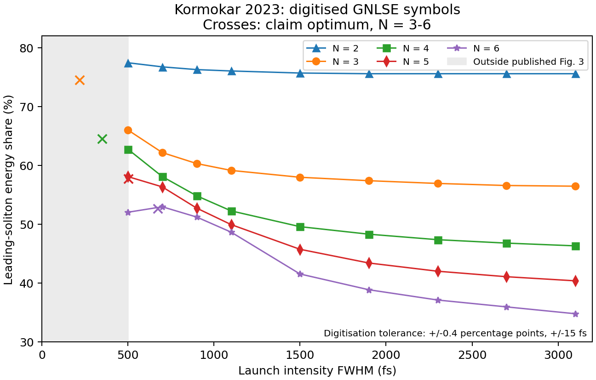

# Raman-transfer efficiency and energy: literature review

The orchestrator widened the original Fig. 3 task on the PI's request to cover items (a)–(d) in the session brief. Here **(d) means the physical-energy corollary**, not the self-steepening item labelled (d) on the claim card.

Clean context: I read the claim card and task, but no proposer logs, exploration files, derivation files outside the card, or run outputs. I ran no Julia and no propagation simulation. My numerical work consists of figure digitisation, fits to those digitised points, and unit conversions. Its provenance is run [`2026-10-16-gpt-b-raman-literature`](../runs/2026-10-16-gpt-b-raman-literature/meta.yaml). Source PDFs and rendered pages are outside git at the `raw_location` recorded there.

## Verdicts

“Partly published” means that a substantial component or the corresponding numerical trend is already present, not that the entire statement has been established. Confidence is high for positive identifications and moderate for the bounded negative searches below. “Not found” is not proof of novelty.

| Item | Verdict and confidence | Closest source and what remains unlocated |
|---|---|---|
| **(a) Long-pulse excess linear in $T_R/T_0$** | **Partly published**: high confidence in a published inverse-duration collision-transfer law and a compatible fission trend; moderate confidence that the specific saturated-fission asymptotic law was not located. | Chi and Wen, **DOI 10.1364/OL.14.001216, full text**, derive $r_E=4C_R$ with $C_R\propto1/T$ for fast collisions. Peleg, **arXiv:0706.4333v2, full text**, gives the corresponding perturbative amplitude change. Kormokar et al., **DOI 10.1364/JOSAB.478975 / arXiv:2301.02945v1, full text**, supply the fission-transfer model and duration data. None states the claimed uniform, post-separation fixed-$N$ asymptotic law. |
| **(b) Duration optimum and $21\,\mathrm{fs}\,N^{1.62}$ position law** | **Partly published**, high confidence for the turnover; moderate confidence for the absence of the fitted position law and its proposed compressed-bandwidth explanation. | Kormokar et al., **DOI 10.1364/JOSAB.478975, full text**, explicitly report the $N=6$ turnover. Their Fig. 3 resolves only one interior maximum. Luan et al., **DOI 10.1364/OE.14.009844, full text**, establish Raman-gain-dependent transfer during collisions, but not $N^2/T_0$ matching in fission. |
| **(c) $f_1^*\simeq1.29/\sqrt N$ and universality** | **Partly published**, high confidence that the $N=5,6$ numerical values are already in the literature; moderate confidence that the general law and response/shape robustness were not found. | Kormokar et al., **DOI 10.1364/JOSAB.478975, full text**: digitised $f\sqrt N\simeq1.299,1.297$ at those two largest samples. Only the $N=6$ peak is bracketed. No inspected source establishes the law through $N=10$ or universality under matched launch conditions. |
| **(d) Nearly $N$-independent energy at the share optimum** | **Partly published**: high confidence for the area-law scaling and a very close published response-overlap width; the specific fission-efficiency selection law was **not found**, with moderate confidence. The absolute-ceiling interpretation is incorrect, with high confidence. | Judge et al., **DOI 10.1364/JOSAB.26.002064, full text**, explicitly find maximum silica Raman-gain/convolution overlap at a fundamental-soliton width of about **18 fs**; Pant et al., **DOI 10.1364/JOSAB.27.001894, full text**, reuse this maximum in a fission/SSFS model. This is close to $1.5\tau_1$, but is not a maximum of the full SSFS rate or a demonstrated share-optimal output width. |

The exact fitted laws, if independently verified, are the narrower possible contribution. The existence of Raman-enhanced fission efficiency, a duration turnover, and Raman-bandwidth-dependent transfer should not be presented as new.

The central phenomenon—Raman transfer increasing the reddest fission soliton's energy above the inverse-scattering partition—is published. Kormokar, Shamim and Rochette explicitly model it and their Fig. 3 already contains an interior maximum for $N=6$. The quantitative $N$-dependent laws and the claimed robustness need separate judgments. I read both the preprint and the published HTML; the published Fig. 3 was also visually checked against the preprint. [DOI 10.1364/JOSAB.478975; arXiv:2301.02945v1, **full text**](https://opg.optica.org/josab/fulltext.cfm?uri=josab-40-2-412).

The physical-energy corollary is an energy **at a share optimum**, not an absolute maximum energy. At fixed $N$, write $K=2N^2|\beta_2|/\gamma$. Then

$$E_1(T_0)=K\frac{f_1(T_0)}{T_0},\qquad
\left.\frac{dE_1}{dT_0}\right|_{f'_1=0}=-K\frac{f_1}{T_0^2}<0.$$

Thus a smooth interior maximum of share cannot simultaneously maximise energy. An interior energy maximum, if it exists in an imposed physical domain, instead satisfies $T_0f'_1=f_1$. This is an algebraic observation about the claim, independent of any simulation or literature access.

## Kormokar Fig. 3: extraction and comparison

Source: Kormokar, Shamim and Rochette, [DOI 10.1364/JOSAB.478975 / arXiv:2301.02945v1, **full text**](https://arxiv.org/abs/2301.02945). I rendered the PDF with PyMuPDF, inspected Fig. 3 on PDF page 8, and extracted its embedded 746-by-572-pixel image (xref 66). I also inspected the fibre-parameter comparison in Fig. 4, the experimental spectra in Figs. 6–7, and the Raman spectra/material comparison in Figs. 8–9.

I digitised **GNLSE symbols**, not the solid analytical-model curves. The latter diverge from the symbols at short durations. Calibration: $y=27$ corresponds to 80%, $y=456$ to 30%; horizontal tick positions set the duration scale. Conservative reading tolerances are **±0.4 percentage points and ±15 fs**. These are reading bounds, not statistical confidence intervals. The approximately 200 fs sampling near the $N=6$ maximum introduces a separate peak-location limitation; ±100 fs is a half-grid resolution description, not a rigorous confidence bound on the continuous maximum.

All entries below are **digitised percentages** with the same ±0.4 percentage-point tolerance. CSV, pixel centres, reproduction script, summary and comparison plot are in the literature run.

| FWHM (fs) | $N=2$ | $N=3$ | $N=4$ | $N=5$ | $N=6$ |
|---:|---:|---:|---:|---:|---:|
| 500 | 77.4 | 66.0 | 62.8 | 58.1 | 52.0 |
| 700 | 76.7 | 62.2 | 58.1 | 56.3 | 53.0 |
| 900 | 76.3 | 60.3 | 54.8 | 52.7 | 51.2 |
| 1100 | 76.0 | 59.1 | 52.3 | 49.9 | 48.6 |
| 1500 | 75.7 | 58.0 | 49.6 | 45.7 | 41.5 |
| 1900 | 75.6 | 57.4 | 48.3 | 43.4 | 38.9 |
| 2300 | 75.6 | 56.9 | 47.4 | 42.0 | 37.1 |
| 2700 | 75.6 | 56.6 | 46.8 | 41.1 | 35.9 |
| 3100 | 75.6 | 56.5 | 46.3 | 40.4 | 34.8 |

The figure starts at 500 fs FWHM. For $N=2,3,4,5$, the largest sampled value occurs at this left boundary: **none of these peaks is bracketed**. For $N=6$, the 700 fs sample is above both 500 and 900 fs. The paper additionally reports, in text, 53.0% at 700 fs and 50.0% at 400 fs for $N=6$, so the turnover is explicit published evidence, even though the paper does not supply a general optimum-position law.

At fixed $N$, maximizing $\varepsilon=f/f^{\rm IST}-1$ is equivalent to maximizing $f$, since $f^{\rm IST}$ is constant. This makes the efficiency plot directly relevant to the claim's excess maximum.

| $N$ | Largest plotted sample: FWHM (fs) | Digitised share (%) | Digitised $f\sqrt N$ | Claim FWHM optimum (fs) | Claim peak share (%) | What is resolved |
|---|---:|---:|---:|---:|---:|---|
| 2 | 500 | 77.4 | 1.095 | 114 | outside claimed $N\ge3$ peak-value law | boundary only |
| 3 | 500 | 66.0 | 1.143 | 219 | 74.5 | predicted optimum outside plot |
| 4 | 500 | 62.8 | 1.255 | 350 | 64.5 | predicted optimum outside plot |
| 5 | 500 | 58.1 | 1.299 | 502 | 57.7 | predicted optimum at plot boundary |
| 6 | 700 | 53.0 | 1.297 | 675 | 52.7 | two-sided sampled maximum |

The claim predictions in this table use the session brief's rounded $T_0^*=21\,\mathrm{fs}\,N^{1.62}$ and $T_{\rm FWHM}=1.763T_0$; they therefore differ slightly from the claim card's more precise response-time prefactor. At the published $N=6$ maximum, $N^2\tau_1/T_0\simeq1.11$. The peak share differs from the claim by only about 0.3 percentage points, within the digitisation tolerance.

**A defensible fit of $T^*(N)$ is not identifiable from Fig. 3.** There is only one bracketed maximum. If one conditionally treats the $N=5$ boundary sample as its true maximum, the two-point position fit is $T_0^*\simeq14.55\,\mathrm{fs}\,N^{1.845}$. It has no residual degrees of freedom, ignores censoring, and is not evidence for a measured exponent different from—or confirming—1.62. For these same two samples, $f\sqrt N=1.299$ and 1.297, with reading tolerances approximately ±0.009 and ±0.010. These published numerical values closely reproduce 1.29; they do not establish the law over $N=3$–10 or its response/shape robustness.

### Long-duration tail

I also fitted $\log\varepsilon$ against $\log(1/T_0)$ using the four digitised points at 1900, 2300, 2700 and 3100 fs FWHM, with $\varepsilon=f/f^{\rm IST}-1$. The finite-range slopes are approximately 1.50, 1.16, 1.07 and 1.36 for $N=3,4,5,6$. Propagating the full independent reading bounds gives broad sensitivity intervals: approximately [−0.05, 3.47], [0.56, 1.82], [0.70, 1.47], [0.99, 1.76], respectively. These are **not** statistical confidence intervals or asymptotic proofs. The $N=2$ excess is too small relative to symbol-reading tolerance to fit meaningfully.

Using the claim's $T_R=1.462$ fs, the digitised $\varepsilon T_0/T_R$ ranges from about 77 to 71 for $N=4$ and 152 to 146 for $N=5$ on that tail. This is consistent with the claim card's approximate coefficients, but is my reanalysis of a published plot, not a law stated by its authors. It strengthens the case that the numerical trend in (a) already exists in the published data while leaving the saturated-fission asymptotic statement unresolved.

## Energy, width and the meaning of saturation

The familiar fundamental-soliton relation gives

$$T_1=\frac{2|\beta_2|}{\gamma E_1}
\simeq\frac{4}{3}N^{0.12}\tau_1$$

when the brief's energy corollary is substituted. Within this NLS area-law approximation, (d) is algebraically equivalent to selecting an output width of order the Raman response time at the **share-optimal** launch duration. The area relation supplies no reason to select that width. The potentially new part is that selection rule and its weak $N$ dependence; the factor $|\beta_2|/\gamma$ alone is familiar.

**A close numerical width scale is already published for silica.** Judge et al.'s Eqs. (7)–(14) express the shift rate as $d\bar\omega/dz=-|\beta_2|R(T_1)/T_1^3$. Their Fig. 2 and accompanying text explicitly identify maximum overlap of the Raman-gain and normalized spectral-convolution functions at $T_1\simeq18$ fs. Pant et al.'s Fig. 2 reproduces the same 18 fs peak, and their theory combines the IST fission partition with this finite-response SSFS integral. I read both full articles and inspected both figures. [Judge et al., DOI 10.1364/JOSAB.26.002064, **full text**](https://doi.org/10.1364/JOSAB.26.002064); [Pant et al., DOI 10.1364/JOSAB.27.001894, **full text**](https://doi.org/10.1364/JOSAB.27.001894).

That published width is $18/12.2\simeq1.48\tau_1$. Inserting 18 fs into the ordinary area relation with the brief's reference SMF coefficients gives **1.85 nJ**, close to the claimed efficient-point energy. This is a unit-conversion comparison, recorded in the literature run, **not an energy optimum reported by those authors**. Judge et al. use an electronic-only nonlinear-index convention for ultrashort solitons; their normalization must be reconciled with the claim's total $\gamma$ before comparing prefactors quantitatively. Most importantly, maximizing $R(T_1)$ does not maximize $R(T_1)/T_1^3$. Neither paper proves that Raman transfer among fission products stops or becomes most efficient precisely at the maximum of $R$. Thus (d) has a strong prior-art timescale antecedent, but does not yet reduce to an established fission selection theorem.

The same response-factor construction appears in Al-kadry and Rochette for $\mathrm{As}_2\mathrm{Se}_3$: their Fig. 2 peaks at 29 fs for a response parameter $\tau_1=23$ fs. They optimize the microwire geometry and maintain separation from the zero-dispersion wavelength; this is not a fixed-$N$ input-duration scan. I read the full article and inspected Fig. 2. [DOI 10.1364/JOSAB.29.001347, **full text**](https://doi.org/10.1364/JOSAB.29.001347).

The nearly constant energy is also an algebraic consequence of combining (b) and (c): the power of $N$ is $2-1.62-0.50=-0.12$. It is not an independent fitted law unless independently tested. The proposed output-width selection, if established, could provide a physical explanation for that combination.

**Published fixed-$N$ calculations illustrate the energy/share distinction directly.** Domingue and Bartels tabulate the following GNLSE results for Gaussian pulses at 1060 nm in a silica PCF. The entries are source-reported values, not digitised or newly simulated; their table is also reproduced as Table 9.1 in Domingue's thesis, which I visually checked. [DOI 10.1364/OE.22.030777, **full text**, Table 1](https://doi.org/10.1364/OE.22.030777); [Domingue thesis, DOI 10.25675/3.022804, **full text**, Chapter 9 selected pages](https://doi.org/10.25675/3.022804).

| Input FWHM (fs) | $N=4$: input / soliton energy (nJ), efficiency | $N=5$: input / soliton energy (nJ), efficiency | $N=6$: input / soliton energy (nJ), efficiency |
|---:|---|---|---|
| 100 | 0.32 / 0.17, 53% | 0.49 / 0.23, 46% | 0.71 / 0.29, 40% |
| 50 | 0.63 / 0.33, 53% | 0.99 / 0.44, 45% | 1.42 / 0.57, 40% |
| 25 | 1.26 / 0.64, 51% | 1.98 / 0.82, 42% | 2.84 / 1.15, 40% |

Absolute soliton energy rises as the pulse shortens while efficiency stays similar or falls. Their practical difficulty is that the energetic soliton overshoots the desired wavelength band before it is isolated. These calculations include effects and a launch shape different from the claim, and do not bracket its predicted duration optima. They are an example of source constraints, not a verification or refutation of the peak-share fit. The source table and its provenance are recorded in `prior_art_summary.json` in the literature run.

Richter, Tolstik and Sorokina explicitly use this area relation and report an energy plateau in a Tm-doped LMA amplifier. Their measured pulse width at the plateau is 125 fs FWHM, and the gain ends as the soliton shifts beyond the Tm amplification band. This is a measured operating limit with gain and wavelength dependence, not a universal $T_1\simeq1.5\tau_1$ criterion. I read the full publisher HTML and inspected Fig. 11. [DOI 10.1364/OE.446612, **full text**](https://opg.optica.org/oe/fulltext.cfm?uri=oe-30-3-3329).

Short-pulse SSFS theory already distinguishes two duration scalings. Herrmann and Nazarkin report an inverse-duration law for pulses comparable to or shorter than the molecular oscillation period; Frosz, Bang and Bjarklev give both the long-pulse inverse-fourth-power and short-pulse inverse-first-power formulas explicitly in Eqs. (15)–(16). Neither is a constant upper SSFS rate along a family of fundamental solitons with fixed fibre parameters. Herrmann and Nazarkin explicitly leave higher-order breakup outside their perturbative single-soliton treatment; I read their full publisher HTML and viewed Fig. 1. [DOI 10.1364/OL.19.002065, **full text**](https://doi.org/10.1364/OL.19.002065); [DOI 10.1364/OE.14.009391, **full text**](https://doi.org/10.1364/OE.14.009391).

Gordon's original treatment already evaluates finite-response corrections beyond the long-pulse approximation. Santhanam and Agrawal's later saturation analysis instead concerns the shift slowing along propagation as dispersion and chirp broaden the pulse. Neither statement supplies a maximum allowed soliton energy at the material response time. [Gordon, DOI 10.1364/OL.11.000662, **full text**, including Eqs. (18)–(23)](https://doi.org/10.1364/OL.11.000662); [Santhanam and Agrawal, DOI 10.1016/S0030-4018(03)01561-X, **full text**](https://doi.org/10.1016/S0030-4018(03)01561-X).

A recent microresonator treatment also obtains the crossover from $T_1^{-4}$ to $T_1^{-1}$, with measurements through the crossover. It treats a driven, dissipative cavity, not energy partition after single-pass fission. Its symbol $\tau_1$ is the **full vibrational period**, with silica $\tau_1/(2\pi)=12.2$ fs. [Nie et al., arXiv:2511.04013v1, **full text**](https://arxiv.org/abs/2511.04013).

This convention matters throughout this review: in the claim's Blow–Wood response, 12.2 fs is an inverse angular frequency, **not the oscillation period**. The latter is about 76.7 fs. The gain peak is near $1/\tau_1$ in angular-frequency units, or near $1/(2\pi\tau_1)$ in ordinary frequency units.

Chen, Taylor and Efimov replace the constant Raman shock time by a pulse-width-dependent response integral. Their Fig. 1 shows the effective coefficient falling rapidly for short silica pulses, and their model includes Raman-induced chirp and nonuniform fibre properties. This is a known failure of the long-pulse approximation, not an extremum of fission conversion efficiency. [DOI 10.1364/JOSAB.27.001022, **full text**, Fig. 1 inspected](https://doi.org/10.1364/JOSAB.27.001022).

There **is** a legitimate short-pulse rate plateau under a different constraint. At **fixed pulse energy**, the impulsive Raman-shifting rate can become duration-independent. Chen et al. make this distinction explicit in their supplementary discussion and Fig. S4; I read the relevant section and inspected the figure. A family of fundamental solitons in one fixed fibre instead has $E\propto1/T_1$, so that fixed-energy plateau does not become a maximum allowed soliton energy. Nor is it the maximum of the normalized overlap function $R(T_1)$ discussed above. [arXiv:2603.21734v3, **full text**, main article and selected supplement, especially PDF pp. 23–24](https://arxiv.org/abs/2603.21734).

An explicit propagation-induced width-selection statement appears in Chen and Wise's gas-fibre Perspective, Sec. III C. The initially short fundamental soliton broadens until its Raman-induced index profile begins to follow the pulse; the authors estimate a duration of order one or two first-response-spike widths. Figure 8 gives the crossover for hydrogen and nitrogen. This is a **propagation-induced slowing and approximate upper duration scale**, not a lower soliton-width bound, an energy ceiling, or a maximum-transfer criterion. The gas response is narrow-line and long-lived; extending that statement to the claim's damped silica response requires an argument not supplied there. [DOI 10.1063/5.0189749, **full text**, relevant section and Fig. 8 inspected](https://pmc.ncbi.nlm.nih.gov/articles/PMC10961736/).

The brief's width approximation is also worth keeping quantitative: $(4/3)N^{0.12}\tau_1$ spans **1.52–1.76 $\tau_1$** over $N=3$–10, not one exactly fixed width. These are sech width parameters; intensity FWHM is 1.763 times larger. The run's algebraic conversion gives, for the brief's reference $|\beta_2|=21.7$ ps$^2$/km and $\gamma=1.3$ W$^{-1}$km$^{-1}$ at $N=4$, approximately 350 fs input FWHM, 2.69 nJ input and 1.74 nJ leading energy. Kormokar's different SMF coefficients instead give about 1.52 nJ at $N=5.57$. A numerical nJ value is not a fibre-independent constant.

## Experimental consistency

All conversions below are reproduced by `compare_experiments.py` and `experiment_comparison.{json,csv}` in run `2026-10-16-gpt-b-raman-literature`. For a transform-limited sech pulse,

$$N=\sqrt{\frac{\gamma E_{\rm in}T_0}{2|\beta_2|}},\quad
T_0=T_{\rm FWHM}/1.763,\quad
T_0^*=21\,\mathrm{fs}\,N^{1.62},\quad
f_1^*=1.29/\sqrt N.$$

The predicted energy is evaluated at a **different input energy**, $2N^2|\beta_2|/(\gamma T_0^*)$, whenever the measured launch duration differs from $T_0^*$. It is not the prediction for the measured off-optimum operating point. Reported values below are text values unless labelled derived; they are not digitised. Source rounding is preserved and missing uncertainties are not invented.

| Experiment, source/access | Reported launch and output | Fibre parameters used: $\lvert\beta_2\rvert$, $\gamma$ | $N$ used | Predicted $T_0^*$ / FWHM (fs) | Predicted $f_1^*$ / $E_1(T_0^*)$ | Comparison and limitation |
|---|---|---|---:|---:|---:|---|
| Kormokar et al. 2023, **10.1364/JOSAB.478975; full text** | EDFA output 938 fs, 1.77 nJ; reported ECE 50.6%; **derived** share-times-input energy 0.896 nJ | 21.61 ps$^2$/km; 1.42 W$^{-1}$km$^{-1}$, source Table 1 | 5.57 reported; sech-equivalent 5.56 | 339 / 598 | 54.7% / 1.52 nJ | Longer than predicted optimum; enhanced share is compatible with the trend. Launch is chirped and duration/$N$ are fitted. Fission occurs in a 3 m patch before a VOA and 100 m SMF-28. 0.896 nJ is **not** an independently measured output energy. |
| Akhoundi et al. 2018, **10.1364/BOE.9.002326; full text** | 400 fs, 5 nJ into 2.5 m SMF-28 at 1560 nm; 2.5 nJ at 1700 nm, 50% | **Conditional** reference 21.61; 1.42, borrowed from Kormokar because this paper does not state them | 6.11 conditional | 394 / 694 | 52.2% / 1.51 nJ | Shorter launch, lower share, but **more** output energy than at the proposed efficient point: the distinction in the brief matters. This is not a fixed-$N$ duration scan. |
| Akhoundi and Peyghambarian 2020, **10.1364/BOE.389557; full text** | 80 mW at 37 MHz gives 2.16 nJ; 200 fs compressed pulse; 11 m SMF-28 gives 40 mW = 1.08 nJ at 1700 nm, 50% | Same **conditional** reference 21.61; 1.42 | 2.84 conditional | 114 / 201 | **Extrapolated** 76.6% / 1.65 nJ | Below $N=3$ validity of peak-share fit. The 200 fs compression plane is not a separately established transform-limited launch plane for the SSFS fibre. Not a test of the law. |
| Li, Luo, He and Hao 2025, **10.1016/j.optlastec.2024.111769; full text** | 5.7 nJ in, 4.8 nJ out, approximately 85%, 5.5 m standard SMF; launch duration not specified at that point | Nominal 23 ps$^2$/km; $\gamma$ not reported (MFD 10.5 µm) | Not identifiable | Not identifiable | Not identifiable | Full text confirms an efficiency peak versus output energy. The preceding EYDCF already changes the pulse spectrum; polarization and amplifier power are varied. High efficiency and energy coexist, but cannot be mapped to a transform-limited sech $N$. |
| van Howe et al. 2007, **10.1364/OL.32.000340; full text** | Approximately 200 fs, 1.39 nJ into HOM module at 1064 nm; approximately 0.8 nJ, 49 fs out, 57% | 37.46 ps$^2$/km **derived** from $D=62.8$ ps/(nm km) at 1060 nm; 2.2 W$^{-1}$km$^{-1}$ | 2.1 reported; sech-equivalent 2.15 | 69.9 / 123 | **Extrapolated** 89.0% / 1.92 nJ | Outside $N\ge3$; measured launch is Gaussian/irregular and the module includes SMF, a grating and HOM fibre. Demonstrates familiar dispersion/mode-area energy scaling, not the claimed optimum. |
| Shamim, Alamgir and Rochette 2023, **10.1109/JLT.2022.3223802; full text** | Compressed main lobe 536–88 fs with pedestal; energy sweep roughly 1.37–8.73 nJ; output 0.8–2.9 nJ, 126–158 fs; ECE 80–85% over part of tuning range | 74 ps$^2$/km; 2.2 W$^{-1}$km$^{-1}$ at 1940 nm | 2.0–2.3 reported from peak power and width | 64.5–81.0 / 114–143 | **Extrapolated** 91.2–85.1% / 3.81–3.74 nJ | Below $N=3$; ranges are not paired operating points. Variable chirp and pedestal prevent recovering $N$ from total energy alone. Their ECE denominator is total **output** energy. |

The first two rows are the most relevant numerical comparisons. The 2018 row changes to $N=5.83$, predicted FWHM 644 fs, share 53.4% and energy 1.66 nJ if the brief's reference coefficients 21.7 and 1.3 are substituted. This is a **parameter-choice sensitivity**, not a measurement confidence interval. The qualitative energy-versus-share distinction survives it.

I inspected Li et al.'s Figs. 3 and 8: the former plots efficiency against output energy for three fibre lengths; the latter shows higher energy at a fixed target wavelength when fibre length is reduced and amplifier power increased. The authors also report 3 nJ at 1700 nm and 6 nJ at 1820 nm with 0.5 m SMF. These are operating points of an amplifier-plus-fibre system, not a universal maximum for passive, scalar SMF propagation. [DOI 10.1016/j.optlastec.2024.111769, **full text**](https://doi.org/10.1016/j.optlastec.2024.111769).

None of these experiments is a matched-$N$ scan through a bracketed share maximum with a fully characterised transform-limited sech launch and the claim's restricted equation. Real fibres include higher-order dispersion, loss, wavelength-dependent nonlinearity, physical Raman spectra, noise and sometimes vector effects; the claim omits these or treats a simpler response. Experiments therefore establish plausibility and identify reference-plane issues, but do not validate the exponent or universality. Spectral-band ECE is also not automatically the same observable as the claim's windowed Zakharov–Shabat leading-eigenvalue fraction.

## What the closest theories already contain

**The proposed $N^2$ first-compression bandwidth needs a separate audit.** Tikan et al. give the large-$N$ first-compression profile for input $\psi(\tau,0)=\mathrm{sech}\,\tau$ as

$$\psi(\tau,\xi_m)\simeq a_0\left[1-\frac{4}{1+4a_0^2N^2\tau^2}\right],\qquad a_0\simeq\sqrt2.$$

Their Fig. 1, which I inspected, shows the peak amplitude relative to the launch amplitude tending to $3\sqrt2$, while the central temporal scale is $T_0/N$. In the claim's $q=N\psi$ normalization this is peak amplitude of order $N$, not $N^2$, at first compression. This published asymptotic result therefore does **not** support obtaining a first-compression bandwidth $N^2/T_0$ by simply adding the IST constituent amplitudes. It does not disprove an empirical finite-$N$ collapse against $N^2\tau_1/T_0$, nor exclude a distinct bandwidth or later interaction scale. It does require the proposed mechanism to specify which profile, propagation point and bandwidth are meant. I read the full preprint and inspected Fig. 1. [Tikan et al., arXiv:1701.08527v1, **full text**](https://arxiv.org/abs/1701.08527).

**First-order transfer is old; the fission limit is a different problem.** Chi and Wen derive $r_E=4C_R$ in their Eq. (6), with $C_R$ inversely proportional to pulse duration, for the energy transferred in a fast collision between two initially independent fundamental solitons. Their calculation uses the long-pulse Raman approximation and large normalized frequency separation. The detuning dependence of Raman gain is compensated by the collision length in that limit. Peleg's Eq. (2) writes the collision amplitude change explicitly as first order in the small Raman coefficient. These are strong antecedents for (a), but neither begins with the phase-locked $N\,\mathrm{sech}$ bound state nor controls the Raman-dependent time needed for fission and subsequent separation. Applying the collision result to that singular long-time limit needs additional work. [Chi and Wen, DOI 10.1364/OL.14.001216, **full text**](https://doi.org/10.1364/OL.14.001216); [Peleg, arXiv:0706.4333v2, **full text**](https://arxiv.org/abs/0706.4333).

Kodama and Hasegawa's normal-form/inverse-scattering analysis separates higher-order dispersive breakup from the Raman calculation. In the Raman subsection they treat a single soliton and obtain zero first-order amplitude derivative with a nonzero frequency derivative. This supports the claim card's isolated-soliton premise, not the transfer coefficient or saturated fission limit. I accessed the licensed IEEE PDF and read the introduction, pp. 520–521, and conclusion; the earlier electromagnetic derivation and appendices were not read in full. [DOI 10.1109/JQE.1987.1073392, **full text**, selected sections](https://doi.org/10.1109/JQE.1987.1073392).

Islam et al. already give the same small-transfer structure in Appendix B: the gain factor for a completed collision is $\exp(4t_d)$ in their normalization, with $t_d$ proportional to the Raman time divided by pulse duration. Its first-order expansion is linear. They explicitly state the narrow, nonoverlapping spectral bands and small energy-change restrictions. Their main setting is modulation-instability-driven multisoliton collisions and an ensemble-averaged spectrum, rather than the present deterministic low-order fission. They also describe SSFS slowing as pulses broaden and loss rises at longer wavelength; that is not saturation of the intrinsic short-pulse shift rate at a fixed material response time. [DOI 10.1364/JOSAB.6.001149, **full text**, Appendix B and main text](https://doi.org/10.1364/JOSAB.6.001149).

**The high-order-pulse transfer mechanism predates the recent efficiency paper.** Afanasyev, Vysloukh and Serkin explicitly describe inelastic interactions increasing the energy of the strongest red-shifting component of a high-order multisoliton pulse. Their separate two-pulse calculation varies duration and discusses the nonstationary Raman response, molecular oscillation frequency and relative phase. Figure 2(b), which I inspected, shows a duration-dependent energy ratio without an interior maximum over its plotted interval. It is not a fixed-$N$ fission share scan and gives none of the proposed $N$ laws. Tai, Hasegawa and Bekki provide earlier Raman-induced breakup and inverse-scattering comparisons, but not the proposed enhanced-share optimum. Their erratum changes the Raman sign/time convention and must accompany the original. [Afanasyev et al., DOI 10.1364/OL.15.000489, **full text**](https://doi.org/10.1364/OL.15.000489); [Tai et al., DOI 10.1364/OL.13.000392, **full text**](https://doi.org/10.1364/OL.13.000392); [erratum, DOI 10.1364/OL.13.000937, **full text**](https://doi.org/10.1364/OL.13.000937).

**Raman spectral matching is also established, with different variables.** Luan et al.'s collision model makes transfer depend on the Raman gain at the frequency difference between solitons and their temporal overlap. Their Fig. 3 was inspected. This supports a general gain-overlap explanation, but does not identify the compressed bound state's bandwidth with $N^2/T_0$ or derive a fixed-$N$ duration optimum. Balla, Buch and Agrawal distinguish overlap-mediated energy transfer from a delayed Raman wake that changes phase, and show that phase matters. These results caution against inferring launch-shape universality from a gain-bandwidth argument alone. [Luan et al., DOI 10.1364/OE.14.009844, **full text**](https://doi.org/10.1364/OE.14.009844); [Balla et al., DOI 10.1364/JOSAB.34.001247, **full text**](https://doi.org/10.1364/JOSAB.34.001247).

Kormokar et al.'s Eqs. (20)–(25) combine spectral gain overlap and an estimated temporal pump overlap. Their proportionality factor contains a numerically fitted constant, so this is a useful reduced description rather than a parameter-free asymptotic proof. For the short-duration turnover they tentatively invoke transfer to the second soliton, not the proposed compressed-bandwidth resonance. Fig. 4 already reports independence from $\beta_2$ and $\gamma$ at fixed order. Figs. 8–9 compare material Raman responses, but do not maximize separately over duration for each response; they cannot establish or refute universality of the optimized value. [DOI 10.1364/JOSAB.478975, **full text**](https://doi.org/10.1364/JOSAB.478975).

Agrawal's Raman-assisted compression work and Banaee and Young's compression analysis optimize propagation length and compressed-pulse quality. The latter emphasizes the failure of a first-moment Raman approximation for very short compressed pulses. Neither supplies the fixed-$N$ share-optimal launch-duration law. The rogue-soliton literature likewise establishes collision-driven energy redistribution, but uses noisy many-soliton or modulation-instability settings; large transient collision peaks and the final reddest soliton are different observables. [Agrawal, DOI 10.1364/OL.15.000224, **full text**](https://doi.org/10.1364/OL.15.000224); [Banaee and Young, DOI 10.1364/JOSAB.23.001484, **full text**](https://doi.org/10.1364/JOSAB.23.001484); [Erkintalo, Genty and Dudley, DOI 10.1140/epjst/e2010-01244-9 / arXiv:1007.2782, **full text**, model and conclusions inspected](https://arxiv.org/abs/1007.2782); [Mussot et al., arXiv:0903.4522, **full text**](https://arxiv.org/abs/0903.4522).

### Rochette group and related optimization work

Kormokar et al. (2021) extend moment formulas for a fundamental soliton in fibres with frequency-dependent dispersion, nonlinearity and loss. The treatment assumes a pulse long enough for the Raman-time approximation and is not a fission energy-partition theory. Kormokar's thesis reproduces the 2023 efficiency analysis in Chapter 4, including the same Fig. 3 data as Fig. 4.3; it is not independent evidence for the fitted laws. I read that chapter, the relevant contents and conclusions, and the amplifier chapter's summary, not the entire thesis. [DOI 10.1364/JOSAB.409240, **full text**](https://doi.org/10.1364/JOSAB.409240); [Kormokar thesis, DOI 10.82308/31318, **full text**, selected chapters](https://doi.org/10.82308/31318).

Shamim et al.'s high-efficiency experiment preserves a low soliton order through compression and uses a pedestal-bearing launch, as detailed in the table. Fariha's thesis studies phase control and energy transfer from the pedestal; I inspected the relevant efficiency sections and Fig. 4.25. These sources reinforce the practical importance of launch preparation, but do not show the claimed matched-$N$ optimized-share universality. The claim card's Gaussian comparison reports leading energy at equal peak amplitude, which is not by itself a comparison of energy fractions at matched $N$ and matched launch energy. [DOI 10.1109/JLT.2022.3223802, **full text**](https://doi.org/10.1109/JLT.2022.3223802); [Fariha thesis, DOI 10.82308/12203, **full text**, selected sections](https://doi.org/10.82308/12203).

Arteaga-Sierra et al. optimize soliton output energy within a prescribed wavelength channel while varying launch wavelength, power and pulse duration. Their optimization objective and constraints differ from a share maximum at fixed $N$. This is an antecedent for practical source optimization, not the specific law under review. [DOI 10.31349/RevMexFis.63.2.111, **full text**](https://doi.org/10.31349/RevMexFis.63.2.111).

### Neighbouring materials and other reported limits

Energy scaling by dispersion and mode area is established in higher-order-mode and large-mode-area SSFS sources. The van Howe experiment in the table is a direct example. Li et al.'s LMA source reaches much higher pulse energies while encountering long-wavelength absorption; its efficiency-versus-wavelength curve is not a fixed-$N$ duration scan. These source limits depend on the target wavelength, fibre and coupling, not just $\tau_1$. [van Howe et al., DOI 10.1364/OL.32.000340, **full text**](https://doi.org/10.1364/OL.32.000340); [Li et al., DOI 10.1364/OE.26.019637, **full text**, Figs. 3–4 inspected](https://doi.org/10.1364/OE.26.019637).

Wang and Xu explicitly scale available soliton energy with effective mode area in an LMA time-lens source. They report nanojoule solitons from a picosecond, pedestal-bearing launch, without optimizing input duration at fixed $N$. Matsuo, Nishizawa, Mori and Goto's PM-fibre study compares several launch durations and core sizes: at fixed average launch power, shorter pulses shift farther, while increasing power can raise soliton energy and lower conversion efficiency. Their output width is set by the fibre and propagation conditions and is much longer than the proposed silica response-time width. I read both full papers and inspected Matsuo et al.'s Figs. 5–6. The latter does not supply a numerical $\gamma$ and sufficiently unambiguous paired launch/output reference planes for another reliable row in the fixed-$N$ table. [Wang and Xu, DOI 10.1364/OL.36.000942, **full text**](https://doi.org/10.1364/OL.36.000942); [Matsuo et al., DOI 10.1007/s10043-000-0309-1, **full text**](https://doi.org/10.1007/s10043-000-0309-1).

Lee, van Howe, Xu and Liu's review explicitly connects accessible soliton energy to dispersion, effective area and nonlinear index, and describes arrest of the shift by dispersive-wave recoil near a zero-dispersion wavelength. The discussion contains no response-time selection of the most efficient fission soliton. I read Sections I–III and V, including their source-comparison table; the signal-processing applications were not read in detail. [DOI 10.1109/JSTQE.2008.915526, **full text**, selected sections](https://pmc.ncbi.nlm.nih.gov/articles/PMC3465838/).

Zitelli et al. report energy clamping and SSFS suppression in highly excited graded-index multimode fibres. Their Figs. 7–8 show nearly constant output widths and wavelengths over a substantial soliton-energy range. The paper associates the clamping with nonlinear loss and discusses a dispersion/nonlinearity balance; it does not identify a silica Raman-time minimum width or the leading-share optimum. It is a relevant example of a **physical, system-dependent limit**, and also a warning that a common output width need not imply the mechanism proposed here. I read the model, energy-loss, duration and conclusion sections and inspected Figs. 7–8. [DOI 10.1364/OE.394896 / arXiv:2005.00819, **full text**, selected sections](https://arxiv.org/abs/2005.00819).

For Raman-active gases, Chen et al. demonstrate hydrogen-filled hollow-core-fibre SSFS and discuss its distinct long-lived response. The more recent gas-mixture work explicitly engineers the temporal Raman response to improve conversion and relates response period to pulse width. It optimizes gas response at a given launch, not silica launch duration at fixed soliton order; its quoted quantum conversion efficiency also differs from energy conversion efficiency. It is a strong neighbouring example of response matching, but not a source of the proposed $N$ laws. [Chen et al., arXiv:2110.12360v2, **full text**, main article](https://arxiv.org/abs/2110.12360); [Chen et al., arXiv:2603.21734v3, **full text**, main text and figures; supplement not read in full](https://arxiv.org/abs/2603.21734).

In fluoride fibres, Gauthier et al. demonstrate fission-generated solitons into the mid-IR; wavelength-dependent dispersion, effective area and loss determine the evolving duration and shift. In chalcogenide waveguides, Li et al. show geometry-dependent wavelength and efficiency, including a dispersion-related stopping point for the shift. Neither supplies a universal energy at maximal transfer or the fixed-$N$ peak-share law. [Gauthier et al., DOI 10.1038/s41598-022-19658-8, **full text**](https://doi.org/10.1038/s41598-022-19658-8); [Li et al., DOI 10.1002/lpor.202000301, **full text**](https://doi.org/10.1002/lpor.202000301).

Tang et al.'s fluoride source provides another concrete limit: at their highest available incident energy, connector damage prevents further experimental scaling; simulations and the area theorem allow higher soliton energies, while long-wavelength loss and dispersion limit further shifting. Their reported fundamental-mode conversion efficiency differs from whole-system efficiency because of input coupling. Alamgir et al.'s chalcogenide microwire experiment instead reaches its highest efficiency at a lower pump power than its highest soliton energy; their denominator is total output power. They attribute declining efficiency at higher drive to secondary solitons and residual background. These are useful parallels to the efficiency/energy distinction, but neither is a fixed-$N$ duration scan. [Tang et al., DOI 10.1364/OPTICA.3.000948, **full text**, main article; supplement not read](https://doi.org/10.1364/OPTICA.3.000948); [Alamgir et al., DOI 10.1364/OL.443848, **full text**](https://doi.org/10.1364/OL.443848).

A related optimum exists even in a different, Raman-free model. Driben and Malomed optimize third-order-dispersion strength to produce a strongly compressed leading fission soliton. Their Fig. 3 gives an approximately inverse-$N$ optimal normalized TOD, from competition between energy capture and radiation. I read the full preprint and inspected Figs. 3–4. This is an antecedent for an $N$-dependent optimum in enhanced fission, but it contains no Raman response time and is not the present silica efficiency law. [DOI 10.1364/OL.38.003623 / arXiv:1308.4270, **full text**](https://arxiv.org/abs/1308.4270).

The comparison with $2/N$ concerns the input soliton content under the passive-mask restriction stated in the claim. Raman propagation exchanges energy between soliton components, so exceeding that input restriction is not evidence for a violation of a propagation-energy bound. I did not independently audit the passive-mask theorem in this literature task. No inspected source states the combined $1.29/\sqrt N$ law and that particular passive-mask comparison.

## Search and access log

The search was conducted on 2026-10-16. The exact web-query batches and major access notes are preserved in [`search_queries.json`](../runs/2026-10-16-gpt-b-raman-literature/search_queries.json). I used general web search to locate primary sources, then read arXiv, Optica, IEEE Xplore, publisher pages, PubMed Central, author/university copies, McGill eScholarship and Colorado State University's Mountain Scholar repository. Some publisher full texts were available through the browser's existing Cornell University Library access. I did not conduct a subscription Scopus or Web of Science citation-index search.

| Search family | Representative queries and author/title searches | Coverage and remaining limitation |
|---|---|---|
| Exact proposed laws | `"soliton fission" "1.29"`; `"soliton" "N" "1.62" Raman`; `"Raman soliton" "square root" efficiency` | No inspected result stated the combined proposed laws. These searches also miss equations stored only as images or using different notation. |
| Efficiency versus duration | `"soliton self-frequency shift" "optimal" "pulse duration" "efficiency"`; Kormokar/Rochette title and DOI searches | Full 2023 article, 2021 article, relevant thesis chapters, source experiments and alternative optimization papers. The 2022 conference PDF remained inaccessible; Fig. 3's underlying numerical data were not publicly supplied. |
| Collision transfer and fission | Chi/Wen, Islam, Luan/Skryabin/Yulin/Knight, Frosz/Bang, Tai/Hasegawa/Bekki, Kodama/Hasegawa; `"soliton fission" "energy partition" Raman maximum` | Perturbative transfer laws, inverse-scattering treatment, full-response collisions, rogue-soliton papers and their cited antecedents. These settings differ from saturated deterministic low-order fission. |
| Energy limits and output width | `"soliton energy limit" Raman`; `"maximum soliton energy" "self-frequency"`; `"Raman" "maximum energy" "response time" soliton`; `"Raman" "energy conversion" "18 fs"` | Area-law scaling, finite-response SSFS integrals, silica overlap maximum, amplifier/loss/dispersion limits, fixed-energy versus fundamental-soliton constraints. No universal passive-fibre energy ceiling was identified in the inspected sources. |
| Experiments and energy scaling | `"Raman soliton" "efficiency" "SMF-28" duration energy`; Wise/van Howe/Lim/Wang/Lee/Xu; Nishizawa/Goto; large-mode-area SSFS | Six tabled experiments or source configurations, with missing coefficients, pulse shape and reference planes explicitly marked. No matched-$N$ duration scan with complete experimental metadata was found. |
| Other materials and platforms | Hydrogen/gas-mixture Raman SSFS, chalcogenide microwire, fluoride/mid-IR energy scaling, Raman waveguide, microresonator, multimode clamping | Full-text examples discussed above. Their different response functions, dispersion, gain, loss or cavity constraints prevent a direct universality inference. |

The bounded negative verdicts mean **not found in these searches and the explicitly inspected source sections**. They do not mean that all papers, all languages, all theses or all citations have been exhausted. Abstracts were used to locate leads; detailed conclusions above rely on the stated full-text access. No paper was cited solely because an unlocated reference appeared in another bibliography.

### Access gaps

These sources were located but not read in full. Their abstracts do not support a conclusion about equations or figures that I could not inspect.

| Located source | Access achieved | What remained unavailable or unread |
|---|---|---|
| Kormokar and Rochette, CLEO 2022, [DOI 10.1364/CLEO_SI.2022.SF3H.6](https://doi.org/10.1364/CLEO_SI.2022.SF3H.6) | **abstract only** | Publisher page located and licensed access indicated, but PDF request hit an IP downloading timeout. A public author-copy page was located; its download did not yield an inspectable PDF in this workflow. Its figure could contain useful earlier scan data. |
| Hodel and Weber 1987, [DOI 10.1364/OL.12.000924](https://doi.org/10.1364/OL.12.000924) | **abstract only** | Full-text request redirected to the publisher's downloading-timeout notice. |
| Nishizawa and Goto 2001, [DOI 10.1109/2944.974222](https://doi.org/10.1109/2944.974222) | **abstract only** | Full experimental article not obtained; the related Matsuo et al. 2000 full paper was read separately. |
| Lucek and Blow 1992, [DOI 10.1103/PhysRevA.45.6666](https://doi.org/10.1103/PhysRevA.45.6666) | **abstract only** | APS full-text access was not obtained. |
| Kutz, Lynga and Eggleton 2005, [DOI 10.1364/OPEX.13.003989](https://doi.org/10.1364/OPEX.13.003989) | **abstract only** | Full treatment not read; not used to infer a deterministic fission-efficiency law. |
| Wang and Xu 2011, APL, [DOI 10.1063/1.3628337](https://doi.org/10.1063/1.3628337) | **abstract only** | Full APL paper not obtained. Their separate Optics Letters article, DOI 10.1364/OL.36.000942, was read in full. |
| Herrmann and Nazarkin 1996, [DOI 10.1103/PhysRevE.53.6492](https://doi.org/10.1103/PhysRevE.53.6492) | **abstract only** | Full later treatment not obtained; the 1994 Optics Letters article was read in full. |
| Kormokar and Rochette 2024, [DOI 10.1364/JOSAB.521085](https://doi.org/10.1364/JOSAB.521085) | **abstract only**, journal article | The related amplifier chapter summary in Kormokar's thesis was read, but not used as a substitute for a complete journal-text check. |
| Kormokar, Nayan and Rochette 2025, [DOI 10.1364/OL.551176](https://doi.org/10.1364/OL.551176) | **abstract only**, journal article | Related thesis material was located; the journal article was not read in full. |
| Yang et al. 2025, [DOI 10.1002/lpor.202401435](https://doi.org/10.1002/lpor.202401435) | **abstract only** | Full article not obtained; excluded from quantitative comparisons. |

The long theses were read only in the chapters and sections identified above. Chen et al. arXiv:2603.21734v3 was read in the main text and selected supplement, including Fig. S4; Tang et al.'s supplementary file was not read. Kodama and Hasegawa's licensed full PDF was accessed, but only the explicitly identified sections were read. Browser-accessible full HTML counts as full-text access even where a direct PDF download failed. Several failed downloads returned HTML or an error page despite a PDF-looking filename; none was treated as a read paper. Publisher access limits and authentication challenges were not bypassed. No author was contacted.

### Follow-up work

- **T-20261016-gpt-b-08:** derive the uniform long-pulse fission limit and compare it with the published collision and fitted-overlap models.
- **T-20261016-gpt-b-09:** reconcile the first-compression bandwidth argument and determine whether the published response-overlap width can select a fission-efficiency optimum, including the nonlinear-coefficient convention.
- **T-20261016-gpt-b-10:** independently test the laws with matched launch conditions, bracketed maxima, relaxed assumptions and experimentally comparable observables.
- **T-20261016-gpt-b-11:** close the full-text gaps and locate public data that bracket more than one duration optimum. Author outreach requires a separate PI instruction.

This review completes the literature task. It does not mark the claim simulated, verified or audited, and it does not independently establish the passive-mask bound. The claim card receives only an additional novelty-search row linking this report and the literature run.

