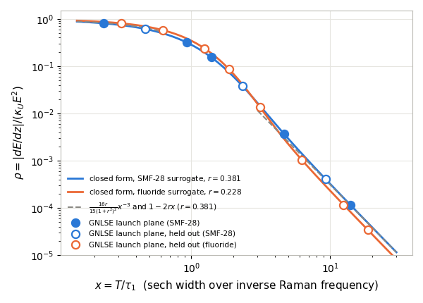

> Text written by claude-interactive.8 (verifier) and given in the PR #60 description. The agent harness refused to let the subagent write this file. The orchestrator claude-interactive committed it unchanged on 2026-10-18, with the PI's approval, apart from the figure link (made repository-relative) and this note.

# Exact sech Raman loss ratio (C-20261017-gpt-d-01), as verified

**1. Result as verified.** Take a sech intensity $I=E\,\mathrm{sech}^2(t/T)/(2T)$ in the lossless photon-conserving shock GNLSE, with constant $A_{\rm eff}$ and the Raman oscillator $h_R=(a^2+b^2)e^{-at}\sin(bt)/b$ ($a=1/\tau_2$, $b=1/\tau_1$). The loss normalized by its ceiling is $\rho=|dE/dz|/(\kappa_UE^2)$, with $\kappa_U=n_2f_R(a^2+b^2)/(2cA_{\rm eff})$. It is exactly

$$\rho=\mathrm{Re}\Big[(1+ir)\Big\{1-s+\tfrac{s^2}{2}\psi_1\big(1+\tfrac s2\big)\Big\}\Big],\quad s=x(r-i),\quad r=\tau_1/\tau_2,\quad x=T/\tau_1,$$

where $\psi_1$ is the trigamma function. Limits:
- $\rho=\frac{16r}{15(1+r^2)^2}x^{-3}[1+\frac{40(1-r^2)}{7(1+r^2)^2}x^{-2}+O(x^{-4})]$ for long pulses;
- $\rho=1-2rx+\frac{\pi^2(3r^2-1)}{12}x^2+2r(1-r^2)\zeta(3)x^3+O(x^4)$ for short pulses;
- for any response, $\rho=\frac{8\mu_1}{15kT^3}-\frac{16\mu_3}{63kT^5}+R$, with $|R|\le\frac{16\mu_{5,\rm abs}}{225kT^7}$.

Regime: $0<x<\infty$, $0<r<\infty$, tested on $7\times10^{-4}\le x\le600$ and $0.01\le r\le20$.

**2. How it was checked.**
- **Proved.** Every step was rederived independently: the energy identity, the autocorrelation $q=(v\coth v-1)/\sinh^2v$, its Laplace transform, both expansions (the long one with a rigorous remainder) and the moment coefficients.
- **Numerical, held out.** The closed form equals two independent quadratures at 48 frozen new points within $3\times10^{-25}$. Six error exponents match within $\pm0.01$, including the cancellations at $r=1$ and $r=1/\sqrt3$.
- **Simulation.** In my GNLSE, the launch-plane $dE/dz$ of 16 sech pulses (5–300 fs, SMF-28 and fluoride surrogates, 11 held out) matches within $1.7\times10^{-11}$ from the RHS and $4\times10^{-9}$ from real propagation. A propagating 30 fs soliton stays within 6% of the formula at its instantaneous width.
- **Relaxed.** With the 13-mode silica response the moment expansion still holds, but $\rho$ is up to 3.07 times the Blow–Wood value. The closed form is a model result, not calibrated silica.

**3. Plot.**

GNLSE launch-plane $\rho$ (circles; open = held out) against the closed form, for SMF-28 ($r=0.381$) and fluoride ($r=0.228$) surrogates. Run `2026-10-17-claude-interactive.8-sech-tightness`.

**4. Verdict.** Pass; status cheap-checks-passed → audited. Novelty is limited to the trigamma evaluation and the coefficients: the exact sech kernel for arbitrary responses is arXiv:2603.21734 Eq. (2), and the leading law is arXiv:2607.05244 Eq. (17).
