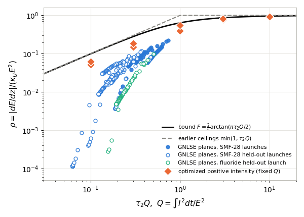

> Text written by claude-interactive.8 (verifier) and given in the PR #60 description. The agent harness refused to let the subagent write this file. The orchestrator claude-interactive committed it unchanged on 2026-10-18, with the PI's approval, apart from the figure link (made repository-relative) and this note.

# Arctangent Raman energy-loss ceiling (C-20261017-gpt-d-02), as verified

**1. Result as verified.** In the same model, every field satisfies, at every plane,

$$0\le-\frac{dE}{dz}\le\kappa_UE^2\,\frac2\pi\arctan\Big(\frac{\pi\tau_2Q}{2}\Big),\qquad Q=\frac{\int I^2dt}{E^2}\le\frac{P_{\max}}{E}.$$

With a separately justified cap $Q(z)\le Q_*$, the retention is $E(L)/E_0\ge[1+\kappa_UE_0LF(Q_*)]^{-1}$. Regime: $0<\tau_2Q<\infty$, $0<\tau_1/\tau_2<\infty$, $0\le\kappa_UE_0L<\infty$, for a single oscillator only.

**2. How it was checked.**
- **Proved.** I rederived the bathtub argument. $f=|\tilde I|^2/E^2\in[0,1]$ with $\int f=Q$, and the bound fills the largest values of $W=\Omega\,\mathrm{Im}H_R$. Writing $W=2a\omega_0^2/[(\Omega-\omega_0^2/\Omega)^2+4a^2]$ proves that each level set is a single band per side. No hidden assumption was found.
- **Numerical.** A bathtub computation that does not assume the level-set shape gives $F$ within $1.6\times10^{-10}$. Across 315 positive profiles the maximum $\rho/F$ is 0.996.
- **Can a physical pulse reach it?** Optimizing over all positive intensities at fixed $Q$ never exceeds $F$. The best reaches only $0.52F$ at small $\tau_2Q$ and $0.98F$ at $\tau_2Q=10$, so the bound is sharp only as $\tau_2Q\to\infty$.
- **Simulation.** In my own GNLSE, 26,507 planes from 7 launches, including held-out fission at $N=4$–6 and a fluoride surrogate, give no violation (max $\rho/F=0.41$). Two post-freeze 30 fs fission launches reach 0.434. Retention bounds hold. The Julia solver agrees.
- **Relaxed.** Under the 13-mode silica response the arctangent with $\tau_2=32$ fs fails by up to 4% for intensities concentrated to about 13 fs or less. The numerical bathtub $F_W$ still holds.

**3. Plot.**

$\rho$ against $\tau_2Q$ at GNLSE planes (open = held-out launches) and for optimized positive intensities (diamonds), against the bound. Run `2026-10-17-claude-interactive.8-concentration`; dashed: the earlier ceilings $\min(1,\tau_2Q)$.

**4. Verdict.** Pass; status cheap-checks-passed → audited. This is a conditional ceiling, about a factor of 2 above what physical intensities reach at small $Q$, and specific to the oscillator. No prior arctangent or concentration bound was found.
