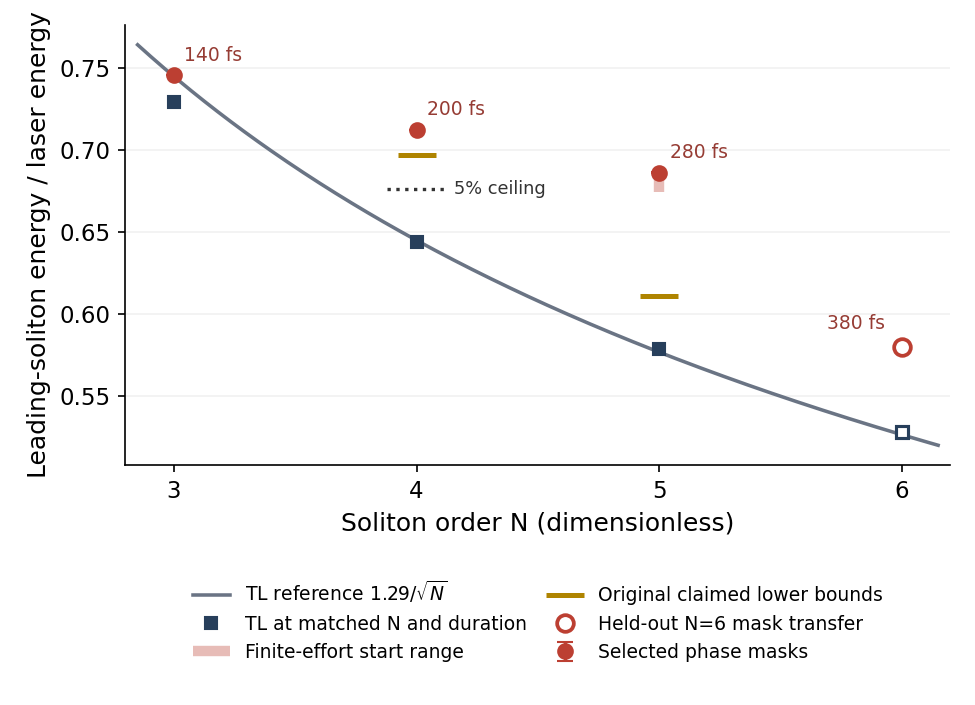

# The 5% phase-shaping ceiling is independently refuted

For a phase-only mask of a sech laser, define

$$f_1=\frac{2\operatorname{Im}\zeta_1}{N^2},\qquad
H_\phi=\sup_\phi\frac{f_1(\phi)}{f_1(0)}
\ge H(A2)\simeq1.09016>1.05.$$

Here $N$ is the input soliton order, $\zeta_1$ the ZS eigenvalue of the
isolated leading output pulse in $q=Nu$, and $\phi$ the spectral phase;
the normalized laser mass is $\int|u(0)|^2d(t/T_0)=2$.
The counterexample has $N=4$, $N^2\tau_1/T_0=1.952$,
$NL/L_D=4$, $f_R=0.18$, $\tau_2/\tau_1=32/12.2$, and zero
higher dispersion, shock and loss. These are points inside the claimed regime,
not a claim about an untested continuous interval.

An independently written fixed-step RK4IP propagator and gated two-sided ZS
shooting calculation reproduce the authorized A2 mask at $T_0=100$ fs.
The independently gated energy also rises by about 9.1%; input energy is
unchanged. A at 100 fs and B at 200 fs separately exceed the same ceiling.
Step, grid, window and extraction checks are much smaller than the refutation
margin. This is a numerical counterexample, not an asymptotic derivation.
Finite search endpoints cannot establish an upper bound.

Matched-energy TL and selected GPT masks (proposer checks); open symbols are held-out N=6.
The curve is the quoted TL reference, not a new phase-shaped law. Run: `2026-10-17-gpt-a-phase-headroom`.

**Verdict:** refuted; status **refuted → refuted**, independently confirmed.
The achievable-gain successor is C-20261016-claude-a-04. The separate loose
global conjecture remains unproved; stronger GPT witnesses are filed separately as C-20261017-gpt-a-01.
