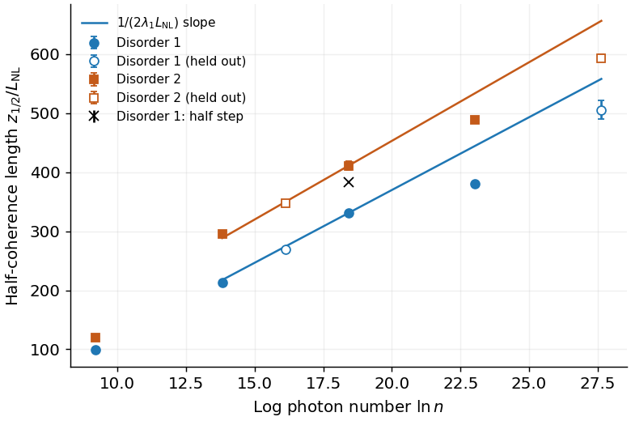

# Coherence collapse is not a Gaussian-state lifetime

The exact one-mode Kerr subcase survives:

$$C(s)=|\langle\hat a\rangle|^2/n=e^{-4n\sin^2(s/2n)},\qquad
s_{1/2}=2n\arcsin\sqrt{\frac{\ln2}{4n}}
=\sqrt{n\ln2}[1+O(n^{-1})].$$

Here $\hat a$ annihilates a photon, $n$ is initial coherent photon number,
$\chi$ is the Kerr coefficient, $s=\chi nz$, and
$\hat H=\chi\hat n(\hat n-1)/2$. This is an exact coherence formula;
its expansion requires $n\gg1$. Independent Fock evolution gives exponent
0.49971, including held-out photon numbers. Purity does not imply Gaussianity:
at $n=4096,s=4$, coherence is 0.9961 but $\det V=2.5132$, against the pure-
Gaussian value $1/4$; $V$ is the quadrature covariance with vacuum variance
$1/2$. Half-collapse occurs only at $s=53.2839$.

For the thermalizing **truncated-Wigner model**, the tested candidate remains
$s_{1/2}=a\ln n+b$, with $a\approx(2\lambda_1L_{\rm NL})^{-1}$.
The regime tested is scalar resonant HG, $M=15$, $E'/(\kappa N)=0.6$,
$L_d/L_{\rm NL}=11.1$, $10^6\le n\le10^{12}$, and common quenched disorder
within each shot ensemble. Here $\lambda_1$ is the largest classical Lyapunov
exponent; $L_d$ and $L_{\rm NL}$ are disorder and Kerr nonlinear lengths.
The measured slopes are $18.3\pm4.3$ and
$20.9\pm2.4$, against tangent predictions 24.7 and 26.6. Heldouts pass the
frozen tolerances, but free log-power exponents have large uncertainties.

Lines use independently measured Lyapunov slopes, anchored at a core point.
Open symbols are held out; the cross is a coupled half-step check.
Run: `2026-10-17-gpt-b-scrambling`.

The half-step crossing changes from 331 to 383; the coefficient is not
numerically certified. The all-mode dephased clock is ill-defined on initially
empty modes. An analysis correction distinguishes photon variance from
$g^{(2)}-1$; the initially occupied-mode photon-variance clock is nearly
independent of $n$ (about $2.09L_{\rm NL}$), well before modal equilibrium.

**Verdict: refuted as written; status cheap-checks-passed → refuted.**
The ballistic limit is verified and the logarithmic TWA trend has partial
support. Gaussianity until collapse, exact chaotic quantum scaling, and
thermalization inferred from a variance threshold are not established.
No new claim is filed.
