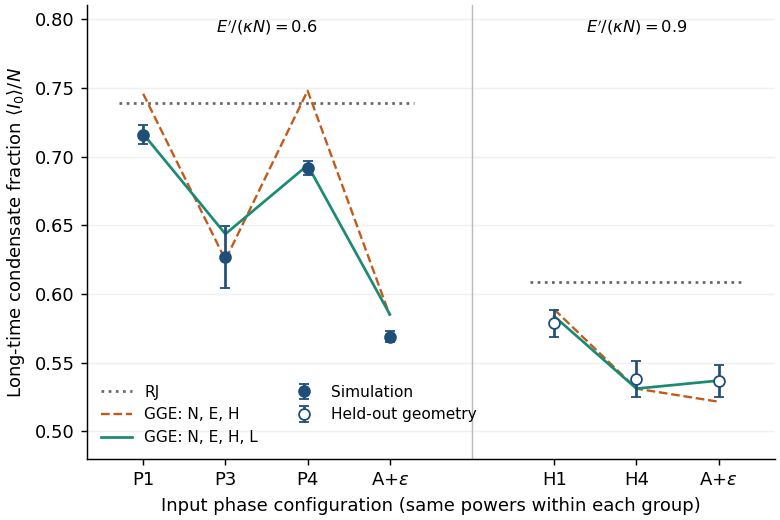

# Phase memory survives; a universal GGE endpoint does not follow

The defensible exact equation is **stationarity** of the constrained measure:

$$d\mu=Z^{-1}\delta(N(a)-N)\delta(E'(a)-E')
\delta(H(a)-h)\delta(L(a)-\ell)\prod_pd^2a_p,\qquad
\mathcal L_H^*\mu=0.$$

Here $a_p$ are normalized modal amplitudes, $N=\sum|a_p|^2$ is power,
$E'=\kappa\sum q_p|a_p|^2$ is excitation energy with group gap $\kappa$,
$q_p$ is the integer mode-group index, and $H$ is the resonant
quartic Kerr Hamiltonian, $L=a^\dagger L_za$ is angular momentum, and $Z$
normalizes the measure. $\mathcal L_H^*$ is the Liouville density-evolution
operator. In the scalar complete-group HG truncation, phase,
ladder-phase and rotation symmetries conserve these charges; Liouville's
theorem proves stationarity. Equality with a trajectory's endpoint additionally
requires ergodicity on its accessible sector. Ideal untruncated GRIN has
further charges; the finite cutoff breaks its Kohn/breathing identities.

Independent simulations use $K=5$, $N=1$, $E'/(\kappa N)\in\{0.6,0.9\}$,
zero disorder and selected extensions through $z/L_{\rm NL}=1200000$, where $L_{\rm NL}$ is the Kerr
nonlinear length. Phase-dependent long-time averages and
failure of RJ are clear. Including $L$ substantially improves the frozen GGE
prediction, but not every launch passes. One phase launch remains imprecise,
with an unresolved narrower shell sampler. A controlled aligned launch gives
$0.56881\pm0.00193$ against refined GGE $0.58127\pm0.00204$, failing the
frozen finite-window endpoint tolerance despite passing precision and stability.
Exact reflection symmetry requires a separate sector measure; its longer
trajectories also miss that sector's predicted mean, with the finer run
remaining imprecise.

Original finite-width GGE curves versus latest long-time means (two block SE).
Open points use held-out geometry; A+ε has an explicit $10^{-4}$ phase perturbation.
Run: `2026-10-17-gpt-b-gge`; extensions were selected after initial tests.

For the matched launch pair, disorder strengths $\sigma=0.1,0.3,1$ erase
memory to a resolved ±0.02 condensate-fraction tolerance over
$z/L_{\rm NL}\in[2000,8000]$, under the specified full-GUE convention
$L_d/L_{\rm NL}=\sigma^{-2}$. At $\sigma=3$, both tested steps pass the same
gate over [32000,96000] and [72000,96000]. The fine-step late difference is
$-0.01199\pm0.00119$: tolerance-level agreement does not mean zero memory.
No universal threshold in $z/L_d$ is established.

**Verdict: endpoint law not verified; status remains cheap-checks-passed.**
The conditional stationary measure is correct,
and some quantitative endpoint comparisons pass. Universal equilibration,
its length, and the quantum-state extension remain unestablished. Long-length
transfer to the full fibre equation is not controlled. Resonant invariants and
Gibbs stationarity have prior art (arXiv:1501.03760 and 1502.05643, full text,
relevant sections); no new claim is filed.
