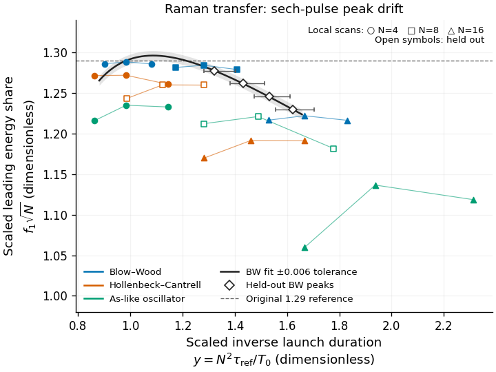

# Raman transfer: finite peak laws survive; energy maximum and width selection fail

The defensible reference-model approximation is
$$f_1^*\simeq\frac{1.29}{\sqrt N}\quad(N=3,\ldots,10),\qquad
T_0^*\simeq21\,{\rm fs}\,N^{1.62}\quad(N=3,\ldots,16).$$
$N^2=\gamma P_0T_0^2/|\beta_2|$, $T_0$ is the input sech width, and
$f_1^*$ is the leading soliton's ZS energy share at a bracketed local duration
maximum. Here $P_0$ is input peak power, $\gamma$ the nonlinear coefficient,
and $\beta_2$ the anomalous dispersion. The tested BW/sech brackets have
$7.1\times10^{-4}\le T_R/T_0\le1.3\times10^{-2}$,
$0.80\le y=N^2\tau_1/T_0\le1.84$, $1.4\le LN/L_D\le8$,
where $L_D=T_0^2/|\beta_2|$, $T_R=1.462$ fs, $\tau_1=12.2$ fs,
$\tau_2/\tau_1=32/12.2$ and $f_R=0.18$; shock, higher dispersion and loss
are zero. Here $L$ is output length, $T_R$ the effective first Raman moment,
$\tau_1,\tau_2$ the oscillator times and $f_R$ the Raman fraction.
These are sampled finite-output bounds, not a global theorem.

**Evidence and uncertainty.** Independent serial RK4IP scans resolve every
integer order 3–16. The scaled share reaches $1.2947\pm0.0009$ near N=5
and falls to $1.2220\pm0.0003$ at N=16 (numerical resolution envelopes).
Over N=3–10, those envelopes stay within 2.1% of the coefficient 1.29.
The final descriptive duration fit has exponent 1.62232, with residual-based
95% interval 1.61459–1.63005; full peak-bracket sensitivity is wider:
1.485–1.757. These are regression and numerical intervals, not a proved remainder.
All four held-out orders pass ±0.006 in scaled share and ±5% in position,
including the numerical envelopes and full duration brackets.
No constant $y^*$ fits all brackets; no infinite-N limit is established.
HC and As-like peak shares are approximately 0.9–2.3% and 3.5–6.4% below BW.
Gaussian fractions are larger, while normalized leading energies differ by
only 0.6–4.9%; equal-resource shape universality remains open.

**Derivation and limits.** The peak laws are numerical, with no controlled
physical remainder. The energy objection is exact:
$$E_1=\frac{2N^2|\beta_2|}{\gamma T_0}f_1,
\qquad E_1'\big|_{f_1'=0}=-E_1/T_0<0.$$
Independent overlap quadrature gives maximizing widths 15.56, 17.71 and
19.15 fs for BW, HC and the As-like response. Simulated exit widths disagree,
including a converged BW counterexample. Realistic SMF-28 dispersion, HC,
shock and loss give about 1.44–1.46 nJ
at the local-ZS share optimum; a fixed 3 nJ input and 10 kW limit yields a
best sampled gated output of 1.811 nJ at 2 m. This is not a certified maximum.
Physical energies, photon fractions, lengths and spectral support are in the
[tables](../runs/2026-10-17-gpt-c-raman-sharpening/tables.md).

Open symbols are held out; the band is the frozen BW interpolation tolerance, ±0.006.
$\tau_{\rm ref}=\tau_1$ for oscillators; HC uses 12.2 fs.
Run: `2026-10-17-gpt-c-raman-sharpening`.

**Novelty:** all four broad parts—selection/overlap, peak share, peak position
and efficient-point energy—are **partly published** (high confidence in
ingredients); exact fission selection and order-wide laws were **not found**
(medium confidence). Closest: Kormokar, DOI 10.1364/JOSAB.478975 (full text);
Judge/Pant, DOI 10.1364/JOSAB.26.002064 / 10.1364/JOSAB.27.001894
(abstracts here; gpt-b's full-text findings attributed); Al-kadry, DOI
10.1364/JOSAB.29.001347 (article abstract; associated thesis chapter full text).
See the [extended search](review-2026-10-17-gpt-c-raman-peak-novelty.md).

**Verdict:** C-20261016-claude-a-02 remains **refuted → refuted**, with the
finite numerical scope above preserved. The separate measured-response
ZBLAN extrapolation is **refuted by proposer tests** on new card
[C-20261017-gpt-c-01](summary-2026-10-17-gpt-c-C-20261017-gpt-c-01.md): all
four frozen duration predictions and all physical exit-width nulls fail.
The derivation, controls, exclusions and follow-up tasks are in the
[audit](../claims/notes/audit-2026-10-17-gpt-c-C-20261016-claude-a-02.md).
