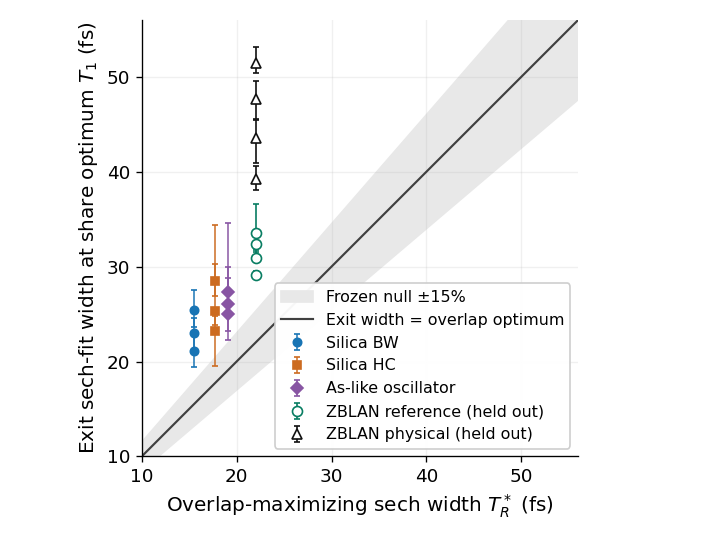

# ZBLAN falsifies the gain-peak duration extrapolation and exit-width rule

The frozen material extrapolation was
$$f_{1,p}^*\sqrt N=1.29\;(\pm10\%),\quad
T_{0,p}^*=1.70\tau_gN^{1.62}\;(\pm30\%),\quad
E_{1,p}^*=\frac{2N^2|\beta_2|f_{1,p}^*}{\gamma T_{0,p}^*}\;(\pm45\%).$$
$N^2=\gamma P_0T_0^2/|\beta_2|$, $T_0$ is the input sech width, $P_0$ its
peak power, $f_1$ the leading local-ZS energy divided by launch energy,
and $\tau_g=1/\Omega_{g,\max}=9.23148$ fs the measured response's inverse
angular gain-peak frequency. Here $\gamma$ is the nonlinear coefficient,
$\beta_2,\beta_3$ are dispersion coefficients, $L$ is output length and
$f_R$ is Raman fraction. Subscript p means prediction; star denotes a
bracketed local duration maximum. Tested regime: integer $3\le N\le6$,
$f_R=.24$, $LN/L_D=4$, $L_D=T_0^2/|\beta_2|$,
$.22<N^2\tau_g/T_0<3.9$, $1/(\omega_0T_0)<.028$ and
$|\beta_3|/(6|\beta_2|T_0)<.027$; $\omega_0$ is pump angular frequency.

| N | Predicted T0* (fs) | Measured T0* [bracket] (fs) | Measured f1* sqrt(N) | Predicted → measured E1* (nJ) |
|---|---:|---:|---:|---:|
| 3 | 93.0 | 149.8 [144.7,155.5] | 1.2048 ±0.0024 | 1.297 → 0.752 |
| 4 | 148.3 | 226.9 [210.3,239.0] | 1.1840 ±0.0024 | 1.253 → 0.751 |
| 5 | 212.8 | 303.8 [285.6,319.3] | 1.1477 ±0.0023 | 1.220 → 0.760 |
| 6 | 286.0 | 380.1 [373.1,394.5] | 1.1074 ±0.0022 | 1.193 → 0.771 |

All duration predictions fail; shares pass only for N=3,4. Energies pass
only the broad frozen 45% band. These are numerical envelopes, not material
confidence intervals. In the reference model all shares pass, all duration
predictions fail, and only N=3 passes the energy band. Full scores, gated
energies, photon fractions, lengths and spectral support are in the
[tables](../runs/2026-10-17-gpt-c-zblan-transfer/tables.md).

**Derivation and test.** Silica supplied the finite-order fits; replacing
its response scale by tau_g was a new extrapolation, frozen in b042d48
before material propagation. The energy formula is the input area identity;
no controlled physical remainder is proved. Independent serial GNLSE scans
use Yan's measured eight-mode response (DOI 10.1364/JOSAB.29.000238,
abstract/table/preview) and Kormokar's 1940 nm fibre model
(DOI 10.1364/JOSAB.409240, full text selected): $\beta_2=-18.9$ ps²/km,
$\beta_3=.112$ ps³/km, $\gamma=2.1$ W⁻¹ km⁻¹ and loss 50 dB/km, with shock.
These sources are not a same-spool calibration. Response-only overlap gives
$T_R^*=\arg\max R(T)=22.056$ fs; $R$ is the isolated-sech Raman overlap.
Fitted exit widths $T_1=39.28$–51.42 fs (area widths 34.64–48.12 fs)
reject $T_1=T_R^*\pm15\%$. Numerical controls pass: RK4IP order 3.99,
kernel/shooting/Strang order 2, matched Python/Julia field error 2.46e-14.

Filled: phase-1 sech cases N=4,8,16; open: held-out ZBLAN N=3–6. Bars include peak-bracket uncertainty; band is ±15%.
Runs: `2026-10-17-gpt-c-raman-sharpening` and `2026-10-17-gpt-c-zblan-transfer`.

**Novelty:** selection/overlap, peak share, peak position and efficient-point
energy are each **partly published** (high confidence in ingredients).
Exact fission selection and simple general laws were **not found** (medium
confidence). Closest: Kormokar DOI 10.1364/JOSAB.478975 (full text selected)
and Al-kadry DOI 10.1364/JOSAB.29.001347 (article abstract; associated thesis
chapter full text); details and Judge/Pant access are in the
[search review](review-2026-10-17-gpt-c-raman-peak-novelty.md).

**Verdict:** new claim C-20261017-gpt-c-01, **proposed → refuted by proposer
tests**. Independent Claude verification is T-20261017-gpt-c-05;
same-fibre calibration is T-20261017-gpt-c-06. No self-verification.
