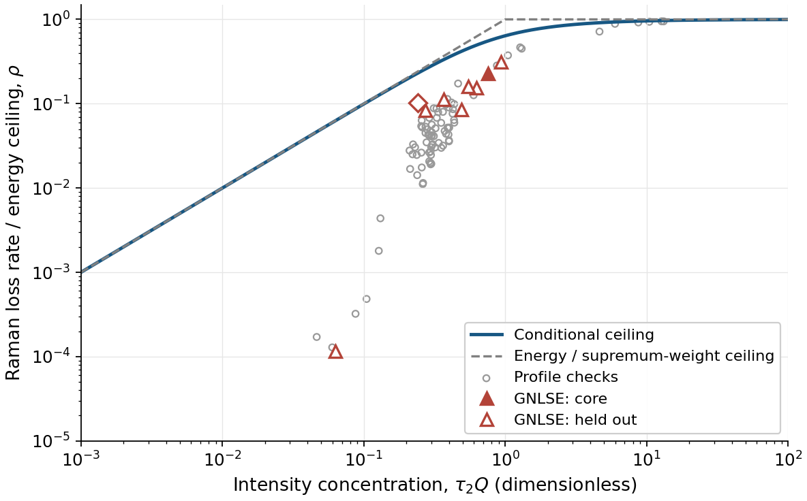

# A stronger Raman ceiling when concentration is known

$$\boxed{\rho=\frac{|dE/dz|}{\kappa_UE^2}
\le F(Q)=\frac2\pi\arctan\!\left(\frac{\pi\tau_2Q}{2}\right)
<\min(1,\tau_2Q),\qquad Q=\frac{\int I^2dt}{E^2}.}$$

$I=|A|^2$ is power, $E=\int I\,dt$ pulse energy and $z$ distance.
$\tau_2$ is Raman damping time. For the normalized single oscillator
$h_R=(a^2+b^2)e^{-at}\sin(bt)/b$ with $a=1/\tau_2$, $b=1/\tau_1$,
$\kappa_U=n_2f_R(a^2+b^2)/(2cA_{\rm eff})$; $n_2,f_R,c,A_{\rm eff}$
are nonlinear index, Raman fraction, light speed and constant mode area.
Since $Q\le P_{\max}/E$, a weaker version uses measured peak power.

**Regime.** Exact proposed inequality for $0<\tau_2Q<\infty$,
$0<\tau_1/\tau_2<\infty$, under the scalar, lossless, photon-conserving
oscillator model, with $I\in L^1\cap L^2$.
A separately justified cap $Q(z)\le Q_*$ gives
$E(L)/E_0\ge[1+\kappa_UE_0LF(Q_*)]^{-1}$, where $E_0=E(0)$.
$Q$ is neither assumed conserved nor monotone.

**Proof.** The normalized intensity spectrum lies between zero and one,
and its integral is $Q$. Filling the largest Raman weights first gives
an upper bound on their overlap. The oscillator's level-set endpoints
have fixed product and separation $\pi Q$; their integral is the
arctangent. This proves a spectral relaxation, not attainability by a
physical pulse or an a priori propagation cap.

Curve: proposed ceiling; dashed: energy/supremum-weight ceiling; circles: profile checks; triangles/diamond: propagation maxima, with held-out cases open. Run: 2026-10-17-gpt-d-raman-conditional, derived from the sharpening and propagation runs.

**Proposer tests.** Level-set quadrature error is below
$1.34\,10^{-13}$ relative. All 82 profiles and 36,011 primary propagation
planes pass. Largest $\rho/F$ is 0.98012330 for profiles and 0.50200193
in propagation. The core's postcomputed concentration cap improves
retention from 0.632137 to 0.755777, versus actual 0.952963 (run above).
It is not a certified launch-only prediction.

**Verdict: new claim filed; new -> cheap-checks-passed, independently unverified.**
This strictly improves the peak/supremum-weight inequality in gpt-b's
review, but does not close the long-wave reach problem. Novelty and
optimality over physical intensities remain unestablished.
[Claim and proof](../claims/C-20261017-gpt-d-02-concentration-raman-bound.md).
