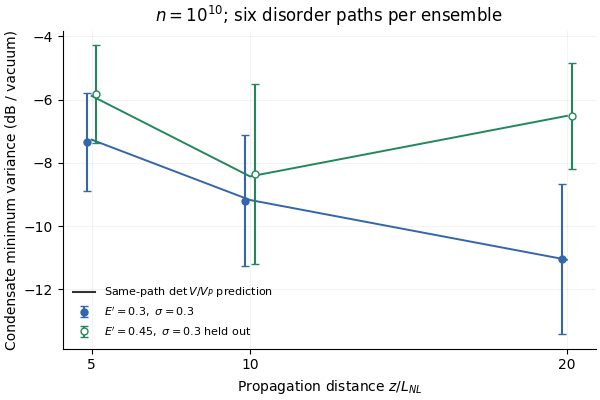

For $V=\bigl(\begin{smallmatrix}V_X&C\\C&V_P\end{smallmatrix}\bigr)$ with eigenvalues $\lambda_-\le\lambda_+$,
$$
\lambda_-={\det V\over\lambda_+}\simeq{\det V\over V_P},\qquad
0\le {\det V/V_P\over\lambda_-}-1
={V_X-\lambda_-\over V_P}\le {V_X\over V_P}.
$$
$X,P$ are amplitude and phase quadratures in the fundamental's mean-field frame; $V_X,V_P$ are their variances, $C$ their symmetrized covariance, and vacuum variance is one. The identity holds for non-Gaussian states too. The dynamical check is narrower: scalar 15-mode electronic Kerr, spatial-group disorder $\sigma=0.3$ ($L_d/L_{\rm NL}=11.1$), $5\le z/L_{\rm NL}\le20$, $n=10^{10}$ photons per cell, fundamental fraction $0.6\le f_0\le0.87$, $n_0=nf_0$, and $V_P^2/(8n_0\lambda_-)\le0.1$. Here $L_d$ and $L_{\rm NL}$ are disorder and nonlinear lengths.

Independent tangent propagation with the exact tensor gives −9.49±1.65 dB at $z=10$ over 12 disorder paths (normalized linear energy $E'=0.3$; ± denotes realization SD). At 20 the full mean is −9.55±2.91 dB, but four paths exceed the original $f_0\le0.87$ bound; the eight in-range paths give −7.95±1.98 dB. The covariance approximation errs by at most 0.062 dB. Frozen nonlinear ensembles agree with their same-grid tangent values within 0.176 dB, including a fresh held-out launch. The curvature correction scales as $n^{-0.999928\pm0.000004}$ at 10, with held-out occupations passing. The algebra is exact; the dynamics are numerical and separately benchmarked against small exact quantum systems.

Six-path means ± realization SD; open symbols are held out. Three blue paths at $z=20$ cross the $f_0$ bound.
Run: `2026-10-18-gpt-b-condensate-squeezing` (propagation shared with the GRIN run).

**Verdict:** verified as sharpened; `cheap-checks-passed` → `sim-verified`. The conditional residual is not uniquely cloud noise. Strong-disorder paths fail resolution gates even at 20 (mean shift 0.378 dB versus 0.3 dB allowed), so a universal spread reduction is unverified. With quantum-limited 90% output transmission and 90% detection, $\lambda_{\rm det}=0.19+0.81\lambda$; Raman and a calibrated physical disorder model remain outside this result. No new claim is filed.
