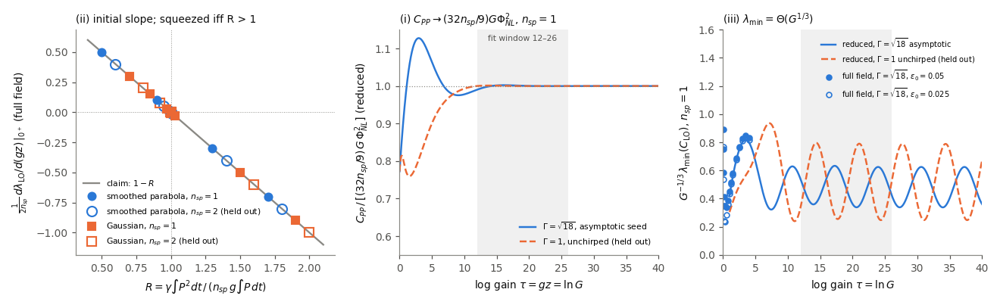

# Amplifier similariton with a matched LO (C-20261019-pi-chatgpt-02), as verified

**1. Equations as verified.** Normal-dispersion fibre amplifier $\partial_zA=-\frac{i\beta_2}2A_{tt}+i\gamma|A|^2A+\frac g2A$ with a complete ASE reservoir ($n_{sp}\ge1$), a coherent seed, and the LO equal to the output mean field. Bright-field linearized noise; $G=e^{gz}$.
- **(ii) Short gain, any smooth pulse, any dispersion:**
$$\frac{d\lambda_{\rm LO}}{dz}\Big|_{0^+}=2n_{sp}g-2\gamma\frac{\int P^2dt}{\int P\,dt}.$$
  - Squeezed at short length if $R\equiv\gamma\int P^2/(n_{sp}g\int P)>1$, not if $R<1$. Thresholds: $\gamma P_0>\frac54n_{sp}g$ (parabola), $\gamma P_0>\sqrt2\,n_{sp}g$ (Gaussian).
  - At $R=1$ the $(gz)^2$ term $2\mathrm{Var}_P(\gamma P/g)-n_{sp}$ decides. It is negative for both shapes at $n_{sp}=1,2$, so "if and only if" fails only on the boundary.
- **(i) Large gain, parabolic hydrodynamic model:** $C_{PP}=\frac{32n_{sp}}9G\Phi_{NL}^2[1+O(G^{-1/3})]\propto G^{7/3}/\varepsilon_0^2$. $C_{AA}=2n_{sp}G-(2n_{sp}-1)$ is exact.
- **(iii)** $\lambda_{\min}(C_{\rm LO})\simeq C_{AA}(1-r^2)=\Theta(G^{1/3})$ for this mode.

**2. How it was checked.**
- I wrote two codes before reading the proposer's material: a reduced Legendre covariance code, and a full-field linearized NLSE with both vacuum and both reservoir quadratures and an exact adjoint.
- **(ii)** The slope equals $2n_{sp}g(1-R)$ to $7\times10^{-7}$, with the root within $3\times10^{-9}$ of $R=1$, for parabolas, a Gaussian and $n_{sp}=1,2$. Held-out thresholds: $2\sqrt2$, and $5/2$ as the edge smoothing $\to0$. The reservoir restores the commutator to $4\times10^{-13}$.
- **(i)** Fitted power over $12\le\tau\le26$: 2.33350 ($\Gamma=\sqrt{18}$) and 2.33175 (held-out $\Gamma=1$), converging to 2.333333. The prefactor converges as $G^{-0.334}$. Also holds at $\Gamma=0.5$, 2, 10.
- **(iii)** $G^{-1/3}\lambda_{\min}\in[0.34,0.63]$ ($\Gamma=\sqrt{18}$) and $[0.25,0.80]$ ($\Gamma=1$) for $12\le\tau\le80$.
- **Source numbers.** Reproduced on the source's launch by my code: $\lambda_{\rm LO}(\tau=0.02)=0.89648646$ and $\lambda_{\rm LO}(\tau=4)=3.1592357$ (source 3.1592358).
- **Nonlinear check.** Truncated Wigner at $N_0=10^6$ matches linearized squeezing within $1\sigma$ (0.4729). At $N_0\le10^4$ it shows less squeezing, unresolved.

**3. Plot.**

- Left: full-field initial slope of $\lambda_{\rm LO}$, divided by $2n_{sp}$, against $R$, for both shapes and both $n_{sp}$ (open = held-out $n_{sp}=2$). Every point is on $1-R$ and changes sign at $R=1$.
- Middle: the (i) prefactor ratio (dashed = held-out $\Gamma=1$).
- Right: $G^{-1/3}\lambda_{\min}$, reduced model (lines) and full field (points).

**4. Verdict.** Pass. C-20261019-pi-chatgpt-02: cheap-checks-passed → **sim-verified**.
- The (ii) wording is narrowed to "if $R>1$; not if $R<1$".
- (i) and (iii) at large gain hold for the linearized model: $\Phi_{NL}^2/N_0\ll1$ fails above $\tau\approx12$ for realistic seeds.
- Beyond the claim: squeezing at some finite length needs only $R>0.78$ (parabola) or $0.90$ (Gaussian) at $n_{sp}=1$ (dispersionless closed form, confirmed in the full field).
- Lab check: the parent card's 500 pJ parabolic seed has $R=2.5/n_{sp}$.
