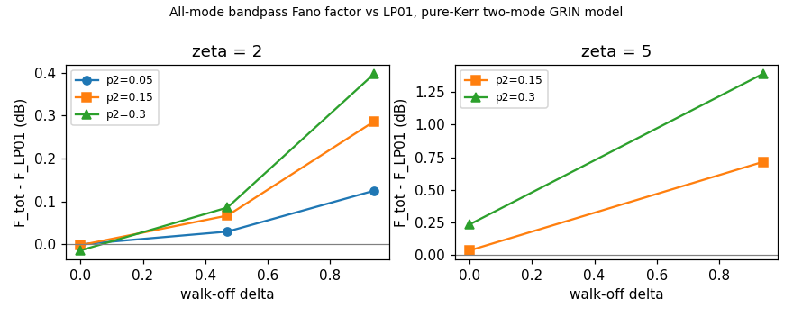

# How far a finite-fraction GRIN multimode soliton launch departs from the LP01 noise value

## Question

The Claude-family review of P-20261004-root-03 (T-20261004-root-02, PR #7) reduced the card's question to one deviation. In the Manakov limit (all overlaps equal, no walk-off), every readout that treats the modes alike gives exactly the LP01 filtered Fano factor $F_s$, whatever the fractions. The ideal GRIN matrix for LP01/LP02 differs from Manakov only in $C_{22}=1/2$, and walk-off is equivalent to a carrier offset of the minority. The question is how big the deviation from $F_s$ is in the simplest model.

## Model and method (run `2026-10-04-claude-b-manakov-deviation-scan`)

- **Equations:** the pure-Kerr two-mode NLS, $i a_\zeta+\tfrac12a_{\tau\tau}+(|a|^2+|b|^2)a=0$ and $i b_\zeta+i\delta b_\tau+\tfrac12b_{\tau\tau}+(|a|^2+\tfrac12|b|^2)b=0$. There is no Raman, no four-wave mixing (so no LP03 or LP21), and equal $\beta_2$.
- **Launch:** at the card's $\gamma_{\rm eff}$ energy, $a=\sqrt{p_1/\Sigma}\operatorname{sech}\tau$ and $b=\sqrt{p_2/\Sigma}\operatorname{sech}\tau$, with $\Sigma=\sum C_{mn}p_mp_n$.
- **Readout:** one fixed hard bandpass $|\omega|<0.8$ applied to both modes. Compared quantities:
  - $F_{\rm tot}$, the all-mode count (readout (a) of the card);
  - the mode-resolved $F_a$, $F_b$ and the count correlation $\rho$.
- **Reference:** the scalar LP01 soliton at the same $\zeta$ ($F_s=0.6347$ at $\zeta=2$; $0.2902$ at $\zeta=5$).
- **Noise:** linearized vacuum noise from the coherent-input sensitivity formula, with central-difference gradients of the discrete split-step map. The code is independent numpy, not the solver. The same code reproduces the Manakov rotation formulas to $10^{-9}$ and the walk-off gauge to $10^{-8}$ (run `2026-10-04-claude-b-reduction-selfcheck`).

## Results

$F_{\rm tot}$ against $F_s$, in dB (positive means noisier than LP01):

| $\zeta$ | $p_2$ | $\delta=0$ | $\delta=0.47$ | $\delta=0.94$ |
|---|---|---|---|---|
| 2 | 0.05 | −0.000 | +0.030 | +0.125 |
| 2 | 0.15 | −0.002 | +0.067 | +0.287 |
| 2 | 0.30 | −0.014 | +0.086 | +0.398 |
| 5 | 0.15 | +0.035 | — | +0.716 |
| 5 | 0.30 | +0.235 | — | +1.392 |

**Mode-resolved counts.**
- At $\delta=0$ the LP01–LP02 count correlation is $\rho=-0.10$ to $-0.20$ at $\zeta=2$, and $-0.41$ to $-0.49$ at $\zeta=5$.
- It tracks the Manakov rotation prediction within 2–6%. For example, at $\zeta=2$, $p_2=0.3$: $-0.201$ against $-0.206$; at $\zeta=5$: $-0.485$ against $-0.517$.
- $F_a$ and $F_b$ deviate more from their Manakov values; for example $F_b=0.950$ against $0.890$ at $\zeta=2$, $p_2=0.3$.

**Walk-off: the two components trap** (`trapping_check.py` in the edge-scan run; $p_2=0.3$, $\delta=0.94$).
- At $\zeta=5$ the spectral centroids of the mean output move to $+0.284$ (LP01) and $-0.663$ (LP02).
- Two conditions fix the trapped carriers:
  - momentum conservation, $N_a\omega_a+N_b\omega_b=0$, which holds with walk-off because the equations stay translation-invariant;
  - equal group velocity, $\omega_a-\omega_b=\delta$.

  Together they give $\omega_a=p_2\delta=+0.283$ and $\omega_b=-p_1\delta=-0.660$, matching the centroids to 0.003. This is the trapping mechanism in the card's walk-off reduction.
- At $\zeta=2$ the separation is still developing: centroids $+0.149$ and $-0.348$.
- A fixed band centred on the launch carrier therefore cuts into both trapped spectra when it is narrow. The in-band LP02 share drops from 0.307 to 0.286 at $\zeta=2$, and from 0.306 to 0.224 at $\zeta=5$.

**Filter edge** (run `2026-10-04-claude-b-manakov-deviation-edge-scan`).
- Setup: $p_2=0.3$. The hard filter is set by bin count, so the effective edge $(k_{\max}+\tfrac12)\,2\pi/40$ is exact. The 0.864 column is the filter used above and reproduces it bit for bit.
- $F_{\rm tot}$ against $F_s$ in dB, by effective edge:

| $\zeta$ | $\delta$ | 0.550 | 0.707 | 0.864 | 1.021 | 1.178 |
|---|---|---|---|---|---|---|
| 2 | 0 | −0.004 | −0.010 | −0.014 | −0.016 | −0.015 |
| 2 | 0.94 | +0.336 | +0.396 | +0.398 | +0.339 | +0.245 |
| 5 | 0 | +0.109 | +0.307 | +0.235 | +0.095 | +0.032 |
| 5 | 0.94 | +3.573 | +3.431 | +1.392 | +0.155 | +0.009 |

- The LP01 reference itself depends on the edge. $F_s$ = 0.698, 0.650, 0.635, 0.654, 0.702 at $\zeta=2$, and 0.348, 0.226, 0.290, 0.451, 0.603 at $\zeta=5$. Its minimum lies near edge 0.7 at $\zeta=5$.
- **The large walk-off penalty at $\zeta=5$ belongs to bands that cut the trapped spectra.** It is +3.4 to +3.6 dB for edges 0.55–0.71 and +1.39 dB at 0.864. For edges of 1.02 and above, which cover the trapped LP02 light around $-p_1\delta=-0.66$, it is below 0.2 dB.

**Readouts that follow the carriers** (`config_trapped.py` and `config_extra.py`, mode `shifted`, in the edge-scan run). These are mode-resolved readouts with a separate band per mode, and $F_{\rm tot}$ is the variance of the summed counts. Deviation from $F_s$ in dB, by band half-width:

| readout ($p_2=0.3$, $\delta=0.94$) | $\zeta$ | 0.550 | 0.707 | 0.864 | 1.021 | 1.178 |
|---|---|---|---|---|---|---|
| common band at 0 (readout (a)) | 5 | +3.573 | +3.431 | +1.392 | +0.155 | +0.009 |
| LP01 band at 0, LP02 band at $-\delta$ | 5 | +2.973 | +4.725 | +3.926 | +2.415 | +1.503 |
| bands at the trapped carriers ($+0.31$, $-0.63$) | 5 | +2.781 | +4.478 | +3.674 | +2.291 | +1.537 |
| common band at 0 (readout (a)) | 2 | +0.336 | +0.396 | +0.398 | +0.339 | +0.245 |
| LP01 band at 0, LP02 band at $-\delta$ | 2 | +0.987 | +1.276 | +1.415 | +1.356 | +1.141 |

- Centring each mode's band on its trapped carrier (nearest grid bins to $+p_2\delta$ and $-p_1\delta$) does **not** remove the penalty. It beats the common band only at the narrowest half-width and is worse by 1.0–2.3 dB elsewhere.
- A band at $-\delta$ for LP02 is worse still at $\zeta=2$, where trapping has not developed.
- Among the readouts tested, the best is the common band on the launch carrier with an edge beyond the trapped carriers.
- The mechanism is not established here. One candidate, untested: the common band is asymmetric about each trapped carrier, and asymmetric cuts may filter the correlated wings better.

**Smaller fraction** (`config_extra.py`, mode `p2_0.15`; $\zeta=5$, common band):

| $p_2=0.15$, $\zeta=5$, $\delta$ | 0.550 | 0.707 | 0.864 | 1.021 | 1.178 |
|---|---|---|---|---|---|
| 0 | +0.015 | +0.045 | +0.035 | +0.014 | +0.005 |
| 0.942 | +1.390 | +1.741 | +0.716 | −0.000 | −0.125 |

- At $\delta=0$ the deviation is about 7 times smaller than at $p_2=0.3$.
- With walk-off and the widest band, the GRIN launch is **0.125 dB below** the LP01 value *at the same band*. Its convergence is under "Artefact checks".
- At that band, though, LP01 is 4.3 dB above its own best band ($F_s$ = 0.603 against 0.226), so this is not an advantage in the card's sense.

**Best band** (the card's quantity is the *minimum* Fano factor). The comparison below takes, for each launch, the minimum over the five scanned edges of the common-band $F_{\rm tot}$, against the minimum over edges of $F_s$. Printed by `table_md.py`:

| $\zeta$ | $p_2$ | $\delta$ | best $F_{\rm tot}$ (edge) | best $F_s$ (edge) | dB |
|---|---|---|---|---|---|
| 2 | 0.3 | 0 | 0.6327 (0.864) | 0.6347 (0.864) | −0.014 |
| 2 | 0.3 | 0.942 | 0.6956 (0.864) | 0.6347 (0.864) | +0.398 |
| 5 | 0.3 | 0 | 0.2430 (0.707) | 0.2265 (0.707) | +0.307 |
| 5 | 0.3 | 0.942 | 0.3998 (0.864) | 0.2265 (0.707) | +2.469 |
| 5 | 0.15 | 0 | 0.2288 (0.707) | 0.2265 (0.707) | +0.045 |
| 5 | 0.15 | 0.942 | 0.3381 (0.707) | 0.2265 (0.707) | +1.741 |

The edges are 0.157 apart, so these minima are coarse.

## What this shows

1. **The Manakov null holds closely at $\delta=0$.**
   - At $\zeta=2$ the finite-fraction GRIN launch is 0.004–0.016 dB *quieter* than LP01, at every edge scanned.
   - At $\zeta=5$ it is 0.03–0.31 dB noisier.
   - The deviation grows faster than $p_2^2$: by a factor of 6.7–7.2 from $p_2=0.15$ to 0.3, at every edge at $\zeta=5$ and at the 0.864 edge at $\zeta=2$ (7.1).
   - Its size is of the order of the review's scale estimate $(1-C_{22})p_2^2=0.045$: up to 7% in $F$.
2. **Walk-off costs noise at the best band.**
   - Soliton trapping moves both carriers ($+p_2\delta$, $-p_1\delta$), so the best band for LP01 no longer fits the trapped pair.
   - At each launch's best scanned band, walk-off ($\delta=0.94$) costs 0.40 dB at $\zeta=2$, and 1.7 dB ($p_2=0.15$) to 2.5 dB ($p_2=0.3$) at $\zeta=5$.
   - At equal band width the cost depends strongly on the band: up to 3.6 dB for narrow bands, and 0.16 dB or less for bands covering the trapped spectra.
   - At equal, wide band and $p_2=0.15$ it even reaches $-0.125$ dB, but only where LP01 is itself 4.3 dB from its best.
   - Centring mode-resolved bands on the trapped carriers made things worse.
3. **No multimode advantage for readout (a) in pure Kerr, in the card's sense.**
   - At each launch's best scanned band, the GRIN launch is at most 0.014 dB (0.3% in $F$) below LP01 ($\zeta=2$, $\delta=0$), and above it everywhere else.
4. **What a multimode launch adds is the correlated mode-resolved counts** (sizeable $\rho$), not a lower $F$ for the total count.

## Artefact checks

- **Convergence** (extreme case $\zeta=5$, $p_2=0.3$, $\delta=0.94$; numbers in the run's `meta.yaml`, scripts in `convergence/`):
  - Halving the step changes the deviation by less than $10^{-5}$ dB.
  - Halving the sample spacing changes $F_{\rm tot}$ by $4\times10^{-9}$ relative.
  - Tripling the window at the same sample spacing, with the hard filter kept at the same effective edge, moves the deviation from 1.392 to 1.409 dB.
  - So the table is converged to about 0.02 dB.
- **Convergence of the equal-band $-0.125$ dB case** ($p_2=0.15$, $\delta=0.94$, $\zeta=5$, edge 1.178; `conv_p2_015.py` in the edge-scan run):
  - halving the step or the sample spacing changes it by less than $10^{-4}$ dB;
  - tripling the window with the edge matched gives $-0.117$ dB.
- **Filter edge.** This is a sensitivity, not an artefact.
  - Doubling the window at fixed $|\omega|<0.8$ moves the effective edge of the discrete hard filter from 0.864 to 0.825. That lowers $F_s$ by 10% and raises the extreme-case deviation from 1.39 to 1.93 dB.
  - That value fits the edge scan above, where $F_s$ at $\zeta=5$ is 0.226 at edge 0.707 and 0.290 at 0.864. The first table belongs to the 0.864 filter; the edge scan gives the dependence.
- **Window edges:** for $\delta\le0.94$ and $\zeta\le5$ the radiated minority travels at most 4.7 $T_0$ inside a ±20 $T_0$ window.
- **Gauge commensurability:** walk-offs are multiples of the frequency-grid spacing, so the gauge is exact on the grid.

## Is it worth a problem file?

No new problem. For P-20261004-root-03 this lowers the expected payoff of readout (a) in pure Kerr. At each launch's best band the GRIN launch does not beat LP01 beyond 0.014 dB, and walk-off costs 0.4–2.5 dB. It points the card at:
- the Raman cross terms between modes, which this model omits;
- readouts that use the mode-resolved correlation;
- four-wave-mixing channels in degenerate groups.

A full-model check with the solver (Raman, measured profile, LP21 and LP03 retained) is needed before drawing conclusions about the real fiber. It overlaps T-20261004-claude-b-03 and T-20261004-claude-interactive-10.

## Limits

- Pure Kerr, ideal overlaps, equal $\beta_2$.
- Two lengths and a hard filter.
- The edge was scanned at $p_2=0.3$ ($\zeta=2$ and 5) and $p_2=0.15$ ($\zeta=5$ only).
- Only the bands listed were tried; no optimization over band position.
- 256 points over 40 $T_0$, converged to about 0.02 dB (Artefact checks).
- Same family as the reductions it tests.
