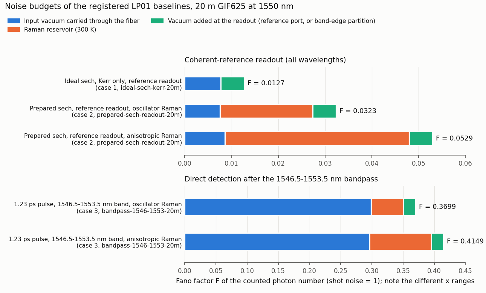

# LP01 soliton noise baselines at 1550 nm, registered as solver runs

## What was done

Three single-mode (LP01) noise results from the archive (`~/Desktop/fall2026_research/ai driven lab work/research_runs/2026-09-26_analytics/report.md`, and for case 3 `research_runs/2026-09-23_arbitrary_bandpass/`) were re-run with the pinned solver and registered as runs. They are the LP01 baselines that P-20261004-root-03, P-20261004-claude-interactive-01 and -02 compare against. All three are 20 m of the GIF625 model at 1550 nm and 80 MHz, in the scalar LP01 model.

**Solver provenance.** The archive ran the copy `dossier/FastDifferentiableMMNLO for agents` (git HEAD c039efe, "checkpointed adjoint implementation"). Its `src/`, `ext/` and `Manifest.toml` are byte-identical to the pinned `solver/` at 9c12887 (`diff -rq` on 2026-10-04; only `.DS_Store` differs), so no API change was needed. The archive's Julia wrappers were copied into each run folder (`lp01_archive_lib.jl` and a driver), with only input paths and output locations changed. They contain the input construction, the exact-Fourier Raman kernels (`AnalyticRaman`), the scalar Raman-reservoir contraction and the readout terminals. Inputs were read from the read-only archive under SHA-256 checks and copied into each run's raw folder.

Because the code is the same as the archive's, bitwise agreement was the expected outcome. These runs register the numbers and show they are reproducible. They do not validate the model independently. The independent checks are listed under Checks.

## Results: archive against this run

Every compared quantity agrees with the archive to the last digit of double precision (relative difference 0.0). **No discrepancy was found.**

| Case and quantity | Archive | This run | Run |
|---|---:|---:|---|
| 1. Ideal sech, Kerr only (β₂, instantaneous Kerr, no Raman, no shock), N = 1, ζ = L/L_D = 10.91; reference readout η = 0.995, r = 0.7017289851, ψ = −2.181661565 rad | | | `2026-10-04-claude-b.1-ideal-sech-kerr-20m` |
| F at ψ | 0.012687341911357897 | 0.012687341911357897 | same |
| F at ψ + π | 4.295819315491556 | 4.295819315491556 | same |
| Readout power at ψ | 38.11952266170737 mW | 38.11952266170737 mW | same |
| Optical covariance Q (XY, YY) | 21.953888173567172, 484.01331638509856 | identical | same |
| 2. Prepared 0.4 ps sech, 36.76796 mW, full scalar model (β₀…β₅, Kerr, shock, causal Raman and 300 K reservoir); same η, r, ψ, zero delay; archive headline grid (8192 samples, 40 ps, dz = 5 mm, Raman spacing 25 mm) | | | `2026-10-04-claude-b.1-prepared-sech-readout-20m` |
| F, oscillator Raman | 0.03232378149230158 (−14.9048 dB) | identical | same |
| Split: signal vacuum / Raman / reference vacuum | 0.007539795412196346 / 0.01978398608010522 / 0.005 | identical | same |
| Readout power, oscillator | 38.19593252167658 mW | identical | same |
| F, anisotropic Raman | 0.052947442066647844 (−12.7616 dB) | identical | same |
| Split, anisotropic | 0.008595101242042923 / 0.03935234082460492 / 0.005 | identical | same |
| Readout power, anisotropic | 38.07359075352224 mW | identical | same |
| F on the archive standard grid (4096, dz = 10 mm), oscillator / anisotropic | 0.03232376744420089 / 0.05294741958191669 | identical | same |
| Reference power; source power for both arms | 18.10540843910626 mW; 302.39682503531014 mW | identical | same |
| 3. Pre-registered (commit 4c79445, before running): archive "long-pulse" input (measured 100 mW spectrum, 3 nm input prefilter, GDD −0.015 ps², 25.0640 mW coupled, 1.23 ps FWHM); direct detection after a 1546.5–1553.5 nm band with 0.5 nm edges; 8192 samples, 80 ps, dz = 5 mm | | | `2026-10-04-claude-b.1-bandpass-1546-1553-20m` |
| F, oscillator Raman | 0.369938248889808 (−4.3187 dB) | identical | same |
| Raman part; power after the band | 0.05200907054764635; 20.92105095259975 mW | identical | same |
| F, oscillator, sharp band edges | 0.3709511900936711 | identical | same |
| F, oscillator, archive coarse grid (4096, 40 ps, dz = 10 mm) | 0.3699508168175295 | identical | same |
| F, anisotropic Raman; its Raman part | 0.41491050276503666; 0.09903311057795168 | identical | same |

For case 3 the sech-equivalent width is $T_0=\mathrm{FWHM}/1.763=0.698$ ps, so $\zeta\approx1.15$ and $N\approx1.48$ from the input peak power of 238.25 W. These figures use β₂ = −28.0887 ps²/km and γ = 0.52933 W⁻¹km⁻¹ from run `2026-10-04-claude-b.1-prepared-sech-readout-20m`. The pulse is not a sech, so they are indicative only.

## Checks

- **Analytical Green function (case 1, independent method).** The archive's soliton-plus-continuum Green-function script, copied unchanged and rerun, gives F = 0.012687341922535941 at ψ and 4.295819315870825 at ψ + π. The archive values were 0.012687341922535945 and 4.295819315870825. The solver differs from it by −1.12 × 10⁻¹¹ and −3.79 × 10⁻¹⁰, and the largest covariance-element difference is 6.88 × 10⁻⁸. The mean field matches the exact soliton to 9.18 × 10⁻¹¹.
- **Photon-number conservation with Raman on.**
  - Case 2, reference blocked, all wavelengths: F − 1 = 9.5 × 10⁻¹¹ for both Raman models. The Raman part is 8.2 × 10⁻²² (oscillator) and 2.0 × 10⁻²¹ (anisotropic).
  - Case 3, all wavelengths on the same propagation: F − 1 = 7.7 × 10⁻¹³ (oscillator) and 7.9 × 10⁻¹³ (anisotropic), with a Raman part of about 10⁻²⁶.
- **Linear two-port control (case 2).** With n₂ = 0 and both coherent ports, F − 1 = 8.9 × 10⁻¹⁶.
- **Adjoint against finite differences (case 2), extended here.**
  - At the archive's ±0.05 % power step, the adjoint and the central difference of dN_out/dN_signal differ by −1.72 × 10⁻⁴ (oscillator) and −1.27 × 10⁻⁴ (anisotropic), as in the archive. The archive attributed this to curvature.
  - Halving the step from 2 × 10⁻³ to 1.25 × 10⁻⁴ cuts the difference by 3.99–4.00 per halving, an exponent of 2.00. That is the central-difference truncation order.
  - The Richardson-extrapolated difference agrees with the adjoint to 3.7 × 10⁻¹⁰ (oscillator) and 1.4 × 10⁻¹⁰ (anisotropic). The adjoint derivative is therefore exact to that level, and the archive's attribution holds.

## Convergence

- **Case 1.**
  - Doubling the window from 40 to 80 ps at fixed sample spacing changes F by at most 4.1 × 10⁻¹⁴ and Q by 3.8 × 10⁻¹².
  - Halving both the sample spacing and dz changes F by 1.10 × 10⁻¹¹ (at ψ) and 3.55 × 10⁻¹⁰ (at ψ + π).
  - The error against the analytical Green function then falls by 15.95 for Q_YY, 15.80 for F at ψ + π and 15.04 for Q_XY. These are exponents 4.00, 3.98 and 3.91, the order of the RK4IP step.
  - At ψ the fine-grid error (−1.7 × 10⁻¹³) is smaller than the change of the analytical quadrature between its own two grids (1.4 × 10⁻¹²), so no exponent is quoted there.
- **Case 2.**
  - Halving the sample spacing, dz and the Raman spacing (archive "tight" against "standard") changes F by 1.40 × 10⁻⁸ (oscillator) and 2.25 × 10⁻⁸ (anisotropic), relative 4.3 × 10⁻⁷ and 4.2 × 10⁻⁷.
  - Doubling the window to 80 ps at fixed spacing, with the input zero-padded in time, changes F by 1.05 × 10⁻⁹ (relative 3.3 × 10⁻⁸). The archive's 20 m validation script had no window test. Its other window tests (the 30 m case, and the observable-gradient audit in `claude_a/`) were not re-run here.
- **Case 3.**
  - Halving the sample spacing, dz and the Raman spacing changes F by 9.9 × 10⁻⁹ (relative 2.7 × 10⁻⁸). Almost all of the change is in the Raman integral.
  - Doubling the window to 160 ps with the input held fixed (zero-padded in time) changes F by −1.2 × 10⁻⁹.
  - The archive's coarse grid changes F by +1.26 × 10⁻⁵ (relative 3.4 × 10⁻⁵), and a 160 ps window with the input rebuilt from the measured spectrum on the finer frequency grid changes it by +1.12 × 10⁻⁵. In both cases the coupled power itself moves by 1.3 × 10⁻⁵ and −2.5 × 10⁻⁵ relative. These 10⁻⁵-level changes therefore come from resampling the measured spectrum, not from the propagation.

## What the numbers show

- **Reference readout: Raman dominates.** At 20 m the Raman reservoir is 61 % (oscillator) or 74 % (anisotropic) of F (run `2026-10-04-claude-b.1-prepared-sech-readout-20m`). The signal-vacuum part (0.00754 and 0.00860) is close to the Kerr-only value of the ideal sech, 0.00769 (run `2026-10-04-claude-b.1-ideal-sech-kerr-20m`). The two inputs differ: 36.768 mW prepared pulse against 37.416 mW exact sech, so this comparison is indicative.
  - Of the signal-vacuum part, 0.00479 comes from directions orthogonal to the bright amplitude and phase quadratures of the input pulse. The bright amplitude and phase quadratures carry 0.00085 and 0.00189 (oscillator, tight grid).
  - A multimode launch at the reference readout has to beat a floor that is mostly Raman, not optical.
- **Bandpass readout: input vacuum dominates.** At the 1546.5–1553.5 nm band, input vacuum carried through the fiber gives 0.298 of F = 0.370, Raman 0.052 and band-edge partition vacuum 0.019 (run `2026-10-04-claude-b.1-bandpass-1546-1553-20m`).
- **The Raman model is the largest uncertainty in these baselines.** Choosing the anisotropic instead of the oscillator response multiplies F by 1.64 at the reference readout and by 1.12 at the bandpass readout.
  - By the convergence tests above, the error from propagation and noise integration is below 10⁻⁶ relative on the archive grids.
  - Rebuilding the case-3 input from the measured spectrum on another grid moves F by up to 3.4 × 10⁻⁵ relative.
- **Simplicity signal.** In the integrable limit (case 1), the linearized noise of the fundamental soliton matches a closed-form soliton-plus-continuum Green function. The agreement is 1.1 × 10⁻¹¹ in F at the nominal phase and 6.9 × 10⁻⁸ (1.4 × 10⁻¹⁰ relative) in the largest covariance element, and the remaining solver error falls at the fourth order of its step.

**Problem file?** No new problem is proposed. These runs are the LP01 reference points for P-20261004-root-03 and its sub-problems: ζ = 10.91 at N ≈ 1 for the reference readout, and ζ ≈ 1.15 at N ≈ 1.48 for the bandpass readout. Under the interim storage rule in `runs/README.md` they may be cited by claims on those problems.

## Limits

- **Not independent of the archive.** These runs use the archive's code. Only case 1 has an independent check of the noise numbers (the analytical Green function). Cases 2 and 3 are checked by conservation, by the linear control and by finite differences, not by a second method. A stochastic-propagation cross-check is task T-20261004-claude-b.1-02.
- **Model assumptions inherited from the archive.**
  - Scalar LP01 field, one polarization, no random mode coupling, no distributed loss.
  - Two alternative scalar Raman responses; no vector Raman model.
  - Nominal pure-silica n₂ and GIF625 profile.
  - The source phase (GDD −0.015 ps²) is assumed, not measured.
  - The case-2 input is a numerical preparation prescription, not a measured pulse.
  - All F values exclude detector efficiency and downstream loss.
- **Inputs not in git.** The inputs (prepared field, measured source spectrum, filter file) are archive files on one Mac. They are copied into each run's raw folder, but no copy exists in this repository or in cloud storage yet.
- **Not yet registered.** Two archive recipes are left for T-20261004-claude-b.1-01:
  - the 30 m prepared-sech recipe, the archive's deepest squeezing, at 30 m / L_D ≈ 16.4 with L_D = 1.8332 m from run `2026-10-04-claude-b.1-ideal-sech-kerr-20m`;
  - the simple 24 nm recipe.
