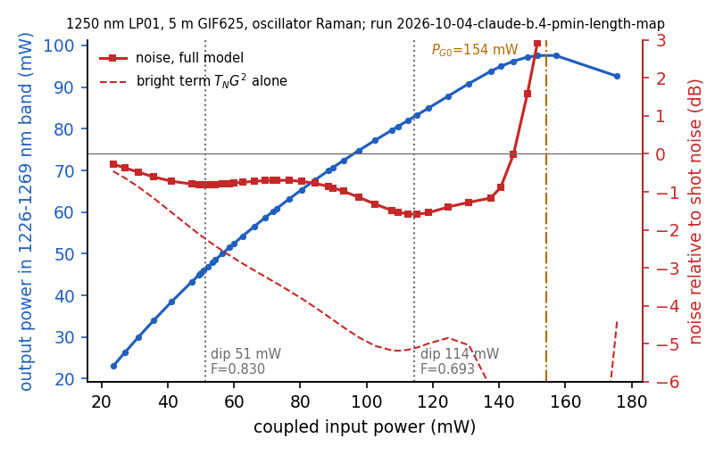

# How the normal-dispersion noise minimum moves with fiber length (1250 nm, LP01, GIF625)

claude-b.4 is a subagent of claude-b. The note has two parts. **Part 1 was written and pushed before any new fiber length was run.** Part 2 holds the results and is appended after the runs.

## Part 1: frozen predictions (written after the reproduction gate, before any new length)

### Setting

This is the archive's normal-dispersion surrogate, rebuilt in run `2026-10-04-claude-b.4-pmin-gate-1250`:
- Fiber and model: 1250 nm GIF625, scalar LP01, $\beta_2\ldots\beta_5$, Kerr, self-steepening, causal Raman (oscillator response, archive name `AgarwalRaman`).
- Noise: linearized input vacuum through the discrete adjoint, plus the matched 300 K Raman reservoir.
- Input: the archive's measured 1550 nm spectrum, translated to 1250 nm, with an assumed GDD of −0.015 ps².
- Readout: flat band 1226–1269 nm, all in-band photons counted, no detector loss.

**Reproduction gate (passed).** I rebuilt the archive sweeps at 0.75, 1 and 1.25 m on the archive's own grids (37 points), with identical code and a byte-identical solver.
- Every Fano factor and every selected power equals the archive value exactly: the maximum relative difference is 0.
- A 3-point quadratic in $\ln P$ through the lowest sampled point and its neighbours gives the same $P_{\min}$ for my runs and the archive's: 178.3, 142.1 and 118.6 mW at 0.75, 1 and 1.25 m, with $F_{\min}$ = 0.928, 0.912 and 0.909.
- A 5-point least-squares parabola gives 178.0, 140.8 and 116.0 mW. The 2.2% shift at 1.25 m comes from the 20% gap to the 150 mW point on a skewed curve. The map below therefore samples at ≤5% around each minimum.
- Local exponent between 0.75 and 1.25 m: $\alpha=\ln(178.3/118.6)/\ln(1.25/0.75)=0.80$.

**Groups at $P_{\min}$** (run `2026-10-04-claude-b.4-pmin-gate-1250`, `summary.json`, `groups_at_P_min`):
- $T_0=0.0793$ ps. This is the rms width of the input power spectrum converted to a Gaussian $T_0$, so it is independent of the chirp.
- $L_D=T_0^2/\beta_2=3.34$ m; $C=\mathrm{GDD}/T_0^2=-2.39$.
- Filter edge offsets: $\Omega_eT_0=1.79$ for the red edge (the nearer one) and 2.34 for the blue edge.
- At $P_{\min}$ for 0.75, 1 and 1.25 m:
  - $\zeta$ = 0.22, 0.30 and 0.37;
  - $N^2$ = 41, 33 and 28, using the transform-limited peak power;
  - $N^2$ = 19, 15 and 13, using the launched (chirped) peak power;
  - nonlinear phase at the launched peak, $\phi=\gamma P_{pk}L$ = 4.31, 4.58 and 4.78 rad.
- So $P_{\min}L$ is not constant; it grows by 11% over this range.

**Decomposition at $P_{\min}$** (same run):
- bright $T_NG^2$ = 0.79, 0.80 and 0.81;
- shape = 0.13, 0.10 and 0.09;
- Raman = 0.0087, 0.0076 and 0.0074;
- phase = 0 (to rounding; exact by the global phase symmetry for one scalar mode);
- partition = 0 (flat 0/1 mask).

The transfer slope $G=d\ln n_D/d\ln N$ at $P_{\min}$ is 0.906, 0.910 and 0.916.

### (a) The card's two limits and the crossover length

**Short $L$.** When dispersion acts on neither the input nor the SPM-broadened pulse within the fiber, the output depends on $P$ and $L$ only through $\phi=\gamma P_{pk}L$ (plus the small Raman part). Then $P_{\min}\propto1/L$ and $\alpha\to1$.

**Long $L$.** After wave breaking the spectrum stops broadening, the pulse disperses linearly, and the filtered count and its noise stop changing. Then $P_{\min}\to$ const and $\alpha\to0$.

**Crossover estimate.**
- The crossover is where $L$ equals the wave-breaking length at $P_{\min}$, with $L_{WB}=\kappa L_D/N$ and $\kappa$ of order 1. Anderson et al., JOSA B 9, 1358 (1992), DOI 10.1364/JOSAB.9.001358, give the prefactor for a Gaussian; I did not access it, so I take $\kappa=1$.
- Since $L/L_{WB}=\sqrt{\phi\zeta}/\kappa$, the crossover sits at $\zeta_c\approx\kappa^2/\phi^*$, i.e. $L_c\approx\kappa^2L_D/\phi^*$.
- Filter edge: the band starts to clip the SPM spectrum when the SPM bandwidth $\sim\phi/T_0$ reaches $\Omega_e$. So $\phi^*$ is expected to scale with $\Omega_eT_0$ (here 1.79), and $L_c\propto L_D/(\Omega_eT_0)$ at fixed pulse shape. I make no prefactor claim for this.
- Which peak power and duration enter $N$ is ambiguous for this strongly chirped input ($C=-2.4$). Each choice gives a different $L_c$:
  - launched (chirped) peak power with spectral $T_0$: $L_{WB}(P_{\min}(1\,\mathrm{m}))=0.85$ m, so $L_c\approx0.8$ m;
  - transform-limited peak power with spectral $T_0$: $L_{WB}=0.58$ m, so $L_c\approx0.4$ m;
  - chirped duration and chirped peak power ($T_c=0.144$ ps, $L_{D,c}=11$ m): $L_{WB}=1.55$ m, so $L_c\approx2.1$ m.

  So **$L_c$ lies between 0.4 and 2.1 m, with a central estimate of 0.8 m.**

**Frozen predictions for (a).** If the card's crossover picture holds with $L_c$ in this range:
1. the finite-difference $\alpha$ between neighbouring lengths decreases monotonically with $L$;
2. $\alpha\ge0.85$ between 0.25 and 0.4 m;
3. $\alpha\le0.3$ between 3 and 5 m.

**My own expectation differs from (a).** The measured $\alpha(1\,\mathrm{m})=0.80$ already sits at $L/L_c\approx1.2$ for the central estimate, where a symmetric crossover would give about 0.5. That points to a slow, possibly logarithmic, approach to the frozen limit: nonlinear phase keeps accumulating after wave breaking while the peak power falls roughly as $1/z$. I therefore expect:
- $\alpha$ between 0.85 and 1.0 for 0.25–0.4 m;
- $\alpha$ between 0.3 and 0.7 for 3–5 m.

If the measured $\alpha(3\text{–}5\,\mathrm{m})$ is below 0.3, the card's picture is right and my expectation is wrong. If it is above 0.7, both are wrong.

### (b) Third reference exponent: $\alpha=2$

If the minimum sat at a fixed ratio $L/L_{WB}$, with $L_{WB}\propto L_D/N$ and $N^2\propto P$, then $L\sqrt{P_{\min}}$ would be constant and $\alpha=2$.

At the archive lengths $L/L_{WB}$ at $P_{\min}$ is not fixed: it grows as $L^{1-\alpha/2}=L^{0.6}$, from 0.98 to 1.34 with the chirped-peak definition. **Frozen prediction:** $\alpha<1.2$ between every pair of neighbouring lengths in 0.25–5 m, so $\alpha=2$ is not seen anywhere.

### (c) claude-b's review hypothesis: $P_{\min}$ just below the plateau power $P_{G0}$

$P_{G0}$ is the power where $G=d\ln n_D/d\ln N=0$, i.e. where the bright term vanishes.

**Evidence from the gate.** The minimum is dominated by the bright term: it is 0.79–0.81 of $F_{\min}\approx0.91$–0.93, with $G\approx0.91$. $G$ then falls with power, and the fall accelerates:
- 1 m: from 0.77 at 250 mW to 0.60 at 300 mW;
- 1.25 m: from 0.74 at 225 mW to 0.61 at 250 mW.

Linear extrapolation of $G$ from the two highest powers (run `2026-10-04-claude-b.4-pmin-gate-1250`, `P_G0_linear_extrapolation_mw`) puts $P_{G0}$ at about 800, 480 and 365 mW. That gives $P_{\min}/P_{G0}\approx0.22$, 0.29 and 0.33 at 0.75, 1 and 1.25 m. At 0.75 m the extrapolation overestimates $P_{G0}$, because $G$ curves down, so 0.22 is a lower bound there.

**What I expect with $L$.**
- In the short-$L$ (pure SPM) limit, both $P_{\min}$ and $P_{G0}$ are set by $\phi$, so both scale as $1/L$ and the ratio tends to a constant.
- In the frozen-spectrum limit both stop moving, so the ratio again tends to a constant.
- In between, the ratio drifts slowly; the gate trend is upward with $L$.
- One caveat: if, after wave breaking, the frozen spectral width keeps growing as $N\propto\sqrt P$, then $n_D\propto\sqrt P$ at high power and $G\to1/2$ instead of 0. In that case the plateau disappears at long $L$.

**Frozen predictions for (c).**
1. At 0.25–2 m, $G$ crosses zero within the sweep at $P_{G0}$ between 2 and 5 times $P_{\min}$, and $P_{\min}/P_{G0}$ lies between 0.2 and 0.45, rising slowly with $L$.
2. At 3–5 m, either $P_{G0}$ is not found below $8P_{\min}$, or $P_{\min}/P_{G0}\le0.5$.
3. At every length the bright term is at least 0.6 at $P_{\min}$. So the strong form of the hypothesis, that $P_{\min}$ sits *just* below $P_{G0}$ (ratio ≥ 0.8, bright term near zero), is predicted **false** at every length in 0.25–5 m.
4. The minimum is ended by the shape term at every length; Raman supplies less than 20% of $dF/d\ln P$ just above $P_{\min}$.
5. $F_{\min}$ stays between 0.88 and 0.95 at all lengths.

### Pre-registered procedure for the map (run `2026-10-04-claude-b.4-pmin-length-map`)

- **Lengths:** 0.25, 0.4, 0.6, 0.75, 1, 1.25, 1.6, 2, 3 and 5 m. Run 0.25, 0.6, 2 and 5 m first.
- **Model:** oscillator Raman, 300 K.
- **Grid:** 8192 points over 40 ps (the archive grid). Step 2.5 mm. Raman reservoir spacing 12.5 mm for $L\le1.25$ m and 25 mm above.
- **Power sweep at each length:**
  1. Coarse geometric scan with ratio 1.15, starting at $0.6\times142\,L^{-0.8}$ mW. Extend downward if the lowest point is the first one. Stop when $F$ has risen on two consecutive points past the running minimum.
  2. Refine at 0.92, 0.96, 1.04 and 1.08 times the coarse minimum, giving 4% spacing.
  3. Upward scan with ratio 1.25 until the bright amplitude $c$ changes sign (giving $P_{G0}$), $P>8P_{\min}$, or a grid diagnostic fails: temporal edge fraction $>10^{-4}$ or spectral edge fraction $>10^{-8}$.
- **Fit:** $P_{\min}$ and $F_{\min}$ from the 3-point quadratic in $\ln P$ on the refined points, with the 5-point least-squares fit as a check. The decomposition is interpolated to $P_{\min}$. $P_{G0}$ comes from linear interpolation of $c$ in $\ln P$.
- **$\alpha$:** finite differences of $\ln P_{\min}$ between neighbouring lengths.
- **Convergence (run `2026-10-04-claude-b.4-pmin-convergence`):** at the shortest and longest lengths, near $P_{\min}$, halve the step and the reservoir spacing, halve the sample spacing, and double the window.

## Part 2: results (appended after the runs)

Part 1 is unchanged since commit 34b2917. All numbers below are from runs:
- `2026-10-04-claude-b.4-pmin-gate-1250` (gate);
- `2026-10-04-claude-b.4-pmin-length-map` (map; `summary.json`, tables printed by `table_md.py`);
- `2026-10-04-claude-b.4-pmin-convergence` (convergence);
- `2026-10-04-claude-b.4-pmin-gdd0-check` (input GDD set to zero).

### What was run, and where it departs from the pre-registration

The map holds 431 oscillator-Raman points at the ten lengths, in three passes.

**Pass 1** is the pre-registered adaptive sweep, with one rule added in the driver before it started: the coarse scan stops only after a dip below $F=0.99$ has been passed. Without that rule, the weak-power wiggles of $F$ near 1 would have been taken for the minimum.

**Pass 2** is a dense scan, not pre-registered. Pass 1 at 5 m had found a second, deeper dip below the plateau, between the coarse plateau-search points, so I added this pass at every length:
- powers at ratio 1.05, from 0.9 times the first dip up to the first zero of $G$;
- extra points at ±2.5% around every local minimum.

**Pass 3** adds weak-power lists, 10–150 mW at 0.25 and 0.4 m; also not pre-registered.

**Changes to the analysis.**
- Every local minimum of $F(P)$ below 1 and below $P_{G0}$ with prominence ≥ 0.003 is fitted by the 3-point parabola in $\ln P$. "First dip" means the lowest-power one.
- $P_{G0}$, the first zero of $G$, turned out to be fragile at 2–3 m: there $G$ comes close to zero, recovers, and only then crosses. I therefore also report $P_{G025}$, the first power where $G<0.25$.

**Other runs.**
- Anisotropic Raman at 1 m and 5 m near the dips: `anisotropic_*` points of the map run.
- The convergence run.
- The zero-GDD check at 0.25 m and 1 m, not pre-registered.

### Map (oscillator Raman)

Columns:
- $\zeta=L/L_D$, with $L_D=3.34$ m.
- At each dip: the parts of $F$, $G$, $T_N$ (the in-band photon fraction) and the output rms bandwidth, interpolated to $P_{\min}$.
- "Ends the dip": the term with the largest positive slope $dF/d\ln P$ at $1.05P_{\min}$, with Raman's share of the rising slope in brackets.
- The phase term is zero to rounding at every point. The partition term is zero for the flat 0/1 band.

| $L$ (m) | $\zeta$ | dips: $P_{\min}$ (mW), $F_{\min}$ | bright | shape | Raman | $G$ | $T_N$ | $\sigma_{\omega,\rm out}$ (rad/ps) | $P_{G0}$ (mW) | $P_{\min}/P_{G0}$ | $P_{G025}$ (mW) | $P_{\min}/P_{G025}$ | ends the dip (Raman share) | points |
|---|---|---|---|---|---|---|---|---|---|---|---|---|---|---|
| 0.25 | 0.075 | no dip of prominence ≥ 0.003; weak-power dip only (lowest sampled $F$ = 0.9987 at 50 mW) | | | | | | | 1141 | | 1024 | | | 74 |
| 0.4 | 0.120 | 271.1, 0.9915 | 0.851 | 0.132 | 0.0090 | 0.935 | 0.9740 | 10.54 | 770 | 0.352 | 703 | 0.386 | shape (0.06) | 54 |
| 0.6 | 0.179 | 209.7, 0.9496 | 0.803 | 0.138 | 0.0094 | 0.911 | 0.9677 | 11.22 | 558 | 0.376 | 517 | 0.406 | shape (0.05) | 34 |
| 0.75 | 0.224 | 178.4, 0.9284 | 0.793 | 0.127 | 0.0088 | 0.906 | 0.9660 | 11.36 | 468 | 0.381 | 437 | 0.408 | shape (0.05) | 34 |
| 1 | 0.299 | 142.6, 0.9117 | 0.798 | 0.106 | 0.0077 | 0.909 | 0.9660 | 11.30 | 375 | 0.380 | 349 | 0.408 | shape (0.05) | 34 |
| 1.25 | 0.374 | 119.0, 0.9088 | 0.811 | 0.090 | 0.0075 | 0.916 | 0.9669 | 11.13 | 317 | 0.375 | 292 | 0.407 | shape (0.06) | 34 |
| 1.6 | 0.479 | 97.0, 0.9136 | 0.827 | 0.078 | 0.0083 | 0.925 | 0.9679 | 10.88 | 268 | 0.362 | 240 | 0.404 | shape (0.07) | 37 |
| 2 | 0.598 | 80.6, 0.9203 | 0.838 | 0.073 | 0.0100 | 0.930 | 0.9680 | 10.69 | 250 | 0.323 | 203 | 0.397 | shape (0.09) | 47 |
| 3 | 0.897 | 77.0, 0.9081 | 0.716 | 0.167 | 0.0250 | 0.874 | 0.9372 | 13.27 | 259 | 0.297 | 160 | 0.482 | shape (0.11) | 41 |
| 5 | 1.496 | 51.3, 0.8305 | 0.598 | 0.201 | 0.0313 | 0.814 | 0.9027 | 14.46 | 154 | 0.333 | 149 | 0.345 | shape (0.14) | 42 |
| 5 (2nd) | 1.496 | 114.4, 0.6931 | 0.308 | 0.297 | 0.0884 | 0.653 | 0.7224 | 27.45 | 154 | 0.742 | 149 | 0.770 | Raman (0.56) |  |

**Local exponents.** These are finite differences between neighbouring lengths.

| Lengths (m) | 0.25–0.4 | 0.4–0.6 | 0.6–0.75 | 0.75–1 | 1–1.25 | 1.25–1.6 | 1.6–2 | 2–3 | 3–5 |
|---|---|---|---|---|---|---|---|---|---|
| first-dip $P_{\min}$ | (no dip at 0.25) | 0.63 | 0.72 | 0.78 | 0.81 | 0.83 | 0.83 | 0.11 | 0.80 |
| $P_{G0}$ | 0.84 | 0.79 | 0.78 | 0.77 | 0.76 | 0.68 | 0.31 | −0.09 | 1.02 |
| $P_{G025}$ | 0.80 | 0.76 | 0.75 | 0.78 | 0.80 | 0.80 | 0.74 | 0.59 | 0.14 |

**Caveats on the table.**
- **The 3 m dip is flat.** $F$ stays within 0.002 of $F_{\min}$ over ±13% in $P$: the half-width in $\ln P$ is 0.129, against 0.04–0.08 at every other dip. $P_{\min}(3\,\mathrm{m})$, and the two exponents next to it (0.11 and 0.80), are therefore poorly determined.
- **Groups at the first dip** (launched peak power): $\phi=\gamma P_{pk}L$ rises from 3.5 at 0.4 m to 5.2 at 2 m, 7.5 at 3 m and 8.3 at 5 m. Over the same range $N^2$ falls from 29 to 5.5, and $L/L_{WB}$ (with $\kappa=1$) rises from 0.65 to 3.5.
- **Agreement with the gate.** At the archive lengths the map agrees with the gate fits: 178.4 against 178.3 mW at 0.75 m, 142.6 against 142.1 at 1 m, and 119.0 against 118.6 at 1.25 m. The differences come from the different power samples and, at 1 m, from the Raman spacing (12.5 mm in the map, 25 mm in the archive).

Figures in the map run folder:
- `pmin_vs_length.png`: $P_{\min}$ and $P_{G0}$ against $L$, the local exponents, and $F_{\min}$ with its parts;
- `power_noise_L5m.png` and `power_noise_L1m.png`: scope-doc convention.

### The frozen predictions, scored

**(a) The card's crossover picture.** It fails at both ends for this input.
1. $\alpha$ does not decrease monotonically. It rises from 0.63 (0.4–0.6 m) to 0.83 (1.25–2 m), then scatters around the flat 3 m dip.
2. The short-length limit $\alpha\to1$ does not exist for this input. As $L$ falls, the dip gets shallower and disappears: $F_{\min}$ = 0.912 at 1 m, 0.950 at 0.6 m, 0.9915 at 0.4 m, and no dip of prominence ≥ 0.003 at 0.25 m. So the prediction "$\alpha\ge0.85$ at 0.25–0.4 m" cannot even be evaluated; the nearest exponent, 0.4–0.6 m, is 0.63. With the input chirp removed (zero-GDD check) the 0.25 m dip exists, but the exponent between 0.25 and 1 m is 0.44, also not 1.
3. For the long-length limit, "$\alpha\le0.3$ at 3–5 m" is false for the first dip (0.80). The global minimum instead jumps to a new, higher-power branch at 5 m.
4. **My own expectation is also wrong at both ends.** I predicted 0.85–1.0 at short $L$ and 0.3–0.7 at 3–5 m. The note said that a value above 0.7 at 3–5 m would make both pictures wrong, and it is.
5. The crossover estimate $L_c\approx$ 0.4–2.1 m marks no change of exponent.

What does move toward 0 is the classical plateau onset: the $P_{G025}$ exponent falls from about 0.8 at $L\le1.6$ m to 0.59 (2–3 m) and 0.14 (3–5 m). That is the frozen-transfer-function limit of (a), seen in the classical quantity and not in the noise minimum.

**(b) $\alpha=2$.** Not seen. On the first-dip branch $\alpha<1.2$ everywhere (maximum 0.83), as predicted.

**(c) $P_{\min}$ against the plateau.**
1. **Plateau within reach.** $P_{G0}$ was found at every length from 0.25 to 2 m, at 2.6–3.1 times $P_{\min}$. $P_{\min}/P_{G0}$ = 0.35–0.38 at 0.4–1.6 m and 0.32 at 2 m: inside the predicted 0.2–0.45 but flat rather than rising. Holds.
2. **3–5 m.** First-dip ratios are 0.30 (3 m) and 0.33 (5 m), so this holds for the first dip. The second 5 m dip is at 0.74.
3. **Bright term at least 0.6.** It is 0.79–0.85 at 0.4–2 m and 0.72 at 3 m. At the 5 m first dip it is 0.598, a marginal failure, and at the 5 m second dip it is 0.31, a clear failure. The strong form of claude-b's hypothesis (ratio ≥ 0.8, bright term near zero) is still not met anywhere: the closest case is the 5 m second dip, at ratio 0.74 with bright term 0.31.
4. **What ends the dip.** The shape term ends the first dip at every length, with Raman supplying 5–14% of the rising slope. Holds. It fails for the 5 m second dip, where Raman supplies 56%.
5. **$F_{\min}$ between 0.88 and 0.95.** Fails at 0.4 m (0.9915) and at 5 m (0.831 and 0.693).

### What was not predicted

**1. With the assumed input chirp, the dip needs fiber length.** Below about 0.3–0.4 m there is no dip beyond the weak-power one. The zero-GDD check shows that this is an effect of the chirp, not of short fiber as such.
- That weak-power dip is the feature the card's Born-slope bullet describes. It is shallow: $F$ = 0.99872 at 50 mW at 0.25 m, and 0.99865 at 30 mW at 0.4 m.
- At 0.25 m, $F>1$ from 105 mW up to the plateau at 1141 mW.
- At equal bright term the waveform noise is larger in short fiber. At bright = 0.80 the shape term is 0.237 at 0.25 m (452 mW), 0.140 at 0.6 m (211 mW) and 0.106 at 1 m (143 mW).
- I first read this as clipping an SPM spectrum that dispersion has had little length to reshape. The zero-GDD check below contradicts that reading: with a transform-limited input the 0.25 m dip is clear ($F=0.925$). The disappearance belongs to the assumed down-chirped input. A candidate mechanism, not tested: SPM on a down-chirped pulse first compresses its spectrum, and fiber dispersion over the first metres removes part of the chirp (T-20261004-claude-b.4-02).

**2. A fixed location in classical terms (0.4–2 m).** The first dip sits at an almost fixed point of the classical transfer function, while $P_{\min}$ itself changes 3.4-fold over this range:
- in-band photon fraction $T_N$ = 0.966–0.974;
- output rms bandwidth 10.5–11.4 rad/ps, about 0.49 of the red-edge offset of 22.6 rad/ps;
- $P_{\min}/P_{G025}$ = 0.386–0.408, and $P_{\min}/P_{G0}$ = 0.32–0.38.

This is a data-collapse signal: on this branch, the length dependence of $P_{\min}$ is the length dependence of spectral broadening. It breaks at 3 and 5 m, where $T_N$ at the dip falls to 0.94 and 0.90. The zero-GDD check shows it also depends on the input chirp: $T_N$ = 0.94 and 0.85 at the dip at 0.25 and 1 m. It is a regularity of one filter and one chirp, a lead and not a law (T-20261004-claude-b.4-04).

**3. A second, deeper dip below the plateau at 5 m.**
- Position and depth: $F=0.693$ (−1.59 dB) at 114.4 mW, i.e. at $P/P_{G0}=0.74$ and $T_N=0.72$.
- The waveform term falls with power from about 89 to 119 mW (0.380 to 0.286, map points). Between 98 and 125 mW the bright term stays at 0.30–0.33, with $G$ = 0.64–0.68.
- The dip is ended mainly by Raman.
- At 3 m the dense pass finds no second dip below $F=1$: $F$ rises monotonically to 1.84 at 197 mW, with a local bump down to 1.70 at 217 mW.
- So the global minimum switches branch between 3 and 5 m, and the global $P_{\min}(L)$ is not a single power law (T-20261004-claude-b.4-01).

### Checks

- **Gate.** The archive sweeps at 0.75, 1 and 1.25 m are reproduced bit for bit (run `2026-10-04-claude-b.4-pmin-gate-1250`).
- **Adjoint slope.** The transfer slope $G$ from the adjoint bright projection agrees with finite differences of $\ln n_D$ against $\ln N$ between neighbouring points (≤ 6% apart) to within:
  - 0.004 at 0.25–2 m;
  - 0.023 at 3 m;
  - 0.007 at 5 m.

  These differences are consistent with the curvature of $\ln n_D$ over the point spacing.
- **Grid diagnostics below $P_{G0}$.**
  - Spectral edge fraction ≤ $2\times10^{-20}$.
  - Temporal edge fraction $6.0\times10^{-7}$ at every point. This is a property of the input's own temporal wings, not of propagation; it halves when the window doubles.
  - $|$photon drift$|$ ≤ $1\times10^{-7}$.
- **Convergence** (run `2026-10-04-claude-b.4-pmin-convergence`). Tested at 0.25 m (no dip), at 0.4 m (the shortest dip) and at both 5 m dips. Each dip is refitted through three powers 4% apart (2.5% for the second 5 m dip).
  - *Step and Raman spacing halved:* $|\Delta F|\le7\times10^{-7}$ at the three dips, and $P_{\min}$ moves by at most $2\times10^{-6}$ relative.
  - *Sample spacing halved:* $|\Delta F|<10^{-15}$. The field is band-limited well inside the grid.
  - *Window doubled at the same sample spacing:* this also halves the frequency spacing on which the measured input spectrum and the band edges are sampled.
    - At the dips: $|\Delta F|\le1.1\times10^{-3}$ and $|\Delta P_{\min}|\le0.13\%$. The 0.4 m minimum moves from 0.9915 to 0.9904. At 5 m the first minimum changes by $3\times10^{-5}$ and the second moves from 0.6932 to 0.6928.
    - At 0.25 m: $F$ at 300 mW changes from 1.0158 to 1.0152, still above 1, and $P_{G0}$ from 1133.4 to 1134.9 mW.

  None of the conclusions depends on the grid. The window/frequency-spacing effect of about $10^{-3}$ in $F$ is the largest numerical uncertainty. It is 12% of the 0.4 m dip depth and under 1% of the others.
- **Raman response** (anisotropic points of the map run; `summary_anisotropic.json`). The full anisotropic map is in the section after "Checks"; the points closest to the oscillator dips give the following.
  - *1 m:* the dip moves from 142.6 to 141.3 mW and from $F$ = 0.9117 to 0.9174. $T_N$ at the dip is 0.968, so the location rule is unchanged.
  - *Check against the archive:* the five anisotropic 1 m points at 125–160 mW agree with the archive's anisotropic 1 m curve (`2026-09-24_grin_wavelengths/results/curve_1250_L1_deepest_anisotropic_P*.toml`) to $1.6\times10^{-7}$ in $F$. The residual difference comes from the Raman spacing, 12.5 mm against 25 mm. This extends the gate to the second response at 1 m.
  - *5 m, first dip:* 46.7 mW with $F$ = 0.8637, against 51.3 mW and 0.8305 for the oscillator.
  - *5 m, second dip:* it persists, at 111.4 mW with $F$ = 0.7799, against 114.4 mW and 0.6931. Its Raman term is 0.161 against 0.088, and Raman supplies 71% of the rising slope.

  So the second dip's position is robust to the Raman model but its depth is not. The spread, 0.087 in $F$, is similar to the 0.09 spread the card quotes at 1200 nm.
- **Input chirp** (run `2026-10-04-claude-b.4-pmin-gdd0-check`, GDD set to 0; not pre-registered). The transform-limited input has 2.2 times the launched peak power.
  - *0.25 m:* a clear dip at 78.2 mW with $F=0.925$ (bright 0.753, shape 0.156, Raman 0.016, $T_N=0.937$, $P_{\min}/P_{G0}=0.33$).
  - *1 m:* a dip at 42.7 mW with $F=0.834$ ($T_N=0.849$, $P_{\min}/P_{G0}=0.48$).

  So the missing dip at 0.25 m is caused by the assumed input pre-chirp ($C=-2.4$), not by the absence of dispersion. And the fixed-$T_N$ location seen at 0.4–2 m is specific to that chirp: without chirp the dip sits at $T_N$ = 0.94 and 0.85.

  The exponent between 0.25 and 1 m without chirp is 0.44, so it is not 1 there either. This is two lengths only; the dense pass and convergence were not run for it.

### Anisotropic Raman map (added after the oscillator write-up)

There was time left after the oscillator work, so I ran the anisotropic response through the same procedure (map run, `anisotropic_*` points, 272 points; `summary_anisotropic.json`, table from `compare_raman.py`):
- pass 1 at all ten lengths;
- the dense pass at 2, 3 and 5 m only.

No convergence test was run for this response.

| $L$ (m) | oscillator dips ($P_{\min}$ / $F_{\min}$) | anisotropic dips | first-dip $\Delta P_{\min}/P_{\min}$ | first-dip $\Delta F_{\min}$ | $P_{G0}$ osc. / aniso. (mW) | aniso. $P_{\min}/P_{G025}$ | aniso. Raman share |
|---|---|---|---|---|---|---|---|
| 0.25 | none | none |  |  | 1141 / 1129 |  |  |
| 0.4 | 271.1 mW / 0.9915 | 270.8 mW / 0.9929 | -0.001 | +0.0014 | 770 / 758 | 0.390 | 0.10 |
| 0.6 | 209.7 mW / 0.9496 | 208.6 mW / 0.9537 | -0.006 | +0.0042 | 558 / 551 | 0.408 | 0.10 |
| 0.75 | 178.4 mW / 0.9284 | 177.0 mW / 0.9336 | -0.008 | +0.0052 | 468 / 463 | 0.410 | 0.10 |
| 1 | 142.6 mW / 0.9117 | 141.4 mW / 0.9174 | -0.009 | +0.0057 | 375 / 371 | 0.410 | 0.10 |
| 1.25 | 119.0 mW / 0.9088 | 117.7 mW / 0.9143 | -0.011 | +0.0056 | 317 / 313 | 0.408 | 0.11 |
| 1.6 | 97.0 mW / 0.9136 | 95.6 mW / 0.9195 | -0.014 | +0.0060 | 268 / 264 | 0.404 | 0.12 |
| 2 | 80.6 mW / 0.9203 | 79.0 mW / 0.9274 | -0.020 | +0.0072 | 250 / 236 | 0.395 | 0.15 |
| 3 | 77.0 mW / 0.9081 | 63.5 mW / 0.9252 | -0.176 | +0.0172 | 259 / 253 | 0.407 | 0.20 |
| 5 | 51.3 mW / 0.8305, 114.4 mW / 0.6931 | 46.7 mW / 0.8637, 111.4 mW / 0.7799 | -0.089 | +0.0332 | 154 / 151 | 0.321 | 0.24 |

Local exponents of the anisotropic first dip:

| Lengths (m) | 0.4–0.6 | 0.6–0.75 | 0.75–1 | 1–1.25 | 1.25–1.6 | 1.6–2 | 2–3 | 3–5 |
|---|---|---|---|---|---|---|---|---|
| $\alpha$ | 0.64 | 0.74 | 0.78 | 0.82 | 0.84 | 0.85 | 0.54 | 0.60 |

The $P_{G025}$ exponent again drops to 0.13 between 3 and 5 m.

**Every qualitative statement above holds for both responses:**
- no dip at 0.25 m;
- exponents 0.64–0.85 over 0.4–2 m, never near 1 or 2;
- the location rule, $P_{\min}/P_{G025}$ = 0.39–0.41 at 0.4–2 m (and 0.41 at 3 m for this response);
- a second, deeper dip below the plateau at 5 m;
- no second dip below $F=1$ at 3 m.

**Size of the model spread at 0.4–2 m.** $P_{\min}$ moves by 0.1–2% and $F_{\min}$ by 0.001–0.007.

**The flat 3 m dip is the exception.** Its position moves by 18% (77.0 to 63.5 mW) under the change of Raman response, consistent with how flat it is.

### What this means for P-20261004-root-01

- **The crossover picture is refuted for this configuration.** No crossover hypothesis for $P_{\min}(L)$ survives in the form on the card. The card's two limits ($\alpha\to1$, $\alpha\to0$) describe neither end of the first-dip branch.
- **The input chirp is a first-order parameter.** It decides whether a dip exists at short length, and where the dip sits on the transfer function. Since the −0.015 ps² GDD was assumed and never measured, the length scaling cannot be compared with a cut-back experiment until the chirp is measured or scanned.
- **The location rule is the lead.** The most usable regularity is that the first dip sits at fixed in-band fraction, about 0.4 of the plateau-onset power, from 0.4 to 2 m, for this chirp. The value of that fraction changes with chirp, so a rule would have to include $C$.
- **Depth beyond 3 m is a separate question.** It is set by a different dip that sits closer to the plateau and is limited by Raman. The card's risk "no simple law may exist beyond wave breaking" applies.
- **No new problem file is needed.** Both observations belong to P-20261004-root-01. If T-20261004-claude-b.4-01 confirms the second dip and finds it deeper still at longer lengths, its depth against the Raman reservoir could become a target of its own.

### Not done

- **Anisotropic map, partly.** The map was run at all lengths (above), but without the dense pass below 2 m and without a convergence test. T-20261004-claude-b.4-03 is closed with that note.
- **Lengths beyond 5 m.** No length beyond 5 m was run, and the second dip is not mapped (T-20261004-claude-b.4-01).
- **Hypotheses not derived.** The short-length disappearance (chirp-induced) and the fixed-$T_N$ location are observations, not derived results (T-20261004-claude-b.4-02 and T-20261004-claude-b.4-04). The zero-GDD check covers two lengths only. The crossover hypothesis was claude-interactive's and these observations are claude-b.4's, so any claim built on them needs a non-Claude verifier.
