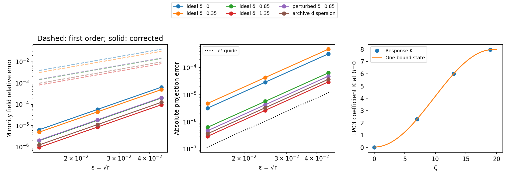
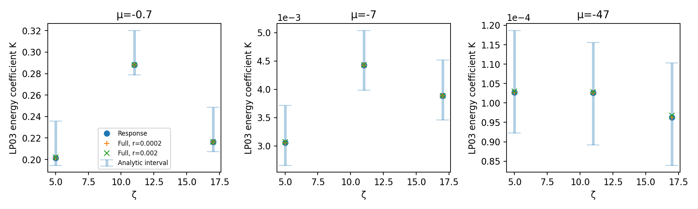
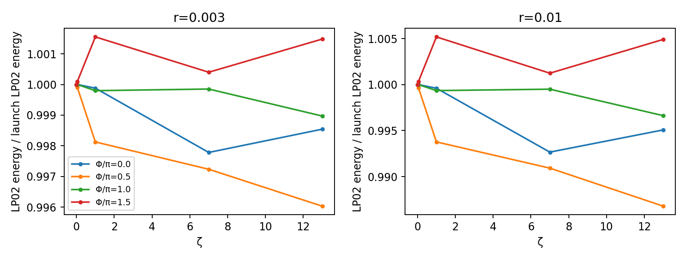

# Next-order retention and the role of modal phase

## Starting evidence and decision

This task starts after completion of T-20261004-claude-interactive-02 in [PR 14](https://github.com/nrivera494/analytical-nl-discovery/pull/14). Its branch is stacked on that PR so the code, calibration and cited run summaries remain reviewable. No branch was merged. The preceding capture, LP03 and noise results were read before this derivation. Its walk-off grid, launch ratios and distances are **construction evidence**, not held-out verification for the present claim.

The literal requested boundary beyond which *no* minority is captured conflicts with the positive leading bound projection at every finite walk-off. A regular finite-time correction cannot establish such a boundary on a compact walk-off interval. I therefore separate that unresolved scattering problem from a stated half-retention boundary, consistent with P-002's requirement to define capture by an explicit modal-fraction criterion. The new claim predicts a reference bound-channel projection and a fixed time gate at finite distance. Neither is mislabeled as the infinite-distance captured energy.

## Required literature and novelty scope

- Menyuk, JOSA B 5, 392–402 (1988), DOI [10.1364/JOSAB.5.000392](https://doi.org/10.1364/JOSAB.5.000392): **full text read**, all sections and captions in the publicly accessible [paper OCR](https://www.scribd.com/document/658412809/menyuk1988). Publisher metadata was cross-checked. The author's UMBC PDF link returned 404; no claim is made to have recovered that PDF. Some displayed equations have OCR defects. The paper treats polarization components with a different cross-phase coefficient, including equal and unequal launch amplitudes, frequency shifts, radiation and attenuation. Section 5 explicitly describes cases without a sharp transition and distinguishes an escaping original minority peak from a newly trapped portion. It does not provide the radial-GRIN three-mode correction evaluated here.
- Steiglitz & Rand, PRA 79, 021802(R) (2009), DOI [10.1103/PhysRevA.79.021802](https://doi.org/10.1103/PhysRevA.79.021802): **full text read**, all four pages of the [author PDF](https://www.cs.princeton.edu/~ken/photon_trapping_transfer09.pdf). Its weak-probe equation, induced sech-squared guide and Legendre eigenstates are prior art. The probe does not back-react on the pump in that model; the collision examples set the explicit pump–probe walk-off to zero. Those omissions distinguish the present finite-admixture response problem, not the basic trapping mechanism.

Additional searches on 2026-10-04: “GRIN weak probe soliton capture perturbation pump depletion four wave mixing LP02 LP03”; “multimode soliton weak component second order capture fraction walk off perturbation”; “soliton guided mode four wave mixing radiation weak probe capture coefficient.” No matching GRIN-specific coefficient map was located in these searches. They are not an exhaustive novelty audit. The proposed method itself is a standard perturbative response expansion; novelty, if any, lies in the parameter-derived correction and its tested usefulness. The empirical 2021 exponential capture law recorded on P-002 is not re-proposed.

## Derivation and why all three sources matter

The full three-mode Kerr polynomials, with intensity terms abbreviated, are

$$\mathcal N_1=(|a_1|^2+\sigma|a_2|^2+\sigma_{13}|a_3|^2)a_1+\kappa a_2^2a_3^*,$$
$$\mathcal N_2=(\sigma|a_1|^2+\alpha_2|a_2|^2+\sigma_{23}|a_3|^2)a_2+2\kappa a_1a_3a_2^*,$$
$$\mathcal N_3=(\sigma_{13}|a_1|^2+\sigma_{23}|a_2|^2+\alpha_3|a_3|^2)a_3+\kappa a_2^2a_1^*.$$

Putting $a_1=u+rU$, $a_2=\sqrt r(v+rV)$ and $a_3=rw$ into these equations gives the hierarchy in the claim. The pump response is needed because its cross-phase correction to LP02 has the same $r^{3/2}$ order as LP02 self-phase and the generated LP03 contribution. Treating LP03 energy as $O(r^2)$ is not a reason to omit its field from the LP02 correction.

The remainder order does not rely on dividing an unweighted field error by $\sqrt r$. Set $b=a_2/\sqrt r$ and $c=a_3/r$ first. Their exact nonlinearities and that of $a_1$ become

$$\mathcal N_1=(|a_1|^2+\sigma r|b|^2+\sigma_{13}r^2|c|^2)a_1+\kappa r^2 b^2c^*,$$
$$\mathcal N_b=(\sigma|a_1|^2+\alpha_2r|b|^2+\sigma_{23}r^2|c|^2)b+2\kappa r a_1cb^*,$$
$$\mathcal N_c=(\sigma_{13}|a_1|^2+\sigma_{23}r|b|^2+\alpha_3r^2|c|^2)c+\kappa b^2a_1^*.$$

This is a polynomial parameter problem with fixed initial data $(f,f,0)$. On a fixed finite interval, the one-dimensional $H^1$ algebra estimate and the integral equation give smooth dependence on $r$ near zero: start with the bounded triangular $r=0$ solution and apply a local Lipschitz estimate and Gronwall on consecutive finite intervals. Differentiating at zero yields $U,V$ and the stated $w$; Taylor's formula in these rescaled variables gives $O(r^2)$ for $a_1-u-rU$ and $b-v-rV$, and $c-w=O(r)$, hence $a_3-rw=O(r^2)$. The constants depend on the propagation interval and coefficient domain. No numerical uniform constant or long-distance scattering bound is proved here.

On any fixed compact walk-off interval the continuous leading projection has a positive minimum. Uniform finite-time $O(r)$ closeness therefore leaves positive projected minority energy for sufficiently small $r$. This rules out a zero of this particular finite-distance observable in that asymptotic regime. It does not exclude eventual escape at distances that diverge as $r\to0$, and supplies no theorem for the requested infinite-distance captured fraction.

The hierarchy is evaluated with an independent Fourier interaction-picture Runge–Kutta implementation. Its outputs are frozen before full finite-admixture comparisons. It solves linear response equations in triangular order, not a fit over finite launch powers. Once two scalar coefficients are computed at a given walk-off and distance, all small launch ratios are predicted without recomputing or fitting those coefficients. This is an asymptotic response map, not a finite-dimensional occupation-only kinetic closure.

At ideal zero walk-off, the coefficient is especially simple. Let $\nu_3=(\sqrt7-1)/2$, $\lambda_3=\nu_3^2/2$ and $b_3^2=I(\nu_3+1,0)^2/I(2\nu_3,0)$. Then

$$K=4-2\operatorname{Re}\{e^{-i\zeta/2}\langle f,e^{iL_3\zeta}f\rangle\},$$
$$\left|K-\left[4-2b_3^2\cos((1/2-\lambda_3)\zeta)\right]\right|\le2(2-b_3^2).$$

The second expression retains the one LP03 temporal bound state, with a rigorous bound on its discarded continuum contribution. The exact coefficient remains bounded by eight at all distances, although the full small-$r$ field expansion is asserted only on the finite interval in the claim. At nonzero carrier mismatch use the forced resolvent/propagator instead; the hierarchy retains it directly.

## Phase test: frozen discrimination before new runs

With only LP01 and LP02 initially occupied, changing their relative phase cannot test an occupation-only closure in the rotating-wave model. The exact symmetry
$a_m\mapsto e^{i\alpha+i(m-1)\theta}a_m$
maps such launches into one another and preserves every modal intensity, including generated LP03. The two-mode launch therefore supplies a **null control**.

A discriminating launch needs three populated modes. Use
$(a_1,a_2,a_3)=(f,\sqrt r f,r c e^{i\Phi}f)$ with equal powers across phase choices, $c=1$, and $\Phi\in\{0,\pi/2,\pi,3\pi/2\}$. The phase invariant is $\Phi=\phi_1+\phi_3-2\phi_2$. The exact initial flux is

$$N_3'(0)=\frac{8\kappa}{3}r^2\sin\Phi,\qquad
N_2'(0)=-\frac{16\kappa}{3}r^2\sin\Phi,\qquad N_1'=N_3'.$$

In particular, $[N_2/(2r)]'(0)=-(2/3)r\sin\Phi$ for $\kappa=1/4$. Opposite phase quadratures predict opposite initial transfer despite identical occupations. This tests an instantaneous deterministic occupation-only closure. It does not refute an explicitly averaged closure under additional assumptions, and it does not constitute an audit of C-0002.

Run the null control at $r=0.01$, $\delta=0.85$, and the seeded test at $r\in\{0.003,0.01\}$, including an archive-dispersion short-distance check. Retain the phase and seeded third-mode fraction in every config. The physical dispersion does not alter the exact initial energy-flux identity.

## Preregistration record

The hierarchy, parameter domain, held-out grid and expected error power were committed in `751cddf`. Numerical predictions were committed and pushed in `6d5b1ff` before the new full nonlinear comparisons. The separate detuning supplement was frozen in `8cb0b5b`, after the main comparisons and before its own runs. Its later design is disclosed below.


## Numerical prediction freeze

The response evaluator was committed in 751cddf, before any new full nonlinear run. The numerical coefficients below are registered in `2026-10-04-gpt-a-nextorder-prediction`. Full predictions for every held-out ratio and output plane are in its summary. This table is frozen before the full-equation comparison.

| Case | $B_0$ | $B_1(7)$ | $B_1(13)$ | $B_1(19)$ | $K_3(19)$ |
|---|---:|---:|---:|---:|---:|
| ideal_d1 | 1 | -2.304031932 | -6.002732282 | -7.960453002 | 7.960453002 |
| ideal_d2 | 0.9050580801 | -1.478701054 | -7.445278113 | -13.88490619 | 14.7384709 |
| ideal_d3 | 0.569810995 | 1.026478868 | -1.045372879 | 1.065399045 | 0.6663069878 |
| ideal_d4 | 0.2664709752 | 0.6535096094 | -0.4097155894 | 0.7939870888 | 0.09741270465 |
| perturbed | 0.5737916448 | 1.274045009 | -0.5677699004 | 1.323418724 | 0.0005945327033 |
| physical | 0.3387512017 | 0.8782275439 | -0.4487683723 | 1.066526507 | 3.052505076e-05 |

At $\zeta=13$, the frozen half-retention prediction is $\delta_{1/2}=0.949476098481-1.446486251515r+O(r^2)$ (`2026-10-04-gpt-a-nextorder-prediction`). The criterion is the fixed reference projection, not zero residual capture. At zero walk-off the single-LP03-bound-state approximation has a uniform absolute coefficient error bound 0.02742990859; its beat gap is 0.16143782777. These analytic spectral quantities and their derivation are in the same run.

## Supplemental detuning corollary: separate prediction freeze

This corollary was designed after seeing the completed main and half-boundary comparisons. Its new mismatch values and output planes are frozen in `2026-10-04-gpt-a-nextorder-detuning-prediction` before its own response or nonlinear runs. It is not retroactively part of the original held-out grid.

For equal dispersions and zero walk-off, keep an arbitrary nonpositive LP03 carrier mismatch $\mu$. Put $H=L_3+\mu$, $d=1/2-\lambda_3$, and denote the squared ground-state overlap above by $b^2$. The exact leading response is

$$w_\mu=\kappa\left(e^{i\zeta/2}-e^{iH\zeta}\right)(1/2-H)^{-1}f^3.$$

Its ground-state contribution to $K_\mu=\|w_\mu\|^2$ is

$$K_b(\mu,\zeta)=\frac{4d^2b^2}{(d-\mu)^2}\sin^2\!\left(\frac{(d-\mu)\zeta}{2}\right).$$

The continuum spectrum of $L_3$ is nonpositive and is orthogonal to its single bound state. Since $(1/2-L_3)f=\kappa f^3$, the spectral multiplier of $f$ in the resolvent is $(1/2-\lambda)/(1/2-\lambda-\mu)$, at most one for $\mu\le0$. Also $\|f^3\|^2=16/15$ and $|\langle\psi_3,f^3\rangle|^2=d^2b^2/\kappa^2$. Consequently, at every distance,

$$0\le K_\mu-K_b\le\min\!\left\{4(2-b^2),\frac{4\kappa^2(16/15)-4d^2b^2}{(1/2-\mu)^2}\right\}.$$

This is an explicit two-sided bound, including the continuum, and gives $K_\mu=O(|\mu|^{-2})$ as $\mu\to-\infty$. It bounds the leading LP03 energy coefficient; the full energy is $N_3=r^2K_\mu+O(r^3)$. The projected LP02 fraction remains $1-rK_\mu+O(r^2)$. Neither finite-$r$ remainder has been assigned a proved numerical constant. The supplemental grid uses $\mu\in\{-0.7,-7,-47\}$, $\zeta\in\{5,11,17\}$ and the original three held-out ratios. The predicted LP03 energy-error exponent is six against $\varepsilon$.

## Outcomes and limits

The proposer comparisons support the stated next-order expansion. Across all held-out conditions and output planes, the minority-normalized field remainder has exponent 3.99635–4.00076 against $\varepsilon$, versus 1.99408–2.00087 before correction. Projection exponents are 3.98844–4.00936; endpoint-corrected gate exponents are 3.98829–4.04554. The LP03 energy remainder has exponent 5.98752–6.01516, as expected from a leading $r^2$ energy and $r^3$ correction (`2026-10-04-gpt-a-nextorder-full`). These are three-ratio fits over the preregistered grid, not a proof of a uniform numerical error constant.

At the frozen half-retention level set, the residuals are $-5.26680\times10^{-7}$, $-4.73677\times10^{-6}$ and $-5.25024\times10^{-5}$, in increasing ratio order. Their fitted exponent is 3.99724 (`2026-10-04-gpt-a-nextorder-boundary`). The coefficient was not adjusted after these values were seen.



Figure: `2026-10-04-gpt-a-nextorder-full` against `2026-10-04-gpt-a-nextorder-prediction`, solver `9c1288712ea9cd7ef858d4e6dff9dea350e9291a`. The first two panels use the last held-out output plane. The right panel shows the analytically bounded one-state approximation and separately evaluated response values.

All three correction sources matter. At ideal $\delta=0.85$, $\zeta=19$, the full coefficient is $B_1=1.06539904$. Deleting self-phase, pump back-action or LP03 gives respectively 1.07727371, -0.59768628 and 1.65121066. Scoring these ablated fields against the same full solutions returns field-error exponents to 1.99808–2.03549 (`2026-10-04-gpt-a-nextorder-response-checks`). The self-phase contribution to this particular projection is small: its ablated projection-error exponent is about 2.93 at the last plane on this grid. It would be misleading to describe every ablated projection fit as a clean second power; the complex-field test is the reliable discrimination.

At $r=0.002$, ideal $\delta=0.85$, halving the propagation step changes the final projection by $1.93\times10^{-11}$, doubling the window by $1.10\times10^{-14}$, and doubling time resolution by $7.77\times10^{-16}$. Adding LP04 changes it by $-4.17\times10^{-7}$, with LP04 energy $3.08\times10^{-10}$. This checks one mode-basis relaxation point; no four-mode scaling sweep was performed. The archive-dispersion half-step change is $9.85\times10^{-13}$ (`2026-10-04-gpt-a-nextorder-convergence`). The independently evaluated response coefficient changes by at most $9.64\times10^{-9}$ under the tested ideal half-step comparison at the last plane (`2026-10-04-gpt-a-nextorder-response-checks`).

The endpoint-corrected gate itself changes by $3.18\times10^{-7}$ on doubling time resolution. Its continuum value is therefore less accurate than the reference projection. The legacy `capture_fixed_*` fields in raw metadata are grid sums; the `W` comparisons use the explicit endpoint-aware quadrature. Total-energy drift is at most $2.35\times10^{-12}$, the largest temporal-edge fraction is $1.97\times10^{-13}$, and the three-mode Manley–Rowe combinations are conserved to the reported solver precision (`2026-10-04-gpt-a-nextorder-full`, `2026-10-04-gpt-a-nextorder-convergence`).

Every supplemental detuning response value lies in its analytical interval. At $\zeta=17$, the coefficients for increasing mismatch magnitude are 0.21634004, 0.003885536 and 0.00009624957. The high-mismatch half-step coefficient changes by at most $1.32\times10^{-11}$ across the sampled planes. Full LP03 energy-error exponents range from 5.93122 to 6.05528, consistent with the predicted sixth power (`2026-10-04-gpt-a-nextorder-detuning-response`, `2026-10-04-gpt-a-nextorder-detuning-full`). This controlled mismatch sweep isolates a suppression mechanism that the preceding physical-versus-ideal comparison alone could not isolate.



Figure: `2026-10-04-gpt-a-nextorder-detuning-prediction`, `2026-10-04-gpt-a-nextorder-detuning-response` and `2026-10-04-gpt-a-nextorder-detuning-full`, same solver commit. Vertical intervals apply at the sampled planes; they are not interpolated across the rapid detuning oscillations. Finite-$r$ values divided by $r^2$ approach the response coefficient.

## Phase outcome

The two-mode phase sweep is exactly the expected null experiment: the largest modal-energy spread is $8.89\times10^{-16}$ and the phase-rotated relative field discrepancy is $4.32\times10^{-16}$. With seeded LP03, the LP02 energy spread at $\zeta=13$, normalized to its input energy, is 0.00545060 at $r=0.003$ and 0.01812871 at $r=0.01$ (`2026-10-04-gpt-a-nextorder-phase`). Thus identical occupations do not determine the instantaneous deterministic evolution in this model once the independent three-mode phase is populated.

The opposite-quadrature initial LP02 slope is predicted to be $-1.33333333\times10^{-4}$ at $r=0.01$. At the shortest sampled distance its relative discrepancy is $5.23\times10^{-8}$ in the ideal case and $9.28\times10^{-5}$ with archive dispersion. Both discrepancies shrink approximately quadratically as that distance is reduced; the finite-distance physical discrepancy is consistent with its fast carrier mismatch, not a failure of the exact initial derivative (`2026-10-04-gpt-a-nextorder-phase`). No conclusion is drawn about an ensemble-averaged or random-coupling closure, or the formal validity domain of C-0002.



Figure: `2026-10-04-gpt-a-nextorder-phase`, same solver commit. Lines join saved planes; each panel fixes all modal launch powers. LP03 is seeded with energy ratio $r^2$ to LP01, and only its invariant phase varies.

## Reproduction and incomplete work

The parent exploration documents regeneration of `2026-10-04-gpt-a-material`; these scripts use that retained calibration. With the pinned solver and the repository virtual environment, regenerate the summaries and figures from retained raw evidence with:

```sh
for mode in full boundary convergence response-checks phase detuning; do
  MPLCONFIGDIR=/private/tmp/gpt-a-mpl OPENBLAS_NUM_THREADS=1 ~/agent-work/venv/bin/python scripts/p002_nextorder_summarize.py "$mode"
done
```

The configs name each propagation script and mode, and the metadata identify its committed source. `p002_nextorder.py` takes an output directory followed by `symbolic`, `prediction`, `convergence` or `ablation`; `p002_nextorder_full.jl` takes an output directory followed by `main`, `boundary`, `convergence` or `phase`. Run Julia commands sequentially with `JULIA_NUM_THREADS=2`. For fresh propagation, choose new raw directories and adapt analysis paths; do not overwrite preserved evidence. Compare recomputed coefficients to the committed prediction tables rather than replacing those tables. The phase evaluator's `phase-resume` mode preserves completed cases. Supplemental detuning scripts and their exact grids are recorded in the corresponding configs.

The first full launch failed before propagation because the older material TOML lacked a derived mismatch key; commit `75ca4e5` computes it from the retained propagation-constant array. The first phase launch completed several cases and then failed while serializing Julia's symbolic $\pi$; `206cf23` converts phase metadata to floating point and resumes completed cases. Failed logs and the partial TOML remain in raw storage. These were harness failures, not failed physical predictions.

The new claim has only proposer checks and is `cheap-checks-passed`, never `sim-verified`. Claude verification and a second-family novelty audit are assigned to `T-20261004-gpt-a-03`. The literal infinite-distance zero-capture boundary remains unresolved under `T-20261004-gpt-a-04`; the parent task is left open. A finite-time response map is useful progress on P-002, but is not a completed universal modal-kinetic closure or an irreversible capture law.

The remaining session time is used for a separately frozen [radiative-onset lead](2026-10-04-gpt-a-radiative-boundary-lead.md). It examines a continuum-frequency condition and outgoing flux, without extending this claim's regime or treating a leading radiation channel as a proven zero-capture boundary.
