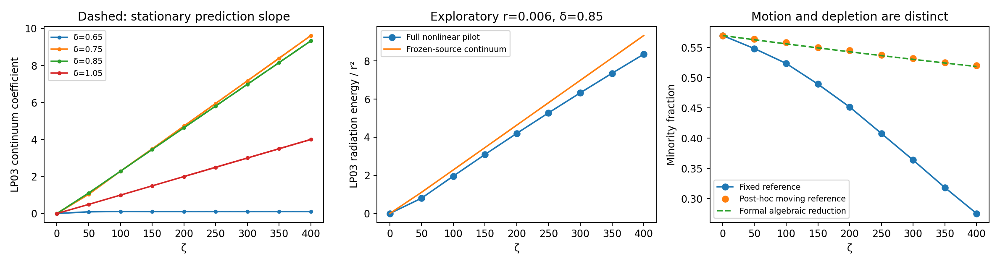

# A radiative-onset lead for the unresolved long-distance boundary

This is a later exploration, designed after the finite-time claim's comparisons. It does not extend C-20261004-gpt-a-01's propagation regime or assert a zero-capture threshold. Its stationary radiation predictions are frozen separately in `2026-10-04-gpt-a-radiation-onset-prediction` before the propagation checks below.

## Frequency condition and predicted flux

For the ideal equal-dispersion model, the bound part of the leading LP02 field is

$$v_b=\sqrt{B_0(\delta)}f(\tau)e^{-i\delta\tau}e^{i(1+\delta^2)\zeta/2}.$$

With $\delta_3=2\delta$, write $w=e^{-2i\delta\tau}e^{i(2\delta^2+\mu)\zeta}\widetilde w$. Its bound-part source gives

$$i\widetilde w_\zeta+L_3\widetilde w+\kappa B_0 f^3e^{i\Omega\zeta}=0,
\qquad\Omega=\tfrac12-\delta^2-\mu.$$

The LP03 continuum has eigenvalues at or below zero. Its forcing enters that continuum when $\Omega<0$, giving the leading **radiative channel opening** $\delta_{\mathrm{rad}}^2=1/2-\mu$. This is a frequency condition, not a proof of eventual loss of all bound LP02 energy. For positive $\Omega$ away from the discrete eigenvalue, the forced response is bounded. At the discrete resonance $\Omega=\lambda_3$, a different secular response occurs. Thus a single monotone capture threshold cannot be inferred merely from the continuum condition.

For an open channel let $k=\sqrt{-2\Omega}$. Solve the even outgoing stationary problem

$$h''+(k^2+\tfrac32f^2)h=-2f^3,\qquad
h'(0)=0,\qquad h(\tau)\sim C e^{ik\tau}\quad(\tau\to+\infty).$$

Each outgoing tail has norm flux $k\kappa^2B_0^2|C|^2$. Hence the frozen-source continuum energy is predicted to grow with slope

$$\Gamma=2k\kappa^2B_0^2|C|^2.$$

The evaluator obtains $C$ from a stationary ODE with an outgoing boundary condition, independently of the propagator. A zero-potential check uses $C=iI(3,k)/k$, verifying the normalization. The propagator removes the LP03 bound-state projection before measuring the secular slope; it does not fit a coefficient to determine $\Gamma$.

The frozen cases are $\delta=0.65$ (closed), and $\delta\in\{0.75,0.85,1.05\}$ (open), all with $\mu=0$. The predicted open-channel slopes are 0.02446213224, 0.02349363056 and 0.01003168377. The propagation comparison uses the interval $200\le\zeta\le400$ and a preregistered relative tolerance of five percent for the open channels (`2026-10-04-gpt-a-radiation-onset-prediction`). One full nonlinear co-launched case at $r=0.006$, $\delta=0.85$ is an exploratory pilot; no finite-$r$ error tolerance or extrapolation to infinite distance is assigned to it.

## Why this does not yet solve the parent task

A formal slow-amplitude replacement of $B_0$ by a time-dependent bound fraction $b$ would give $b'=-r\gamma b^2$, $\gamma=\Gamma/B_0^2$, using the three-mode Manley–Rowe relation. That would produce algebraic depletion on distances of order $1/r$. This step is **not established here**: the pump's frequency and velocity change, the initial radiation must be separated, the threshold and discrete-resonance limits need distinct reductions, and other radiation channels may open at higher orders even when this one is closed. In particular, a channel-opening condition alone cannot justify a literal zero-capture boundary or its correction in $p_2$.

The general mechanism is prior art. Soffer & Weinstein, [DOI:10.1103/PhysRevLett.95.213905](https://doi.org/10.1103/PhysRevLett.95.213905), [arXiv:nlin/0512059](https://arxiv.org/abs/nlin/0512059), **full text read**, all four pages of the [author PDF](https://www.columbia.edu/~miw2103/papers/sw-prl.pdf), derive nonlinear master equations and radiative ground-state selection for a class of Schrödinger systems. Their frequency-resonance condition, transfer into ground state plus radiation, and algebraic late decay are established concepts. Their stated small-amplitude external-potential setting does not directly prove the present moving, self-consistent soliton reduction. The longer theorem paper, [arXiv:nlin/0308020](https://arxiv.org/abs/nlin/0308020), was located and its abstract read, not its full proof. No novelty is claimed for the golden-rule mechanism.

Searches: “Soffer Weinstein ground state selection nonlinear Schrödinger Fermi golden rule two bound states radiation arxiv” and “multimode soliton bound mode radiation four wave mixing Fermi golden rule capture.” This is a targeted mechanism check, not an exhaustive new literature audit.

## Closed-form coefficient, derived after the first checks

The outgoing ODE coefficient can be evaluated without an ODE. This expression was derived after the driven-response results and does not replace the frozen prediction. Put $\nu=(\sqrt7-1)/2$, $a=(1-\nu)/2$, $b=1+\nu/2$, and

$$J(k)=\frac{\pi}{\cosh(\pi k/2)}
\frac{\pi 2^{ik}\Gamma(1-ik)}{\Gamma(a)\Gamma(b)\Gamma(a-ik/2)\Gamma(b-ik/2)},$$
$$\mathcal T(k)=\frac{\sinh^2(\pi k)}{\sinh^2(\pi k)+\sin^2(\pi\nu)}.$$

Then the same radiation rate is

$$\Gamma=\frac{B_0^2(1+k^2)^2}{2k}\mathcal T(k)|J(k)|^2.$$

To derive it, normalize the right Jost solution as $F_+(\tau,k)=\Gamma(1-ik)\mathsf P_\nu^{ik}(\tanh\tau)$, using the Ferrers function on $-1<x<1$. Equivalently, $F_+=e^{ik\tau}{}_2F_1(-\nu,\nu+1;1-ik;(1-\tanh\tau)/2)$, which fixes its phase convention and gives $F_+\sim e^{ik\tau}$ on the right. The beta integral for $\int fF_+\,d\tau$ is a $_3F_2(1)$ with parameters $(-\nu,\nu+1,(1-ik)/2;1,1-ik)$. Watson's sum gives $J(k)$. The relevant identity and convergence condition were read in **full text of the cited section** of NIST DLMF, [Eq. 16.4.6](https://dlmf.nist.gov/16.4.E6), [DOI:10.18434/M3167](https://doi.org/10.18434/M3167). Here its convergence condition is satisfied for real $k$.

The Jost connection coefficients give transmission probability $\mathcal T$. Integration by parts using $(1/2-L_3)f=f^3/4$ gives $\int f^3F_+\,d\tau=2(1+k^2)J(k)$. The outgoing Green function supplies $|C|^2=\mathcal T\,|\int f^3F_+|^2/k^2$, yielding the formula above. This derivation explains the normalization independently of the propagation slope.

The rate vanishes linearly in $k$ at the continuum edge. In particular,

$$\Gamma\sim c_* B_0^2k,\qquad
c_* =\frac{\pi^2}{2\sin^2(\pi\nu)}
\left[\frac{\pi^2}{\Gamma(a)^2\Gamma(b)^2}\right]^2.$$

Thus its onset is a square root in $\delta^2-1/2$ when $\mu=0$. The evaluated prefactor is 0.20523395; the closed formula agrees with the independent stationary ODE within relative $8.42\times10^{-12}$ in the sampled open channels (`2026-10-04-gpt-a-radiation-onset-closed-form`). This is a flux law for the stated source model, not a capture-fraction phase transition.

## A mode-cutoff obstruction to identifying this with zero capture

The rotating-wave selection rule permits higher radial modes at higher powers of the weak field. For mode $m=n+1$ with equal dispersions, affine walk-off $\delta_m=n\delta$ and residual carrier mismatch $\mu_m$, the harmonic generated by $n$ copies of the bound minority and $n-1$ conjugate pump factors has forcing frequency

$$\Omega_m=\tfrac12-\tfrac12n(n-1)\delta^2-\mu_m$$

after removing the mode's frequency phase. For example, the formal LP04 harmonic can enter its continuum while the LP03 channel is still closed. This is only a frequency condition: the coupling residue, intermediate resonances and competing harmonics still need calculation. It shows why the number of retained modes and the residual carrier spacings matter for any proposed infinite-distance boundary. Terms negligible in the finite-distance expansion can control much slower leakage.

## Checks

All three open-channel continuum slopes pass the frozen five-percent criterion. Relative discrepancies from the independent ODE prediction are $2.11\times10^{-4}$, $3.07\times10^{-5}$ and $2.38\times10^{-6}$ in increasing walk-off order. The closed-channel fitted slope is $2.16\times10^{-6}$ over the same finite interval, reflecting an unresolved finite-time oscillatory tail rather than an asserted exactly zero fitted slope. At $\delta=0.85$, halving the step changes the measured open-channel slope by $2.80\times10^{-11}$ and doubling the window by $1.49\times10^{-11}$ (`2026-10-04-gpt-a-radiation-onset-response`, `2026-10-04-gpt-a-radiation-onset-convergence`).

In the full co-launched pilot the outer LP03 energy slope, divided by $r^2$, is 0.02075897, about 11.6 percent below the frozen-source value. The fixed original projection falls to 0.27544, while a **post-hoc** pump-centered, frequency-adjusted projection is 0.52015. The pump center has moved by 1.36794 pulse widths. The long pilot therefore makes the observable distinction consequential; it does not show that most of the minority has ceased to be trapped (`2026-10-04-gpt-a-radiation-onset-pilot`).

The nonlinear pilot's additional refinements are complete. Doubling the time window changes its normalized radiation slope by $3.00\times10^{-8}$ and its final moving projection by $1.99\times10^{-10}$; halving the propagation step changes them by $8.55\times10^{-10}$ and $1.20\times10^{-8}$. The final fixed-projection changes are $1.01\times10^{-8}$ and $1.11\times10^{-7}$, respectively. The doubled window reduces the maximum temporal-edge fraction from $4.97\times10^{-6}$ to $1.32\times10^{-9}$; the halved step reduces the maximum total-energy drift from $4.86\times10^{-8}$ to $1.53\times10^{-9}$ (`2026-10-04-gpt-a-radiation-onset-pilot-convergence`). The 11.6 percent discrepancy from the frozen-source rate survives these checks. These refinements establish numerical stability at this pilot point, not a small-$r$ error law or a mode-cutoff-independent limit.

Using the previously written formal slow equation without an adjustable rate or time offset gives $b=B_0/[1+r\Gamma\zeta/B_0]$. Its largest difference from the post-hoc moving projection on the saved planes is 0.002225 (`2026-10-04-gpt-a-radiation-onset-pilot`). This is a useful lead for the next derivation, not a controlled or held-out verification of that nonlinear law. The moving reference was defined after seeing the fixed-reference drift, and the pilot samples only one launch ratio and walk-off.

Figure: `2026-10-04-gpt-a-radiation-onset-response` and `2026-10-04-gpt-a-radiation-onset-pilot`, solver `9c1288712ea9cd7ef858d4e6dff9dea350e9291a`. Dashed slopes in the first panel use the independently frozen rates with their vertical position anchored only for comparison. The second panel compares distinct observables: outer LP03 energy in the full pilot and continuum-projected energy in the frozen-source calculation. The third panel explicitly labels the post-hoc tracker and formal reduction; it is not evidence for a literal zero-capture boundary.

The follow-up is T-20261004-gpt-a-04; the parent task remains open. The frozen-source rate does not by itself establish the proposed slow nonlinear equation or an all-orders boundary.

Reproduce the registered comparisons and figure after the raw runs with `MPLCONFIGDIR=/private/tmp/gpt-a-mpl OPENBLAS_NUM_THREADS=1 ~/agent-work/venv/bin/python scripts/p002_radiation_summarize.py`.
