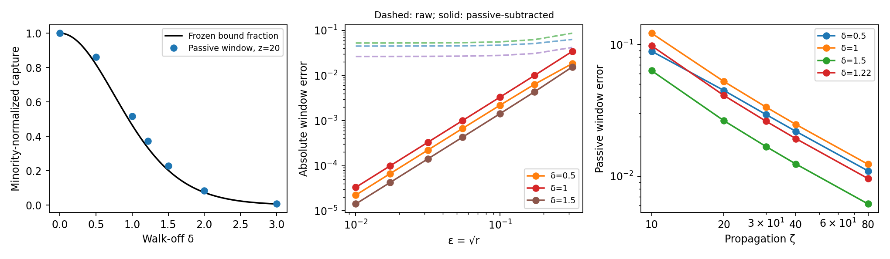
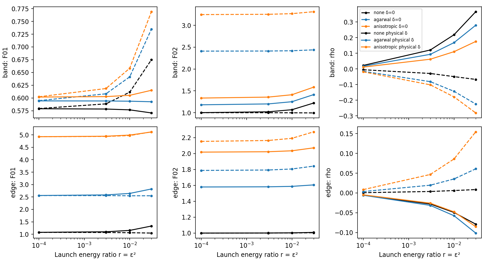

# Independent weak-LP02 capture test

## Frozen contract (before production propagation)

The tested formula is the Claude proposal on P-20261004-claude-interactive-01. This is an independent exploration, not adoption or verification of a registered claim. Set $u(0,\tau)=\operatorname{sech}\tau$ and $a_2(0,\tau)=\sqrt r\operatorname{sech}\tau$, where $r=\varepsilon^2=E_2/E_1$. The true total modal fraction is $p_2=r/(1+r)$. Keep the LP01 fundamental-soliton power fixed. Use the archive's 0.4 ps intensity-FWHM reference, $T_0=0.4/[2\operatorname{arcosh}(\sqrt2)]$ ps.

The first-order prediction is $C_0(\delta)=[\pi\delta/(2\sinh(\pi\delta/2))]^2$, with $C_0(0)=1$. The gauge and Fourier signs will be checked from the solver convention. The predicted absolute error in a **minority-normalized** capture fraction is $O(r)=O(\varepsilon^2)$ at fixed propagation distance. Thus a log–log slope against $r$ is 1, against $\varepsilon$ is 2. This is not an assertion uniform in distance or at a vanishing leading coefficient.

Frozen predictions (material calibration: `2026-10-04-gpt-a-material`; no propagation performed):

| $\delta$ | Predicted $C_0$ |
|---|---|
| 0 | 1 |
| 0.5 | 0.817464976862 |
| 1 | 0.465901054525 |
| 1.5 | 0.203121445662 |
| 2 | 0.0739998067545 |
| 3 | 0.00716940791283 |
| 1.21850695882 | 0.333085476964 |

The physical-model value is the final row. This table and the expected exponent are committed before any production propagation.

Sweep $\delta\in\{0,0.5,1,1.5,2,3,\delta_{\rm GIF625}\}$ and $r\in\{0.003,0.01,0.03,0.1\}$. Smaller $r\in\{10^{-4},3\times10^{-4},10^{-3}\}$ are prespecified scaling diagnostics if a finite-distance residual hides the asymptote. A passive linear probe supplies the $r=0$ finite-distance baseline. These extra values are not new fitting parameters.

Primary observable: LP02 energy inside $|\tau|<5$, divided by launched LP02 energy, at $\zeta=20$. Also record windows of radius 4 and 6, the window centered on the LP01 peak, and the projection onto the gauge-shifted sech bound state. At finite $r$, the LP01 pulse can move: the original-frame and peak-centered observables must remain distinguishable. Inspect $\zeta\in\{10,20,40\}$, extending to 80 for the passive probe if radiation remains. A residual at $r=0$ is finite-distance/window error and must not be fitted as a nonlinear exponent. Report both raw formula errors and differences from the passive-probe baseline.

The main model is scalar, axisymmetric, rotating-wave Kerr, equal anomalous $\beta_2$, no gain/loss, no Raman, no self-steepening, and no random coupling. Use the ideal overlaps and the archive-model overlaps separately if they differ. The physical-model control retains each mode's own $\beta_2$; distinguish this relaxation from the equal-dispersion formula. Three-mode runs include the resonant 01+03↔02+02 overlap. Record the physical residual phase mismatch instead of silently calling real modes equally spaced.

Numerical starting settings: total time window 320 in $\tau$, 4096 points, $\Delta\zeta=0.01$. Double the window at fixed temporal spacing, halve the step, and double temporal resolution on representative $(r,\delta)=(0.01,1),(0.1,3)$ and the physical point. Reduce these sizes only if documented preproduction implementation tests show the same controls. Use the package RK4IP and an independent split-step implementation for Kerr checks. Required controls: scalar fundamental soliton, mode energy conservation in the two-mode Kerr model, boundary energy and spectral-edge energy.

Noise contract: $r\in\{0.003,0.01,0.03\}$, $\delta=0$ and $\delta_{\rm GIF625}$, $\zeta=20$, initially coherent fields. Filters are a binary symmetric bandpass $|\Omega T_0|\le1$ and the binary positive-frequency edge $\Omega T_0\ge0$; both stay fixed in the launch carrier frame. Record mode-resolved photon-count Fano factors and $\rho=V_{12}/\sqrt{V_{11}V_{22}}$. No filter or length optimization. Check unfiltered mode counts with Kerr only. Compare no Raman, Agarwal oscillator and anisotropic Raman, with deterministic response and matching 300 K reservoir. The no-shock model uses a constant carrier photon normalization; any physical shock control uses frequency-dependent photon weights. Do not describe a deterministic Raman adjoint alone as full quantum noise. If the reservoir or numerical convergence cannot be validated, mark the result incomplete and create a follow-up task.

A finite-limit statement is only supported if the decreasing-$r$ sequence stabilizes. A large but finite value counts as finite; no squeezing is presupposed. Optical and reservoir covariances must be reported separately, including positive-semidefiniteness and total-count controls.

## Results

The numerical table was committed and pushed in `43bc96d` before the first propagation. The earlier `855ce5d` commit corrected a Julia parse error; its commit subject anticipated a table-generation command that had failed on a missing Python TOML reader. It contains no prediction table or simulation output. `43bc96d` is the authoritative freeze.

### Material and conventions

`2026-10-04-gpt-a-material` independently integrates the radial Laguerre polynomials and reconstructs the archive's GIF625 model. It gives ideal $S_{12}/S_{11}=1/2$, $S_{22}/S_{11}=1/2$, and $S_{1223}/S_{11}=1/4$ to quadrature precision. The archive gives $\sigma=1.000000000000099$, $S_{22}/S_{11}=0.500000000000099$, $T_0=0.2269185314$ ps, $L_D=1.833195707$ m and $\delta_{\rm phys}=1.218506959$. The task's expectation that the archive profile shifts $\sigma$ is not supported: it uses ideal analytical GRIN mode fields, not measured GIF625 index data. Its modal dispersions and residual carrier mismatch still differ from the equal-dispersion, exactly resonant idealization.

### Capture law and finite-distance failure

Runs: `2026-10-04-gpt-a-capture`, `2026-10-04-gpt-a-capture-small`, `2026-10-04-gpt-a-passive`. The first two use the pinned solver's RK4IP, with a task-local response type supplying an exact no-shock cache. The third uses an independently implemented fourth-order split-step method. Neither edits the solver tree.

The **bound projection** agrees with the frozen law as $r\to0$. The initially reported time-window values below are the preserved grid sums; endpoint-aware quadrature and its resolution error are given in the convergence section. The prescribed finite window at $\zeta=20$ does not measure an asymptotic captured fraction. Slow continuum radiation remains near the soliton. For example, at $\delta=1$, the passive window gives 0.51835634 at $\zeta=20$, 0.49062915 at 40, and 0.47822685 at 80, versus $C_0=0.46590105$. At the physical-model walk-off, these are 0.37417891, 0.35237732 and 0.34269475, versus 0.33308548. Widening the observation window includes more radiation. Widening the computational window does not remove this physical residual.

After subtracting the **prespecified passive finite-distance baseline**, the fitted exponents in $\varepsilon$ over $r\in\{10^{-4},3\times10^{-4},10^{-3}\}$ are 1.99894, 2.00024, 2.00058, 2.00052 and 2.00048 at $\delta=0.5,1,1.5,2,\delta_{\rm phys}$ respectively. At $\delta=3$, the nonlinear coefficient is small and the measured exponent is 2.01219. The uncorrected formula error plateaus instead of following $\varepsilon^2$. All fit points and both fitting intervals are retained in the capture summary; no fitted coefficient enters the predicted formula.

The relative $L^2$ error of the normalized minority **field** against the independent passive field has fitted exponents from 1.99984 to 2.00018 in $\varepsilon$ across all seven walk-offs, including zero (`2026-10-04-gpt-a-capture`). This is the cleanest direct test of the first-order field theory.

The zero-walk-off bound projection is an exception with a vanishing linear-in-$r$ probability correction: its measured exponent is 3.99933 in $\varepsilon$, consistent with an $O(r^2)$ projection loss. This does not refute an $O(r)$ upper bound, but it refutes interpreting 2 as a universal nonzero leading exponent for every observable and walk-off. The finite window also omits the soliton tails at $r=0$.

The scalar complex-field control has relative error $3.01\times10^{-8}$ at $\zeta=20$ and the two-mode energy drift is below $1.57\times10^{-10}$ (`2026-10-04-gpt-a-capture`). Independent split-step comparisons are recorded in that summary. The completed step/window/resolution and LP03 checks are reported below.

A post-hoc explanation of the slow passive residual follows from the known continuum states. In the gauge removing walk-off, their coefficients for the launched sech are
$c(k)=i\pi\delta/[\sqrt{2\pi(1+k^2)}\cosh(\pi(\delta-k)/2)]$.
Stationary phase gives a leading continuum **energy** inside a symmetric radius-$R$ window proportional to
$\pi\delta^2(R-\tanh R)/[2\zeta\cosh^2(\pi\delta/2)]$.
The leading bound–continuum interference is odd and integrates to zero in that symmetric window. This explains why simply waiting to $\zeta=20$ is inadequate. It was derived after seeing the residual and is not a frozen forecast or a new claim.

### Noise

The main production sweep, smaller-admixture extension and Raman convergence runs are complete (`2026-10-04-gpt-a-noise`, `2026-10-04-gpt-a-noise-small`, `2026-10-04-gpt-a-noise-convergence`). These noise runs use two ideal radial modes with equal modal dispersion, and vary the LP02 group delay; “physical δ” denotes only the archive-calibrated walk-off. They do not use the unequal modal dispersion or LP03 channel of the physical capture control. The optical contribution is the Gram matrix of discrete-adjoint input-vacuum sensitivities. Binary filters have zero added partition term. A constant carrier photon weight matches the explicitly no-shock equations; this is the narrowband photon convention, not an undocumented use of the shock-weighted observable.

The Raman calculation uses the analytic transforms of the two causal response models and the symmetric bath proportional to $|\operatorname{Im}H(\Omega)|\coth(\hbar|\Omega|/2k_BT)$. The modal-pair Gram matrix is averaged with the same GRIN rotating-wave selection rule. Source: Drummond & Corney, DOI [10.1364/JOSAB.18.000139](https://doi.org/10.1364/JOSAB.18.000139), [arXiv:quant-ph/9912095](https://arxiv.org/abs/quant-ph/9912095), **full text accessed**, Sec. 6 and Eqs. (6.11), (6.13), (6.16) inspected. This source supplies the fluctuation–dissipation convention, not an independent validation of the multimode implementation. No reservoir prefactor is fitted. The limiting statements concern the linearized bright-field regime $1\ll rN_1\ll N_1$; they do not define a photon-count Fano factor for an exactly empty mean mode or establish an interchange of the $r\to0$ and large-photon-number limits.

### Additional physical-dispersion prediction (before that control)

After inspecting the ideal-model results, but before running any unequal-dispersion propagation, freeze a separate correction for the physical $b=|\beta_{2,02}|/|\beta_{2,01}|$. Its linear potential has $\nu(\nu+1)=2\sigma/b$ and normalized bound state proportional to $\operatorname{sech}^{\nu}\tau\,e^{-i\delta\tau/b}$. Write $I(a,k)=2^{a-1}|\Gamma((a+ik)/2)|^2/\Gamma(a)$. The corresponding initial bound fraction is
$C_{b,\sigma}=I(\nu+1,\delta/b)^2/[2I(2\nu,0)]$.
The numerical prediction is in `runs/2026-10-04-gpt-a-material/config_physical_prediction.json`. This extension is not the original frozen Claude formula and is not evidence for novelty. It isolates the unequal-$\beta_2$ effect from finite-window radiation and nonlinear corrections; the physical runs remain a test of a relaxed model assumption.

The additional prediction was committed in `705cfaf` before the physical-probe run. `2026-10-04-gpt-a-physical-probe` gives a bound projection of 0.338751201742 at $\zeta=40$, versus the predicted 0.338751201724. Its finite-window fraction is still 0.35709086657. Here $b=1.01107237322$ and $\nu=0.992681400466$. This is a check of the linear unequal-dispersion correction, not of finite-admixture LP03 leakage.

### Convergence and LP03

`2026-10-04-gpt-a-capture-convergence` halves the propagation step, doubles the computational time window, doubles temporal resolution and doubles distance at the three prespecified representative points. The original grid-sum gate changes by as much as $2.62\times10^{-4}$ when temporal resolution doubles. This is endpoint quadrature error of a hard gate: integrating through interpolated endpoints reduces the maximum difference to $4.77\times10^{-7}$. With that same continuous $|\tau|<5$ definition, step halving changes the measured fraction by at most $6.09\times10^{-11}$ and computational-window doubling by at most $3.76\times10^{-14}$. Original grid-sum values are retained; the extra fields are `capture_gate_trapezoid_5`. The corrected passive values at $\zeta=20$ are 0.51889540746 at $\delta=1$ and 0.37460697872 at the physical walk-off. The finite-distance failure is far larger than these numerical errors.

Adding LP03 changes the $r=0.01,\delta=1$ grid-sum window fraction by $-0.00358058$ and the same-$r$ physical-walk-off, equal-dispersion ideal model by $-0.00121987$ (`2026-10-04-gpt-a-capture-convergence`). This is a physical model correction, not a propagation-grid error.

`2026-10-04-gpt-a-three-scaling` gives absolute LP03-energy exponents 3.99062 and 4.00025 in $\varepsilon$, at $\delta=0$ and 1 respectively, using $r\in\{10^{-4},3\times10^{-4},10^{-3}\}$. Thus the LP03 **field** is $O(\varepsilon^2)$, its energy is $O(\varepsilon^4)$, and the loss relative to the launched LP02 energy is $O(\varepsilon^2)$. The identities $N_1-N_3=2$ and $N_2+2N_3=2r$ hold within $3.22\times10^{-10}$ in the tested normalization. At zero walk-off and $r=10^{-4}$, $N_3/r^2=7.94557$ and the LP02 bound projection is 0.99920543. The coefficient changes appreciably at larger fractions, so extrapolating the first correction to $r=0.1$ is not justified.

The archive-model carrier detuning matters. `2026-10-04-gpt-a-material` gives $\mu_3=(\beta_{01}+\beta_{03}-2\beta_{02})L_D=-46.96209735$, not zero. In the physical three-mode run at $r=0.01$, LP03 energy is $2.76733\times10^{-9}$, compared with $1.63123\times10^{-5}$ in the ideal equal-spacing, equal-dispersion model at the same LP02 walk-off (`2026-10-04-gpt-a-capture-convergence`). Both the residual phase mismatch and the actual third-mode group delay are retained in the physical case. This comparison changes several physical dispersion coefficients together; it is not a one-parameter attribution test.

### Noise controls and numerical scope

Across the main noise sweep, the total-count Fano error is at most $2.38\times10^{-9}$ and the total-count Raman contribution is below $5.85\times10^{-19}$. In the Kerr cases, unfiltered LP02 has $|F-1|\le1.31\times10^{-10}$ (`2026-10-04-gpt-a-noise`). The covariance was not renormalized to enforce these controls.

`2026-10-04-gpt-a-noise-controls` independently checks filtered-count adjoints by directional finite differences and the modal reservoir contraction by direct integration over transverse space and a GRIN beat phase. The smallest-step relative derivative errors are $5.33\times10^{-11}$ (Kerr) and $8.35\times10^{-13}$ (anisotropic Raman); the direct-space covariance discrepancy is $2.02\times10^{-16}$. These check the implementation and normalization of the chosen linearized model, not a separate quantum calculation of the real fiber.

The fixed edge filter has a visible frequency-grid error when the time window changes. It is retained and reported, with follow-up `T-20261004-gpt-a-02` for the continuous-frequency limit. The noise readout includes the entire modal output, including radiation, after the fixed spectral filter; it has no temporal capture gate. No noise value should be interpreted as the noise of only the bound component.

### Scope and reproducibility

All main capture points were held out from any fitted correction: the prediction table and error power were frozen first. The extra unequal-dispersion prediction was frozen separately before that control, after the ideal results were known. The tested range is $10^{-4}\le r\le0.1$, $0\le\delta\le3$ and $\zeta=20$, with passive checks through $\zeta=80$. The quadratic field-error statement is supported by the smaller interval $10^{-4}\le r\le10^{-3}$; it is not a uniform small-error guarantee over the entire range or at infinite propagation distance. The three-mode correction is substantial at the larger launch fractions.

Each registered run contains its script, mode and parameter choices in `config.*`, plus the solver pin and raw-data path in `meta.yaml`. The common model adapter reads the material calibration from the registered material raw folder. Material calibration is regenerated with `scripts/p002_material.jl`; capture with `scripts/p002_capture.jl`; independent split-step checks with `scripts/p002_independent.py`; noise with `scripts/p002_noise.jl`; and adjoint/Gram controls with `scripts/p002_noise_controls.jl`. Supply a fresh raw-output directory to each script to preserve the original runs. Julia commands use `JULIA_NUM_THREADS=2 julia --project=solver`; BLAS and FFT are each limited to one thread by the helper. The Python summary helper reproduces the plots, error fits, endpoint-aware gates and noise comparisons from the retained raw files. Its modes `capture`, `convergence`, `gates` must run in that order because `gates` augments the first two summaries.

### Additional reservoir-prefactor control (frozen before its run)

The continuous-wave check isolates a known Gaussian quantum-channel limit: a bright coherent minority wave and an undepleted classical pump, with thermal occupation $n_T$ at their beat frequency. If the deterministic minority power gain is $G$, the predicted input-vacuum contribution is $F_{\rm opt}=G$ and the symmetric reservoir contribution is $F_R=(2n_T+1)|G-1|$. Thus an amplifying Stokes channel has $F=1+2(n_T+1)(G-1)$, whereas the attenuating channel has $F=1+2n_T(1-G)$. This is an independent absolute-prefactor test; neither the gain nor the bath normalization is fitted. The gain exponent is also checked against $2(S_{12}/S_{11})|\operatorname{Im}H_R(\Omega)|\zeta$.

Use both Raman models, both beat-frequency signs, $r\in\{10^{-6},10^{-8}\}$, $\zeta\in\{0.01,0.02\}$, a periodic interval of length 40 and its fourth harmonic. The finite-pump correction should shrink as $r$ decreases. This supplement was designed after the soliton results, before the CW control; it does not expand their preregistration retroactively.

The completed `2026-10-04-gpt-a-noise-convergence` sweep checks $r=0.003$, $\delta=\delta_{\rm phys}$ for all three responses. Halving both the propagation step and reservoir integration spacing changes $F_{01}$ by at most $2.15\times10^{-5}$, $F_{02}$ by $8.25\times10^{-6}$ and $\rho$ by $1.22\times10^{-6}$. Doubling temporal resolution at fixed window changes the Fano factors by less than $2.45\times10^{-14}$. Doubling the computational window at fixed temporal spacing changes them by up to 0.02048 ($F_{01}$), 0.004918 ($F_{02}$) and 0.001031 ($\rho$), with the largest effects at the edge filter. The bandpass changes are smaller: at most 0.001514 in $F_{01}$ and 0.001029 in $F_{02}$. These are observed changes at the checked parameter point, not rigorous error bounds over the entire sweep. The continuous-frequency sharp-filter limit is therefore **incomplete**, as tracked by `T-20261004-gpt-a-02`.

The main sweep's smallest optical and reservoir covariance eigenvalues are $-1.33\times10^{-15}$ and $-6.28\times10^{-16}$, consistent with roundoff in Gram matrices; its maximum temporal-boundary mean-field energy fraction is $5.90\times10^{-12}$ (`2026-10-04-gpt-a-noise`). This rules out a large mean-field wraparound error at the tested window; it does not remove the frequency quadrature issue in the filtered noise observable.

Before launching the CW control, extend its frozen temperature set to 0 K and 300 K. The zero-temperature attenuator predicts $F=1$ and the amplifier predicts $F=2G-1$; this checks the spontaneous contribution separately from the large thermal occupation. No soliton production settings change.

### Small-admixture noise results

At $r=10^{-4}$ the reference-grid readouts below support finite Fano limits and vanishing intermodal correlation. These are finite-$r$ values, not exact limiting constants. The Kerr minority values approach one; Raman leaves finite excess noise. Reducing $r$ from 0.003 to $10^{-4}$ changes $F_{02}$ by at most 0.02158 across these fixed readouts, with no divergence. The LP01 values for the two walk-offs approach the same scalar limit. The complete optical/reservoir split, photon means and changes from $r=0.003$ are in `2026-10-04-gpt-a-noise-small`; the numerical frequency-grid qualification above still applies.

| Response | Walk-off | Filter | $F_{01}$ | $F_{02}$ | $\rho$ |
|---|---|---|---:|---:|---:|
| none | 0 | band | 0.57925 | 0.99997 | -0.00553 |
| none | 0 | edge | 1.07511 | 1.00001 | 0.00072 |
| agarwal | 0 | band | 0.59476 | 2.40912 | -0.01516 |
| agarwal | 0 | edge | 2.55802 | 1.78719 | 0.00361 |
| anisotropic | 0 | band | 0.60232 | 3.24604 | -0.01891 |
| anisotropic | 0 | edge | 4.92548 | 2.15222 | 0.00852 |
| none | archive δ | band | 0.57892 | 1.00064 | 0.02213 |
| none | archive δ | edge | 1.07603 | 1.00003 | -0.00516 |
| agarwal | archive δ | band | 0.59430 | 1.18008 | 0.01704 |
| agarwal | archive δ | edge | 2.55896 | 1.57930 | -0.00571 |
| anisotropic | archive δ | band | 0.60180 | 1.33449 | 0.01139 |
| anisotropic | archive δ | edge | 4.92578 | 2.01743 | -0.00467 |

The finite-limit evidence concerns the prescribed coherent-input, linearized, bright-minority regime. It does not extrapolate the linearized count approximation to an exactly empty quantum mode. The phase, wavelength and filter conventions were not adjusted to improve the limiting behavior.

### Reservoir-prefactor result and remaining work

The supplementary control was frozen in `444c177` before running. `2026-10-04-gpt-a-noise-cw` passes the thermal bosonic amplifier/attenuator benchmark for both responses, both frequency signs, both temperatures and both launch ratios. The maximum relative reservoir error is $5.70\times10^{-10}$; the analytic gain-exponent error is below $6.29\times10^{-10}$; and total Fano-factor error is below $1.25\times10^{-12}$. The zero-temperature attenuator preserves $F=1$ within $4.06\times10^{-14}$. Errors are already at the numerical floor for this short CW test, so the two tested launch ratios do not resolve a finite-pump correction exponent. This validates the absolute prefactor against an independent quantum-channel limit without fitting it. It does not establish a second independent solution of the entire pulsed multimode problem.

The exploration is complete, with two explicit limitations assigned as follow-ups: the missing measured GIF625 profile (`T-20261004-gpt-a-01`) and the continuous-frequency sharp-filter limit (`T-20261004-gpt-a-02`). The finite-distance time-window failure is a result, not a numerical failure to be hidden by choosing a different gate. The next assigned task concerns the nonlinear capture correction and phase dependence; no claim has been promoted or marked verified here.
