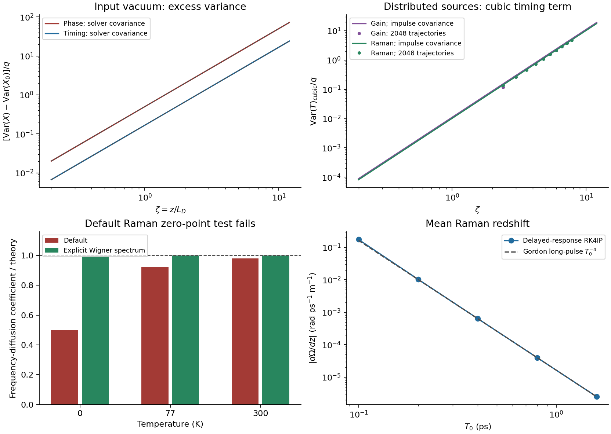

# Scalar soliton noise baselines

## Scope fixed before the runs

Reproduce established scalar results, without starting the blocked multimode
derivation. The reference equation is
$u_\zeta=i(u_{\tau\tau}/2+|u|^2u)$, with
$u_0=\operatorname{sech}\tau\exp(i\zeta/2)$.
The dimensional map is $\tau=t/T_0$, $\zeta=z/L_D$,
$L_D=T_0^2/|\beta_2|$, $P_0=1/(\gamma L_D)$ and
$q=\hbar\omega_0/(P_0T_0)=1/\bar n$. The pulse contains $2/q$ photons.

The coordinates are energy $E=\int|u|^2d\tau$, phase $\theta$,
position $T$, and phase-gradient frequency $V$; physical frequency detuning is
$-V/T_0$ in the solver's Fourier convention. At unit amplitude the dual modes,
under $\operatorname{Re}\int g^*\delta u\,d\tau$, are

$$g_E=2s,\qquad g_\theta=i(1-\tau\tanh\tau)s,\qquad
g_T=\tau s,\qquad g_V=i s\tanh\tau,\qquad s=\operatorname{sech}\tau.$$

Their biorthogonality and adjoint evolution identities must be checked;
biorthogonality alone does not remove continuum contamination. The independent
linearization gives $\delta\theta'=\delta E/2$ and $\delta T'=\delta V$.

## Numerical decisions

- Use the pinned solver's RK4 interaction-picture step with an explicitly flat
  nonlinear prefactor for the exact NLSE limit. This removes optical shock and
  spectral damping from the reference model. Keep the solver tree unchanged.
- Project full-field perturbations with the dual modes. Determine covariance
  by a trace over orthonormal input perturbations and by stochastic checks;
  do not estimate a prefactor by fitting it to the reference formula.
- Balanced distributed gain and loss have zero mean net gain but additive
  Wigner noise. The existing general additive-drive interface can represent
  this source even though `GainLangevin` alone couples noise to net gain.
- Use a causal single-Lorentzian Raman response with explicit Fourier transfer
  function. Its parameters and temperature fix the Raman fluctuation spectrum.
  Check the solver's default spectrum separately against the Wigner
  fluctuation-dissipation relation; a matching exponent is insufficient.
- Vary the step, window and temporal resolution, and compare a second
  integration method. For Raman drift, also vary $T_0$ and test convergence
  toward the long-pulse $T_0^{-4}$ law. For variance growth, subtract only the
  analytically prescribed lower-order terms before reporting a power.
- Preserve failed checks and distinguish the stationary-mean perturbative
  Raman benchmark from full delayed-response propagation.

## References and access

Corney and Drummond, arXiv:quant-ph/9912096, **full text**, supplies the
Wigner correlations and scalar timing coefficients (equations 2.4–2.7 and
3.18). Haus and Lai, DOI 10.1364/JOSAB.7.000386; Gordon and Haus,
DOI 10.1364/OL.11.000665; and Gordon, DOI 10.1364/OL.11.000662,
**abstract only**. Coefficients will be derived independently and compared
with the accessible Corney–Drummond full text. This is a baseline exploration,
not an independent verification of a new claim.

Drummond and Corney, arXiv:quant-ph/9912095, DOI
10.1364/JOSAB.18.000139, **full text, sections III and VI read closely**,
fixes the response/noise convention: $\alpha_R=2|\operatorname{Im}H_R|$
and the Wigner factor is $n_{\rm th}+1/2$. These were checked before labeling
the default Raman normalization a failure. The legacy API's name alone was
not taken as evidence of a quantum ordering convention.

## Results

All numerical values in this note come from
[`2026-10-04-gpt-b-soliton-baselines`](../runs/2026-10-04-gpt-b-soliton-baselines/summary.json)
unless the pathwise run is named explicitly. The solver commit is
`9c1288712ea9cd7ef858d4e6dff9dea350e9291a`, clean and unchanged.

The scalar baselines pass with explicit Wigner sources. The built-in Raman
spectrum fails its zero-point normalization check. This is a calibration
result, not a new claim or a multimode derivation.

### Formulas and measured powers

For coherent input, the real and imaginary field quadratures each have
covariance $(q/4)\delta(\tau-\tau')$. Dual projection gives

$$\frac{\operatorname{Var}(E)}q=2,\quad
\frac{\operatorname{Var}(\theta)}q=\frac{\pi^2+12}{72}+\frac{\zeta^2}{2},\quad
\frac{\operatorname{Var}(T)}q=\frac{\pi^2}{24}+\frac{\zeta^2}{6},\quad
\frac{\operatorname{Var}(V)}q=\frac16.$$

The nonzero evolving cross covariances are
$\operatorname{Cov}(E,\theta)=q\zeta$ and
$\operatorname{Cov}(T,V)=q\zeta/6$. These refer to linearized collective
coordinates, not a nonlinear pulse fit or a time-window centroid containing
radiation.

Balanced broadband intensity gain/loss, $\alpha_G=\alpha_A$, gives complex
additive covariance $q\alpha_G\delta\delta$ and the **added** timing variance

$$\frac{\operatorname{Var}(T)_{G}}q=
\alpha_G\left(\frac{\pi^2\zeta}{12}+\frac{\zeta^3}{9}\right).$$

Here $\alpha_G=0.1$. A pure cubic fit to the total variance at short distances
would be the wrong benchmark. The source-only runs start without input noise
to isolate covariance contributions; such a contribution is not by itself
a complete physical quantum state.

For Raman noise let
$S_R(k)=[2n_{\rm th}(|k|/T_0)+1]|\operatorname{Im}H_R(k/T_0)|$,
$b(\tau)=\operatorname{sech}^2\tau\tanh\tau$, and use the unnormalized
Fourier transform. The frequency diffusion coefficient is

$$D_R/q=\int\frac{dk}{2\pi}S_R(k)|\widehat b(k)|^2=2I,\qquad
\operatorname{Var}(V)_R=D_R\zeta,\qquad
\operatorname{Var}(T)_R=D_R\zeta^3/3.$$

The source covariance is contracted against the **numerically propagated**
complete field Jacobian. Integrating that impulse response gives the
distributed covariance; no polynomial response or coefficient is imposed.

| Quantity, after prescribed lower-order subtraction | Predicted power | Measured power | Predicted coefficient in variance divided by $q$ | Measured coefficient |
|---|---:|---:|---:|---:|
| Input energy | 0 | 0.000006 | 2 | 1.999991 |
| Input frequency | 0 | -0.000002 | 1/6 | 0.16666692 |
| Input phase excess | 2 | 2.000000 | 1/2 | 0.49999976 |
| Input timing excess | 2 | 2.000000 | 1/6 | 0.16666665 |
| Gain timing cubic term | 3 | 3.000000 | 0.0111111111 | 0.0111111103 |
| Raman timing | 3 | 3.000000 | 0.0102369736 | 0.0102369731 |
| Raman frequency | 1 | 0.999999 | 0.0307109209 | 0.0307109349 |

Fits use $1\le\zeta\le12$. The Raman entries use $T_0=0.5$ ps and 300 K,
with the single-Lorentzian response specified below. Their coefficients are
predicted from the spectrum, not inferred from the growth curves.



### Mean Raman drift

The causal model is
$H_R(\omega)=f_R(a^2+b^2)/[(a-i\omega)^2+b^2]$,
with $f_R=0.18$, $a^{-1}=32$ fs and $b^{-1}=12.2$ fs. Its first moment is
$T_R=2f_Ra/(a^2+b^2)=1.46195287$ fs. This value belongs to this specified
response model; it is not a fitted or universal silica constant.

The long-pulse predictions are
$dV/d\zeta=(8/15)T_R/T_0$ and
$d\Omega_{\rm physical}/dz=-(8/15)T_R|\beta_2|/T_0^4$.
With $T_0$ varied from 0.1 to 1.6 ps, the longest three pulses give a physical
redshift exponent **-4.00267**. The relative error against the long-pulse
formula decreases with exponent **-2.00255** in $T_0$. It decreases from
6.677% at 0.1 ps to 0.02467% at 1.6 ps. Thus the short-pulse discrepancy
is retained, and it shrinks at the expected second-order response-expansion
rate. RK4IP and an independent split-step method agree on the drift rate
within $5.8\times10^{-6}$ relative. The full delayed convolution is used,
not a first-moment Raman term in the propagation equation.

### Numerical checks and Monte Carlo limitations

The main trace uses 256 temporal points over a dimensionless window of 40,
$\Delta\zeta=0.02$, and centered field perturbations of size
$3\times10^{-5}$ in a complete real orthonormal basis. The largest relative
diagonal-covariance error is $1.34\times10^{-5}$; halving the step reduces it
to $7.73\times10^{-7}$, approximately fourth-order convergence. Doubling
resolution, enlarging the window to 60, and halving the perturbation all
change the reported noise curves by less than $7\times10^{-8}$ relative.
An independent Fourier-collocation Bogoliubov matrix exponential matches
the analytic variances within $1.18\times10^{-9}$. Independent split-step
propagation of random full-field probes agrees with RK4IP transport within
$2.36\times10^{-5}$.

There are 2048 independent full nonlinear trajectories per source. Their
final timing-variance ratios to the continuum predictions are 1.0213
(input), 0.9398 (gain), 0.9840 (Raman on the stationary Kerr mean), and
1.0178 (Raman with the full delayed mean). The nominal single-variance
sampling error is 3.13%. The corresponding timing growth fits are 1.9805,
3.1364, 3.0108 and 3.0505; their bootstrap intervals are recorded in the
summary. Two intervals exclude the nominal asymptotic power. These fits
are retained, not relabeled as exact agreement. Subtracting a theoretical
linear variance term amplifies finite-sample fluctuations, and end-of-step
noise injection also has a small, known finite-step bias.

The follow-up run
[`2026-10-04-gpt-b-noise-pathwise`](../runs/2026-10-04-gpt-b-noise-pathwise/summary.json)
uses another seed, 1024 trajectories, $T_0=0.35$ ps, 77 K,
$\alpha_G=0.2$, a different grid/window, and half the propagation step.
Each full-field trajectory is compared with the reduced coordinates driven
by the **same sampled noise**. Timing path errors are at most
$9.06\times10^{-5}$ (gain) and $2.54\times10^{-4}$ (Raman) relative RMS;
timing-variance disagreements are below $1.47\times10^{-5}$ relative.
The gain field and reduced-model exponents are 3.141452 and 3.141462.
Their agreement identifies that shifted finite-sample exponent as sampling
behavior, not a failure of the propagation or projection. The complete
Jacobian covariance, rather than a small ensemble's fitted exponent, is
the accurate ensemble benchmark. This pathwise check uses the stationary
mean; it does not establish an exact cubic law for arbitrarily long
delayed-response propagation.

### Failed default-source checks

With the correct response supplied, the pinned
`raman_langevin_spectrum` constructs a factor
$2n_{\rm th}+\Theta(\omega)$. Its real-noise sampler averages paired bins,
giving $2n_{\rm th}+1/2$ instead of the Wigner $2n_{\rm th}+1$.
At zero temperature its predicted frequency diffusion is therefore exactly
half the Wigner value; 8192 samples give a ratio 0.50195. At 77 K and 300 K
the exact ratios for this pulse are 0.92500 and 0.98058. The zero-frequency
thermal limit is also omitted, which additionally affects phase noise.
The sampler reproduces its supplied covariance: the mismatch is in the
default spectrum convention. Explicit Wigner spectra pass at all three
temperatures, without a fitted noise multiplier.

The legacy `photon_vacuum_ensemble` default also produces twice the coherent
Wigner variance. That function documents its one-photon convention;
`noise_scale=0.5` supplies the required half photon, and the high-level
`ShotNoise()` default already uses 0.5. The benchmark sets the convention
explicitly rather than treating all noise interfaces as interchangeable.

Follow-up **T-20261004-gpt-b-02** requests an independent-family audit and,
if confirmed, a tested opt-in Raman ordering option and a separate pin-bump
PR. No solver patch is necessary to run the present baselines: the existing
explicit-spectrum and general additive-noise interfaces suffice.

## Validity and what remains untested

The deterministic reference is scalar, one polarization, second-order
anomalous dispersion, constant Kerr coefficient, no shock, no spectral
filter, no mode coupling and no gain saturation. The distributed gain test
has balanced gain and loss and unit inversion factor. It does not test a
growing soliton under uncompensated positive net gain.

For the main physical map, $\beta_2=-0.021$ ps$^2$/m,
$\gamma=0.0013$ W$^{-1}$m$^{-1}$ and $\lambda_0=1550$ nm give
$L_D=11.9048$ m, $P_0=64.6154$ W and $q=3.96679\times10^{-9}$.
The tested noise domain has $qN_\tau/L_\tau\ll1$ and
$q\zeta^2\ll1$, with $0\le\zeta\le12$ for impulse covariance and
$0\le\zeta\le8$ for the primary stochastic ensemble. Raman timing theory
additionally assumes a slowly changing mean: for that ensemble
$(T_R/T_0)\zeta\le0.0234$. The long-pulse drift approximation requires
$\max(12.2,32)\,{\rm fs}/T_0\ll1$; its finite-width error was measured
rather than assumed absent. Radiation is retained on the full temporal grid.

The runs establish leading weak-noise covariances, not exact nonlinear
quantum evolution. A single-Lorentzian response omits multi-phonon spectral
detail and GAWBS. The convenience facade's automatic kernel sampling and
every combination of gain, Raman and optical shock have not been certified.
The blocked multimode task T-20261004-claude-interactive-09 was not started.

## Reproduction

Use the configurations in the two run folders and the pinned solver:

```sh
JULIA_NUM_THREADS=2 OPENBLAS_NUM_THREADS=1 julia --project=solver evaluator/soliton_noise_baselines.jl runs/2026-10-04-gpt-b-soliton-baselines/config.toml
OPENBLAS_NUM_THREADS=1 python evaluator/analyze_soliton_noise.py runs/2026-10-04-gpt-b-soliton-baselines/config.toml
JULIA_NUM_THREADS=2 OPENBLAS_NUM_THREADS=1 julia --project=solver evaluator/soliton_noise_baselines.jl runs/2026-10-04-gpt-b-noise-pathwise/config.toml
OPENBLAS_NUM_THREADS=1 python evaluator/analyze_soliton_noise.py runs/2026-10-04-gpt-b-noise-pathwise/config.toml --pathwise
```

For a repeat, use a copied configuration with a fresh `raw_location`;
propagation refuses to overwrite existing arrays. Python dependencies and
runtime details are recorded in each `meta.yaml`. The Julia code contains
the dual projections and calls the pinned RK4IP and noise samplers. The
Python code independently contracts the covariance, integrates the impulse
response, constructs the Fourier linearization, and evaluates the reference
formulas. Raw arrays, trajectories and logs remain outside git.
