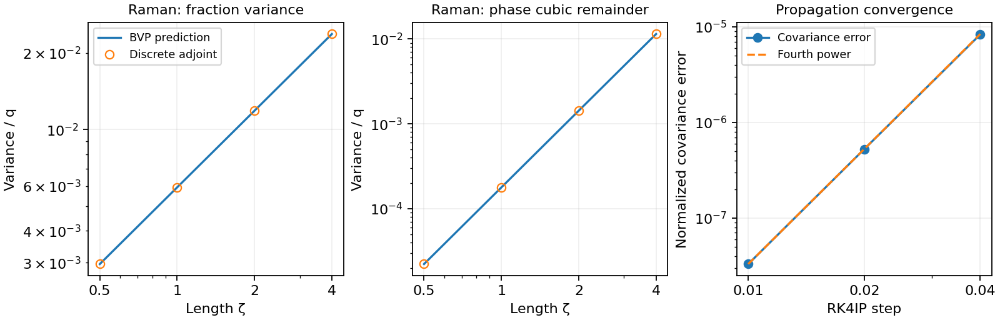
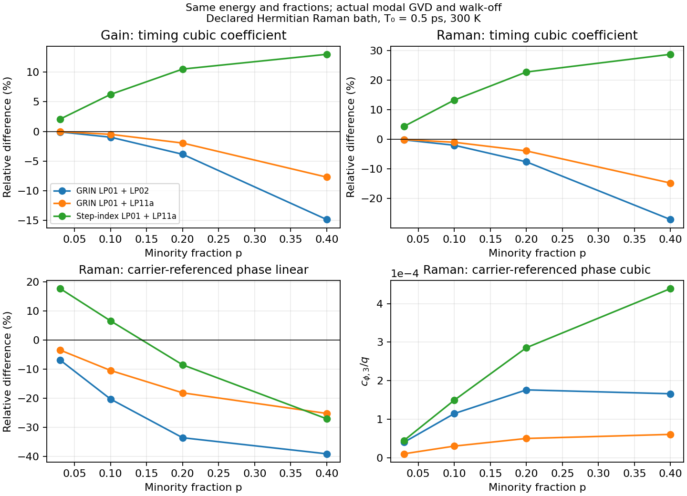
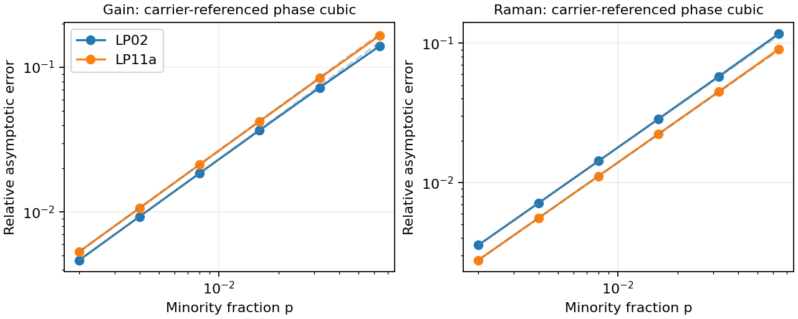

# Raman and gain covariance on an unequal-overlap bound family

## Scope and epistemic status

This note derives the covariance of **specified adjoint coordinates**, rather
than fitting noisy pulses to a common sech. The stationary family is an
unequal-shape, phase-incoherent (SPM/XPM) multimode bound pulse with compensating
modal carrier offsets. Its duals and the local spatial Raman bath can be
constructed without a Manakov approximation. The resulting coefficients are
explicit one-dimensional quadratures of a prescribed boundary-value problem;
they are not elementary functions of the overlap matrix.

The identities in the stationary SPM/XPM model are proved below. Their use for
a physical GRIN or step-index fibre is an approximation requiring checks of
discarded coherent coupling, extra modes, and slow deterministic Raman/gain
evolution. Numerical checks by the proposer are **not** independent
verification. The problem card is unchanged. The PI's round-two instruction
authorizes this derivation despite its still-`candidate` status; both family
literature reviews are present.

## Full model, normalization, and spatial reservoir

Write $A_m=\sqrt{P_0}u_m$, $\tau=t/T_0$, $\zeta=z/L_D$,
$L_D=T_0^2/|\beta_{2,1}|$, $P_0=1/(\gamma_{11}L_D)$, and
$q=\hbar\omega_0/(P_0T_0)$. The dimensional $T_0$ in the last expression
is in seconds. $E=\sum_m\int|u_m|^2d\tau$ and the photon number is $E/q$.
Define $b_m=|\beta_{2,m}|/|\beta_{2,1}|>0$,
$d_m=\Delta\beta_{1,m}T_0/|\beta_{2,1}|$, and
$s_{mn}=S_{mmnn}/S_{1111}$, for real, power-normalized spatial modes.
Uniform scalar material response is assumed, so the Raman and Kerr spatial
overlaps are the same. A spatially varying Raman material requires its own
weighted overlap tensor.

Before secular averaging the nonlinear terms are

$$u'_m=-d_mu_{m,\tau}+i\frac{b_m}{2}u_{m,\tau\tau}
+i\sum_{nkl}\frac{S_{mnkl}}{S_{1111}}e^{i\Delta\beta_{mnkl}z}
u_n\{(1-f_R)u_ku_l^*+h_R*(u_ku_l^*)\}
+\frac{\Gamma_m}{2}u_m+\dot G_m
+i\sum_n u_n\dot W_{mn}.$$

$h_R$ includes $f_R$ and integrates to it. The overlap tensor, modal
delays, GVD ratios, and Raman interference gratings are retained before
any approximation. In particular, replacing every Raman grating by a
convolution of modal intensity is incorrect when carriers differ.
Here $\Delta\beta_{mnkl}=\beta_{0,n}+\beta_{0,k}-\beta_{0,l}-\beta_{0,m}$.

The multiplicative Hamiltonian Raman noise is interpreted in the
Stratonovich sense, or in Itô form with the matching noise-induced drift.
That drift changes the mean at order $q$ and does not change the leading
linearized covariance derived here. An uncorrected Itô amplitude kick
would not conserve total norm beyond its linear increment.

Let a real Gaussian phonon force $d\xi(\mathbf r,\tau,\zeta)$ be local in
the transverse plane and white in $\zeta$. Its temporal spectrum, divided
by $q$, is

$$S_R(k)=|\operatorname{Im}H_R(k/T_0)|
\coth\!\left(\frac{\hbar|k|}{2k_BT T_0}\right).$$

At zero temperature the coth is one. At nonzero temperature the DC bin is
the continuous limit, not zero. The projected force is
$dW_{mn}=S_{1111}^{-1/2}\int\phi_m\phi_n
e^{i(\beta_{0,n}-\beta_{0,m})z}d\xi\,d^2r$; hence $dW=W^\dagger$.
Its fourth-order spatial Gram matrix is the **full overlap tensor**.
Neither independent per-mode phase noise nor one common scalar force
reproduces this matrix.

The numerical examples choose
$h_R(t)=f_R(a^2+b_R^2)e^{-at}\sin(b_Rt)/b_R$ for $t\ge0$,
with $f_R=0.18$, $a^{-1}=0.032$ ps and $b_R^{-1}=0.0122$ ps.
Thus $H_R(\omega)=f_R(a^2+b_R^2)/[(a-i\omega)^2+b_R^2]$ in the
positive-sign Fourier convention; the evaluator's negative-sign FFT uses
its conjugate for a causal convolution. These model parameters are
recorded in the run configs. The same response is used at every stated
temperature; only the reservoir occupation changes. A measured
temperature-dependent silica response would require recalculating the
quadratures.

For two nondegenerate spatial modes, averaging rapid longitudinal beating
leaves correlated real diagonal forces with spectrum
$qS_R(k)s_{mn}$ and a circular off-diagonal force with
$\mathbb E|dW_{12}(k)|^2=q s_{12}S_R(k)d\zeta$.
Its real and imaginary quadratures each carry half this covariance.
The off-diagonal force is not suppressed by the deterministic Kerr phase
mismatch: the local reservoir is white in longitudinal position. With
degenerate beat groups, retain cross-correlations within each group, as in
the evaluator's four-index Gram contraction.

This averaging requires the observation length to exceed the relevant
beat lengths: $|\Delta\beta_0|L_D\zeta\gg1$ for discarded beat differences.
It is not a physical $z\to0$ limit below one beat length. Near-resonant
groups must instead remain explicitly in the deterministic field and in
the reservoir Gram matrix.

For a generic mean $a_m$ and dual $g_{i,m}$ define

$$B_{i,mn}(\tau)=\frac{i}{2}
\left(g_{i,m}^*a_n-g_{i,n}a_m^*\right).$$

Then the real spatial force on coordinate $i$ is
$\sum_{mn}B_{i,mn}\phi_m\phi_n/\sqrt{S_{1111}}$ and

$$\boxed{D^R_{ij}=q\int\frac{dk}{2\pi}S_R(k)
\sum_{mn,pq}\widehat B_{i,mn}^*(k)
\mathcal S_{mn,pq}\widehat B_{j,pq}(k),}$$

where $\mathcal S_{mn,pq}=S_{mnpq}/S_{1111}$ for equal retained beat
differences and zero otherwise. Take the real part of the contraction.
This is positive semidefinite because it is a spatial Gram contraction.
It is also a formula for nonstationary full-field adjoints.

## Gain normalization

For an intensity gain $g_m=g_{e,m}-g_{a,m}>0$, inversion factor
$n_{sp,m}=g_{e,m}/g_m$, and passive loss $\ell_m$, the net mean gain is
$\Gamma_m=L_D(g_m-\ell_m)$. Symmetrically ordered additive noise has

$$\mathbb E[dG_m(\tau)dG_n^*(\tau')]
=q a_m\delta_{mn}\delta(\tau-\tau')d\zeta,\qquad
a_m=\frac{L_D}{2}[(2n_{sp,m}-1)g_m+\ell_m].$$

There is no anomalous correlation. Thus each real field quadrature has
variance $q a_m/2$. Balanced gain/loss gives $a_m=L_Dn_{sp,m}g_m$;
a quantum-limited unbalanced amplifier gives $a_m=L_Dg_m/2$.
Normal-order ASE and Wigner noise are not interchangeable conventions.
The same physical gain/loss rates imply $a_m\ge|\Gamma_m|/2$.
Modal gain may differ: the formula keeps $a_m$ individually. The stationary
numerical examples have balanced, mode-independent gain/loss; no
stationary soliton is asserted under uncompensated positive gain.
Gain and Raman reservoirs are taken to be independent, so their leading
added covariance matrices sum; input covariance is added separately.

The pinned backend's quantum-limited gain setting was calibrated in
`2026-10-08-gpt-b-gain-calibration`. For power gain $G$ and a bright input
mode of $N_0$ photons the source-only linear energy variance is
$N_0G(G-1)$, and adding coherent-input noise gives $N_0(2G^2-G)$.
This check does not establish arbitrary $n_{sp}$, balanced gain/loss,
gain saturation, or a multimode gain-noise implementation in that API.

White ASE is a broad-band **leading covariance** approximation, not an
infinite-power nonlinear field model. The weak-noise expansion takes
$q\to0$ at fixed finite gain half-bandwidth $B$ and observation window $W$,
then approximates the converged dual-mode contractions by their wide-band
limit. Useful background restrictions are
$qa_mB\zeta/\pi\ll f_m(0)^2$ and
$qWB\zeta\sum_m a_m/\pi\ll E$ for an unfiltered energy measurement.
For finite-band gain replace the time-domain overlap by
$\frac q2\operatorname{Re}\sum_m\int a_m(k)\widehat g_{i,m}^*
\widehat g_{j,m}\,dk/(2\pi)$, with physical carrier phases restored.
The limits run records convergence with $B$.

The finite-noise soliton-phase distribution can depend on radiation and
noise bandwidth; see Cargill–Moore–McKinstrie and Li–Kath in the access
ledger. The present result is a centered covariance at leading order in
$q$ for specified adjoint quadratures. It does not claim a complete phase
distribution or a bandwidth-independent nonlinear noise-induced mean.

## Bound family and its adjoints

Retain the SPM/XPM Kerr terms,
$C_{mm}=s_{mm}$ and $C_{mn}=2s_{mn}$ for $m\ne n$. The positive even
family $f_m(\tau;N_1,\ldots,N_M)$ solves

$$\frac{b_m}{2}f_m''-\lambda_m f_m+
f_m\sum_n C_{mn}f_n^2=0,\qquad
\int f_m^2d\tau=N_m.$$

For velocity $v$ its carrier slope is $(v-d_m)/b_m$. At rest the exact
SPM/XPM solution is

$$u_m=f_m(\tau)e^{-id_m\tau/b_m}
e^{i[\lambda_m+d_m^2/(2b_m)]\zeta+i\theta_m}.$$

Thus finite $d_m$ need not destroy trapping. It shifts the modal spectra;
the resulting spectra must remain in the quadratic-dispersion, constant-
overlap bandwidth. **A same-carrier launch is a different initial condition.**

Let $a_{jm}=\partial f_m/\partial N_j$,
$K_{mj}=\partial\lambda_m/\partial N_j$, and
$\mathcal M=\sum_mN_m/b_m$. In the carrier-removed frame, under the
pairing $\operatorname{Re}\sum_m\int g_m^*\delta u_m d\tau$, the duals are

$$\boxed{g_{N_j,m}=2\delta_{jm}f_m,\quad
g_{\theta_j,m}=2i a_{jm},\quad
g_{T,m}=\frac{2\tau f_m}{b_m\mathcal M},\quad
g_{v,m}=-\frac{2i f'_m}{\mathcal M}.}$$

Restore the same carrier and propagation phases as the mean when using
these duals on physical fields. The phase observable is the local linear
coordinate selected by this dual, not an arbitrary peak-phase fit.
Precisely, the nearby-family convention is
$u_m=f_m(\tau-T;\mathbf N)\exp[i(v-d_m)\tau/b_m+i\theta_m]$:
$\theta_m$ is a carrier-referenced phase intercept at a fixed time origin.
Subtract the nominal propagation phase when quoting its fluctuations.
$T$ is the weighted centroid with weights $1/b_m$ at linear order. It is
the ordinary energy centroid when all $b_m$ are equal. For unequal $b_m$,
the unweighted centroid also contains internal/radiative motion; do not
silently substitute it for this collective timing readout.

The ordinary energy-centroid gradient at this stationary mean is
$g_{T_o,m}=2\tau f_m/E$. Its difference from the closed dual is

$$g_{T_o,m}-g_{T,m}=2\tau f_m\left[\frac1E-
\frac1{b_m\mathcal M}\right].$$

This difference annihilates every tangent of the bound family but reads
internal or radiative perturbations. It is first order in the GVD
mismatch as a linear observable. Thus an exact finite-length polynomial
for $T_o$ does not follow just by substituting it for $T$. The full-field
adjoint integral applies to it without that substitution. A local
Hermitian Raman impulse conserves total intensity at each time, so its
**direct** ordinary-centroid diffusion is exactly zero even at unequal
GVD; its accumulated timing variance is not zero.

For a proof, define

$$L_{-,m}=-\frac{b_m}{2}\partial_\tau^2+
\lambda_m-\sum_nC_{mn}f_n^2,\qquad
L_{+,mn}=\delta_{mn}L_{-,m}-2C_{mn}f_mf_n.$$

The real/imaginary linearization is
$x'=L_-y$, $y'=-L_+x$.
$L_-f_m=0$, $L_+f'=0$,
$L_+a_j=-f_mK_{mj}$, and $L_-(\tau f_m/b_m)=-f'_m$.
Norm differentiation gives $2\int f_ma_{jm}=\delta_{mj}$.
Self-adjointness gives $K=K^T$. These identities prove both
biorthogonality and closure of the adjoint subspace. A Gram inverse of
arbitrary sech tangents would prove only the former and could retain
continuum contamination.

Consequently, for $X=(\delta\mathbf N,\delta\boldsymbol\theta,\delta T,\delta v)$,

$$dX=A_0X\,d\zeta+d\eta,\qquad
A_0=\begin{pmatrix}0&0&0&0\\K&0&0&0\\0&0&0&1\\0&0&0&0\end{pmatrix},
\qquad A_0^2=0.$$

Fractions are coordinates along a solved nonlinear family. Their existence
and the stability of the constrained shape directions are separate
requirements, rather than assumptions of a Manakov reduction.

## Explicit diffusion and covariance coefficients

Write the dual as $g_{i,m}=R_{i,m}+iI_{i,m}$ in the real-profile frame.
Define the spectral bilinear form
$\langle a,b\rangle_R=\operatorname{Re}\int S_R(k)\widehat a^*(k)
\widehat b(k)dk/(2\pi)$ and

$$w_{i,m}=I_{i,m}f_m,\qquad
H_{i,mn}=e^{i(d_m/b_m-d_n/b_n)\tau}
\{I_{i,m}f_n+I_{i,n}f_m+i(R_{i,m}f_n-R_{i,n}f_m)\}.$$

For distinct retained beat pairs,

$$\boxed{\frac{D^R_{ij}}q=
\sum_{mn}s_{mn}\langle w_{i,m},w_{j,n}\rangle_R
+\frac12\sum_{m<n}s_{mn}\langle H_{i,mn},H_{j,mn}\rangle_R,}$$

$$\boxed{\frac{D^G_{ij}}q=
\frac12\sum_ma_m\int(R_{i,m}R_{j,m}+I_{i,m}I_{j,m})d\tau.}$$

The first Raman sum includes both diagonal cross terms. The factor in the
second sum is fixed by circular off-diagonal noise, not fitted. These
expressions show **every** dependence on spatial overlaps, modal powers,
profiles, and walk-off. The latter appears as a spectral translation in
$H$; an even coloured Raman spectrum is not generally invariant under it.
For a white temporal bath that spectral translation drops out of diagonal
diffusions. Broadband phase-insensitive gain is carrier-gauge invariant.

For either source separately, the added covariance is

$$\boxed{\Sigma(\zeta)=D\zeta+
\frac{A_0D+DA_0^T}{2}\zeta^2+
\frac{A_0DA_0^T}{3}\zeta^3.}$$

Input covariance, if wanted, adds
$(I+\zeta A_0)\Sigma_0(I+\zeta A_0)^T$.
Useful individual blocks are

$$\Sigma_{NN}=D_{NN}\zeta,\quad
\Sigma_{N\theta}=D_{N\theta}\zeta+D_{NN}K\zeta^2/2,$$
$$\Sigma_{\theta\theta}=D_{\theta\theta}\zeta+
(KD_{N\theta}+D_{\theta N}K)\zeta^2/2+
KD_{NN}K\zeta^3/3,$$
$$\Sigma_{TT}=D_{TT}\zeta+D_{Tv}\zeta^2+D_{vv}\zeta^3/3,
\quad\Sigma_{Tv}=D_{Tv}\zeta+D_{vv}\zeta^2/2,
\quad\Sigma_{vv}=D_{vv}\zeta,$$
$$\Sigma_{NT}=D_{NT}\zeta+D_{Nv}\zeta^2/2,\quad
\Sigma_{\theta v}=D_{\theta v}\zeta+KD_{Nv}\zeta^2/2,$$
$$\Sigma_{\theta T}=D_{\theta T}\zeta+
(KD_{NT}+D_{\theta v})\zeta^2/2+KD_{Nv}\zeta^3/3.$$

For two modes set $p=N_2/E$, $\phi=\theta_2-\theta_1$,
$\theta=(1-p)\theta_1+p\theta_2$ with **nominal fixed** weights in this
linear readout, and $V=J/E$, the total phase-gradient spectral centroid.
The physical frequency offset is $-V/T_0$. At a resting mean,

$$\delta E=\delta N_1+\delta N_2,\quad
\delta p=\frac{-p\delta N_1+(1-p)\delta N_2}{E},$$
$$\delta V=\left(\sum_m\frac{p_m}{b_m}\right)\delta v
-\sum_m\frac{d_m}{b_m}\delta p_m.$$

These linear transformations give all requested covariances of
$(E,\theta,T,V,p,\phi)$; their matrices are frozen in the run summaries.
Units are restored by multiplying the corresponding rows and columns by
$P_0T_0$, $1$, $T_0$, $-1/T_0$, $1$, $1$, respectively, and replacing
$\zeta$ by $z/L_D$.

The energy here is the carrier-normalized envelope norm. In a photon-flux
normalization, retaining the spectral photon-energy weight would instead
give $U/(P_0T_0)=E-J/(\omega_0T_0)$ and therefore

$$\frac{\delta U}{P_0T_0}=
\left(1-\frac{V_0}{\omega_0T_0}\right)\delta E
-\frac{E}{\omega_0T_0}\delta V.$$

Here $\omega_0T_0$ uses consistent time units. This explains why zero
Raman diffusion of the conserved envelope norm is not an exact statement
about broadband optical energy in joules. A consistent prediction at
that correction order also needs the omitted shock and frequency-dependent
couplings; this readout transformation alone does not establish it.

Phase at the moving pulse centre is a different, also measurable readout.
Writing $k_m=-d_m/b_m$ at the resting mean gives

$$\delta\Theta_m=\delta\theta_m+k_m\delta T,\qquad
\delta\Theta=\delta\theta+V_0\delta T,\qquad
\delta\Phi=\delta\phi+(k_2-k_1)\delta T,$$

where $V_0=\sum_m p_m k_m$, again using nominal fixed weights for the common
phase. The covariance is $L\Sigma L^T$ with these replacement rows.
`pulse_centre_phase_coefficients_over_q` in the summaries records this
conversion; it changes no frozen prediction for the original readout.
For Raman its cubic relative-phase coefficient is

$$c^R_{\Phi,3}=\frac{h_p^2D^R_{pp}
+2(k_2-k_1)h_pD^R_{pv}+(k_2-k_1)^2D^R_{vv}}3.$$

For gain, add $(k_2-k_1)^2D^G_{vv}/3$ to the carrier-referenced coefficient;
the norm/velocity gain cross terms vanish. A Manakov pulse with unequal
carriers therefore has a timing-induced pulse-centre phase cubic even
though its carrier-referenced phase cubic is zero. Identifying those two
phases would produce a false novelty statement. The isolated partition
contribution can be measured with carrier-referenced local oscillators or
by correcting the centre-phase record using the simultaneous timing record.

### Two consequences that a scalar substitution misses

The scalar check is particularly simple. For
$f=(E/2)\operatorname{sech}(E\tau/2)$, the gain diffusion in
$(E,\theta,T,v)$ is diagonal, with

$$\frac{D^G}{q}=a\,\operatorname{diag}
\left(2E,\frac{\pi^2+12}{18E},\frac{2\pi^2}{3E^3},\frac E6\right).$$

It gives the balanced Gordon–Haus timing law
$\operatorname{Var}T_G=qa[2\pi^2\zeta/(3E^3)+E\zeta^3/18]$
and the nonlinear phase law
$\operatorname{Var}\theta_G=qa[(\pi^2+12)\zeta/(18E)+E^3\zeta^3/24]$.
The scalar Raman frequency diffusion is

$$D^R_{vv}=\frac q{E^2}\int\frac{dk}{2\pi}\,k^2S_R(k)
|\widehat{f^2}(k)|^2,\qquad
\operatorname{Var}T_R=D^R_{vv}\zeta^3/3.$$

Direct Raman norm and timing diffusion vanish; direct phase diffusion is
$q\langle\partial_E(f^2),\partial_E(f^2)\rangle_R$.
These are the Corney–Drummond projection conventions used by the
round-one baseline. The registered scalar limit check below compares
both the analytic gain expressions and that numerical Raman baseline.

For equal GVD, two-mode Raman exchange has

$$\boxed{D^R_{pp}=\frac{2q s_{12}}{E^2}
\int\frac{dk}{2\pi}S_R(k)
\left|\widehat{f_1f_2e^{-i\delta\tau}}(k)\right|^2,\qquad
D^R_{EE}=0,}$$

where $\delta=d_2-d_1$. Total intensity is conserved by an instantaneous
Hermitian reservoir kick, whereas modal intensities need not be.
Let $e=(-1,1)^T$, $h_p=E e^TKe$, and $h_E=e^TK(p_1,p_2)^T$.
Parity makes $D^R_{p\phi}=0$. Therefore the stationary leading-order
relative-phase variance is

$$\boxed{\operatorname{Var}(\phi)_R=D^R_{\phi\phi}\zeta+
\frac{h_p^2D^R_{pp}}{3}\zeta^3.}$$

For gain, the cubic coefficient is
$(h_E^2D^G_{EE}+2h_Eh_pD^G_{Ep}+h_p^2D^G_{pp})/3$.
Unequal overlaps change $K$; merely changing a scalar $\gamma_{\rm eff}$
cannot reproduce this phase response.

Second, for equal GVD and uniform gain noise,
$D^G_{pp}=2qa p(1-p)/E$, $D^G_{vp}=0$, and
$D^G_{vv}=2qa\sum_m\int(f'_m)^2/E^2$.
Since $V=v-\delta p$,

$$D^G_{Vp}=-\delta D^G_{pp},\qquad
D^G_{VV}=D^G_{vv}+\delta^2D^G_{pp},$$
$$D^G_{VV}+2\delta D^G_{Vp}+\delta^2D^G_{pp}=D^G_{vv}.$$

The apparently separate bare-walk-off contribution to timing cancels.
The centroid conservation law remains true; treating physical frequency
and fractions as independent for a **frequency-compensated bound pulse**
is what fails. A same-carrier, nonstationary launch can have the partition
term discussed in T-20261004-claude-interactive-09. That task is not claimed
here. Coloured Raman noise can have $D^R_{vp}\ne0$ and a walk-off-dependent
$D^R_{vv}$ through the displayed spectral shifts, so the gain cancellation
does not erase multimode Raman structure.

The same algebra applies to coherent-input vacuum covariance: replace
$D$ by $\Sigma_0$ and propagate with $I+\zeta A_0$. The putative extra
$\delta^2\Sigma_{pp,0}\zeta^2$ timing term then cancels for the same
compensated, equal-GVD family. This directly bears on the passive-input
part of T-20261004-claude-interactive-09. It does not remove the ordinary
velocity uncertainty or the internal-mode corrections at unequal GVD.

Explicitly, a coherent input has
$\Sigma_{ij,0}=q\operatorname{Re}\sum_m\int g_{i,m}^*g_{j,m}d\tau/4$,
using the same pairing and carrier phases. Thus
$\Sigma_{pp,0}=q p(1-p)/E$ and $\Sigma_{vp,0}=0$ at equal GVD.
This is the gain contraction with every $a_m$ replaced by one half,
applied once at the input rather than integrated along the fibre.

### Closed weak-minority law for the two ideal GRIN pairs

For $b_1=b_2=C_{11}=C_{12}=1$ and $C_{22}=c$, the limit $p\to0$
has $f_1=F+O(p)$ and $f_2=\sqrt p F+O(p^{3/2})$, with
$F=(E/2)\operatorname{sech}(E\tau/2)$. At fixed total energy the first
change in the constrained Hamiltonian is
$-(c-1)E^3p^2/12$. The shape correction enters this Hamiltonian at the
next order in $p$, so no smallness of $c-1$ is needed for this limit.
It follows that

$$h_p=(c-1)E^2/6+O(p),\qquad h_E=(c-1)Ep/3+O(p^2).$$

For uniform gain-noise strength $a$ and
$J_\delta=\int S_R(k)|\widehat{F^2e^{-i\delta\tau}}|^2dk/(2\pi)$,
the **cubic** relative-phase coefficients are

$$\boxed{\frac{c^G_{\phi,3}}q=
\frac{a E^3(c-1)^2}{54}\,p[1+O(p)],\qquad
\frac{c^R_{\phi,3}}q=
\frac{E^2(c-1)^2J_\delta}{108}\,p[1+O(p)].}$$

In the white thermal limit $J_\delta=S_R(0)E^3/6$, so
$c^R_{\phi,3}/q=S_R(0)E^5(c-1)^2p/648+O(p^2)$.
The ideal transverse profiles give $c=1/2$ for LP02 and $c=3/4$ for
LP11a (material/overlap run below). This predicts a factor of four
between their leading cubic coefficients at otherwise matched parameters.
It is a weak-minority result, not an equal-width finite-fraction ansatz.
Finite physical GVD differences are handled by the full quadrature formula;
they must not be discarded in taking a literal $p\to0$ limit.

For example, retain $b_1=C_{11}=1$ but allow arbitrary $b=b_2$ and
$C_{12}$. The vanishing-probe equation is solved by
$f_2\propto\operatorname{sech}^{\nu}(E\tau/2)$, where
$\nu(\nu+1)=2C_{12}/b$. Thus
$\lambda_2=b\nu^2 E^2/8$ while $\lambda_1=E^2/8$ at $p=0$.
Writing $\mu=b\nu^2-1$ gives the gain limit

$$h_E=\frac{\mu E}{4}+O(p),\qquad
\frac{c^G_{\phi,3}}q=\frac{aE^3\mu^2}{24}+O(p).$$

This is a bright-probe asymptote with $q\ll Ep$, not a phase assigned to an
exactly empty mode. For $C_{12}=1$ and $b=1+\epsilon_b$,
$\mu=-\epsilon_b/3+O(\epsilon_b^2)$. The displayed ideal-GRIN linear-in-$p$
law dominates this gain correction only when
$\epsilon_b^2\ll4(c-1)^2p$. The full BVP formula needs no such extra
approximation. The registered probe-limit check tests this noncommuting
small-fraction/equal-dispersion limit; it is another reason to retain
the actual overlaps and modal dispersion.

`2026-10-08-gpt-b-covariance-limits` evaluates the exact stationary-family
coefficients for the prescribed decreasing fractions. Their relative errors
against these laws have the predicted first power of $p$. No coefficient
was obtained by fitting the covariance.

## Deterministic Raman drift, gain drift, and saturation

### Uniform nonzero net gain: an adiabatic extension

There is a closed extension for uniform constant net gain $\Gamma$ if the
mean follows the instantaneous Kerr family adiabatically. This is a
**derived reduced-model formula, not a verified full-field claim**.
Require $|\Gamma|/\omega_{\rm gap}\ll1$ on the local family, where
$\omega_{\rm gap}$ is the least nonzero internal/continuum frequency,
and negligible
deterministic Raman shape drift, and the bandwidth restrictions above.
Write $G=e^{\Gamma\zeta}$. Cubic-NLS homogeneity gives

$$N_m(\zeta)=GN_{m0},\quad
f_m(\tau;G\mathbf N_0)=Gf_m(G\tau;\mathbf N_0),\quad K(\zeta)=GK_0.$$

For broad-band ASE with constant modal $a_m$, the nonzero diffusion blocks
scale as $D_{NN}=GD_{NN,0}$, $D_{\theta\theta}=G^{-1}D_{\theta\theta,0}$,
$D_{TT}=G^{-3}D_{TT,0}$, and $D_{vv}=GD_{vv,0}$.
Parity makes the other gain blocks zero. Integrating this explicitly gives

$$\Sigma^G_{NN}=D_{NN,0}\frac{G(G-1)}\Gamma,\qquad
\Sigma^G_{N\theta}=D_{NN,0}K_0\frac{G(G-1)^2}{2\Gamma^2},$$
$$\Sigma^G_{\theta\theta}=D_{\theta\theta,0}\frac{1-G^{-1}}\Gamma
+\frac{K_0D_{NN,0}K_0}{4\Gamma^3}
\left[G^4-\frac83G^3+2G^2-\frac13\right],$$
$$\Sigma^G_{vv}=D_{vv,0}\frac{G-1}\Gamma,\qquad
\Sigma^G_{Tv}=D_{vv,0}\frac{G-1-\Gamma\zeta}{\Gamma^2},$$
$$\Sigma^G_{TT}=D_{TT,0}\frac{1-G^{-3}}{3\Gamma}
+\frac{2D_{vv,0}}{\Gamma^3}
\left[G-1-\Gamma\zeta-\frac{(\Gamma\zeta)^2}{2}\right].$$

All expressions have removable limits at $\Gamma=0$ and recover the
stationary gain polynomial. Transform to fractions with the **output**
energy $GE_0$, keeping their nominal mean values fixed. General unequal
net modal gains change the fractions and do not obey this homogeneity
reduction along a single fixed-fraction branch.

For example the added gain fraction variance is
$\Sigma^G_{pp}=D^G_{pp,0}(1-G^{-1})/\Gamma$. For positive net gain it
formally approaches $D^G_{pp,0}/\Gamma$ in this adiabatic model, even
while the pulse energy grows. This fractional-noise limit does not imply
saturated energy or an assumed restoring force. It is not a physical
infinite-length prediction: gain bandwidth, pulse compression, Raman
drift, and omitted dispersion must still obey their stated restrictions.

Raman noise can be contracted along the same adiabatic amplifying family
without treating its coloured spectrum as white. The norm/phase propagator
from $s$ to $\zeta$ is

$$\Phi_{NN}=e^{\Gamma(\zeta-s)}I,\qquad
\Phi_{\theta N}=\frac{e^{2\Gamma\zeta-\Gamma s}-e^{\Gamma s}}
{2\Gamma}K_0,\qquad\Phi_{\theta\theta}=I,$$

and $\Phi_{Tv}=\zeta-s$. Insert the scaled profiles and the exact $S_R$
into $D_R(s)$ and integrate $\Phi D_R\Phi^T$ over $s$. This is an explicit
length quadrature after solving the initial BVP, with no fitted response
coefficient. Deterministic Raman drift and radiation are additional errors;
T-20261008-gpt-b-03 is responsible for testing this adiabatic closure.

### Raman mean drift and its covariance feedback

The secular delayed correction on a gauged real profile is calculated from

$$\mathcal R_m=i\sum_n s_{mn}f_m[h_R*f_n^2-f_Rf_n^2]
+i\sum_{n\ne m}s_{mn}f_n e^{-i(k_m-k_n)\tau}
\{h_R*[f_mf_ne^{i(k_m-k_n)\tau}]-f_Rf_mf_ne^{i(k_m-k_n)\tau}\},$$

where $k_m=-d_m/b_m$. Its collective drift is
$F_i^R=\operatorname{Re}\sum_m\int g_{i,m}^*\mathcal R_m$.
The exact convolution is used in the evaluator. With
$\epsilon_R=T_R/T_0$ and $T_R=\int t h_R(t)dt$, the first-moment limit gives

$$N'_m=2\epsilon_R\sum_{n\ne m}s_{mn}(k_m-k_n)
\int f_m^2f_n^2d\tau+\text{higher response moments},$$

$$v'=\frac{\epsilon_R}{\mathcal M}
\left[\sum_{mn}s_{mn}\int(f_m^2)'(f_n^2)'d\tau
+2\sum_{m<n}s_{mn}\int((f_mf_n)')^2d\tau\right]
+\text{higher response moments}.$$

Thus Raman also changes the mean fractions when frequency compensation
separates the carriers. Gain gives $N'_m=\Gamma_mN_m$ and, for two modes,
$p'=p(1-p)(\Gamma_2-\Gamma_1)$. A constant-coefficient covariance requires
these mean changes to remain small, or to be externally compensated.

There is also a normalization check connecting the mean transfer to the
noise. In the thermal white-spectrum and first-response-moment limit, put
$\Delta=d_2/b_2-d_1/b_1>0$ and $I=\int f_1^2f_2^2d\tau$. Then
$F_p^R=-2(T_R/T_0)s_{12}\Delta I/E$ and
$D_{pp}^R=2qs_{12}S_R(0)I/E^2$, so

$$\boxed{\frac{D_{pp}^R}{|F_p^R|}
=\frac qE\frac{2k_BT T_0}{\hbar\Delta}.}$$

Here $T_0$ is in seconds. Spatial and temporal overlap factors cancel in
this ratio. Its stated limit requires all relevant Raman frequencies to
lie in the linear susceptibility/high-temperature region. Exact-response
ratios are separately recorded, without asserting this approximation at
zero temperature or zero carrier separation.

The same cancellation gives a second local relation,

$$\boxed{\frac{D_{vv}^R}{F_v^R}
=\frac q{\mathcal M}\frac{2k_BT T_0}{\hbar}.}$$

Here $v$ is the compensated common velocity, reconstructed from frequency
and fractions, rather than the bare spectral centroid. Both numerator
and denominator contain the same derivative-overlap bracket displayed
above. These thermal relations require the projected spectral support to
satisfy $\Omega^2/(a^2+b_R^2)\ll1$,
$2a\Omega/(a^2+b_R^2)\ll1$, and $\hbar\Omega/(2k_BT)\ll1$ in consistent
units. They can connect noise coefficients to measured local mean drifts
without an independent fit of the Raman strength or spatial overlap.
They do not justify extending the frozen covariance over a large mean drift.

For an evolving family the appropriate expression is

$$\Sigma(z)=\Phi(z,0)\Sigma_0\Phi(z,0)^T+
\int_0^z\Phi(z,s)D(s)\Phi(z,s)^Tds,\qquad
\partial_z\Phi=A(z)\Phi,$$

with $A$ the Jacobian of the deterministic coordinate drift, including
Raman and gain. This is a general linear-noise identity, already familiar
in Manakov perturbation theory, not by itself a new claim. In particular,
energy noise feeding Raman acceleration can generate a timing term in
$z^5$; the cubic stationary formula is not a long-distance law for an
uncompensated Raman amplifier. Shape radiation can require full-field
adjoints even when instantaneous family parameters are known.

A useful **additional adiabatic approximation**, not part of the frozen
claim, makes the possible higher power explicit. Suppose the modal norms
have no deterministic drift (equal compensated carriers and balanced gain),
the Raman force changes only the common velocity, and its linear response
is $\delta v'=r^T\delta\mathbf N$, where
$r_j=\partial F_v^R/\partial N_j$. Freeze this derivative locally. The
augmented drift then has $A^3=0$, and exactly within this reduced system

$$\operatorname{Var}T=D_{TT}\zeta+D_{Tv}\zeta^2
+\frac{D_{vv}+r^TD_{NT}}3\zeta^3
+\frac{r^TD_{Nv}}4\zeta^4
+\frac{r^TD_{NN}r}{20}\zeta^5.$$

Even-profile, zero-walk-off gain and Raman sources have
$D_{NT}=D_{Nv}=D_{Tv}=0$. The last term is then the noise of the fluctuating
Raman acceleration. For the scalar first-moment response,
$F_v^R=\epsilon_RE^4/30$ and $r=2\epsilon_RE^3/15$; Raman has $D_{NN}=0$
whereas gain has $D_{NN}=2qaE$. In two modes the local Raman bath has
nonzero $D_{NN}$ on the partition direction, so it can feed this term even
at constant total norm. The full-field reduction to this accelerated
family, its internal-mode response, and the resulting quintic coefficient
have **not** been verified here. The displayed polynomial is proved only
conditional on the additional drift model, and is a follow-up prediction.

There is no damping or saturation in $A_0$. The small-noise theory does
not predict indefinite physical diffusion through $p=0$ or $p=1$, where
relative phase is undefined. Gain saturation or frequency filtering must
be specified before an Ornstein–Uhlenbeck saturation law can be asserted.
For a stable scalar drift eigenvalue $-\kappa$, the corresponding variance
would be $D(1-e^{-2\kappa z})/(2\kappa)$; no such restoring rate is assumed
or fitted here.

A damped frequency or partition does not make its integrated timing or
phase saturate. For $dx=-\kappa x\,d\zeta+d\eta_x$ and
$dy=h x\,d\zeta+d\eta_y$, zero initial covariance gives

$$\operatorname{Var}y=D_{yy}\zeta+
\frac{2hD_{xy}}\kappa\left[\zeta-\frac{1-e^{-\kappa\zeta}}\kappa\right]
+\frac{h^2D_{xx}}{\kappa^2}
\left[\zeta-\frac{2(1-e^{-\kappa\zeta})}\kappa
+\frac{1-e^{-2\kappa\zeta}}{2\kappa}\right].$$

Generically it crosses from the cubic law to linear growth; a specially
correlated source can cancel the effective long-distance diffusion.
This is a conditional
linear-systems formula; assigning $\kappa$ to a real gain saturation or
filter mechanism requires a specified physical model.

## Manakov reference and comparison convention

Set $C_{mn}=1$ and $b_m=1$, keeping the same total dimensionless energy,
fractions, gain-noise strengths, and stated walk-off. Then
$f_m=\sqrt{p_m}F$, $F=(E/2)\operatorname{sech}(E\tau/2)$,
$\lambda_m=E^2/8$, and every $K_{mn}=E/4$. Hence $h_p=h_E=0$ for the
relative phase. Its cubic variance vanishes even though its linear gain
variance is nonzero. These are the published Manakov baseline's symmetries,
not properties of a GRIN overlap matrix.

The deterministic Manakov equation does **not** define a Raman reservoir.
For a declared comparator use the unitarily invariant Hermitian bath
$s_{11}=s_{22}=1$, $s_{12}=1/2$. Its diagonal and off-diagonal correlations
are specified above. A common scalar Raman phase force is a different
comparator: it has $D_{pp}=0$. Ratios to a zero coefficient are reported
as newly nonzero channels, never as a finite relative error.

For every matrix coefficient $c_{ij}^{(r)}$, the reported difference is
$c_{ij,\mathrm{fibre}}^{(r)}/c_{ij,\mathrm{Manakov}}^{(r)}-1$ with the
same readout and normalization. The profile and $K$ enter this comparison;
energy participation alone does not determine it.

A secondary comparison tests a simple adjustment of the mean pulse width.
Set $\kappa=(p^TCp)/(\sum_m p_mb_m)$, the common-sech variational width
coefficient, and use $C_{mn}^{M}=\kappa$, $b_m^{M}=1$ with the same
$E,d_m,a_m$. This choice uses the overlaps and GVD, not propagated noise.
For this comparator explicitly scale the declared isotropic Raman bath to
$s_{mm}^{M}=\kappa$, $s_{12}^{M}=\kappa/2$ as well. That reservoir scaling
is an additional modeling choice; it does not follow from the effective
Kerr coefficient alone. The Manakov duals are exact for their own model;
no common-sech dual is substituted into the unequal-overlap fibre model.
The source matrices for this comparison are stored under
`width_rescaled_Manakov`, separately from the primary unscaled reference.

## Numerical evidence and physical qualifications

The calibrated examples are analytic-profile silica GRIN and step-index
models, not measured fibre samples. The material run is
`2026-10-08-gpt-b-covariance-material`; the profile/dual sweep is
`2026-10-08-gpt-b-covariance-sweep`. The primary full-field check is
`2026-10-08-gpt-b-covariance-adjoint`. Extended-mode and delayed-mean
qualification is recorded separately in `2026-10-08-gpt-b-covariance-relaxed`.
All evidence here is from the proposer. The held-out case has not been
propagated, and neither independent verification nor promotion is asserted.

### Mean family and physical units

At $E=2$, $p=0.2$, and $T_0=0.5$ ps the modeled pairs have the following
parameters. The carrier offset is the second component's physical frequency
relative to LP01. The shape discrepancy compares the solved family to the
common-sech approximation at the same modal energies; it is not a stationarity
error of the solved family (material and sweep runs cited above).

| Pair | $s_{12}$ | $s_{22}$ | $b_2$ | $d_2$ | Carrier offset (THz) | Common-sech field discrepancy |
|---|---:|---:|---:|---:|---:|---:|
| GRIN LP01 + LP02 | 0.5 | 0.5 | 1.01107237 | 2.68489960 | 0.845271 | 1.2703% |
| GRIN LP01 + LP11a | 0.5 | 0.75 | 1.00536657 | 1.29358692 | 0.409564 | 0.6292% |
| Step-index LP01 + LP11a | 0.587760143 | 0.868047952 | 0.981601834 | 1.41484161 | 0.458799 | 1.0213% |

The GRIN example has $q=1.20756612\,10^{-9}$ and pulse energy 212.258 pJ;
the step-index example has $q=1.04091716\,10^{-10}$ and energy 2462.40 pJ
at this normalization. Their dispersion lengths are approximately 8.90 m
and 8.93 m. The large longitudinal pair beat rates are approximately
$1.0871\,10^5$, $5.4325\,10^4$, and $4.8147\,10^3$ per $L_D$ respectively.
These are analytic material-profile models, not measurements of a specific
manufactured fibre (`2026-10-08-gpt-b-covariance-material`).

### Core identities, source checks, and error scaling

The exact-family/full-field adjoint covariance error decreases with measured
step-size power 3.9928. At steps 0.04, 0.02, and 0.01 its maximum normalized
covariance errors are $8.35\,10^{-6}$, $5.26\,10^{-7}$, and
$3.29\,10^{-8}$. The Raman fraction variance has measured length power
0.99999997 and the carrier-referenced relative-phase remainder after
subtracting direct diffusion has power 3.00000082. Gain gives the same
linear/cubic powers within the registered numerical error
(`2026-10-08-gpt-b-covariance-adjoint`). These compare a BVP/Hessian
calculation with the full-field discrete RK4IP Jacobian; no covariance
coefficient was fitted to the propagated data.

Figure: `2026-10-08-gpt-b-covariance-adjoint`, solver pin
`b9fa957f922b9cae20b2a2e4c4ff45c1bc8768aa`. This growth series uses
the equal-GVD GRIN LP01+LP02 reduction at $E=2$, $p=0.2$, $\delta=1$.
The phase remainder is carrier-referenced, with direct linear diffusion
subtracted. Actual-GVD cases are separately included in the same run.

The scalar gain coefficients agree with their analytic expressions to
$5.5\,10^{-13}$ relative error. The scalar Raman frequency coefficient is
$D_{vv}/q=0.0307109209$ at the registered parameters, reproducing the
round-one baseline to its quoted precision. The weak-minority relative
errors have powers 0.994–1.003, as predicted by $O(p)$, using the registered
decreasing fractions. Temporal quadrature was refined down to 2.93 fs
and the window enlarged independently. The analytic Fourier response
avoids the sampled-oscillator normalization defect
(`2026-10-08-gpt-b-covariance-limits`).

The unequal-GVD probe limit gives nonzero gain phase-cubic limits of
$4.49634\,10^{-7}$, $1.06160\,10^{-7}$, and $0.00200714$, divided by $q$,
for the physical GRIN LP02, GRIN LP11a, and step-index pairs. Decreasing
the probe fraction to $10^{-7}$ approaches these limits with relative
errors $8.52\,10^{-4}$, $9.05\,10^{-4}$, and $-3.44\,10^{-7}$.
The original unscaled sensitivity solve exceeded its mesh budget in this
extension; that failed attempt is preserved. Scaling the sensitivity
unknowns by $\sqrt{N_m}$ resolves the conditioning problem without changing
the frozen core evaluator's default parameterization. The conditional
uniform-gain formula also agrees with direct integration of its stipulated
covariance ODE within $4.2\,10^{-11}$ normalized error. This last check
verifies the algebra, not the adiabatic full-field reduction
(same limits run, `conditional_extensions_algebra`).
Its formal ODE test at $\Gamma=0.3$, $a=0.1$ lies outside the quantum
gain/noise bound and is explicitly flagged as algebra-only; it is not a
physical amplifier prediction. The other tested rates obey that bound.

The unmodified scalar gain backend gives measured/analytic energy-variance
ratios 1.0121 for added noise and 0.9895 including coherent-input noise;
the sampling standard error is 1.56% for each
(`2026-10-08-gpt-b-gain-calibration`). The separate transverse real-phonon
sampler gives maximum normalized covariance deviations 1.91% at zero
temperature and 2.66% at 300 K. Its empirical diagonal-variance standard
errors are approximately 1.1–1.2%; the largest diagonal deviation is within
2.3 of its estimated standard errors. It also preserves total norm at a
linear impulse to roundoff (`2026-10-08-gpt-b-covariance-bath`). This is
sampling evidence, not an exact statistical acceptance guarantee or a
multimode stochastic propagation run.

With finite gain half-bandwidth $B=8$, the maximum normalized covariance
change at $\zeta=4$ is at most $3.12\,10^{-7}$ across the three physical
pairs. The noise background and cutoff are recorded explicitly. This
checks the broad-band contraction, not finite-noise phase-distribution
universality (`2026-10-08-gpt-b-covariance-limits`).

The local thermal noise/drift ratios provide an additional source check.
The white-spectrum/first-moment fraction and common-velocity identities
hold to roundoff. Using the exact response and coth spectrum changes the
fraction ratios by at most 0.077% and the common-velocity ratios by at most
0.089% at the three physical points
(`2026-10-08-gpt-b-covariance-sweep`, `raman_exchange_balance`).

### The size of the Manakov error

The following relative differences use exactly the comparator and readout
conventions above, at $p=0.2$. All coefficient matrices and comparisons at
the other fractions are in `2026-10-08-gpt-b-covariance-sweep`.

| Pair | Gain timing cubic | Raman timing cubic | Raman carrier-referenced phase linear | Raman pulse-centre phase cubic |
|---|---:|---:|---:|---:|
| GRIN LP01 + LP02 | −3.86% | −7.66% | −33.62% | −9.45% |
| GRIN LP01 + LP11a | −1.97% | −3.96% | −18.19% | −4.70% |
| Step-index LP01 + LP11a | +10.52% | +22.74% | −8.58% | +28.75% |

The carrier-referenced phase cubic is newly nonzero; its Manakov ratio
is undefined. In contrast the pulse-centre phase cubic has a nonzero
Manakov timing contribution. A small field-shape discrepancy is plainly
insufficient to justify using a Manakov noise coefficient.

However, the unscaled timing differences alone overstate the failure of
an adjusted scalar approximation. With the explicitly width-rescaled
comparator above, the same three cases give:

| Pair | $\kappa$ | Gain timing cubic | Raman timing cubic | Raman carrier-referenced phase linear |
|---|---:|---:|---:|---:|
| GRIN LP01 + LP02 | 0.977834611 | +0.546% | +1.019% | −30.57% |
| GRIN LP01 + LP11a | 0.988938558 | +0.240% | +0.411% | −16.35% |
| Step-index LP01 + LP11a | 1.054769575 | −0.663% | −0.864% | −17.83% |

Thus a declared effective-width/noise-strength adjustment gives useful
timing estimates at these points, while still missing much of the direct
relative-phase noise and all of its carrier-referenced cubic. Neither
the original large timing differences nor this improved agreement is
a universal error bound. Both comparisons and the other fractions are
in `2026-10-08-gpt-b-covariance-sweep`. The secondary comparison changes
no frozen fibre coefficient or held-out prediction.

Figure: `2026-10-08-gpt-b-covariance-sweep`; phase panels use the
carrier-referenced readout and all panels use the unscaled reference.
Material solver pin
`b9fa957f922b9cae20b2a2e4c4ff45c1bc8768aa`; the coefficients are BVP projections.

Figure: `2026-10-08-gpt-b-covariance-limits`; dashed guides have slope one.
The same solver pin supplies the material convention; no propagation fit
is used in this asymptotic check.

### Relaxing the mean-field approximation

For $p=0.2$ and $\zeta=4$, restoring group-resonant coherent coupling and
extra modes changes the nominal-adjoint covariance by 0.0545% for GRIN
LP01+LP02 and 0.2355% for GRIN LP01+LP11a. The step-index degenerate-partner
check changes it by less than $1.4\,10^{-10}$. The GRIN shape errors after
removing each occupied modal phase are 0.0284% and 0.1134% respectively.
These are spot checks of a specified retained tensor, not all guided modes
or all rapid coherent terms (`2026-10-08-gpt-b-covariance-relaxed`).

Adding the exact delayed mean raises the maximum normalized covariance
changes to 3.320%, 3.976%, and 5.739% for the three pairs. Their largest
diagonal changes remain 0.741%, 0.527%, and 0.935%. The corresponding mean
shape changes are approximately 1.00%, 0.97%, and 1.25%. The mean fractions
also drift, consistently with the intermodal Raman-grating term. These
figures use **fixed nominal adjoint homodyne readouts**. Once the mean moves,
its nominal norm quadrature is no longer the exact total-energy gradient;
any nonzero value in that nominal Raman energy channel must not be called
physical total-energy diffusion (same relaxed run).

Increasing the retained GRIN basis from six to eleven modes changes the
Kerr-mean covariances by at most $2.52\,10^{-10}$ for LP01+LP02 and
$1.03\,10^{-8}$ for LP01+LP11a in the same normalized metric. The larger
basis includes the reflection-even modes through group four plus LP04
and the original LP11 sine control; it is not the full guided basis.
Halving the LP01+LP02 step while switching the dense tensor to its exact
sparse-term CP representation changes its covariance by
$4.21\,10^{-8}$ (same relaxed run, `between_run_comparisons`).

Replacing the nominal energy, weighted timing, spectral-centroid, and
fraction gradients by the exact gradients at the Raman-evolved mean
gives maximum normalized differences from the frozen formula of 1.800%,
1.236%, and 1.668%. The two phase readouts remain nominal adjoint
homodyne quadratures. The exact norm's Raman variance is below
$8.1\,10^{-19}q$ in these calculations, consistent with conservation;
the gain norm variance agrees with the balanced-source formula within
$2.2\,10^{-9}$ relative error. These rows end in `_actual` in the same run.
They show why a drifting mean requires the actual observable gradient,
even when its drift is small.

For the GRIN LP01+LP02 delayed-mean case, doubling the temporal sample
count from 512 to 1024 and halving the step from 0.002 to 0.001 changes
the actual-observable covariance by only $2.18\,10^{-8}$ in the normalized
metric. The difference from the frozen formula remains 1.800%. The
physical time spacing changes from 46.875 fs to 23.4375 fs; the analytic
Fourier response avoids sampling the narrow temporal Raman kernel itself.
This is a joint resolution check, not a separate temporal convergence
exponent (same relaxed run, `grin02_joint_temporal_and_step_refinement`).
The independent source-quadrature check reaches the finer time spacing
quoted above.

The separate `2026-10-08-gpt-b-covariance-timing` run uses a seventh
full-field adjoint for the ordinary intensity centroid at the stationary
mean. Its timing variance differs from the weighted-coordinate variance
by $-0.00687\%$, $-0.00182\%$, and $-0.00978\%$ for gain, and by
$-0.03708\%$, $-0.00897\%$, and $-0.03792\%$ for Raman, for the three
pairs at $\zeta=4$. Its direct Raman timing diffusion is zero to numerical
precision, while the unequal-GVD weighted coordinate has a small direct
term. The full seven-coordinate covariances are retained; this check
does not prove an exact polynomial for ordinary timing at unequal GVD.

Higher-order dispersion and shock have not been propagated. At spectral
cutoffs excluding only $10^{-6}$ of input energy, the fitted third- through
fifth-order coefficients give triangle bounds of about 5.0–7.6% on the
relative GVD correction, and the shock bandwidth ratios are 0.75–1.14%.
These are scale diagnostics, not measured covariance errors
(`2026-10-08-gpt-b-covariance-sweep`). They are why the claim's secular-model
tolerance is not presented as a physical-fibre precision guarantee.

### Frozen case and possible measurement

The step-index case at $p=0.35$, $T_0=0.35$ ps and 77 K was frozen in
`dc16c67`, with the full matrices in
`2026-10-08-gpt-b-covariance-prediction`. It is still unpropagated by the
proposer. The later pulse-centre columns are a stated linear readout
conversion of those frozen matrices, not a refit.

A measurement would mode-sort the output, track the timing and modal energy
fractions, and use temporally shaped, phase-locked local oscillators with
the derived dual profiles. The carrier-referenced relative phase can be
read directly or obtained from the centre phase by subtracting the known
carrier difference times the measured timing. A length series separates
the direct linear variance from the cubic term; an input covariance must
also be propagated and subtracted as specified above. A classical noise
floor, uncertain material overlaps, and output readout calibration have
not been modeled here.

## Assumption ledger and solver capability

Assumptions carried by the formulas:

- weak guidance, one polarization, real orthonormal transverse modes;
- narrowband envelopes with fixed spatial overlaps and second-order anomalous
  dispersion; no shock, random mode coupling, acoustic reservoir, or loss of
  light from the modeled basis;
- a positive even, stable bound branch with both occupied modes bright,
  $N_m/q\gg1$, and nonsingular chosen coordinates;
- a longitudinal secular approximation for coherent Kerr terms and reservoir
  beat correlations; any near-degenerate beat correlations are retained;
- a local, uniform scalar Raman material and the symmetrized thermal plus
  zero-point spectrum, including its DC limit;
- independent, circular ASE reservoirs for the selected gain axes;
- linearized weak noise and a slowly evolving mean for the polynomial law;
  diffusion matrices alone are not a complete quantum-state calculation.

The solver capability check found `stochastic_solve_raman` and the public
Raman/gain Langevin interface restricted to a single scalar spatial mode.
The multimode checks use deterministic propagation and
`adjoint_mode=:discrete_rk4ip`, with an explicit external reservoir
contraction. The task-local response adapter supplies an analytic causal
Fourier transfer and a flat no-shock prefactor. It does not change the solver
tree or its pin. This avoids under-integrating the sampled Raman oscillator;
the temporal-bandwidth and propagation-step checks remain necessary.

## Literature and search record

- Drummond–Corney, DOI 10.1364/JOSAB.18.000139,
  [arXiv:quant-ph/9912095](https://arxiv.org/abs/quant-ph/9912095): **full text**
  in round one; Wigner section VI.3 reread this session. Fixes the ordering
  convention used for both gain and Raman noise. Its single-mode model does
  not by itself supply the spatial Gram matrix derived here.
- Corney–Drummond, [arXiv:quant-ph/9912096](https://arxiv.org/abs/quant-ph/9912096):
  **full text** in round one; bright-soliton projection section reread here.
  Supplies the scalar timing baseline and its slowly changing mean caveat.
- Derevyanko–Prilepsky–Yakushev, DOI 10.1088/0305-4470/39/6/006,
  [arXiv:nlin/0509024](https://arxiv.org/abs/nlin/0509024): **full text** in the
  round-one review; abstract rechecked here. General additive-noise vector
  covariance and its matrix propagation are prior results.
- Chen–Wise, [DOI 10.1063/5.0189749](https://doi.org/10.1063/5.0189749):
  **full text, section II and scope paragraphs read**, not the complete
  article or supplement. A multimode/vector Raman propagation framework
  already includes spontaneous Raman sources; this gas-filled-fibre work
  is not a verification of the silica soliton coefficients derived here.
- Mollenauer–Gordon, DOI 10.1364/OL.19.000375, and Gordon–Haus,
  DOI 10.1364/OL.11.000665: **abstract only**, as recorded in the round-one
  review. No new full-text access is claimed. The same applies to
  Haus–Lai, DOI 10.1364/JOSAB.7.000386.
- Cargill–Moore–McKinstrie,
  [DOI 10.1364/OL.36.001659](https://doi.org/10.1364/OL.36.001659), and
  Cargill–Moore, [DOI 10.1137/15M1049592](https://doi.org/10.1137/15M1049592):
  **abstract only**. Publisher full-text attempts were inaccessible. These
  works identify radiation and noise bandwidth as relevant to soliton phase
  statistics; the latter abstract specifically discusses a bandwidth-dependent
  mean shift. No equation-level equivalence or refutation is inferred here.
- Li–Kath, [DOI 10.1137/110828289](https://doi.org/10.1137/110828289):
  **full text, sections 1–2 and the section 5 comparison read**, via the
  [author-hosted PDF](https://ins.sjtu.edu.cn/people/jinglaili/files/siap2012.pdf).
  It separates soliton parameters from noisy background and explains why
  naive full-window moments can differ from soliton coordinates. This
  supports specifying the readout and finite noise bandwidth explicitly;
  it is a scalar extraction method, not a multimode validation.

Searches this session: `multimode fiber Raman Langevin noise spatial overlap
local phonon quantum correlations`; `multimode soliton Raman covariance`;
`soliton relative phase Raman noise multimode`; exact Corney–Drummond and
Derevyanko titles; and the multimode-review identifier 10.1364/PRJ.531393.
These searches did not locate the particular unequal-overlap coefficients
above. This is not a novelty certification. The close polarization and
multimode Raman-delay comparisons in the prior review remain relevant.
Additional searches: `vector soliton phase diffusion unequal nonlinear
coefficients Raman noise`; `multimode fiber local phonon reservoir Raman
spatial correlation modes noise`; exact Cargill–Moore titles and their DOI
with `pdf`/`author manuscript`. The newly identified radiation/bandwidth
comparison is assigned to the physical-error follow-up task. The earlier
inaccessible primary texts remain tracked by T-20261004-gpt-b-01.
