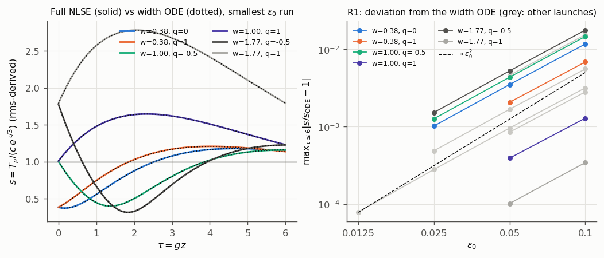
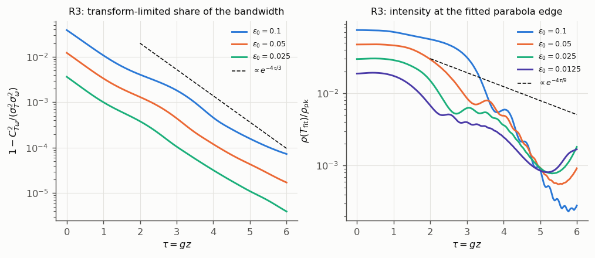
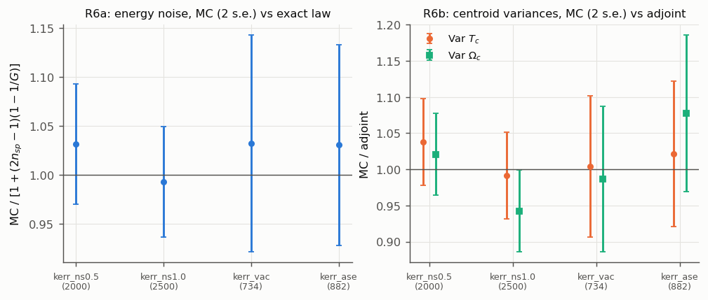
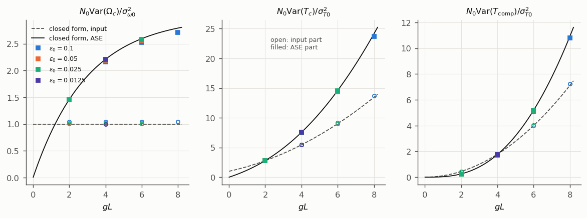
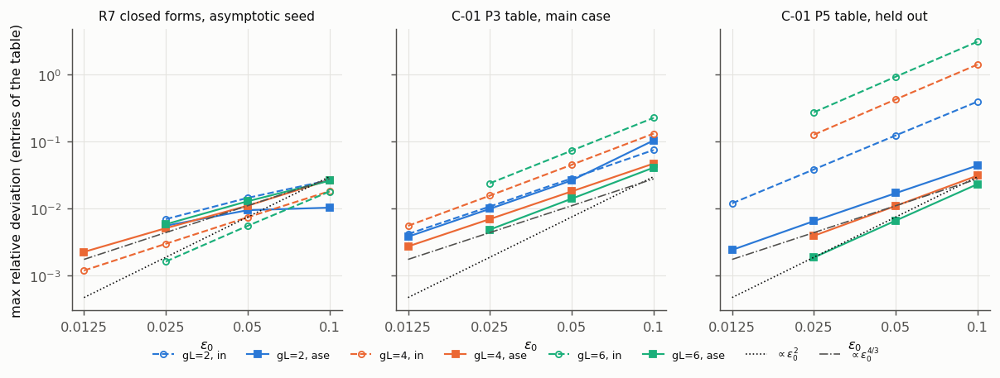
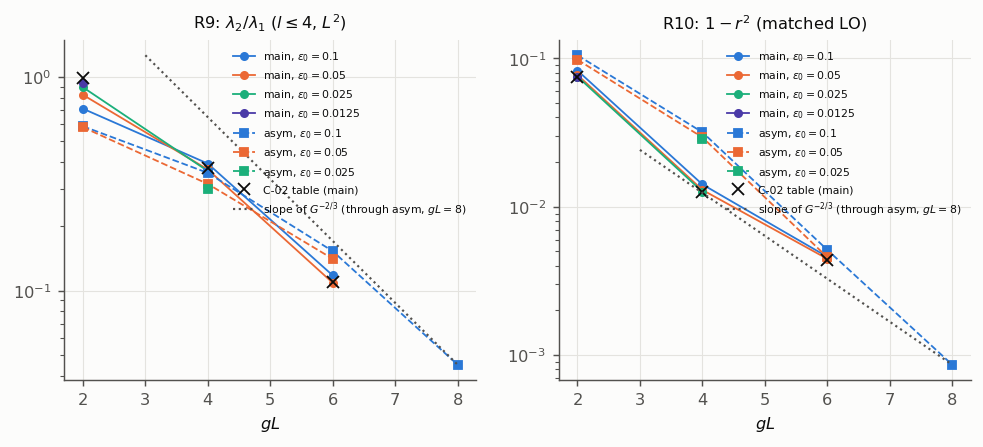

# Full-NLSE validation of the amplifier-similariton results R1-R10

## Summary

- **Confirmed in the full NLSE, with error exponents measured over $\varepsilon_0=0.1$-0.025:**
  - R1, the width ODE and its Lyapunov function, for parabolic launches;
  - R2, the shape-mode spectrum: decay $g/3$ and frequencies $\sqrt2g/3$, $\sqrt5g/3$, $g$ at $\varepsilon_0=0.025$ to within 0.11% for $l=2,3$ and 0.31% for $l=4$, with no mixing at leading order;
  - R3 and R4, the $\varepsilon_{\rm eff}$ and energy scalings;
  - R5, the phase-sensitive $G^{1/3}/G^{5/3}$ structure, up to $gL=6$;
  - R6, the exact moment and energy laws, to discretization accuracy and by Monte Carlo;
  - R7, the closed forms on the asymptotic seed;
  - R10, $C_{AA}$ exactly, plus the matched-LO tables.
- **Reproduced to all quoted digits:** the realistic-seed table (C-01 P8, ratio 3.5495).
- **Not confirmed, or confirmed only with stated deviations:**
  - C-01's 5% error band for the input-vacuum entries (+23% to +313% at $\varepsilon_0=0.1$, from the seed's transform-limited bandwidth);
  - C-02's individual spectral-variance entries (P3): several are more than 10% off at the smallest $\varepsilon_0$ run, and the $s_1$ ASE entry stays 14-19% high at every $gL$ without shrinking ($\lambda_2/\lambda_1$ agrees at $gL=4$, 6);
  - C-02's spectral tables at $gL=2$: the main-case $\lambda_2/\lambda_1$ converges slowly (-5.3% at $\varepsilon_0=0.0125$, slope 0.80) and the held-out one does not converge (-9.1%, -9.4%, -9.5%, -8.4% at $\varepsilon_0$ = 0.1, 0.05, 0.025, 0.0125; effective exponent 0.04 over a factor 8 in $\varepsilon_0$);
  - the orchestrator's inference that the shape-mode vacuum share tends to 1/4: it oscillates;
  - the edge-layer scaling $\propto\varepsilon_{\rm eff}^{2/3}$ in my frozen R3 targets: the measured slope approaches $-4/9$ as $\varepsilon_0$ falls (-1.60 ($\varepsilon_0=0.1$), -1.07 ($\varepsilon_0=0.05$), -0.70 ($\varepsilon_0=0.025$), -0.52 ($\varepsilon_0=0.0125$)) but misses the frozen 5% criterion;
  - C-01's "roughly 10%" gain-filtering estimate: at the claim's own bound the full NLSE reduces $\mathrm{Var}(\Omega_c)$ by 1.2% (see Convergence).
- **Not tested:** the $gL=12$-18 asymptotic laws (C-02 P2 exponents; $G^{-2/3}$ slopes of $\lambda_2/\lambda_1$ and $1-r^2$).
- **Independence:** all of this is Claude-family evidence and cannot move either claim to `sim-verified`.

## Scope and independence

The PI asked (2026-10-10) for a simulation test of every analytical statement on the NLSE amplifier similariton that the orchestrator presented (R1-R10 in the task prompt). They come from the orchestrator's sketch on P-001 and from claims C-20261008-claude-a-01 and C-20261008-claude-a-02 (branch `origin/task/T-20261008-claude-a-01`, unmerged).

**All of this is Claude-family evidence about Claude-family claims.** Under AGENTS.md hard rule 1 it cannot mark either claim `sim-verified`. The proposed check-table rows in the log are labelled accordingly. For test independence I read only the two claim cards (statements and frozen tables), the P-001 card, gpt-a's claim cards and gpt-b's literature review. I did not read claude-a's derivation note, run scripts or log. The predictions were frozen in `runs/2026-10-10-claude-interactive.2-simval-lib/targets.md` (commit 9b60c6e) before any production run.

**Regions not used to build the claims.** These were added here:
- the full-NLSE regime itself, with $\varepsilon_0$ down to 0.0125 (noise runs at $gL$ = 2, 4 only; one attraction launch);
- $gL=8$;
- R1 launches with $w\ne1$ and $q\ne0$;
- the gain-bandwidth and self-steepening relaxations.

The claims' own held-out case ($\Gamma=1$, C-01 P5 and C-02 P5) was scored as such.

## Model, solver and methods

**Model.** $\partial_zA=-\tfrac i2\beta_2A_{TT}+i\gamma|A|^2A+\tfrac g2A+F$, with $\beta_2>0$ and flat, unsaturated power gain $g$. The noise is white ASE with $\langle FF^*\rangle=g(n_{sp}-\tfrac12)\hbar\omega_0\delta\delta$ and a symmetric vacuum of $\tfrac12$ photon per mode at the input. There is no Raman, third-order dispersion, gain bandwidth or saturation.

**Units.** $T_0=1$ ps is the seed half-width and $\beta_2=1$ ps²/m, so $L_D=1$ m. $P_0$ is set by $\varepsilon_0$, and $g=\Gamma/\varepsilon_0$ m⁻¹.

**Seeds.**
- Parabolic intensity $P_0\,\mathrm{softplus}(1-T^2/T_0^2;\delta)$ with $\delta=\tfrac12\varepsilon_0^{2/3}$, and phase $-qgT^2/(2\beta_2)$.
- Main case: $\Gamma=\sqrt{18}$, $q=0$. Held-out case: $\Gamma=1$, $q=0$. Asymptotic seed: $\Gamma=\sqrt{18}$, $q=1/3$.
- The soft edge is needed for a finite spectrum. It raises the seed's rms variance by $O(\delta^2)\propto\varepsilon_0^{4/3}$: by 2.2% at $\varepsilon_0=0.05$, relative to the sharp parabola's $T_0^2/5$. That is the dominant error in several input-vacuum entries (see R7). A family with $\delta=\tfrac12\varepsilon_0$ was run to separate this from the claims' own error.

**Solver.** FastDifferentiableMMNLO, agents' copy at b9fa957, unmodified.
- Deterministic and adjoint runs use the `MMGNLSEParameters` facade: fixed-step RK4IP, with `gain` as the power gain.
- The solver's Kerr prefactor contains $(\omega_0+\omega)/c$, so self-steepening is always on. I set $\omega_0=10^8$ rad/ps, making $\omega/\omega_0\le10^{-5}$, and chose $n_2$ to give the wanted $\gamma$. One run of the realistic seed keeps the true 1030 nm carrier, as a relaxed-assumption check.
- The solver's spectral damping window multiplies only the nonlinear term near the grid edge. Every run records the energy fraction beyond 0.75 of the Nyquist frequency at the output: at most $5.1\times10^{-9}$.
- The deterministic energy balance $E=E_0e^{gz}$ holds to $|E/(E_0e^{gL})-1|\le3.8\times10^{-5}$ in every flat-gain production run but one: $7\times10^{-5}$ at $gL=8$, $\varepsilon_0=0.1$ (`energy_err` in the summaries). The step count is $\max(3000,\,30\,\Phi_{NL})$, where $\Phi_{NL}$ is the hydrodynamic peak nonlinear phase.

**Noise, route (ii): adjoint contraction.** Each output functional $J$ (centroids, photon number, matched-LO phase quadrature, spectral Legendre components, the $n_2$ readout) gets its own `solve_adjoint` run. These use `adjoint_mode=:discrete_rk4ip` and `units=:photon`, with 401 saved planes. Then
- $I_{\rm in}=\sum|\lambda(0)|^2$;
- $I_{\rm ase}=g\int\sum|\lambda(z)|^2dz$ (Simpson rule);
- cross-covariances come from the overlaps of the adjoint fields;
- variance $=I_{\rm in}+(2n_{sp}-1)I_{\rm ase}$.

Central-difference checks of the adjoint gradients of $T_c$ and $\Omega_c$ (three random directions each; `fd_check.json` in run `2026-10-10-claude-interactive.2-moment-noise`) agree to 1.1e-06 or better (relative).

**Noise, route (i): Monte Carlo.** The solver's legacy stochastic backend (`stochastic_ensemble` and `stochastic_solve` with `ShotNoise` and `GainLangevin`) on the main seed: $\varepsilon_0=0.1$, $gL=4$, $N_0=1.28\times10^9$, 1024 points, 2000 steps. `mc_adjoint.jl` repeats route (ii) on exactly that grid and step.

**Shape modes.** Paired $\pm\eta$ full-NLSE runs, with $\eta=10^{-4}$; $\eta=10^{-3}$ is kept as a linearity check.
- Launches: a phase perturbation $\eta P_l(\xi)$ and a relative-intensity perturbation $\eta P_l(\xi)$, for $l=0..4$.
- The central difference is read out with exact moment functionals:
  - $n_l=\tfrac{2l+1}2\tfrac4{3E}\int P_l(T/T_p)\delta\rho\,dT$;
  - $p_l=\tfrac{2l+1}{2\beta_2l(l+1)}\tfrac{4T_p}{3E}[\tfrac{T_p'}{T_p}\int P_l'\,T\delta\rho-\int P_l'\delta j]$ with $j=\beta_2\mathrm{Re}(A^*i\partial_TA)$;
  - $p_0=\int\mathrm{Im}(\bar A^*\delta A)/E+p_2/5$.
- For $l\le3$ these reduce to the readouts of C-...-02.
- The measured $2\times2$ maps $M_l$ on $(p_l,n_l/\varepsilon_0)$ are compared with the reduced block ODE of C-...-02 (a). That ODE is started from the simulated seed's rms moments; its background follows $a''=2\kappa_Ee^{\Gamma\zeta}/a^2$.

**Width ODE (R1).** $s=\sqrt5\sigma_T/(c\,e^{\tau/3})$ and $c^3=27\gamma\beta_2E_0/(2g^2)$.
- $s'$ comes from the exact virial identity $d\sigma_T^2/dz=2\beta_2C_{T\omega}$.
- The ODE is started from the simulated $s(0)$ and $s'(0)$.
- The constant $c$ was re-derived: on $T_p=ce^{gz/3}$, $\ddot T_p=\tfrac32\gamma\beta_2E_0e^{gz}/T_p^2$ gives $c^3=\tfrac{27}2\gamma\beta_2E_0/g^2$, as stated.

## Verdicts

Run-id prefix `2026-10-10-claude-interactive.2-`: `att` = attraction, `sm` = shape-modes, `mn` = moment-noise, `mc` = gain-noise-mc. "Exponent" is the slope of log(deviation) against log $\varepsilon_0$.

| Item | Statement | Verdict | Measured against predicted | Error against $\varepsilon_0$ | Runs | Caveats |
|---|---|---|---|---|---|---|
| R1a | $c^3=27\gamma\beta_2E_0/(2g^2)$, width ODE | confirmed | constant re-derived; hydrodynamic $a_L,a'_L$ equal C-01's to 4 digits | exact | att, mn | |
| R1b | full-NLSE rms width and chirp follow the ODE | confirmed | $\max\lvert s/s_{\rm ODE}-1\rvert$: 3.4e-04 to 1.8e-02 (10 launches) at 0.1, 1.0e-04 to 5.2e-03 (10 launches) at 0.05, 2.8e-04 to 1.5e-03 (5 launches) at 0.025 | slopes 1.71 to 1.78 (median 1.75) | att | parabolic, soft-edged launches only; $\tau\le6$ |
| R1c | $V$ non-increasing | confirmed | no increase at $\varepsilon_0\le0.05$; $\le6\times10^{-6}$ at 0.1 | $O(\varepsilon_0^2)$ | att | |
| R1d | every parabolic launch converges | consistent | all launches approach $s=1$, $s'=0$ along the ODE spiral | | att | finite distance; not a proof |
| R2a | $l\ge2$: decay $g/3$, frequency $\tfrac g3\sqrt{l(l+1)/2-1}$ | confirmed | at $\varepsilon_0=0.025$: decay 0.3332, 0.3332, 0.3323; frequency 0.4709, 0.7452, 1.0007 (predicted $1/3$; 0.4714, 0.7454, 1) | block-map error ($\tau\le4$) slopes 1.42, 1.51, 1.06 for $l=2,3,4$ over $\varepsilon_0=0.1$-0.025 | sm | rates from a constant-generator fit on $\tau\in[3,6]$; $l=4$ is inside the claimed regime ($l\varepsilon_0\le0.2$) only for $\varepsilon_0\le0.05$ |
| R2b | $l=0$ neutral | confirmed | $n_0$ conserved; $M_0$ within 0.02% of the ODE at $\varepsilon_0=0.025$ | slope 1.62 | sm | needs $\eta\le10^{-4}$ (large Kerr phase) |
| R2c | $l=1$ double root $-g/3$ | confirmed | $M_1$ within 0.06% at $\varepsilon_0=0.025$ (Ehrenfest law) | slope 1.76 | sm | |
| R3a | $\varepsilon_{\rm eff}\propto e^{-2gz/3}$ | confirmed | slope per unit $\tau$ of $\varepsilon_{\rm eff}$ from peak and width: -0.664 ($\varepsilon_0=0.1$), -0.666 ($\varepsilon_0=0.05$), -0.666 ($\varepsilon_0=0.025$) (predicted $-2/3$) | | att, sm | |
| R3b | transform-limited bandwidth share $\propto\varepsilon_{\rm eff}^2$ up to a log | consistent | slopes -1.10 ($\varepsilon_0=0.1$), -1.12 ($\varepsilon_0=0.05$), -1.14 ($\varepsilon_0=0.025$) (predicted $-4/3$ plus log) | | sm | (share)/$\varepsilon_{\rm eff}^2$ grows by 3.6 ($\varepsilon_0=0.1$), 2.7 ($\varepsilon_0=0.05$), 2.1 ($\varepsilon_0=0.025$) over $\tau=2$-6, approaching the edge-logarithm value (about 2) as $\varepsilon_0\to0$ |
| R3c | edge-layer width$/T_p\propto\varepsilon_{\rm eff}^{2/3}$ | converging toward the prediction; frozen criterion not met | edge-intensity slopes -1.60 ($\varepsilon_0=0.1$), -1.07 ($\varepsilon_0=0.05$), -0.70 ($\varepsilon_0=0.025$), -0.52 ($\varepsilon_0=0.0125$) (predicted $-4/9$) | the gap shrinks with each halving of $\varepsilon_0$; still 17% at $\varepsilon_0=0.0125$ | att | depends on the fitted edge; a frozen target of mine, not a statement of either claim |
| R4 | $d\ln(T_p,P_{\rm pk},\sigma_\omega)/d\ln E_0=(1/3,2/3,1/3)$; chirp independent of $E_0$ | confirmed | extrapolated asymptotes $\varepsilon_0=0.1$: (0.332, 0.678, 0.339, 0.0066); $\varepsilon_0=0.05$: (0.333, 0.672, 0.335, 0.0024); $\varepsilon_0=0.025$: (0.333, 0.669, 0.334, 0.0009) | NLSE = width ODE to $\le0.006$ | att | values at finite $\tau$ still oscillate, e.g. $(d\ln T_p,\,d\ln P_{\rm pk},\,d\ln\sigma_\omega,\,d\ln\kappa)/d\ln E_0$ = (0.366, 0.636, 0.397, 0.031) at $\varepsilon_0=0.025$ |
| R5a | photon-normalized shape gains: envelopes $G^{1/3}$, $G^{5/3}$ | confirmed through $gL=6$ | scaled-variable generator oscillatory (real parts $\le$ 1.0e-03 for $\varepsilon_0\le0.05$); $l=2$ exponents at $gL=6$: (1.7228, 0.2786) NLSE vs (1.7232, 0.2768) ODE | | sm | $gL=12$-24 values of C-02 P2 not reached |
| R5b | product $G^2$ ($\det M_l=1$) | confirmed for $l\le2$, approximately for $l=3,4$ | Across $\varepsilon_0$: 0.1: 1.0035, 0.9448, 0.8580; 0.05: 1.0043, 0.9838, 0.9550; 0.025: 1.0024, 0.9962, 0.9879 ($l=2,3,4$). | det deviation falls with $\varepsilon_0$ | sm | |
| R5c | no mixing between $l$ | confirmed | residual 7.5% ($\varepsilon_0=0.1$), 3.3% ($\varepsilon_0=0.05$), 1.4% ($\varepsilon_0=0.025$) of the driven response | falls with $\varepsilon_0$ | sm | largest between $l=2$ and 4 |
| R6a | $N_0\mathrm{Var}(N)/\langle N\rangle^2=1+(2n_{sp}-1)(1-1/G)$ | confirmed (exact) | adjoint: (1, $1-1/G$) to $5\times10^{-4}$, every run; MC: see R6 | discretization only | mn, mc | |
| R6a' | `GainLangevin(n_s)` with `ShotNoise(0.5)` gives $n_{sp}=2n_s^2+\tfrac12$ | confirmed | from the kick sampler; MC energy law at $n_s=0.5$ and 1 with Kerr on | | mc | |
| R6b | centroid covariance $= W(0)/N_0+\int\tfrac{2D}{E}W\,dz$ with drift | confirmed (exact) | adjoint vs moment formula $\le2.3\times10^{-5}$; MC/adjoint ASE scale 1.013 $\pm$ 0.024 ($T_c$), 0.993 $\pm$ 0.019 ($\Omega_c$) | | mn, mc | MC at one configuration; $\chi^2$ for $\Omega_c$ is high (6.6 for 2 degrees of freedom) |
| R6c | $T_{\rm comp}=T_c+D_c\Omega_c$, $D_c=-C_L/\sigma_{\omega L}^2$ | confirmed | definition; P8 $D_c=-0.045060$ (claim $-0.045058$) | | mn | |
| R7a | $\Omega_c$: $1+3(2n_{sp}-1)(1-G^{-1/3})$ | confirmed | ASE part within 0.27% ($gL=2$, $\varepsilon_0=0.025$), 0.23% ($gL=4$, $\varepsilon_0=0.0125$), 0.58% ($gL=6$, $\varepsilon_0=0.025$); input part $1+O(\varepsilon_0^2\ln)$ (seed transform-limited bandwidth) | ASE slopes 1.68 ($gL=2$), 1.61 ($gL=4$) for $\delta\propto\varepsilon_0$ seeds ($\varepsilon_0^2\ln$ gives 1.66); 0.26 ($gL=2$), 1.06 ($gL=4$), 1.08 ($gL=6$) for $\delta\propto\varepsilon_0^{2/3}$ seeds | mn | normalized by $\tfrac g{3\beta_2}\sigma_{T0}$ as defined |
| R7b | $T_c$: $(1+U/3)^2+(2n_{sp}-1)(3+U^2/3-3G^{-1/3})$ | confirmed | ASE within 0.11% ($gL=2$, $\varepsilon_0=0.025$), 0.11% ($gL=4$, $\varepsilon_0=0.0125$), 0.34% ($gL=6$, $\varepsilon_0=0.025$); input excess = seed transform-limited term | ASE slopes 1.66 ($gL=2$), 1.63 ($gL=4$) ($\delta\propto\varepsilon_0$); 0.85 ($gL=2$), 1.05 ($gL=4$), 1.03 ($gL=6$) ($\delta\propto\varepsilon_0^{2/3}$) | mn | |
| R7c | $T_{\rm comp}$: $U^2/9+(2n_{sp}-1)(U^2/3-2U+6(1-G^{-1/3}))$ | confirmed | ASE within 0.55% ($gL=2$, $\varepsilon_0=0.025$), 0.18% ($gL=4$, $\varepsilon_0=0.0125$), 0.26% ($gL=6$, $\varepsilon_0=0.025$) | ASE slopes 1.55 ($gL=2$), 2.02 ($gL=4$) ($\delta\propto\varepsilon_0$); 0.45 ($gL=2$), 1.31 ($gL=4$), 1.17 ($gL=6$) ($\delta\propto\varepsilon_0^{2/3}$) | mn | |
| R7d | C-01 P3 table (main) | confirmed by the frozen criteria; the claim's 5% band fails at $\varepsilon_0=0.1$ | ASE entries within 0.4% ($gL=2$, $\varepsilon_0=0.0125$), 0.3% ($gL=4$, $\varepsilon_0=0.0125$), 0.5% ($gL=6$, $\varepsilon_0=0.025$); input entries within 0.4% ($gL=2$, $\varepsilon_0=0.0125$), 0.6% ($gL=4$, $\varepsilon_0=0.0125$), 2.4% ($gL=6$, $\varepsilon_0=0.025$), but up to +23% at 0.1 | ASE slopes 0.98 to 3.11 (median 1.77); input 1.34 to 1.62 (median 1.45) | mn | input entries set by the seed's transform-limited bandwidth and soft edge |
| R7e | C-01 P5 table (held out) | ASE entries confirmed; input entries converge but stay far outside 5% at $gL=4,6$ for every $\varepsilon_0$ run | ASE within 0.2% ($gL=2$, $\varepsilon_0=0.0125$), 0.4% ($gL=4$, $\varepsilon_0=0.025$), 0.2% ($gL=6$, $\varepsilon_0=0.025$); input within 1.2% ($gL=2$, $\varepsilon_0=0.0125$), 12.7% ($gL=4$, $\varepsilon_0=0.025$), 27.5% ($gL=6$, $\varepsilon_0=0.025$) (up to +313% at 0.1) | ASE slopes 1.40 to 3.49 (median 2.15); input 1.39 to 1.75 (median 1.70) | mn | same cause |
| R7f | C-01 P8 (realistic seed), ratio 3.55 | confirmed | all entries to the quoted digits; ratio 3.5495 | | mn | self-steepening at 1030 nm: $\le5\times10^{-4}$ |
| R8a | energy vacuum share $1/(1+(2n_{sp}-1))$ | confirmed (exact) | $1/(2-1/G)$ to $10^{-4}$ | | mn | |
| R8b | $\Omega_c$, $T_{\rm comp}$ share $\to1/(1+3(2n_{sp}-1))$ | confirmed | finite-$G$ closed forms reproduced (R8 section); MC split agrees | | mn, mc | approach for $T_{\rm comp}$ is $O(1/gL)$ |
| R8c | shape-mode intensity share $\to1/4$ | not confirmed | oscillates: 0.41 ($gL=2$, $\varepsilon_0=0.05$), 0.42 ($gL=2$, $\varepsilon_0=0.1$), 0.07 ($gL=4$, $\varepsilon_0=0.025$), 0.09 ($gL=4$, $\varepsilon_0=0.05$), 0.14 ($gL=4$, $\varepsilon_0=0.1$), 0.30 ($gL=6$, $\varepsilon_0=0.05$), 0.29 ($gL=6$, $\varepsilon_0=0.1$), 0.40 ($gL=8$, $\varepsilon_0=0.1$) | | mn | holds at best for a cycle average |
| R9a | C-02 P3 and P5: $\lambda_2/\lambda_1$ | confirmed at $gL=4$ and 6; at $gL=2$ main case converging slowly, held-out ratio not converging | deviation at the smallest $\varepsilon_0$ run: main: -5.3% ($gL=2$, $\varepsilon_0=0.0125$), -2.8% ($gL=4$, $\varepsilon_0=0.025$), -0.6% ($gL=6$, $\varepsilon_0=0.05$); held out: -8.4% ($gL=2$, $\varepsilon_0=0.0125$), +0.9% ($gL=4$, $\varepsilon_0=0.025$), +7.1% ($gL=6$, $\varepsilon_0=0.05$) | main, $gL=2$: -5.3% at $\varepsilon_0=0.0125$, slope 0.80; held out, $gL=2$: -9.1%, -9.4%, -9.5%, -8.4% at $\varepsilon_0$ = 0.1, 0.05, 0.025, 0.0125 | mn | the claim's own criterion ($\le10\%$ at $\varepsilon_0=0.05$) fails at $gL=2$ in both cases |
| R9a' | C-02 P3: the individual $N_0\mathrm{Var}(s_l)$ entries | not confirmed entry by entry | entries off by more than 10% at the smallest $\varepsilon_0$ run: $gL=2$, $\varepsilon_0=0.0125$: $s_1$ ase +19%, $s_3$ in -16%, $s_4$ in -12%; $gL=4$, $\varepsilon_0=0.025$: $s_1$ ase +15%, $s_2$ in +15%; $gL=6$, $\varepsilon_0=0.05$: $s_1$ ase +14%, $s_2$ in +152%, $s_2$ ase +16%, $s_3$ in +32% | several do not shrink ($s_1$ ASE stays 14-19% high at every $gL$) | mn | $s_1$ should be $\tfrac45$ of C-01's $\mathrm{Var}(\Omega_c)$ entry, which the centroid functional reproduces; the excess is in the core-restricted Legendre readout |
| R9b | rank one, $\lambda_2/\lambda_1\propto G^{-2/3}$ | consistent trend; asymptotic law not tested | asymptotic seed: 0.588, 0.356, 0.153, 0.0451 at $gL=2$-8; local slope $-0.61$ at $gL=6$-8 | | mn | $gL=12$-18 not reached |
| R10a | $C_{AA}=G+(2n_{sp}-1)(G-1)$ | confirmed (exact) | to $5\times10^{-4}$ | | mn | |
| R10b | C-02 P4 ($\varepsilon_0^2C_{PP}/G$, $1-r^2$) | confirmed | $C_{PP}$ within 1% at 0.05; $1-r^2$ within 2-4% at 0.05 | falls with $\varepsilon_0$ | mn | |
| R10c | $1-r^2\propto G^{-2/3}$ | not tested at the claimed $gL$ | asymptotic seed: 0.105, 0.0318, 0.00512, 0.000862 at $gL=2$-8 (local slope about $-0.9$) | | mn | transient up to $gL=8$ |

## Results

### R1. Parabolic width ODE, Lyapunov function, convergence (run `2026-10-10-claude-interactive.2-attraction`)

**Launches.** Soft-edged parabolic launches with $w=(\Gamma^2/18)^{1/3}\in\{0.38,1,1.76\}$ and $q\in\{-0.5,0,\tfrac13,1\}$, propagated to $gL=6$. Runs per $\varepsilon_0$: 10 at 0.1, 10 at 0.05, 5 at 0.025, 1 at 0.0125.

**Width ODE.**
- The rms-derived $s(\tau)$ follows the ODE started from the simulated $s(0)$, $s'(0)$ for every launch.
- $\max_{\tau\le6}|s/s_{\rm ODE}-1|$ is 3.4e-04 to 1.8e-02 (10 launches) at $\varepsilon_0=0.1$, 1.0e-04 to 5.2e-03 (10 launches) at 0.05 and 2.8e-04 to 1.5e-03 (5 launches) at 0.025.
- The measured slopes in $\varepsilon_0$ are 1.71 to 1.78 (median 1.75).
- The chirp error, $\max|b'/b-(b'/b)_{\rm ODE}|/(g/3)$, behaves the same way: max 8.7e-02 at $\varepsilon_0=0.1$, max 2.6e-02 at $\varepsilon_0=0.05$, max 7.0e-03 at $\varepsilon_0=0.025$, max 1.3e-04 at $\varepsilon_0=0.0125$.

**Lyapunov function.** $V=\tfrac12s'^2+s^2/18+1/(9s)$, evaluated from the simulated $s$ and $s'$, never increases at $\varepsilon_0\le0.05$. At $\varepsilon_0=0.1$ the largest single-step increase is $6\times10^{-6}$, against $V\approx0.17$-$1.4$: an $O(\varepsilon_0^2)$ dispersive effect. By $\tau=6$, $V$ falls from 0.22-1.38 to 0.167-0.29; its minimum is $1/6$.

**Convergence.** Every launch moves toward $s=1$, $s'=0$, with the spiralling approach of the ODE. 

This is evidence for the parabolic family in the full NLSE over a finite distance, not a proof. Non-parabolic and odd launches were not tested (gpt-a's C-20261008-gpt-a-02 shows that odd inputs cannot converge in $L^2$).

### R2 and R5. Linear spectrum and phase-sensitive shape amplification (run `2026-10-10-claude-interactive.2-shape-modes`)

**Readouts.** The shape modes are read out on the asymptotic seed with exact moment functionals and paired $\pm10^{-4}$ launches.

**Block ODE.** I re-derived the reduced block ODE independently from the linearized dispersionless equations: $dp_l/dz|_\xi=\gamma\delta\rho$ and $\rho_{\rm pk}\,dn_l/dz|_\xi=-(\beta_2\rho_{\rm pk}/T_p^2)\,l(l+1)\,p_l$. It agrees with C-02 (a). Solved from the claim's sharp unchirped seed, it reproduces the frozen P1 matrices to $\le5\times10^{-5}$ (`recompute_p1.py` and `.json` in run `2026-10-10-claude-interactive.2-shape-modes`).

**C-02 P1 (main case).** The frozen P1 matrices are for the unchirped main-case seed at $gL=2,4,6$ ($M_0$, $M_2$, $M_3$). The full-NLSE maps of the soft-edged main seed (run `2026-10-10-claude-interactive.2-shape-modes`, `sm_main_*`) deviate from them by at most 20.1% at $\varepsilon_0=0.1$, 8.0% at $\varepsilon_0=0.05$ (relative Frobenius norm, largest over the nine matrices). The deviations fall with slopes 1.13 to 1.69 in $\varepsilon_0$. The frozen matrices assume a sharp-edged seed; the soft edge of the simulated seed ($\delta\propto\varepsilon_0^{2/3}$) is one source of the deviation, not separated here.

**Block maps.**
- The measured $2\times2$ maps agree with the reduced block ODE:
  - $l=0,1,2$: to $\le0.9\%$ at $\varepsilon_0=0.1$, $\le0.3\%$ at 0.05 and $\le0.12\%$ at 0.025;
  - $l=3$ and $l=4$: errors are larger and fall with $\varepsilon_0$, as the table shows.
- The relative (Frobenius) error is not monotone in $\tau$; it peaks where the map's norm passes through a minimum. For example, for $l=3$ at $\varepsilon_0=0.05$ it is 0.2%, 1.1%, 2.1% and 6.6% at $\tau=1$, 3, 5 and 6. The late-window generator, below, is a phase-independent measure.
- The claim's regime requires $l\,\varepsilon_{\rm eff}\le0.2$. At launch $\varepsilon_{\rm eff}=\varepsilon_0$, so $l=4$ satisfies it only for $\varepsilon_0\le0.05$ and $l=3$ for $\varepsilon_0\le0.067$.

**Rates.** On the window $\tau\in[3,6]$ the map in the scaled variables $(e^{-\tau/3}p_l,\,e^{\tau/3}n_l/\varepsilon_0)$ is fitted by a constant generator. Its eigenvalues give the decay of $n_l$ and the oscillation frequency.
- At $\varepsilon_0=0.05$: decays 0.3332, 0.3338, 0.3326 (units of $g$) and angular frequencies 0.4700, 0.7447, 1.0022, for $l=2,3,4$. The predictions are $1/3$ and $\sqrt2/3=0.4714$, $\sqrt5/3=0.7454$, $1$.
- At $\varepsilon_0=0.025$ (window $\tau\in[3,6]$): decays 0.3332, 0.3332, 0.3323; frequencies 0.4709, 0.7452, 1.0007.
- The generator's eigenvalues have real parts (units of $g$, largest over $l=2,3,4$) of 5.9e-03 ($\varepsilon_0=0.1$), 7.5e-04 ($\varepsilon_0=0.05$), 1.0e-03 ($\varepsilon_0=0.025$). For $\varepsilon_0\le0.05$ the decay is therefore the $e^{-gz/3}$ of the background scaling to within 0.31%, with no extra damping or growth. At $\varepsilon_0=0.1$ the larger values come from $l=3,4$, which are outside the claimed regime $l\varepsilon_0\le0.2$ there.

**Cross-family context (not my evidence).** gpt-a's C-20261008-gpt-a-02 (branch `origin/task/T-20261008-gpt-a-01`, card read) reports a full-NLSE $l=2$ width response with its own code. At $N_*=20$ on $6\le Z\le12$ it gives decay $0.333184g$ and frequency $0.471385g$ (run `2026-10-08-gpt-a-similariton-rates-fine`). That is a GPT-family measurement of the $l=2$ rates, consistent with the values above.

**Neutral modes.** $l=0$ is neutral: $n_0$ is conserved and $M_0=\begin{pmatrix}1&\theta\\0&1\end{pmatrix}$, with the Kerr term $\theta$ within 0.07% of the ODE at $\varepsilon_0=0.05$. $l=1$ follows the double root $-g/3$, i.e. the exact Ehrenfest law ($M_1$ within 0.2%).

**Linearity.** With $\eta=10^{-3}$ the $l=0$ map was off by 1.1% at $\varepsilon_0=0.05$. The Kerr phase response, about 0.25 rad, is then not small. All production maps therefore use $\eta=10^{-4}$; the other blocks are identical to $<10^{-5}$.

**No mixing (R5, block structure).** A relative-intensity launch $\eta P_l$ also excites $l\pm2$. The response measured in those blocks equals their own maps applied to the initial components, to 7.5% ($\varepsilon_0=0.1$), 3.3% ($\varepsilon_0=0.05$), 1.4% ($\varepsilon_0=0.025$) of the driven response.

**R5, phase-sensitive gains.**
- With $\det M_l=1$, the photon-normalized power gains of a block are $G\sigma_i^2$, where $\sigma_i$ are the singular values of $M_l$. Their product is $G^2$.
- **Determinant.** Measured: 1.004 ($l=2$), 0.984 ($l=3$) and 0.955 ($l=4$) at $\varepsilon_0=0.05$. Across $\varepsilon_0$: 0.1: 1.0035, 0.9448, 0.8580; 0.05: 1.0043, 0.9838, 0.9550; 0.025: 1.0024, 0.9962, 0.9879 ($l=2,3,4$).
- **Gain exponents at $gL=6$.** For $l=2$: $(1.7228,\,0.2786)$ from the full NLSE, against $(1.7232,\,0.2768)$ from the reduced ODE. The claim's reduced-model values at $gL=12,18,24$ continue this trend: 1.705, 1.690, 1.674.
- **Envelopes.** The constant-generator fit with purely imaginary eigenvalues is exactly the statement that the scaled variables only rotate. So $|p_l|\sqrt E\propto G^{5/6}$ and $|n_l|\sqrt E\propto G^{1/6}$ on average: the $G^{5/3}$ and $G^{1/3}$ power envelopes. Directly: the singular values of the scaled maps $\mathrm{diag}(e^{-\tau/3},e^{\tau/3})M_l(\tau)$ stay between 0.21 and 4.7 for all $\tau\le6$ and $l=2,3,4$ ($\varepsilon_0=0.1$ and 0.05). They neither grow nor decay; they oscillate.
- **Not tested.** The singular values themselves were not followed past $gL=6$.

<!-- TABLE:shape -->
| $\varepsilon_0$ | $l$ | max rel. error of $M_l$, $\tau\le4$ | over $\tau\le6$ | det $M_l(6)$ | decay, $\tau\in[3,6]$ ($g$) | ang. freq. ($g$) | predicted freq. | gain exponents NLSE | ODE |
|---|---|---|---|---|---|---|---|---|---|
| 0.1 | 0 | 0.00221 | 0.00233 | 1.0000 | n/a | n/a | n/a | (1.9836, 0.01646) | (1.9842, 0.0158) |
| 0.1 | 1 | 0.00692 | 0.00692 | 1.0000 | n/a | n/a | n/a | (1.852, 0.148) | (1.853, 0.147) |
| 0.1 | 2 | 0.00891 | 0.00891 | 1.0035 | 0.3333 | 0.4675 | 0.4714 | (1.7241, 0.277) | (1.7253, 0.2747) |
| 0.1 | 3 | 0.0303 | 0.2 | 0.9448 | 0.3371 | 0.7430 | 0.7454 | (1.2672, 0.7138) | (1.3032, 0.6968) |
| 0.1 | 4 | 0.153 | 0.454 | 0.8580 | 0.3392 | 1.0080 | 1.0000 | (1.6281, 0.3209) | (1.6836, 0.3164) |
| 0.05 | 0 | 6.90e-04 | 7.30e-04 | 1.0000 | n/a | n/a | n/a | (1.9824, 0.01766) | (1.9826, 0.01741) |
| 0.05 | 1 | 0.00207 | 0.00207 | 1.0000 | n/a | n/a | n/a | (1.8509, 0.1491) | (1.8512, 0.1488) |
| 0.05 | 2 | 0.00323 | 0.00323 | 1.0043 | 0.3332 | 0.4700 | 0.4714 | (1.7228, 0.2786) | (1.7232, 0.2768) |
| 0.05 | 3 | 0.011 | 0.0745 | 0.9838 | 0.3338 | 0.7447 | 0.7454 | (1.3055, 0.6891) | (1.3203, 0.6797) |
| 0.05 | 4 | 0.0837 | 0.202 | 0.9550 | 0.3326 | 1.0022 | 1.0000 | (1.6667, 0.318) | (1.6845, 0.3155) |
| 0.025 | 0 | 2.35e-04 | 6.07e-04 | 1.0001 | n/a | n/a | n/a | (1.9817, 0.01828) | (1.9819, 0.01806) |
| 0.025 | 1 | 6.00e-04 | 6.00e-04 | 1.0000 | n/a | n/a | n/a | (1.8504, 0.1496) | (1.8505, 0.1495) |
| 0.025 | 2 | 0.00124 | 0.00124 | 1.0024 | 0.3332 | 0.4709 | 0.4714 | (1.7221, 0.2787) | (1.7223, 0.2777) |
| 0.025 | 3 | 0.00376 | 0.0247 | 0.9962 | 0.3332 | 0.7452 | 0.7454 | (1.323, 0.6757) | (1.3279, 0.6721) |
| 0.025 | 4 | 0.0352 | 0.0752 | 0.9879 | 0.3323 | 1.0007 | 1.0000 | (1.6795, 0.3164) | (1.6846, 0.3154) |
<!-- /TABLE:shape -->

### R3. Effective semiclassical parameter on the asymptote (run `2026-10-10-claude-interactive.2-attraction`)

**Definition check.** On the asymptotic seed, $\varepsilon_{\rm eff}=\sqrt{\beta_2/(\gamma P_{\rm pk}T_p^2)}$ from the measured peak and width falls at -0.664 ($\varepsilon_0=0.1$), -0.666 ($\varepsilon_0=0.05$), -0.666 ($\varepsilon_0=0.025$) per unit $\tau$; the prediction is $-2/3$. This follows from R4.

**Dispersive corrections.**
- The transform-limited share of the bandwidth, $1-C_{T\omega}^2/(\sigma_T^2\sigma_\omega^2)$, is $O(\varepsilon_{\rm eff}^2\ln)$ for a parabola. It falls at -1.10 ($\varepsilon_0=0.1$), -1.12 ($\varepsilon_0=0.05$), -1.14 ($\varepsilon_0=0.025$) per unit $\tau$ for $2\le\tau\le6$; the prediction is $-4/3$ plus a slow logarithmic correction.
  - The ratio (share)/$\varepsilon_{\rm eff}^2$ grows from $\tau=2$ to 6 by a factor of 3.6 ($\varepsilon_0=0.1$), 2.7 ($\varepsilon_0=0.05$), 2.1 ($\varepsilon_0=0.025$) (shape-mode reference runs, same seed).
  - The edge logarithm $\ln(T_p/\delta)$ accounts for roughly a factor of 2.
  - The excess over that shrinks as $\varepsilon_0$ decreases (3.6, then 2.7, then 2.1). It is a finite-$\varepsilon_0$ effect; the low-amplitude wings outside the parabola, which have their own chirp, are a possible source that was not tested.
- The intensity at the fitted parabola edge, an edge-layer measure $\propto\varepsilon_{\rm eff}^{2/3}$, falls at -1.60 ($\varepsilon_0=0.1$), -1.07 ($\varepsilon_0=0.05$), -0.70 ($\varepsilon_0=0.025$), -0.52 ($\varepsilon_0=0.0125$) per unit $\tau$; the prediction is $-4/9$. The slope moves toward the prediction with each halving of $\varepsilon_0$ and is 17% steeper at $\varepsilon_0=0.0125$. That is consistent with the scaling as $\varepsilon_0\to0$, but the frozen criterion (within 5% at $\varepsilon_0=0.025$) is not met. The measure depends on the fitted edge, which the $l=2$ oscillation moves, and on how the seed's soft edge relaxes; neither was separated.

### R4. Energy mapping (run `2026-10-10-claude-interactive.2-attraction`)

**Method.** Paired runs with seed energy scaled by $1\pm10^{-3}$ (asymptotic seed, same width and chirp).

**Log-derivatives.** At $\tau=6$ they are $(d\ln T_p,\,d\ln P_{\rm pk},\,d\ln\sigma_\omega,\,d\ln\kappa)/d\ln E_0$ = (0.366, 0.636, 0.397, 0.031) at $\varepsilon_0=0.025$. The full NLSE matches the width-ODE prediction for the same pair to $\le0.006$ at every $\tau$. The approach to the asymptotic values is the $l=2$ damped oscillation.

**Asymptotes.** The values extrapolated with the predicted rate and frequency, $y_\infty+e^{-\tau/3}(A\cos\tfrac{\sqrt2}3\tau+B\sin\tfrac{\sqrt2}3\tau)$ fitted on $1\le\tau\le6$, are $\varepsilon_0=0.1$: (0.332, 0.678, 0.339, 0.0066); $\varepsilon_0=0.05$: (0.333, 0.672, 0.335, 0.0024); $\varepsilon_0=0.025$: (0.333, 0.669, 0.334, 0.0009). The predictions are $(1/3,\,2/3,\,1/3,\,0)$.

**Chirp.** The linear chirp equals $g/(3\beta_2)$ to 4.6e-03 ($\varepsilon_0=0.1$), 1.6e-03 ($\varepsilon_0=0.05$), 5.2e-04 ($\varepsilon_0=0.025$) at $\tau=6$.

### R6. Exact moment structure (runs `2026-10-10-claude-interactive.2-moment-noise`, `2026-10-10-claude-interactive.2-gain-noise-mc`)

**R6(a), energy.**
- In every adjoint run the photon-number variance splits as $I_{\rm in}=1$ and $I_{\rm ase}=1-1/G$ (in units of $\langle N\rangle^2/N_0$), to $\le5\times10^{-4}$. The runs cover the main, held-out, asymptotic and realistic seeds, $gL$ from 2 to 8, and Kerr on.
- $C_{AA}=(G,\,G-1)$ in output shot-noise units holds to the same accuracy. This is R10's first item, which follows from R6(a).
- The deviation tracks the step-size error of the energy balance. The worst case is $4.6\times10^{-4}$ at $gL=8$, $\varepsilon_0=0.1$, where $|E/E_0e^{gL}-1|=7\times10^{-5}$.

**Solver normalization.** In `stochastic_solve`, each gain kick adds $E|\delta B|^2=2n_s^2(e^{g\,dz}-1)$ photons per frequency bin per step (`_sample_linear_gain_kick`). With `ShotNoise(0.5)`, that is a symmetric-ordered amplifier with $n_{sp}-\tfrac12=2n_s^2$, i.e. $n_{sp}=2n_s^2+\tfrac12$. The Monte Carlo confirms it with Kerr on: $n_s=0.5$ ($n_{sp}=1.0$, 2000 trajectories): $N_0\mathrm{Var}(N)/\langle N\rangle^2$ = 2.044 $\pm$ 0.061 against 1.9817; $n_s=1.0$ ($n_{sp}=2.5$, 2500 trajectories): $N_0\mathrm{Var}(N)/\langle N\rangle^2$ = 4.891 $\pm$ 0.139 against 4.9267.

**R6(b), centroid covariance.**
- **Adjoint against the moment formula.** In every flat-gain run, the adjoint covariance of $(T_c,\Omega_c)$ equals the moment formula to $\le2.3\times10^{-5}$ of $|I_{\rm in}|+|I_{\rm ase}|$. The formula is $W(0)/N_0$ plus $\int\frac{(2n_{sp}-1)g}{N(z)}W(z)\,dz$, carried to $L$ with $dT_c/dz=\beta_2\Omega_c$, using $W(z)$ of the same noise-free run. The adjoint is a full linearization of the NLSE and makes no moment assumption, so this is the exact identity, checked numerically.
- **With self-steepening on** (realistic seed, 1030 nm carrier) the identity is no longer exact. The difference is $2.4\times10^{-4}$.
- **Monte Carlo against the adjoint** (route (i) against route (ii), on the same grid and step; ratios MC/adjoint with bootstrap standard errors, table below).
  A joint weighted fit of the four Kerr-on cases to $a\,I_{\rm in}+b\,(2n_{sp}-1)I_{\rm ase}$ gives ASE scale factors $b$ = 1.013 $\pm$ 0.024 ($T_c$), 0.993 $\pm$ 0.019 ($\Omega_c$).
  - $\chi^2$ for $T_c$ is 1.3 for 2 degrees of freedom; for $\Omega_c$ it is 6.6 for 2 degrees of freedom. That is mild tension, driven by $n_s=1$ (0.94) against the ASE-only run (1.08), both of which contain ASE.
  - The Monte Carlo therefore confirms the adjoint's ASE normalization to about 2%. It does not resolve differences below that.
- **Gaussianity.** The MC sample skewness and excess kurtosis of $T_c$, $\Omega_c$ and $N$ are within 2 standard errors of zero (summary.json).

| case | trajectories | energy (exact law) | Var $T_c$ | Var $\Omega_c$ | Cov |
|---|---|---|---|---|---|
| kerr_ns0.5 | 2000 | 1.032 $\pm$ 0.031 | 1.038 $\pm$ 0.030 | 1.021 $\pm$ 0.028 | 1.039 $\pm$ 0.034 |
| kerr_ns1.0 | 2500 | 0.993 $\pm$ 0.028 | 0.991 $\pm$ 0.030 | 0.943 $\pm$ 0.028 | 0.957 $\pm$ 0.033 |
| kerr_vac | 734 | 1.032 $\pm$ 0.055 | 1.004 $\pm$ 0.049 | 0.987 $\pm$ 0.050 | 0.811 $\pm$ 0.151 |
| kerr_ase | 882 | 1.030 $\pm$ 0.051 | 1.021 $\pm$ 0.050 | 1.078 $\pm$ 0.054 | 1.054 $\pm$ 0.058 |

**Prior art.** The arbitrary-pulse moment structure tested in R6 is published. gpt-b's review (`origin/task/T-20261009-gpt-b-01`, full texts read by gpt-b) attributes it to Grigoryan, Menyuk & Mu (1999), DOI 10.1109/50.779156, and McKinstrie, Santhanam & Agrawal (2002), DOI 10.1364/JOSAB.19.000640. I did not access either paper. This note tests the statements numerically and makes no novelty claim.

**R6(c), compressor.** $D_c=-C_L/\sigma_{\omega L}^2$ is the rms-optimal group-delay dispersion by construction. For the realistic seed it comes out at $-0.045060$ ps² (claim: $-0.045058$).

### R7. Closed forms and frozen tables (run `2026-10-10-claude-interactive.2-moment-noise`)

**R7(a-c), closed forms on the asymptotic seed.**
- The closed forms are normalized by the simulated seed's own $\sigma_{T0}$ and by $\sigma_{\omega0}=\tfrac g{3\beta_2}\sigma_{T0}$, as the claim defines them.
- **ASE parts.** These are the claim's content. They lie within 2.8% of the closed forms at $\varepsilon_0=0.1$ ($gL\le8$) and, at the smallest $\varepsilon_0$ run for each $gL$, within 0.55% ($gL=2$, $\varepsilon_0=0.025$), 0.23% ($gL=4$, $\varepsilon_0=0.0125$), 0.58% ($gL=6$, $\varepsilon_0=0.025$).
  - Measured slopes of the ASE deviations against $\varepsilon_0$: $gL=2$: $\Omega_c$ 0.26, $T_c$ 0.85, $T_{\rm comp}$ 0.45; $gL=4$: $\Omega_c$ 1.06, $T_c$ 1.05, $T_{\rm comp}$ 1.31; $gL=6$: $\Omega_c$ 1.08, $T_c$ 1.03, $T_{\rm comp}$ 1.17. All are below the effective slope 1.66 of the claim's $\varepsilon_0^2\ln(1/\varepsilon_0)$ over this range. At $gL=2$ the ASE deviations are already at most 1.03% at $\varepsilon_0=0.1$ and fall slowly.
  - Part of this comes from the seed. The soft edge puts the launch about 1% off the asymptote ($s(0)\approx1.01$ at $\varepsilon_0=0.05$, a shift $\propto\delta^2\propto\varepsilon_0^{4/3}$), and that shift excites the breathing transient.
  - The soft-edge variant ($\delta=\tfrac12\varepsilon_0$, closer to the claim's sharp parabola) tests this: main case, $gL=4$, $\mathrm{Var}(T_{\rm comp})$ input part: deviations +0.24%, +0.87%, +3.04% at $\varepsilon_0$ = 0.025, 0.05, 0.1, slope 1.82; main case, $gL=4$, $\mathrm{Var}(T_c)$ input part: deviations +0.99%, +3.38%, +11.26% at $\varepsilon_0$ = 0.025, 0.05, 0.1, slope 1.75; asymptotic seed, $gL=2$, $\Omega_c$ ASE part: deviations +0.26%, +0.84%, +2.64% at $\varepsilon_0$ = 0.025, 0.05, 0.1, slope 1.68; asymptotic seed, $gL=2$, $T_{\rm comp}$ ASE part: deviations +0.46%, +1.38%, +3.97% at $\varepsilon_0$ = 0.025, 0.05, 0.1, slope 1.55; asymptotic seed, $gL=4$, $\Omega_c$ ASE part: deviations +0.17%, +0.55%, +1.63% at $\varepsilon_0$ = 0.025, 0.05, 0.1, slope 1.61; asymptotic seed, $gL=4$, $T_{\rm comp}$ ASE part: deviations -0.03%, -0.12%, -0.49% at $\varepsilon_0$ = 0.025, 0.05, 0.1, slope 2.02.
  - With these seeds the ASE deviations fall with slopes 1.55 to 2.02 at $gL=2$ and 4. That is consistent with the claim's $O(\varepsilon_0^2\ln(1/\varepsilon_0))$, whose effective slope over $\varepsilon_0=0.025$-0.1 is 1.66. The slower and, at $gL=2$, irregular scaling of the default family (two seed effects of opposite sign) is a property of the more rounded seed, not of the closed forms. By the frozen pass criterion (exponent above 0.5), the default family alone would fail at $gL=2$ for $\Omega_c$ and $T_{\rm comp}$; the $\delta\propto\varepsilon_0$ family passes at every $gL$ run.
- **Input part of $\Omega_c$.** It is $1.041$ rather than 1 at $\varepsilon_0=0.1$. That is exactly the seed's transform-limited bandwidth, which the leading order drops: normalized by the seed's actual rms bandwidth it is 1.000. It falls as 0.0405 ($\varepsilon_0=0.1$), 0.0124 ($\varepsilon_0=0.05$), 0.0037 ($\varepsilon_0=0.025$), 0.0010 ($\varepsilon_0=0.0125$); slope 1.76.
- **Input parts of $T_c$ and $T_{\rm comp}$.** These carry the same transform-limited term, $(\beta_2L)^2\sigma_{\rm TL}^2$ and $(\beta_2L+D_c)^2\sigma_{\rm TL}^2$. For $T_c$ this is $(U/3)^2\times0.041/(1+U/3)^2=+1.8\%$ at $gL=6$, $\varepsilon_0=0.1$, exactly the measured excess. At $\varepsilon_0=0.05$, $gL=4$ it gives $(16/9)(0.0124)/(49/9)=+0.40\%$, against $+0.41\%$ measured.
- The table below lists every entry; the error-scaling panel gives the measured slopes.

**C-01 P3 (main case) and P5 (held out).**
- The hydrodynamic background of my width solver reproduces the claim's $a_L$ and $a'_L$ to all four quoted digits. The table normalizations are therefore identical.
- I also recomputed every P3 and P5 entry from the claim's formulas (b), with an independent ODE solve and quadrature (`recompute_tables.py`, output `recompute_tables.json` in run `2026-10-10-claude-interactive.2-moment-noise`). All entries agree to $\le2.3\times10^{-4}$ relative, i.e. to the quoted digits. Any difference from the simulation therefore comes from the leading-order approximation itself, not from the table arithmetic.
- **ASE entries.** All converge to the frozen tables. At the smallest $\varepsilon_0$ run they are within 0.4% ($gL=2$, $\varepsilon_0=0.0125$), 0.3% ($gL=4$, $\varepsilon_0=0.0125$), 0.5% ($gL=6$, $\varepsilon_0=0.025$) (main) and 0.2% ($gL=2$, $\varepsilon_0=0.0125$), 0.4% ($gL=4$, $\varepsilon_0=0.025$), 0.2% ($gL=6$, $\varepsilon_0=0.025$) (held out). The measured slopes are 0.98 to 3.11 (median 1.77) (main) and 1.40 to 3.49 (median 2.15) (held out).
- **Input-vacuum entries of $\mathrm{Var}(T_c)$ and $\mathrm{Var}(T_{\rm comp})$.** These converge more slowly and are far outside the claim's 5% band at $\varepsilon_0=0.1$: main $+23\%$ and held out $+313\%$ at $gL=6$. The excess is the seed's transform-limited bandwidth carried by $\beta_2L+D_c$. For the held-out case this is $\approx\sigma_{\omega0}^2(\beta_2L)^2$, with $\beta_2L=0.6\,T_0^2$ at $\varepsilon_0=0.1$. Since $\beta_2L\propto\varepsilon_0$, it falls as $\varepsilon_0^2\ln$.
- **Sharper seed family, main case.** With $\delta=\tfrac12\varepsilon_0$ all P3 entries at $gL=4$ (input and ASE) fall with slopes 1.71 to 1.82, consistent with $\varepsilon_0^2\ln$. The $\mathrm{Var}(T_c)$ input entry is still +11.3% at $\varepsilon_0=0.1$, so the claim's 5% band fails at $\varepsilon_0=0.1$ for either seed softening.
- **Mixed slopes.** The measured slopes of the input entries (1.34 to 1.62 (median 1.45) main, 1.39 to 1.75 (median 1.70) held out) mix $\varepsilon_0^2\ln$ with the soft-edge change of the seed's rms width ($\propto\delta^2\propto\varepsilon_0^{4/3}$). The family with $\delta=\tfrac12\varepsilon_0$ separates the two: main case, $gL=4$, $\mathrm{Var}(T_{\rm comp})$ input part: deviations +0.24%, +0.87%, +3.04% at $\varepsilon_0$ = 0.025, 0.05, 0.1, slope 1.82; main case, $gL=4$, $\mathrm{Var}(T_c)$ input part: deviations +0.99%, +3.38%, +11.26% at $\varepsilon_0$ = 0.025, 0.05, 0.1, slope 1.75; asymptotic seed, $gL=2$, $\Omega_c$ ASE part: deviations +0.26%, +0.84%, +2.64% at $\varepsilon_0$ = 0.025, 0.05, 0.1, slope 1.68; asymptotic seed, $gL=2$, $T_{\rm comp}$ ASE part: deviations +0.46%, +1.38%, +3.97% at $\varepsilon_0$ = 0.025, 0.05, 0.1, slope 1.55; asymptotic seed, $gL=4$, $\Omega_c$ ASE part: deviations +0.17%, +0.55%, +1.63% at $\varepsilon_0$ = 0.025, 0.05, 0.1, slope 1.61; asymptotic seed, $gL=4$, $T_{\rm comp}$ ASE part: deviations -0.03%, -0.12%, -0.49% at $\varepsilon_0$ = 0.025, 0.05, 0.1, slope 2.02.

**C-01 P8, realistic Gaussian seed.**
- The adjoint contraction reproduces the frozen table to all quoted digits:
  - $N_0\mathrm{Var}(T_c)=(0.153228,\,0.175487)$ ps², against $(0.15323,\,0.17549)$;
  - $N_0\mathrm{Var}(\Omega_c)=(22.1807,\,26.2002)$, against $(22.181,\,26.201)$;
  - $N_0\mathrm{Cov}=(1.77446,\,2.07626)$;
  - $D_c=-0.045060$ ps²;
  - $N_0\mathrm{Var}(T_{\rm comp})=(0.038350,\,0.041571)$, against $(0.038353,\,0.041576)$;
  - for $\gamma=0$: $(0.011271,\,0.011245)$ with $D_c=-0.080000$.
- The compressed-timing ratio at $n_{sp}=1$ is **3.5495** (claim: 3.55).
- With self-steepening on at the true 1030 nm carrier, every entry changes by $\le5\times10^{-4}$, and the ratio becomes 3.5504.
- The P8 numbers in the claim were computed from $W(z)$ and the R6(b) formula. This check therefore confirms the formula and the claim's deterministic run; it is not an independent test of new physics.

<!-- TABLE:noise -->
| $gL$ | $\varepsilon_0$ | $\Omega_c$ (in, ase) | dev | $T_c$ (in, ase) | dev | $T_{\rm comp}$ (in, ase) | dev |
|---|---|---|---|---|---|---|---|
| 2 | 0.1 | (1.041, 1.454) | +4.1%, -0.4% | (2.796, 2.783) | +0.6%, -0.3% | (0.433, 0.25) | -2.7%, -1.0% |
| 2 | 0.05 | (1.012, 1.453) | +1.2%, -0.5% | (2.783, 2.787) | +0.2%, -0.2% | (0.438, 0.25) | -1.4%, -0.9% |
| 2 | 0.025 | (1.004, 1.456) | +0.4%, -0.3% | (2.779, 2.79) | +0.1%, -0.1% | (0.441, 0.251) | -0.7%, -0.6% |
| 4 | 0.1 | (1.041, 2.164) | +4.1%, -2.0% | (5.516, 7.47) | +1.3%, -1.0% | (1.745, 1.705) | -1.8%, -2.7% |
| 4 | 0.05 | (1.012, 2.185) | +1.2%, -1.1% | (5.467, 7.504) | +0.4%, -0.5% | (1.765, 1.732) | -0.7%, -1.1% |
| 4 | 0.025 | (1.004, 2.198) | +0.4%, -0.5% | (5.451, 7.524) | +0.1%, -0.2% | (1.772, 1.744) | -0.3%, -0.4% |
| 4 | 0.0125 | (1.001, 2.204) | +0.1%, -0.2% | (5.446, 7.534) | +0.0%, -0.1% | (1.776, 1.749) | -0.1%, -0.2% |
| 6 | 0.1 | (1.041, 2.526) | +4.1%, -2.6% | (9.162, 14.39) | +1.8%, -1.4% | (4.022, 5.118) | +0.5%, -1.3% |
| 6 | 0.05 | (1.012, 2.561) | +1.2%, -1.3% | (9.05, 14.49) | +0.6%, -0.7% | (4.006, 5.156) | +0.2%, -0.6% |
| 6 | 0.025 | (1.004, 2.579) | +0.4%, -0.6% | (9.015, 14.54) | +0.2%, -0.3% | (4.001, 5.174) | +0.0%, -0.3% |
| 8 | 0.1 | (1.041, 2.714) | +4.1%, -2.8% | (13.73, 23.72) | +2.1%, -1.7% | (7.228, 10.79) | +1.6%, -1.2% |

**C-01 P3 (main)**: relative deviation of (in, ase) from the frozen table.

| $gL$ | $\varepsilon_0$ | Var $T_c/\sigma_{TL}^2$ | Var $T_{\rm comp}/T_0^2$ | Var $\Omega_c/\sigma_{\omega L}^2$ (ase) | $\varepsilon_0$Cov (ase) |
|---|---|---|---|---|---|
| 2 | 0.1 | +7.5%, +5.1% | +5.9%, +7.1% | +10.4% | +4.2% |
| 2 | 0.05 | +2.8%, +1.9% | +2.3%, +2.6% | +2.4% | +1.0% |
| 2 | 0.025 | +1.1%, +0.7% | +0.9%, +1.0% | +0.4% | +0.2% |
| 2 | 0.0125 | +0.4%, +0.3% | +0.4%, +0.4% | -0.0% | +0.1% |
| 4 | 0.1 | +13.2%, +3.5% | +7.0%, +4.7% | +1.4% | +2.1% |
| 4 | 0.05 | +4.5%, +1.1% | +2.7%, +1.8% | +0.0% | +0.3% |
| 4 | 0.025 | +1.6%, +0.3% | +1.0%, +0.7% | -0.1% | -0.0% |
| 4 | 0.0125 | +0.6%, +0.1% | +0.4%, +0.3% | -0.1% | -0.1% |
| 6 | 0.1 | +22.7%, +2.5% | +10.7%, +4.1% | +1.0% | +1.5% |
| 6 | 0.05 | +7.4%, +0.7% | +3.8%, +1.4% | +0.1% | +0.2% |
| 6 | 0.025 | +2.4%, +0.2% | +1.3%, +0.5% | -0.1% | -0.0% |

**C-01 P5 (held out)**: relative deviation of (in, ase) from the frozen table.

| $gL$ | $\varepsilon_0$ | Var $T_c/\sigma_{TL}^2$ | Var $T_{\rm comp}/T_0^2$ | Var $\Omega_c/\sigma_{\omega L}^2$ (ase) | $\varepsilon_0$Cov (ase) |
|---|---|---|---|---|---|
| 2 | 0.1 | +39.8%, +2.5% | +7.2%, +4.4% | +1.6% | +1.9% |
| 2 | 0.05 | +12.4%, +0.6% | +2.7%, +1.7% | +0.2% | +0.3% |
| 2 | 0.025 | +3.9%, +0.1% | +1.0%, +0.7% | -0.1% | -0.0% |
| 2 | 0.0125 | +1.2%, -0.0% | +0.4%, +0.2% | -0.1% | -0.1% |
| 4 | 0.1 | +142.5%, +1.5% | +19.9%, +3.1% | +1.0% | +1.3% |
| 4 | 0.05 | +43.0%, +0.2% | +6.5%, +1.1% | +0.1% | +0.2% |
| 4 | 0.025 | +12.7%, -0.0% | +2.1%, +0.4% | -0.1% | -0.0% |
| 6 | 0.1 | +313.5%, +1.3% | +65.1%, +2.3% | +1.0% | +1.2% |
| 6 | 0.05 | +93.9%, +0.2% | +19.9%, +0.7% | +0.1% | +0.2% |
| 6 | 0.025 | +27.5%, -0.0% | +6.0%, +0.2% | -0.0% | -0.0% |

<!-- /TABLE:noise -->

### R8. Input-vacuum versus ASE share (run `2026-10-10-claude-interactive.2-moment-noise`)

**Method.** The adjoint gives $I_{\rm in}$ and $I_{\rm ase}$ separately. The vacuum share at $n_{sp}=1$ is $I_{\rm in}/(I_{\rm in}+I_{\rm ase})$. The finite-$G$ predictions follow from the R7 closed forms; the asymptotic values are $1/4$ (frequency, compressed timing) and $1/2$ (energy).

**Results (asymptotic seed).**
- Energy share: equals $1/(2-1/G)$ to $10^{-4}$.
- $\Omega_c$ share: $gL=2$, $\varepsilon_0=0.025$: 0.408 (closed form 0.407); $gL=4$, $\varepsilon_0=0.0125$: 0.312 (closed form 0.312); $gL=6$, $\varepsilon_0=0.025$: 0.280 (closed form 0.278); $gL=8$, $\varepsilon_0=0.1$: 0.277 (closed form 0.264).
- $T_{\rm comp}$ share: $gL=2$: 0.637 (closed form 0.637); $gL=4$: 0.504 (closed form 0.504); $gL=6$: 0.436 (closed form 0.435); $gL=8$: 0.401 (closed form 0.394).
- The approach to $1/4$ is slow for $T_{\rm comp}$ (corrections $O(1/gL)$): the closed-form share is still 0.39 at $gL=8$.
- **Shape-mode intensity** ($n_2$ readout): the vacuum share **oscillates**, 0.41 ($gL=2$, $\varepsilon_0=0.05$), 0.42 ($gL=2$, $\varepsilon_0=0.1$), 0.07 ($gL=4$, $\varepsilon_0=0.025$), 0.09 ($gL=4$, $\varepsilon_0=0.05$), 0.14 ($gL=4$, $\varepsilon_0=0.1$), 0.30 ($gL=6$, $\varepsilon_0=0.05$), 0.29 ($gL=6$, $\varepsilon_0=0.1$), 0.40 ($gL=8$, $\varepsilon_0=0.1$). No monotone approach to $1/4$ is seen up to $gL=8$.
  - Reason: the input-vacuum contribution enters with a single oscillation phase of the $l=2$ block, while the ASE contribution averages over phases. Their ratio therefore keeps oscillating with an amplitude of order one.
  - The orchestrator's statement can hold at best for a cycle average, which runs up to $gL=8$ cannot settle. It is an inference in the orchestrator's sketch; neither claim makes it.

**Monte Carlo split** (main seed, $gL=4$): vacuum-only and ASE-only runs reproduce the adjoint's separate parts. kerr_vac: energy 1.032 $\pm$ 0.055, Var $\Omega_c$ 0.987 $\pm$ 0.050; kerr_ase: energy 1.030 $\pm$ 0.051, Var $\Omega_c$ 1.078 $\pm$ 0.054 (ratios to the adjoint's separate input and ASE parts).

### R9 and R10. Spectral covariance and matched local oscillator (run `2026-10-10-claude-interactive.2-moment-noise`)

**R9, spectral covariance.**
- **Definition.** I use Legendre components $s_l$ of $\delta S/S_0$ over the spectral core $|\omega-\Omega_c|\le\sqrt5\sigma_\omega$, with $S_0$ the parabolic peak $\tfrac34E_\omega/\omega_{\rm edge}$. The ratio $\lambda_2/\lambda_1$ of the covariance operator restricted to $l\le4$ is taken in $L^2$ (metric $\int P_lP_m=2\delta_{lm}/(2l+1)$). This metric reproduces the claim's tabulated ratios; the Euclidean metric on the $s_l$ does not (0.84 against 0.11 at $gL=6$).
- **Main case.**
  - At $gL=4$ and 6 the ratio agrees with the C-02 P3 table: 0.369 (table 0.3735) and 0.109 (table 0.1095) at $\varepsilon_0=0.05$. Deviations at the smallest $\varepsilon_0$ run: main: -5.3% ($gL=2$, $\varepsilon_0=0.0125$), -2.8% ($gL=4$, $\varepsilon_0=0.025$), -0.6% ($gL=6$, $\varepsilon_0=0.05$); held out: -8.4% ($gL=2$, $\varepsilon_0=0.0125$), +0.9% ($gL=4$, $\varepsilon_0=0.025$), +7.1% ($gL=6$, $\varepsilon_0=0.05$).
  - **Entries.** The individual $N_0\mathrm{Var}(s_l)$ entries of P3 are not all reproduced (entry table below). Off by more than 10% at the smallest $\varepsilon_0$ run: $gL=2$, $\varepsilon_0=0.0125$: $s_1$ ase +19%, $s_3$ in -16%, $s_4$ in -12%; $gL=4$, $\varepsilon_0=0.025$: $s_1$ ase +15%, $s_2$ in +15%; $gL=6$, $\varepsilon_0=0.05$: $s_1$ ase +14%, $s_2$ in +152%, $s_2$ ase +16%, $s_3$ in +32%. The $s_1$ ASE entry stays 14-19% high at every $gL$ and does not shrink with $\varepsilon_0$. In the claim's leading order $s_1=2\delta\Omega_c/\omega_{\rm edge}$, so its entry is $\tfrac45$ of C-01's $\mathrm{Var}(\Omega_c)$ entry (it is, in the frozen tables), and the centroid functional reproduces that entry to within 2.4% for $\varepsilon_0\le0.05$ (0.4% at 0.025). The excess therefore comes from non-centroid noise that the Legendre projection over the core picks up, probably near the spectral edge where $P_1$ is largest; this was not resolved. The ratio $\lambda_2/\lambda_1$ is dominated by the large entries and is less affected.
  - At $gL=2$ it converges slowly: $\lambda_2/\lambda_1$ deviates by -5.3%, -9.3%, -16.4%, -28.0% at $\varepsilon_0$ = 0.0125, 0.025, 0.05, 0.1 (slope 0.80). The 9 nonzero $N_0\mathrm{Var}(s_l)$ entries deviate by at most 19% at $\varepsilon_0=0.0125$ ($s_1$, ase), with slopes 0.11 to 0.82. At $\varepsilon_0=0.05$ the ratio is 16% low, outside the claim's own criterion ($\le10\%$ at $\varepsilon_0=0.05$). Values for both cases are in the last bullet of this list.
  - The claim's own neglected term, the edge-singular phase-quadrature noise weighted by $(l(l+1)\varepsilon_0/aa')^2$, is largest at $gL=2$. It shrinks with $\varepsilon_0$, which fits the slow main-case convergence but not the flat held-out deviation (task T-20261010-claude-interactive.2-05 recomputes the frozen held-out value).
  - A second possibility is sensitivity to where the spectral core is cut. I cut at $\sqrt5\sigma_\omega$, which includes the transform-limited part; the claim's edge is the chirp edge. The spectral fluctuations are largest near the edge. Test with the core cut at the chirp edge $\sqrt5|C_{T\omega}|/\sigma_T$: heldout, $gL=2$, $\varepsilon_0=0.05$: 0.386 (rms-edge core 0.386); main, $gL=2$, $\varepsilon_0=0.05$: 0.833 (rms-edge core 0.825). Moving the cut changes the ratio by at most 1.0%, so the cut does not explain the gap.
  - At $gL=2$ the main-case ratio is 0.711 ($\varepsilon_0=0.1$), 0.825 ($\varepsilon_0=0.05$), 0.895 ($\varepsilon_0=0.025$), 0.934 ($\varepsilon_0=0.0125$) against 0.987. The held-out (C-02 P5) $gL=2$ ratio is 0.387 ($\varepsilon_0=0.1$), 0.386 ($\varepsilon_0=0.05$), 0.385 ($\varepsilon_0=0.025$), 0.390 ($\varepsilon_0=0.0125$) against 0.4257.
- **Asymptotic seed, single components.** C-02 (b) predicts that every $\mathrm{Var}(s_{l\ge1})/\mathrm{Var}(s_0)$ decays as $G^{-2/3}$. Over $gL=4$-8 ($\varepsilon_0=0.1$, $n_{sp}=1$) the measured slopes are $l=1$: -0.59, $l=2$: -0.69, $l=3$: -0.56, $l=4$: -0.53, against $-0.67$. They are modulated by the shape-mode oscillation.
- **Asymptotic seed.** $\lambda_2/\lambda_1$ = 0.588, 0.356, 0.153, 0.0451 at $gL=2,4,6,8$ ($\varepsilon_0=0.1$). The local slope $d\ln(\lambda_2/\lambda_1)/d(gL)$ steepens from $-0.25$ through $-0.42$ to $-0.61$, toward $-2/3$. The claim's slope, fitted at $gL=12$-18, was not reached.

**R10, matched local oscillator.**
- $C_{AA}=G+(2n_{sp}-1)(G-1)$ holds exactly (R6a).
- $\varepsilon_0^2C_{PP}/G$ converges to the C-02 P4 table: 0.1% at $gL=2$ and 1.0% at $gL=6$ for $\varepsilon_0=0.05$.
- $1-r^2$: $gL=2$, $\varepsilon_0=0.0125$: 0.07471 (table 0.07436, 0.5%); $gL=2$, $\varepsilon_0=0.025$: 0.07537 (table 0.07436, 1.4%); $gL=2$, $\varepsilon_0=0.05$: 0.07729 (table 0.07436, 3.9%); $gL=2$, $\varepsilon_0=0.1$: 0.08279 (table 0.07436, 11.3%); $gL=4$, $\varepsilon_0=0.025$: 0.01264 (table 0.01251, 1.0%); $gL=4$, $\varepsilon_0=0.05$: 0.01299 (table 0.01251, 3.8%); $gL=4$, $\varepsilon_0=0.1$: 0.01414 (table 0.01251, 13.1%); $gL=6$, $\varepsilon_0=0.05$: 0.004456 (table 0.004356, 2.3%); $gL=6$, $\varepsilon_0=0.1$: 0.004602 (table 0.004356, 5.7%).
- Asymptotic seed: $1-r^2$ = 0.105, 0.0318, 0.00512, 0.000862 at $gL=2$-8. Its local slope (about $-0.9$ for $gL=4$-8) is steeper than $-2/3$. Up to $gL=8$ the decay is still transient, and the claimed $G^{-2/3}$ law at $gL=12$-18 was not reached.
- With $\gamma=0$ (linear amplifier), $r=0$ and $1-r^2=1$, as expected.

<!-- TABLE:spectral -->
| case | $gL$ | $\varepsilon_0$ | $\lambda_2/\lambda_1$ | table | $1-r^2$ | table | $\varepsilon_0^2C_{PP}/G$ (in, ase) | table |
|---|---|---|---|---|---|---|---|---|
| asym | 2 | 0.1 | 0.588 | n/a | 0.105 | n/a | (2.438, 1.36) | n/a |
| asym | 2 | 0.05 | 0.582 | n/a | 0.0979 | n/a | (2.44, 1.359) | n/a |
| asym | 4 | 0.1 | 0.356 | n/a | 0.0318 | n/a | (47.17, 41.68) | n/a |
| asym | 4 | 0.05 | 0.316 | n/a | 0.0294 | n/a | (46.93, 41.51) | n/a |
| asym | 4 | 0.025 | 0.298 | n/a | 0.0285 | n/a | (46.82, 41.44) | n/a |
| asym | 6 | 0.1 | 0.153 | n/a | 0.00512 | n/a | (667, 666.1) | n/a |
| asym | 6 | 0.05 | 0.141 | n/a | 0.00457 | n/a | (659.3, 658.8) | n/a |
| asym | 8 | 0.1 | 0.0451 | n/a | 8.62e-04 | n/a | (9437, 9495) | n/a |
| heldout | 2 | 0.1 | 0.387 | 0.426 | 0.0663 | 0.0619 | (13.13, 7.124) | n/a |
| heldout | 2 | 0.05 | 0.386 | 0.426 | 0.0632 | 0.0619 | (12.99, 7.054) | n/a |
| heldout | 2 | 0.025 | 0.385 | 0.426 | 0.0623 | 0.0619 | (12.93, 7.021) | n/a |
| heldout | 2 | 0.0125 | 0.39 | 0.426 | 0.062 | 0.0619 | (12.9, 7.007) | n/a |
| heldout | 4 | 0.1 | 0.147 | 0.126 | 0.0221 | 0.0211 | (114.7, 99.95) | n/a |
| heldout | 4 | 0.05 | 0.13 | 0.126 | 0.0214 | 0.0211 | (113.1, 98.63) | n/a |
| heldout | 4 | 0.025 | 0.127 | 0.126 | 0.0212 | 0.0211 | (112.3, 98.05) | n/a |
| heldout | 6 | 0.1 | 0.0872 | 0.0757 | 0.00802 | 0.00776 | (1329, 1346) | n/a |
| heldout | 6 | 0.05 | 0.0811 | 0.0757 | 0.00786 | 0.00776 | (1310, 1327) | n/a |
| main | 2 | 0.1 | 0.711 | 0.987 | 0.0828 | 0.0744 | (3.813, 2.262) | (3.809, 2.258) |
| main | 2 | 0.05 | 0.825 | 0.987 | 0.0773 | 0.0744 | (3.81, 2.258) | (3.809, 2.258) |
| main | 2 | 0.025 | 0.895 | 0.987 | 0.0754 | 0.0744 | (3.809, 2.258) | (3.809, 2.258) |
| main | 2 | 0.0125 | 0.934 | 0.987 | 0.0747 | 0.0744 | (3.809, 2.258) | (3.809, 2.258) |
| main | 4 | 0.1 | 0.393 | 0.373 | 0.0141 | 0.0125 | (63.06, 56.4) | (61.81, 55.32) |
| main | 4 | 0.05 | 0.369 | 0.373 | 0.013 | 0.0125 | (62.33, 55.77) | (61.81, 55.32) |
| main | 4 | 0.025 | 0.363 | 0.373 | 0.0126 | 0.0125 | (62.02, 55.5) | (61.81, 55.32) |
| main | 6 | 0.1 | 0.118 | 0.11 | 0.0046 | 0.00436 | (718.6, 702.6) | (700.9, 685.3) |
| main | 6 | 0.05 | 0.109 | 0.11 | 0.00446 | 0.00436 | (708.1, 692.3) | (700.9, 685.3) |

**C-02 P3 entries (main case)**: relative deviation of $N_0\mathrm{Var}(s_l)$ (in, ase) from the frozen table; where the table entry is 0 the simulated value is given.

| $gL$ | $\varepsilon_0$ | $s_0$ | $s_1$ | $s_2$ | $s_3$ | $s_4$ |
|---|---|---|---|---|---|---|
| 2 | 0.1 | -9.0%, -7.3% | 0.0929, +42.8% | -11.7%, +9.5% | -37.9%, -22.0% | +56.3%, -26.5% |
| 2 | 0.05 | -6.8%, -5.4% | 0.0629, +24.2% | -6.6%, +9.2% | -28.3%, -14.0% | +7.7%, -19.0% |
| 2 | 0.025 | -4.9%, -3.9% | 0.0464, +17.5% | -3.5%, +8.2% | -21.1%, -9.2% | -8.3%, -13.3% |
| 2 | 0.0125 | -3.7%, -3.0% | 0.0449, +19.0% | -2.2%, +7.6% | -16.2%, -6.5% | -12.3%, -9.6% |
| 4 | 0.1 | -3.1%, -3.3% | 0.0144, +17.7% | +25.0%, +1.6% | -1.0%, +9.5% | +23.7%, -3.7% |
| 4 | 0.05 | -1.9%, -2.1% | 0.0064, +12.9% | +15.7%, -1.6% | -9.1%, +2.9% | +6.8%, -6.1% |
| 4 | 0.025 | -1.3%, -1.5% | 0.0036, +14.5% | +15.2%, -1.8% | -9.7%, +2.4% | +1.5%, -6.6% |
| 6 | 0.1 | -1.0%, -1.1% | 0.0033, +17.1% | +256.5%, +23.8% | +65.0%, +9.5% | +6.8%, +8.5% |
| 6 | 0.05 | -0.7%, -0.8% | 0.0022, +14.3% | +152.1%, +15.5% | +31.7%, +4.1% | -2.7%, +0.7% |
<!-- /TABLE:spectral -->

## Convergence, artefacts and second solver

- **Energy balance.** $|E/(E_0e^{gL})-1|\le3.8\times10^{-5}$ in every production run except two:
  - the $gL=8$, $\varepsilon_0=0.1$ asymptotic run, at $7\times10^{-5}$;
  - the gain-bandwidth runs, where flat gain does not apply.
- **Window and damping.** At the output, the energy fraction in the outer 20% of the time window is $\le1.4\times10^{-9}$. The fraction beyond 0.75 of the Nyquist frequency is $\le5.1\times10^{-9}$. The solver's damping window, which acts near the grid edge, is therefore not reached.
- **Step size and grid.** Main case, $\varepsilon_0=0.05$, $gL=4$, all functionals:
  - doubling the number of steps changes every entry by at most 1.3e-05 (largest over the covariance entries, $\lambda_2/\lambda_1$ and $1-r^2$);
  - halving $dt$ (Nt 2048 to 4096, same window, so the spectral window doubles) changes every entry by at most 8.0e-08 (largest over the covariance entries, $\lambda_2/\lambda_1$ and $1-r^2$).
  - Shape modes: doubling the steps changes the block maps by at most 3.1e-05 (asymptotic seed, $\varepsilon_0=0.1$, $gL=6$).
- **$z$ quadrature.** The ASE integrals use Simpson's rule on 401 planes. The integrands $\sum|\lambda(z)|^2$ are smooth, because the unitary dispersion phase drops out. The energy-noise check, whose exact value is known, agrees to the step-size error, which bounds the quadrature error.
- **Linearity.**
  - Monte Carlo: $N_0=1.28\times10^9$, so relative fluctuations are about $10^{-4}$.
  - Shape modes: $\eta=10^{-3}$ against $10^{-4}$, see R2.
- **Second solver.** An independent numpy split-step code (Strang splitting; `xcheck_numpy.py`, not FastDifferentiableMMNLO) was run on the asymptotic seed at $\varepsilon_0=0.1$, $gL=6$. Against the solver it gives rms width, bandwidth and $T$-$\omega$ covariance at all 61 planes within 6.1e-06, 1.1e-05 and 4.3e-04, and the $l=2$ block map within 1.3e-05 (48000 steps).
- **Relaxed assumption, self-steepening.** With the true 1030 nm carrier, the realistic-seed entries change by $\le5\times10^{-4}$.
- **Relaxed assumption, gain bandwidth.** Parabolic gain $g(1-\omega^2/\Omega_g^2)$ on the asymptotic seed ($\varepsilon_0=0.1$, $gL=6$, $n_{sp}=1$, noise weight $\lvert g(\omega)\rvert$), relative to flat gain: $gL(\omega_{\rm edge}/\Omega_g)^2=0.05$: $\mathrm{Var}(\Omega_c)$ ratio 0.9881, $\mathrm{Var}(T_{\rm comp})$ ratio 0.9968, $\lambda_2/\lambda_1$ ratio 0.996, $1-r^2$ ratio 1.015. C-01's regime statement says gain filtering at the bound 0.05 damps the centre-frequency noise by roughly 10%; the claim's own drift formula integrated on the asymptote gives about 0.9%. At the bound the full NLSE reduces $\mathrm{Var}(\Omega_c)$ by 1.2% (input part 0.9%, ASE part 1.3%); the output energy is 0.24% below the flat-gain value. This is the size of the drift estimate, about an order of magnitude below "roughly 10%"; the claim's gain-flatness bound is conservative.

## Not tested

- **$gL=12$-18.** Not reached for R5 (gain exponents), R9 ($\lambda_2/\lambda_1$ slope) or R10 ($1-r^2$ slope).
  - In the lab frame the grid grows as $e^{2gL/3}/\varepsilon_0$ and the RK4IP step count as the nonlinear phase $\propto e^{2gL/3}/\varepsilon_0$. At $gL=12$ and $\varepsilon_0=0.1$ that is about $2^{17}$ points and $3\times10^5$ steps per forward run, and the adjoint costs 4-5 times more.
  - Task T-20261010-claude-interactive.2-02 records what is needed. T-20261010-claude-interactive.2-03 asks for the claim's reduced-model values at $gL\le8$, so that the trends measured here can be compared entry by entry.
- **Relaxed assumptions.** Raman, third-order dispersion and gain saturation were not tested. Gain bandwidth was tested only on one case (parabolic gain at the claim's bound, asymptotic seed at $\varepsilon_0=0.1$, $gL=6$). Self-steepening was tested only on the realistic seed.
- **Monte Carlo coverage.** Route (i) was run at one configuration only (main seed, $\varepsilon_0=0.1$, $gL=4$). The spectral, matched-LO and shape-mode noise results rest on the adjoint alone.
- **Launch classes.** R1 used parabolic launches only, to $gL=6$. Runs to $gL=10$ were dropped for cost.
- **Kerr-off Monte Carlo.** The Kerr-off cases were dropped under the two-process limit. With Kerr off, the energy law and the $n_{sp}$ mapping rest on claude-a's benchmark (run `2026-10-08-claude-a-gain-noise-benchmark`, not re-examined here) and on my adjoint runs.
- **Frozen held-out ratio.** Whether C-02 P5's $gL=2$ value 0.4257 is itself right was not checked (task T-20261010-claude-interactive.2-05).
- **Independence.** No non-Claude agent has checked any of this.

## Reproducing

**Raw runs.** Every raw run is one command, listed in the `config.md` of its run folder. The command takes the case, $\varepsilon_0$ and $gL$ as arguments, and its JSON or CSV output goes to `~/analytical-nl-discovery-data/<run-id>/`.

**Derived files.** `runs/2026-10-10-claude-interactive.2-simval-lib/finalize.sh` rebuilds every summary.json, figure, table and config from the raw outputs. `fill_note.py` recomputes every number quoted in this note's text from those summaries.
