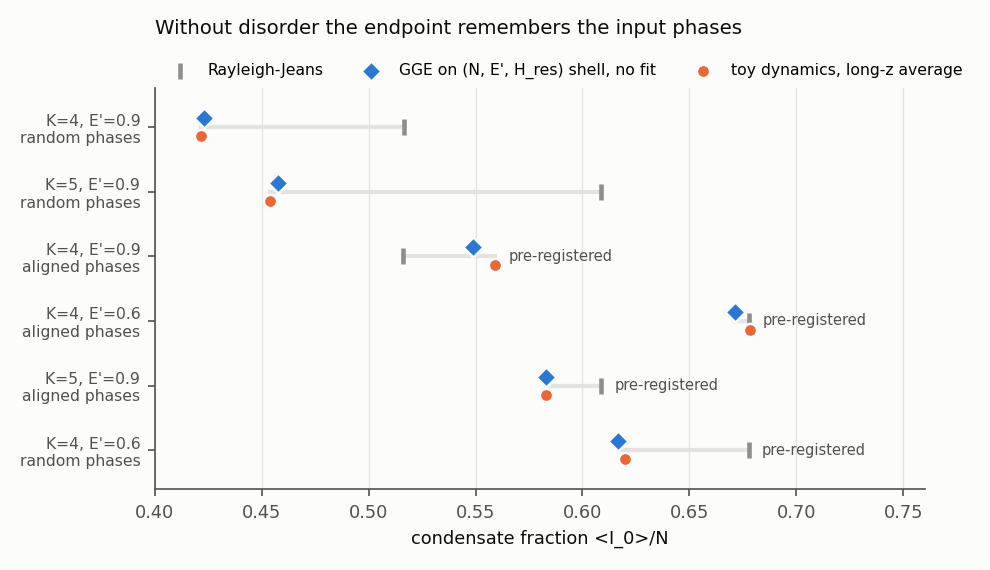
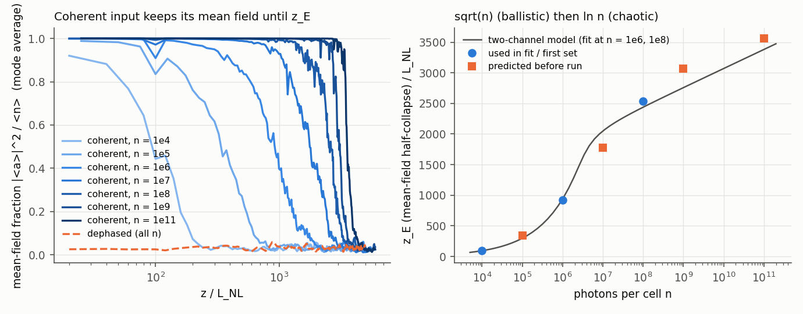
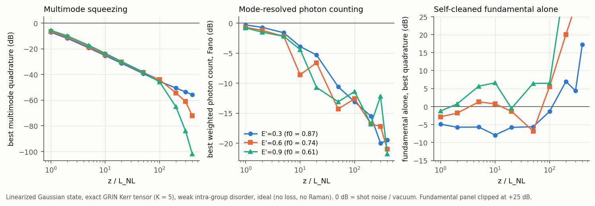
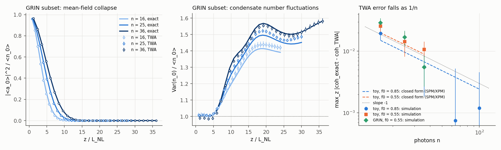
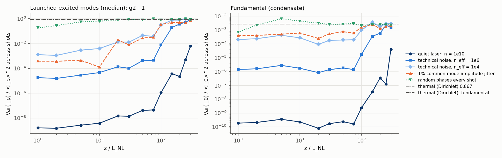
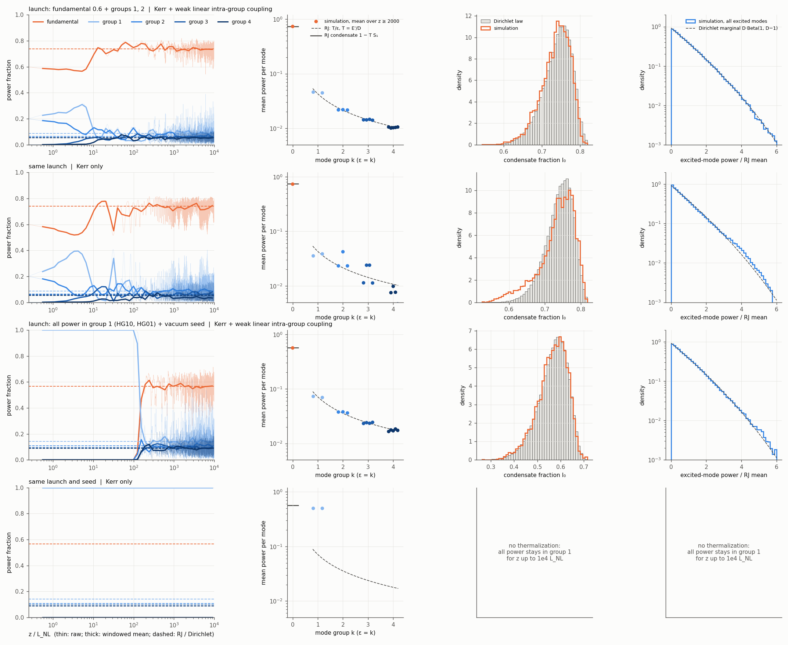
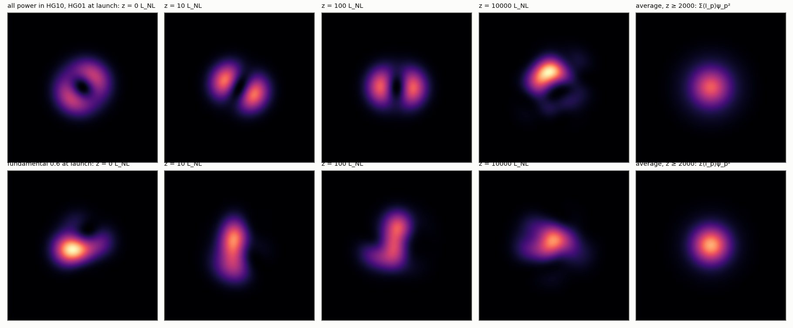
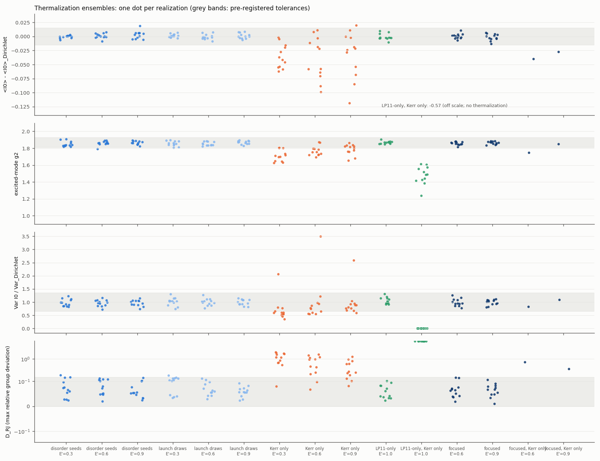
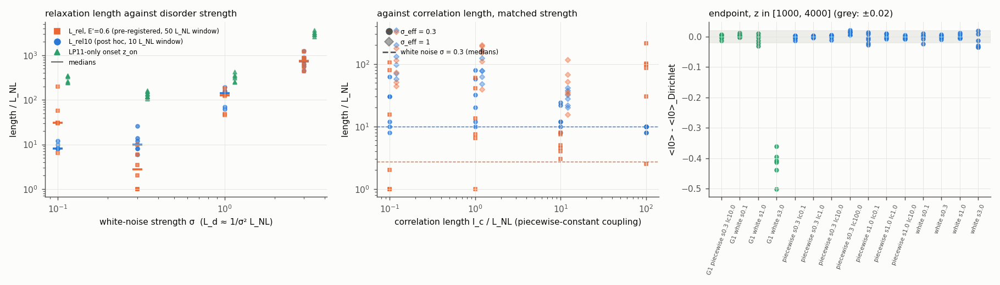
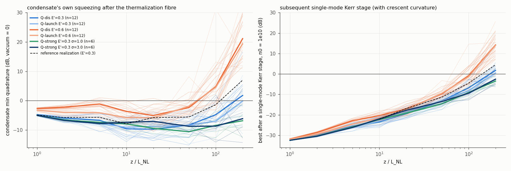

# Quantum state of Rayleigh–Jeans-thermalized light: first analytics and toy-model checks

- Agent: claude-interactive.7 (claude-opus-5-5, claude family)
- Date: 2026-10-16
- Task: T-20261016-claude-interactive.7-01
- Problem card: `problems/P-20261016-claude-interactive.7-01-quantum-state-of-rj-thermalized-light.md`
- Runs:
  - `runs/2026-10-16-claude-interactive.7-rj-polytope-mc` (closed forms against Monte Carlo);
  - `runs/2026-10-16-claude-interactive.7-rj-toy-thermalization` (classical toy dynamics);
  - `runs/2026-10-16-claude-interactive.7-rj-toy-twa-scrambling` (truncated-Wigner ensemble);
  - `runs/2026-10-16-claude-interactive.7-rj-toy-gge` (generalized-Gibbs tests);
  - `runs/2026-10-16-claude-interactive.7-grin-lyapunov` (exact GRIN Kerr tensor, Lyapunov exponents, CW sidebands);
  - `runs/2026-10-16-claude-interactive.7-grin-gaussian-state` (exact linearized pre-scrambling state).
  - `runs/2026-10-16-claude-interactive.7-grin-gge` (generalized-Gibbs tests with the exact GRIN tensor);
  - `runs/2026-10-16-claude-interactive.7-grin-twa-scrambling` (truncated-Wigner scrambling with the exact GRIN tensor);
  - `runs/2026-10-16-claude-interactive.7-few-quanta-exact` (exact diagonalization, few quanta above a condensate);
  - `runs/2026-10-16-claude-interactive.7-exact-vs-twa-4mode` (exact quantum dynamics against truncated Wigner, §6.6);
  - `runs/2026-10-16-claude-interactive.7-grin-shot-statistics` (shot-to-shot and within-pulse statistics at large $n$, §6.7);
  - `runs/2026-10-16-claude-interactive.7-grin-lyapunov-modecount` ($\lambda_1$ against mode count, §6.7);
  - `runs/2026-10-17-claude-interactive.7-condensate-kerr-squeezability` (Kerr squeezing of the equilibrated condensate, §6.8; task T-20261017-claude-interactive.7-01).
  - `runs/2026-10-17-claude-interactive.7-grin-thermalization-visual` (thermalization seen directly, Kerr only against Kerr plus weak linear coupling, §6.9; task T-20261017-claude-interactive.7-01).

This note records what was derived and checked in one four-hour session on the PI's question. The question: what is the quantum state of a multimode fibre field after Kerr thermalization to the Rayleigh–Jeans (RJ) equilibrium? Cases: a coherent or dephased-coherent CW input, and the condensed RJ regime. Status labels:

- **[exact]**: follows from the model with no approximation.
- **[derived]**: derived here under stated assumptions; checked only as stated.
- **[conjecture]**
- **[toy]**: observed in the toy model below, not in a fibre model.

## Answer in brief (provisional; first family; toy and linearized models only)

1. **The total state.** It is never a grand-canonical thermal state. Each CW coherence cell keeps the input's Poisson photon-number law. A coherent input stays globally pure, so the thermal-looking mixedness of any mode is entanglement with the other modes.
2. **Coherent input, before scrambling** ($z<z_E$).
   - The state is a pure, displaced, multimode Gaussian state centred on a deterministic, RJ-looking speckle, and is strongly squeezed.
   - Mode-resolved photon counting with computed weights reaches photon-number squeezing that improves by about 10 dB per decade of $z/L_{\rm NL}$: −4 to −9 dB at $10L_{\rm NL}$, −20 to −27 dB at $400L_{\rm NL}$, in the ideal linearized model (§6.5).
   - The self-cleaned fundamental alone is only modestly squeezed.
   - The scrambling length is $z_E=\min[\sqrt{\ln2\,n/\mathcal A},\ \ln(n/c)/2\lambda_1]$. The ballistic term is exact for self- and cross-phase dynamics. For realistic GRIN parameters $z_E\sim10^2$–$10^3L_{\rm NL}$, on the order of 100 m at 10 kW, so metre-scale experiments are in this regime.
   - **Shot to shot at large $n$** (§6.7). A fixed launch is not thermal shot to shot. With a quiet laser at $n=10^{10}$ the mode powers repeat to $g^{(2)}-1\sim10^{-8}$ for $z\le75L_{\rm NL}$; thermal light has 0.87. The noise is Gaussian (variance proportional to the input noise) until $z_E(n/F_{\rm in})$, so laser technical noise, not quantum noise, decides when shots look thermal. Phases redrawn on every shot give the Dirichlet law within about $30L_{\rm NL}$. Within one pulse, the instants sample one trajectory over a range of lengths: a large temporal speckle in the mode fractions that repeats from pulse to pulse.
   - Truncated Wigner, which underlies the scrambling statements, agrees with exact quantum dynamics on four modes to $O(1/n)$ (§6.6).
3. **Dephased input.** It becomes a mixture of phase-averaged displaced thermal states at the kinetic length, independent of photon number.
4. **After scrambling, or for dephased inputs beyond $L_{\rm kin}$.** Fock-diagonal reduced states with the statistics of the conserved-quantity shell.
   - With weak disorder this is the polytope law. In the condensed case it is exactly Dirichlet: $g^{(2)}=2-2/M$ per excited mode, cross $1-1/M$, a closed-form condensate variance with a $\ln K$ law for GRIN, and a sign change of the condensate–mode correlation.
   - Without disorder the endpoint is a generalized Gibbs ensemble fixed by the resonant Kerr energy, so it remembers the input phases.
   - Seen directly in single trajectories (§6.9): power moves between groups only through Kerr, but RJ is reached only with the weak linear intra-group coupling. A launch with all power in LP11 condenses to the RJ fraction after a vacuum seed grows; with Kerr alone it never leaves LP11.
5. **Condensed limits.**
   - All photons in the fundamental: a pure Kerr-squeezed coherent state with $O((L_{\rm beat}/L_{\rm NL})^2)$ Bogoliubov dressing. Nothing thermalizes.
   - Weak excitations: classical Dirichlet statistics if there are many more excitation quanta than $K^3$ and the depletion is large enough for chaos. A few quanta above a large condensate do not thermalize at all: exact diagonalization shows a frozen quasiparticle number, ${\rm Var}\,N_{\rm ex}\propto N^{-1.2}$ (§5).
   - **Squeezing the equilibrated condensate afterwards** (§6.8). Before scrambling it keeps its phase and near-shot-noise intensity noise. Its mixedness $\nu$ (entanglement with the cloud) limits direct Kerr squeezing to $\approx0.95(\nu^4/\bar n_0)^{1/3}$: −11 to −22 dB at $\bar n_0=10^{10}$ for $10\le z\le50L_{\rm NL}$, none by about $200L_{\rm NL}$. After scrambling Kerr cannot squeeze it at all, because it is Fock-diagonal. A balanced self-referenced (Sagnac) squeezer rejects all of this down to the pump's relative power spread squared.

## 1. Model

**Field and invariants.** Scalar field, one polarization, $M$ guided modes. Linear "energies" are $\varepsilon_p=\beta_0-\beta_p\ge0$, with the fundamental $p=0$ and $\varepsilon_0=0$. The Kerr overlap tensor $S_{pqrs}=\int\phi_p\phi_q\phi_r\phi_s$ is real and fully symmetric. The classical equation is
$$i\partial_zA_p=\varepsilon_pA_p-\gamma\sum S_{pqrs}A_q^*A_rA_s$$
(focusing). Two quantities are conserved: $N=\sum|A_p|^2$ and $H=\sum\varepsilon_p|A_p|^2-\frac{\gamma}{2}\sum S\,A^*A^*AA$.

**CW and cells.** In the dispersionless spatial model each instant $t$ evolves on its own. Quantize per time cell of duration $\tau$:
- $[a_p,a_q^\dagger]=\delta_{pq}$;
- $\hat H=\sum_p\varepsilon_p\hat n_p-\frac g2\sum S_{pqrs}a_p^\dagger a_q^\dagger a_ra_s$, with $g=\gamma\hbar\omega/\tau$;
- $\bar N=P\tau/\hbar\omega$ photons per cell.

The classical dynamics depends only on $g\bar N=\gamma P$. Quantum effects enter only through $1/\bar N$, which acts as $\hbar_{\rm eff}$.

**The cell duration [conjecture, partly refuted in §6.4].** The first version of this note said $\tau$ is set by the band over which noise sidebands evolve as at $\Omega=0$: $\tau\simeq2\pi/\Omega_\lambda$, with $\Omega_\lambda\sim\min(\lambda/|\Delta\beta_1|,\sqrt{\lambda/|\beta_2|})$. The reasoning was that walk-off or dispersion would dephase sidebands beyond that band. The sideband calculation of §6.4 contradicts the walk-off part. Relative walk-off *raises* the sideband growth rate above $\lambda(0)$ (intermodal modulation instability), so the fastest-growing quantum noise sits at sideband frequencies set by the walk-off and the nonlinear length, not by $\lambda/\Delta\beta_1$. The cell picture survives only as a statement about which band dominates. A detector bandwidth narrower than that band sets $\tau$ instead.

**Inputs.**
- (a) Coherent: $|\alpha\rangle=\otimes_p|\alpha_p\rangle$.
- (b) Dephased, meaning per-mode phase-randomized: $\rho_b=\otimes_p\sum_n{\rm Poi}(n;|\alpha_p|^2)\,|n\rangle\langle n|$. This is the random-phase initial ensemble of wave turbulence, and the ensemble of experiments that redraw the diffuser or SLM phases on every shot.
- (b′) A *globally* dephased coherent state. It is identical to (a) for every number-conserving observable, because $[\hat N,\hat H]=0$.

## 2. Exact statements

**E1. Photon-number statistics [exact].** The total photon-number distribution of every cell does not depend on $z$. For (a) and (b) it is Poisson($\bar N$).
- A grand-canonical Gibbs state has ${\rm Var}\,N=\sum n_p(n_p+1)\gg\bar N$. The thermalized state is therefore never grand-canonical. It is at most a mixture of microcanonical shells weighted by the input's joint distribution of $(N,H)$.
- The total-power Fano factor stays exactly 1.

**E2. Energy [exact].** The two inputs differ in mean energy by the phase-coherent part of the Kerr energy:
$$\langle\hat H\rangle_a-\langle\hat H\rangle_b=-\tfrac g2\Big[\sum S_{pqrs}\alpha_p^*\alpha_q^*\alpha_r\alpha_s-2\sum_{pq}S_{ppqq}|\alpha_p|^2|\alpha_q|^2+\sum_pS_{pppp}|\alpha_p|^4\Big].$$
- ${\rm Var}\,\hat H$ is at shot-noise scale for (a).
- For (b) it also contains the random-phase variance of the Kerr energy. That term is classical: it does not vanish relative to $(g\bar N^2S)^2$ as $\bar N\to\infty$.

**E3. Purity [exact].**
- State (a) stays pure in every cell (or across all cells, if they couple). Every bit of mixedness in a reduced state of (a) is entanglement.
- State (b) carries its input entropy, $\sum_p\frac12\ln(2\pi e|\alpha_p|^2)$ for large $|\alpha_p|^2$. This is far below the entropy $\sum_p\ln(en_p)$ of the RJ state it relaxes to.

**E4. Ideal-GRIN collective modes [exact in the untruncated paraxial model].** Take an exactly parabolic profile with a contact (Kerr) interaction.
- The centre of mass oscillates harmonically for any interaction (Kohn's theorem).
- The breathing mode evolves exactly (the SO(2,1) symmetry of the 2D contact problem, Pitaevskii–Rosch).
- $L_z$ is conserved.

Consequently, a coherent input with a displaced centroid keeps that oscillation, and the quantum state of the centre-of-mass degree of freedom, at every $z$. Thermalization can act only on the remaining (internal) degrees of freedom. The truncation to guided modes, profile errors and disorder all break these exact modes.

**E5. Resonant normal form [derived, standard].** Suppose $g\bar NS\ll\kappa$, where $\kappa$ is the smallest nonzero gap in $\varepsilon$; then $L_{\rm beat}\ll L_{\rm NL}$. The beat-averaged dynamics conserves two further quantities, accurate to $O(g\bar NS/\kappa)$:
- the linear energy $E_{\rm lin}=\sum\varepsilon_p|A_p|^2$;
- the resonant part $H_{\rm res}$ of the Kerr energy.

Random linear coupling inside a degenerate group (the disorder of real fibres) keeps $N$ and $E_{\rm lin}$, but not $H_{\rm res}$.

## 3. Coherent input: a pure Gaussian state until a scrambling length

**Pre-scrambling [derived; standard linearization].** Write $a_p=A_p(z)+\delta a_p$, with $A(z)$ the classical trajectory from $A(0)=\alpha$. The fluctuation $\delta a$ evolves by the symplectic tangent map $\mathsf S(z)$. The state is therefore a pure Gaussian with Wigner covariance $V=\frac12\mathsf S\mathsf S^{\mathsf T}$ about a deterministic mean field.

In a chaotic regime the singular values of $\mathsf S$ grow as $e^{\lambda_iz}$, in pairs $\pm\lambda_i$, with neutral pairs for $N$ and $H$. Before that, and throughout the strongly condensed regime, they grow algebraically through Kerr shear (§6.5). Consequences in the chaotic regime:
- **Mean field.** $\langle a_p\rangle\simeq A_p(z)$. This is a fixed speckle that looks thermal across modes and along $z$.
- **Squeezing.** The most squeezed multimode quadrature has variance $\simeq\frac12e^{-2\lambda_1z}$.
- **Single-mode noise.** Single-mode Fano factors grow like $e^{2\lambda_1z}$.
- **Conserved quadratures.** The total-number quadrature, and $E_{\rm lin}$ in the resonant regime, keep their input noise.

**Scrambling length: two channels [derived; toy-tested, §6].** The input's vacuum noise seeds every departure from the classical trajectory, so every channel scales as $1/n_{\rm cell}$, the number of photons per mode per cell. Write $F_{\rm in}$ for the input's excess-noise factor (1 for a coherent state) and assume the accumulated phase noise is Gaussian. Then the mean-field fraction ${\rm coh}_p=|\langle a_p\rangle|^2/\langle n_p\rangle$ obeys
$$-\ln{\rm coh}_p(z)\simeq\frac{F_{\rm in}}{n_{\rm cell}}\Big[\mathcal A_p\,z^2+c_p\,e^{2\lambda_1z}\Big],$$

using $-\ln{\rm coh}={\rm Var}\,\phi$ for Gaussian phase noise, since ${\rm coh}$ is defined from $|\langle a\rangle|^2$.

- **Ballistic channel** (the first term).
  - The cause is the input's shot-noise spread of the conserved quantities: $\delta N$, $\delta E'$, with ${\rm Var}\,\delta N=\bar N$ for Poisson input. This spread shifts each mode's mean frequency $\bar\omega_p(N,E')$, so phases spread linearly in $z$:
    $$\mathcal A_p\,n^{-1}={\rm Var}\big(\partial_N\bar\omega_p\,\delta N+\partial_{E'}\bar\omega_p\,\delta E'\big).$$
  - This is the multimode form of single-mode Kerr phase diffusion, $|\langle a\rangle|=|\alpha|e^{-2\bar N\sin^2(\Lambda z/2)}$, and of the $\mathcal At^2$ term of Sinatra, Witkowska and Castin.
  - It acts on mean fields and relative phases. Its length scales as $\sqrt{n_{\rm cell}}\,L_{\rm NL}$, and it exists without chaos.
- **Chaotic channel** (the second term). Lyapunov amplification. Its length scales as $\ln(n_{\rm cell})/2\lambda_1$, and it also scrambles the mode powers.
- **The scrambling length** is set by whichever channel reaches $O(1)$ first:
  $$z_E\approx\min\big[\sqrt{\ln2\;n_{\rm cell}/\mathcal A}\,,\ \ln(n_{\rm cell}/c)/2\lambda_1\big].$$
- **Laser noise.** Common-mode laser phase noise does not enter: in the dispersionless model it is a global phase of each cell, and the dynamics commutes with global phase rotations. Amplitude noise does enter, through $F_{\rm in}$.

**Condensate ballistic coherence length [derived; Hartree–Fock].** In the condensed RJ state, the condensate's mean frequency is $\bar\omega_0=-g[S_{0000}\langle I_0\rangle+2\sum_mS_{00mm}\langle I_m\rangle]$, with $\langle I_m\rangle=E'/(D\varepsilon_m)$ and $\langle I_0\rangle=N-E'S_1/D$. Hence:
- $\partial_N\bar\omega_0=-gS_{0000}$;
- $\partial_{E'}\bar\omega_0=g\,\nu$, with $\nu=\big(S_{0000}S_1-2\sum_mS_{00mm}/\varepsilon_m\big)/D$.

The coherent input has ${\rm Var}\,\delta N=\bar N$, ${\rm Var}\,\delta E'=\sum_m\varepsilon_m^2n^{\rm in}_m$ and ${\rm Cov}=\sum_m\varepsilon_mn^{\rm in}_m$. With $L_{\rm NL}=1/(gS_{0000}\bar N)$ and $\nu'=\nu/S_{0000}$, this gives
$$z_{\phi,0}=L_{\rm NL}\sqrt{\frac{\ln2\ \bar N}{1-2\nu'\langle\varepsilon\rangle_{\rm in}+\nu'^2\langle\varepsilon^2\rangle_{\rm in}}}.$$
- **Toy check (no free parameter).** This predicts $|\langle a_0\rangle|^2/\langle n_0\rangle=\tfrac12$ at $z=78$ ($n=10^4$) and $783$ ($n=10^6$). The truncated-Wigner toy gives 70 and 744 (interpolated crossings, run `…-rj-toy-twa-scrambling`, `ballistic_hf.json`), within 11% and 5%. At $n=10^8$ the chaotic branch takes over: 2474 observed, against 7837 for the ballistic term alone. An earlier version of this note dropped a factor 2 in $-\ln{\rm coh}={\rm Var}\,\phi$ and quoted 111 and 1108.
- **Fibres.** $\bar N$ per cell is $10^9$–$10^{10}$, so this length is $\sim10^5L_{\rm NL}$. The chaotic channel decides $z_E$ unless $\lambda_1L_{\rm NL}\lesssim10^{-4}$.

**Which readout sees the squeezing [conjecture REFUTED, §6.5].** The first version of this note argued that bin-resolved photon counting measures quadratures in the amplitude subspace. It then argued that the amplitude subspace and the stable (squeezed) subspace, both Lagrangian, generically meet at angles of order 1, so that weighted photon counting would stay near shot noise.

The exact linearized state of §6.5 shows the opposite. The optimally weighted mode-resolved photon count, $\lambda_{\rm gen}$, falls far below shot noise and keeps falling: about −10 dB per decade of $z$, reaching −20 to −27 dB at $z=400L_{\rm NL}$ (ideal, lossless). The dynamics is not generic. The optimal weights (`gauss_weights.json`) put 78–93% of their norm on the fundamental. They overlap the total-$N$ direction by 0.64–0.93, and within-group differences carry under 10%. So the quiet observable is the condensate photon number corrected by a weighted sum of higher-order-mode photon numbers, not a twin-beam difference. There are 3–8 independent sub-shot-noise directions. The conserved total $N$ stays exactly at shot noise, so the squeezing comes from combinations that the dynamics makes quiet without conserving them. The mechanism has not been derived (T-…-10).

**Entanglement and purity [derived from a published theorem].** Before scrambling, the global state is pure Gaussian. A single mode's reduced state has symplectic eigenvalue $\nu_p(z)$, and its entanglement entropy is
$$S_p=(\nu_p+\tfrac12)\ln(\nu_p+\tfrac12)-(\nu_p-\tfrac12)\ln(\nu_p-\tfrac12).$$
For unstable quadratic dynamics, $S$ of a subsystem grows linearly at its Kolmogorov–Sinai rate: for one mode, generically the sum of the two largest Lyapunov exponents (Bianchi, Hackl & Yokomizo, JHEP 03 (2018) 025, arXiv:1709.00427; abstract only). It saturates at the thermal entropy $\ln(en_p)$ of the RJ reduced state, at $z\approx\ln(n_p)/(\lambda_1+\lambda_2)$, consistent with $z_E$. After saturation, the thermal entropy of every single mode is entanglement, because the global state stays pure.

**Post-scrambling [derived, assuming ergodicity].** The Wigner function becomes the input's distribution of the conserved Wigner quantities $(N_W,H_W,\dots)$, averaged over the ergodic measure on each shell.
- Reduced few-mode states are phase-invariant and diagonal in the Fock basis, with $\langle a_p\rangle\to0$.
- The global state stays pure for input (a).

**Dephased input (b) [derived].** Input (b) is already a classical mixture over phases. It reaches the shell mixture once the classical ensemble has mixed, at the kinetic length $L_{\rm kin}$, without waiting for $z_E$.

In the random-phase kinetic regime, the one-mode intensity PDF obeys $\partial_zP=\partial_s[s(\gamma_pP+\eta_p\partial_sP)]$. This is exactly the intensity Fokker–Planck equation of a complex Ornstein–Uhlenbeck process; we checked the identity by Itô calculus. Starting from a fixed amplitude, its solution is the noncentral exponential (Rician) law. Each mode's reduced state is therefore a **phase-averaged displaced thermal state**:
- coherent part $|\alpha_p|^2e^{-\int\gamma_p}$;
- thermal part from the kinetic equation.

The one-mode PDF evolution of random-phase-and-amplitude wave fields is the subject of Choi, Lvov & Nazarenko, Phys. Lett. A 332, 230 (2004), DOI 10.1016/j.physleta.2004.09.062, arXiv:math-ph/0409071. Only its abstract was read; it establishes that random phases stay random and amplitudes stay independent in the coarse-grained sense. The Fokker–Planck form used above was derived independently here, as the intensity equation of a complex Ornstein–Uhlenbeck process with the kinetic coefficients $(\eta_p,\gamma_p)$. Whether that paper or Nazarenko's book states it in this form is not checked.

**Answer to (a) versus (b), in this picture.** Suppose the system is ergodic on the shell of $N$ and $E_{\rm lin}$, which needs weak intra-group disorder. Then both inputs reach the same endpoint. Without disorder, the endpoint depends on the input phases through $H_{\rm res}$ (§6.1). The routes differ:
- **(b)** becomes a mixed thermal state at $L_{\rm kin}$.
- **(a)** stays a pure, displaced, multimode-squeezed Gaussian state riding on a deterministic RJ-looking speckle until $z_E$.
- **Measurable difference.** With $L_{\rm kin}<z<z_E$, repeated shots of (a) give the same mode powers up to amplified quantum noise. Repeated shots of (b) give thermal shot-to-shot statistics.

## 4. Post-scrambling statistics in closed form: the polytope ensemble

**Assumptions.**
- Weakly nonlinear: the Kerr energy is negligible within the shell.
- Classical: $n_p\gg1$.
- Only $N$ and $E_{\rm lin}$ are conserved.
- Ergodic.

**The measure [exact under these assumptions].** The microcanonical measure $\delta(\sum I-N)\,\delta(\sum\varepsilon I-E)\prod d^2A_p$ is uniform in the intensities $I_p=|A_p|^2$ on the polytope $\{I\ge0,\ \sum I=N,\ \sum\varepsilon I=E\}$ and uniform in the phases. This is because $d^2A=\frac12dI\,d\phi$. Under truncated Wigner, $I_p$ is the Wigner intensity $n_p+\frac12$.

**General marginals [derived; checked].** Write $x=I/N$ and $e=E/N$. By the Curry–Schoenberg theorem, the density of $\sum\varepsilon_px_p$ for $x$ uniform on the simplex is the B-spline $\mathcal M(e;\{\varepsilon\})$. Hence
$$P(x_p=s)=\frac{(M-1)(1-s)^{M-3}\,\mathcal M\big(\tfrac{e-\varepsilon_ps}{1-s};\{\varepsilon\}_{q\ne p}\big)}{\mathcal M(e;\{\varepsilon\})}.$$
For large $M$ this tends to an exponential with the RJ mean $T/(\varepsilon_p-\mu)$. Monte Carlo check (6 nondegenerate modes, $e=1.3$): means and $g^{(2)}$ agree to 0.5% (run `…-rj-polytope-mc`).

**Condensed regime [exact under the same assumptions].** Let $E'=\sum_{m\ge1}\varepsilon_mI_m\le\kappa N$, i.e. a mean excitation energy per photon below the first gap. Then the constraint $I_0\ge0$ can never bind. With $x_m=\varepsilon_mI_m/E'$, the $D=M-1$ excitations are exactly Dirichlet$(1,\dots,1)$, which gives:
- **Means.** $\langle I_m\rangle=T/\varepsilon_m$ with $T=E'/D$. This is RJ with $\mu=\varepsilon_0$, and equipartition holds exactly at any $M$.
- **Single-mode law.** $P(I_m)=(D-1)\frac{\varepsilon_m}{E'}\big(1-\frac{\varepsilon_mI_m}{E'}\big)^{D-2}$ on $[0,E'/\varepsilon_m]$.
- **Autocorrelation.** $g^{(2)}_m=2D/(D+1)=2-2/M$ for every excited mode, independent of $\varepsilon_m$ and $E'$. More generally $g^{(k)}_m=k!\,D^k(D-1)!/(D+k-1)!$.
- **Cross-correlation.** $g^{(2)}_{mn}=1-1/M$ between distinct excited modes.
- **Depletion distribution.** $N_{\rm ex}=E'\sum_mx_m/\varepsilon_m$ is distributed as the B-spline with knots $E'/\varepsilon_m$. Its variance is
$${\rm Var}\,N_0={\rm Var}\,N_{\rm ex}=T^2\frac{D(S_2-S_1^2/D)}{D+1},\qquad S_k=\sum_{m\ge1}\varepsilon_m^{-k}.$$
  The input's Poisson spread of $N$ adds $\bar N$ to ${\rm Var}\,N_0$, because $N_{\rm ex}$ is fixed by $E'$, not by $N$.
- **Sign change.** ${\rm Cov}(N_0,I_m)=-\frac{E'^2}{\varepsilon_m}\frac{D/\varepsilon_m-S_1}{D^2(D+1)}$. The condensate is anticorrelated with modes below the harmonic mean $D/S_1$ of the excitation energies, and correlated with modes above it.
- **Check.** An independent rejection sampler on the full polytope (6 modes with GRIN degeneracy, $E'=0.6\kappa N$) reproduces every item above, including the sign of the covariance (run `…-rj-polytope-mc`).

**Degenerate fundamental (two polarizations) [derived].** Integrating out $d_0$ degenerate ground modes under the $N$ constraint leaves a Jacobian $(N-N_{\rm ex})^{d_0-1}$. The excitations are then Dirichlet tilted by that factor, not exactly Dirichlet.
- Exactness is restored by one extra linear invariant per extra ground mode. In an isotropic fibre that is $S_z$: the two condensate components follow from $N$ and $S_z$, the excitations are exactly Dirichlet on $D=M-2$ components, and the condensate's circular polarization fluctuates as the excitations' spin, ${\rm Var}\,S_0=(E'/D)^2DS_2/(D+1)$, because $\sum_ms_m/\varepsilon_m=0$.
- With random birefringence (only $N$, $E'$ conserved), corrections are $O(N_{\rm ex}/N)$, and the condensate's polarization is uniform on the Poincaré sphere.
- **Check** (run `…-rj-polytope-mc`, `check_degenerate.py`; 6 modes $\varepsilon=0,0,1,1,2,2$, $E'=0.8$). Monte Carlo $\langle N_{\rm ex}\rangle=0.5798$ against 0.5800 tilted and 0.6000 untilted; $g^{(2)}$ 1.5950 against 1.5948 tilted and 1.6005 untilted.

**GRIN, one polarization.** Groups $k=0,\dots,K-1$ have degeneracy $k+1$ and $\varepsilon_k=k\kappa$. Then
- $D=K(K+1)/2-1$;
- $S_1=(K-1+H_{K-1})/\kappa$;
- $S_2=(H_{K-1}+H^{(2)}_{K-1})/\kappa^2$.

So ${\rm Var}\,N_{\rm ex}/\langle N_{\rm ex}\rangle^2\to(\ln K+\gamma_E+\pi^2/6-2)/K^2$, with slow convergence (relative corrections $O(\ln K/K)$). For $K=10$ it is 0.0125, i.e. the depletion fluctuates by 11% per cell. The condensate's relative intensity noise per cell is then $0.11(1-f_0)/f_0$, with $f_0$ the condensate fraction.

**Quantum reading.** For $n\gg1$, these are the photon-number statistics of reduced states that are diagonal in the Fock basis, with $\langle a\rangle=0$, after scrambling. The photon-number variance is ${\rm Var}_W(I)-\frac14$.

## 5. Quantum corrections and the limits of truncated Wigner

**Bose–Einstein versus RJ [derived].**
- The quantum microcanonical ensemble of the noninteracting system is uniform on the *integer* points of the polytope. It departs from RJ once $T/\varepsilon_m\lesssim1$.
- In the condensed regime with $Q=E'/\kappa$ excitation quanta, mode statistics are vector-partition counts. For GRIN, the configurations are generated by $\prod_{k\ge1}(1-q^k)^{-(k+1)}$, which is MacMahon's plane-partition function times Euler's partition function (truncated at $K$).
- Example, $Q=1$: one quantum is shared between the two $k=1$ modes, each mode holds 0 or 1 photon, and the light is antibunched ($g^{(2)}=0$).
- **Exact counts, GRIN with $K=10$ (54 excited modes)** (run `…-rj-polytope-mc`, `quantum_partitions.json`):

  | $Q$ | $g^{(2)}$, group-1 mode | $\langle n\rangle$ group 1: quantum / RJ | $\langle N_{\rm ex}\rangle$: quantum / RJ | ${\rm Var}\,N_{\rm ex}$: quantum / RJ |
  |---|---|---|---|---|
  | 1 | 0 (antibunched) | 0.50 / 0.02 | 1.0 / 0.2 | 0 / 0 |
  | 2 | 1.33 | 0.50 / 0.04 | 1.5 / 0.4 | 0.25 / 0.00 |
  | 5 | 1.61 | 0.80 / 0.09 | 2.9 / 1.1 | 1.2 / 0.01 |
  | 10 | 1.80 | 1.08 / 0.19 | 4.6 / 2.2 | 2.5 / 0.06 |
  | 20 | 1.88 | 1.50 / 0.37 | 7.7 / 4.4 | 5.1 / 0.24 |
  | 60 | 1.93 | 2.67 / 1.11 | 18.2 / 13.1 | 15.6 / 2.2 |

  The classical Dirichlet $g^{(2)}$ is 1.964. Quantum freeze-out of the high modes concentrates the excitations in low groups. The depletion and its fluctuations are therefore much larger than RJ at the same $E'$: at $Q=60$ the variance is seven times the RJ value. So the condensate's photon-number distribution in this regime is a Bose–Einstein (partition) object, not the RJ B-spline.

**But few quanta above a large condensate do not thermalize [exact diagonalization; run `…-few-quanta-exact`].** The partition statistics above are the ensemble that would be reached if the dynamics were ergodic in the $(N,Q)$ sector. The resonant Hamiltonian conserves $N$ and $E'$, so the sector is small and can be diagonalized exactly (random-tensor toy, $K=4$, $g=1/N$). Fock initial states with $Q=6$ quanta overlap only about two eigenstates, and the excitation photon number is essentially frozen. The diagonal-ensemble ${\rm Var}\,N_{\rm ex}$ against the uniform-sector value 1.1:

| $N$ | 8 | 12 | 20 | 50 | 100 | 1000 |
|---|---|---|---|---|---|---|
| ${\rm Var}\,N_{\rm ex}$ | 1.01 | 0.53 | 0.043 | 0.0049 | 0.0017 | 0.0001 |

This falls roughly as $N^{-1.2}$. The condensate's mean field (order $gN$) detunes the processes that convert excitations (such as $1+1\leftrightarrow0+2$), whose amplitude is $O(1/\sqrt N)$. So for $N\gg Q$, a few quanta behave as long-lived quasiparticles: only their arrangement within degenerate groups changes.

This is the quantum counterpart of the classical result $\lambda_1\propto1-f_0$ (§6.4): a nearly fully condensed field barely thermalizes at all. So in the few-quanta regime the quantum state is the input's quasiparticle configuration, dressed, with mixing inside groups. It is not the partition ensemble.
- **Crossover.** For large $Q$ (untruncated), $Q\approx2\zeta(3)(T_q/\kappa)^3$ and $N_{\rm ex}\approx\zeta(2)(T_q/\kappa)^2$. This is the 2D-trap Bose–Einstein law, the quantum limit of Zanaglia et al. 2024.
  - RJ with equipartition over all $K$ groups needs $T_q\gg K\kappa$, i.e. $Q\gg2\zeta(3)K^3$.
  - Up to an $O(1)$ factor, this is the truncated-Wigner validity condition $E'\gg E'_{\rm vac}\approx\kappa K^3/6$ below.
  - So "weak excitations above the condensate" is a quantum (Bose–Einstein) problem precisely when the classical simulation fails.
  - In spatial modes this needs a launch purity of about $1-K^3/\bar N$ per cell, unreachable in practice. In the CW frequency sidebands, which start in vacuum, it is the generic case.

**Truncated Wigner fails at weak excitation [derived; the mechanism is in Sinatra, Lobo & Castin, J. Phys. B 35, 3599 (2002)].** The stochastic GNLSE with symmetric vacuum noise also equipartitions the vacuum energy. In the condensed regime it gives:
- an effective temperature $T_W=(E'+\sum_m\varepsilon_m/2)/D$;
- occupations $n^{\rm TWA}_m=T_W/\varepsilon_m-\frac12$, which go negative wherever $\varepsilon_m>2T_W$.

It is valid only if $E'\gg E'_{\rm vac}=\sum_m\varepsilon_m/2$, which is $\approx\kappa K^3/6$ per cell for GRIN. The same holds for every simulated frequency bin of a CW window. The classical spatio-temporal problem has no ultraviolet-finite equilibrium (Zanaglia et al. 2026), so CW Wigner simulations must be checked for dependence on the number of bins and the window.

**All photons in the fundamental [derived, standard].** A fundamental-only launch is a stationary point. It is linearly stable in the spatial modes when $\kappa\gg g\bar NS$.
- **Fundamental.** Its state is the single-mode Kerr-evolved coherent state:
  - Kitagawa–Yamamoto squeezing $V_{\min}=1+2\Phi^2-2\Phi\sqrt{1+\Phi^2}$ (vacuum = 1) at $\Phi=\Lambda\bar Nz$;
  - mean-field decay $|\langle a\rangle|=|\alpha|e^{-2\bar N\sin^2(\Lambda z/2)}$.
- **Excited modes.** Each pair $(m,m')$ with $S_{00mm'}\ne0$ is a weakly two-mode-squeezed vacuum: $\langle n_m\rangle=\frac{G^2}{\Delta^2-G^2}\sin^2(\sqrt{\Delta^2-G^2}\,z)$, with $G=g\bar N_0S_{00mm'}$ and $\Delta\approx\varepsilon_m$. This dynamical quantum depletion is of order $(L_{\rm beat}/L_{\rm NL})^2$.
- **No thermalization.** The state is pure and Gaussian up to the Kerr phase-diffusion length $L_{\rm NL}\sqrt{\bar N}$.
- **CW sidebands.** They have the same Bogoliubov structure, with $\Delta(\Omega)$ including dispersion and walk-off. Phase-matched bands grow from vacuum (spontaneous four-wave mixing). That is real physics, not thermalization.

## 6. Toy model: what the closed forms need dynamically

**The model.** The resonant (beat-averaged) Kerr system on $K$ equidistant groups with GRIN degeneracy and a random, fully symmetric, positive overlap tensor $S_{pqrs}=\sum_ju_{pj}u_{qj}u_{rj}u_{sj}$ ($J=400$, Gaussian $u$, mean self-overlap 1). It has no $L_z$, Kohn or breathing invariants.
- Units: $N=1$, $g=1$, $\kappa=1$; $z$ is in units of $1/(gN)$.
- Optional intra-group disorder: Brownian motion on $U(k+1)$ inside each group with strength $\sigma$. It keeps $N$ and $E'$ exactly, and breaks $H_{\rm res}$.
- Statistics are time averages along one trajectory for $z\in[2000,20000]$, sampled every 0.5.
- Lyapunov exponents come from a shadow trajectory.
- Code and per-case numbers: run `…-rj-toy-thermalization`.

### 6.1 Which ensemble the classical dynamics reaches

Run `…-rj-toy-thermalization` (18 cases) and run `…-rj-toy-gge`. All numbers below are $\langle I_0\rangle$ unless stated, with time-average block errors of about 0.004.

| Disorder | Condensed launch | Endpoint | Evidence |
|---|---|---|---|
| none | $E'=0.9$, $K=4$ and 5 | **GGE on $(N,E',H_{\rm res})$, not RJ** | random-phase launch: 0.422 (GGE 0.423, RJ 0.517); 0.454 (GGE 0.458, RJ 0.609). Pre-registered focused and random-phase predictions all within 0.010 (claim C-03). |
| none | $E'=0.3$, $K=4$ ($f_0\approx0.8$) | non-ergodic | group-3 modes at 0.24 of RJ against 0.77 for the GGE; $\lambda_1=0.004$ |
| weak, $\sigma=0.3$ ($L_d\approx11L_{\rm NL}$) | $E'=0.3,0.6,0.9$, dephased | **RJ with Dirichlet fluctuations** | $I_0$ = 0.838, 0.675, 0.518 against 0.839, 0.678, 0.517; $g^{(2)}$ 1.77–1.82 against 1.80; cross 0.899–0.904 against 0.900 (claim C-01) |
| weak, $\sigma=0.3$ | focused | RJ means, with slower drifts | group deviations 0.16–0.29; block-to-block drift of comparable size |
| strong, $\sigma=1$ ($L_d\approx L_{\rm NL}$) | $E'=0.3,0.6,0.9$ | **neither**: inter-group exchange frozen | $I_0$ = 0.868, 0.650, 0.557; $g^{(2)}$ 1.67–1.74. The pre-registered Dirichlet prediction failed here. |
| weak, $\sigma=0.3$ | non-condensed, $E'=1.5,2.0$ | **polytope (B-spline) law** | $I_0$ = $0.193\pm0.018$, $0.087\pm0.006$ against the Monte Carlo predictions 0.216, 0.085; $g^{(2)}$ 1.743, 1.712 against 1.759, 1.712 |
| strong, $\sigma=1$ | non-condensed | fails | $E'=2.0$: $g^{(2)}$ 1.86 against 1.71 |
| weak, $\sigma=0.3$ | held-out $K=5$, $E'=0.6$ | RJ means; fluctuations within a few to tens of percent | $I_0$ $0.744\pm0.012$ against 0.739; groups within 7%; $g^{(2)}$ 1.92 against 1.87; ${\rm Var}\,I_0$ 44% high |

**What the GGE result means for the PI's (a)/(b) question.** Without disorder, the resonant Kerr energy $H_{\rm res}$ carries the input phases to the endpoint. Two inputs with *identical mode powers* ($K=4$, $E'=0.9$) relax to condensate fractions:
- 0.422 with random phases;
- 0.559 with phases aligned at one point of the overlap structure;
- RJ predicts 0.517 for both.

The parameter-free GGE predicts 0.423 and 0.549.

For launches with power in groups 1 and 2, fixed-amplitude random-phase inputs sit below the RJ mean of $H_{\rm res}$: by 1.2–2.6 standard deviations in the random-tensor toy (`hres_rj_check.json`), and by 2.8–2.9 in GRIN. Exponential (thermal) mode statistics raise $\langle H_{\rm res}\rangle$, and fixed-amplitude inputs lack them. But this is not universal: in GRIN, a random-phase launch with power in groups 1 and 4 sits *above* the mean ($z_h=+1.28$; `grin_gge_screen.json`). Which side an input lies on depends on its mode distribution, and the GGE handles both.

### 6.1b Linear-response formula for the GGE shift [derived; checked post hoc]

The extra multiplier for $H_{\rm res}$ responds linearly to the input's excess resonant energy. This is the fluctuation–response relation of the generalized ensemble:
$$\langle I_0\rangle_{\rm GGE}\simeq\langle I_0\rangle_{\rm RJ}+\frac{{\rm Cov}_{\rm RJ}(I_0,H_{\rm res})}{{\rm Var}_{\rm RJ}(H_{\rm res})}\,\big(h_{\rm in}-\langle H_{\rm res}\rangle_{\rm RJ}\big).$$

**Leading order in the condensed regime.** Moving a photon from the condensate into mode $m$ changes the random-phase Kerr energy by $c_m=\langle I_0\rangle(2S_{00mm}-S_{0000})$ (times $g$): cross-phase energy gained, condensate self-energy lost. So ${\rm Cov}(I_0,H_{\rm res})\approx-{\rm Cov}_{\rm D}(N_{\rm ex},W)$ with $W=\sum_mc_mI_m$, and the Dirichlet covariance gives the closed form
$${\rm Cov}_{\rm D}\Big(\sum a_mI_m,\sum b_mI_m\Big)=\frac{E'^2}{D^2(D+1)}\Big[D\sum_m\frac{a_mb_m}{\varepsilon_m^2}-\Big(\sum_m\frac{a_m}{\varepsilon_m}\Big)\Big(\sum_m\frac{b_m}{\varepsilon_m}\Big)\Big].$$
${\rm Var}_{\rm RJ}(H_{\rm res})$ is a tensor sum over resonant quartets with Dirichlet fourth moments. Here it was sampled.

**Check** (run `…-rj-toy-gge`, `gge_linear.json`; post hoc, not pre-registered):

| Case | $z_h$ | RJ | linear | linear, closed covariance | GGE shell | toy |
|---|---|---|---|---|---|---|
| $K=4$, $E'=0.9$, random phases | −1.41 | 0.516 | 0.433 | 0.405 | 0.423 | 0.422 |
| $K=5$, $E'=0.9$, random phases | −2.54 | 0.609 | 0.480 | 0.459 | 0.458 | 0.454 |
| $K=4$, $E'=0.9$, focused | +0.37 | 0.516 | 0.538 | 0.545 | 0.549 | 0.559 |
| $K=4$, $E'=0.6$, focused | −0.27 | 0.678 | 0.666 | 0.665 | 0.671 | 0.678 |
| $K=5$, $E'=0.9$, focused | −0.61 | 0.609 | 0.578 | 0.573 | 0.583 | 0.583 |
| $K=4$, $E'=0.6$, random phases | −1.29 | 0.678 | 0.622 | 0.613 | 0.617 | 0.620 |

Here $z_h=(h_{\rm in}-\langle H_{\rm res}\rangle_{\rm RJ})/\sigma_{\rm RJ}$. The closed-covariance formula is within 0.005–0.017 of the toy, against shifts from RJ of 0.02–0.15. That holds up to $|z_h|=2.5$.

**GRIN: the sign is not universal [corrected].** In GRIN, $S_{00mm}=S_{0000}/2$ for the first excited group ($c=0$) and $S_{00mm}<S_{0000}/2$ for higher groups ($c<0$). An earlier version of this note concluded from that alone that inputs with large $H_{\rm res}$ condense more. That is wrong for the exact GRIN tensor.
- The sampled RJ regression slope is *negative*: $-1.24$ at $E'=0.6$ and $-1.09$ at $E'=0.9$ (run `…-grin-gge`). Modes above the harmonic mean, which are anticorrelated with $N_{\rm ex}$, dominate the covariance.
- **Pre-registered test, exact GRIN tensor, no disorder, centre-focused launch** (all modes that are non-zero at the centre phased to add there). The GGE predicted 0.695 and 0.587 at $E'=0.6$ and 0.9; the dynamics gave $0.700\pm0.004$ and $0.582\pm0.007$; RJ gives 0.739 and 0.609.
- The random-phase launch with the same mode powers gave 0.732 and 0.610. So in GRIN a phase-aligned launch condenses *less* than a random-phase one, the opposite of the random-tensor toy. The GGE gets the sign right in both.
- For the random-phase GRIN launches ($z_h\approx-2.9$), linear response fails and the GGE shell is off by 0.02 at $E'=0.6$. The extra GRIN invariants ($L_z$, Kohn, breathing) are not in the shell (T-…-05).
- **Second launch geometry, pre-registered** (`grin_gge_predict3.json`; power in groups 1 and 4, $E'=0.9$, screened for a large $|z_h|$). Centre-focused ($z_h=+2.78$): GGE 0.529, observed $0.535\pm0.006$, RJ 0.609. Random phases ($z_h=+1.28$): GGE 0.583, observed $0.577\pm0.010$. That makes six pre-registered GGE predictions passed, three with the GRIN tensor.
- **Disorder erases the memory** (`grin_gge_disorder.py`). The focused launch at $E'=0.6$ with intra-group disorder of decorrelation length $L_d$ = 1100, 100 and 11 $L_{\rm NL}$ gives $\langle I_0\rangle$ = 0.714, 0.745 and 0.740, averaged over $z\in[10^3,10^4]$. So the phase memory survives only while the fibre is shorter than a few $L_d$, and a lab test needs a short, well-controlled fibre.

### 6.2 Lyapunov exponents

In the random-tensor toy, $\lambda_1$ (shadow trajectory, units of $gN$) is 0.002–0.025 across all condensed cases, and grows with $E'$. At $f_0\approx0.8$ it is about 0.004. This is small: on the chaotic branch it puts $z_E=\ln(n)/2\lambda_1$ at thousands of $L_{\rm NL}$ for $n=10^9$–$10^{10}$.

### 6.3 Scrambling: coherent against dephased input (truncated Wigner)

Run `…-rj-toy-twa-scrambling`: $K=4$, $E'=0.3$, $\sigma=0.3$, fixed disorder realization, 32–40 trajectories per $n$.

- **Coherent input.** The mean-field fraction stays near 1, then collapses. Half-collapse lengths:

  | $n$ | $10^4$ | $10^5$ | $10^6$ | $10^7$ | $10^8$ | $10^9$ | $10^{11}$ |
  |---|---|---|---|---|---|---|---|
  | $z$ | 94 | 339 | 923 | 1774 | 2537 | 3071 | 3560 |

  - The $\sqrt n$ branch fits up to about $10^6$ (ballistic; parameter-free Hartree–Fock estimate within 11%, §3).
  - From $10^7$ on, the growth is roughly logarithmic: a few hundred $L_{\rm NL}$ per decade.
  - The four values at $10^5$–$10^{11}$ were predicted before the run, from fits to $10^6$ and $10^8$ plus the independent $\lambda_1=0.0037$. All landed within ±15%.
  - The $\ln n$ increment from $10^9$ to $10^{11}$ was 489, against $622\pm25\%$.
- **Collapse of the scaled dephasing.** $n\times(-\ln\overline{\rm coh})$ is the same for $n=10^6$ and $10^8$ at $z=200$–1200, within 26% (`summary.json` of the run). The departure from the classical trajectory is seeded by vacuum noise.
- **Mode-power scrambling.** The median relative spread of the excited-mode powers reaches half of its Dirichlet value, 0.8, at 514, 927, 1219, 1887, 2396, 3039 and 3525 for the same $n$. On the chaotic branch this tracks the mean-field collapse.
- **Dephased input.** The thermal-level spread is reached by $z\approx20$ for every $n$.
- **Window.** For a coherent input, the window $L_{\rm kin}<z<z_E$, in which the speckle looks thermal but the state is still a near-pure Gaussian, spans $z\approx10^2$ to $3\times10^3\,L_{\rm NL}$ here.
- **Exact GRIN tensor, pre-registered** (run `…-grin-twa-scrambling`; $K=5$, $E'=0.6$, $\sigma=0.3$). Half-collapse at 235, 372, 511, 639 $L_{\rm NL}$ for $n=10^6$–$10^{12}$: exactly linear in $\ln n$. Slope 67.4 $L_{\rm NL}$ per decade against the predicted $\ln10/(2\lambda_1)=62.9$ from the independent shadow-trajectory $\lambda_1=0.0183$; the increment over six decades is 404 against $377\pm25\%$. The chaotic branch of $z_E$ holds quantitatively in the realistic tensor. Past $z_E$ ($z\ge1000$) the shot-to-shot statistics of the coherent input are the Dirichlet law of §4: excited-mode relative variance 0.81–0.84 against $(D-1)/(D+1)=0.867$, condensate 0.0025–0.0029 against 0.0027, for every $n$. That links the two claims: the scrambling length (C-02) sets when the state becomes mixed, and the Dirichlet law (C-01) gives what it becomes. A per-mode dephased input with the same mode powers (pre-registered) reaches thermal-level spread within 2–4 $L_{\rm NL}$ for both $n=10^6$ and $10^{10}$. So in GRIN the window in which a coherent input looks RJ-thermalized while remaining a near-pure Gaussian state spans about $5$ to $10^2$–$10^3\,L_{\rm NL}$.

### 6.4 First look with exact GRIN overlaps, and CW sidebands

Run `2026-10-16-claude-interactive.7-grin-lyapunov`. The resonant dynamics of an ideal parabolic GRIN fibre, $K=5$ groups (15 Hermite–Gauss modes), with the exact Kerr tensor ($S_{0000}=1$, so $z$ is in units of $L_{\rm NL}$). Launch as in the toy; one trajectory per case, $z\le10^4$.

**Ensemble reached and $\lambda_1$.**

| Disorder | $E'$ | $\lambda_1L_{\rm NL}$ | $\langle I_0\rangle$ (RJ) | $g^{(2)}$ (Dirichlet 1.867) | cross (0.933) | ${\rm Var}\,I_0$ / Dirichlet | group occupations / RJ |
|---|---|---|---|---|---|---|---|
| none | 0.3 | 0.0014 | 0.845 (0.870) | 1.61 | 0.99 | 2.3 | 1.39, 1.81, 0.91, 0.43 |
| none | 0.6 | 0.0165 | 0.732 (0.739) | 1.72 | 0.95 | 1.8 | 0.88, 1.39, 1.22, 0.64 |
| none | 0.9 | 0.0245 | 0.610 (0.609) | 1.81 | 0.94 | 2.4 | 0.86, 1.24, 1.05, 0.87 |
| $\sigma=0.3$ | 0.3 | 0.0085 | 0.867 (0.870) | 1.845 ± 0.011 | 0.935 | 0.95 | 1.08, 1.02, 0.96, 0.99 |
| $\sigma=0.3$ | 0.6 | 0.0183 | 0.735 (0.739) | 1.863 ± 0.009 | 0.934 | 0.97 | 1.07, 1.01, 1.00, 0.97 |
| $\sigma=0.3$ | 0.9 | 0.0261 | 0.611 (0.609) | 1.857 ± 0.014 | 0.934 | 0.93 | 0.97, 1.01, 1.00, 1.00 |

- **Without disorder** the strongly condensed launch is far from RJ, and $\lambda_1$ is $0.0014/L_{\rm NL}$. Ideal GRIN has extra invariants, and the resonant $H_{\rm res}$ as well.
- **With weak intra-group disorder** ($\sigma=0.3$) and the real tensor, the condensed state matches the Dirichlet law (claim C-01) at all three $f_0=0.61$–0.87. In the strongly condensed case $\lambda_1$ rises from 0.0014 to $0.0085/L_{\rm NL}$.
- **Lyapunov exponent against depletion [observation, three points].** With weak disorder, $\lambda_1L_{\rm NL}$ = 0.0085, 0.018, 0.026 at depletion $1-f_0$ = 0.13, 0.26, 0.39. So $\lambda_1L_{\rm NL}\approx0.067\,(1-f_0)$, i.e. $\lambda_1/(1-f_0)=0.065$–0.070: chaos grows with the light outside the fundamental. Without disorder the ratio is the same at $E'=0.6$ and 0.9 (0.063). The strongly condensed disorder-free case is the exception: 0.011, the near-integrable case that is also non-ergodic. If it holds generally, the chaotic branch is $z_E\approx\ln(n)\,L_{\rm NL}/[0.13\,(1-f_0)]$.
- **Lengths.** For $n\sim10^{10}$ the spatial chaotic branch then gives $z_E=\ln n/2\lambda_1\approx10^3L_{\rm NL}$. At 1 µm in a 50 µm GRIN fibre, $\gamma\approx6\times10^{-4}$ W$^{-1}$m$^{-1}$ (order-of-magnitude estimate, $A_{\rm eff}\approx250\,\mu$m$^2$), so $L_{\rm NL}\approx0.16$ m at 10 kW. That puts $z_E$ at about 160 m, long compared with metre-scale self-cleaning experiments.

**CW sidebands** (`cw_sidebands*.json`, same trajectory, $E'=0.6$, $\sigma=0.3$). The growth rate $\lambda(\Omega)$ of noise at sideband $\Omega$, with $x$ the phase per $L_{\rm NL}$:

| $x$ | 0 | 0.003 | 0.01 | 0.03 | 0.1 | 0.3 | 1 | 2 | 4 |
|---|---|---|---|---|---|---|---|---|---|
| walk-off, $\lambda(\Omega)L_{\rm NL}$ | 0.017 | 0.017 | 0.019 | 0.027 | 0.046 | 0.057 | 0.054 | 0.055 | 0.054 |
| GVD (anomalous sign), $\lambda(\Omega)L_{\rm NL}$ | 0.017 | 0.072 | 0.13 | 0.23 | 0.41 | 0.66 | 0.87 | 0.0004 | 0.0001 |

Larger $x$ is not shown: the fixed RK4 step makes the walk-off point at $x=16$ unstable, and damps GVD points at $x\ge8$.

- **Walk-off.** Relative walk-off ($x=\Delta\beta_1\Omega L_{\rm NL}$ per group) *raises* the growth above $\lambda(0)$, peaking near $x\approx0.3$. This is intermodal modulation instability: walk-off phase-matches sideband pairs against the Hartree mismatch. The §1 conjecture that walk-off limits the cell bandwidth is wrong.
  - Ideal GRIN: $\Delta\beta_1\sim0.01$–0.1 ps/m between groups puts the gain band at $\Omega\sim1/(\Delta\beta_1L_{\rm NL})$, tens to hundreds of THz out. There GVD dominates.
  - Step-index fibre ($\Delta\beta_1\sim1$–10 ps/m): sub-THz to THz.
- **GVD.** With $x=\beta_2\Omega^2L_{\rm NL}/2$ of one sign (anomalous with this convention), the condensate's ordinary scalar MI dominates, with field gain up to about $0.9/L_{\rm NL}$. With the other sign (normal dispersion): growth stays at $\lambda(0)$ up to $|x|\approx0.03$–0.1, then falls: 0.013 at $|x|=0.1$, 0.0045 at 0.3, 0.0005 at 1, 0 at 4. So the noise band in normal dispersion is $|\beta_2|\Omega^2L_{\rm NL}/2\lesssim0.2$. Its width is set by the nonlinear rate, not by $\lambda_1$; that refutes the $\sqrt{\lambda/|\beta_2|}$ guess of §1 as well. Order of magnitude for a 50 µm GRIN fibre at 1064 nm ($\beta_2\approx22$ ps$^2$/km) at 10 kW ($L_{\rm NL}\approx0.16$ m): $\Omega_c\approx1.1\times10^{13}$ rad/s (about 1.7 THz), a cell of about 0.6 ps, $n_{\rm cell}\approx3\times10^{10}$ photons per cell (all modes), and $z_E\approx\ln n_{\rm cell}/2\lambda_1\approx7\times10^2\,L_{\rm NL}\approx100$ m. That uses $\lambda_1=0.018/L_{\rm NL}$ from the $E'=0.6$ disordered case, and leaves out $O(1)$ constants in the logarithm.
- **Consequence for CW.** The noise that scrambles a CW beam first is in whichever sideband band has the largest gain. $z_E$ for CW is $\ln(n_{\rm band})/2\lambda_{\max}$, where $n_{\rm band}$ is the number of photons per mode per inverse bandwidth of that band, not the spatial $\lambda(0)$. T-…-06 must derive this band analytically.

### 6.5 The pre-scrambling quantum state, computed exactly in the linearized theory

Run `2026-10-16-claude-interactive.7-grin-gaussian-state`. The tangent map $S(z)$ of the GRIN resonant model (exact Kerr tensor, $K=5$) gives the Gaussian state $V=SS^{\rm T}/2$ in vacuum units. It is independent of $n$, and valid while single-mode Fano factors stay well below photons per mode per cell. Launch as before; $E'\in\{0.3,0.6,0.9\}$, $\sigma\in\{0,0.3\}$, checkpoints $z=1$–400 $L_{\rm NL}$.

- **Multimode squeezing** $\lambda_{\min}(V)=1/(2\sigma_{\max}^2)$.
  - It grows as the Kerr shear early: −6 dB at $z=1$, −24 dB at $z=10$.
  - It is exponential later in the less condensed cases: $\ln\sigma_{\max}$ rises at about $0.022/L_{\rm NL}$ for $z=100$–400 at $E'=0.9$, $\sigma=0.3$, against $\lambda_1=0.026$.
  - **[Superseded 2026-10-18, §6.11 and C-20261018-claude-interactive.7-01:** valid only while $\sigma_{\max}^6<0.8\bar n_0$, to about $z=20$ at $\bar n_0\approx10^{10}$; the large-$z$ values are withdrawn.**]** At $z=400$ it is −55 to −102 dB. That is an ideal linearized number; any loss bounds what can be measured.
- **Photon-counting bound** $\lambda_{\rm gen}$ (best real weights on mode-resolved counts).
  - −0.3 to −1 dB at $z=1$; −4 to −9 dB at $z=10$; −11 to −17 dB at $z=100$; −20 to −27 dB at $z=400$.
  - A log-log fit for $z\ge10$ gives −7 to −12 dB per decade, i.e. roughly $\lambda_{\rm gen}\propto z^{-1}$.
  - The total photon number has Fano factor 1.000 throughout, as it must.
  - **Conserved-quantity structure** (`gauss_structure.json`; $E'=0.6$). For $z\ge50$, 95–99% of the optimal weight vector lies in the span of the amplitude projections of $\nabla N$, $\nabla E'$ and $\nabla H_{\rm res}$. The best combination inside that span reaches only −2 to −9 dB, and the complement alone −1 to −5 dB; the optimum (−13 to −27 dB) needs both. So the quiet observable is mostly a combination of conserved quantities, plus a small admixture of other mode powers. The admixture presumably cancels the phase part of $\delta H_{\rm res}$, which the amplitude projection leaves out. This is a lead for the derivation (T-…-10), not a derivation.

    **Partial mechanism [derived for the span part].** For a conserved quantity $C$ that depends only on intensities ($N$, $E'$), the photon count $\sum_p(\partial C/\partial I_p)\,\delta I_p=\delta C$ keeps its input variance, $\sum_p(\partial_pC)^2I_p(0)$ for coherent input. Its shot-noise normalization uses the current populations, $\sum_p(\partial_pC)^2I_p(z)$. So the Fano factor is the ratio of the two.
    - With three conserved quantities the weight $a+b\varepsilon_p+c\,\omega_p$ can be made small on initially populated modes and large on modes that were empty at launch and are populated now. The ratio is then below 1. Here $\omega_p=\partial\bar H_{\rm res}/\partial I_p$, and $H_{\rm res}$ adds a phase part that must be cancelled.
    - That accounts for the −2 to −9 dB available inside the span. It stops improving once the populations stop moving. Check: $N$ and $E'$ alone give −1.2 to −3.9 dB along the GRIN trajectory, roughly flat in $z$ (`redistribution_bound_summary.txt`).
    - The continued improvement, roughly $1/z$, must then come from the small admixture, through phase–amplitude correlations that the shear builds up. This part is not derived.
  - **Not in the minimal model.** The 3-mode integrable ladder (HG00, HG10, HG20; one exchange coordinate) saturates at −5 to −8 dB from $z\approx50$ on, for three launches (`minimal_lgen_summary.txt`). The steady improvement needs many modes, i.e. many exchange channels, not a single shear.
  - **Robust to mode count** (`gauss_modecount_summary.txt`; $E'=0.6$, $\sigma=0.3$). $K=4$, 5, 6 (10, 15, 21 modes) give nearly the same $\lambda_{\rm gen}(z)$: −7 to −9 dB at $z=10$, −13 to −16 dB at 100, −21 to −24 dB at 400.
  - **Conjecture, no derivation:** $\lambda_{\rm gen}\approx c/(z/L_{\rm NL})$ before scrambling. **Hypothesis for the mechanism (not derived):** the excitations act as a meter of the condensate number. Cross-phase modulation turns the input number fluctuation $\delta N$ into a phase shift of the excitations that grows $\propto z$. Four-wave mixing turns that into population shifts, so a weighted count can subtract most of $\delta N$. A $1/z$ law would follow if the meter's own noise grows like $\sqrt z$.
  - **Structure of the optimal weights** ($E'=0.6$; `gauss_weights.json`): 78–93% of the weight norm on the fundamental, overlap 0.64–0.93 with total $N$, under 10% in within-group differences, and 3–8 directions below shot noise. A simple readout follows: the fundamental's photon number minus a weighted sum of higher-order-mode photon numbers.
- **The fundamental (condensate) alone.**
  - At $f_0\approx0.87$ ($E'=0.3$) its minimum quadrature variance is −5 to −8 dB for $z\le50$ with weak disorder, and −11 to −13 dB at some checkpoints without.
  - At $f_0\approx0.61$ ($E'=0.9$) it is −1 dB at $z=1$ with disorder, then anti-squeezed.
  - Once chaos sets in, the condensate's Fano factor grows into the thousands to millions by $z=400$ in the less condensed cases.
  - So a self-cleaned beam is only modestly squeezed as a single mode. Most of its squeezing is multimode.
- **Entanglement entropy of one mode.** It grows like $\ln z$ in the shear stage. In the chaotic stage it grows linearly: condensate, $E'=0.9$, $\sigma=0.3$, from 6.0 to 15.0 nats between $z=100$ and 400, a rate $0.030/L_{\rm NL}$, between $\lambda_1$ and $2\lambda_1$. This agrees with Bianchi et al. (rate $\le\lambda_1+\lambda_2$).

**What this adds to the answer.** Before scrambling, the field that looks RJ-thermalized carries a large, structured, multimode Gaussian squeezing. Part of it is directly measurable as sub-shot-noise photon-number correlations between modes, given mode-resolved detection with computed weights. The self-cleaned fundamental alone shows little of it.

### 6.6 Exact quantum dynamics against truncated Wigner (four modes)

Run `2026-10-16-claude-interactive.7-exact-vs-twa-4mode` (`summary.txt`, `summary.json`). Every scrambling statement in §3 and §6.3 is a truncated-Wigner (TWA) statement.
- **Setup.** Four modes with linear energies $(0,1,1,2)$ and the resonant Hamiltonian with $g=1/n$. It conserves $N$ and $Q=n_{1a}+n_{1b}+2n_2$, so a coherent input can be propagated exactly, sector by sector (captured norm $\ge0.99999996$), up to $n\approx100$.
- **Observables.** The fundamental's mean-field fraction ${\rm coh}_0$ and its Fano factor ${\rm Var}\,n_0/\langle n_0\rangle$, for $z\le6\sqrt n\,L_{\rm NL}$. TWA uses 20000 trajectories, with jackknife errors.
- **Random-tensor toy, restricted to four modes.** Its exchange couplings are about $1/(3\sqrt J)\approx0.02$ of the self- and cross-phase couplings. So over this range the dynamics is pure self/cross-phase diffusion: the exact ${\rm coh}_0$ matches $\exp[-4\sum_qn_q\sin^2(\Lambda_{0q}z/2)]$ within 0.0024, and the exact Fano factor stays within 0.91–1.08.
  - **TWA collapses slightly early.** At $f_0=0.55$ the largest gap in ${\rm coh}_0$ is 0.026, 0.014, 0.011 at $n=16$, 25, 36 (3–5.5 sampling errors): measured exponent $-1.08$.
  - **That is the known Wigner truncation error of Kerr phase diffusion.** For frozen powers the Gaussian Wigner input gives in closed form $-\ln{\rm coh}_0=\sum_qn_q\theta_q^2/(1+\theta_q^2/4)+2\ln(1+\theta_0^2/4)+\sum_{q>0}\ln(1+\theta_q^2/4)$, $\theta_q=\Lambda_{0q}z$. It reproduces the simulated TWA within sampling error, and its gap to the exact result is $0.32/n$ (exponent $-0.98$).
  - At $f_0=0.85$ the gap is 0.020 and 0.006 at $n=16$, 36. At $n=64$ and 100 it is below the TWA sampling error (0.005); the closed form there gives $0.24/n$.
  - The Fano factors agree within 0.5–2.7 sampling errors (largest pointwise deviation over 30 points).
- **Exact GRIN subset** (HG00, HG01, HG10, HG02; exchange couplings $\pm0.18$ against self/cross 1 and 0.375–0.5). Power exchange is real here.
  - The exact Fano factor rises to 1.41, 1.50, 1.58 at $n=16$, 25, 36, and the collapse departs from the frozen-power form by 0.013–0.014.
  - TWA reproduces the Fano curves within 1.6–2.7 sampling errors (largest deviations 0.029, 0.036, 0.018), and ${\rm coh}_0$ within 0.029, 0.017, 0.006.
- **Ordering term.** Integrating the Weyl symbol (adds $-g\sum_sT_{qs}A_s$, $T_{qs}=\sum_pR_{pqps}$) instead of the bare Hamiltonian changes ${\rm coh}_0$ by at most 0.0011 here. The large-$n$ runs omit it. There its mode-dependent part (spread of $T_{qq}$ 0.8 in the $M=10$ toy and 2.0 in GRIN $K=5$; off-diagonal at most 0.37) gives a phase of at most 0.03 rad (toy, $n=10^5$, $z\le4000L_{\rm NL}$) and 0.003 rad (GRIN, $n\ge10^6$, $z\le1500$). It does not apply to technical (classical) noise.
- **A sign error caught by the comparison.** The first version evolved the exact state with $e^{-iHz}$, the opposite convention to every TWA code here ($dA/dz=+i\,\partial H/\partial A^*$). That is equivalent to conjugating the input phases. The self/cross-phase collapse is blind to it, but the exchange dynamics is not: it showed up as an $n$-independent lag of the Fano dip, about $3.5L_{\rm NL}$. After the fix the dips coincide. All numbers above are after the fix.
- **Scope.** These are small-$n$ tests, on the ballistic branch. They show a TWA error of order $1/n$ where it can be checked. The chaotic ($\ln n$) branch needs $n\gg e^{2\lambda_1z}$ and is out of reach of exact methods here (T-…-03). The few-quanta failure of §5 is a different regime ($E'\lesssim E'_{\rm vac}$).

### 6.7 Shot-to-shot statistics at large photon number, with laser noise [simulated; PI request of 2026-10-16]

Run `2026-10-16-claude-interactive.7-grin-shot-statistics` (`summary.txt`, `summary.json`). The aim is the statistics an experiment would record shot by shot, at the photon numbers of real experiments, where the physics is close to Gaussian.
- **Setup.** Exact GRIN tensor, $K=5$ (15 modes), weak disorder ($\sigma=0.3$), the condensed launch of §6.3 ($E'=0.6$, Dirichlet $\langle I_0\rangle=0.739$). Same trajectory as `…-grin-twa-scrambling`.
- **Ensembles.** 128 shots each, propagated to $300L_{\rm NL}$:
  - a fixed coherent launch with vacuum noise at $n=10^{10}$ photons per cell (a quiet laser);
  - the same noise shape at $n_{\rm eff}=10^6$ and $10^4$ (isotropic technical noise, i.e. $F_{\rm in}=n/n_{\rm eff}$);
  - 1% RMS common-mode amplitude jitter (2% in power), typical of pulsed lasers;
  - random phases redrawn on every shot (the SLM/diffuser protocol).
- **Observable.** The relative variance of each mode power across shots, ${\rm Var}\,I_p/\langle I_p\rangle^2=g^{(2)}_p-1$ for the photon number when $n_p\gg1$. Sampling error about 12% (variance of 128 shots).

Results (median over the five launched excited modes, unless stated):

| $z/L_{\rm NL}$ | quiet, $n=10^{10}$ | $n_{\rm eff}=10^6$ | $n_{\rm eff}=10^4$ | 1% common-mode jitter | random phases | Dirichlet |
|---|---|---|---|---|---|---|
| 1 | $1.6\times10^{-9}$ | $1.8\times10^{-5}$ | $1.3\times10^{-3}$ | $3.8\times10^{-4}$ | 0.18 | 0.867 |
| 10 | $3.8\times10^{-9}$ | $4.6\times10^{-5}$ | $3.9\times10^{-3}$ | $1.3\times10^{-4}$ | 0.62 | 0.867 |
| 30 | $1.4\times10^{-8}$ | $1.0\times10^{-4}$ | $1.3\times10^{-2}$ | $7.9\times10^{-3}$ | 0.87 | 0.867 |
| 75 | $4.5\times10^{-8}$ | $4.5\times10^{-4}$ | $3.7\times10^{-2}$ | $3.3\times10^{-2}$ | 0.96 | 0.867 |
| 100 | $1.1\times10^{-6}$ | $7.9\times10^{-3}$ | 0.31 | 0.34 | 0.80 | 0.867 |
| 150 | $3.7\times10^{-5}$ | 0.19 | 0.77 | 0.49 | 0.87 | 0.867 |
| 300 | $6.2\times10^{-3}$ | 0.85 | 0.80 | 0.74 | 0.83 | 0.867 |

- **A fixed launch with a quiet laser is not thermal shot to shot.** At $n=10^{10}$ the mode powers repeat to $g^{(2)}-1\sim10^{-8}$ for $z\le75L_{\rm NL}$, and $6\times10^{-3}$ at $300L_{\rm NL}$, against 0.867 for a thermal (Dirichlet) state. The launched excited modes' photon-number noise is 1–11 times shot noise for $z\le75$ (median Fano factor), then 250 at $z=100$ and $1.6\times10^6$ at 300. The fundamental's Fano factor is 0.6–2 for $z\le75$ (the linearized theory gives 1.05, 1.21, 2.1 at $z=1$, 2, 5 for the same launch with a different disorder realization), then 18 at 100, 260 at 150 and $3\times10^5$ at 300, as chaos amplifies it.
- **The noise is Gaussian (linear) at large $n$.** Scaling the input noise by $10^4$ scales the output variances (launched-mode median and fundamental) by $(0.7$–$1.2)\times10^4$ up to $z\approx100L_{\rm NL}$, and by 70–160 for a further factor 100 ($n_{\rm eff}=10^4$) up to $z\approx75$. So the linearized Gaussian state of §6.5, multiplied by $F_{\rm in}$, gives the shot-to-shot statistics until the ensemble scrambles.
- **Thermal statistics appear shot to shot only past $z_E(n_{\rm eff})$.** For this launch the mean-field collapse of C-02 gives $z_E\approx[235+67\log_{10}(n_{\rm eff}/10^6)]L_{\rm NL}$ (`…-grin-twa-scrambling`, measured for $n=10^6$–$10^{12}$), i.e. 235 and 511 $L_{\rm NL}$ for $n_{\rm eff}=10^6$ and $10^{10}$, and about 100 by extrapolation to $10^4$. The variances above reach thermal level (≥0.5) at about 150, 250 and beyond 300 respectively. So $n_{\rm eff}=n/F_{\rm in}$, set by the larger of quantum and technical noise, decides whether a shot looks thermal.
- **Common-mode jitter is enough.** A 1% amplitude jitter, which leaves the mode shape unchanged, gives $3\times10^{-2}$ at $75L_{\rm NL}$ and 0.34 at 100, approaching 0.74 by 300. The sensitivity of the trajectory to $N$ is the ballistic channel of C-02, amplified by chaos.
- **Within one pulse: deterministic temporal speckle** [scaling exact for the resonant model without disorder; simulated with disorder] (`pulse_stats.py`, `pulse_stats_log.txt`).
  - The resonant model has only cubic terms, so a cell at power fraction $s$ obeys $I_p(z;s)=s\,i_p(sz)$, where $i_p$ is the full-power trajectory. Without dispersion (time slices of a long pulse are independent cells), the instants of one pulse sample *one* trajectory over the lengths $[s_{\min}z,\,z]$.
  - Simulated within the FWHM of a Gaussian pulse ($s\in[1/2,1]$, 128 slices, same fibre and launch, $z$ in $L_{\rm NL}$ at peak power). Across the pulse, the launched excited modes' normalized fractions have relative variance 0.02, 0.32, 0.34, 0.68 at $z=10$, 30, 100, 300 (Dirichlet 0.867). Two pulses with independent vacuum noise at $n=10^{10}$ agree to $4\times10^{-5}$, $2\times10^{-5}$, $1\times10^{-4}$ and $1\times10^{-2}$ in every mode fraction.
  - The energy-weighted, pulse-integrated condensate fraction is 0.656, 0.722, 0.734, 0.749 (RJ 0.739).
  - So a time-integrated measurement averages over a speckle in time, which is large and RJ-like in its means but repeats from pulse to pulse. Time-resolved, mode-resolved detection would see strong fluctuations across the pulse and none between pulses at the same delay. That separates deterministic chaos from noise-driven thermalization. The variance across the pulse stays below Dirichlet because $[z/2,z]$ covers only a few correlation lengths of the trajectory when $\lambda_1L_{\rm NL}\approx0.02$.
- **Random phases reach the Dirichlet law within about $30L_{\rm NL}$.** Excited-mode relative variance 0.80–0.99 against 0.867, condensate relative variance $(2.1$–$3.0)\times10^{-3}$ against $2.71\times10^{-3}$, $\langle f_0\rangle=0.74$ against 0.739 (C-01, now shot to shot with the exact GRIN tensor).
- **Mode count: 21 modes ($K=6$)** (`summary_K6.txt`; same launch powers, so more condensed: Dirichlet $\langle I_0\rangle=0.7815$). The picture holds.
  - The quiet-laser launch repeats to $(1$–$7)\times10^{-8}$ for $z\le100L_{\rm NL}$ and $3\times10^{-4}$ at 300.
  - $n_{\rm eff}=10^4$ reaches thermal level at about 200–250 $L_{\rm NL}$, later than with 15 modes. That is consistent with $\lambda_1\propto1-f_0$.
  - Random phases give the 21-mode Dirichlet values from $z\approx10L_{\rm NL}$: 0.80–0.95 against 0.905, $\langle f_0\rangle=0.78$ against 0.7815, condensate relative variance $(1.1$–$1.9)\times10^{-3}$ against $1.54\times10^{-3}$ for $z\ge50$.
  - So at fixed $E'/N$, more modes did not speed up scrambling here.
- **$\lambda_1$ against mode count at fixed thermal $f_0=0.70$** (run `…-grin-lyapunov-modecount`; single trajectories, weak disorder, $E'$ set per $K$ so that the Dirichlet $\langle I_0\rangle=0.70$).
  - $\lambda_1L_{\rm NL}=0.024$ (10 modes), 0.020 and 0.021 (15; two launch seeds), 0.019 (21), 0.016 (28), 0.016 and 0.015 (36; two launch seeds).
  - Every case relaxes to the Dirichlet values: $\langle I_0\rangle=0.69$–0.71, mean excited $g^{(2)}$ within 5%.
  - So $\lambda_1$ falls slowly with $M$ and levels off near $0.015$–$0.016/L_{\rm NL}$. If this holds for real fibres with hundreds of modes, $z_E=\ln(n/F_{\rm in})/2\lambda_1$ is no shorter than in the 15-mode model, and the estimates above are not optimistic. A full fibre model with realistic disorder must check this (T-…-04).

**What this means for existing experiments (order of magnitude).** With $\gamma\approx6\times10^{-4}$ W$^{-1}$m$^{-1}$ (50 µm GRIN, 1064 nm), $L_{\rm NL}\approx0.17$ m at 10 kW and 1.7 m at 1 kW, so metre-scale fibres are at $z\lesssim60L_{\rm NL}$. There, a fixed launch gives mode powers that repeat shot to shot to a relative variance of at most about $5\times10^{-2}$, even with 0.5–1% laser noise (`summary.txt`, $z\le50$). RJ occupations measured in that regime describe the ensemble the experiment averages over (SLM phases, pulses, or the power profile within a pulse, which samples one trajectory over a range of lengths), not shot-to-shot thermal fluctuations. Shot-resolved, mode-resolved detection at a fixed launch would show it, and time-resolved detection within the pulse would show the deterministic temporal speckle. **Limits:** 15 modes, resonant model, one launch, Brownian disorder, no dispersion or pulse shape. Real fibres have hundreds of modes and possibly larger $\lambda_1$ (T-…-04).

### 6.8 Can the equilibrated condensate be Kerr-squeezed afterwards? [derived; linearized and exact single-mode checks; PI question of 2026-10-17]

Task T-20261017-claude-interactive.7-01. Run `2026-10-17-claude-interactive.7-condensate-kerr-squeezability` (`cond_kerr_log.txt`, `best_squeezing.txt`, `kerr_curvature_log.txt`, `phase_jitter.txt`). The fundamental is taken out after classical equilibration and passed through a single-mode Kerr stage of nonlinear phase $\Phi$. Linearized, the stage is a shear $P\to P+2\Phi X$ in the condensate's own amplitude ($X$) and phase ($P$) quadratures, vacuum variance 1.

**General result [derived].** Take a Gaussian condensate with covariance $\begin{pmatrix}V_X&C\\C&V_P\end{pmatrix}$ and symplectic eigenvalue $\nu$ ($\nu=1$ pure; $\nu>1$ mixed by entanglement with the excited modes).
- After the stage, $\lambda_{\min}(\Phi)\simeq\nu^2/V'(\Phi)$ with $V'=V_P+4\Phi C+4\Phi^2V_X$. For large $\Phi$ this is $V_{P|X}/4\Phi^2$, with $V_{P|X}=V_P-C^2/V_X$.
- So excess amplitude (intensity) noise does not block squeezing by itself: the shear moves it along the long axis. What costs is phase noise uncorrelated with the condensate's own photon number, i.e. its mixedness $\nu$.
- The curvature of the Kerr crescent adds $V'^2/8\bar n_0$ ($\bar n_0$ = condensate photons per cell). Exact single-mode Kerr of a coherent state checks this: best variance $0.945\,\bar n^{-1/3}$, measured slope $-0.337$ for $\bar n=10^2$–$10^6$.
- Optimizing $\Phi$ gives $\lambda_{\rm best}\simeq0.945\,(\nu^4/\bar n_0)^{1/3}$, valid when the existing phase spread is below the optimum $(4\bar n_0\nu^2)^{1/3}$. It matches the numerical optimum within 0.1 dB in every case where that holds.

**Along the GRIN trajectories** (pre-scrambling, quantum noise only, $\sigma=0.3$; best squeezing at $\bar n_0=10^{10}$; coherent state of the same photon number: $\Phi=1.42$ for −10 dB, best −33.6 dB). **One realization** (phase_seed 1, dis_seed 7). Ensemble means and spreads are in §6.10: $\lambda_{\rm best}$ and $\nu$ agree within about 2 dB, while the own squeezing and the $\Phi$ needed for −10 dB vary strongly between realizations.

| $E'$ ($f_0$) | $z/L_{\rm NL}$ | $\nu$ | $V_X$ | $V_{P\vert X}$ | own squeezing | $\Phi$ for −10 dB | best, $\bar n_0=10^{10}$ |
|---|---|---|---|---|---|---|---|
| 0.3 (0.85) | 10 | 7.1 | 1.2 | 41 | −7.9 dB | 2.3 | −22.2 dB |
| 0.3 (0.83) | 20 | 18 | 1.7 | 190 | −5.8 dB | 8.9 | −16.9 dB |
| 0.3 (0.86) | 50 | 46 | 1.9 | 1100 | −5.6 dB | 22 | −11.4 dB |
| 0.3 (0.86) | 100 | 152 | 1.5 | $1.6\times10^4$ | −1.4 dB | 141 | −4.5 dB |
| 0.3 (0.87) | 200 | 720 | 5.8 | $9.0\times10^4$ | +7.0 dB | 446 | none (+4.5 dB) |
| 0.6 (0.61) | 10 | 16 | 2.5 | 98 | +0.8 dB | 12 | −17.6 dB |
| 0.6 (0.77) | 50 | 36 | 1.6 | 800 | −6.8 dB | 14 | −12.9 dB |
| 0.6 (0.75) | 100 | 277 | 6.7 | $1.2\times10^4$ | +5.6 dB | 149 | −1.0 dB |
| 0.6 (0.72) | 200 | 4500 | 490 | $4.1\times10^4$ | +20 dB | 327 | none (+15 dB) |

- **Phase coherence is not lost before scrambling.** At $n=10^{10}$ the condensate's quantum phase variance is $10^{-8}$–$10^{-6}$ rad$^2$ for $z=10$–150 (Wigner ensemble; it matches $V_P/4\bar n_0$ within 16% for $z=5$–50).
- **Its intensity noise stays near shot noise** ($V_X$ = Fano factor 1.0–2.5 for $z\le50$).
- **The mixedness $\nu$ grows**, roughly linearly in $z$ before chaos and exponentially after. Its source is the cross-phase noise from the excited modes' fluctuations. It raises the Kerr phase needed (−10 dB: 2–22 rad for $10\le z\le50$, against 1.4 for a coherent state) and lowers the best squeezing (−11 to −22 dB at $\bar n_0=10^{10}$ for $10\le z\le50$, against −34 dB). At about $200L_{\rm NL}$, still well before $z_E\approx500L_{\rm NL}$, no single-mode Kerr stage squeezes it at $\bar n_0=10^{10}$ (best −0.1 to +15 dB); at $\bar n_0=10^{12}$ −2 to −7 dB remain in three of the four cases.
- **[Superseded 2026-10-17 by the ensembles of §6.10:** at $f_0\approx0.85$ the mean over 12 realizations is −9.6, −9.8 and −8.4 dB at $z=10$, 20, 50, with an SD of about 3 dB; the realization below was on the weak side.**]** **The condensate leaves the thermalization fibre already squeezed** at $f_0\approx0.85$. For one launch with weak disorder it is −4.9 to −7.9 dB at the six checkpoints $z=1$–$50L_{\rm NL}$, −1.4 dB at 100, and anti-squeezed beyond. Checks (`own_squeezing_checks_log.txt`):
  - **Step size.** dz = 0.02 and 0.01 agree to 0.01 dB (at $\sigma=0$, where the step does not change the disorder path).
  - **Independent method.** A truncated-Wigner ensemble (768 trajectories at $n=10^{10}$, full nonlinear propagation, same fibre and launch) gives −5.1, −6.1, −6.0, −8.1, −5.7, −5.6, −1.0 dB (±0.2–0.25). The tangent map gives −4.9, −5.7, −5.7, −7.9, −5.8, −5.6, −1.4 dB at $z=1$, 2, 5, 10, 20, 50, 100.
  - **Mechanism.** The shear is mostly self-phase modulation: a single mode with the condensate's own accumulated nonlinear phase reproduces 84–91% of $V_P$ ($z=1$–100). On its own that shear would squeeze to −18 to −38 dB at $z=5$–50. The cloud's cross-phase noise limits it to $\lambda\approx V_XV_{P|X}/V_P$, which matches the computed minimum within 0.3 dB for $z\ge2$.
  - Without disorder: −4.7 to −13.4 dB for $z\le50$. **[Superseded (§6.10): at $f_0\approx0.6$–0.77 the ensemble mean is −2 to −6 dB for $z=10$–50.]** At $f_0\approx0.6$–0.77 the condensate is mostly not squeezed (one realization): −2.8 to +1.3 dB for $z\le20$, −6.8 dB at $z=50$.
- Without disorder the numbers are similar, sometimes better: −7 dB best at $z=100$ for $E'=0.3$.

**After scrambling, or for a phase-randomized ensemble [exact].** The reduced state is Fock-diagonal. Kerr is diagonal in the Fock basis, so it leaves that state unchanged: no Kerr stage acting on the mode can squeeze it. Any phase-invariant state has ${\rm Var}\,X_\theta=1+2\langle n\rangle$ at every angle.

**A self-referenced squeezer still works [derived; Gaussian check].** In a balanced Sagnac loop the pump's own noise splits equally between the arms and leaves through the bright port. The dark port carries the vacuum, sheared by each arm's mean field, and is measured against the bright port's phase.
- The pump's phase noise and mixedness cancel to first order.
- Its shot-to-shot power spread $\varepsilon$ (relative RMS) tilts the squeezing angle and adds $\varepsilon^2$. Gaussian check: dark-port variance $=V_{\min}(\Phi)+\varepsilon^2$ within 1%.
- A phase-randomized condensate with a smooth super-Poissonian number distribution is a mixture of coherent states, so this applies to it too.
- Floors: $\varepsilon=5.2\%$ (Dirichlet condensate, $K=5$) gives −26 dB; 2% pump-power jitter gives −34 dB.

**Laser noise forces self-referencing in practice.** The thermalization fibre's own Kerr turns laser power jitter into condensate phase jitter. With 1% amplitude jitter it is 0.19 rad RMS at $10L_{\rm NL}$ and 0.94 rad at 50 (`phase_jitter.txt`), against about $10^{-4}$ rad from quantum noise.
- A local oscillator taken from the laser before the fibre is therefore useless.
- The squeezing stage must be balanced so that its own conversion of power jitter into phase is common-mode. With an unbalanced stage and an LO tapped after the fibre, the stage turns a 2% power jitter into about $0.02\,\Phi$ rad, and the crescent's curvature then swamps the squeezing.

**Answer.** Equilibrating to a condensate at large $n$ does not destroy the resource.
- **Before scrambling** the condensate keeps its phase and near-shot-noise intensity noise. It is a mixed Gaussian, and its mixedness (entanglement with the thermal cloud) limits direct Kerr squeezing to about $0.95(\nu^4/\bar n_0)^{1/3}$.
- **A balanced, self-referenced Kerr squeezer** is insensitive to that mixedness, to the loss of absolute phase, and to classical thermal fluctuations, down to $\varepsilon^2$.
- **Limits of this analysis.** It is linearized (pre-scrambling) and uses 15 GRIN modes and one launch. The stage is ideal: lossless, single-mode, no dispersion, Raman or GAWBS. A detection efficiency $\eta$ bounds what is measured to $10\log_{10}[\eta\lambda+1-\eta]$.

### 6.9 Thermalization seen directly, and what drives it [simulated; PI question of 2026-10-17]

Run `2026-10-17-claude-interactive.7-grin-thermalization-visual` (`thermalize_log_noiseless_G1.txt`, `thermalize_log_G1.txt`). Single classical trajectories of the resonant GRIN model: exact Hermite–Gauss Kerr tensor, 15 modes, $z$ up to $10^4L_{\rm NL}$, $N$ and $E'$ conserved to $10^{-5}$.
- **What drives it.** Power moves between mode groups only through the Kerr four-wave-mixing terms. The weak random linear coupling inside degenerate groups ($\sigma=0.3$) conserves every group's power. It mixes modes within a group and breaks the extra invariants of the resonant model and the ideal parabolic fibre ($H_{\rm res}$, $L_z$, Kohn, breathing).
- **Kerr plus weak linear coupling.** From the $E'=0.6$ launch the group powers relax within about 10–30 $L_{\rm NL}$ and then fluctuate about the RJ values. Means over $z\ge2000$, against RJ/Dirichlet:

  | Quantity | Simulation | RJ / Dirichlet |
  |---|---|---|
  | $\langle I_0\rangle$ | 0.735 | 0.739 |
  | groups 1–4 | 0.091, 0.065, 0.057, 0.052 | 0.086, 0.064, 0.057, 0.054 |
  | excited $g^{(2)}$ | 1.862 | 1.867 |
  | ${\rm Var}\,I_0$ | $1.45\times10^{-3}$ | $1.48\times10^{-3}$ |

  The per-mode occupations follow $T/\varepsilon_m$. The histograms of the condensate fraction and of the excited-mode powers follow the Dirichlet law over three decades.
- **Kerr only.** The same launch relaxes, but not to RJ: $\langle I_0\rangle$ 0.732, groups 0.074, 0.089, 0.071, 0.034, $g^{(2)}$ 1.73, ${\rm Var}\,I_0$ $2.64\times10^{-3}$. This is the generalized-Gibbs endpoint of C-03.
- **Condensation into an empty fundamental.** All power is launched in group 1 (HG10, HG01).
  - Without noise nothing happens: every Kerr source term for an empty mode needs another empty-mode amplitude.
  - With one vacuum-noise sample at $n=10^{10}$ (spontaneous four-wave mixing) and the weak linear coupling, the seed grows. At $z\approx100$–$150L_{\rm NL}$ power floods into the fundamental, which settles at 0.564 (RJ 0.565). Groups 1–4 come out at 0.142, 0.112, 0.095, 0.087 against 0.143, 0.107, 0.095, 0.089, and ${\rm Var}\,I_0=4.11\times10^{-3}$ against $4.11\times10^{-3}$.
  - With Kerr only, the seeded state does not move for $10^4L_{\rm NL}$. The group-1 state is nonlinearly stable; the linear coupling destabilizes it.
- **Beam picture.** The instantaneous near field stays a speckle, because the condensate interferes with the cloud. The $z$-averaged incoherent profile $\sum_p\langle I_p\rangle\psi_p^2$ is a clean centred beam. That average is what pulse- or time-integrated self-cleaning images record.
- **So in this model RJ thermalization needs both ingredients.** Kerr four-wave mixing moves power between groups. Weak linear disorder removes the extra invariants and, for some launches, destabilizes a nonlinear stationary state. Kerr alone reaches a generalized Gibbs state, or nothing.
- **Limits.** Resonant (beat-averaged) model, exactly equidistant groups, 15 modes, Brownian disorder, single trajectories (one launch, one disorder seed). In real fibres, non-equidistant groups and non-resonant terms also break the invariants. The ensembles, disorder-strength and correlation-length tests are in §6.10.

### 6.10 Ensembles over disorder realizations and launches, and validity of the quenched disorder model [simulated; PI request of 2026-10-17]

Task T-20261017-claude-interactive.7-02. Runs `2026-10-17-claude-interactive.7-ensemble-thermalization`, `-disorder-model-scan` and `-ensemble-squeezing`. Predictions were frozen in `predictions.md` in each folder before any run (commit 1e377a7).

**The original disorder model, and how it compares with the literature.**
- **What it is.** One random unitary walk inside each degenerate group of the scalar field, white in $z$: increments $\exp(-i\sigma\sqrt{dz}\,H)$ with $H$ drawn from the GUE every step. Strength $\sigma$; nominal decorrelation length $L_d=1/\sigma^2$ (a group of $n_k$ modes loses intra-group amplitude coherence at rate $\sigma^2n_k/4$). The original runs use $\sigma=0.3$, $L_d\approx11L_{\rm NL}$.
- **Quenched.** One fixed realization per run plays one fibre. All noise samples and time slices of that run see the same disorder.
- **Same class as the "weak disorder" of Fusaro et al. (PRL 122, 123902 (2019)) and Garnier et al. (PRA 100, 053835 (2019)).** In both, the coupling acts only inside degenerate subspaces, so every group's power and $E_{\rm lin}$ are conserved and RJ remains the equilibrium. Coupling between groups is suppressed when $\beta_0l_c\gg1$; with $\beta_0\approx5\times10^3$ m$^{-1}$ that holds for any $l_c\gtrsim1$ mm.
- **Three differences.**
  - Their disorder couples the two polarizations of each mode; this scalar model has no polarization, and couples the degenerate spatial modes of each group instead.
  - Theirs is an Ornstein–Uhlenbeck process with $l_\beta=0.5$–30 cm; this one is white.
  - Theirs is stronger than the nonlinearity ($L_d\approx2$–40 cm against $L_{\rm nl}\approx1$ m, i.e. $L_d/L_{\rm NL}\approx0.02$–0.4); this one is weaker ($L_d/L_{\rm NL}\approx11$). In this model's units their range is $\sigma\approx1.6$–7.
- **Not modelled.** The "strong" disorder of Berti et al. (PRL 129, 063901 (2022)) couples non-degenerate modes and pulls toward equipartition of power. It is negligible only while its relaxation length is much longer than the fibre (unstressed fibres of metre length).
- **Their kinetic theory gives a sharp expectation for this model at strong disorder.** For $L_d\ll L_{\rm NL}$ the rate is $\propto\gamma^2/\Delta\beta$, so stronger disorder relaxes more slowly. The disorder-free resonant dynamics does not reach RJ at all. So the relaxation length should be shortest near $L_d\sim L_{\rm NL}$ (prediction D2–D3).

**Thermalization over disorder realizations and launches** (`…-ensemble-thermalization`, `summary.txt`; 158 single trajectories, 12 per ensemble; averages over $z\in[1000,4000]L_{\rm NL}$; original disorder $\sigma=0.3$):

| Ensemble | $E'$ | $\langle I_0\rangle$, mean ± SD (Dirichlet) | $g^{(2)}$, mean [range] (1.867) | ${\rm Var}\,I_0$/Dirichlet, mean [range] |
|---|---|---|---|---|
| 12 disorder seeds | 0.3 / 0.6 / 0.9 | 0.869 ± 0.003 (0.870) / 0.740 ± 0.004 (0.739) / 0.612 ± 0.007 (0.609) | 1.85 [1.82, 1.91] / 1.86 [1.79, 1.89] / 1.86 [1.82, 1.89] | 0.97 [0.82, 1.22] / 0.96 [0.72, 1.16] / 0.96 [0.73, 1.14] |
| 12 launch draws | 0.3 / 0.6 / 0.9 | 0.871 ± 0.003 / 0.738 ± 0.005 / 0.610 ± 0.005 | 1.85 / 1.85 / 1.87 | 1.01 / 0.99 / 0.99 |
| Kerr only, 12 launch draws | 0.3 / 0.6 / 0.9 | 0.834 ± 0.021 / 0.700 ± 0.038 / 0.576 ± 0.041 | 1.71 / 1.77 / 1.78 | 0.70 [0.35, 2.06] / 0.99 [0.54, 3.49] / 0.96 [0.58, 2.58] |
| all-LP11 + vacuum seed | 1.0 | 0.565 ± 0.006 (0.566), onset 106–161 $L_{\rm NL}$ | 1.87 | 1.05 |
| all-LP11, Kerr only | 1.0 | 0 in 12 of 12 (never leaves LP11) | — | — |
| centre-focused | 0.6 / 0.9 | 0.740 ± 0.005 / 0.607 ± 0.006 | 1.86 / 1.86 | 0.99 / 0.99 |
| centre-focused, Kerr only | 0.6 / 0.9 | 0.699 / 0.581 (C-03: 0.700, 0.582) | 1.75 / 1.85 | 0.82 / 1.09 |

- **With the original weak disorder the RJ/Dirichlet endpoint self-averages.** The spread across realizations of $\langle I_0\rangle$ (0.003–0.007) is within twice the single-run sampling error (median block error 0.003–0.006) in all six ensembles (pre-registered T2). Disorder seeds and launch draws give the same spread. ${\rm Var}\,I_0$ scatters by 11–15% between realizations, about the sampling noise of a variance over one 3000-$L_{\rm NL}$ window; its means are within 1–4% of Dirichlet.
- **Post hoc** (`posthoc_dirichlet_tail.json`): the fraction of excited-mode samples above three times their RJ mean is 0.0426–0.0440 (SD 0.001–0.003) in every disordered ensemble, against the Dirichlet 0.0435. Kerr only: 0.062 ± 0.017, 0.049 ± 0.009 and 0.044 ± 0.004.
- **Without disorder the endpoint is launch-specific** (C-03).
  - The spread across launches is 7–8 times larger.
  - The condensate fraction is below RJ by 0.03–0.04 on average.
  - The excited groups are far from RJ (median of the largest group deviation 0.26–1.15).
  - The all-LP11 state never thermalizes in any of the 12 draws.
- **So for thermalization, one quenched realization represents the ensemble,** with the original disorder. No ensemble or annealed average is needed for the endpoint statements. Kerr-only statements are statements about one launch.
- **Pre-registered checks.** T1b–T5 pass. T1 passes in three of four cases; with disorder seeds at $E'=0.6$ it fails because one realization has $g^{(2)}=1.790$, against a tolerance edge of 1.807.

**Disorder strength and correlation length** (`…-disorder-model-scan`, `summary.txt`; launch $E'=0.6$, 6 realizations per setting):
- **Strength (white noise).** Median relaxation length $L_{\rm rel}$ (pre-registered, 50-$L_{\rm NL}$ window):

  | $\sigma$ | $L_d$ | median $L_{\rm rel}$ | all-LP11 onset | endpoint |
  |---|---|---|---|---|
  | 0.1 | 100 $L_{\rm NL}$ | 31 | about 300 | 5/6 within 0.02 of RJ |
  | 0.3 | 11 $L_{\rm NL}$ | 3 | about 130 | 5/6 |
  | 1 | 1 $L_{\rm NL}$ | 126 | about 330 | 5/6 |
  | 3 | 0.1 $L_{\rm NL}$ | 753 | 2600–3700 | 2/6 |

  The post-hoc 10-$L_{\rm NL}$ window gives 8, 10, 142 and 739.
  - At $\sigma=3$ the $E'=0.6$ endpoint is still 0.03 below RJ in three of six realizations, with suppressed fluctuations, and the all-LP11 launch has barely condensed by $z=4000$.
  - So the relaxation is fastest when $L_d$ is comparable to or longer than $L_{\rm NL}$. In the kinetic regime $L_d\ll L_{\rm NL}$ it slows roughly in proportion to $1/L_d$, as the kinetic theory of Fusaro et al. and Garnier et al. predicts (rate $\propto\gamma^2/\Delta\beta$).
  - Pre-registered: D2 passes (753 against 126). D1 and D5 fail at $\sigma=3$.
  - D3 passes on the pre-registered metric but reverses on the post-hoc one (8 against 10). At $\sigma=0.1$ the condensate fraction relaxes about as fast as at 0.3, but the excited groups stay further from RJ (median largest group deviation 0.11 against 0.065; one realization 0.44). Weaker disorder leaves more of the generalized-Gibbs structure in place.
- **Correlation length.** Piecewise-constant coupling over $l_c$ with matched white-noise-equivalent strength ($s=\sigma_{\rm eff}/\sqrt{l_c}$, as $\Delta\beta=\sigma_\beta^2l_\beta$).
  - At $\sigma_{\rm eff}=0.3$, $l_c=0.1$, 1 and 10 $L_{\rm NL}$ all reach RJ (6/6). Median relaxation is 9, 11 and 5 $L_{\rm NL}$ (post hoc 21, 26, 12, against 10 for white noise). That is within a factor of about 2–4 of white noise, all below the pre-registered metric's 50-$L_{\rm NL}$ resolution. D4 fails by the letter at $l_c=0.1$ and 1, and passes at 10.
  - At $l_c=100L_{\rm NL}$, where the disorder is frozen over many nonlinear lengths, the endpoint sits 0.006–0.022 above RJ with fluctuations suppressed to 0.6–0.7 of Dirichlet (D4 fails). The white-noise idealization breaks down there.
  - At $\sigma_{\rm eff}=1$: $l_c=1$ and 10 reach RJ (6/6), $l_c=0.1$ only 3/6 (D1 fails narrowly, with the slower relaxation at this strength).
- **Step size (post hoc, `posthoc_dz_check.json`).** The same piecewise realization at $\sigma_{\rm eff}=3$ ($l_c=0.1$) gives $L_{\rm rel}=717$ and $714L_{\rm NL}$ at $dz=0.02$ and 0.01. White noise at $\sigma=3$ and $dz=0.01$ gives 499–1532 (median 1163) against 439–1232 (median 753) at $dz=0.02$, a statistical comparison because the path changes with $dz$. The slowing is not a step-size effect.

**Squeezing over disorder realizations and launches** (`…-ensemble-squeezing`, `summary.txt`; tangent-map Gaussian state; mean ± SD over realizations, dB):

| Ensemble | $z=10$ | 20 | 50 | 100 | 200 |
|---|---|---|---|---|---|
| own squeezing, $E'=0.3$ ($f_0\approx0.85$), 12 disorder seeds | −9.6 ± 2.9 | −9.8 ± 3.0 | −8.4 ± 3.9 | −4.8 ± 3.2 | +1.8 ± 6.2 |
| same, 12 launch draws | −9.1 ± 2.9 | −8.7 ± 3.3 | −8.5 ± 3.3 | −7.0 ± 3.4 | −0.1 ± 5.8 |
| same, strong disorder $\sigma=1$ / 3 (6 seeds) | −8.0 ± 1.1 / −7.4 ± 0.5 | −9.4 ± 0.9 / −7.1 ± 1.0 | −10.6 ± 1.3 / −8.8 ± 1.4 | −8.5 ± 3.1 / −8.7 ± 5.8 | −6.9 ± 3.9 / −6.2 ± 7.1 |
| own squeezing, $E'=0.6$ ($f_0\approx0.6$–0.77), disorder seeds / launch draws | −3.7 ± 2.5 / −5.8 ± 2.6 | −5.1 ± 3.4 / −5.8 ± 3.1 | −2.4 ± 2.4 / −1.9 ± 4.1 | +4.8 / +4.5 | +21 / +19 |
| $\lambda_{\rm best}$ ($\bar n_0=10^{10}$), $E'=0.3$, disorder seeds | −23.4 ± 1.9 | −19.5 ± 1.9 | −13.2 ± 2.5 | −6.8 ± 2.3 | +1.8 ± 4.9 |
| same, launch draws | −23.0 ± 1.9 | −18.8 ± 2.1 | −13.2 ± 2.2 | −8.2 ± 2.3 | +0.5 ± 3.3 |
| same, strong disorder $\sigma=1$ / 3 | −22.3 / −22.0 | −19.2 / −17.8 | −14.6 / −13.5 | −9.1 / −9.4 | −3.5 / −2.6 |

- **The reference realization was atypical** (phase_seed 1, dis_seed 7). For the condensate's own squeezing it was on the weak side: −7.9, −5.8 and −5.6 dB at $z=10$, 20, 50, against ensemble means of −8.4 to −9.8 dB with an SD of about 3 dB (range −3 to −15 dB).
  - The own squeezing does not self-average at $\sigma=0.3$: it depends on the realization and launch through the trajectory, with an SD of about 3 dB.
  - At realistic strong disorder ($\sigma=1$, 3) the spread is three to six times smaller. Fast intra-group mixing averages the cloud's cross-phase noise.
  - At $E'=0.6$ the condensate is squeezed by −2 to −6 dB on average for $z=10$–50, not "mostly unsqueezed" as written from the reference realization.
- **The mixedness $\nu$ and the subsequent-Kerr limit $\lambda_{\rm best}$ self-average.** The geometric SD of $\nu$ is a factor 1.4–1.5 for $z\le100$. The SD of $\lambda_{\rm best}$ is about 2 dB, and the reference realization lies within 1–2 dB of the means: −22.2, −11.4, −4.5 and +4.5 dB at $z=10$, 50, 100, 200, against means of −23.4, −13.2, −6.8 and +1.8 dB.
  - At $z=200$, $\lambda_{\rm best}>-1$ dB in at least 9 of 12 realizations (no useful squeezing); a minority still reach −1 to −6 dB.
  - With strong disorder the chaos is slower, so −3 dB remains at $z=200$.
- **Sagnac floors.** The 2% laser-jitter floor (−34 dB) is a property of the laser, not of the realization. The floor set by a Dirichlet-thermalized condensate's own power spread is −25.9 dB on average over 12 realizations (range −27.2 to −25.0; Dirichlet −25.7).
- **Pre-registered checks.** Q4 and Q5 pass. Q1, Q2 and Q3 fail, all in the direction of more squeezing and more realization dependence than predicted. Q2 fails by 0.12 dB at $z=10$; Q1 and Q3 fail clearly. Q6 fails narrowly: one realization is 1.52 dB from the Dirichlet floor, against a ±1.5 dB tolerance.

**Verdict on the original quenched disorder model.**
- **As a physical model it is the right class, with two omissions.** Random coupling confined to degenerate groups is the "weak disorder" of the literature, justified in GRIN fibres by $\beta_0l_c\gg1$. It misses polarization, which in Fusaro and Garnier is the disorder. It also misses the inter-group coupling of stressed fibres (Berti et al.). Both are task T-20261017-claude-interactive.7-03.
- **The white-noise idealization holds for $l_c\lesssim10L_{\rm NL}$** (tested 0.1–10 $L_{\rm NL}$). Published correlation lengths, 0.5–30 cm against $L_{\rm NL}\approx0.2$–2 m, are inside that range. For disorder frozen over many nonlinear lengths ($l_c\approx100L_{\rm NL}$) it fails: the endpoint shifts above RJ.
- **The original strength is not realistic.** $\sigma=0.3$ ($L_d\approx11L_{\rm NL}$) is 30–500 times weaker in $L_d$ than the published estimates ($\sigma\approx1.6$–7). It sits near the strength that thermalizes fastest. At $\sigma=3$ the same model reaches RJ 6–20 times more slowly: median relaxation about 750 $L_{\rm NL}$, all-LP11 onset about 3000 $L_{\rm NL}$, and RJ not reached by $z=4000$ in half the realizations. This is the kinetic regime of Fusaro and Garnier. In this 15-mode model, metre-scale fibres ($z\lesssim60$–300 $L_{\rm NL}$) would therefore not be thermalized at realistic intra-group disorder. Whether the larger mode count of real fibres, or a weaker effective intra-group coupling, closes that gap is open (T-…-03, T-…-04).
- **A single quenched realization represents the ensemble for the thermalization endpoint**, with the original disorder: it self-averages and does not depend on the launch. No ensemble or annealed average is needed for those statements. **It does not represent the ensemble for the condensate's own pre-scrambling squeezing** (SD about 3 dB at $\sigma=0.3$), which must be quoted as an ensemble mean and spread. $\nu$ and $\lambda_{\rm best}$ self-average within about 2 dB.
- **Statements that change** (old text kept, marked superseded):
  - "The condensate leaves the thermalization fibre squeezed by −4.9 to −7.9 dB" becomes an ensemble mean of −9 to −10 dB at $z=10$–20 and −8.4 dB at 50 (SD about 3 dB).
  - "At $f_0\approx0.6$–0.77 mostly not squeezed" becomes −2 to −6 dB on average.
  - "Relaxes within 10–30 $L_{\rm NL}$" and "LP11 condenses at 100–150 $L_{\rm NL}$" hold for $\sigma\approx0.3$ only.
  - The Dirichlet and GGE endpoint statements stand.

### 6.11 Where the linearized squeezing numbers describe the true state [checked; task T-20261018-claude-interactive.7-01]

Run `2026-10-18-claude-interactive.7-gaussian-validity` (`summary.txt`; predictions frozen in commit 363ab078). The motivation is gpt-b's review of C-20261016-claude-interactive.7-02: in exact one-mode Kerr the state is pure but non-Gaussian long before coherence collapses (det $V=2.51$ against $1/4$ at $n=4096$, $s=4$). The leading-order mechanism is the crescent's curvature. A phase-quadrature spread $V'$ on a circle of radius $2\sqrt{\bar n}$ adds $V'^2/(8\bar n)$ to the narrow-direction variance and about $V'^3/(8\bar n)$ to det $V$; this gives det $V\approx2.25$ at their point. The squeezing results are now claims C-20261018-claude-interactive.7-01 to -03; each has a GPT verify task.
- **Multimode quadrature squeezing** (truncated Wigner with 512 trajectories on the tangent map's own trajectory, $E'=0.6$, $\sigma=0.3$).
  - Along the linearized most-squeezed direction the true variance equals $1/\sigma_{\max}^2$ within 0.4 dB wherever $\sigma_{\max}^6<0.8\bar n_0$: at $n=10^{10}$ for $z\le20$ (down to −30 dB), at $n=10^6$ only at $z=5$.
  - It is 6–63 dB worse wherever $\sigma_{\max}^6>8\bar n_0$.
  - So the large-$z$ values of §6.5 are not physical at any realistic photon number.
- **Photon-counting squeezing $\lambda_{\rm gen}$ is not limited by the curvature.** The photon-number estimate matches the linearized value within 0.5 dB at every $z\le100$, for $n=10^{10}$ and for $n=10^6$. At $n=10^6$, by contrast, the multimode quadrature squeezing fails by up to 63 dB, and the estimate of $\lambda_{\rm gen}$ from linear amplitude quadratures fails by up to 29.5 dB. Photon numbers are invariant under the phase rotation that bends the crescent. This failed my pre-registered expectation (G3b) in the favourable direction. Its limit is presumably the scrambling of the amplitudes, untested beyond $z=100$.
- **A Kerr stage on the extracted condensate.** The classical Wigner map (exact up to $O(1/\bar n_0)$), applied to nine mixed condensate inputs, matches the curvature-limited optimum and $0.945(\nu^4/\bar n_0)^{1/3}$ within 0.7 dB at $\bar n_0=10^{10}$. For a coherent input it gives $0.945\,\bar n^{-1/3}$ within 0.02 dB. At $10^8$ the formula is pessimistic by 1–6 dB for inputs that are themselves outside their Gaussian regime.
- **The condensate's own squeezing.** It is inside the Gaussian regime at $\bar n_0\approx10^{10}$ for $z\le50$. The 10%-curvature threshold has median (maximum) $1.2\times10^6$ ($3\times10^6$) at $z=10$ and $5\times10^8$ ($3.1\times10^9$) at 50, so $z=100$ is marginal. My pre-registered cutoff of $10^9$ (G4) failed by the letter for the worst realization.

## 7. Open items

Each has a task (problem card, Approaches) except where marked "no task".
- **Truncated Wigner versus exact quantum dynamics** at small $M$. A first check on four modes (§6.6) finds a TWA error of order $1/n$ on the ballistic branch. Open: the chaotic branch, reduced states, the few-quantum condensed regime (T-…-03).
- **Shot statistics in a realistic experiment model** (pulse shape and time-integrated detection, hundreds of modes, measured laser noise), to compare with published shot-resolved data (T-…-12). §6.7 is a 15-mode first look.
- **$\lambda_1$ in real fibres** with intra-group disorder, so $z_E$ in metres for published experiments (T-…-04). A first look with exact GRIN overlaps is §6.4.
- **Realistic disorder strength** (T-…-03, T-…-04). At the intra-group disorder strength estimated for real fibres ($L_d\approx0.02$–0.4 $L_{\rm NL}$), this 15-mode model thermalizes in about $10^3L_{\rm NL}$ (§6.10), longer than metre-scale experiments. A larger mode count, polarization, or a weaker effective intra-group coupling may close the gap; untested.
- **The disorder-free endpoint with the ideal-GRIN invariants** ($L_z$, Kohn, breathing) on top of $H_{\rm res}$, and its dependence on disorder strength (T-…-05).
- **CW coupling between cells**: $\lambda(\Omega)$, the coherence-cell size, spectral broadening after $z_E$, and the bin and window dependence of truncated Wigner (T-…-06). A first look is §6.4.
- **Condensate quadrature squeezing before scrambling in the condensed regime** (no task). §6.5 gives sampled values (−1 to −13 dB, fluctuating with $z$). A law in $f_0$, $z$ and the mode count is missing.
- **The double-exponential mean-field collapse** on the chaotic branch (no task). First look with the exact GRIN tensor (`…-grin-twa-scrambling`, `summary.json`, `collapse_shape`): within each collapse window, $\ln(-\ln\overline{\rm coh})$ is linear in $z$ with the same slope for every $n$ (0.014–0.016). So the shape is double-exponential, but its rate is about $\lambda_1$, not the conjectured $2\lambda_1$. The $n$-dependence of the crossing does give $1/(2\lambda_1)$ within 7%. The single-term form $c\,e^{2\lambda_1z}/n$ therefore describes the $n$-scaling but not the shape. Unexplained; test with ensembles of 200+ trajectories.
