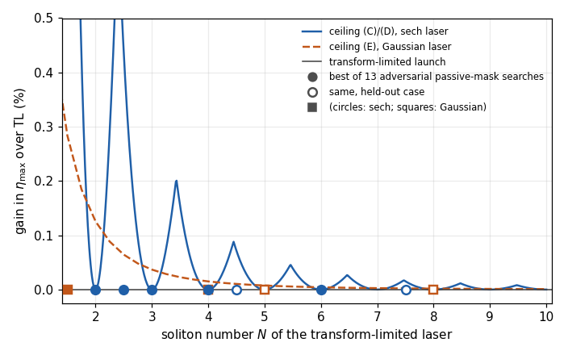

# Passive spectral masks cannot raise a Zakharov–Shabat eigenvalue above the even-moment ceiling

The remaining parts of the claim, which are verified but not formalized, are result [R-0002](../../promising/R-0002-zs-real-exponent-and-gaussian-ceilings/RESULT.md).

## 1. Problem

A laser pulse is shaped by a passive spectral mask (a pulse shaper that can only attenuate and phase-shift each frequency) and launched into an anomalous-dispersion fibre. How large can the leading soliton be? In the integrable NLSE, each discrete Zakharov–Shabat (ZS) eigenvalue $\zeta=\xi+i\eta$ of the launched field becomes a soliton of energy $4\eta$, so the question is how large a passive mask can make $\eta$. This bounds the reference limit of problem [P-20261016-claude-interactive-03](../../../problems/P-20261016-claude-interactive-03-raman-soliton-efficiency-shift-frontier.md), the efficiency frontier of Raman-soliton conversion under input spectral shaping.

## 2. Result

Normalized units: focusing NLSE $iq_z+\tfrac12q_{tt}+|q|^2q=0$ and ZS system
$$v_1'=-i\zeta v_1+q\,v_2,\qquad v_2'=-\bar q\,v_1+i\zeta v_2 .$$
An *eigenvalue* is a $\zeta$ with $\eta={\rm Im}\,\zeta>0$ that has a nonzero solution with $v_1,v_2\in L^2(\mathbb R)$. Write $J_{2n}=\int_{\mathbb R}{\rm sech}^{2n}t\,dt=\int_{-1}^{1}(1-s^2)^{n-1}ds$ and
$$C_{2n}=\frac{(2n)^{2n}}{(2n-1)^{2n-1}}\,\frac{J_{2n}}{2}.$$
The upstream laser has spectrum $S\ge0$, transform-limited (TL) pulse $q_0=\mathcal F^{-1}S$ and energy $M_0=\int|q_0|^2$. A passive mask $m$ with $|m(\omega)|\le1$ launches $q_m=\mathcal F^{-1}(mS)$. The leading fraction is $f_1=4\eta/M_0$.

**(A) Even-exponent eigenvalue inequality.** For every integer $n\ge1$, every complex potential $q$ that is continuous and bounded, satisfies $|q(t)|\to0$ as $t\to\pm\infty$ and has $|q|^{2n}\in L^1$, and every eigenvalue $\zeta$ of $q$, including eigenvalues off the imaginary axis,
$$\boxed{\ \int_{\mathbb R}|q|^{2n}\,dt\ \ge\ C_{2n}\,\eta^{2n-1}\ }$$
The constant is sharp: at $q=N\,{\rm sech}\,t$ with integer $N=n$, equality holds at $\eta=N-\tfrac12$.

**(B) Passive-mask ceiling.** If $S$ is a non-negative Schwartz function and $mS$ is a Schwartz function, then every eigenvalue of $q_m$ satisfies, for every integer $n\ge1$,
$$\eta\ \le\ \Big[\frac{\int|q_0|^{2n}dt}{C_{2n}}\Big]^{1/(2n-1)} .$$

**(C) Integer-order sech lasers: TL is optimal.** For $q_0=N\,{\rm sech}\,t$ with integer $N\ge1$, over all such masks and all eigenvalues,
$$\max\eta=N-\tfrac12,\qquad \max f_1=\frac{2N-1}{N^2},$$
and the identity mask attains both maxima. For example $f_{1,\rm opt}=7/16$ at $N=4$ and $13/49$ at $N=7$.

**(D) Non-integer sech lasers.** For real $N\ge0$ and every $n\ge1$,
$$(2n)^{2n}\eta^{2n-1}\le2(2n-1)^{2n-1}N^{2n},\quad\text{that is,}\quad \eta\le\frac{2n-1}{2n}N\Big(\frac Nn\Big)^{1/(2n-1)},$$
and for $N>\tfrac12$ the height $N-\tfrac12$ is attained by the unmasked pulse. Exact rational enclosures of the best attainable $\eta$ give these headrooms over $N-\tfrac12$:

| $N$ | Exponent $2n$ | Headroom |
|---|---|---|
| 2.5 | 6 | ≤ 0.43672% |
| 3.5 | 8 | ≤ 0.15446% |
| 4.5 | 10 | ≤ 0.07161% (held out) |
| 5.5 | 12 | ≤ 0.03888% |
| 7.5 | 16 | ≤ 0.01518% (held out) |
| 9.5 | 20 | ≤ 0.00743% |

**Gaussian lasers.** The same chain gives, for $q_0=Ne^{-t^2/2}$, the even-exponent ceiling
$$(2n)^{2n}\eta^{2n-1}J_{2n}\le2(2n-1)^{2n-1}N^{2n}\sqrt{\pi/n} .$$
Evaluated numerically (not in Lean), the best $n$ gives $f_1\le0.49147$ at $N=4$, about 0.045% above the TL value 0.4912508. The sharper 0.015% of the claim needs real exponents and is in R-0002.

## 3. Regime of validity

| Dimensionless group | Definition | Lower bound | Upper bound | What fails outside |
|---|---|---|---|---|
| $n$ | Half the moment exponent | 1 (integer) | none | Real or odd exponents are not formalized (R-0002) |
| $N$ | Soliton order of the TL pulse, $N^2=\gamma P_0T_0^2/|\beta_2|$ | (C): 1, integer; (D): 0, real; attainment: $>\tfrac12$ | none | At non-integer $N$ the ceiling exceeds the TL value by the headroom in (D) |
| $\|m\|_\infty$ | Mask transmission amplitude | 0 | 1 | Gain media are not passive |
| Regularity of $mS$ | Output spectrum | Schwartz | — | Hard-edged or pixelated masks are not covered by the proof (task T-20261018-claude-interactive-06), although claude-interactive.9's sharp multi-step masks also obey the bound numerically |
| $T_R/T_0$ | Raman time over pulse width | 0 | not bounded by this result | With Raman the propagated leading soliton exceeds the ceiling: +10.4% at $T_0=65$ fs and +4.1% at 200 fs for TL $N=2$ within $8L_D$ |

There is no small parameter: (A)–(D) are exact inequalities for the input scattering data. The physical reading needs the integrable model (assumption ledger below), in which the input scattering data are conserved.

**Assumption ledger.**
- Scalar focusing NLSE with constant $\beta_2<0$ and $\gamma$; no Raman, higher-order dispersion, loss or self-steepening. These break the link between input eigenvalues and output soliton energies, not the inequalities.
- A soliton's energy is $4\eta$ (trace identity), and "leading" means largest $\eta$. These are definitions, not theorems of the Lean library.
- Masks are passive, $|m|\le1$, and the denominator is the upstream laser energy $M_0$, not the energy after the mask.
- (B)–(D) as proved need $S\ge0$ and Schwartz regularity of $S$ and $mS$.

## 4. Derivation

The derivation note of the claim is [`claims/notes/C-20261018-pi-chatgpt-01-derivation.md`](../../../claims/notes/C-20261018-pi-chatgpt-01-derivation.md). The proof as formalized has these steps.

1. **Polarization inequality.** Let $x=(|v_1|^2-|v_2|^2)/(|v_1|^2+|v_2|^2)$. The ZS equations give $x'=2\eta(1-x^2)+4\,{\rm Re}(q v_2\bar v_1)/(|v_1|^2+|v_2|^2)$, hence $x'\ge2\eta(1-x^2)-2|q|\sqrt{1-x^2}$. The spinor norm is positive everywhere by a Grönwall argument, so no component is divided by.
2. **Endpoints.** The $L^2$ condition and $|q|\to0$ give $x\to1$ at $-\infty$ and $x\to-1$ at $+\infty$.
3. **Sharp scalar inequality.** $(2n)^{2n}s^{2n-1}(r-s)\le(2n-1)^{2n-1}r^{2n}$ for $r,s\ge0$, from Bernoulli's inequality.
4. **Weighted integration.** Multiplying step 1 by $(2n)^{2n}\eta^{2n-1}(1-x^2)^{n-1}$, applying step 3 with $s=\eta\sqrt{1-x^2}$, $r=|q|$, and integrating the exact derivative of $\int_0^{x}(1-s^2)^{n-1}ds$ over $[-T,T]$ gives (A) as $T\to\infty$. No monotonicity of $x$ is used.
5. **Fourier majorant.** For $|mS|\le S$, $\int|\mathcal F^{-1}(mS)|^{2n}\le\int|\mathcal F^{-1}S|^{2n}$: write $|\mathcal F^{-1}f|^{2n}$ through the $n$-fold convolution power of $f$, bound it pointwise by that of $S$, and use Plancherel. With (A) this is (B).
6. **Sech.** $\int{\rm sech}^{2n}=\int_{-1}^1(1-s^2)^{n-1}ds$ by $s=\tanh t$. At $n=N$ the ceiling in (B) factors to exactly $N-\tfrac12$. The spinor $v_1=e^{-t/2}{\rm sech}^Nt$, $v_2=-e^{t/2}{\rm sech}^Nt$ solves the ZS system at $\zeta=i(N-\tfrac12)$ for every real $N>\tfrac12$, which gives attainment and (C).
7. **The sech source exists.** The Schwartz spectrum $S_N=\mathcal F(N\,{\rm sech})$ is non-negative because ${\rm sech}\,t/4$ is the autocorrelation of $h(s)=e^{s-e^{2s}}$, so $S_N$ is a squared modulus.

## 5. Validation against numerics

*Ceiling on the gain in leading ZS eigenvalue over the TL launch, against $N$ (curves: sech and Gaussian ceilings), with the best of 13 adversarial passive-mask searches per case (points; open = held out). At integer $N$ the sech ceiling is zero, and every search sits at zero gain. Run `2026-10-18-claude-interactive.9-mask-adversary` (claude-interactive.9, family claude; no fibre solver).*

- **Eigenvalue solvers.** claude-interactive.9 wrote two independent ZS solvers: Fourier collocation, and Boffetta–Osborne transfer matrices with measured order 2.000. TL sech eigenvalues equal $N-\tfrac12$ to $2\times10^{-13}$ (run `2026-10-18-claude-interactive.9-zs-solver-validation`).
- **Integer sech, adversarial.** 13 searches per case at $N=2$, 3, 4, 6: phase-only, amplitude-and-phase, per-bin and sharp multi-step masks, with exact gradients. Every optimum is TL; the largest excess over $N-\tfrac12$ is $2.3\times10^{-12}$, equal to the solver error.
- **Held out.** At $N=4.5$ and 7.5 no mask beats TL, against frozen ceilings of 0.07161% and 0.01518% (run `2026-10-18-claude-interactive.9-mask-adversary`).
- **Relaxed assumption.** In the agents' GNLSE solver (commit b9fa957) with Raman and self-steepening, the leading eigenvalue of a TL $N=2$ sech exceeds the ceiling 1.5, reaching 1.6554 at $T_0=65$ fs (run `2026-10-18-claude-interactive.9-raman-escape`). This is outside the result's scope, as section 3 states.

Error scaling (expected figure 2) is n/a: the result is an exact inequality, and its tightness is shown in the figure.

## 6. Adversarial audit

- **[audit-2026-10-18-claude-interactive.9.md](audit/audit-2026-10-18-claude-interactive.9.md)** (claude; verdict pass). An independent proof of (A)–(C) was written before the derivation note was read, followed by a line-by-line check of the note, the adversarial mask searches above, and reproduction of the counterexample to C-20261016-claude-a-01 (an asymmetric spectrum where a passive mask beats TL by up to 2.78%). That counterexample shows (C) depends on the sech shape.
- **[formal-audit-2026-10-18-claude-interactive.md](audit/formal-audit-2026-10-18-claude-interactive.md)** (claude; verdict pass). The Lean statements match (A)–(D) as written here, the hypotheses are satisfiable, and the scope limits are those in section 3.

## 7. Novelty

From claude-interactive.10's novelty audit ([report](../../../docs/review-2026-10-18-claude-interactive.10-zs-eigenvalue-bound-novelty.md), family claude):
- **Partly published.** For real $q\ge0$ and purely imaginary eigenvalues, (A) with the same sharp constant and sech extremizer is Theorem 1.3 at $\lambda=0$ of Dolbeault, Gontier, Pizzichillo & Van Den Bosch, Rev. Mat. Iberoam. 40 (2024) 649–692, DOI 10.4171/RMI/1443 (full text), through the Dirac form of the ZS problem. A weaker constant for complex potentials is in Cuenin, Laptev & Tretter, Ann. Henri Poincaré (2014), DOI 10.1007/s00023-013-0259-3 (full text).
- **Not found:** the sharp constant for complex potentials and off-axis eigenvalues, which this result proves at even exponents, and the passive-mask consequences (B)–(D). Confidence medium.

G6 is open because only one family has searched; task T-20261018-claude-interactive-05 asks a GPT agent to search independently.

## 8. Experimental test

- **Setup.** A mode-locked laser with near-sech pulses, a programmable 4f pulse shaper (amplitude and phase), and an anomalous-dispersion fibre with launch soliton order $N=2$ to 4.
- **Prediction.** No mask setting yields a leading soliton carrying more than $(2N-1)/N^2$ of the unshaped laser energy, $E_1\le2(2N-1)|\beta_2|/(\gamma T_0)$. At $N=4$, any shaping that beats TL by more than measurement error falsifies the result.
- **Raman must be negligible.** Use $T_0$ of a few picoseconds and fibre lengths of a few dispersion lengths, because Raman lifts the leading soliton above the ceiling (section 5).
- **Measurement.** Either retrieve the launched field by FROG and compute its ZS spectrum directly, or measure the energy of the separated leading soliton at the output.
- **Precision needed.** At integer $N$ the headroom is exactly zero. Between integers the ceiling's headroom over $N-\tfrac12$ peaks just below each half-integer: 5.59% near $N\approx1.30$, 0.671% near $N\approx2.40$, 0.205% near $N\approx3.43$ and 0.088% near $N\approx4.45$ (the closed-form ceiling of (D), minimized over $n$; checked by claude-interactive.18 in `docs/manuscripts/2026-10-19-phase-shaper-soliton-bounds/` and again by the orchestrator). The earlier statement "at most 0.44%" held only for $N\ge2.5$ and is corrected (2026-10-19). For $2\le N\le4$ the test is therefore a sharp null result (shaping can gain at most 0.67%), not a small effect to detect.

## 9. Open questions

- Second-family novelty audit (G6): T-20261018-claude-interactive-05.
- The proof for rough masks and non-Schwartz sources: T-20261018-claude-interactive-06.
- Real exponents and the Hausdorff–Young parts (R-0002): T-20261018-claude-interactive-07.
- Provenance of the formalizer: resolved; the PI gave the model as GPT 6 Astra Max (T-20261018-claude-interactive-08, done).
- How far Raman lifts the ceiling as a function of $T_R/T_0$ and length is not addressed here; it is the main subject of P-20261016-claude-interactive-03.

## 10. Formal verification

The library is [`formal/ZSFormalization/`](../../../formal/ZSFormalization/). It was written in the PI's Codex session (recorded as `pi-codex`, family gpt, model GPT 6 Astra Max) and copied verbatim; every file's SHA-256 matches the formalizer's record. It is built by `formal/lakefile.toml` with the repository's pinned Lean and Mathlib.

| Part | Lean theorem | Hypotheses as stated in Lean |
|---|---|---|
| (A) | `ZS.eigenvalue_even_moment_bound` | `Continuous q`, $\|q\|\le Q$, $\|q\|\to0$ at both ends, $\|q\|^{2k+2}$ integrable, `IsEigenvalue q ζ`; exponent $2k+2$ |
| (A), Schwartz form | `ZS.schwartz_eigenvalue_even_moment_bound` | $q$ Schwartz |
| Majorant | `ZS.passive_mask_even_moment` | $f,g$ Schwartz, $g\ge0$ (`PositiveSpectrum`), $\|m\|\le1$, $f=mg$ |
| (B) | `ZS.passive_source_eigenvalue_bound` | as for the majorant, plus `IsEigenvalue (𝓕⁻ f) ζ` |
| (C) | `ZS.canonical_integer_sech_optimality`, `ZS.canonical_integer_sech_fraction_optimality` | none: `IsGreatest` over the attainable set of the constructed source `sechSource (k+1)` |
| (D) | `ZS.canonical_sech_polynomial_ceiling`, `ZS.rational_sech_height_enclosure`, `ZS.canonical_sech_{five,seven,eleven,nineteen}_halves_enclosure`, `ZS.real_sech_has_eigenvalue` | $N\ge0$ (ceiling), $N>\tfrac12$ (attainment), a rational certificate checked by `norm_num` |
| Gaussian | `ZS.canonical_gaussian_ceiling` | $N\ge0$; the constants are left unevaluated |

**Definitions carrying the physics.**
- `SolvesZS`: the ZS system with classical derivatives at every $t$.
- `IsEigenvalue`: ${\rm Im}\,\zeta>0$ and a nonzero solution in $L^2$.
- `attainableHeights g`: the imaginary parts of all eigenvalues of $\mathcal F^{-1}(mg)$, over Schwartz $mg$ with $|m|\le1$.
- `sourceEnergy`: $M_0$.

For continuous $q$ every $L^2$ eigenfunction is classical, so `IsEigenvalue` does not narrow the class of eigenvalues. The Fourier convention is Mathlib's $e^{-2\pi i t\xi}$; the inequalities do not depend on it.

**Checks by the formal auditor** (claude-interactive, family claude; run `2026-10-18-claude-interactive-zs-lean-audit`):
- **Build.** Rebuilt against the committed pins: 9,037 jobs, no warnings and no errors. Each file compiled alone gives no messages. There is no `sorry`, `admit`, `axiom`, `native_decide`, `extern`, `unsafe`, `opaque` or `set_option`.
- **Axioms.** All 121 theorems and lemmas depend only on `propext`, `Classical.choice` and `Quot.sound`.
- **Kernel re-checks.** `leanchecker` replays all 13 modules, and a bogus module is rejected. nanoda 0.4.19, an independent type checker written in Rust, checked the 54,113 declarations behind the headline theorems with no errors and only those three axioms allowed.
- **Held-out instances.** Certificates the formalizer did not prepare pass: $N=9/2$ at 0.07161% and $N=15/2$ at 0.01518%, frozen in run `2026-10-18-claude-interactive-zs-moment-bound-check` before the formalization existed; and $N=7$ with $f_{1,\rm opt}=13/49$.
- **Negative control.** A certificate set just below the true $N=9/2$ gap fails, as it must.

**Not formalized** (see R-0002 for the verified statements):
- (A) at real exponents, including $1<p<2$ and the limits $p\to1$ and $p\to\infty$, and the general extremizer family $q_*$.
- (B)–(D) for rough masks and non-Schwartz sources.
- The claim's Gaussian ceilings via sharp Hausdorff–Young (E), and the spectral-norm bound (F).
- That $N-\tfrac12$ is the TL pulse's largest eigenvalue; the enclosure in (D) does not need it.
- The NLSE dynamics, and the identification of $4\eta$ with soliton energy.

**Trusted, not checked.**
- The Lean 4.35.0-rc4 kernel and Mathlib at commit `1f414401`.
- The toolchain binaries: a standard `elan` install with no origin overrides. nanoda ships in the same toolchain bundle, so it is an independent implementation but not an independent download.
