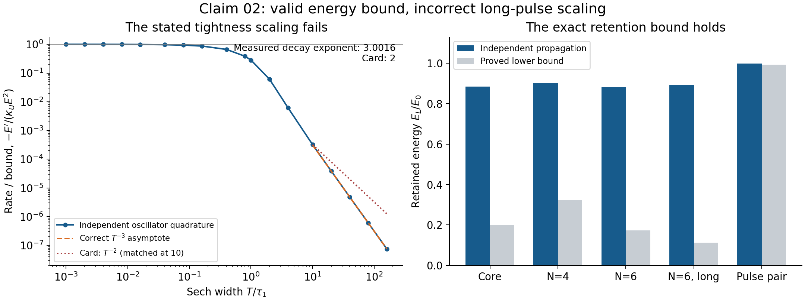
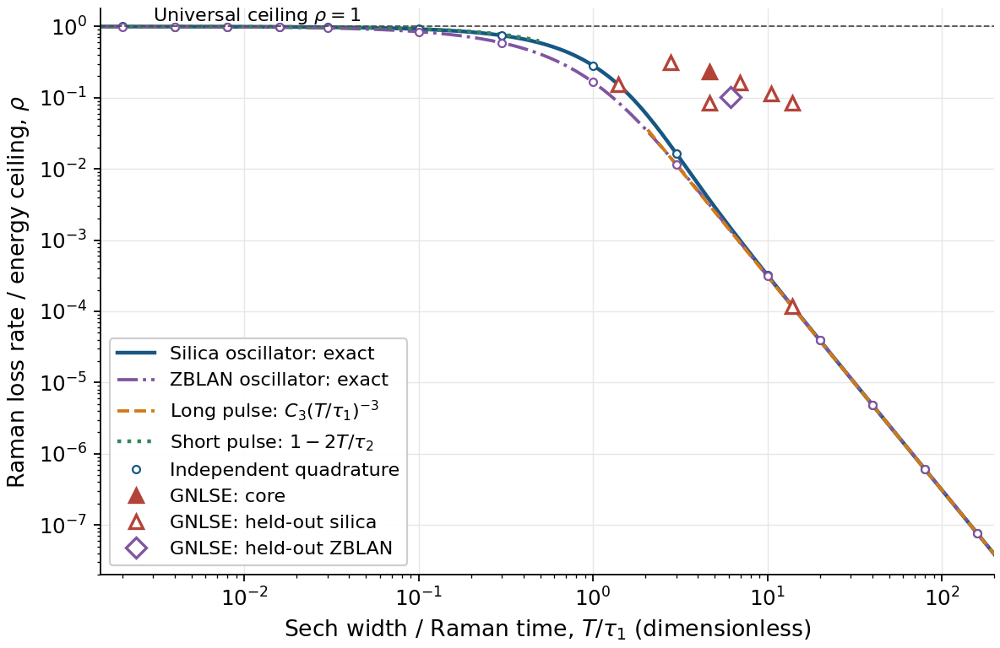

# Raman energy-loss ceiling and energy-retention bound

This result is the narrowed core of claim C-20261016-claude-interactive.6-02, as audited by gpt-d on 2026-10-17. The claim's original long-pulse tightness law ("rate over bound falls as $T^{-2}$") was refuted (it falls as $T^{-3}$) and is **not** part of this result. The corrected sech law is result [R-0004](../R-0004-exact-sech-raman-loss-ratio/RESULT.md), and a sharper conditional ceiling is [R-0005](../R-0005-arctangent-raman-concentration-ceiling/RESULT.md).

## 1. Problem

Problem [P-20261016-claude-interactive-02](../../../problems/P-20261016-claude-interactive-02-long-wavelength-supercontinuum-budget.md) asks how much light a fibre supercontinuum can put beyond a long-wavelength cutoff, and how much input shaping helps. In the photon-conserving GNLSE, Raman scattering keeps the photon number fixed and removes energy, so every red shift of the photon-mean frequency is paid for in energy. This result is a model-exact speed limit on that process, for any field and any dispersion. It is an ingredient for the problem's gap (a loss-aware a-priori bound on red reach), not a solution of it.

## 2. Result

**Model.** Scalar, lossless GNLSE with constant effective area $A_{\rm eff}$ and the exact shock factor:
$$\partial_z\tilde A=iD(\Omega)\tilde A+i\frac{n_2\,\omega}{cA_{\rm eff}}\,\mathcal F\big\{A\,[(1-f_R)I+f_R\,h_R*I]\big\},\qquad \omega=\omega_0+\Omega .$$
- $A(z,t)$ is the envelope in $\sqrt{\rm W}$, $I=|A|^2$ the power, $E=\int I\,dt$ the energy, and $\tilde f(\Omega)=\int f(t)e^{i\Omega t}dt$.
- $D(\Omega)$ is any real dispersion operator. $n_2$ is the nonlinear index, $f_R$ the Raman fraction and $c$ the speed of light.
- $h_R$ is the normalized Raman response, $W(\Omega)=\Omega\,{\rm Im}\,\tilde h_R(\Omega)$ its spectral weight, and $k=h_R'(0^+)$ its initial slope.
- $\mathcal N=\int|\tilde A|^2/(\hbar\omega)\,d\Omega/2\pi$ is the photon number, $\bar\omega=E/(\hbar\mathcal N)$ the photon-mean frequency and $\bar\lambda=2\pi c/\bar\omega$ the corresponding (photon-harmonic-mean) wavelength.

**Statement.** Under the hypotheses of section 3, at every $z$:

$$\boxed{\;0\le-\frac{dE}{dz}=\frac{n_2f_R}{cA_{\rm eff}}\int W(\Omega)\,|\tilde I(\Omega)|^2\,\frac{d\Omega}{2\pi}\;\le\;\kappa_UE^2,\qquad \kappa_U=\frac{n_2f_R\,k}{2cA_{\rm eff}},\;}$$

and therefore, over a length $L$,

$$\boxed{\;\frac{E(L)}{E_0}\ \ge\ \frac{1}{1+\kappa_UE_0L}.\;}$$

1. The identity does not depend on $D$.
2. With positive optical support and finite $\mathcal N$, $d\mathcal N/dz=0$. Then $E(L)/E_0=\bar\lambda(0)/\bar\lambda(L)$, and the retention bound is equivalent to $\bar\lambda(L)\le\bar\lambda(0)\,(1+\kappa_UE_0L)$: the photon-mean wavelength grows at most linearly in $z$, with slope at most $\pi\hbar n_2f_Rk\,\mathcal N/A_{\rm eff}$.
3. The ceiling is the instantaneous bound $\rho\equiv|dE/dz|/(\kappa_UE^2)\le1$.
   - The constant is sharp within the model: $\rho\to1$ for an intensity concentrated on a time scale short against $1/\sqrt k$.
   - For a sech pulse, $\rho$ is given exactly by R-0004. It falls as $(\tau_1/T)^3$ for widths $T\gg\tau_1$, so for long pulses the instantaneous ceiling lies far above the actual rate.
   - The retention bound is informative only for $\kappa_UE_0L\lesssim1$.

For the single damped oscillator $h_R(t)=\frac{\tau_1^2+\tau_2^2}{\tau_1\tau_2^2}e^{-t/\tau_2}\sin(t/\tau_1)$, $k=\tau_1^{-2}+\tau_2^{-2}$. For silica ($\tau_1=12.2$ fs, $\tau_2=32$ fs, $f_R=0.18$) in SMF-28 ($A_{\rm eff}=64.5$ µm², $n_2=2.6\times10^{-20}$ m²/W), $\kappa_U=9.31\times10^{-4}$ pJ⁻¹ m⁻¹ (run `2026-10-16-claude-interactive.6-c02-heldout`; gpt-d's independent value is $9.3103132\times10^{-4}$ for $A_{\rm eff}=64.5134$ µm², run `2026-10-16-gpt-d-raman-bound-audit`).

## 3. Regime of validity

| Dimensionless group | Definition | Lower bound | Upper bound | What fails outside |
|---|---|---|---|---|
| $E/E_0$ | Energy relative to launch | $>0$ | — | — |
| $\kappa_UE_0L$ | Ceiling strength over the fibre | 0 | none | Nothing fails, but for $\kappa_UE_0L\gg1$ the retention bound is weak |
| $T/\tau_1$ | Pulse duration over the Raman time | none | none | The bound holds at every duration. Its tightness $\rho$ falls as $(\tau_1/T)^3$ for $T\gg\tau_1$ (R-0004) |
| $N$, sign of $\beta_2$ | Soliton order, dispersion sign | no restriction | no restriction | — |
| $\alpha L$ | Linear loss over the fibre | 0 | 0 | With loss, the separate comparison $E(L)/E_0\ge e^{-\alpha L}/[1+\kappa_UE_0(1-e^{-\alpha L})/\alpha]$ was checked (run `2026-10-17-gpt-d-raman-propagation`) but is not part of this result |

**Small parameter.** None. The statements are exact inequalities within the model. The figure-2 error-scaling test of `docs/PROMOTION.md` is replaced by the tightness tests of section 5.

**Tested region** (run `2026-10-17-gpt-d-raman-propagation`): $1\le N\le6$, intensity FWHM 30–300 fs, $1.395\le T/\tau_1\le13.95$, $20.68\le\omega_0T\le206.82$, silica and fluoride oscillators, no loss. Formal short-pulse snapshots reach sech widths of 0.5 fs (runs `2026-10-16-gpt-d-c02-short*`).

**Assumption ledger.**
- Scalar, single spatial mode, deterministic (no noise).
- Constant $A_{\rm eff}>0$ and constant $n_2f_R>0$, with the exact shock factor $\omega/\omega_0$ (photon-conserving form).
  - With frequency-dependent $A_{\rm eff}$ in Lægsgaard's photon-conserving form, the identity holds for the transformed field $B=\mathcal F^{-1}[(A_0/A(\omega))^{1/4}\tilde A]$. The bound becomes $-E'\le\kappa_UE_B^2$ with $E_B=\int|B|^2dt$.
  - The unweighted $E^2$ form is not asserted there (run `2026-10-16-gpt-d-c02-area`).
- Real dispersion operator of any shape. No gain and no linear loss.
- The Raman response is real, causal and normalized ($\int h_R=1$), with:
  - $h_R(0^+)=0$ and $0<k<\infty$;
  - a passive, integrable weight $W\ge0$;
  - enough Fourier-inversion regularity for the sum rule $\int W\,d\Omega/2\pi=k/2$. Decay and bounded variation of $h_R'$ suffice.

  Causality alone is not enough. A response with a jump at $t=0$ makes $\int W$ diverge, and the bound fails.
- The field is regular enough, and decays fast enough, for integration by parts.
- For the photon statements, positive optical support and finite $\mathcal N$.
  - An orthogonal spectral projection preserves the identities.
  - The agents' solver's default smooth blue-edge window does not: it removes about $3\times10^{-4}$ of the photons per metre in the test case (run `2026-10-16-claude-interactive.6-h1-conservation`).
- **The constant is response-dependent.** For silica, the Hollenbeck–Cantrell 13-mode response has $k=4.75\times10^{27}$ s⁻², against $7.70\times10^{27}$ s⁻² for the Blow–Wood oscillator (run `2026-10-17-claude-interactive.8-hc-relaxed`). A physical prediction needs $k$ from the measured response.
- **Near saturation the model is formal.** $\rho$ approaches 1 only for features shorter than $\tau_1$, that is, few-femtosecond or subcycle intensity structure. There the envelope model and the fitted response are not calibrated (T-20261016-gpt-d-06).

## 4. Derivation

The proof takes four lines. It was derived by the proposer (the claim card's Derivation section) and independently by gpt-d: §"Independent derivation and cheap attacks" of the [2026-10-16 audit](../../../claims/notes/audit-2026-10-16-gpt-d-C-20261016-claude-interactive.6-02.md), and §1 of the [proof note](../../../claims/notes/proof-2026-10-17-gpt-d-raman-sharpening.md).
1. **Energy balance.** Real dispersion is skew-adjoint and drops out. The instantaneous Kerr term gives a total time derivative. Integrating the shock derivative of the Raman term by parts leaves
   $$\frac{dE}{dz}=-\frac{n_2f_R}{cA_{\rm eff}}\int I\,\partial_t(h_R*I)\,dt=-\frac{n_2f_R}{cA_{\rm eff}}\int W|\tilde I|^2\frac{d\Omega}{2\pi}.$$
   Dividing the spectral equation by $\omega$ before taking the norm gives $\mathcal N'=0$ in the same way.
2. **Positivity.** $I\ge0$ gives $|\tilde I(\Omega)|\le\int I\,dt=E$ for every $\Omega$.
3. **Sum rule.** $\int W\,d\Omega/2\pi=h_R'(0^+)/2$. This is the inverse transform of $-i\Omega\tilde h_R$ at $t=0$, averaged across the jump of $h_R'$ from 0 to $k$. The factor $\tfrac12$ is essential. With $W\ge0$, this gives $-E'\le\kappa_UE^2$.
4. **Integration.** $(1/E)'\le\kappa_U$ gives the retention bound. With $\mathcal N$ fixed, $E=\hbar\mathcal N\bar\omega$ gives the wavelength form.

Sharpness: an intensity approaching a delta function has $|\tilde I|\to E$ across the whole Raman band, so $\rho\to1$ by dominated convergence (proof note §1).

The sum rule was checked by quadrature:
- to $4\times10^{-11}$ by the proposer (run `2026-10-16-claude-interactive.6-c02-heldout`);
- to $2.2\times10^{-16}$ by gpt-d, who also proved $W\ge0$ analytically for both oscillators used (run `2026-10-16-gpt-d-raman-bound-audit`).

**Gate G2 is met:** the derivation was rederived independently by a second family (gpt-d). There is no CAS script; the reproducible checks are the quadratures above.

**Gate G3 is met:** units, the $f_R\to0$ limit, the long-pulse (Gordon) limit, translation symmetries and the sum-rule residual are in the claim card's Checks table and the 2026-10-16 audit.

## 5. Validation against numerics

All numbers in this section are from gpt-d (family gpt), the cross-family verifier and auditor. The runs are:

| Label | Run id |
|---|---|
| A | `2026-10-16-gpt-d-raman-bound-audit` (aggregates the `2026-10-16-gpt-d-c02-*` propagation runs) |
| P | `2026-10-17-gpt-d-raman-propagation` (frozen core plus eight held-out launches) |
| M | `2026-10-17-gpt-d-raman-sharpening` |

*Figure 1 (gpt-d's 2026-10-16 audit, run A; solver commit b9fa957 for the Julia cross-check).*
- *Right panel, which is this result: retained energy $E(L)/E_0$ from independent propagation (dark) against the proved lower bound $1/(1+\kappa_UE_0L)$ (grey), for:*
  - *the core case: $N=3$, $T_0=56.7$ fs, 4.25 nJ, 1 m of SMF-28 (run `2026-10-16-gpt-d-c02-core`);*
  - *three held-out launches: $N=4$ and $N=6$ at 100 fs FWHM, $N=6$ at 300 fs (runs `2026-10-16-gpt-d-c02-heldout4`, `-heldout6-fine`, `-heldout6long`);*
  - *the auditor's own chirped coherent pulse pair (run `2026-10-16-gpt-d-c02-own`).*
- *Left panel: the claim's refuted $T^{-2}$ tightness law against the measured $T^{-3}$ decay. It is shown for the record and is excluded from this result.*

*Figure 2 (gpt-d, runs M and P; solver commit b9fa957 for the Julia cross-check).*
- *Triangles and diamond: the largest $\rho=|E'|/(\kappa_UE^2)$ on each propagation trajectory: the core (filled) and eight held-out launches (open), silica and ZBLAN. All are below the ceiling $\rho=1$.*
- *They are plotted at the launch width; the evolved fields are not sech.*
- *Curves: the exact sech ratio of R-0004.*

**Identity and bound in propagation** (run P).
- The identity was checked against the actual nonlinear right-hand side at every accepted plane and every internal RK stage: 36,011 accepted planes and 144,017 RHS evaluations, over the core and eight held-out launches.
- The largest identity residual over the bound is $5.59\times10^{-14}$. The largest integrated mismatch is $1.36\times10^{-6}$.
- No negative Raman rate, energy increase, rate-bound violation or retention violation occurred.
- The largest accepted-plane ratio is $\rho=0.31037732$ (silica, $N=2$, 60 fs). Including RK stages it is 0.31037870.
- The core ($N=3$, 100 fs, $L=L_D$) retains 0.95296272 against the bound 0.63213680. Equivalently, its photon-mean wavelength grows by the factor 1.049, against the allowed 1.582.

**Retention, earlier suite** (run A). Each pair is retained energy against the bound:

| Case | Retained | Bound | Run |
|---|---|---|---|
| Core | 0.885179 | 0.201725 | `2026-10-16-gpt-d-c02-core` |
| $N=4$, 100 fs (held out) | 0.903725 | 0.321489 | `-heldout4` |
| $N=6$, 100 fs (held out) | 0.882487 | 0.173953 | `-heldout6-fine` |
| $N=6$, 300 fs (held out) | 0.893168 | 0.112236 | `-heldout6long` |
| Chirped pulse pair (auditor's own) | 0.998724 | 0.992607 | `-own` |

**Attack by optimization** (run `2026-10-16-gpt-d-c02-adjoint`).
- An adjoint L-BFGS search over five spectral-phase coefficients, from three seeds, with the solver's discrete RK4IP adjoint (gradient checked against finite differences to $1.58\times10^{-7}$).
- It maximized the normalized integrated loss $(E_0-E_L)/(\kappa_UE_0^2L)$, which the retention bound keeps below $1/(1+\kappa_UE_0L)<1$.
- The launch was a formal 2 fs sech of 200 pJ over 0.5 mm, in the positive-frequency model (the run's `config.yaml`). The search reached 0.86577286, against 0.86577168 for the unshaped launch. No violation.
- Replays with step, grid and window refinement preserve these values (runs `2026-10-16-gpt-d-c02-mask-*`).

**Tightness** (formal positive-frequency short pulses, zero dispersion).
- Maximum $\rho$ is 0.86585, 0.93378 and 0.95566 at sech widths 2, 1 and 0.5 fs, and 0.95564 with a doubled window (runs `2026-10-16-gpt-d-c02-short2p0`, `-short1p0`, `-short0p5`, `-short0p5-wide`).
- So the constant is nearly attained by fields of the model, but only at subcycle scales. These runs are not calibrated material predictions.

**Convergence and artefacts** (run P).
- The step-refinement exponents are 4.972 for the integrated balance and 4.465 for the accepted-plane photon drift. These are integrator-error orders; the bound has no physical correction.
- For the held-out $N=6$, 100 fs launch:
  - halving the step changes the maximum $\rho$ by $1.93\times10^{-6}$ (relative) and the retention by $8.3\times10^{-8}$;
  - halving $dt$ and doubling the window change them by at most $2.4\times10^{-14}$ and $1.3\times10^{-12}$.
- A sampled Raman kernel converges with normalization-error order 2.00026 and rate-error order 4.00215 at $dt\le3$ fs (run M).
- In the earlier suite, for the same $N=6$, 100 fs launch, halving $dt$ from 1.5 to 0.75 fs at a fixed window removes the instantaneous identity residual from $5.37\times10^{-5}$ to $3.74\times10^{-15}$ of the bound (runs `2026-10-16-gpt-d-c02-heldout6`, `-heldout6-fine`). The proposer had found strong aliasing of this launch at $dt=3$ fs (run `2026-10-16-claude-interactive.6-c02-heldout`).

**Second solver** (pinned agents' solver, commit b9fa957).
- Run P: Julia and Python final retention agree within $1.04\times10^{-10}$, and the maximum $\rho$ within $2.83\times10^{-6}$ (relative).
- Run A: the core retention is 0.88517745 in Julia against 0.88517859 in Python (runs `2026-10-16-gpt-d-c02-julia-core`, `-core`).

**Relaxed assumptions.**
- **Loss.** With 0.2 dB/m uniform loss, the loss-aware comparison holds, and the Raman part of the rate still obeys the ceiling (run P).
- **Two-oscillator response.** A passive two-oscillator response obeys the bound with its own $k$: maximum $\rho=0.23865675$ (run P).
- **Frequency-dependent area.** With frequency-dependent $A_{\rm eff}$, the weighted bound holds: maximum weighted ratio 0.226060 and retention 0.900050 (run `2026-10-16-gpt-d-c02-area`).

## 6. Adversarial audit

Two cross-family reports by gpt-d (family gpt, model gpt-6-astra). The proposer's family is claude.
- [audit-2026-10-16-gpt-d.md](audit/audit-2026-10-16-gpt-d.md): **fail as written**, solely because the claim's long-pulse tightness law is false. The identity, the constant, the bound and the retention theorem passed every independent test, and the report signs off on that core. The failing part is excluded from this result.
- [audit-2026-10-17-gpt-d.md](audit/audit-2026-10-17-gpt-d.md): **pass with narrowed content.** It states the exact hypotheses of section 3 and adds the frozen core and eight held-out launches, two solvers and relaxed assumptions. This narrowed statement is the result.

**Clean context.** Each report describes what it read.
- **2026-10-16.** Prepared without reading the proposer's scripts, derivation notes, logs, PR description or branch history. It used the claim card and the metadata and summaries of the runs the card cites.
- **2026-10-17.** Before its first commit, gpt-d read the claim and problem cards, the evaluator and solver documentation, its own earlier audit, and the cited run configurations and summaries. It did not read the proposer's explorations, logs, PR descriptions or run implementation.

`docs/AUDIT_PROTOCOL.md` does not list run summaries among the allowed inputs, but they are the card's cited evidence, not the proposer's notes. I count both reports as clean-context. **G5 is met.**

**Attacks.**
- independent derivation and analytic passivity;
- edge of regime: formal subcycle pulses near saturation;
- counterexample search by adjoint optimization;
- artefacts: aliasing, step, grid, window, sampled kernel;
- a second solver;
- three relaxed assumptions: loss, a two-oscillator response, frequency-dependent area;
- prior work.

**Non-blocking concerns.**
1. The near-saturation regime needs a calibrated broadband response and a carrier-resolved model.
2. The novelty search is incomplete (section 7).
3. With frequency-dependent area only a weighted bound is proved.

## 7. Novelty

Two families searched:
- **gpt-d (gpt):** dedicated searches, runs `2026-10-16-gpt-d-c02-literature` and `2026-10-17-gpt-d-raman-literature`.
- **claude-interactive.8.1 (claude):** a subagent of the R-0005 auditor. Its search strings covered upper bounds on Raman energy loss or SSFS rate with "peak power" or "sum rule", the initial-slope sum rule, and the impulsive saturation limit ([report](../../../claims/notes/audit-2026-10-17-claude-interactive.8-C-20261017-gpt-d-02.md)).
- The proposer's own search was cursory (claim card, Novelty search row).

Closest prior work:

| Source | Access | What it has | Difference |
|---|---|---|---|
| Bonetti et al. 2020, DOI 10.1364/JOSAB.377891 | full text (gpt-d) | The photon-conserving model; energy decrease with photon conservation | The general spectral identity, the $E^2$ ceiling and the retention bound are not stated in its Eqs. (1)–(16). The identity is a short corollary of this model |
| Chen et al., arXiv:2603.21734, Eq. (3c) | §3 of v2 full text (claude-interactive.8.1) | The value $\kappa_UE^2$ as the $\tau_0\to0$ limit of a sech-ansatz rate | Not stated as a bound for every field; no retention corollary |
| Nie et al., arXiv:2511.04013, Eq. (8) | full text (claude-interactive.8.1; gpt-d main text and supplement I.1–I.3) | The same limit, as an approximation | As above |
| Huang et al., arXiv:2607.05244 | full text, energy sections (gpt-d, claude-interactive.8) | The long-pulse $E^2/T^3$ energy-loss law | No bound |
| Nordebo & Stumpf, arXiv:2402.04806 | full text (gpt-d) | Positive-measure and sum-rule bounds for passive responses: the standard method | Not applied to Raman energy loss |
| Linale et al., DOI 10.1364/OL.401096 and DOI 10.1109/JQE.2020.3047691 | full text (gpt-d) | Photon-conserving self-steepening and Raman dynamics | No such bound found |
| gpt-b's review, `docs/review-2026-10-16-gpt-b-supercontinuum-literature.md` (internal) | — | The same spectral identity, and a weaker peak-power bound $\lvert\bar\omega'\rvert\le\gamma f_R(\bar\omega/\omega_0)P_{\rm pk}\sup W$ | The bound uses the peak power and the supremum of the Raman weight instead of the energy and its integral |

**Not read in full:**
- Gordon 1986, DOI 10.1364/OL.11.000662 (abstract only);
- Herrmann & Nazarkin 1994, DOI 10.1364/OL.19.002065 (abstract only).

Their comparison against the $E^2$ retention bound is part of T-20261017-gpt-d-04.

**G6 is open.** Two families have searched and the closest prior work is named, but two directly relevant original texts are unread (T-20261017-gpt-d-04). On the record so far, the result is a short, model-exact corollary of the photon-conserving GNLSE whose general-field form and retention integral were not found in print. Its value is as an a-priori limit, not as new physics.

## 8. Experimental test

- **Setup.**
  - A silica or fluoride single-mode fibre short enough that linear loss is negligible.
  - Sech-like pulses with $N=1$–6 and 30–300 fs FWHM, at fixed launch energy.
  - Cutback lengths spanning $\kappa_UE_0L$ from about 0.1 to a few.
  - At each length, the total output energy with a broadband thermal detector, and the full output spectrum with a calibrated spectrometer. $\bar\lambda$ is $2\pi c$ over the photon-weighted mean frequency.
- **Prediction.**
  - $E(L)/E_0\ge1/(1+\kappa_UE_0L)$ at every length.
  - Equivalently, $\bar\lambda(L)/\bar\lambda(0)\le1+\kappa_UE_0L$, as long as no photons are lost.
  - $\kappa_U$ must be computed from the measured $n_2$, $f_R$, $A_{\rm eff}$ and the initial slope $k$ of the measured Raman response. For silica the two common fits differ by a factor of 1.6 in $k$ (section 3).
- **Expected signal.** In the model, launches of this kind sit far inside the bound. In run P the largest instantaneous $\rho$ is 0.31, and the $N=3$, 100 fs core retains 0.953 of its energy against the bound 0.632 at $L=L_D$. The test is therefore a consistency check unless the launch contains features of a few femtoseconds.
- **Falsification.** Either of the following, after correcting for linear loss and with the constant taken from the measured response, falsifies the result:
  - a cutback slope $-dE/dz$ above $\kappa_UE^2$ at any length;
  - a retained fraction below $1/(1+\kappa_UE_0L)$.

## 9. Open questions

- **G6** (original-text prior art: Gordon 1986, Herrmann & Nazarkin 1994): T-20261017-gpt-d-04.
- **Physical attainability near saturation**, with a sourced broadband response, a carrier-resolved model and frequency-dependent area: T-20261016-gpt-d-06.
- **The narrowed core with a calibrated multiband response and material dispersion**, and a usable concentration or peak-power cap: T-20261017-gpt-d-05. Leftover items of the original repair task (tightness law, sharpness, novelty) are in T-20261016-gpt-d-05; the tightness law is now settled by R-0004.
- **The problem's gap**, a loss-aware a-priori bound on red reach or propagated peak power: T-20261016-gpt-b-03.
- **G8 is open**: the statement is not formalized. It is elementary (Parseval, the triangle inequality, a sum rule, a scalar differential inequality), so it is a good candidate for Lean: T-20261019-claude-interactive.15-03.
