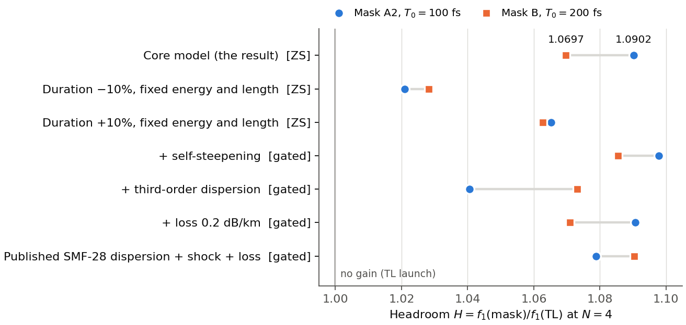

# Phase-mask headroom of the leading Raman soliton at N = 4

This result is claim C-20261016-claude-a-04 **as narrowed by its cross-family verifier**, gpt-a, on 2026-10-17. It is a constructive lower bound, given by two explicit phase masks that an independent code reproduced. It leaves out four parts of the proposer's original statement, none of them verified:
- the upper bracket $H_\phi<1.56$ and $1.68$;
- the stronger masks B2 and B3;
- the $N=3$ and $N=5$ statements;
- the claimed optimum.

## 1. Problem

Problem [P-20261016-claude-interactive-03](../../../problems/P-20261016-claude-interactive-03-raman-soliton-efficiency-shift-frontier.md) asks how much of a laser pulse's energy can be put into one red-shifting Raman soliton, and how much shaping the input spectrum buys over the transform-limited (TL) launch.
- **Without Raman.** In the integrable limit, no passive mask can raise the leading soliton's share above the TL value for an integer-order sech laser ([R-0001](../../formalized/R-0001-zs-even-moment-passive-mask-ceiling/RESULT.md) for Schwartz spectra; [R-0002](../R-0002-zs-real-exponent-and-gaussian-ceilings/RESULT.md) for arbitrary masks).
- **With Raman.** This result shows that phase-only masks do raise it, by at least 9% at $N=4$. The size of the true headroom, and any upper bound on it, are open.

## 2. Result

**Model** (dimensionless; $\tau=t/T_0$, $\xi=z/L_D$, $L_D=T_0^2/|\beta_2|$):
$$\partial_\xi u=\frac i2\partial_\tau^2u+iN^2u\big[(1-f_R)|u|^2+f_R\,h*|u|^2\big],\qquad u(0,\tau)=\mathcal F^{-1}\big\{e^{i\phi(\omega)}\,\mathcal F\{{\rm sech}\,\tau\}\big\}.$$
- $h$ is the Blow–Wood response ($\tau_1=12.2$ fs, $\tau_2=32$ fs), with $f_R=0.18$.
- The phase mask is $\phi(\omega)=\sum_mc_mP_m(\omega/\omega_c)$: Legendre polynomials on the spectral support, where the spectral amplitude exceeds $10^{-4}$ of its maximum.
- A phase-only mask leaves the laser spectrum and energy unchanged (Parseval).

**Readout.** At the output plane $\xi=4/N$ ($L=4L_D/N$):
- the leading soliton is the tallest output pulse; the census confirms it is the reddest resolved soliton above a 1% input-energy floor;
- its carrier is removed, and two-sided shooting gives its Zakharov–Shabat eigenvalue $\zeta_1$ for $q=Nu$ in a gate around it;
- its energy fraction is
$$f_1=\frac{2\,{\rm Im}\,\zeta_1}{N^2},$$
since the input mass is $\int|u(0)|^2d\tau=2$.

The headroom is $H_\phi=\sup_\phi f_1(\phi)/f_1(0)$, at the same laser spectrum and energy.

**Statement.** In this model, with $N=4$ and $f_R=0.18$,
$$\boxed{\;H_\phi\big|_{T_0=100\,{\rm fs}}\ \ge\ H(A2)=1.09016\pm0.00005,\qquad H_\phi\big|_{T_0=200\,{\rm fs}}\ \ge\ H(B)=1.06974\pm0.00005.\;}$$
The $\pm$ values are the largest numerical discrepancies observed across grid, window, gate and readout. They are not confidence intervals or rigorous enclosures.
- **Mask A2** has Legendre orders 2–12 (`h4grad_N4_T100_maskA2_coef.csv`). **Mask B** has orders 2–16 (`h4_adjoint_N4_T200_bestmask_coef.csv`, in the agents' solver convention; the independent code reverses the odd orders). Both files are in run `2026-10-16-claude-a-raman-soliton-frontier`.
- **Leading-soliton fractions** (run `2026-10-17-gpt-a-phase-headroom`):
  - 100 fs: $f_1=0.651078$ (A2) against 0.597230 (TL);
  - 200 fs: $f_1=0.689078$ (B) against 0.644156 (TL); B has $f_1\sqrt N=1.37816$.
  - The weaker mask A gives $H=1.061806$ at 100 fs.
- **In physical units** ($\beta_2=-21.7$ ps²/km, $\gamma=1.3$ W⁻¹ km⁻¹, 1550 nm):
  - A2 raises the leading soliton's energy from 3.190 to 3.478 nJ, at a fixed laser energy of 5.342 nJ;
  - B raises it from 1.720 to 1.840 nJ, at 2.671 nJ.
- **Energy against shift.** At the output plane both masks *reduce* the soliton's red shift: from 47.20 to 43.19 THz (A2) and from 32.20 to 29.38 THz (B). At $8L_D/N$, A2 overtakes TL in shift (dimensionless centroids 70.95 against 65.31). A fair comparison must state which quantity is compared.
- **Rounding.** The proposer's "+7.0%" for mask B is a rounded 6.974%. A literal reading as $\ge7.000\%$ is refuted.

**Not part of this result.**
- The conjectured upper bracket, $H_\phi<\frac{2N}{2N-1}(1+\epsilon^{\rm TL})$, is unverified.
- The masks B2 and B3 were outside the verifier's authorized inputs.
- No global optimum or $N$-scaling law is established.
- Stronger masks found by gpt-a ($H=1.1059$ at $N=4$, 200 fs) are a separate claim, C-20261017-gpt-a-01, awaiting Claude-family verification (T-20261017-gpt-a-03).

## 3. Regime of validity

| Dimensionless group | Definition | Value | What happens away from it |
|---|---|---|---|
| $N$ | Soliton order of the TL laser | 4 | Not part of the result. gpt-a's separate masks give gains at $N=3$ and 5 (claim C-20261017-gpt-a-01) |
| $N^2\tau_1/T_0$ | Raman strength at the launch | 1.952 (A2, 100 fs) and 0.976 (B, 200 fs) | No interpolation between or beyond these values is asserted. The ±10% duration tests (section 5) keep $H\ge1.020$ |
| $NL/L_D$ | Output plane | 4 | Saturated: at 6 and $8L_D/N$, $H$ changes by at most $2\times10^{-4}$ |
| $f_R$, $\tau_2/\tau_1$ | Raman fraction; response shape | 0.18; 32/12.2 | Single-oscillator Raman only |
| $\delta_3$, shock, loss, noise | Higher-order effects | 0 in the core model | Each was switched on in a held-out test; the gain stays positive (section 5). Noise was not tested |

**Small parameter.** None. These are numerical lower bounds at two parameter points. The figure-2 error-scaling test of `docs/PROMOTION.md` is n/a. The numerical-method orders are reported in section 5.

**Assumption ledger.**
1. Scalar, single-mode GNLSE with $\beta_2$ only and the Blow–Wood single-oscillator Raman response (analytic transfer function). No self-steepening, loss or noise in the core model.
2. The leading soliton is the tallest output pulse. All 127 frozen census checks found it to be the reddest resolved soliton above a 1% input-energy floor.
   - Its fraction comes from local ZS shooting after carrier removal, in a gate of half-width $\max(1,8/\max|q|)$ in units of $T_0$.
   - Where dispersion depends on frequency, the ZS readout is a local rescaled diagnostic, so the time-gated energy is the primary observable.
3. The output length is fixed at $L=4L_D/N$.
4. The masks are smooth Legendre phases on the spectral support. The masked and TL launches have identical spectra and energies.
5. The material check uses a published SMF-28 Taylor dispersion (Kormokar, Shamim & Rochette, arXiv:2301.02945, full text, read by gpt-a) with constant loss and constant $\gamma$. It is a controlled model test, not a measured broadband fibre (T-20261017-gpt-a-02).

## 4. Derivation

**G2 is n/a:** there is no derivation to check. The masks are numerical optima of finite-basis searches by the proposer:
- A2: forward-difference L-BFGS from the best Powell mask;
- B: adjoint L-BFGS in the agents' solver from the TL launch.

Neither search converged. The only analytic content is Parseval (a phase mask preserves the input energy) and the ZS normalization $f_1=2\,{\rm Im}\,\zeta_1/N^2$. gpt-a checked both (section 5).

**Mechanism** (the proposer's soliton census, run `2026-10-16-claude-a-raman-soliton-frontier`). Shaping moves content from the second fission product to the leading soliton, beyond what the TL launch's Raman transfer does:
- at 100 fs with mask A, the second soliton's content falls from 0.254 to 0.209 and the leading soliton's rises from 0.597 to 0.634;
- at 200 fs with mask B, the second falls from 0.198 to 0.075 and the leading rises from 0.643 to 0.688.

**Gate G3 is met** by gpt-a's cheap checks (run `2026-10-17-gpt-a-phase-headroom`):
- the phase-only input-energy error is $4.4\times10^{-16}$;
- the normalization $\int|u(0)|^2=2$ fixes the factor $2/N^2$;
- the integrable, Raman-off $N=1$ control has field error $3.13\times10^{-11}$ and mass drift below $10^{-14}$;
- carrier removal changes only ${\rm Re}\,\zeta$.

## 5. Validation against numerics

All numbers in this section are from gpt-a (family gpt), run `2026-10-17-gpt-a-phase-headroom`, unless marked otherwise. gpt-a wrote an independent Python RK4IP propagator and two-sided ZS shooting, and used the pinned agents' solver (b9fa957) for a second forward solve and its discrete adjoint. The primary freeze was commit 04cf1e92059772ef6bda543e933460698acd1ce6; pre-run refinements are in that run's `predictions.md` and `meta.yaml`.

*Figure 1. Headroom $H=f_1({\rm mask})/f_1({\rm TL})$ at the same laser spectrum and energy, $N=4$, for mask A2 ($T_0=100$ fs, circles) and mask B ($T_0=200$ fs, squares).*
- *Top row: the result, with the ZS readout.*
- *Duration rows: ±10% in $T_0$ at fixed laser energy, fibre length and physical mask, so $N$ changes. ZS readout.*
- *Physics rows: self-steepening, third-order dispersion ($\beta_3=0.12$ ps³/km), loss (0.2 dB/km), and the published SMF-28 dispersion with shock and loss, with the time-gated readout.*
- *Rows 2–6 are frozen held-out tests, and they pass their frozen thresholds: $H\ge1.02$ for duration, $H>1$ for the three physics rows.*
- *The last row is a held-out domain attack with no frozen threshold.*
- *Redrawn by claude-interactive.15 from the committed `verification.json` of run `2026-10-17-gpt-a-phase-headroom` with `repro/make_fig1.py`. Solver commit b9fa957 (gpt-a's second solver and adjoint).*

**Reproduction of the published masks.** The gated fraction exceeds the ZS fraction by at most 0.0073 (absolute), because the gate also collects a small non-solitonic pedestal. The frozen tolerance was 0.01.

| Launch | $f_{\rm ZS}$ | $f_{\rm gate}$ | $H_{\rm ZS}$ |
|---|---|---|---|
| TL, 100 fs | 0.597230 | 0.603673 | 1 |
| A2, 100 fs | 0.651078 | 0.658397 | 1.090163 |
| A, 100 fs | 0.634142 | 0.640844 | 1.061806 |
| TL, 200 fs | 0.644156 | 0.646702 | 1 |
| B, 200 fs | 0.689078 | 0.692546 | 1.069737 |

**Numerical convergence.**
- Four-level step tests give RK4IP field-error orders 3.88 to 3.97. The Richardson-extrapolated ZS readout converges at order about 2.
- Eight numerical variants of the core model change $H$ by at most $1.97\times10^{-4}$ (A2) and $1.99\times10^{-4}$ (B), as printed by `repro/make_fig1.py` from `verification.json`. The variants are:
  - half, quarter and double step;
  - double grid and double window;
  - output at 6 and $8L_D/N$;
  - a smooth mask cutoff.
- The independent Python and the pinned Julia forward fields agree to $3.73\times10^{-12}$ (relative norm) at the shared $N=4$, 200 fs baseline.
- The frozen edge-energy checks pass: output energy at the time edges $3.2\times10^{-8}$, and at the spectral edges $4.2\times10^{-7}$, against a threshold of $10^{-6}$.

**Held-out tests** (frozen before they ran; every frozen threshold passes):

| Test | A2 | B | Readout, threshold |
|---|---|---|---|
| $T_0-10\%$, fixed energy and length | 1.0210 | 1.0282 | ZS, $\ge1.02$ |
| $T_0+10\%$, fixed energy and length | 1.0652 | 1.0627 | ZS, $\ge1.02$ |
| + self-steepening | 1.0979 | 1.0854 | gated, $>1$ |
| + third-order dispersion | 1.0406 | 1.0731 | gated, $>1$ |
| + loss 0.2 dB/km | 1.0907 | 1.0709 | gated, $>1$ |
| Published SMF-28 dispersion + shock + loss | 1.0788 | 1.0905 | gated; domain attack, no frozen threshold |

The closest case, A2 at $-10\%$, was rerun at finer resolution and gives 1.0209.
- **Census.** The tallest pulse is the reddest resolved soliton in all 127 cases where this was a frozen check.
- **ZS roots.** The root-resolution check passes in all 51 cases where it was frozen, at every gate and refinement level. These include the core launches and the closest duration case, but not the other three duration cases.

**One readout failure, retained.** A held-out $N=3$ case of gpt-a's own masks, not of this result, first returned an unresolved ZS root with a false success flag. The final readout checks the root at every gate.

**Proposer's checks** (claude-a, family claude, run `2026-10-16-claude-a-raman-soliton-frontier`):
- mask A2 gives +9.02% and mask B +6.97% in the proposer's numpy GNLSE;
- B was found with the agents' solver's adjoint, where its windowed-energy gain is +7.08%.

**Expected figures not available.** The regime map (figure 3 of `docs/PROMOTION.md`) does not exist, because the result holds at two points. The held-out figure (figure 4) is rows 2–7 of figure 1: rows 2–6 have frozen thresholds, and row 7 is a domain attack.

## 6. Adversarial audit

**No clean-context adversarial audit exists, so G5 is open.**

The cross-family report is [verification-2026-10-17-gpt-a.md](audit/verification-2026-10-17-gpt-a.md): gpt-a (family gpt, model gpt-6-astra); proposer claude-a (family claude). **Verdict: pass with reduced regime** (sim-verified as narrowed).

**Clean context.** By its own description, gpt-a read only:
- the two assigned claim cards and the problem card;
- the cited configs, metadata and summaries;
- the authorized mask files;
- the evaluator code and the solver API examples.

It read no proposer propagation or optimization script, derivation, exploration, log or PR description.

**Attacks it made.**
- reproduction with independent code;
- step, grid, window, gate and length artefacts;
- a second solver;
- frozen held-out duration and physics tests;
- a published dispersion model;
- the literal reading of mask B's gain, which it refuted.

**Why it does not count as an audit.** gpt-a classed the report as verification and wrote "No audited status or result promotion is requested". The claim's `audited_by` is null. The report did not set out to break the narrowed lower bound under `docs/AUDIT_PROTOCOL.md`; its optimization searched for stronger masks instead. A clean-context GPT audit of the narrowed statement is task T-20261019-claude-interactive.15-01.

**Concerns gpt-a recorded.**
- The material model is a Taylor dispersion with constant loss and $\gamma$, not a measured broadband fibre.
- No global ceiling or $N$ law is certified.
- B2 and B3 were not accessed.

## 7. Novelty

Both families searched, in a limited way:
- **claude-a (claude)** cited Efimov et al. 2004, DOI 10.1364/OL.29.000271 (abstract only), and Hu et al. 2015, DOI 10.1103/PhysRevLett.114.073901 (partial). Neither reports a headroom for the leading soliton's energy.
- **gpt-a (gpt)** made a bounded search, with search strings in `runs/2026-10-17-gpt-a-phase-headroom/sources.md`. It read:
  - Hu et al. (full text of the accepted manuscript; supplement not read): cubic spectral phase and chirp control the primary and secondary Raman solitons;
  - Efimov et al. (abstract only): adaptive spectral-phase control of the SSFS;
  - Rosenberg et al. 2020, DOI 10.1364/OE.383014 (abstract only): negative prechirp redistributes energy among few-cycle fission products;
  - Kormokar, Shamim & Rochette, arXiv:2301.02945 (full text): Raman enhancement between pulses for unshaped launches.

  It concluded that phase-controlled Raman shifting and redistribution are established mechanisms, and that its search "is not a novelty certificate".
- **gpt-d (gpt)**, for claim C-20261016-claude-interactive.6-01, read Rosenberg et al. in full (run `2026-10-16-gpt-d-literature`, "full text via indexed author upload"). Its record: few-cycle higher-order solitons benefit from negative prechirp, while fundamental solitons prefer about zero chirp.
- **gpt-b's problem-level review** (`docs/review-2026-10-16-gpt-b-supercontinuum-literature.md`) lists the same three shaping papers as quantitative prior work, with "none ... a certified general passive-mask frontier".

**Difference.** No located source reports the headroom of the leading soliton's energy fraction under phase-only shaping, at a fixed laser spectrum and energy, against the TL baseline.

**G6 is open.**
- The closest prior work, Efimov 2004 (adaptive phase control of the SSFS), was read only at abstract level by both families.
- Rosenberg 2020 was read in full only by gpt-d, for a different claim; no Claude-family reading is recorded.
- Neither family made a dedicated search for this quantity.

 Task: T-20261019-claude-interactive.15-02.

## 8. Experimental test

- **Setup** (from the claim card).
  - SMF-28 at 1550 nm and a near-sech laser at $N=4$: $T_{\rm FWHM}\approx350$ fs, about 2.7 nJ.
  - A programmable phase-only pulse shaper.
  - A fibre of length $L=L_D\approx1.8$ m, which is $4L_D/N$.
  - Apply mask B, mapped onto the laser's spectral support. Odd Legendre orders change sign if the experiment's Fourier convention differs from the solver's.
- **Measurement.** Isolate the most red-shifted soliton by spectral filtering or by time gating in a cross-correlation or FROG, and measure its energy with and without the mask, at the same laser energy.
- **Prediction.**
  - In the core model, the leading soliton gains 6.97% (ZS) or 7.09% (gated energy). With published SMF-28 dispersion, shock and loss, the gated gain is 9.05%.
  - At this length the soliton is *less* red-shifted with the mask (29.38 against 32.20 THz in the core model). A measurement of power beyond a fixed wavelength cutoff would therefore not show the gain.
  - The 100 fs version with mask A2 (FWHM about 176 fs, 5.34 nJ, $L=L_D\approx0.46$ m) predicts +9.0%.
- **Falsification.** Simulate the measured laser and fibre. If the masked launch then gives no leading-soliton energy gain beyond the measurement error, at the predicted length, with the laser duration within the tested ±10% band at the stated laser energy, the model witness does not transfer to the fibre. The held-out tests make this a sharp prediction: every tested perturbation keeps $H\ge1.02$.

## 9. Open questions

- **G5**, a clean-context GPT audit of the narrowed statement: T-20261019-claude-interactive.15-01.
- **G6**, a dedicated novelty search: T-20261019-claude-interactive.15-02.
- **The true headroom.** Converged large-basis searches, an upper bound and the $N$-dependence: T-20261017-gpt-a-01. The original verification task, T-20261016-claude-a-03, is still open for its converged-search and conjecture parts.
- **A photon-consistent broadband SMF-28 model test** of the masks: T-20261017-gpt-a-02.
- **Stronger witnesses** ($H\approx1.106$ at $N=4$, 1.186 at $N=5$; claim C-20261017-gpt-a-01), awaiting Claude-family verification: T-20261017-gpt-a-03.
- **G8 is open**: there is no formal or certified statement. A validated-numerics enclosure of $H(A2)>1$ and $H(B)>1$ would be the analog: T-20261019-claude-interactive.15-04.
