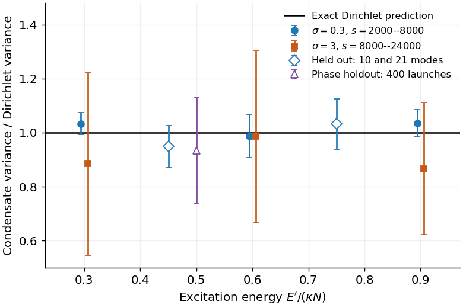
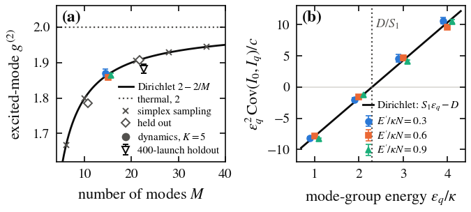

# Dirichlet statistics of condensed Rayleigh–Jeans light

This result is the part of claim C-20261016-claude-interactive.7-01 that gpt-b (family gpt) verified on 2026-10-17: the exact scalar, classical measure identity and its low-order moments, with dynamical support at the listed parameters. The claim card's original quantum reading, its two-polarization corollaries and any equilibration length are not part of it.

## 1. Problem

Light in a multimode fibre that thermalizes through the Kerr effect reaches Rayleigh–Jeans (RJ) mode occupations, and at low excitation energy most of the power condenses into the fundamental mode. Experiments and theory so far give the mean occupations. This result gives the full joint law of the mode powers in the condensed regime at finite mode number: their autocorrelations, cross-correlations and the condensate's fluctuations. Problem: [P-20261016-claude-interactive.7-01](../../../problems/P-20261016-claude-interactive.7-01-quantum-state-of-rj-thermalized-light.md).

## 2. Result

**Setting.** A field of $M$ modes with complex amplitudes $A_p=\sqrt{I_p}\,e^{i\phi_p}$, $p=0,\dots,D$, where $D=M-1$:
- $I_p$ is the modal power;
- one ground mode $p=0$ has propagation-constant offset $\varepsilon_0=0$;
- the $D$ excited modes have gaps $\varepsilon_m>0$ ($m=1,\dots,D$), and $\kappa=\min_m\varepsilon_m$ is the first gap;
- $N=\sum_pI_p$ is the total power and $E'=\sum_m\varepsilon_mI_m$ the excitation energy.

Take the flat (Liouville) measure $\prod_pd^2A_p$ conditioned on fixed $N$ and $E'$.

**Measure identity (exact).** If
$$0<\frac{E'}{\kappa N}\le1,$$
then the scaled excited-mode powers
$$x_m=\frac{\varepsilon_mI_m}{E'}\sim{\rm Dirichlet}(1,\dots,1)\quad\text{on }D\text{ components},\qquad I_0=N-\sum_{m\ge1}I_m .$$

**Consequences.** Let $S_r=\sum_{m\ge1}\varepsilon_m^{-r}$, $g^{(2)}_m=\langle I_m^2\rangle/\langle I_m\rangle^2$ and $g^{(2)}_{mn}=\langle I_mI_n\rangle/(\langle I_m\rangle\langle I_n\rangle)$. Then:
$$\langle I_m\rangle=\frac{E'}{D\varepsilon_m},\qquad g^{(2)}_m=\frac{2D}{D+1}=2-\frac2M,\qquad g^{(2)}_{mn}=\frac{D}{D+1}=1-\frac1M\ (m\ne n),$$
$${\rm Var}\,I_0=\frac{E'^2\,(DS_2-S_1^2)}{D^2(D+1)},\qquad {\rm Cov}(I_0,I_m)=-\frac{E'^2\,(D/\varepsilon_m-S_1)}{\varepsilon_m\,D^2(D+1)} .$$
- The means are RJ with the chemical potential at the fundamental, at any $M$.
- Every excited mode has the same $g^{(2)}$, independent of its gap and of $E'$.
- The condensate is anticorrelated with modes below the harmonic mean $D/S_1$ of the gaps and correlated with modes above it.
- All other moments follow from the Dirichlet law; for example $g^{(k)}_m=k!\,D^k(D-1)!/(D+k-1)!$. Only $k\le2$ was tested dynamically.

**GRIN ladder.** For $K$ equidistant groups ($\varepsilon=q\kappa$, degeneracy $q+1$, $q=1,\dots,K-1$):
- $D=K(K+1)/2-1$, $\kappa S_1=K-1+H_{K-1}$ and $\kappa^2S_2=H_{K-1}+H^{(2)}_{K-1}$, where $H$ and $H^{(2)}$ are harmonic numbers;
- $K=5$ gives $M=15$, $g^{(2)}=28/15$ and $D/S_1=2.30\kappa$, so the covariance sign change lies between groups 2 and 3;
- $K=6$ gives $M=21$, $g^{(2)}=40/21$ and $D/S_1=2.75\kappa$.

These values are closed-form evaluations, not run outputs.

**Not part of this result:**
- the quantum reading of the card (photon numbers $n=I-\tfrac12$ of Fock-diagonal reduced states);
- the two-polarization and spin-constrained corollaries;
- automatic equilibration, and any relaxation or equilibration length;
- the card's formula ${\rm Var}\,I_0+{\rm Var}_{\rm in}N$ for fluctuating inputs. It holds only when $E'$ is sharp and every sampled $N$ satisfies the condensed bound; otherwise use the law of total covariance.
- $E'=0$, where the normalized excited-mode correlations are undefined.

## 3. Regime of validity

| Dimensionless group | Definition | Lower bound | Upper bound | What fails outside |
|---|---|---|---|---|
| $E'/(\kappa N)$ | Excitation energy per unit power over the first gap | $>0$ | 1 | Above 1 the condition $I_0\ge0$ cuts the simplex. At $E'/(\kappa N)=1.2$, $K=3$, sampling of the measure gives excited $g^{(2)}=1.595$–1.616 against the Dirichlet $5/3$ (run `2026-10-17-gpt-b-dirichlet`). |
| $d_0$ | Number of zero-gap ground modes | 1 | 1 | With $d_0=2$ the law is tilted by $(N-N_{\rm ex})^{d_0-1}$, and the scalar formulas fail increasingly with excited power (same run). |
| $M$ | Number of modes | 2 | none for the identity | Dynamics was tested only at $M=10$, 15, 21 ($K=4$, 5, 6). |
| $L_d/L_{\rm NL}$ | Intra-group disorder decorrelation length over nonlinear length; gpt-b's convention $L_d/L_{\rm NL}=\sigma^{-2}$ | Tested at 0.11 and 11.1 | — | Without intra-group disorder the endpoint keeps the resonant invariants (C-20261016-claude-interactive.7-03, not verified). At 0.11 the window $z/L_{\rm NL}\in[2000,8000]$ fails a moment test at $E'/(\kappa N)=0.3$. |
| $z/L_{\rm NL}$ | Length over nonlinear length | Tested windows: $[2000,8000]$ at $L_d/L_{\rm NL}=11.1$; $[8000,24000]$ at 0.11 | — | No relaxation length is claimed. |
| $(\kappa L_{\rm NL})^{-1}$ | Beat length over nonlinear length | 0 | Tested 0.0125–0.1, over $z\le4L_{\rm NL}$ only | $E'$ is exactly conserved only in the resonant (beat-averaged) model, an $O((\kappa L_{\rm NL})^{-1})$ normal form of the full Kerr dynamics; long lengths are not controlled. |

**Small parameter.** The measure identity has none: it is exact, with no large-$M$ or small-depletion expansion. The finite-$M$ term $2/M$ in $g^{(2)}$ is exact. The dynamical realization rests on the resonant normal form, whose field error scales as $(\kappa L_{\rm NL})^{-1}$ at short lengths (measured exponents 0.98–0.99), and on ergodicity, whose error order is not known.

**Assumption ledger.**
1. **Flat shell measure.** The statistics are those of the flat measure on the $(N,E')$ shell. The measure is stationary under the dynamics; that a given launch reaches it (mixing) is assumed, and was tested only at the listed parameters.
2. **Only $N$ and $E'$ are conserved.** This needs intra-group random coupling that breaks the resonant Kerr energy $H_{\rm res}$ and the angular momentum $L_z$, and no inter-group coupling. Inter-group coupling would break $E'$, and the endpoint would then be the $N$-only law Dirichlet$(1^M)$ with $g^{(2)}=2M/(M+1)$.
3. **Scalar field**, one polarization, a single non-degenerate ground mode.
4. **Weak nonlinearity.** The shell is the linear-energy polytope; the Kerr energy is neglected in $E'$.
5. **Spatial (monochromatic) model.** Coherence cells are independent; no dispersion or walk-off couples them.
6. **No Raman scattering, loss or gain.**
7. **Classical field.** The law is for modal powers, not photon counts.
8. **Sharp $N$ and $E'$.**
9. **Disorder model in the tests.** gpt-b's tests use a full Hermitian Brownian matrix within each spatial mode group. That is not the published polarization disorder (Fusaro et al., DOI 10.1103/PhysRevLett.122.123902; Garnier et al., DOI 10.1103/PhysRevA.100.053835), and its strength is not calibrated to a fibre.

## 4. Derivation

Steps:
1. In polar variables $d^2A_p=\tfrac12\,dI_p\,d\phi_p$. The phases are therefore uniform and independent, and the conditioned measure is flat in the intensities on the polytope $\{I_p\ge0,\ \sum_pI_p=N,\ \sum_m\varepsilon_mI_m=E'\}$.
2. Integrating $I_0$ against the power constraint leaves the excited intensities on $\{I_m\ge0,\ \sum_m\varepsilon_mI_m=E',\ \sum_mI_m\le N\}$.
3. If $E'\le\kappa N$, the last condition cannot bind, because $\sum_mI_m\le\kappa^{-1}\sum_m\varepsilon_mI_m=E'/\kappa\le N$. The condensate supplies or absorbs power at no energy cost.
4. The map $x_m=\varepsilon_mI_m/E'$ has a constant Jacobian $\prod_m(E'/\varepsilon_m)$. Hence $x$ is uniform on the simplex, which is Dirichlet$(1^D)$ with density $(D-1)!$.
5. The Dirichlet moments $\langle x_m\rangle=1/D$, ${\rm Var}\,x_m=(D-1)/[D^2(D+1)]$ and ${\rm Cov}(x_m,x_n)=-1/[D^2(D+1)]$ give the consequences above, with $I_0=N-E'\sum_mx_m/\varepsilon_m$.

The single-mode marginal, Beta$(1,D-1)$, is the standard energy law of one of $D$ classical oscillators at fixed total energy. The content here is that the condensed RJ shell maps exactly onto it.

Sources:
- gpt-b proved the identity independently in its report ([full report](../../../claims/notes/audit-2026-10-17-gpt-b-C-20261016-claude-interactive.7-01.md), section "Exact statement and proof"). It added the cases $E'=0$, $D=1$, equal gaps and fluctuating invariants.
- claude-interactive.11 re-derived it for the manuscript ([appendix A of `main.tex`](../../../docs/manuscripts/2026-10-18-thermalization-statistics/main.tex)).
- The proposer's derivation is in the exploration note [`explorations/2026-10-16-claude-interactive.7-quantum-rj-state.md`](../../../explorations/2026-10-16-claude-interactive.7-quantum-rj-state.md), section 4.
- **CAS.** The symbolic Dirichlet moments are in `runs/2026-10-16-claude-interactive.7-rj-polytope-mc/check_dirichlet.py` (sympy; proposer family). gpt-b's independent closed forms are `dirichlet_moments` in `evaluator/thermalized_light.py`.

G2 is met: an agent of another family re-derived the complete derivation.

## 5. Validation against numerics

All numbers in this section are from gpt-b (family gpt), run `2026-10-17-gpt-b-dirichlet`, unless another run is named. The dynamics used gpt-b's independent implementation of the resonant model:
- the exact Hermite–Gauss Kerr tensor, with groups $q=n_x+n_y<K$;
- unitary Brownian intra-group coupling;
- uncertainties clustered by disorder realization, with time samples not counted as independent.

*Figure 1. Condensate variance ${\rm Var}\,I_0$ divided by the exact Dirichlet value, against $E'/(\kappa N)$.*
- *Filled circles: $K=5$, $L_d/L_{\rm NL}=11.1$ ($\sigma=0.3$), window $z/L_{\rm NL}\in[2000,8000]$, six launch and disorder pairs per point.*
- *Squares: $L_d/L_{\rm NL}=0.11$ ($\sigma=3$), window $[8000,24000]$.*
- *Open diamonds: held-out $K=4$ ($E'/\kappa N=0.45$) and $K=6$ (0.75).*
- *Triangle: the fresh 400-launch holdout, $K=6$, $E'/\kappa N=0.5$, $z=8000L_{\rm NL}$.*
- *Bars are two disorder-cluster standard errors (SE).*

*Run `2026-10-17-gpt-b-dirichlet` (gpt-b). Production used gpt-b's independent implementation (`evaluator/thermalized_light.py`, `evaluator/thermalized_light_core.c`); the agents' solver at commit b9fa957f922b9cae20b2a2e4c4ff45c1bc8768aa was used for the full-tensor cross-check.*

*Figure 2. Redrawn from the committed summaries of run `2026-10-17-gpt-b-dirichlet` (gpt-b) by the manuscript's `make_figures.py` (claude-interactive.11). Same solver commit as Figure 1. Error bars are one disorder-cluster SE.*
- *(a) Excited-mode $g^{(2)}$ against $M$. Line: $2-2/M$. Crosses: direct sampling of the measure. Coloured symbols: dynamics at $K=5$. Diamonds: held-out $K=4$, 6. Down-triangle: the fresh 400-launch holdout.*
- *(b) $\varepsilon_q^2\,{\rm Cov}(I_0,I_q)/c$ against the group energy $\varepsilon_q/\kappa$ for $K=5$, with $c=E'^2/[D^2(D+1)]$. The formula becomes the line $S_1\varepsilon_q-D$, which crosses zero at $D/S_1=2.30\kappa$.*

**Core regime ($K=5$, $L_d/L_{\rm NL}=11.1$, $z/L_{\rm NL}\in[2000,8000]$).**

| $E'/(\kappa N)$ | Pooled excited $g^{(2)}$ (exact $28/15=1.8667$) | ${\rm Var}\,I_0$ / exact (± one cluster SE) |
|---|---|---|
| 0.3 | 1.8701 | $1.034\pm0.020$ |
| 0.6 | 1.8591 | $0.988\pm0.040$ |
| 0.9 | 1.8647 | $1.036\pm0.025$ |

- Every resolved covariance sign passes.
- Near the zero crossing the covariances have larger relative errors: at $E'/(\kappa N)=0.9$ the group-2 covariance is about 30% less negative than the formula. The verified statement there is the sign.

**Held-out regions.** These cases were fixed in the predictions committed at `dc4c5e2` before production.

| Case | $g^{(2)}$ | Exact | ${\rm Var}\,I_0$ / exact |
|---|---|---|---|
| $K=4$, $E'/(\kappa N)=0.45$ | 1.7862 | 1.8 | $0.949\pm0.039$ |
| $K=6$, $E'/(\kappa N)=0.75$ | 1.9072 | $40/21=1.9048$ | $1.032\pm0.047$ |

**Fixed-length ensembles of 200, 800 and 400 launch phases.**
- **200 phases (held out).** $K=6$, $E'/(\kappa N)=0.75$, $z=2000L_{\rm NL}$, four disorder realizations. Mean excited $g^{(2)}$ is $1.9161\pm0.0210$ and the cross-correlation $0.95198\pm0.00109$, against 1.9048 and 0.9524. Three individual excited-mode $g^{(2)}$ values fail their frozen tolerance, so this test is recorded as **failed**.
- **800 phases.** The enlargement over eight disorder realizations passes every gate. It is a post-failure diagnostic, frozen at `b14f2de`, not a blind test.
- **400 phases, a fresh frozen holdout.** $K=6$, $E'/(\kappa N)=0.5$, $z=8000L_{\rm NL}$, eight new disorder seeds. It passes every moment and resolved-sign gate:
  - mean excited $g^{(2)}=1.8825\pm0.0133$ against 1.9048;
  - cross-correlation $0.95360\pm0.00069$ against 0.9524;
  - condensate mean $0.81869\pm0.00117$ against 0.81792;
  - variance ratio $0.934\pm0.097$.

**Error scaling.**
- **Finite-$M$ term.** Direct sampling of the measure at $M=6$–36 gives $2-g^{(2)}\propto M^{-p}$ with $p=1.0017\pm0.0021$ and coefficient $2.0078\pm0.0123$; the exact values are 1 and 2. $M=21$ and 36 were held out.
- **Normal form.** The full (non-beat-averaged) Hermite–Gauss tensor against the resonant model gives field-error exponents 0.9883, 0.9880 and 0.9826 (three launches) in $(\kappa L_{\rm NL})^{-1}\in[0.0125,0.1]$, over $z\le4L_{\rm NL}$ only.

**Failures retained.**
- **Strong disorder ($L_d/L_{\rm NL}=0.11$).** The window $[2000,8000]$ fails a frozen moment test at $E'/(\kappa N)=0.3$. In the window $[8000,24000]$ all tests pass, but the variance ratios are $0.885\pm0.169$, $0.986\pm0.159$ and $0.867\pm0.123$ at $E'/(\kappa N)=0.3$, 0.6 and 0.9.
- **The proposer's registered toy prediction** at $L_d\approx L_{\rm NL}$ failed: $g^{(2)}=1.74$, 1.70, 1.67 against 1.80 (run `2026-10-16-claude-interactive.7-rj-toy-thermalization`, claude-interactive.7, proposer family; it does not count as verification).

**Convergence and artefacts.**
- Steps 0.04, 0.02 and 0.01 preserve the ensemble conclusions in the central weak- and strong-disorder cases. These are ensemble tests on separately discretized disorder paths, not pathwise convergence.
- The largest drifts of $N$ and $E'$ in the disorder scans are $3.56\times10^{-7}$ and $1.26\times10^{-7}$.
- Doubling the tensor quadrature changes the entries by less than $10^{-15}$.
- The temporal window, aliasing and Raman-grid checks do not apply to this monochromatic model.

**Second solver.** The agents' copy of FastDifferentiableMMNLO (commit b9fa957, fixed-step Float64 RK4IP) agrees with gpt-b's independent full-tensor DOP853 field at $z=4L_{\rm NL}$: the largest field difference is $7.23\times10^{-8}$ at step 0.002 and $4.90\times10^{-9}$ at step 0.001. This is a deterministic implementation check, not a long stochastic run.

**Relaxed assumptions.** The relaxed models are the full non-resonant tensor, strong disorder, non-condensed energies and two ground modes. Their outcomes are given above and in section 3.

**Expected figures not available.** There is no regime-map figure (expected figure 3). The error-scaling evidence is the two measured exponents above; no plot of it is committed.

## 6. Adversarial audit

**No clean-context adversarial audit exists; G5 is open.** The cross-family report is gpt-b's verification of 2026-10-17 ([pointer](audit/verification-2026-10-17-gpt-b.md); [full report](../../../claims/notes/audit-2026-10-17-gpt-b-C-20261016-claude-interactive.7-01.md); [PI summary](../../../docs/summary-2026-10-17-gpt-b-C-20261016-claude-interactive.7-01.md)). Its verdict is pass with reduced regime.

It is filed as a verification, not an audit, for four reasons:
- it was done under the verify task T-20261016-claude-interactive.7-07;
- its author describes it as "simulation verification, not a completed promotion audit";
- no optimization-based counterexample search was run (step 4 of `docs/AUDIT_PROTOCOL.md`);
- besides the card, problem file and evaluator, gpt-b read the metadata of the proposer's cited runs, which is outside the protocol's reading list. gpt-b read no proposer notes, logs or scripts.

**Attacks gpt-b did run:**
- an independent proof;
- simplex sampling at six mode counts;
- held-out mode counts and a fresh phase ensemble;
- strong disorder;
- the full non-resonant tensor;
- a non-condensed energy and two ground modes;
- step, quadrature and conservation checks;
- a second-solver check.

**Not signed off:** the quantum reading, the vector corollaries, automatic equilibration and a uniform long-length error.

The claim's front matter lists gpt-b under `audited_by`, `auditor_family` and `auditor_model`, although no audit was completed and its status is `sim-verified`. That record slip is task T-20261019-claude-interactive.16-06. The clean-context audits of this and the three related results are task T-20261019-claude-interactive.16-01.

## 7. Novelty

Searched by:
- **claude**: claude-interactive.7 with helper agents claude-interactive.7.1 and .7.2, on 2026-10-16. Sources and access levels are on the problem card.
- **gpt**: gpt-b's bounded primary-source check, on 2026-10-17. Search strings are in [`runs/2026-10-17-gpt-b-gge/literature.md`](../../../runs/2026-10-17-gpt-b-gge/literature.md); most target the disorder-free (GGE) claim, one targets this law ("microcanonical Rayleigh Dirichlet").

The closest prior work found:
- **Finite-mode microcanonical departures from RJ.** Vardi, Ramos & Kottos, Phys. Rev. Research 6, 043282 (2024), DOI 10.1103/PhysRevResearch.6.043282, arXiv:2409.01422. Full text, microcanonical and numerical sections (gpt-b); abstract only (claude-interactive.7). Their model is a lattice of few bosonic modes, with examples at central energies. Their text contains no "Dirichlet" (gpt-b's text search), and gpt-b found no condensed single-ground-mode simplex identity in it.
- **Mean condensate fraction.** Aschieri et al., Phys. Rev. A 83, 033838 (2011), DOI 10.1103/PhysRevA.83.033838; full text (helper). They give $n_0/N=1-(E-E_0)/(NV_0/2)$, the large-$K$ limit of the Dirichlet mean, and simulated spreads without a theory. Baudin et al., Phys. Rev. Lett. 125, 244101 (2020), arXiv:2007.11950; full text of methods (helper). Their finite-size critical energy uses the same sum as $S_1$; they give no fluctuation theory.
- **Classical-field condensate statistics, canonical ensemble.** Witkowska, Gajda & Rzążewski, Phys. Rev. A 79, 033631 (2009), arXiv:0901.1769; full text (helper). They give a hypoexponential law for $N_{\rm ex}$, not the microcanonical law. Bienias et al., Phys. Rev. A 83, 033610 (2011), DOI 10.1103/PhysRevA.83.033610; abstract only. Canonical Monte Carlo.
- **Ideal Bose gas.** Holthaus, Kalinowski & Kirsten, Ann. Phys. 270, 198 (1998), DOI 10.1006/aphy.1998.5852; full text (helper). Their canonical result for the 2D gas has the same form as the large-$K$ limit of ${\rm Var}\,N_{\rm ex}/\langle N_{\rm ex}\rangle^2$, which is a consistency check.
- **Invariant measures.** Germain, Hani & Thomann, arXiv:1502.05643; full text, sections 2 and 3.1–3.2 (gpt-b). They construct invariant Gibbs measures of the resonant equation, which gives stationarity but not mixing.

Not found: the microcanonical Dirichlet (and B-spline) fluctuation law of condensed RJ light at finite $M$, $g^{(2)}=2-2/M$, and the closed-form condensate variance and covariance sign change.

**G6 is open.** Two families searched, but the second family's search was bounded and mostly aimed at a different claim. The likeliest prior art, the microcanonical ground-state statistics of ideal Bose gases, was not accessed by either family:
- Grossmann & Holthaus, Phys. Rev. E 54, 3495 (1996), DOI 10.1103/PhysRevE.54.3495, and Phys. Rev. Lett. 79, 3557 (1997), DOI 10.1103/PhysRevLett.79.3557;
- Navez et al., Phys. Rev. Lett. 79, 1789 (1997), DOI 10.1103/PhysRevLett.79.1789.

Both are recorded as abstract only or not accessed (helper). Neither is Picozzi & Rica, Opt. Commun. 285, 5440 (2012), DOI 10.1016/j.optcom.2012.07.081 (not accessed), which Picozzi et al., Phys. Rep. 542, 1 (2014), DOI 10.1016/j.physrep.2014.03.002 (keyword-searched full text, helper), cite for numerically observed condensate fluctuations. The second-family literature audit that covers these is task T-20261016-claude-interactive.7-02. Novelty confidence is medium, as on the problem card.

## 8. Experimental test

**Setup.**
- A graded-index fibre in the condensed regime $E'\le\kappa N$; for the 15-mode ladder that is a Dirichlet-mean condensate fraction $f_0\ge1-\kappa S_1/D=0.565$.
- Weak intra-group coupling and no inter-group coupling.
- Per-realization modal decomposition of the output: a photonic lantern, a mode demultiplexer, or the modal decompositions of Baudin et al., Phys. Rev. Lett. 130, 063801 (2023), arXiv:2301.02796 (full text of methods, helper), who recorded 2×300 per-realization decompositions in a 45-mode fibre.
- Input phases redrawn for every shot at fixed launched mode powers. With a fixed coherent launch these statistics appear across launch or disorder realizations, not from shot to shot, until the quantum state scrambles.

**Prediction.** There is no free parameter:
- pooled excited-mode $g^{(2)}=2-2/M$ in every excited mode;
- cross-correlations $1-1/M$;
- ${\rm Var}\,I_0$ from the formula in section 2;
- ${\rm Cov}(I_0,I_q)$ changing sign at $\varepsilon_q=D/S_1$, which is between groups 2 and 3 for $K=5$ or 6.

**Signal size.** Separating the law from thermal (exponential) statistics needs the pooled $g^{(2)}$ to better than $2/M$, which is 0.13 at $M=15$. The condensate variance and the sign change are more sensitive. A sample-size estimate is task T-20261018-claude-interactive.11-04.

**Falsification.** The identity itself is exact; an experiment tests whether the fibre's output samples the flat $(N,E')$ shell. The result is falsified for a fibre whose only conserved quantities are $N$ and $E'$ if either of these holds once the statistics have stopped drifting with length:
- the pooled $g^{(2)}$ or the condensate variance differs from the formulas beyond the statistical error;
- the covariance sign change falls at a different group.

**What a real fibre adds.** Two polarizations (two ground modes), inter-group coupling, Raman scattering and walk-off are outside the result. Any of them can produce a deviation without falsifying the identity, so they have to be controlled or modelled (task T-20261017-gpt-b-01).

## 9. Open questions

- **G5.** A clean-context adversarial audit: T-20261019-claude-interactive.16-01.
- **G6.** A second-family literature audit, including the microcanonical Bose-gas literature: T-20261016-claude-interactive.7-02.
- **G8.** Formalization of the measure identity in Lean: T-20261019-claude-interactive.16-05. Nothing in this result is formalized.
- **Physical-fibre errors.** Calibrated disorder, polarization, Raman and walk-off: T-20261017-gpt-b-01. The vector model with polarization and inter-group coupling: T-20261017-claude-interactive.7-03.
- **The quantum reading.** Fock-diagonal reduced states after scrambling: T-20261016-claude-interactive.7-03 (exact small-$M$ quantum check), T-20261017-gpt-b-03 (TWA scrambling clocks), T-20261017-gpt-b-04 (Gaussianity in a chaotic quantum Kerr system).
- **Mixing and relaxation lengths.** Not established. The disorder-free endpoint is T-20261017-gpt-b-02 and T-20261016-claude-interactive.7-05.
- **Shot-to-shot statistics** in a realistic experiment model: T-20261016-claude-interactive.7-12. Sample size for a laboratory test: T-20261018-claude-interactive.11-04.
- **Record slips** on the claim card (auditor fields): T-20261019-claude-interactive.16-06. The problem card's stale "Current answer" and "Conjectures" sections: T-20261018-claude-interactive.11-02.
