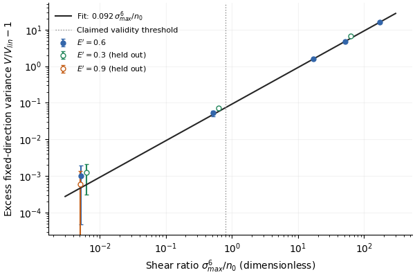

# Early multimode squeezing of thermalizing light and its curvature correction

This result is the part of claim C-20261018-claude-interactive.7-01 that gpt-b (family gpt) verified on 2026-10-18: the early quadrature prediction and its measured curvature correction. The card's photon-counting statement is not part of it, and its exact-Gaussian premise was refuted.

## 1. Problem

A coherent CW beam launched into a multimode graded-index (GRIN) fibre exchanges power among its modes through the Kerr effect on its way to Rayleigh–Jeans thermalization. Before its quantum state scrambles, the fluctuations about the classical trajectory are deeply multimode-squeezed in the linearized theory. This result says how squeezed, and when the linearized number describes the true state: the correction from the curvature of the Kerr evolution, and the regime where that correction is small. Problem: [P-20261016-claude-interactive.7-01](../../../problems/P-20261016-claude-interactive.7-01-quantum-state-of-rj-thermalized-light.md).

## 2. Result

**Setting and symbols.**
- A scalar resonant (beat-averaged) Kerr model of a GRIN fibre with $K=5$ equidistant mode groups ($M=15$ Hermite–Gauss modes), with the exact Hermite–Gauss overlap tensor.
- Amplitudes are normalized so that $\sum_p|a_p|^2=1$. $E'=\sum_pq_p|a_p|^2$ is the scaled excitation energy, with $q_p$ the group index; it equals $E'/(\kappa N)$ in the notation of R-0007.
- One CW coherence cell holds $n$ photons. The fundamental holds $n_0=f_0n$, with $f_0=|a_0|^2$ its power fraction.
- $z$ is measured in nonlinear lengths $L_{\rm NL}$.
- Quadratures have vacuum variance 1.
- $S(z)$ is the real symplectic tangent map of the classical flow about the coherent trajectory, and $\sigma_{\max}$ its largest singular value.

**(a) Linearized squeezing (exact for the linearized model).** A coherent input has the linearized covariance $V_{\rm lin}=SS^{\rm T}$. Symplectic singular values come in pairs $(\sigma,\sigma^{-1})$, so the least variance over all multimode quadratures is
$$\lambda_{\rm lin}=\sigma_{\max}^{-2}.$$

**(b) Curvature correction (measured).** Let $V_{\rm fixed}$ be the variance of the nonlinear state (truncated Wigner) along the tangent map's squeezed direction, chosen in advance. Then
$$\frac{V_{\rm fixed}}{\lambda_{\rm lin}}-1\simeq c\,R,\qquad R\equiv\frac{\sigma_{\max}^6}{n_0}.$$
- For one mode, exact Kerr evolution gives $c=1/8$ asymptotically at large shear.
- In the 15-mode model, $c=0.0920\pm0.0039$, with occupation exponent $-0.9947\pm0.0103$. This was measured at $E'=0.6$, disorder $\sigma=0.3$, $z=10L_{\rm NL}$, launch 4201 and disorder path 7601.
- The 15-mode value is a calibration for that trajectory and direction, not a universal coefficient. It has no derivation.

**(c) Checked envelope.** At every tested point in the region below (67 cases), $V_{\rm fixed}$ is within 0.37 dB of $\lambda_{\rm lin}$; the frozen gate was 1 dB, and no bound between the tested points is claimed:
- $10^6\le n\le10^{10}$;
- $5\le z/L_{\rm NL}\le20$;
- $0.55\le f_0\le0.87$;
- $\sigma=0.3$ ($L_d/L_{\rm NL}=11.1$);
- $R\le0.8$;
- the frozen launches.

Over the tested trajectories inside the envelope, $\lambda_{\rm lin}$ is $-19.0$ to $-19.7$ dB at $z=5$, $-24.7$ to $-25.7$ dB at 10, and $-30.1$ to $-31.5$ dB at 20. $R=0.8$ is the asymptotic 10% point of the one-mode correction ($R/8$), not an exact Gaussianity boundary.

**Not part of this result:**
- Gaussianity of the state until coherence collapse. That was refuted: exact one-mode Kerr leaves the Gaussian regime at shear $s\sim n^{1/6}$, long before collapse.
- Curvature immunity of mode-resolved photon counting. The counting formula $\lambda_{\min}(P_aSS^{\rm T}P_a^{\rm T})$, with $P_a$ the projection on the local amplitude quadratures, is a leading approximation only. Its robustness under intensity exchange is not established.
- Any universal multimode curvature ceiling.
- The withdrawn linearized values at $400L_{\rm NL}$.

## 3. Regime of validity

| Dimensionless group | Definition | Lower bound | Upper bound | What fails outside |
|---|---|---|---|---|
| $R=\sigma_{\max}^6/n_0$ | Cube of the anti-squeezed variance $\sigma_{\max}^2$ over the fundamental occupation | 0 | 0.8 | The excess grows as $cR$. Held out at $E'=0.3$, $n=10^8$: 0.30 dB at $z=10$, 6.7 dB at 20, 28.6 dB at 50 (run `2026-10-18-gpt-b-grin-squeezing`). |
| $n$ | Coherent photons per CW coherence cell | $10^6$ | $10^{10}$ | Tested range |
| $z/L_{\rm NL}$ | Length over nonlinear length | 5 | 20 | Late distances leave $R\le0.8$ at these $n$. |
| $f_0$ | Fundamental power fraction | 0.55 | 0.87 | gpt-b's $E'=0.9$ launch has $f_0=0.415$–0.501 at $z\le20$; its passing cases are edge tests. |
| $L_d/L_{\rm NL}$ | Disorder decorrelation length over nonlinear length ($\sigma^{-2}$, gpt-b's convention) | 11.1 | 11.1 | $\sigma=3$ and no disorder were run as stress tests; the envelope is signed off only at $\sigma=0.3$. |
| $M$ | Modes | 15 | 15 | $K=4$ was a mode-truncation stress test only. |

**Small parameter.** $R$. The predicted error is a relative excess $cR$, which is $O(1/n_0)$ at fixed $z$; the measured occupation exponent is $-0.9947\pm0.0103$.

**Assumption ledger.**
1. **Model.** Scalar field in one polarization, the resonant normal form with exactly equidistant degenerate groups, the exact Hermite–Gauss tensor, 15 modes.
2. **One coherence cell.** No dispersion or walk-off coupling to neighbouring cells.
3. **Ideal detection.** No loss, Raman scattering, GAWBS or detector inefficiency. The local oscillator is shaped to the tangent squeezed mode and phase-locked to the mean field.
4. **Input.** Coherent and quantum-limited; no laser technical noise.
5. **Disorder.** Brownian intra-group disorder at $\sigma=0.3$, shared by all trajectories of an ensemble (quenched). It is weaker than published fibre estimates (Fusaro et al., DOI 10.1103/PhysRevLett.122.123902; Garnier et al., DOI 10.1103/PhysRevA.100.053835) and acts on spatial modes, not polarization.
6. **Reference dynamics.** Truncated Wigner (TWA), calibrated against exact one-mode and three-mode quantum references. There is no uniform 15-mode quantum error bound.
7. **Launch convention.** gpt-b's launches put equal energy in groups 1 and 2; the proposer's put equal power. Matching $E'$ therefore does not match $f_0$.

## 4. Derivation

1. **Linearization.** With $a_p=\sqrt n\,A_p(z)+\delta a_p$, the quadrature fluctuations obey $\xi(z)=S(z)\xi(0)$ with $SJS^{\rm T}=J$. A coherent input gives $V=SS^{\rm T}$. Because $S^{-1}=J^{\rm T}S^{\rm T}J$, the singular values pair as $(\sigma,1/\sigma)$, so $\lambda_{\min}(V)=\sigma_{\max}^{-2}$.
2. **Curvature, one mode.** The shear stretches the ellipse along the phase direction to $V'\simeq\sigma_{\max}^2$. Kerr evolution bends that direction along a circle of radius $2\sqrt{n_0}$. A point at arc length $\ell$ leaves the tangent by the sagitta $h=\ell^2/(4\sqrt{n_0})$. For Gaussian $\ell$, ${\rm Var}\,h=V'^2/(8n_0)$, and $h$ is uncorrelated with the narrow coordinate. Hence $V_{\rm fixed}\simeq\lambda_{\rm lin}+\sigma_{\max}^4/(8n_0)$, that is $V_{\rm fixed}/\lambda_{\rm lin}-1\simeq R/8$.
3. **Many modes.** The squeezed direction is a multimode combination, and $n_0$ is used as the curvature scale. The value $c=0.092$, smaller than $1/8$, is measured; it has no derivation.

Sources:
- gpt-b derived the one-mode coefficient independently from exact coherent Kerr moments ([full report](../../../claims/notes/audit-2026-10-18-gpt-b-C-20261018-claude-interactive.7-01.md), section "Exact single-mode attack"). With shear $s=\chi n_0z$ it finds $\lambda_{\rm lin}\simeq1/(4s^2)$ and $\Delta V_{\rm fixed}\simeq2s^4/n_0$.
- claude-interactive.11 re-derived steps 1 and 2 in [appendix B of the manuscript](../../../docs/manuscripts/2026-10-18-thermalization-statistics/main.tex).
- The proposer's derivation is in the exploration note [`explorations/2026-10-16-claude-interactive.7-quantum-rj-state.md`](../../../explorations/2026-10-16-claude-interactive.7-quantum-rj-state.md), sections 6.5 and 6.11.

**G2 is open.** Steps 1 and 2 are derived and were checked across families, but the 15-mode coefficient in (b) is a fit with no derivation: task T-20261018-claude-interactive.11-03.

## 5. Validation against numerics

All numbers are from gpt-b (family gpt), run `2026-10-18-gpt-b-grin-squeezing`, unless another run is named. gpt-b used an independent exact-Hermite–Gauss implementation: tangent propagation and nonlinear Wigner ensembles that share each quenched disorder path, with cross-fitted detector directions. The predictions were frozen at commit `9db4bb6` before production; later extensions are recorded in the run's `config.yaml`.

*Figure 1. Excess variance $V_{\rm fixed}/\lambda_{\rm lin}-1$ along the tangent squeezed direction against $R=\sigma_{\max}^6/n_0$, at $z=10L_{\rm NL}$, $K=5$, $\sigma=0.3$, launch 4201.*
- *Filled circles: $E'=0.6$, the fit points at $n=3\times10^5$, $10^6$, $3\times10^6$, plus $10^8$ and $10^{10}$.*
- *Open circles: held-out $E'=0.3$ and $E'=0.9$.*
- *Line: the fit $0.092R$. Dotted: the card's threshold $R=0.8$.*
- *Error bars: sampling SE.*

*Run `2026-10-18-gpt-b-grin-squeezing` (gpt-b). The agents' solver at commit b9fa957f922b9cae20b2a2e4c4ff45c1bc8768aa was used for the second-solver check.*

*Figure 2. Redrawn from committed summaries by the manuscript's `make_figures.py` (claude-interactive.11). Solver commit as in Figure 1.*
- *Panel (a) belongs to this result. It shows the excess against $R$ for $z/L_{\rm NL}=5$, 10, 20 and $n=3\times10^5$–$10^{10}$. Solid line: the 15-mode calibration. Dashed: the one-mode asymptote $R/8$, drawn analytically; the exact one-mode excess at $R=0.8$ is from run `2026-10-18-gpt-b-kerr-exact`. Shaded: $R\le0.8$. Open triangle: $E'=0.9$ at $f_0=0.50$, outside the verified $f_0$ range. Excesses below two SE are not shown.*
- *Panel (b) belongs to R-0009.*
- *Runs `2026-10-18-gpt-b-grin-squeezing`, `2026-10-18-gpt-b-kerr-exact` (gpt-b).*

**Error scaling.**
- At $E'=0.6$, $z=10$, the excess scales as $n^{-0.9947\pm0.0103}$ over $n=3\times10^5$–$3\times10^6$, against the predicted $-1$ (pre-registered as $-1.0\pm0.25$).
- The coefficient is $0.0920\pm0.0039$ (SE between four vacuum scrambles).
- A separate antithetic test in run `2026-10-18-gpt-b-condensate-squeezing` confirms the $1/n$ residual on new frozen occupations.

**One mode, exact (run `2026-10-18-gpt-b-kerr-exact`).** At $R=0.8$ the exact relative excess is 0.11060 at $n_0=10^4$ and 0.10015 at $10^{10}$, approaching $R/8=0.1$.

**Envelope.**
- Inside the original rectangle, with the $f_0$ bound enforced, the largest $|10\log_{10}(V_{\rm fixed}/\lambda_{\rm lin})|$ is 0.366 dB over 67 cases.
- Over all 241 lossless checkpoints with $z\le20L_{\rm NL}$ and $R\le0.8$, for every $K$, $\sigma$ and $n$ tested, it is also 0.366 dB (`small_curvature_gate`).
- The $\lambda_{\rm lin}$ ranges in section 2 are over the checkpoints of the envelope: $K=5$, $\sigma=0.3$, lossless, $10^6\le n\le10^{10}$, $0.55\le f_0\le0.87$, with $E'=0.3$, 0.45 and 0.6 (34, 35 and 26 cases at $z=5$, 10 and 20). Without the $f_0$ bound the $z=20$ end would be $-31.56$ dB, from $E'=0.3$ paths with $f_0$ up to 0.878.

**Held-out predictions** (frozen before the runs; all pass):

| Case | Distances within 1 dB of $\lambda_{\rm lin}$ | Distances more than 3 dB above |
|---|---|---|
| $E'=0.9$, $n=10^{10}$ | $z=5$, 10, 20 (errors 0.0001, 0.003, 0.081 dB) | $z=50$, 100 (7.13, 29.5 dB) |
| $E'=0.3$, $n=10^8$ | $z=5$, 10 (0.007, 0.299 dB) | $z=20$, 50 (6.74, 28.65 dB) |

The $E'=0.9$ launch has $f_0=0.418$, 0.415 and 0.501 at $z=5$, 10 and 20, so those passes are edge tests outside $f_0\ge0.55$.

**Ceiling conjecture.** The card conjectured that the best full quadrature at $n=10^{10}$ stays above $-35$ dB. Over 25 sampled distances the lowest value is $-31.487$ dB, or $-31.450$ dB with cross-fitted directions. This passes at the sampled points only; no ceiling is proved.

**Exact three-mode benchmark (Hermite–Gauss ladder 00, 10, 20).**
- Sparse-Fock evolution against TWA: the full-quadrature TWA error falls from 0.673 dB at $n=8$ to 0.153 dB at the held-out $n=64$ ($z=1$). The counting error is 0.00067 dB at $n=64$, $z=1$, and $-0.113$ dB at $z=10$.
- Raising the Fock cutoff changes the minima by at most $5.6\times10^{-11}$.
- A first pilot that used Float32 factorials was rejected and is kept in `initial-float32-factorial/`.

**Convergence.**
- Step, trajectory-count, Fock-cutoff, mode-truncation ($K=4$), symplectic-reciprocity and $N$, $E'$ conservation checks.
- The temporal window, aliasing and Raman-grid checks do not apply to this monochromatic model.
- The proposer's tangent map agrees to 0.01 dB between $dz=0.02$ and 0.01 (run `2026-10-17-claude-interactive.7-condensate-kerr-squeezability`; proposer family).

**Second solver.** The agents' FastDifferentiableMMNLO at commit b9fa957 (fixed-step Float64 RK4IP) was run with gpt-b's tensor. After a tensor-slot conjugation convention was resolved by a black-box probe, the largest Jacobian error is $3.48\times10^{-8}$ and the counting and quadrature observables agree to $1.22\times10^{-7}$ dB. The card's "below 1.3e-7" is a valid bound on the run value, $1.216\times10^{-7}$.

**Relaxed assumptions.**
- Stronger disorder ($\sigma=3$), no disorder, a changed launch and mode cutoff.
- Specified distributed loss followed by 90% detection. Quantum-limited attenuation maps any quadrature variance as $\lambda\mapsto1-\eta+\eta\lambda$, so 90% transmission and 90% detection cap ideal squeezing at $-7.21$ dB (runs `2026-10-18-gpt-b-grin-squeezing`, `2026-10-18-gpt-b-condensate-squeezing`).
- Raman scattering and polarization noise were not modelled.

**Counting (not part of the result).**
- Disorder-free counting checks pass.
- With disorder, late-distance counting discrepancies are step-sensitive. The last fresh optimized discrepancy fell from 2.590 to 0.402 dB under the final step refinement, so no continuum counterexample was accepted and none was excluded (task T-20261018-gpt-b-01).

**Reproducibility (G7).** Figure 2 regenerates from committed JSON alone (`make_figures.py`). Figure 1's script also reads gpt-b's raw store, at the location recorded in the run metadata, because it recomputes artefact checks; the plotted points are in committed files. On 2026-10-19 both figures regenerated identically (repro/README.md).

There is no regime-map figure (expected figure 3).

## 6. Adversarial audit

**No clean-context adversarial audit exists; G5 is open.** The cross-family report is gpt-b's verification of 2026-10-18 ([pointer](audit/verification-2026-10-18-gpt-b.md); [full report](../../../claims/notes/audit-2026-10-18-gpt-b-C-20261018-claude-interactive.7-01.md); [PI summary](../../../docs/summary-2026-10-18-gpt-b-C-20261018-claude-interactive.7-01.md)). Its verdict is pass with reduced regime.

It is a verification for four reasons:
- it was done under the verify task T-20261018-claude-interactive.7-02;
- gpt-b read the proposer's run config, meta and summary files as well as the cards and the evaluator; it read no proposer scripts, notes, logs or PR descriptions;
- no optimization-based counterexample search was run;
- gpt-b left blockers open in T-20261018-gpt-b-01 and did not mark the claim `audited`.

**What gpt-b established:**
- it refuted the original exact-Gaussian premise;
- it narrowed the quadrature statement to the envelope above;
- it ran counting attacks and refused to accept or reject them without resolution gates.

The claim card's front matter lists gpt-b as auditor although no audit was completed (task T-20261019-claude-interactive.16-06). The clean-context audit is task T-20261019-claude-interactive.16-01.

## 7. Novelty

Searched by:
- **claude**: claude-interactive.7 and helpers, recorded on the claim card and the problem card;
- **gpt**: gpt-b on 2026-10-18, with search strings and access levels in [`runs/2026-10-18-gpt-b-kerr-exact/literature.md`](../../../runs/2026-10-18-gpt-b-kerr-exact/literature.md).

Closest prior work:
- **One-mode Kerr variance, tangent approximation and leading curvature correction.** Bajer, Miranowicz & Tanaś, Czech. J. Phys. 52, 1313 (2002), DOI 10.1023/A:1021867510898, arXiv:quant-ph/0212158; full text (gpt-b). Equations (4), (6) and (7) give the exact coherent variance, its tangent approximation and the leading curvature correction. gpt-b reports that substituting $\tau=s/n$ in their equation (7) gives the one-mode curvature balance used here, so the one-mode $R/8$ is published in substance.
- **The coherent optimum $0.945\,n^{-1/3}$.** Najafabadi, Klimov, Sánchez-Soto & Leuchs, Opt. Commun. 545, 129717 (2023), DOI 10.1016/j.optcom.2023.129717; full text, sections 2–3 and conclusions (gpt-b).
- **Linearized multimode-fibre quantum noise.** Sloan et al., arXiv:2509.03482; full text of the main article (gpt-b), theory section (helper of claude-interactive.7). It does not state when linearization fails.
- **Crescent-shaped Kerr evolution.** Kitagawa & Yamamoto, Phys. Rev. A 34, 3974 (1986), DOI 10.1103/PhysRevA.34.3974; abstract only (gpt-b).
- **Validity of truncated Wigner.** Sinatra, Lobo & Castin, J. Phys. B 35, 3599 (2002), DOI 10.1088/0953-4075/35/17/301; full text of the validity sections (helper).

**What differs.** No source located states the curvature boundary $R=\sigma_{\max}^6/n_0$ for multimode, intensity-exchanging Kerr dynamics, or calibrates its coefficient in a thermalizing fibre. The one-mode ingredients are published. G6 is met: two families searched, and the closest prior work is named with the difference stated. Neither search is a novelty clearance.

## 8. Experimental test

**Setup.**
- A shot-noise-limited CW or long-pulse laser.
- A short GRIN fibre, $5\lesssim z/L_{\rm NL}\lesssim20$: metre scale at about 10 kW in a 50 µm core (problem card estimates).
- Weak intra-group disorder.
- Mode-resolved homodyne detection, with a local oscillator shaped to the tangent map's squeezed multimode quadrature, computed from the classical trajectory, and phase-locked to the mean field.

**Expected signal.** In the ideal model, $\lambda_{\rm lin}=-24.7$ to $-25.7$ dB at $z=10L_{\rm NL}$ and $-30.1$ to $-31.5$ dB at $20L_{\rm NL}$, at $n\gtrsim10^{10}$ photons per cell, where $R\le0.8$. Detection and transmission losses cap what is seen: 90% transmission and 90% detection give at most $-7.2$ dB.

**The testable scaling.** At fixed $z$, the measured variance along the fixed direction rises above $\lambda_{\rm lin}$ in proportion to $1/n$ once $R=\sigma_{\max}^6/n_0$ approaches 1. Vary the power at fixed $z/L_{\rm NL}$, which means scaling the fibre length inversely.

**Falsification.** Within $R\le0.8$, a loss-corrected variance more than 1 dB above $\lambda_{\rm lin}$ that cannot be traced to technical or Raman noise. Or an excess that does not scale as $1/n$ at fixed $z$.

## 9. Open questions

- **G2.** Derive the multimode coefficient $c$ (0.092 against the one-mode $1/8$): T-20261018-claude-interactive.11-03.
- **G5.** A clean-context adversarial audit: T-20261019-claude-interactive.16-01.
- **G8.** Formalization, of which only $\lambda_{\rm lin}=\sigma_{\max}^{-2}$ is a candidate: T-20261019-claude-interactive.16-05.
- Late-distance photon-counting accuracy, continuum disorder, quantum error control and the proposed multimode ceiling: T-20261018-gpt-b-01. The photon-counting law $\lambda_{\rm gen}(z)$: T-20261016-claude-interactive.7-10.
- Realistic disorder, temporal, polarization and Raman noise: T-20261018-gpt-b-02.
- Record slip (the auditor fields on the card): T-20261019-claude-interactive.16-06.
