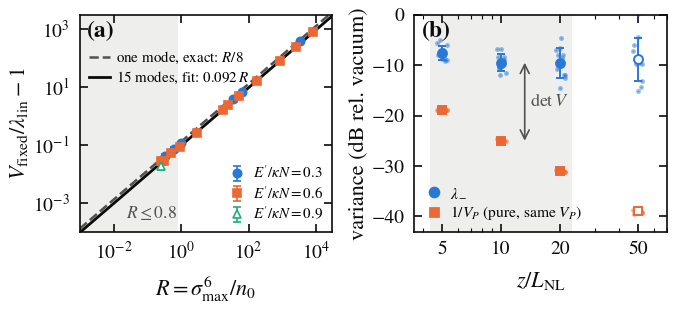

# The condensate's own squeezing during early Kerr thermalization

This result is the part of claim C-20261018-claude-interactive.7-02 that gpt-b (family gpt) verified on 2026-10-18: the covariance approximation, and the condensate squeezing found in the tested early, weak-disorder ensemble. Three things on the card are not part of it: Gaussianity, the reading of the conditional phase noise as the excited modes' cross-phase noise, and the strong-disorder spread.

## 1. Problem

In a multimode fibre that is self-cleaning toward a Rayleigh–Jeans condensate, the fundamental mode carries most of the power and is phase-modulated by itself and by the fluctuating excited modes. Is the fundamental itself quadrature-squeezed, and by how much? A homodyne measurement of the self-cleaned beam alone would need no multimode local oscillator. This result gives an exact way to read the squeezing from the fundamental's covariance, and the squeezing found in an independent ensemble of simulations. Problem: [P-20261016-claude-interactive.7-01](../../../problems/P-20261016-claude-interactive.7-01-quantum-state-of-rj-thermalized-light.md).

## 2. Result

**Symbols.**
- $X$ and $P$ are the fundamental mode's amplitude and phase quadratures in the frame of its own mean field, with vacuum variance 1.
- $V=\begin{pmatrix}V_X&C\\C&V_P\end{pmatrix}$ is their covariance, with $C$ the symmetrized covariance, and $\lambda_-\le\lambda_+$ its eigenvalues.
- $n$ is the number of coherent photons per CW coherence cell, $f_0$ the fundamental's power fraction, and $n_0=f_0n$.

**(a) Covariance identity (exact, for any state, Gaussian or not).**
$$\lambda_-=\frac{\det V}{\lambda_+},\qquad \frac{\det V/V_P}{\lambda_-}-1=\frac{V_X-\lambda_-}{V_P}\in\Big[0,\ \frac{V_X}{V_P}\Big].$$
So for a covariance elongated along the phase direction,
$$\lambda_-\simeq\frac{\det V}{V_P}=\frac{V_X\,V_{P|X}}{V_P},\qquad V_{P|X}=V_P-\frac{C^2}{V_X},$$
and the approximation always overestimates $\lambda_-$.
- $V_{P|X}$ is a Schur complement: the variance of $P$ left after the best linear regression on $X$. It is not the phase variance after a measurement of $X$.
- It is not uniquely the cross-phase noise of the excited modes.
- For a Gaussian state, $\det V=\nu^2$ with $\nu$ the symplectic eigenvalue. A pure state ($\nu=1$) would have $\lambda_-\simeq1/V_P$; the mixedness of the fundamental, which comes from its entanglement with the other modes, costs $10\log_{10}\det V$ dB.

**(b) Early weak-disorder squeezing (numerical).** gpt-b computed this in the scalar 15-mode electronic-Kerr GRIN model (independent tangent-map ensembles, confirmed by nonlinear truncated-Wigner ensembles) over:
- $E'=0.3$, the excitation energy over $\kappa N$;
- disorder $\sigma=0.3$ ($L_d/L_{\rm NL}=11.1$);
- $n=10^{10}$;
- $5\le z/L_{\rm NL}\le20$;
- $0.6\le f_0\le0.87$;
- curvature ratio $r=V_P^2/(8n_0\lambda_-)\le0.1$.

The fundamental's least quadrature variance over 12 independent disorder paths is:

| $z/L_{\rm NL}$ | Mean $\lambda_-$ (dB) | SD over paths (dB) | Note |
|---|---|---|---|
| 5 | $-7.50$ | 1.38 | all 12 paths in range |
| 10 | $-9.49$ | 1.65 | all 12 paths in range (SE of the mean 0.48 dB) |
| 20 | $-9.55$ (all 12) / $-7.95$ (8 in range) | 2.91 / 1.98 | 4 paths exceed $f_0=0.87$ |

The $z=20$ in-range subset is bookkeeping for the $f_0$ bound, not an unbiased population.

- The covariance approximation (a) errs by at most 0.062 dB over the recorded ensemble.
- The truncated-Wigner curvature correction scales as $\Delta V_{\rm own}=A/n$, with $A=14826\pm612$ and exponent $-0.999928\pm0.000004$ at $z=10$. This is the classical curvature of the Wigner flow, not the quantum error of truncated Wigner.
- These early states are not shown to be an RJ equilibrium.

**(c) Detection.** For quantum-limited output transmission $\eta_{\rm out}=0.9$ and detector efficiency $\eta_{\rm det}=0.9$ the detected variance is exactly $\lambda_{\rm det}=0.19+0.81\lambda$.

**Not part of this result:**
- Gaussianity of the reduced state.
- A unique decomposition of $V_{P|X}$ into cross-phase ("cloud") noise.
- The card's statement that self-phase modulation supplies 84–91% of $V_P$. The ensemble's self-phase reference ratio is not an additive causal fraction.
- A universal realization spread, including the strong-disorder spread reduction.
- Any value beyond $z=20L_{\rm NL}$.
- Strong disorder.

## 3. Regime of validity

| Dimensionless group | Definition | Lower bound | Upper bound | What fails outside |
|---|---|---|---|---|
| $V_X/V_P$ | Elongation of the covariance | 0 | none for (a) | The relative error of $\det V/V_P$ is at most $V_X/V_P$; it was at most 0.023 over 1177 tested covariances. |
| $r=V_P^2/(8n_0\lambda_-)$ | Curvature (sagitta) variance over the least variance | 0 | 0.1 | The Wigner variance departs from the tangent value. At $n=10^6$ the departure is $+6.8$ dB at $z=20$ and $+16.6$ dB at 50 (run `2026-10-18-gpt-b-grin-squeezing`). |
| $n$ | Coherent photons per cell | $10^{10}$ | $10^{10}$ | Lower $n$ shrinks the range where $r\le0.1$. |
| $z/L_{\rm NL}$ | Length over nonlinear length | 5 | 20 | At $z=50$ single paths change by up to 1.29 dB under step refinement, failing the frozen 1 dB gate. |
| $f_0$ | Fundamental power fraction | 0.6 | 0.87 | Four of 12 paths exceed 0.87 at $z=20$. |
| $L_d/L_{\rm NL}$ | Disorder decorrelation over nonlinear length ($\sigma^{-2}$) | 11.1 | 11.1 | At 0.25 and 0.11 ($\sigma=2$, 3) the ensembles fail step-resolution gates at $z=20$. |
| $E'/(\kappa N)$ | Excitation energy | 0.3 core; 0.45 held out | — | Only these two energies were run at weak disorder. |

**Small parameters.** $V_X/V_P$ for the approximation in (a); $r$ for the agreement between tangent and nonlinear values in (b). The curvature excess is $O(1/n)$ at fixed $z$, with measured exponent $-0.999928\pm0.000004$.

**Assumption ledger.**
1. **Model.** The scalar resonant GRIN model, 15 modes, exactly equidistant groups, electronic Kerr only.
2. **One coherence cell.** No dispersion or walk-off.
3. **Input.** Coherent, quantum-limited.
4. **Disorder.** Quenched Hermitian Brownian intra-group disorder. It acts on spatial modes, not on polarization as in the published model (Garnier et al., DOI 10.1103/PhysRevA.100.053835), and is not calibrated to a fibre.
5. **Detection.** Homodyne at the optimal angle, with a local oscillator phase-locked to the condensate's own mean field. With a laser-referenced oscillator, 1% laser amplitude jitter becomes 0.2–0.9 rad of condensate phase jitter at $z=10$–$50L_{\rm NL}$ (run `2026-10-17-claude-interactive.7-condensate-kerr-squeezability`; proposer family), which destroys the measurement.
6. **Ideal and lossless** unless the loss is stated as in (c). No Raman scattering or GAWBS.
7. **Reference dynamics.** Truncated Wigner, calibrated observable by observable against exact one-mode and three-mode quantum references.
8. **Launch convention.** gpt-b's launches put equal energy in groups 1 and 2; the proposer's put equal power.

## 4. Derivation

**(a)** For a real symmetric positive $2\times2$ matrix, $\lambda_-\lambda_+=\det V$ and $\lambda_-+\lambda_+=V_X+V_P$. Then
$$\frac{\det V}{V_P}=\frac{\lambda_-(V_X+V_P-\lambda_-)}{V_P}=\lambda_-\Big[1+\frac{V_X-\lambda_-}{V_P}\Big],$$
and $0\le\lambda_-\le\min(V_X,V_P)$ gives the bounds. Writing $\det V=V_X(V_P-C^2/V_X)$ exhibits the Schur complement.
- gpt-b derived this independently ([full report](../../../claims/notes/audit-2026-10-18-gpt-b-C-20261018-claude-interactive.7-02.md), section "What is exact").
- claude-interactive.11 re-derived it ([appendix C of the manuscript](../../../docs/manuscripts/2026-10-18-thermalization-statistics/main.tex)).
- The proposer's derivation is in [`explorations/2026-10-16-claude-interactive.7-quantum-rj-state.md`](../../../explorations/2026-10-16-claude-interactive.7-quantum-rj-state.md), sections 6.8 and 6.10.

**(b)** The values are from simulation: the tangent map of the classical trajectory gives $V$ for the coherent input. Nothing predicts the level of squeezing from the model. The single-mode self-phase reference $1+4\Phi_{\rm self}^2$, with $\Phi_{\rm self}=\int_0^z|A_0|^2dz'$, is on average 0.822, 0.863 and 0.889 of the computed $V_P$ at $z/L_{\rm NL}=10$, 20 and 50. That is a reference, not a derivation of $V_P$ or $\det V$.

**G2 is open.** (a) is derived and was re-derived across families, but the squeezing level in (b), which is the physical content, has no derivation: task T-20261019-claude-interactive.16-04.

## 5. Validation against numerics

All numbers are from gpt-b (family gpt), run `2026-10-18-gpt-b-condensate-squeezing`, whose nonlinear propagation is shared with `2026-10-18-gpt-b-grin-squeezing`, unless another run is named. The predictions were frozen at commit `9db4bb6`; later frozen extensions are listed in the run's `config.yaml`.

*Figure 1. The condensate's least quadrature variance (dB relative to vacuum) against $z/L_{\rm NL}$ at $n=10^{10}$, from nonlinear truncated-Wigner ensembles of six disorder paths each.*
- *Points: means ± realization SD. Lines: the same-path $\det V/V_P$ prediction.*
- *Blue: $E'=0.3$, $\sigma=0.3$. Three blue paths at $z=20$ cross the $f_0=0.87$ bound.*
- *Green, open: the held-out launch 4213, disorder paths 7701–7706, $E'=0.45$, $\sigma=0.3$.*

*Run `2026-10-18-gpt-b-condensate-squeezing` (gpt-b), propagation shared with `2026-10-18-gpt-b-grin-squeezing`. The agents' solver at commit b9fa957f922b9cae20b2a2e4c4ff45c1bc8768aa was used for the second-solver check in the latter run.*

*Figure 2. Redrawn from committed summaries by the manuscript's `make_figures.py` (claude-interactive.11). Solver commit as in Figure 1.*
- *Panel (b) belongs to this result. Circles: $\lambda_-$. Squares: the pure-state value $1/V_P$ with the same $V_P$. Both for the 12 tangent-map paths at $E'=0.3$, $\sigma=0.3$, $n=10^{10}$. Large symbols: mean ± SD; dots: single paths. The gap between them is $\det V$. Shaded: the verified range. Open symbols: not resolved under step refinement.*
- *Panel (a) belongs to R-0008.*
- *Run `2026-10-18-gpt-b-condensate-squeezing` (gpt-b).*

**Identity (a).** Over 1177 covariances:
- the largest approximation error is 0.0617 dB;
- the largest $V_X/V_P$ is 0.0226;
- the identity residual is below $2.2\times10^{-13}$.

**Ensemble (b), tangent maps, finest step $h=0.0025L_{\rm NL}$.**
- The values are in the table in section 2.
- The pure-state reference $1/V_P$ has mean $-24.97$ dB at $z=10$ (manuscript Table III, computed from this run's per-path data).
- The largest curvature ratio $r$ is $2.4\times10^{-5}$ at $z=10$ and $6.3\times10^{-4}$ at $z=20$.

**Step resolution (weak disorder, $h=0.005\to0.0025$).**

| $z/L_{\rm NL}$ | Largest per-path change (dB) | Paired mean change (dB) | Frozen 1 dB path gate |
|---|---|---|---|
| 10 | 0.042 | 0.003 | passes |
| 20 | 0.140 | $-0.008$ | passes |
| 50 | 1.288 | 0.147 | fails, so the sign-off stops at 20 |

**Nonlinear confirmation.** This extension was frozen at `de19ac5`: six paths per ensemble at $n=10^{10}$, with four vacuum scrambles per path.
- All three ensembles pass their frozen mean and per-path gates through $z=20$: the weak core, the strong case $\sigma=3$, and the held-out launch at $E'=0.45$.
- The largest nonlinear-minus-tangent difference is 0.175 dB.
- At $z=20$ the nonlinear means are $-11.04\pm2.38$ dB (weak core), $-6.97\pm0.88$ dB ($\sigma=3$) and $-6.54\pm1.67$ dB (held out).
- Doubling the vacuum trajectories changes the variance by at most 0.114 dB.

**Error scaling.** Antithetic vacuum pairs with paired tangent controls, fitted on frozen training occupations:

| $z/L_{\rm NL}$ | Exponent of $\Delta V_{\rm own}$ in $n$ | Largest held-out coefficient error | Coefficient / sagitta estimate $V_P^2/(8f_0)$ |
|---|---|---|---|
| 5 | $-0.999986$ | 0.011% | 0.98 |
| 10 | $-0.999928\pm0.000004$ | 0.059% | 0.93 |
| 20 | $-0.999713$ | 0.225% | 0.91 |

**Held-out predictions** (registered on the card before verification):

| Prediction | Outcome |
|---|---|
| 1. $E'=0.45$ ensemble mean in $[-11,-6]$ dB with SD ≥ 1.5 dB | Passes: $-7.63\pm2.08$ dB at $z=10$ and $-6.63\pm2.47$ dB at 20 (12 paths). |
| 2. $\sigma=2$ mean in $[-11,-6]$ dB with SD ≤ 1.5 dB | Passes at $z=20$. At $z=50$ the literal SD gate fails: 1.616 dB over six paths. |
| 3. TWA at lower $n$ | Passes. At $n=10^8$ the departures are $-0.024$, $+0.149$ and $+1.455$ dB at $z=10$, 20, 50; at $n=10^6$, $+6.81$ and $+16.61$ dB at 20 and 50. |
| 4. Identity within 0.3 dB everywhere | Passes (0.062 dB). |

**Failures retained (strong disorder, finest pair $h=0.00125\to0.000625$, 12 paths).**

| $\sigma$ | $z/L_{\rm NL}$ | Mean ± SD (dB) | Paired mean change (dB) | Largest path change (dB) | Gates |
|---|---|---|---|---|---|
| 2 | 10 | $-7.34\pm1.02$ | $-0.076$ | 0.572 | pass |
| 2 | 20 | $-7.32\pm0.98$ | 0.123 | 1.325 | path gate fails |
| 3 | 10 | $-7.08\pm0.66$ | $-0.062$ | 0.449 | pass |
| 3 | 20 | $-6.79\pm0.86$ | 0.378 | 1.147 | both fail |

**Relaxed assumptions.**
- Distributed quantum-limited loss $\alpha=-\ln(0.9)/(50L_{\rm NL})$, with independent vacuum noise, followed by 90% detection, at $\sigma=3$ (four paths): detected $-5.35\pm0.54$, $-5.57\pm0.28$ and $-5.47\pm0.42$ dB at $z=10$, 20 and 50. The late value is not fully converged.
- Strong disorder, launch ensembles, and exact small quantum references.
- Calibrated Raman scattering was not modelled.

**Convergence.** Fock cutoff, occupation, mode truncation, stochastic step (nested Brownian bridges), trajectory count, ordering corrections and conservation laws were all checked. The temporal window, aliasing and Raman-grid checks do not apply to this monochromatic model.

**Reproducibility (G7).** Figure 2 regenerates from committed JSON alone (`make_figures.py`). Figure 1's script also reads gpt-b's raw store, at the location recorded in the run metadata, for tangent files of the shared propagation run. On 2026-10-19 both figures regenerated identically (repro/README.md).

There is no regime-map figure (expected figure 3).

## 6. Adversarial audit

**No clean-context adversarial audit exists; G5 is open.** The cross-family report is gpt-b's verification of 2026-10-18 ([pointer](audit/verification-2026-10-18-gpt-b.md); [full report](../../../claims/notes/audit-2026-10-18-gpt-b-C-20261018-claude-interactive.7-02.md); [PI summary](../../../docs/summary-2026-10-18-gpt-b-C-20261018-claude-interactive.7-02.md)). Its verdict is pass with reduced regime.

It is a verification for four reasons:
- it was done under the verify task T-20261018-claude-interactive.7-03;
- gpt-b read the proposer's run config, meta and summary files as well as the cards and the evaluator; it read no proposer scripts, notes, logs or PR descriptions;
- no optimization-based counterexample search was run;
- gpt-b kept the strong-disorder and calibration blockers open in T-20261018-gpt-b-02 and did not mark the claim `audited`.

**What gpt-b rejected:**
- the unique cloud-noise attribution;
- the universal spread;
- the strong-disorder statistics beyond $z=10$.

The claim card's front matter lists gpt-b as auditor although no audit was completed (task T-20261019-claude-interactive.16-06). The clean-context audit is task T-20261019-claude-interactive.16-01.

## 7. Novelty

Searched by:
- **claude**: claude-interactive.7, as recorded on the claim card. It found no work on Kerr squeezing of a self-cleaned beam's fundamental by its own propagation.
- **gpt**: gpt-b's bounded search ([`runs/2026-10-18-gpt-b-kerr-exact/literature.md`](../../../runs/2026-10-18-gpt-b-kerr-exact/literature.md)). It targeted single-mode Kerr and Sagnac squeezing, not this result.

Closest prior work in the record:
- **Multimode sensitivity-based quantum noise in fibres, including self- and cross-phase mechanisms.** Sloan et al., arXiv:2509.03482; full text of the main article (gpt-b), who cites it as context for multimode SPM and XPM noise. The record does not say whether it treats the squeezing of the fundamental during thermalization; T-20261019-claude-interactive.16-02 should check.
- **Fibre Sagnac squeezing with Raman, loss and GAWBS.** Tacey & Corney, Opt. Lett. 38, 2991 (2013), DOI 10.1364/OL.38.002991, arXiv:1305.0633; full text (gpt-b). This is a different geometry and observable.
- **The identity (a)** is elementary $2\times2$ algebra; no source is claimed for it.

**G6 is open.** Only one family searched for this result's content. Task T-20261019-claude-interactive.16-02 is a non-Claude search; the problem-wide second-family literature audit is T-20261016-claude-interactive.7-02.

## 8. Experimental test

**Setup.**
- A quiet laser and a short GRIN fibre with weak intra-group coupling, at $z\approx10L_{\rm NL}$ and $f_0\approx0.8$–0.86.
- Separate the fundamental at the output with a mode demultiplexer or photonic lantern.
- Homodyne it with a local oscillator phase-locked to the condensate's own mean field (assumption 5). The record does not say how to build such an oscillator; one taken from the laser before the fibre does not work.

**Expected signal.** In the ideal model, about $-9.5$ dB on average at $z=10L_{\rm NL}$ and $n\approx10^{10}$ photons per cell, varying by about 1.7 dB (SD) from one disorder realization to another. With 90% transmission and 90% detection that becomes $\lambda_{\rm det}=0.19+0.81\lambda$, about $-5.5$ dB for $\lambda=-9.5$ dB (closed-form evaluation).

**Consistency test of (a).** Measure $V_X$, $V_P$ and $C$ by tomography of the fundamental. The minimum variance from scanning the homodyne angle must equal $\lambda_-$ and lie within the predicted relative error $V_X/V_P$ of $\det V/V_P$.

**Falsification.**
- A loss-corrected minimum variance of the fundamental well above vacuum at $z\le20L_{\rm NL}$, with a condensate-locked oscillator, in a fibre whose disorder is weak in the sense of the model. That would falsify (b) for that fibre.
- A violation of the bound in (a) beyond measurement error would indicate an error in the tomography, since (a) is an algebraic identity.

The realistic disorder strength of fibres is outside the tested regime (task T-20261018-gpt-b-02).

## 9. Open questions

- **G2.** Derive $V_P$ and $\det V$ of the condensate in the early regime, and with them the squeezing level and its realization spread: T-20261019-claude-interactive.16-04.
- **G5.** A clean-context adversarial audit: T-20261019-claude-interactive.16-01.
- **G6.** A non-Claude literature search: T-20261019-claude-interactive.16-02, and the problem-wide T-20261016-claude-interactive.7-02.
- **G8.** Formalization of the identity (a): T-20261019-claude-interactive.16-05.
- Strong-disorder convergence, calibrated disorder, temporal, polarization and Raman noise: T-20261018-gpt-b-02.
- Record slips (the auditor fields on the card): T-20261019-claude-interactive.16-06.
