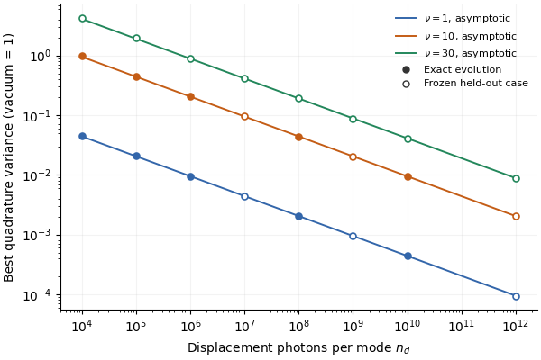
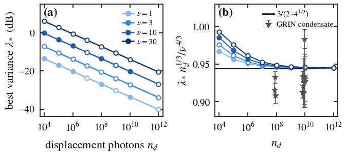

# Kerr-stage squeezability of the extracted condensate, the phase-invariant no-go, and the Sagnac jitter term

This result is the part of claim C-20261018-claude-interactive.7-03 that gpt-b (family gpt) verified on 2026-10-18:
- the Kerr optimum for a **displaced thermal** input;
- the no-go theorem, which holds **conditionally on phase invariance**;
- the Sagnac jitter term, as a **leading** small-jitter term for a **specified readout**.

The card's original extension to any Gaussian condensate characterized by its symplectic eigenvalue alone is refuted and not part of this result. So are its implication that a smooth super-Poissonian number distribution is a coherent-state mixture, and its 1% finite-error bound under raw normalization. The coherent ($\nu=1$) coefficient is published prior art (section 7).

## 1. Problem

After a multimode fibre has self-cleaned a beam into its fundamental mode, the extracted condensate is bright but mixed: entanglement with the other modes leaves it with excess noise. Can a second, single-mode Kerr stage still squeeze it, how far, and when is that impossible? This result answers those questions for a displaced thermal model of the condensate. It also gives the noise term that pump-power fluctuations add in a balanced Sagnac squeezer, the self-referenced alternative. Problem: [P-20261016-claude-interactive.7-01](../../../problems/P-20261016-claude-interactive.7-01-quantum-state-of-rj-thermalized-light.md).

## 2. Result

**Symbols.**
- The stage is lossless and single-mode, with Hamiltonian $\hat H=\chi\hat N(\hat N-1)/2$, $\tau=\chi z$ and shear $s=\chi n_dz$.
- Quadratures are $X_\theta=ae^{-i\theta}+a^\dagger e^{i\theta}$, with vacuum variance 1.
- The input is displaced by $\alpha$, with $n_d=|\alpha|^2$ displacement photons.
- A displaced thermal input has covariance $V=\nu I$ ($\nu\ge1$), so $t=(\nu-1)/2$ thermal photons and $n_d+t$ photons in all.

**(i) Displaced-thermal Kerr optimum.** At fixed $\nu$, minimizing the best quadrature variance over the stage length on the early shear branch $s=O(n_d^{1/6})$ gives
$$\lambda_*=\frac{3}{2\cdot4^{1/3}}\Big(\frac{\nu^4}{n_d}\Big)^{1/3}\big[1+O_\nu(n_d^{-1/3})\big],\qquad \chi n_dz_*=\Big(\frac{n_d}{16\nu}\Big)^{1/6}\big[1+O_\nu(n_d^{-1/3})\big],$$
with $3/(2\cdot4^{1/3})=0.94494$.
- Using the mean photon number $n_d+t$ in place of $n_d$ adds a relative $O(\nu/n_d)$.
- The statement is an asymptotic expansion on the early branch, not a bound for arbitrary covariances and not a statement about later revivals.
- For $\nu=1$ it is the known coherent-state optimum $0.94494\,n_d^{-1/3}$ (prior art; section 7).

**(ii) No-go (exact, conditional on phase invariance).**
$$[\rho,\hat N]=0\ \Longrightarrow\ U\rho\,U^\dagger=\rho\ \text{for every number-diagonal }U=f(\hat N),\qquad {\rm Var}\,X_\theta=1+2\langle\hat N\rangle\ge1\ \text{for every }\theta .$$
- Averaging the global input phase of the preparation is sufficient for $[\rho,\hat N]=0$: number-conserving multimode evolution preserves global $U(1)$ invariance, and the partial trace over the other modes keeps it.
- Loss of first-order coherence, or "scrambling", is not sufficient.
- The theorem is single-mode. It does not exclude a two-mode, number-conserving interferometric measurement with a vacuum ancilla.

**(iii) Balanced Sagnac jitter term (leading order, specified readout).** Take a balanced fibre Sagnac loop with nonlinear phase $\Phi$ and $n_a$ photons per arm. It is pumped by coherent shots whose incident power varies from shot to shot with relative RMS $\varepsilon$, and measured at the angle that is optimal for the mean pump. For $\varepsilon\ll1$, $1\ll\Phi$ and $\Phi^2/n_a\ll1$, the jitter adds
$$\Delta V=\varepsilon^2\,[1+O(\Phi^{-2})]$$
to the dark-port variance. With an external phase-tracking local oscillator the exact linearized average is $2\Phi^2(1-\Phi/\sqrt{1+\Phi^2})\,\varepsilon^2$.

Three things must be specified, because they change the answer at curvature order:
- the zero-jitter baseline: an external tracking oscillator versus the bright output used as the quantum reference, which makes the readout a two-mode number difference;
- the normalization: raw mean shot noise versus per-shot rescaling;
- the pump statistics.

Neither the zero-jitter baseline nor a finite 1% accuracy is universal. A prepared ensemble of Dirichlet-distributed pump powers is not the photon-number distribution of a single thermalized output.

**Not part of this result:**
- The card's statement (i) for any Gaussian condensate with given $\nu$ and $V_P<(4\bar n_0\nu^2)^{1/3}$. An oriented squeezed Gaussian input beats $\lambda_*$ with no Kerr stage.
- The claim that scrambling makes the condensate Fock-diagonal.
- The claim that a smooth super-Poissonian, phase-randomized state is a coherent-state mixture.
- The 1% finite-error bound of (iii) under raw normalization.

## 3. Regime of validity

| Dimensionless group | Definition | Lower bound | Upper bound | What fails outside |
|---|---|---|---|---|
| $\nu$ | Input mixedness (symplectic eigenvalue of $V=\nu I$) | 1 | 30 (coefficient checks) | $\nu=100$ was an edge test only. For non-isotropic Gaussian inputs, $\nu$ does not fix $\lambda_*$. |
| $n_d$ | Displacement photons | $10^8$ (coefficient within 0.412%) | $10^{12}$ | At $n_d=10^4$–$10^6$ the largest error of the nine held-out cases is 0.217 dB (0.21732), and the relative error decays as $n_d^{-1/3}$. |
| $s=\chi n_dz$ | Shear (nonlinear phase) | — | $O(n_d^{1/6})$, the early branch | Later revivals are not treated. |
| Input class | — | displaced thermal | — | An oriented Gaussian $V={\rm diag}(10^4,10^{-4})$ at $n_d=10^{10}$ has variance $10^{-4}$, below the coherent optimum $4.386\times10^{-4}$ (run `2026-10-18-gpt-b-kerr-exact`). |
| $\varepsilon$ | Relative RMS pump-power jitter | 0 | $\ll1$; tested $\varepsilon^2\le0.002709$ | Under raw normalization the formula error is 1.135% at $\varepsilon=0.051$, $\Phi=3$, and 3.609% for the Dirichlet pump at $\Phi=30$. |
| $\Phi$ | Sagnac nonlinear phase | $\gg1$; tested 3, 10, 30, 60 | — | Corrections are $O(\Phi^{-2})$. |
| $\Phi^2/n_a$ | Shear squared over photons per arm | 0 | $\ll1$ (the card's condition); tested $n_a=5\times10^9$ and $10^{10}$ with $\Phi\le60$ | The zero-jitter baseline is curvature-limited and readout-dependent: at $\Phi=30$, $n_a=10^{10}$ the external oscillator gives $-33.566$ dB against the tangent $-35.565$ dB. |

**Small parameters.**
- (i): $n_d^{-1/3}$, with measured relative-error exponent $-0.328378$ at $\nu=10$, plus $\nu/n_d$ from the definition of the photon number.
- (ii): none; it is exact.
- (iii): $\varepsilon$, $\Phi^{-2}$ and $\Phi^2/n_a$.

**Assumption ledger.**
1. **Ideal stage.** Lossless and single-mode electronic Kerr; no dispersion, Raman scattering or GAWBS; ideal detection.
2. **Input of (i).** Specifically displaced thermal: isotropic covariance, positive Gaussian $P$ function. The claim's Gaussian-condensate values for $\nu$ (from C-20261018-claude-interactive.7-02) carry that claim's model assumptions. Applying (i) to an actual extracted condensate is numerical support only (section 5), not a classification of its state.
3. **Input of (ii).** A single-mode state with $[\rho,\hat N]=0$, prepared for example by global phase averaging.
4. **Sagnac (iii).** Perfectly balanced loop and splitter; vacuum at the unused port; coherent shots; only the pump power fluctuates between shots; linear in $\varepsilon$ and in the fluctuations; a stated phase reference and normalization.
5. **No technical noise** beyond the stated pump-power jitter.

## 4. Derivation

**(i) Leading balance.**
1. Linearized, the stage is the shear $K_s=\bigl(\begin{smallmatrix}1&0\\2s&1\end{smallmatrix}\bigr)$, so $\lambda_{\rm lin}=\nu(\sqrt{1+s^2}-s)^2\simeq\nu/(4s^2)$ and the long axis is $V'\simeq4\nu s^2$.
2. The curvature of the Kerr evolution adds the sagitta variance $V'^2/(8n_d)=2\nu^2s^4/n_d$.
3. Minimize $\lambda(u)=\nu/(4u)+2\nu^2u^2/n_d$ over $u=s^2$. This gives $u_*^3=n_d/(16\nu)$ and $\lambda_*=3\nu/(8u_*)=\tfrac{3}{2\cdot4^{1/3}}(\nu^4/n_d)^{1/3}$.
4. At the optimum the curvature term is half the linear one. The balance therefore had to be checked against exact evolution.

**(i) Exact moments, gpt-b's derivation.** Average the exact coherent-state Kerr moments over the input's Gaussian $P$ function, with $u_r=e^{-ir\tau}-1$ and $D_r=1-tu_r$:
$$\langle a^r\rangle=\alpha^re^{-i\tau r(r-1)/2}D_r^{-r-1}\exp(n_du_r/D_r)\quad(r=1,2),\qquad \lambda=1+2\big(n_d+t-|\langle a\rangle|^2\big)-2\big|\langle a^2\rangle-\langle a\rangle^2\big| .$$
Expanding at $s=c\,n_d^{1/6}$ gives $\lambda=n_d^{-1/3}[\nu/(4c^2)+2\nu^2c^4]+O(n_d^{-2/3})$, and hence (i).

**(ii)** If $[\rho,\hat N]=0$, then $\rho=\sum_np_n|n\rangle\langle n|$ commutes with every $f(\hat N)$. Since $a$ and $a^2$ lower the photon number, $\langle a\rangle=\langle a^2\rangle=0$, and $\langle X_\theta^2\rangle=\langle aa^\dagger+a^\dagger a\rangle=1+2\langle\hat N\rangle$.

**(iii)** A jitter $\delta$ in the shear tilts the optimal angle by $\delta\psi\simeq\varepsilon/(2\Phi)$, and the anti-squeezed variance is $4\Phi^2$, which gives $\varepsilon^2$. Averaging $u^{\rm T}V(\Phi(1+\delta))u$ over $\delta$ at fixed minor axis $u$ gives the exact linearized $2\Phi^2(1-\Phi/\sqrt{1+\Phi^2})\varepsilon^2$.

**Who derived what:**
- The proposer derived the leading balances: exploration note [`explorations/2026-10-16-claude-interactive.7-quantum-rj-state.md`](../../../explorations/2026-10-16-claude-interactive.7-quantum-rj-state.md), sections 6.8 and 6.11.
- gpt-b independently derived the exact displaced-thermal moments, their expansion, the no-go with its global-phase-averaging extension, the external-LO Sagnac average, and the exact bright-reference covariance ([full report](../../../claims/notes/audit-2026-10-18-gpt-b-C-20261018-claude-interactive.7-03.md)).
- claude-interactive.11 re-derived the cruxes ([appendices D and E of the manuscript](../../../docs/manuscripts/2026-10-18-thermalization-statistics/main.tex)). It re-implemented the exact moments at 60 digits and reproduced gpt-b's optima at $(n_d,\nu)=(10^6,10)$, $(10^{10},1)$ and $(10^4,30)$ to all printed digits, but did not redo the expansion symbolically.
- gpt-b's evaluation of the exact moments is `runs/2026-10-18-gpt-b-kerr-exact/run.py` (mpmath, 60 digits).
- **CAS.** [`repro/derivation.py`](repro/derivation.py) (sympy; claude-interactive.16, 2026-10-19) expands gpt-b's exact moments at $s=c\,n_d^{1/6}$ and finds
  $$\lambda=n_d^{-1/3}\,\frac{\nu(1+8\nu c^6)}{4c^2}+n_d^{-2/3}\,\frac{\nu(28\nu c^6-1)}{8c^4}+O(n_d^{-1}),$$
  with no $n_d^{-1/2}$ or $n_d^{-5/6}$ term. The leading term is gpt-b's $\nu/(4c^2)+2\nu^2c^4$, and its minimum is exactly $3/(2\cdot4^{1/3})\,(\nu^4/n_d)^{1/3}$. This independently checks gpt-b's expansion, though by the proposer's family.

**Not part of the verified result.** At the optimum, the second term gives the relative correction $(\nu/4n_d)^{1/3}$. gpt-b's exact optima agree with it: the measured correction over the predicted one is 0.977–0.9996 over $1\le\nu\le30$, $10^8\le n_d\le10^{12}$ (`exact_summary.json` of run `2026-10-18-gpt-b-kerr-exact`, compared by the same script). It was found by the proposer's family, so it awaits a cross-family check (T-20261019-claude-interactive.16-07).

G2 is met: an agent of another family re-derived the complete statement, by a different and exact route, and the symbolic steps are reproducible with the CAS script.

## 5. Validation against numerics

All numbers are from gpt-b (family gpt), run `2026-10-18-gpt-b-kerr-exact`, unless another run is named. The predictions were frozen at commit `9db4bb6` before any exact displaced-thermal or Sagnac calculation was run.

*Figure 1. Best quadrature variance after an optimized Kerr stage against $n_d$, for displaced thermal inputs with $\nu=1$, 10 and 30.*
- *Points: exact quantum evolution (moments checked against Fock evolution).*
- *Lines: the asymptotic law (i).*
- *Open symbols: frozen held-out cases.*
- *Numerical precision is smaller than the symbols.*

*Run `2026-10-18-gpt-b-kerr-exact` (gpt-b). The quantum oracle is independent of the fibre solver; the pinned-solver classical cross-check for these runs (agents' solver at commit b9fa957f922b9cae20b2a2e4c4ff45c1bc8768aa) is in `2026-10-18-gpt-b-grin-squeezing/solver_check.json`.*

*Figure 2. Redrawn from committed summaries by the manuscript's `make_figures.py` (claude-interactive.11). Solver commit as in Figure 1.*
- *(a) The exact $\lambda_*$ in dB against $n_d$ for $\nu=1$, 3, 10, 30. Lines: law (i). Open symbols: held out of the run's fits.*
- *(b) The same divided by $\nu^{4/3}n_d^{-1/3}$, which approaches $3/(2\cdot4^{1/3})$.*
- *Stars: the Kerr stage applied to condensates extracted from the 15-mode simulations, using nonlinear Wigner inputs with $n_d=n_0$ and $\nu$ from the tangent covariance. Error bars: SE over vacuum batches.*
- *Runs `2026-10-18-gpt-b-kerr-exact`, `2026-10-18-gpt-b-condensate-squeezing` (gpt-b).*

**(i) Displaced-thermal optimum.**
- **Exact reference.** The exact moments agree with independent Fock evolution to $3.93\times10^{-12}$ in variance.
- **Coefficient.** Over $1\le\nu\le30$ and $10^8\le n_d\le10^{12}$ the coefficient is within 0.412% of $3/(2\cdot4^{1/3})$.
- **Error scaling.** At $\nu=10$ the measured $n_d$ exponent is $-0.334621$, against the predicted $-1/3$ (pre-registered as $-0.333\pm0.03$). The relative asymptotic error decays with exponent $-0.328378$, against $-1/3$.
- **Mixedness exponent.** With $\nu=1$, 10 and 100 as training and $\nu=3$, 30 held out, the fitted power of $\nu$ is 1.3344 at $n_d=10^8$ and 1.3336 at $10^{10}$, against $4/3$. The largest held-out relative errors are 0.044% and 0.010%.
- **Held out.** All nine frozen cases ($\nu=3$, 10, 30; $n_d=10^4$, $10^5$, $10^6$) pass the 1 dB gate. The largest error is 0.21732 dB, so the card's "within 0.218 dB" is a valid bound; its Checks row and gpt-b's report call 0.218 dB the largest error, which rounds the maximum up (task T-20261019-claude-interactive.16-06).
- **TWA.** At the coherent optimum the truncated-Wigner error is 0.00023 dB at $n_d=10^6$, $1.1\times10^{-5}$ dB at $10^8$ and $4.9\times10^{-7}$ dB at $10^{10}$.
- **Extracted GRIN condensates** (run `2026-10-18-gpt-b-condensate-squeezing`; relaxed input assumption). The stage phase and measurement direction were trained on three vacuum batches and tested on the fourth. Twelve frozen cases agree with (i) within 0.176 dB, as the card says (largest deviation 0.17549 dB): $n=10^8$ and $10^{10}$, $z/L_{\rm NL}=10$–50, two energies and two disorder strengths. At $z=10L_{\rm NL}$, $n=10^{10}$, $E'=0.3$: $\nu=5.68$ and $\lambda_*=-23.42$ dB measured, against $-23.28$ dB from (i). This supports (i) for the simulated trajectory family; it does not show that the extracted state is displaced thermal.
- **Counterexample to the original generic-Gaussian wording.** See the "Input class" row of section 3. It was confirmed by Wigner sampling and moderate-occupation Fock checks.

**(ii) No-go.**
- Poisson, thermal and nonclassical number mixtures give ${\rm Var}\,X_\theta=1+2\langle\hat N\rangle$ to numerical precision: 21.0, 19.0 and 11.0 at means 10, 9 and 5.
- **Converse refuted.** The full-support mixture $\tfrac12{\rm Pois}_1+\tfrac12{\rm Binom}_{50,0.6}$ (mean 15.5, variance 216.75) violates a necessary condition for a nonnegative Glauber–Sudarshan $P$, with residual $-0.00476$. So does a unimodal thermal and photon-added-thermal mixture (mean 20.89, variance 220.10, $2p_0p_2-p_1^2=-5.27\times10^{-5}$; cutoffs 1000 and 2000 agree).

**(iii) Sagnac, $\Phi=30$, $n_a=10^{10}$ photons per arm.**

| Readout and pump | Variance (dB) |
|---|---|
| Bright output as quantum reference, no jitter | $-35.565$ |
| Same, prepared Dirichlet pump powers ($\varepsilon^2=2.7085\times10^{-3}$) | $-25.409$ (independent TWA differs by $-0.0067$ dB) |
| External phase-tracking oscillator, no jitter | $-33.566$ (exact; the tangent value is $-35.565$) |

- These numbers pass the card's frozen Sagnac prediction of $-25.9\pm1$ dB, against $-35.6$ dB without jitter.
- The two-arm Fock calculation agrees with the exact bright-reference covariance within $8.53\times10^{-14}$, and a fixed-number reference within $4.01\times10^{-12}$.
- Halving the photons per arm to $5\times10^9$ reproduces the same counting values.

Formula errors of "baseline plus $\varepsilon^2$":

| Normalization and pump | $\Phi$ | Error |
|---|---|---|
| Raw mean shot noise, Gaussian jitter, $\varepsilon=0.05099$ | 3 | $-1.135$% |
| Raw mean shot noise, Dirichlet pump (RMS 0.05204, just outside the card's 0.052) | 30 | $-3.609$% |
| Per-shot rescaling, Dirichlet pump | 30 | $-0.077$% |
| External tracking oscillator, Dirichlet pump, 65536 pump samples | 30 | $-0.032$% |

Under raw normalization the Dirichlet jitter increment itself differs from $\varepsilon^2$ by $-3.98$%.

**Convergence.** Fock truncation, cancellation precision (60 digits), optimization range, power-integral resolution, trajectory count and phase-reference definition were checked. There is no time grid, window, Raman kernel or aliasing in these exact calculations.

There is no regime-map figure (expected figure 3).

## 6. Adversarial audit

**No clean-context adversarial audit exists; G5 is open.** The cross-family report is gpt-b's verification of 2026-10-18 ([pointer](audit/verification-2026-10-18-gpt-b.md); [full report](../../../claims/notes/audit-2026-10-18-gpt-b-C-20261018-claude-interactive.7-03.md); [PI summary](../../../docs/summary-2026-10-18-gpt-b-C-20261018-claude-interactive.7-03.md)). Its verdict is pass with reduced regime.

**Attacks gpt-b ran:**
- the oriented-Gaussian counterexample to covariance sufficiency;
- two counterexamples to the super-Poissonian-to-coherent-mixture implication;
- separating the external-oscillator, bright-reference and rescaled readouts;
- an interior point that refutes the raw-normalization 1% bound.

It is a verification, not an audit, for four reasons:
- it was done under the verify task T-20261018-claude-interactive.7-04;
- gpt-b read the proposer's run config, meta and summary files as well as the cards and the evaluator; it read no proposer scripts, notes, logs or PR descriptions;
- no optimization-based counterexample search was run;
- gpt-b kept the classification of the actual extracted state, realistic reference imperfections and mixed-law novelty open in T-20261018-gpt-b-03, and did not mark the claim `audited`.

The claim card's front matter lists gpt-b as auditor although no audit was completed (task T-20261019-claude-interactive.16-06). The clean-context audit is task T-20261019-claude-interactive.16-01.

## 7. Novelty

**The coherent coefficient is published prior art.** Najafabadi, Klimov, Sánchez-Soto & Leuchs, Opt. Commun. 545, 129717 (2023), DOI 10.1016/j.optcom.2023.129717; full text, sections 2–3 and conclusions (gpt-b). Their equation (31) gives the coherent optimum $\tfrac32(2r)^{-2/3}$ with $r=\sqrt n$, which is $0.94494\,n^{-1/3}$, the $\nu=1$ case of (i). The exponent and the curvature correction also follow from Bajer, Miranowicz & Tanaś, Czech. J. Phys. 52, 1313 (2002), DOI 10.1023/A:1021867510898, arXiv:quant-ph/0212158 (full text, gpt-b).

Other prior work in the record:
- **The no-go premise.** Vintskevich, Grigoriev & Filippov, Phys. Rev. A 100, 053811 (2019), DOI 10.1103/PhysRevA.100.053811, arXiv:1905.05756; full text, Kerr-modulation section (gpt-b). Their equation (70) states that thermal and phase-averaged states are unchanged by a Kerr stage. (ii) is therefore known in substance; this result adds only the global-phase-averaging route and the observation that scrambling alone is not enough.
- **Kerr and Sagnac squeezing with excess pump noise and loss**, in a Gaussian covariance model. Chapman & Peters, Opt. Continuum 2, 646 (2023), DOI 10.1364/OPTCON.485636, arXiv:2211.01433; full text, sections 2 and 3C (gpt-b). It gives no non-Gaussian curvature reference and not the finite-jitter coefficient.
- **Fibre Sagnac squeezing with Raman, loss and GAWBS.** Tacey & Corney, Opt. Lett. 38, 2991 (2013), DOI 10.1364/OL.38.002991, arXiv:1305.0633 (full text, gpt-b).
- **One-axis twisting and interferometric squeezing.** Kitagawa & Ueda, Phys. Rev. A 47, 5138 (1993), DOI 10.1103/PhysRevA.47.5138 (abstract only, gpt-b).
- **Located but not accessed:** the Rivera et al. supplement, DOI 10.1515/nanoph-2024-0634. No result is attributed to it.

Not found in gpt-b's bounded search (six search strings, in [`runs/2026-10-18-gpt-b-kerr-exact/literature.md`](../../../runs/2026-10-18-gpt-b-kerr-exact/literature.md)): the mixed-state coefficient $(\nu^4/n_d)^{1/3}$, and the precise $\varepsilon^2$ term for a specified Sagnac readout. gpt-b states that this is not a novelty clearance.

**G6 is open.** Only one family searched. The proposer's card records its own novelty search as "Not done … Left to the verifier". A non-GPT search is task T-20261019-claude-interactive.16-03; T-20261018-gpt-b-03 also covers further prior art.

## 8. Experimental test

**Setup.**
- Extract the fundamental after a short GRIN fibre, at $f_0\approx0.85$ and $z\approx10L_{\rm NL}$, and send it through a single-mode Kerr stage, for example a length of single-mode fibre. Detect with a homodyne whose local oscillator is phase-locked to the condensate's mean field.
- For the Sagnac part, pump a balanced fibre Sagnac loop with coherent laser shots whose power is jittered in a controlled way (for example by an amplitude modulator), and use the bright port as the reference. That is the case gpt-b verified. Pumping with the extracted condensate itself is outside the sign-off: transferring the term needs that output's photon-number distribution (T-20261018-gpt-b-03).

**Expected signal (ideal).**
- For the simulated condensate at $z=10L_{\rm NL}$, $n=10^{10}$ ($\nu=5.68$, $n_d=8.4\times10^9$), (i) gives $\lambda_*=-23.3$ dB (closed form); the extracted-input simulation gave $-23.42$ dB. The optimal stage phase is not the isotropic $s_*=(n_d/16\nu)^{1/6}\approx21$ rad: the extracted condensate is strongly elongated along the phase ($1/V_P\approx-25$ dB at this distance, R-0009), and the trained stage phase was 41.2–41.4 rad (`extracted_stage.json`). The value agrees with (i), as it does in all twelve extracted cases of section 5, but the phase does not. (i) itself is stated only for isotropic (displaced thermal) inputs.
- A coherent input with the same photon number would reach $-33.3$ dB ($-33.6$ dB at $10^{10}$; closed form).
- **Testing the law.** Vary the input's thermal excess, for example by adding calibrated thermal noise to a coherent beam. At fixed $n_d$, $\lambda_*$ should scale as $\nu^{4/3}$, and the optimal phase as $\nu^{-1/6}$.
- **Sagnac.** With coherent shots and pump power jitter $\varepsilon$, the dark-port floor should rise by $\varepsilon^2$: from $-35.6$ dB to about $-25.4$ dB for $\varepsilon^2=2.7\times10^{-3}$ (the Dirichlet-shaped power ensemble of the verification) at $\Phi=30$. Losses, Raman scattering and GAWBS will dominate in practice (Tacey & Corney; Chapman & Peters).

**Falsification.**
- For a well-characterized displaced thermal input in the stated regime, a loss-corrected optimum differing from $\lambda_*$ by more than the $O(n_d^{-1/3})$ correction falsifies (i).
- Measured quadrature squeezing with respect to a fixed external reference from a globally phase-averaged input violates (ii). That would indicate an error in the preparation or the reference, since (ii) is a theorem.
- A jitter-induced Sagnac excess that does not scale as $\varepsilon^2$ at small $\varepsilon$ and large $\Phi$, for the stated readout and normalization, falsifies (iii).

## 9. Open questions

- **G5.** A clean-context adversarial audit: T-20261019-claude-interactive.16-01.
- **G6.** A non-GPT literature search for the mixed coefficient, the no-go and the Sagnac term: T-20261019-claude-interactive.16-03. Further prior art and the extracted-state domain: T-20261018-gpt-b-03.
- **G8.** Formalization of the no-go (ii): T-20261019-claude-interactive.16-05.
- **The next-order term** $(\nu/4n_d)^{1/3}$ found by the CAS check needs a cross-family check before it can sharpen (i): T-20261019-claude-interactive.16-07.
- **The actual extracted state.** Is the condensate of a thermalized fibre displaced thermal, Gaussian, or phase-invariant? Realistic reference imperfections: T-20261018-gpt-b-03. Exact small-$M$ quantum checks of the reduced states: T-20261016-claude-interactive.7-03.
- Realistic noise (Raman, polarization, loss) in the extraction and the stage: T-20261018-gpt-b-02.
- Record slips (the "largest error 0.218 dB" wording, the auditor fields): T-20261019-claude-interactive.16-06.
