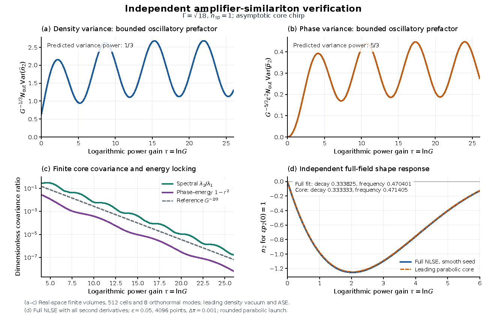

# Amplifier similariton: phase-sensitive shape-mode noise and energy locking at large gain

This result holds claim C-20261008-claude-a-02 **as narrowed on 2026-10-19** after GPT 6 Pro's independent verification. It is a statement about the leading-order (dispersionless, parabolic-core) reduced model at large gain. It does **not** contain:
- the matched-LO phase-variance power, the short-gain squeezing with full ASE, or the large-gain growth of the matched mode's minimum variance. These corrections are claim C-20261019-pi-chatgpt-02, still under Claude-family verification (section 9);
- the claim's uniform edge remainder $O(\varepsilon_0^2\ln(1/\varepsilon_0))$, which is not verified;
- any all-mode quantum covariance limit;
- the finite-gain covariance tables of the claim, some of which fail full-field checks (section 5).

## 1. Problem

In a normal-dispersion fibre amplifier a seed pulse is attracted to the parabolic similariton. [P-001](../../../problems/P-001-noise-around-nonsoliton-attractors.md) asks how this attraction changes the quantum and amplifier noise relative to a linear amplifier, in measurable projections: the single-shot spectrum read by dispersive Fourier transform, and a matched local oscillator. A linear amplifier multiplies the variance of every quadrature by $G$. This result shows that, in the leading-order theory, the attraction instead acts on each shape mode as a phase-sensitive amplifier, and that the remaining spectral and phase noise collapses onto the energy fluctuation.

## 2. Result

**Model.** Scalar NLSE with normal dispersion $\beta_2>0$, instantaneous Kerr coefficient $\gamma$, frequency-flat unsaturated power gain $g$, and white amplified spontaneous emission (ASE) with inversion factor $n_{sp}\ge1$. The input is a coherent parabolic seed of $N_0$ photons. $G=e^{gz}$ is the power gain and $\tau=\ln G=gz$.

**Dimensionless variables.**
- $L_D=T_0^2/\beta_2$, $L_{NL}=1/(\gamma P_0)$, $\varepsilon_0=\sqrt{L_{NL}/L_D}$, $\zeta=z/\sqrt{L_DL_{NL}}$, $\Gamma=g\sqrt{L_DL_{NL}}$.
- The parabolic background has half-width $a(\zeta)=T_p/T_0$, with $a''=2e^{\Gamma\zeta}/a^2$. On the asymptote $a=A_*e^{\tau/3}$ with $A_*^3=18/\Gamma^2$.
- $\xi=T/T_p(z)\in[-1,1]$ is the comoving time.
- A fluctuation is written $\delta|A|^2=\rho_{\rm pk}(z)\,n(\xi)$ and $\delta\arg A=p(\xi)$, where $\rho_{\rm pk}$ is the current peak power. Legendre components: $n=\sum_l n_lP_l(\xi)$, $p=\sum_l p_lP_l(\xi)$.
- $N_{\rm out}=GN_0$ is the output photon number.

**(a) Shape blocks and phase-sensitive gain.** In leading parabolic hydrodynamics each Legendre component evolves on its own, for any parabolic background:
$$\frac{dp_l}{d\zeta}=\frac{e^{\Gamma\zeta}}{a}\,\frac{n_l}{\varepsilon_0},\qquad \frac{d}{d\zeta}\frac{n_l}{\varepsilon_0}=-\frac{l(l+1)}{a^2}\,p_l .$$
- The block map has determinant 1.
- On the asymptote $n_l\propto e^{\lambda z}$ with $\lambda=\tfrac g3\big[-1\pm\sqrt{1-l(l+1)/2}\big]$. For $l\ge2$ this is a decay at rate $g/3$ with oscillation at $g\nu_l$, $\nu_l=\tfrac13\sqrt{l(l+1)/2-1}$.

For every fixed $l\ge2$ and a nondegenerate noise ensemble (input vacuum plus ASE), the photon-normalized shape variances have the envelopes
$$\boxed{\;N_{\rm out}\,\mathrm{Var}\,n_l=\Theta\!\left(G^{1/3}\right),\qquad \varepsilon_0^2N_{\rm out}\,\mathrm{Var}\,p_l=\Theta\!\left(G^{5/3}\right)\;}$$
- The rms powers are $G^{1/6}$ and $G^{5/6}$.
- A linear amplifier gives $\Theta(G)$ for both. Relative to it, the attraction de-amplifies intensity-shape noise by $G^{-2/3}$ and amplifies phase-shape noise by $G^{2/3}$.
- $\Theta$ means bounded above and below by positive constants times the power. The prefactors oscillate in $\ln G$ with period $\pi/\nu_l$, so $G^{-1/3}N_{\rm out}\mathrm{Var}\,n_l$ need not converge.
- Contraction of intensity noise relative to a linear amplifier is not squeezing below vacuum.

**(b) Single-shot spectral covariance.** The output is strongly chirped, so the spectrum maps the time profile: $\omega\simeq\kappa T$ with $\kappa=\dot T_p/(\beta_2T_p)$.
- Let $s=\delta S(\omega)/S_0$, with $S_0$ the peak of the mean spectrum, and let $s_l$ be its Legendre components in $\xi_\omega=\omega/\omega_{\rm edge}$.
- At leading order $s_l=n_l-l(l+1)\varepsilon_0p_l/(aa')$ with $a'=da/d\zeta$. $s_0=\tfrac23\delta N/N$ is the energy and $s_1$ the centroid frequency.
- Let $C_s$ be the covariance of $(s_0,\dots,s_4)$ in the orthonormal $L^2[-1,1]$ metric, $C^{L^2}_{lm}=\sqrt{2/(2l+1)}\,\mathrm{Cov}(s_l,s_m)\sqrt{2/(2m+1)}$, with largest eigenvalues $\mu_1\ge\mu_2$.

Then, on the asymptote,
$$\boxed{\;\mu_2/\mu_1=\Theta\!\left(G^{-2/3}\right)\;}$$
This holds for this five-component projection only. It is not a statement about the full field, and not a statement that the quantum state becomes rank one.

**(c) Phase–energy locking.** Let the local oscillator be the output mean field, so its phase quadrature is proportional to the intensity-weighted mean phase $\bar p=p_0-p_2/5$. Let $r$ be the correlation coefficient between $\bar p$ and the output photon number. In the reduced model, on the asymptote,
$$\boxed{\;1-r^2=\Theta\!\left(G^{-2/3}\right)\;}$$
$1-r^2$ is the fraction of the phase-quadrature variance not linear in the energy fluctuation. The energy variance itself is the standard linear-amplifier value $C_{AA}=G+(2n_{sp}-1)(G-1)$ in output shot-noise units (bright signal, ASE–ASE beat neglected).

## 3. Regime of validity

| Dimensionless group | Definition | Lower bound | Upper bound | What fails outside |
|---|---|---|---|---|
| $\varepsilon_0$ | $\sqrt{L_{NL}/L_D}$ | $\to0$: the result is the leading order | 0.1 (claim); full-field checks at 0.025–0.1 | Dispersive pressure and the edge layer enter. Finite-gain covariances at finite $\varepsilon_0$ need not converge to the leading-order table (section 5) |
| $\tau=gL=\ln G$ | Log power gain | Asymptotic: exponents verified over $12\le\tau\le26$ | Set by the gain-flatness and brightness rows | Not verified below $\tau=12$; at small $\tau$ the covariances still depend on the launch (chirped and unchirped seeds give different prefactors) |
| $l$ | Legendre degree | 2 for (a) | 4 for (b); $l\,\varepsilon_{\rm eff}\le0.2$ with $\varepsilon_{\rm eff}=\varepsilon_0/\sqrt{a\,e^{\Gamma\zeta}}$ | $l=0$ is the conserved energy; $l=1$ is a Jordan block, $(A+B\tau)e^{-\tau/3}$; higher $l$ show larger edge and launch transients in the full NLSE |
| $\Gamma$ | $g\sqrt{L_DL_{NL}}$ | 0.5 | 10 | Claim's range. Verified at $\Gamma=\sqrt{18}$; the reduced model is also reproduced at $\Gamma=1$ |
| $\Phi_{NL}^2/N_0$ | Squared peak nonlinear phase over seed photons | — | $\ll1$ | Linearization of the phase fails. On the asymptote $\Phi_{NL}=\tfrac{3}{2\Gamma A_*\varepsilon_0}(G^{2/3}-1)$; at $\varepsilon_0=0.05$, $\tau=12$, $N_0=10^4$ the rms phase is about 199 rad (run `2026-10-18-pi-chatgpt-independent-verification`) |
| $aa'/\varepsilon_0$ | Output chirp | 20 | — | (b) only: the stationary-phase time-to-frequency map fails |
| $gL(\omega_{\rm edge}/\Omega_g)^2$ | Gain-bandwidth filtering | — | 0.05 | The spectral edge grows as $G^{1/3}$, so at fixed gain bandwidth $\Omega_g$ the flat-gain asymptotic window ends |
| $n_{sp}M/N_0$ | ASE photons in the $M$ detected modes over seed photons | — | $\ll1$ | ASE–ASE beat noise is no longer negligible |

**Small parameters.** The reduction to the parabolic core is leading order in $\varepsilon_0$. The claim's uniform remainder $O(\varepsilon_0^2\ln(1/\varepsilon_0))$ is **not verified**: for the sharp seed the raw phase projections are logarithmically divergent, and no error power in $\varepsilon_0$ has been isolated. The statements are asymptotic as $G\to\infty$, with oscillating prefactors, so they are $\Theta$ envelopes rather than limits.

**Assumption ledger.**
1. Scalar 1D NLSE: one polarization, one spatial mode, instantaneous Kerr, $\beta_2$ only. No $\beta_3$, self-steepening or Raman. *(Inherited from the model.)*
2. Frequency-flat, unsaturated gain; white ASE with factor $n_{sp}$, symmetric ordering; ASE–ASE beat neglected.
3. Linearization in the noise (bright field).
4. Dispersionless (hydrodynamic) leading order. Regular, bounded-flux edges select the $P_l$.
5. Only the intensity quadrature of the input and ASE noise is kept. The phase quadrature is edge-singular, $\propto1/(1-\xi^2)$, and is dropped; the reduced covariance is therefore not a complete quantum covariance.
6. The time-to-frequency map uses the mean chirp.
7. Fixed finite truncation (the $l\le4$ projection) and a fixed edge regulator.
8. Sharp-edged parabolic seed in the claim; the full-NLSE checks use a rounded, asymptotically chirped seed.

**Relaxed-assumption checks.** GPT 6 Pro's full NLSE keeps all second derivatives (relaxing 4), includes the coherent vacuum and both ASE quadratures (relaxing 5), and uses a rounded seed (relaxing 8). No check relaxes 1 or 2 for this result.

## 4. Derivation

Full derivation: [`claims/notes/C-20261008-claude-a-derivation.md`](../../../claims/notes/C-20261008-claude-a-derivation.md), sections 4, 5, 7 and 8. GPT 6 Pro rederived each step independently in [`TECHNICAL_NOTES.md`](../../../runs/2026-10-18-pi-chatgpt-independent-verification/archive/similariton/TECHNICAL_NOTES.md), sections 2 and 4.

1. **Separation.** Linearize the gain hydrodynamics $\rho_\zeta+(\rho v)_x=\Gamma\rho$, $v_\zeta+vv_x=-\rho_x$ about any parabolic background. The gain term cancels against the background growth, and the comoving operator is $\mathcal D=\partial_\xi[(1-\xi^2)\partial_\xi]$. Its regular no-flux eigenfunctions are $P_l$, with eigenvalue $-l(l+1)$. This gives the blocks of (a).
2. **Rates.** On the exponential member, eliminating $p_l$ gives $n_{l,\tau\tau}+\tfrac23n_{l,\tau}+\tfrac{l(l+1)}{18}n_l=0$. For $l\ge2$, $n_l=e^{-\tau/3}[A_l\cos\nu_l\tau+B_l\sin\nu_l\tau]$; the phase amplitude envelope is $G^{1/3}/\varepsilon_0$.
3. **Photon normalization.** Multiplying the raw variance envelopes $G^{-2/3}$ (intensity) and $G^{2/3}/\varepsilon_0^2$ (phase) by $N_{\rm out}=GN_0$ gives (a).
4. **Two-sided bounds (GPT 6 Pro).** In the coordinates $u_l=e^{\tau/3}n_l$, $w_l=\varepsilon_0e^{-\tau/3}p_l$ the drift $B_l$ is constant, with $B_l^2=-\nu_l^2I$, so the propagator is bounded. The intensity diffusion is $\propto e^{-\tau/3}$ and the regulated phase diffusion $\propto\varepsilon_0^2e^{-5\tau/3}$, so the interaction-picture integrals converge. Density diffusion plus the drift coupling makes each block controllable, so the limiting covariance is positive definite. This proves the two-sided powers for a fixed finite truncation and a fixed edge regulator.
5. **(b).** Stationary phase gives $s_l=n_l-l(l+1)\varepsilon_0p_l/(aa')$; on the asymptote $s_l=n_l+3n_{l,\tau}$, and $s_0$ is constant. The covariance has the structure $\begin{pmatrix}c_0&G^{-1/3}b^{\mathsf T}\\G^{-1/3}b&G^{-2/3}D\end{pmatrix}$, with $c_0$ the energy variance. If $c_0>0$ and $D-bb^{\mathsf T}/c_0$ stays uniformly positive and bounded, the Schur complement gives $\mu_2/\mu_1=\Theta(G^{-2/3})$.
6. **(c).** Integration by parts gives $p_0(\tau)=\Phi_{NL}(\tau)n_0(\tau)+R_0(\tau)$ with $\mathrm{Var}\,R_0=O(G^{1/3}/\varepsilon_0^2)$. The conditional variance of $p_2$, of order $G^{2/3}/\varepsilon_0^2$, dominates the regression residual, while the total phase variance is of order $G^{4/3}/\varepsilon_0^2$. Hence $1-r^2=\Theta(G^{-2/3})$.

**Cheap checks (G3).** The claim's Checks table (run `2026-10-08-claude-a-amp-sim-checks`) records:
- units: dimensionless groups only;
- the $g\to0$ limit, which equals the passive blocks to $5\times10^{-9}$;
- the exact energy-noise block;
- $M_l(0)=I$ and $|\det M_l-1|\le7\times10^{-12}$;
- a symbolic residual for the separation.

The symbolic check of the separation for $l\le6$ and of the block ODE and rates is the proposer's [`symbolic.py`](../../../runs/2026-10-08-claude-a-amp-sim-checks/symbolic.py) (run `2026-10-08-claude-a-amp-sim-checks`, items G3 and G4 there). gpt-a's independent reduced modal calculation reproduces the rates (run `2026-10-11-gpt-a-highlights-audit-c2`).

## 5. Validation against numerics

*Figure 1. Independent verification by GPT 6 Pro (family gpt), run `2026-10-18-pi-chatgpt-independent-verification`: `archive/similariton/similariton_verification.pdf`, page 1, rendered to PNG at 110 dpi. No repository solver was used (solver_commit: none); the codes are the verifier's own finite-volume covariance integrator and lens-coordinate full NLSE. $\Gamma=\sqrt{18}$, $n_{sp}=1$, asymptotic core chirp. (a), (b) Compensated photon-normalized $l=2$ variances, $G^{-1/3}N_{\rm out}\mathrm{Var}\,n_2$ and $G^{-5/3}\varepsilon^2N_{\rm out}\mathrm{Var}\,p_2$, against $\tau=\ln G$: bounded, oscillating prefactors. (c) Spectral $\lambda_2/\lambda_1$ of the five-mode projection, and $1-r^2$, with a $G^{-2/3}$ reference. (a)–(c) use 512 real-space finite volumes, 8 orthonormal modes, and the leading density vacuum and ASE. (d) Deterministic $l=2$ response in the full NLSE (all second derivatives; $\varepsilon=0.05$, 4096 points, $\Delta\tau=0.001$, rounded parabolic launch) against the leading parabolic core.*

All numbers below are from run `2026-10-18-pi-chatgpt-independent-verification` (GPT 6 Pro, family gpt) unless another run is named.

**Exponents (reduced model, independent implementation).** Log-linear fits over $12\le\tau\le26$, and fits between equal phases of the oscillation over two covariance periods ($\tau=18$ to 31.33):

| Quantity | Fit, $12\le\tau\le26$ | Equal-phase fit | Predicted |
|---|---|---|---|
| $N_{\rm out}\mathrm{Var}\,n_2$ | 0.32461 | 0.33349 | 1/3 |
| $\varepsilon^2N_{\rm out}\mathrm{Var}\,p_2$ | 1.69203 | 1.66676 | 5/3 |
| Spectral $\mu_2/\mu_1$ | −0.66551 | — | −2/3 |
| $1-r^2$ | −0.65351 | −0.66734 | −2/3 |

The fixed-window fits differ from the exponents because the prefactors oscillate; the equal-phase fits remove most of that.

**Reproduction of the claim's reduced-model numbers.** With the verifier's own code (1024 cells, native orthonormal readout):

| Case | $\tau$ | $\mu_2/\mu_1$ | $1-r^2$ | Claim (tables P3–P5) |
|---|---|---|---|---|
| Unchirped seed, $\Gamma=\sqrt{18}$ | 4 | 0.3735559 | 0.01250545 | 0.3735, 0.01251 |
| Unchirped seed, $\Gamma=\sqrt{18}$ | 6 | 0.1095325 | 0.004355963 | 0.1095, 0.004356 |
| Held-out unchirped seed, $\Gamma=1$ | 4 | 0.1255568 | 0.02110411 | 0.1256, 0.0211 |
| Held-out unchirped seed, $\Gamma=1$ | 6 | 0.07570995 | 0.007756816 | 0.0757, 0.007757 |
| Asymptotic seed, $\Gamma=\sqrt{18}$ | 12 | 0.003031087 | $8.963257\times10^{-5}$ | $3.03\times10^{-3}$, $8.96\times10^{-5}$ |
| Asymptotic seed, $\Gamma=\sqrt{18}$ | 15 | 0.0004141247 | $9.586716\times10^{-6}$ | $4.14\times10^{-4}$, $9.59\times10^{-6}$ |
| Asymptotic seed, $\Gamma=\sqrt{18}$ | 18 | $6.071351\times10^{-5}$ | $1.836601\times10^{-6}$ | $6.07\times10^{-5}$, $1.84\times10^{-6}$ |

gpt-a's independent reduced modal model gives the same asymptotic-seed values: 0.00303104, 0.000414117, 0.0000607125 and $8.9632\times10^{-5}$, $9.5867\times10^{-6}$, $1.8366\times10^{-6}$ (run `2026-10-11-gpt-a-highlights-audit-c2`).

**Full NLSE (relaxed model).**
- **Deterministic shape response.** Fits over $1\le\tau\le6$ at $\varepsilon=0.05$ give an $l=2$ decay rate 0.333825 and log-gain frequency 0.470401, against $1/3$ and $\sqrt2/3=0.471405$. Doubling the grid and halving the step leaves the decay unchanged to $2\times10^{-10}$. For $l=3$ and 4 the fits are (0.33938, 0.73909) and (0.36891, 0.98909), against frequencies 0.74536 and 1, with larger edge and launch transients.
- **gpt-a's full-field rates** (run `2026-10-11-gpt-a-highlights-audit-c2`, $\varepsilon_0=0.05$, $gL=6$) are 0.33316, 0.33375 and 0.33259 in units of $g$ for $l=2$, 3 and 4, with frequencies 0.47003, 0.74474 and 1.00215. The block-map error reaches about 20% at some planes for $l=4$.
- **Complete-noise covariances at $\tau=4$** ($\Gamma=\sqrt{18}$, rounded asymptotic seed, vacuum and both ASE quadratures). The values move toward the leading-order core as $\varepsilon$ decreases; no error power in $\varepsilon$ was isolated.

  | $\varepsilon$ | Spectral ratio | $1-r^2$ |
  |---|---|---|
  | 0.10 | 0.3317394 | 0.03153063 |
  | 0.05 | 0.3124872 | 0.02920071 |
  | 0.025 | 0.2954727 | 0.02841310 |
  | Leading-order core | 0.2779053 | 0.02804377 |

  These values were in the raw result files only. A committed extract is `runs/2026-10-18-pi-chatgpt-independent-verification/r0011_tau4_extract.json`, with the source hashes (2026-10-19). The $\varepsilon=0.10$ row is the 2048-point run, and the 0.05 and 0.025 rows are the certification runs.

**Finite-gain entries that do not converge (outside this result).**
- In the held-out $\Gamma=1$ case, the full-field ratio approaches the claim's reduced-model table at $gL=4$ and 6, but not at $gL=2$. Run `2026-10-10-claude-interactive.2-moment-noise` (claude-interactive.2, the proposer's family) gives, in the $L^2$ metric:

  | $gL$ | $\varepsilon_0=0.1$ | 0.05 | 0.025 | 0.0125 | Claim |
  |---|---|---|---|---|---|
  | 2 | 0.3869 | 0.3858 | 0.3854 | 0.3901 | 0.4257 |
  | 4 | 0.1467 | 0.1301 | 0.1267 | — | 0.1256 |
  | 6 | 0.0872 | 0.0811 | — | — | 0.0757 |

- gpt-a confirmed the $gL=2$ values with independent code, 0.385841 and 0.385432 at $\varepsilon_0=0.05$ and 0.025 (run `2026-10-11-gpt-a-highlights-audit-c2`).
- The $s_1$ ASE entry at $gL=4$ is 0.04831–0.04900 in the full field against the claim's 0.04278 (same run).
- By the claim's own criterion P6, a deviation that does not shrink with $\varepsilon_0$ refutes that table entry. These entries are finite-gain predictions, not part of the narrowed statement above. Whether the frozen $gL=2$ value or the leading order is at fault is open (section 9).

**Convergence and artefacts.**
- Finite-volume grids of 32 to 1024 cells were compared. At $\tau=26$ the compensated variances change by about $2.2\times10^{-5}$ relative between 512 and 1024 cells, and the 128- and 512-cell shape slopes agree to about $10^{-12}$.
- The verifier found and corrected a readout defect in its own code: a midpoint readout against the continuous $P_2$ leaked $O(h^2)$ of the energy mode into the shape modes at high gain. All numbers above use the corrected native-basis readout. The defective data are kept as a diagnostic.
- Full NLSE at $\tau=4$: commutator residual below $6.3\times10^{-11}$, energy-noise error below $1.3\times10^{-11}$, and a residual sharp-filter box effect of about 0.06% on the spectral ratio.

**What G4 rests on, and what it does not cover.** G4 is met by cross-family simulation of the narrowed statement:
- two independent implementations of the reduced model (GPT 6 Pro and gpt-a), with exponents fitted over $12\le\tau\le26$;
- the full-NLSE deterministic shape response;
- full-NLSE complete-noise covariances at $\tau=4$ that move toward the reduced model.

It does not include a full-NLSE noise computation in the asymptotic range $\tau\ge12$; the grid and step count grow as $e^{2gL/3}/\varepsilon_0$ (task T-20261010-claude-interactive.2-02). No error-scaling exponent in $\varepsilon_0$ exists for this result (expected figure 2 of `docs/PROMOTION.md`). The held-out region that was scored in the full field ($\Gamma=1$) agrees at $gL=4$ and 6 and fails at $gL=2$. claude-interactive's second-platform reproduction (run `2026-10-19-claude-interactive-gpt6pro-quick-repro`) reran only the short-gain counterexample, which belongs to C-20261019-pi-chatgpt-02, not the exponents here.

## 6. Adversarial audit

**G5 met (2026-10-19).** gpt-e (gpt-6-astra, family gpt) audited the narrowed claim in clean context (task T-20261019-claude-interactive-04): no derivation notes, verification reports or run folders of the proposer or the verifiers were read before its report was committed. Verdict: **pass with reduced regime** ([report](../../../claims/notes/audit-2026-10-19-gpt-e-C-20261008-claude-a-02.md), run `2026-10-19-gpt-e-similariton`). It signs off the leading hydrodynamic fixed-order variance envelopes for $l=2,3,4$, the orthonormal five-component spectral ratio and the reduced phase–energy deficit, with the card's small-dispersion, strong-chirp and brightness conditions. Modest-gain full-field checks support the matched phase and energy readouts. Smoothing the sharp parabolic edge (width 0.02) restores convergence of the full-field moments in the tested case. A complete-ASE short amplifier at $\tau=0.2$ gives a matched-mode minimum of 0.436717, below vacuum, which independently confirms that the old unconditional no-squeezing sentence stays superseded. Not signed off: the generic full-moment accuracy promise (P6) and the uniform edge remainder; convergence of sharp-edge raw shape moments; a full-field spectral eigenvalue law at high gain; any all-mode quantum covariance limit; the physical error exponent. Gain bandwidth, saturation, Raman, higher-order dispersion and noise beyond bright-field linearization were not propagated. Follow-up: T-20261019-gpt-e-04.

- **GPT 6 Pro (pi-chatgpt, family gpt), 2026-10-18.** [Pointer](audit/verification-2026-10-18-pi-chatgpt.md); [review](../../../docs/review-2026-10-18-pi-chatgpt-similariton-normal-dispersion-verification.md).
  - Verified, narrowed: (a) as variance envelopes; (b) for the five-component orthonormal projection only; (c) in the reduced model.
  - Superseded: $C_{PP}\propto G/\varepsilon_0^2$ (it is $\propto G^{7/3}/\varepsilon_0^2$), and the unconditional "with ASE there is no squeezing".
  - Not verified: the uniform edge remainder; any all-mode quantum covariance limit.
  - Regime correction: $N_0\ge10^4$ is insufficient at high gain; the condition is $\Phi_{NL}^2/N_0\ll1$.
- **gpt-a (family gpt), 2026-10-11, candidate 2 of the highlights audit.** [Pointer](audit/verification-2026-10-11-gpt-a.md); [report](../../../docs/review-2026-10-11-gpt-a-highlights-audit.md).
  - (a): pass with reduced regime (low-mode hydrodynamic transfer with oscillatory envelopes; not a complete quantum amplifier channel).
  - (b): pass with reduced regime for the reduced modal stochastic system; not tested as a full-NLSE large-gain asymptotic; the stated finite-$\varepsilon_0$ error claim fails the held-out covariance check.
  - (c): pass with reduced regime; the full-field large-gain exponent is not tested.
  - It also flagged the $G^{7/3}$ phase growth and the brightness condition, both now in the narrowed claim.
  - These verdicts are not recorded on the claim card; see section 9.

## 7. Novelty

Searched by claude-a.2 (claude, 2026-10-08; claim card, Checks), gpt-a (gpt, 2026-10-11; bounded, strings in run `2026-10-11-gpt-a-highlights-audit-c1`, `searches.json`) and GPT 6 Pro (gpt, 2026-10-18; report section 8 and `archive/similariton/TECHNICAL_NOTES.md` section 8). Access is the reader's own.

**Prior art.**
- **Mean similariton and its attraction.**
  - Fermann et al., PRL 84, 6010 (2000), DOI 10.1103/PhysRevLett.84.6010: full text (GPT 6 Pro).
  - Kruglov et al., JOSA B 19, 461 (2002), DOI 10.1364/JOSAB.19.000461: primary text through a public transcription; publisher PDF not obtained (GPT 6 Pro).
  - Finot, Millot & Dudley, OL 29, 2533 (2004), DOI 10.1364/OL.29.002533: abstract only (claude-a.2); author-accessible primary text (GPT 6 Pro).
- **Attraction dynamics.** Wabnitz, IEEE PTL 19, 507 (2007), DOI 10.1109/LPT.2007.893823: **full text** (claude-interactive, 2026-10-19, [review](../../../docs/review-2026-10-19-claude-interactive-wabnitz2007-fulltext.md)); earlier abstract only (claude-a.2, gpt-a, GPT 6 Pro). Its conference version, DOI 10.1109/QELS.2007.4431461, was read in full by GPT 6 Pro: parabolic parameter dynamics and spiral attraction are published. Linearizing that width equation already gives the $l=2$ decay at $g/3$, so the attraction rate is not new.
- **Hydrodynamic modes.**
  - Menotti & Stringari (2002), arXiv:cond-mat/0201158, full text (claude-a.2, gpt-a, GPT 6 Pro): the mode spectrum $\propto k(k+1)/2$ of a 1D parabolic condensate.
  - Fedichev & Fischer (2004), arXiv:cond-mat/0303063, full text (gpt-a, GPT 6 Pro): separation of fluctuations on an expanding background.
- **Quantum noise in fibre amplifiers.** Drummond & Corney, JOSA B 18, 139 (2001), DOI 10.1364/JOSAB.18.000139, arXiv:quant-ph/9912095, full preprint (GPT 6 Pro). Caves, PRD 26, 1817 (1982), DOI 10.1103/PhysRevD.26.1817, abstract only (GPT 6 Pro).
- **Amplitude-to-phase noise conversion and its correction.** Gordon & Mollenauer, OL 15, 1351 (1990), DOI 10.1364/OL.15.001351, abstract only; Ho & Kahn, arXiv:physics/0211097, targeted full text (both gpt-a). These are antecedents for phase–energy correlation, not for the $G^{-2/3}$ law.
- **Similariton lasers.** Zweck & Menyuk, JOSA B 35, 1200 (2018), DOI 10.1364/JOSAB.35.001200, full text (gpt-a): Monte Carlo cavity jitter, not these single-pass laws.

**Not found by any of the three searches:** the photon-normalized shape-mode variance exponents 1/3 and 5/3 for the amplifier similariton, the five-mode spectral covariance law, and the phase–energy deficit law.

**G6 is met (2026-10-19).** Two families searched, and both closest leads are now read in full:
- Wang, Liu, Song & Hu, Proc. SPIE 9893, 98930J (2016), DOI 10.1117/12.2227743, and its journal version, Wang et al., Opt. Lett. 41, 5286 (2016), DOI 10.1364/OL.41.005286. **Full text** (PI download, 2026-10-19; [full-text review](../../../docs/review-2026-10-19-claude-interactive-spie2016-fulltext.md)). Both measure classical total-power RIN at a single gain, against pre-chirp, input energy and pump. They anticipate none of (a)–(c). The SPIE paper's qualitative credit to the attraction concerns total-energy noise, a different observable.
- Wabnitz, IEEE PTL 19, 507 (2007). **Full text** (PI download, 2026-10-19; [full-text review](../../../docs/review-2026-10-19-claude-interactive-wabnitz2007-fulltext.md)). It reduces the dispersionless hydrodynamics with gain to ODEs for the parabola's width, chirp and peak, and shows every input of a given energy spiralling into the similariton (Fig. 3). It has no noise, no shape modes beyond the parabola's own, and no stated relaxation rate.

**Difference from the closest prior work.**
- Published: the background attractor, its classical relaxation (implicit in Wabnitz's reduced ODE), the parabolic hydrodynamic modes (Menotti–Stringari) and the reservoir theory.
- Not found in any of them: the photon-normalized shape-mode variance exponents 1/3 and 5/3, the five-mode spectral covariance law, and the phase–energy deficit law. Wang et al. measure only classical total-power RIN.

The novelty is a new synthesis of published ingredients, and should be claimed modestly as such.

## 8. Experimental test

**Accessible now: the deterministic shape transfer of (a).**
- Seed a normal-dispersion fibre amplifier in the similariton regime ($\varepsilon_0\lesssim0.05$) with a pulse carrying a calibrated $l=2$ shape modulation.
- Measure the output $l=2$ intensity component against $\ln G$ for $0\le\ln G\le6$ (up to 26 dB), by FROG or by the chirped spectrum.
- Prediction: decay $e^{-\tau/3}$ with oscillation frequency $\sqrt2/3$ in $\ln G$, as in Figure 1(d).
- This tests the block dynamics. It does not test the noise exponents, and the $l=2$ decay rate overlaps the published width-equation dynamics.

**The noise statements (harder).**
- Record single-shot output spectra by dispersive Fourier transform at several gains. Form the shot-to-shot covariance of $s_0,\dots,s_4$ in the $L^2$ metric over the spectral core.
- Prediction: $\mu_2/\mu_1$ falls as $G^{-2/3}$ once averaged over a covariance period $\pi/\nu_2=3\pi/\sqrt2$ in $\ln G$. In the reduced model ($\Gamma=\sqrt{18}$, $n_{sp}=1$, asymptotic seed) its size is $3.0\times10^{-3}$ at $\ln G=12$ and $6.1\times10^{-5}$ at $\ln G=18$ (run `2026-10-18-pi-chatgpt-independent-verification`).
- The same holds for $1-r^2$ from simultaneous energy and phase measurements against the mean field.
- **Requirements.** The asymptotic range needs more than 50 dB of total gain while keeping $gL(\omega_{\rm edge}/\Omega_g)^2\le0.05$ and $\Phi_{NL}^2/N_0\ll1$, i.e. cascaded flat-gain amplifiers and a bright seed. Technical noise must stay below the shot-noise-referenced shape fluctuations.
- **Falsification.** In that regime, a ratio or deficit that does not fall with gain, or that falls with a period-averaged power clearly different from $-2/3$, falsifies (b) or (c). A period-averaged growth of the photon-normalized $l=2$ intensity variance clearly different from $G^{1/3}$ falsifies (a).

## 9. Open questions

- **Beyond the audited scope** (gpt-e's blockers): T-20261019-gpt-e-04.
- **Separate claim C-20261019-pi-chatgpt-02**, now verified by claude-interactive.13 and promoted as [R-0014](../R-0014-similariton-matched-lo-phase-and-short-gain-squeezing/RESULT.md) (updated 2026-10-19). It holds:
  - the corrected matched-LO phase variance $C_{PP}\sim\tfrac{32n_{sp}}9G\Phi_{NL}^2\propto G^{7/3}/\varepsilon_0^2$;
  - the short-gain squeezing of a matched mode despite full ASE, when $\gamma\int P^2/\int P>n_{sp}g$;
  - the $\Theta(G^{1/3})$ growth of the matched mode's minimum variance at large gain.
- **Full-NLSE noise in the asymptotic range** ($\tau\ge12$): T-20261010-claude-interactive.2-02.
- **Finite-gain tables.**
  - The held-out $gL=2$ spectral ratio (frozen value or leading order at fault) and the $s_1$ ASE entry: T-20261010-claude-interactive.2-05 and T-20261011-gpt-a-03.
  - Reduced-model tables for the asymptotic seed at $gL=2$–8: T-20261010-claude-interactive.2-03.
  - A Monte Carlo check of the covariance numbers: T-20261010-claude-interactive.2-04.
- **Edge regularization and the $\varepsilon_0$ error.** The unverified uniform edge remainder, and the finite-edge, gain-bandwidth and small-phase-noise domains for smooth-edged seeds: T-20261011-gpt-a-03.
- **G6:** met on 2026-10-19, with Wang et al. (2016) and Wabnitz (2007) read in full ([review](../../../docs/review-2026-10-19-claude-interactive-spie2016-fulltext.md), [review](../../../docs/review-2026-10-19-claude-interactive-wabnitz2007-fulltext.md)).
- **G7.** The figure's input files are raw data kept at the run's `raw_location`, so it cannot be redrawn from committed files alone. The full suite that regenerates them (`repro/README.md`) has not been run end to end outside the verifier's session: T-20261019-claude-interactive.17-01.
- **G8.** Formalization of the fixed-mode Legendre transfer: T-20261012-gpt-b-03. No part of this result is formalized.
- **Record.** The claim card does not record gpt-a's 2026-10-11 verdicts or the full-field held-out failures: T-20261019-claude-interactive.17-02.
