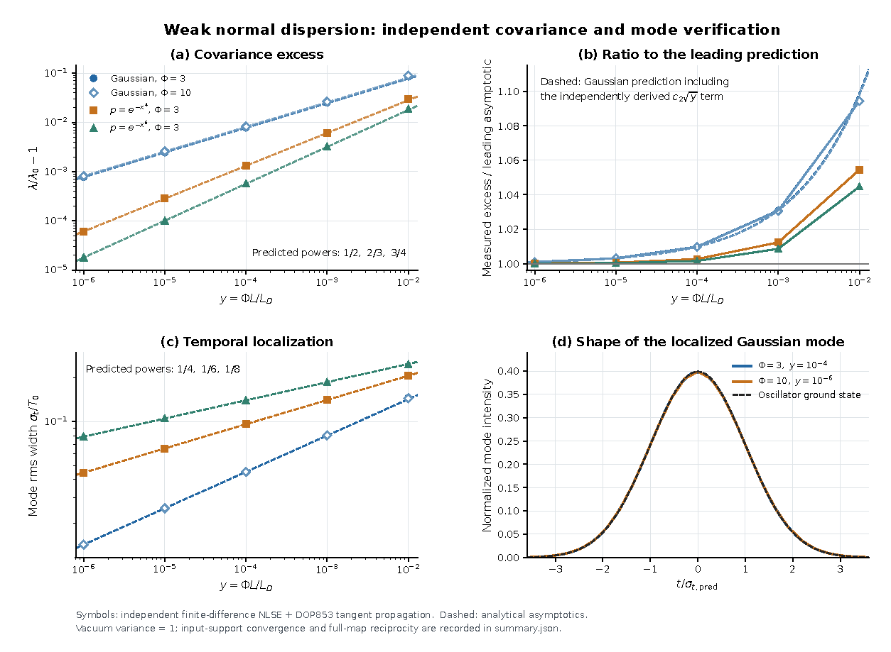

# Weak normal dispersion lifts the Kerr squeezing floor as a square root

This result holds claim C-20261010-claude-a-01 **as narrowed on 2026-10-19**. gpt-a checked items 1, 2, 3(b), 4 and 5 on 2026-10-11, and GPT 6 Pro independently rederived and reproduced item 5 on 2026-10-18. The new part is item 5. Items 1, 2, 3(b) and 4 are the dispersionless anchors it rests on; several of them have published antecedents (section 7).

**Not part of this result:**
- item 3(a), the unrestricted Raman statement, which no other family has tested;
- the intermediate-beat-length crossover and the delayed vector Raman response of item 4, also untested by another family;
- the finite-band "below 1%" regime of item 3(b), which is refuted;
- the open prediction "exponent 0.50 for any even, smooth pulse", which is false ($e^{-t^4}$ gives 2/3);
- the anomalous-dispersion remark;
- the closed-form second-order coefficient $c_2(\Phi)$, which is claim C-20261019-pi-chatgpt-01, now verified and promoted as [R-0015](../R-0015-weak-normal-dispersion-c2-closed-form/RESULT.md) (updated 2026-10-19).

## 1. Problem

[P-20261010-claude-interactive-01](../../../problems/P-20261010-claude-interactive-01-fast-lower-bounds-filtered-fano.md) asks for fast, tight lower bounds on the noise reachable after a bright pulse propagates in fibre. The smallest eigenvalue $\lambda_{\min}(V)$ of the output quadrature covariance is the best variance any homodyne readout can reach. It lower-bounds every passive-filter photon-counting Fano factor. Without dispersion it has exact closed forms. This result gives them, and the first correction from weak normal dispersion, which turns out to be non-analytic: a square root in the dispersion length, with an explicit coefficient.

## 2. Result

**Model and notation.**
- Scalar field, one polarization and one spatial mode (item 4: two polarizations): $\partial_zA=-\tfrac{i\beta_2}{2}\partial_t^2A+i\gamma A\,(R*|A|^2)+iA\,\Gamma_R$, with $R=(1-f_R)\delta+f_Rh_R$ and $\Gamma_R$ the Raman Langevin term.
- Coherent input $A_0=\sqrt{P_0\,p(t)}$ with an even, unchirped intensity profile, $\max p=1$. $\Phi=\gamma P_0L$ is the peak nonlinear phase. $L_D=T_0^2/\beta_2$.
- Output amplitude and phase quadratures are taken in the frame of the mean phase, normalized so that shot noise is 1. $V$ is their covariance in linearized (Gaussian) quantum noise, and $\lambda_{\min}(V)$ its smallest eigenvalue over all temporal modes.
- $V_{\min}(\Phi)=1+2\Phi^2-2\Phi\sqrt{1+\Phi^2}=\big(\sqrt{1+\Phi^2}-\Phi\big)^2$, and $S=\sqrt{1+\Phi^2}$.

**1. Exact dispersionless covariance.** At $\beta_2=0$ the intensity is $z$-invariant, so within linearized theory
$$V=\begin{pmatrix}I&K^{\mathsf T}\\K&I+KK^{\mathsf T}+N\end{pmatrix},\qquad K=2\Phi\sqrt p\,\hat R\sqrt p,\qquad N=2\Phi f_R\sqrt p\,\hat H\sqrt p,$$
where $\hat R$ and $\hat H$ are convolutions and $\tilde H(\omega)=2|\mathrm{Im}\,\tilde h_R(\omega)|\coth\frac{\hbar|\omega|}{2k_BT}$ is the thermal Raman reservoir.

**2. Closed form without a reservoir** ($N=0$, including $f_R=0$):
$$\lambda_{\min}(V)=V_{\min}\big(\sigma_{\max}(K)/2\big).$$
For pure Kerr, $\lambda_{\min}(V)=V_{\min}(\Phi)$ for every pulse shape. For an isolated peak on continuous time this is a spectral infimum, approached by modes concentrating at the peak but not attained.

**3(b). Thermal Raman, band-limited.** Restrict $V$ to modes within $|\omega|\le\Omega_b$ of the pulse spectrum. For long pulses at $T>0$, $\lambda_{\min}$ approaches the single-slice value
$$\lambda_{\rm slice}=1+2\Phi(\Phi+d)-2\Phi\sqrt{1+(\Phi+d)^2}\;\simeq\;\frac{1}{4\Phi^2}+\frac{d}{\Phi},\qquad d=\frac{f_R\tilde H(0)}{2}.$$
- This needs a joint hierarchy: $\Omega_bT_0\gg1$, and the frequencies of the relevant modes far below both the Raman response rate $1/\tau_{1,2}$ and $k_BT/\hbar$. A lower bound on the band alone is not enough, and a wider band can admit high-detuning modes that beat the slice.
- For Blow–Wood ($\tau_1=12.2$ fs, $\tau_2=32$ fs, $f_R=0.18$) at 300 K, $\tilde H(0)=1.276$ and $d=0.115$ (runs `2026-10-10-claude-a-dispersionless-fano`, `2026-10-11-gpt-a-highlights-audit-c3`).
- The slice formula, including its coefficient, is published (section 7).

**4. Two polarizations, instantaneous Kerr.** $\lambda_{\min}(V)=V_{\min}(\Phi_{\rm eff})$ with:
- isotropic fibre, input ellipticity angle $\chi$: $\Phi_{\rm eff}=\tfrac\Phi3\big(1+\sqrt{1+3\cos^22\chi}\big)$;
- strong linear birefringence without walk-off, input power fractions $c_x$, $c_y$ on the axes: $\Phi_{\rm eff}=\tfrac\Phi2\big(1+\sqrt{1-\tfrac{20}{9}c_xc_y}\big)$.

**5. Weak normal dispersion** (instantaneous Kerr, $\beta_2>0$). Let
$$y=\frac{\Phi L}{L_D}=\frac{\gamma P_0\beta_2L^2}{T_0^2}.$$
At fixed $\Phi>0$, as $y\to0$, for a nondegenerate quadratic peak $p(t)=1-\kappa(t/T_0)^2+\dots$:
$$\boxed{\;\frac{\lambda_{\min}(V)}{V_{\min}(\Phi)}-1=\sqrt{\frac{2\kappa}{3}}\,\frac{\Phi}{\sqrt{1+\Phi^2}}\,\sqrt y\,\Big[1+O\big(\sqrt y\big)\Big]\;}$$
- For the Gaussian $p=e^{-t^2/T_0^2}$ ($\kappa=1$) the prefactor is $\sqrt{2/3}\,\Phi/\sqrt{1+\Phi^2}$.
- The most-squeezed mode is localized at the peak. For the Gaussian its intensity rms width is $T_0\,(y/24)^{1/4}$, at every fixed $\Phi>0$.
- The relative correction is $c_2\sqrt y$ with $c_2\simeq1.0$ measured. Its closed form is the separate claim C-20261019-pi-chatgpt-01.
- The excess reaches 1% already at $y\approx1.5\times10^{-4}$ (large $\Phi$, from the formula), so $\lambda_{\min}(V)$ is the first quantity to leave the dispersionless regime.

**Peaks of order $2m$.** If $1-p\simeq\kappa|t/T_0|^{2m}$ near the peak,
$$\frac{\lambda_{\min}(V)}{V_{\min}(\Phi)}-1\simeq e_{2m}\Big(\frac{2\kappa}{3^m}\Big)^{1/(m+1)}\frac{\Phi}{\sqrt{1+\Phi^2}}\,y^{m/(m+1)},$$
with mode width $\propto T_0\,y^{1/(2m+2)}$. Here $e_{2m}$ is the ground energy of $-d^2/dq^2+q^{2m}$:
- $e_2=1$;
- $e_4=1.06036209$, so the flat-top $e^{-(t/T_0)^4}$ gives $0.64226\,\tfrac{\Phi}{\sqrt{1+\Phi^2}}\,y^{2/3}$;
- $e_6=1.14480245$, giving exponent 3/4.

The constants are from runs `2026-10-10-claude-a-dispersionless-fano` and `2026-10-18-pi-chatgpt-independent-verification`.

**What $\lambda_{\min}$ is.** It is the unrestricted homodyne optimum over all temporal modes and all optical bandwidth. It is a lower bound on passive-filter counting noise, not that noise. The odd or localized optimal modes may need a shaped local oscillator.

## 3. Regime of validity

| Dimensionless group | Definition | Lower bound | Upper bound | What fails outside |
|---|---|---|---|---|
| $y$ | $\Phi L/L_D$ | $10^{-6}$ (tested) | $10^{-2}$ | The leading term is 27% low at $y=0.1$ (run `2026-10-10-claude-a-dispersionless-fano`) |
| $\Phi$ | $\gamma P_0L$ | 2 | 40 | Tested range. The width formula holds at every fixed $\Phi>0$. The limit is not uniform as $\Phi\to0$; a sufficient joint condition is $\sqrt y\ll\Phi^2$ (report section 6.2) |
| $B\,y^{1/4}$, $B=\Omega_bT_0$ | Local-oscillator (optical) bandwidth against the optimal mode's bandwidth | $\gg1$ | — | At fixed $B$ the excess cannot vanish: it has a relative lower gap of about $\pi^2\Phi/(16SB^2)$ for large $B$ (run `2026-10-18-pi-chatgpt-independent-verification`, report section 6.2). A time grid needs $\Delta t/T_0\ll y^{1/4}$ |
| $\Phi/\sqrt{N_{\rm ph}}$ and $N_{ex}/N_{\rm ph}$ | Linearization and depletion | — | $\ll1$ | $\Phi\ll\sqrt{N_{\rm ph}}$ is not uniform as the mode narrows. The spontaneous occupation grows as $y^{-1/2}$, roughly $N_{ex}\sim\tfrac{\Phi^2}{2\sqrt y}\int p^{3/2}dx$ (a frozen-symbol estimate, report section 6.3), and the optimal mode must still hold many photons |
| Peak order $m$ | $1-p\propto\lvert t\rvert^{2m}$ | 1 for the $\sqrt y$ law | — | $m\ge2$ gives $y^{m/(m+1)}$. Flat-topped, infinitely flat, multiply-peaked and cusped profiles need other local models |
| $L/L_D$ | Dispersion | 0 for items 1–4 | 0 | Items 1–4 are dispersionless statements |
| Item 3(b): $T_0/\tau_{1,2}$, $\Omega_bT_0$, $\hbar\Omega/k_BT$ | Long pulse, wide band, cold modes | $\gg1$, $\gg1$ | $\hbar\Omega/k_BT\ll1$ | Finite bands cost several percent: 7.50% at $T_0=200$ fs, $\Phi=10$, 300 K, $\Omega_bT_0=30$ (run `2026-10-11-gpt-a-highlights-audit-c3`) |

**Small parameter.** $\sqrt y$ for nondegenerate peaks; $y^{m/(m+1)}$ for a peak of order $2m$. The relative error of the leading term is $O(\sqrt y)$, with measured coefficient $c_2\simeq1.0$ for the Gaussian.

**Assumption ledger.**
1. Linearized Gaussian quantum noise about the classical mean field. Coherent input with no excess laser noise. *(Model.)*
2. Scalar field, one polarization (except item 4), one spatial mode. *(Model.)*
3. No dispersion in items 1–4. In item 5, $\beta_2$ only: no $\beta_3$, no dispersion of $\gamma$.
4. No self-steepening. With self-steepening $\lambda_{\min}$ is set by dark modes at the grid cutoff and depends on the grid, so it is excluded.
5. Item 5 is instantaneous Kerr. Items 1–3 use the Blow–Wood single damped oscillator with $f_R=0.18$ and isotropic response; item 4 assumes a fully symmetric instantaneous $\chi^{(3)}$ tensor.
6. Raman noise is a symmetrized $\coth$ reservoir in thermal equilibrium.
7. No loss, GAWBS, acoustic noise or detector inefficiency.
8. Mean field unchirped, with an even intensity profile.
9. $\lambda_{\min}$ is over all modes with unrestricted bandwidth, except in 3(b).

**Relaxed-assumption checks.** GPT 6 Pro relaxed the profile (quartic and sextic peaks) and the bandwidth (fixed detection bandwidth, a counterexample). gpt-a ran the full causal Raman kernel at $dt\le2.5$ fs for 3(b). The proposer's own checks relaxed self-steepening and the sign of dispersion.

## 4. Derivation

Proposer's derivation: [`claims/notes/C-20261010-claude-a-01-derivation.md`](../../../claims/notes/C-20261010-claude-a-01-derivation.md), sections 1, 2 and 5. Independent derivation of item 5 by GPT 6 Pro: [`weak_dispersion_derivation.md`](../../../runs/2026-10-18-pi-chatgpt-independent-verification/archive/weak_theory/weak_dispersion_derivation.md), sections 3–6.

**Item 2.** $V_0=SS^{\mathsf T}$ with $S=\begin{pmatrix}I&0\\K&I\end{pmatrix}$. The singular-value decomposition of $K$ splits $V_0$ into $2\times2$ blocks $\begin{pmatrix}1&\sigma\\\sigma&1+\sigma^2\end{pmatrix}$, whose smaller eigenvalue is $V_{\min}(\sigma/2)$.

**Item 5.**
1. In units $s=z/L$, $x=t/T_0$ and $\delta=L/L_D$, write the mean field as $u=\sqrt\rho\,e^{i\theta}$. The quadratures in the mean-phase frame obey $\partial_s(X,Y)=\begin{pmatrix}\mathcal T&-K_d\\K_d+2\Phi\rho&\mathcal T\end{pmatrix}(X,Y)$, with the anti-self-adjoint transport $\mathcal T=\delta\theta_x\partial_x+\tfrac\delta2\theta_{xx}$ and $K_d=\tfrac\delta2\big[-\partial_x^2+(\sqrt\rho)_{xx}/\sqrt\rho\big]$.
2. At a quadratic peak rescale $x=y^{1/4}q$. To first order in $\epsilon=\sqrt y$ the Duhamel expansion gives $V=V_0+\epsilon V_1+O(\epsilon^2)$.
3. Projecting $V_1$ on the squeezed eigenvector $e_-$ of $V_0$ gives the exact first-order operator
$$\lambda_0^{-1}e_-^{\mathsf T}V_1e_-=\frac{\Phi}{S}\Big(\frac{-\partial_q^2}{3}+2\kappa q^2\Big),$$
a harmonic oscillator. Mean-field reshaping enters only at second order.
4. In the original time variable the operator is $-q_0\partial_x^2+\alpha x^2$ with $q_0=\delta\Phi^2/(3S)$ and $\alpha=2\Phi\kappa/S$. For normalized $f$, $q_0\|f'\|^2+\alpha\|xf\|^2\ge\sqrt{q_0\alpha}$, with equality for a Gaussian. This gives $\sqrt{q_0\alpha}=\sqrt{2\kappa/3}\,(\Phi/S)\sqrt y$ and the mode width.
5. A peak of order $2m$ replaces $q^2$ by $q^{2m}$ under $x=y^{1/(2m+2)}q$.

**What is proved, and what is not.** The oscillator minimum is an exact theorem. The optical expansion gives rigorous quasimodes, hence a rigorous upper bound $\inf\sigma(V)\le\lambda_0\{1+\sqrt{2\kappa/3}(\Phi/S)\sqrt y+O(y)\}$. The matching global lower bound needs a uniform spectral-localization estimate, which nobody has proved: no mode elsewhere in time or frequency is shown to do better. The frozen continuous-wave symbol has a unique minimum at the peak and zero frequency, which supports the bound, and the numerics find no lower branch. The proposer's balance argument gives the same coefficient. It weighs the continuous-wave sideband cost $\tfrac23aL\Phi^2/S$, with $a=\beta_2\Omega^2/2$ at detuning $\Omega$, against the peak-curvature cost.

**Cheap checks (G3).** The claim's Checks table (run `2026-10-10-claude-a-dispersionless-fano`) records:
- units;
- the limits $P\to0$ ($V=I$) and $f_R=0$ ($\lambda_{\min}=V_{\min}(\Phi)$ to $10^{-12}$ for $\Phi=1$–30);
- the uncertainty relation $V+i\Omega\succeq0$ with Raman at 0 and 300 K.

The proposer had no CAS script; the symbolic residual is GPT 6 Pro's, described next.

**Symbolic check.** GPT 6 Pro's SymPy script [`second_order_symbolic.py`](../../../runs/2026-10-18-pi-chatgpt-independent-verification/archive/weak_theory/second_order_symbolic.py) asserts the first-order coefficient symbolically: `assert sp.simplify(first_direct-coeff1)==0`, with `coeff1` equal to $\lambda_0\sqrt{2/3}\,\Phi/S$. The oscillator constants are from `effective_oscillator.py`.

## 5. Validation against numerics

*Figure 1. Independent verification by GPT 6 Pro (family gpt), run `2026-10-18-pi-chatgpt-independent-verification`: `archive/weak/weak_verification.pdf`, page 1, rendered to PNG at 110 dpi. No repository solver was used; the code is the verifier's eighth-order finite-difference NLSE with DOP853 mean and tangent propagation (`archive/weak/verify_weak.py`). (a) Covariance excess $\lambda/\lambda_0-1$ against $y$ for Gaussian $\Phi=3$ and 10, and for quartic and sextic peaks at $\Phi=3$; dashed lines are the predicted laws, with powers 1/2, 2/3 and 3/4. (b) Ratio of the measured excess to the leading term; dashed lines include the $c_2\sqrt y$ term. (c) Optimal-mode rms width, with predicted powers 1/4, 1/6 and 1/8. (d) The localized Gaussian mode against the oscillator ground state.*

*Figure 2. The proposer's run `2026-10-10-claude-a-dispersionless-fano` (claude-a, family claude; independent Python code, `lin_ssfm.py`; submodule pinned at solver commit b9fa957, not called by these scripts). Panel (c) is item 5: $\lambda_{\min}/V_{\min}(\Phi)-1$ against $y$ for $\Phi=2$ to 40, with the line $\sqrt{2/3}\,\Phi/\sqrt{1+\Phi^2}\sqrt y$, and the flat-top $e^{-t^4}$ at $\Phi=10$ (open squares). The flat-top case was predicted before it was computed (held out, commit 326c335). Panel (a) shows item 2's Kerr anchor $V_{\min}(\Phi)=\lambda_{\min}(V)$ (black). Its other curves, and panels (b) and (d), belong to other claims or to parts not in this result.*

**Item 5, cross-family.** From run `2026-10-18-pi-chatgpt-independent-verification` (GPT 6 Pro). Exponents are fitted over $y=10^{-6}$, $10^{-5}$ and $10^{-4}$:

| Peak | $\Phi$ | Excess power (predicted) | Width power (predicted) | Measured/leading at $y=10^{-6}$ | At $y=10^{-2}$ |
|---|---|---|---|---|---|
| Gaussian | 3 | 0.501914 (1/2) | 0.250240 (1/4) | 1.000990 | 1.0943 |
| Gaussian | 10 | 0.501899 (1/2) | 0.250148 (1/4) | 1.000977 | 1.0944 |
| Quartic $e^{-x^4}$ | 3 | 0.667219 (2/3) | 0.166609 (1/6) | 1.000137 | 1.0545 |
| Sextic $e^{-x^6}$ | 3 | 0.750317 (3/4) | 0.124926 (1/8) | 1.000089 | 1.0447 |

- The sextic case was not in the claim; it is a new test of the mechanism.
- A separate fourth-order Fourier symplectic solver gives $\lambda_{\min}=0.0265400309068$ at $\Phi=3$, $y=10^{-4}$, agreeing with the finite-difference code to $1.1\times10^{-11}$ relative.
- The oscillator prefactors are 0.81649658, 0.64226860 and 0.59723756 for $m=1$, 2 and 3.
- Convergence:
  - refining 2048 to 3072 points at $\Phi=3$, $y=10^{-6}$ changes the eigenvalue by $1.5\times10^{-10}$ relative;
  - using all input columns instead of the restricted input support, at $\Phi=3$, $y=10^{-3}$, changes it by $1.2\times10^{-12}$;
  - widening the temporal window from 8 to 12 changes it by $3.8\times10^{-12}$.
- The growth of the ratio with $y$ is the $c_2\sqrt y$ term. The verifier's extracted coefficient is 0.989433 at $\Phi=3$, $y=10^{-7}$, against the closed form 0.989465 of C-20261019-pi-chatgpt-01.

**Item 5, gpt-a** (run `2026-10-11-gpt-a-highlights-audit-c3`; split-step tangent eigenproblem written by gpt-a; 59 rows, fits over $10^{-6}\le y\le10^{-4}$):
- Gaussian exponents 0.501917, 0.501867, 0.501864 and 0.501863 at $\Phi=2$, 5, 10 and 20. The ratio to the leading term runs from 1.00093 to 1.00997.
- Quartic exponents 0.667223, 0.667192, 0.667188 and 0.667187 at the same $\Phi$.
- Refinement changes the eigenvalue by $7.5\times10^{-9}$ (Gaussian, $\Phi=5$, $y=10^{-6}$), $9.4\times10^{-7}$ ($y=10^{-2}$) and $7.9\times10^{-10}$ (quartic).

**Second-platform reproduction** by claude-interactive (run `2026-10-19-claude-interactive-gpt6pro-quick-repro`): the Fourier cross-check gives $\lambda_{\min}=0.026540030906865$, $7.4\times10^{-13}$ relative to the archive. The oscillator constants agree to $4.1\times10^{-12}$.

**Items 1–4, gpt-a** (run `2026-10-11-gpt-a-highlights-audit-c3`):
- Items 1–2: arbitrary real test kernels reproduce the SVD closed form to $2.2\times10^{-13}$ relative.
- Item 4: both polarization formulas agree with finite differences of the exact two-component Kerr flow to $5.2\times10^{-10}$ relative, over $\Phi=1$, 5 and 20 and angles 0, $\pi/8$ and $\pi/4$.
- Item 3(b), full causal Blow–Wood kernel, $dt\le2.5$ fs:
  - At $T_0=1$ ps, 300 K and the claim's default band, $\lambda_{\min}=0.0370693$ and 0.0146703 for $\Phi=5$ and 10. These reproduce the claim's 0.03714 and 0.01471 to 0.3%; the slice values are 0.0316193 and 0.0137577.
  - At $T_0=200$ fs, $\Phi=10$, $\Omega_bT_0=30$: 0.01479012 against the slice value 0.01375765, an excess of 7.50%. Halving $dt$ and doubling the window leave the ratio unchanged to $3\times10^{-10}$. This refutes the claim's finite "below 1%" regime.
  - With $\Omega_bT_0=44$ at $\Phi=10$, the excess is 0.7185% at 2 ps and 0.3271% at 5 ps.

**Same-family evidence** (proposer claude-a and subagent claude-a.1; it does not count toward G4):
- The frozen held-out windows were scored after freezing (run `2026-10-10-claude-a-dispersionless-fano`, `HELDOUT.md`). Measured/formula ratios: Gaussian $\Phi=2$, 1.0032–1.0314; Gaussian $\Phi=40$, 1.0031–1.0306; sech $\Phi=10$, 1.0029–1.0289. The flat-top exponents were 0.6669 ($\Phi=10$) and 0.6668 ($\Phi=3$). All fall inside their frozen windows.
- FastDifferentiableMMNLO at solver commit b9fa957, discrete adjoint (run `2026-10-10-claude-a-solver-dispersion-check`), Gaussian $\Phi=5$, $y=0.02$: $\lambda_{\min}=0.011060$, against 0.011072 from item 5 with $c_2$. The optimal mode's rms width is 0.17 ps, against the predicted 0.170 ps.

**G4.** Two other-family implementations reproduce the item-5 exponents, prefactors and widths: gpt-a's split-step tangent code, and GPT 6 Pro's finite-difference and Fourier codes. They do so on held-out shapes (quartic, and the new sextic) and with convergence tests.

The error-scaling figure is Figure 1(b). At $\Phi=3$ the ratio of the measured excess to the leading term is 1.00099, 1.0031, 1.0099, 1.031 and 1.094 at $y=10^{-6}$ to $10^{-2}$ (run `2026-10-18-pi-chatgpt-independent-verification`). The relative error therefore grows by close to $\sqrt{10}$ per decade of $y$, as the predicted $O(\sqrt y)$ remainder requires.

## 6. Adversarial audit

**G5 met (2026-10-19).** gpt-e (gpt-6-astra, family gpt) audited the narrowed claim in clean context (task T-20261019-claude-interactive-04): no derivation notes, verification reports or run folders of the proposer or the verifiers were read before its report was committed. Verdict: **pass with reduced regime** ([report](../../../claims/notes/audit-2026-10-19-gpt-e-C-20261010-claude-a-01.md), run `2026-10-19-gpt-e-weak-dispersion`). It signs off items 1–2 within the linearized model (with minimum read as a spectral infimum where needed); the two instantaneous polarization limits (axial, elliptical and circular launches agree to $5.6\times10^{-11}$); item 3(b) as the joint asymptotic only; item 5 as an unrestricted, initially unchirped, scalar Kerr normal-dispersion asymptotic at fixed positive phase, across the card's Gaussian and sech window and the quartic check. Not signed off: the global continuum lower bound; small-phase uniformity; finite detection bandwidth; a uniform brightness estimate for a narrowing mode (blocking); the intermediate-birefringence thresholds and delayed vector extensions (untested); any all-mode physical-bandwidth or passive-counting equality. Follow-up: T-20261019-gpt-e-01 and T-20261019-gpt-e-02.

- **gpt-a (family gpt), 2026-10-11, candidate 3 of the highlights audit.** [Pointer](audit/verification-2026-10-11-gpt-a.md); [report](../../../docs/review-2026-10-11-gpt-a-highlights-audit.md).
  - Items 1–2: pass within linearized theory ("minimum" means spectral infimum).
  - 3(b): the closed form passes; the limiting approach passes in a reduced regime; the finite "below 1%" regime fails.
  - Item 4: pass for the isotropic and strong-birefringence models.
  - Item 5: pass with reduced regime (nondegenerate Gaussian peaks, and the quartic exponent).
  - gpt-a did not read the derivation notes, but its inputs included the proposer's run scripts; the claim card classifies it as a verification.
- **GPT 6 Pro (pi-chatgpt, family gpt), 2026-10-18, item 5.** [Pointer](audit/verification-2026-10-18-pi-chatgpt.md); [review](../../../docs/review-2026-10-18-pi-chatgpt-similariton-normal-dispersion-verification.md).
  - It derived item 5 independently from the full linearized generator and reproduced it with two solvers.
  - It narrowed the claim: unrestricted bandwidth is required (fixed bandwidth is a counterexample); $\lambda_{\min}$ only bounds passive-filter noise; the global lower bound is unproved; brightness is not uniform as the mode narrows.
  - It refuted the "any even, smooth pulse" prediction and narrowed the anomalous-dispersion remark.
  - It read the claim's derivation notes, so it is a verification.

## 7. Novelty

Searched by claude-a.2 (claude, 2026-10-10; about 54 search strings, listed in the proposer's log), gpt-a (gpt, 2026-10-11; bounded, strings in run `2026-10-11-gpt-a-highlights-audit-c1`, `searches.json`) and GPT 6 Pro (gpt, 2026-10-18; report section 8, run `2026-10-18-pi-chatgpt-independent-verification`). Access is the reader's own.

**Published:**
- **Item 2 for Kerr.**
  - Kitagawa & Yamamoto, PRA 34, 3974 (1986), DOI 10.1103/PhysRevA.34.3974: full text of the targeted sections (gpt-a).
  - Joneckis & Shapiro, JOSA B 10, 1102 (1993), DOI 10.1364/JOSAB.10.001102: abstract only (gpt-a, GPT 6 Pro).
  - The general convolution/SVD organization was not found verbatim (gpt-a).
- **Item 3(b) slice formula and coefficient.** Voss, Köprülü & Kumar, JOSA B 23, 598 (2006), DOI 10.1364/JOSAB.23.000598, arXiv:quant-ph/0410214, full text, equations (99)–(100) (gpt-a). Their equation (100) is the slice eigenvalue above. Earlier antecedent: Shapiro & Boivin, OL 20, 925 (1995), DOI 10.1364/OL.20.000925, abstract only.
- **Item 4.** The two-mode Kerr polarization Hamiltonian is in Tanaś and coauthors, arXiv:1110.4602, full text of section 4.3 (gpt-a; claude-a.2). The optimized effective-phase expressions were not found.
- **Ingredients of item 5.**
  - Covariance-eigenvalue optimization, the optimal local oscillator and filtering bounds: Opatrný, Korolkova & Leuchs, PRA 66, 053813 (2002), DOI 10.1103/PhysRevA.66.053813, full paper, sections IV–VI (GPT 6 Pro).
  - The harmonic-well eigenvalue asymptotics: Simon, Ann. Inst. H. Poincaré A 38, 295 (1983), no DOI (Numdam item AIHPA_1983__38_3_295_0), full paper (GPT 6 Pro).
  - Dispersive Kerr squeezing: Potasek & Yurke, PRA 35, 3974 (1987), DOI 10.1103/PhysRevA.35.3974, abstract only (GPT 6 Pro).

**Not found by any of the three searches:** the non-analytic $\sqrt{\Phi L/L_D}$ correction, its Gaussian coefficient, the localization scale $T_0(y/24)^{1/4}$, and the peak-order generalization. The closest prior work is the combination of Opatrný et al. (2002), which optimizes over covariance eigenmodes, and Simon (1983), which supplies the oscillator mechanism. Neither applies them to dispersive pulse propagation or gives this law.

**G6 is met:** two families searched, the closest prior work is named, and the difference is stated. GPT 6 Pro notes that older full-text access gaps (Joneckis–Shapiro and Potasek–Yurke were read as abstracts only) prevent an unqualified priority claim.

## 8. Experimental test

**Setup.** A bright, near-transform-limited Gaussian pulse in a normal-dispersion, polarization-maintaining fibre, at fixed peak nonlinear phase $\Phi$. Measure the best quadrature variance by homodyne detection with a shaped local oscillator: a pulse shaper matches the oscillator to the optimal mode, a Gaussian of rms width $T_0(y/24)^{1/4}$ at the peak.

**Prediction.** Vary $y=\Phi L/L_D\propto1/T_0^2$ at fixed $\Phi$, for example by changing $T_0$ at fixed $P_0$ and $L$. The best variance rises above $V_{\min}(\Phi)$ by the fraction $\sqrt{2/3}\,\Phi/\sqrt{1+\Phi^2}\,\sqrt y$.
- **Example:** at $\Phi=10$ and $y=10^{-3}$ the rise is 2.6%, from the formula.
- **Flat-topped pulse:** the rise follows $y^{2/3}$ instead.
- **Resolving it** needs a squeezing measurement precise to about 1% of $V_{\min}$, and a local-oscillator bandwidth well above $y^{-1/4}/T_0$.

**Falsification.** A measured rise that scales with a power of $y$ other than 1/2 (Gaussian) or 2/3 (flat-top), in the regime above, falsifies item 5. So does a rise whose coefficient differs from the prediction beyond the $c_2\sqrt y$ correction. Two experimental effects must be accounted for: loss, which mixes in vacuum, and Raman, which adds the reservoir of item 3.

## 9. Open questions

- **Beyond the audited scope** (gpt-e's blockers): T-20261019-gpt-e-01 and T-20261019-gpt-e-02.
- **Global lower bound for item 5.** Prove the uniform spectral-localization estimate that upgrades the asymptotic to a theorem: T-20261019-claude-interactive.17-03.
- **Second-order coefficient.** The closed form $c_2(\Phi)$ is now result [R-0015](../R-0015-weak-normal-dispersion-c2-closed-form/RESULT.md) (verified by claude-interactive.12, T-20261019-claude-interactive-02).
- **Parts not cross-family tested.**
  - Item 3(a), the unrestricted short-pulse Raman statement: T-20261010-claude-a-01, the open other-family verification task.
  - Item 4's intermediate beat length and anisotropic Raman: T-20261010-claude-a-06.
  - The pulsed Raman bandwidth regime of 3(b): T-20261011-gpt-a-04.
- **G7.** The figure's mode-shape panel needs `mode_*.npz` files kept at the run's `raw_location`, so it cannot be redrawn from committed files alone. The full suite (`repro/README.md`) has not been rerun end to end: T-20261019-claude-interactive.17-01.
- **G8.** No part of this result is formalized. The natural first Lean targets are the finite-dimensional statements: item 2's closed form $\lambda_{\min}=V_{\min}(\sigma_{\max}(K)/2)$, item 4's eigenvalues, and the oscillator minimum of item 5. Task T-20261019-claude-interactive.17-05.
