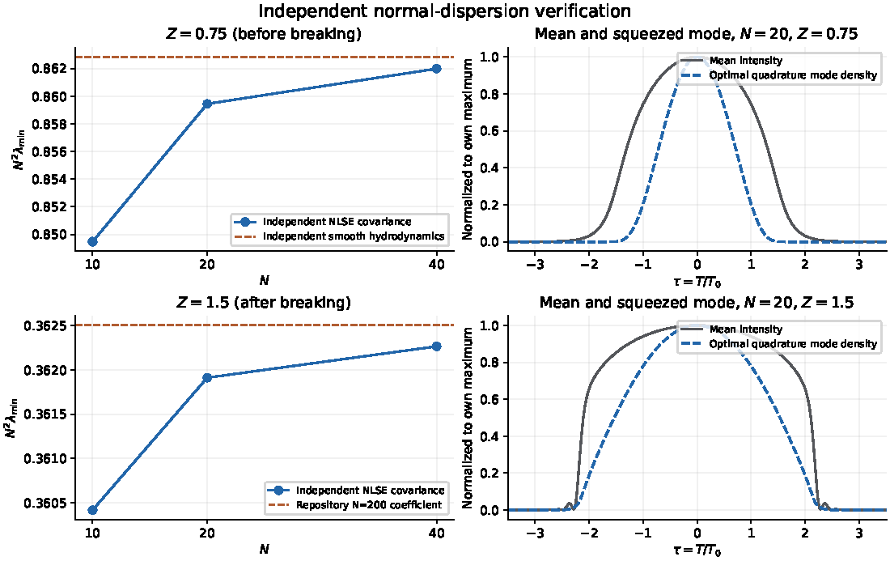

# Strong normal dispersion: the squeezing floor of a Gaussian is $\Lambda(Z)/N^2$

This result holds claim C-20261010-claude-b-01 **as narrowed on 2026-10-19** after GPT 6 Pro's independent verification. gpt-a's 2026-10-11 audit reached compatible verdicts on parts (a) and (b).

The statements carry different weight:
- **Before wave breaking**, (a) is a conditional theorem with independent numerical reproduction.
- **After breaking**, (a′) is numerically supported, with a stated sufficient condition that is unproved.
- **The passive-readout equality** in (c) is numerical.

**Not part of this result:**
- the Raman-reservoir correction, which is claim C-20261010-claude-b-03;
- the small-$Z$ coefficient (b) as a separate finding. It is the large-$\Phi$ limit of [R-0012](../R-0012-weak-normal-dispersion-lambda-min/RESULT.md) and is stated here only for continuity.

## 1. Problem

[P-20261010-claude-interactive-01](../../../problems/P-20261010-claude-interactive-01-fast-lower-bounds-filtered-fano.md) asks how much squeezing a bright pulse can show after a fibre, as a formula faster than a simulation. In normal dispersion with many dispersion lengths of nonlinearity ($N\gg1$), the pulse flattens and eventually breaks. This result reduces the best quadrature variance, over all detection modes, to one $N$-independent function $\Lambda(Z)$ of the scaled distance. $\Lambda$ is the inverse squared largest singular value of a single linear map, and it is tabulated.

## 2. Result

**System.** An unchirped Gaussian, $A(0,T)=\sqrt{P_0}\,e^{-T^2/2T_0^2}$, in lossless single-mode fibre with normal dispersion $\beta_2>0$ and instantaneous Kerr nonlinearity $\gamma$. The input is a coherent state; noise is linearized about the mean field.

**Notation.**
- $N^2=\gamma P_0T_0^2/\beta_2=L_D/L_{NL}$ and $\varepsilon=1/N$.
- $Z=z/\sqrt{L_DL_{NL}}=Nz/L_D$ is the semiclassical distance; $\Phi=NZ=\gamma P_0z$ is the peak nonlinear phase.
- $V$ is the output quadrature covariance over all temporal (equivalently spectral) modes, with shot noise 1.
- $\lambda_{\min}(V)$ and $\lambda_2(V)$ are its two smallest eigenvalues. $\lambda_{\rm pass}$ is the minimum of $V$ on the hyperplane orthogonal to the global phase direction $i\bar\alpha$, the quantity that passive linear optics plus photon counting can approach.

**The map $C_Z$.** Use the amplitude quadrature $X=\delta\rho/(2\sqrt\rho)$ and the scaled phase quadrature $\tilde Y=\varepsilon\sqrt\rho\,\delta\theta$, with $\rho=|A|^2/P_0$ and $\delta\theta$ the phase fluctuation in radians. $C_Z$ maps the input amplitude quadrature $X_0(\tau)$ to the output scaled phase $\tilde Y(\tau,Z)$, at $\tilde Y_0=0$. Its singular values $\sigma_1\ge\sigma_2\ge\dots$ are taken in $L^2(d\tau)$.
- **Before wave breaking** ($Z<Z_b$; run `2026-10-10-claude-b-nd-meanfield` gives the dispersionless gradient catastrophe at $Z_b\approx1.27\pm0.02$ and the onset of NLSE oscillations at 1.24–1.25 for $N=40$–80; the theorem-level statement uses $Z<1.25$): $C_Z$ is the linearized dispersionless (shallow-water) hydrodynamics of the defocusing NLSE, which does not depend on $N$.
- **After breaking:** the shallow-water tangent map does not exist past the gradient catastrophe. $C_Z$ is instead the limit $C_\infty$ of the full-NLSE tangent amplitude-to-scaled-phase block $C_N$ as $N\to\infty$.

**(a) Before breaking: conditional theorem.** At fixed $Z<Z_b$, as $N\to\infty$,
$$\boxed{\;\lambda_{\min}(V)=\frac{\Lambda(Z)}{N^2}\Big[1-\frac{c(Z)}{\Phi^2}+o(\Phi^{-2})\Big],\qquad \Lambda(Z)=\frac{1}{\sigma_1(C_Z)^2}\;}$$
- The relative correction is $O(N^{-2})$ at fixed $Z$.
- **The theorem.** For a real symplectic map with blocks $\begin{pmatrix}A_\varepsilon&\varepsilon B_\varepsilon\\C_\varepsilon/\varepsilon&D_\varepsilon\end{pmatrix}$, where $A,C,D$ equal their limits up to $O(\varepsilon^2)$, $B_\varepsilon=O(1)$ and $s_1=\sigma_1(C_0)>0$, one has $\lambda_{\min}=\varepsilon^2s_1^{-2}[1+O(\varepsilon^2)]$.
- **The hypotheses for the NLSE** (regular block limits) come from a formal multiple-scale reduction. They are confirmed numerically for $Z\le1$: an $\varepsilon=0$ hydrodynamic computation reproduces the $N\to\infty$ limit.
- **The continuum statement** for white vacuum on $L^2$, where $B_0$ is unbounded, needs a further Sobolev or microlocal estimate.
- **The bound $0<c\le2$** holds in all data ($Z=0.106$–3.19) but does not follow from symplecticity.

**(a′) After breaking: numerically supported.**
- If $C_N\to C_\infty$ in operator norm, and $\|A_N\|/N$, $\|D_N\|/N$ and $\|B_N\|/N^2\to0$, then $N^2\lambda_{\min}\to\|C_\infty\|^{-2}$. These hypotheses are unproved.
- Converged full-NLSE covariances support the law at $Z=1.5$ (section 5), and the proposer's oracle up to $Z=9.58$.
- No universal next-order exponent is established after breaking.

**(b) Small $Z$** (continuity with R-0012, $y=Z^2$):
$$4Z^2\Lambda(Z)=1+\tfrac{2}{\sqrt6}Z+O(Z^2),\qquad 4Z^2\Pi(Z)=1+\sqrt6\,Z+O(Z^2).$$

**(c) Second eigenvalue and passive readout.**
- $\lambda_2(V)=\Pi(Z)/N^2\,[1+o(1)]$ with $\Pi=\sigma_2(C_Z)^{-2}$.
- $\lambda_{\rm pass}=\lambda_2(V)$ in every case tested. Parity alone does not prove it: it shows only that odd modes lie in the allowed hyperplane, not that the even sector's restricted minimum is higher.
- The optimal odd mode is dark (it has zero mean amplitude). Bright-field photon counting reaches it only through a small even carrier admixture, or with an external local oscillator.

**(d) Coefficients.** From the proposer's reduced computation at $N=200$ (run `2026-10-10-claude-b-nd-semiclassical`, `curve_N200.json`; 80 Hermite input functions). The complete-grid values are GPT 6 Pro's direct $\varepsilon=0$ hydrodynamics (run `2026-10-18-pi-chatgpt-independent-verification`):

| $Z$ | $\Lambda(Z)$ | Complete grid | $4Z^2\Lambda$ | $\Pi(Z)$ | Complete grid |
|---|---|---|---|---|---|
| 0.10 | 27.234 | 27.23396 | 1.0894 | 32.02 | 31.98003 |
| 0.20 | 7.4551 | 7.455461 | 1.1928 | 10.184 | 10.18615 |
| 0.30 | 3.6350 | 3.635091 | 1.3086 | 5.7066 | 5.707226 |
| 0.50 | 1.5702 | 1.570244 | 1.5702 | 3.1315 | 3.131707 |
| 0.75 | 0.8628 | 0.8628417 | 1.9414 | 2.1800 | 2.180071 |
| 1.00 | 0.5877 | — | 2.3508 | 1.7862 | — |
| 1.25 | 0.4467 | — | 2.7920 | 1.5739 | — |
| 1.50 | 0.3625 | — | 3.2625 | 1.4411 | — |
| 2.00 | 0.2678 | — | 4.2855 | 1.2358 | — |
| 2.50 | 0.2167 | — | 5.4170 | 1.1020 | — |
| 3.00 | 0.1848 | — | 6.6511 | 1.0122 | — |

The 80-Hermite truncation biases the claim's values at $Z=0.1$ by 0.012% ($\Lambda$) and 0.165% ($\Pi$); the bias falls quickly with $Z$. Values for $Z\ge1.25$ are at or after breaking, in the sense of (a′).

**Measurable form.** $\lambda_{\min}(V)\approx\Lambda(Z)/N^2=4Z^2\Lambda(Z)/(4\Phi^2)$. Dispersion therefore raises the best variance above the dispersionless $1/(4\Phi^2)$ by the factor $4Z^2\Lambda(Z)$: 1.09 at $Z=0.1$, 1.94 at $Z=0.75$, 3.26 at $Z=1.5$ and 6.65 at $Z=3$.

## 3. Regime of validity

| Dimensionless group | Definition | Lower bound | Upper bound | What fails outside |
|---|---|---|---|---|
| $Z$ | $z/\sqrt{L_DL_{NL}}$ | 0.1 | 3.2 (claim); oracle points to 9.58 | At small $Z$ the law crosses over to R-0012. (a) is a theorem-level statement only for $Z<Z_b\approx1.25$ |
| $\Phi=NZ$ | Peak nonlinear phase | 5 | — | $c/\Phi^2$ is not small: −30.5% at $\Phi=1.06$ (run `2026-10-10-claude-b-nd-oracle`) |
| $N$ | $\sqrt{L_D/L_{NL}}$ | Tested 5–40 (proposer), 10–40 (GPT 6 Pro), 12–48 (gpt-a) | — | Asymptotic in $N$ at fixed $Z$ |
| $sN$ | Self-steepening $s=1/(\omega_0T_0)$ times $N$ | — | 0.16 | Changes $\lambda_{\min}$ by at most 0.4% at $sN\le0.16$ (run `2026-10-10-claude-b-nd-oracle`) |
| $\Phi/\sqrt{N_{\rm ph}}$ | Linearization | — | $\ll1$ | Bright-field linearization fails |
| $\rho(Z)\,\hat c(0)\,\Phi/[Z^2\Lambda(Z)]$ | Raman reservoir term $\rho\hat c(0)/\Phi$ over the Kerr floor $\Lambda/N^2$. $\hat c(0)=4af_Rk_BT/[\hbar(a^2+b^2)]$ with $a=1/\tau_2$, $b=1/\tau_1$; it is 0.114 for silica at 300 K. $\rho\approx1$–1.9 empirically (C-20261010-claude-b-03) | — | $\ll1$ | The thermal Raman reservoir dominates. In silica at 300 K it raises $\lambda_{\min}$ 2.1–5.8 times at the computed points (run `2026-10-10-claude-b-nd-raman`) |

**Small parameter.** $1/\Phi^2=1/(NZ)^2$ at fixed $Z$. The measured error exponents in $N$, with prediction $-2$:

| Distance | Exponent | Who | Run |
|---|---|---|---|
| $Z=0.75$ | −1.98555 | GPT 6 Pro | `2026-10-18-pi-chatgpt-independent-verification` |
| $Z=0.5$ | −1.98768 | gpt-a | `2026-10-11-gpt-a-highlights-audit-c1` |
| $z/z_{\rm wb}=0.3$, 0.7, 1.0 | −1.93, −1.98, −1.98 | proposer | `2026-10-10-claude-b-nd-oracle` |

After breaking, the decay is slower and not settled: −1.78 from two values of $N$ (proposer), and −1.78370 from $N=12$, 20 but −1.43626 from four values of $N$ (gpt-a). Those fits are referenced to a finite-$N$ map.

**Assumption ledger.**
1. Scalar, single-mode, single-polarization, lossless fibre. *(Model.)*
2. $\beta_2$ only; no $\beta_3$.
3. Instantaneous Kerr, with no Raman response and no Raman reservoir. The reservoir adds a positive semidefinite term to $V$ for a given map, so the Kerr-only value is a lower bound on the reservoir-noisy one only if the map is unchanged. The deterministic delayed response changes the map; its effect on $\Lambda$ is not computed.
4. Self-steepening neglected ($sN\le0.16$).
5. Coherent input, linearized (bright-field) Gaussian noise, shot noise uniform per frequency bin.
6. Unchirped Gaussian input. $\Lambda(Z)$ depends on the shape; only the method carries over.
7. The finite-grid covariance is assumed to converge in its low-lying spectrum (checked numerically, not proved).
8. The $\varepsilon$-independence of the leading blocks follows from formal multiple-scale reasoning, confirmed numerically for $Z\le1$.

**Relaxed-assumption checks.**
- Self-steepening (proposer): at most 0.4%.
- The Raman reservoir on the Kerr map (proposer, run `2026-10-10-claude-b-nd-raman`; reservoir-only form checked by gpt-a at one point): a large increase, the subject of C-20261010-claude-b-03.
- The verifiers' full-NLSE covariances keep every input vacuum mode, with no Hermite truncation.

## 4. Derivation

Proposer's notes: [`explorations/2026-10-10-claude-b-semiclassical-normal-dispersion.md`](../../../explorations/2026-10-10-claude-b-semiclassical-normal-dispersion.md), sections 1–3. Independent derivation by GPT 6 Pro: [`strong_report.md`](../../../runs/2026-10-18-pi-chatgpt-independent-verification/archive/strong/strong_report.md), sections 1–4 and 6.

1. **Scaling.** With $\varepsilon=1/N$ the NLSE is $i\varepsilon u_Z-\tfrac{\varepsilon^2}2u_{\tau\tau}+|u|^2u=0$. With $u=\sqrt\rho\,e^{i\theta/\varepsilon}$, the mean field obeys shallow water up to $O(\varepsilon^2)$ before breaking.
2. **Blocks.** Linearizing gives, in $(X,\tilde Y)$, an $\varepsilon$-independent symplectic map $\begin{pmatrix}A&B\\C&D\end{pmatrix}$. In physical quadratures $(X,Y)$ it is $M=\begin{pmatrix}A&\varepsilon B\\C/\varepsilon&D\end{pmatrix}$. Write the conjugated phase $S=-\theta$ with velocity $v=S_\tau$. With $\eta=\delta\rho$ and $\psi=\delta S$, the dispersionless tangent equations are $\eta_Z=-\partial_\tau(v\eta+\rho\partial_\tau\psi)$ and $\psi_Z=-v\partial_\tau\psi-\eta$. Then $C_ZX_0=\sqrt{\rho(Z)}\,\psi(Z)$ for $\eta_0=2\sqrt{\rho_0}X_0$, $\psi_0=0$.
3. **Lemma (GPT 6 Pro).** Coherent input gives $V=MM^{\mathsf T}$, and $MJM^{\mathsf T}=J$, so $\lambda_{\min}(V)=\|M\|^{-2}$. With $K_\varepsilon=\varepsilon M_\varepsilon$, the lower block of $K_\varepsilon K_\varepsilon^{\mathsf T}$ is $C_0C_0^{\mathsf T}+O(\varepsilon^2)$, and the off-diagonal first-order terms have zero compression onto its top eigenspace. Hence $\|K_\varepsilon\|^2=s_1^2+O(\varepsilon^2)$ and $\lambda_{\min}=\varepsilon^2/s_1^2\,[1+O(\varepsilon^2)]$. No inverse of $C_0$ is needed.
4. **The correction.** For a simple top singular value, $\lambda_{\min}=\tfrac{\varepsilon^2}{s^2}\big[1-\varepsilon^2\tfrac{b}{s^2}+O(\varepsilon^4)\big]$ with $b=\|D_0^{\mathsf T}w\|^2+\|A_0C_0^{\mathsf T}w\|^2/s^2\ge0$, where $w$ is the unit top eigenvector of $C_0C_0^{\mathsf T}$. A second-order term $C_2$ in $C_\varepsilon$ adds $2w^{\mathsf T}C_2C_0^{\mathsf T}w$, which has no fixed sign. So the sign and size of $c$ are dynamical facts, not consequences of symplecticity.
5. **Small $Z$.** Near the peak, on modes of width $\tau\sim\sqrt Z$, $C_Z/(-2Z)=1-\tau^2+\tfrac{Z^2}6\partial_\tau^2$ up to higher order. With $\tau=\sqrt Z\,s$ this is the oscillator $s^2-\partial_s^2/6$, with levels $(2j+1)/\sqrt6$. This gives (b): the ground state gives $\Lambda$, the odd first excited state gives $\Pi$.
6. **After breaking.** Under the sufficient conditions of (a′), $M_N/N\to\begin{pmatrix}0&0\\C_\infty&0\end{pmatrix}$ and reciprocity gives the limit. The conditions are not proved. The amplitude block grows with $N$ after breaking, so "the other blocks are subdominant" is a real hypothesis.

**Cheap checks (G3).** The claim's Checks table records:
- units;
- known limits: $Z\to0$ gives $1/(4\Phi^2)$, and $c\to1/2$ matches the exact single-mode expansion;
- parity: $\lambda_{\rm pass}=\lambda_2$ to below $10^{-8}$ (runs `2026-10-10-claude-b-nd-oracle`, `2026-10-10-claude-b-nd-heldout2`);
- a residual check of the leading-order reduction: direct $\varepsilon=0$ hydrodynamics reproduces the $N=200$ curve to $1.3\times10^{-4}$ at $Z=0.1$ and $\le1\times10^{-5}$ at $Z\ge0.5$ (run `2026-10-10-claude-b-nd-semiclassical`).

That residual check is numerical; there is no CAS script.

**G2 is open.** GPT 6 Pro independently rederived and proved the matrix lemma, and the pre-breaking reduction is formal but rederived. But (a′) and the equality $\lambda_{\rm pass}=\lambda_2$ in (c) have no derivation, and the continuum version of (a) needs an estimate nobody has supplied (section 9).

## 5. Validation against numerics

*Figure 1. Independent verification by GPT 6 Pro (family gpt), run `2026-10-18-pi-chatgpt-independent-verification`: `archive/strong/strong_comparison.pdf`, page 1, rendered to PNG at 110 dpi. No repository solver was used; the code is the verifier's fourth-order symplectic Fourier split-step flow with exact tangent and adjoint and every input vacuum mode (`archive/strong/verify_strong.py`), and its direct $\varepsilon=0$ hydrodynamics (`verify_hydro.py`). Left: $N^2\lambda_{\min}$ against $N$. At $Z=0.75$, before breaking, the dashed line is the verifier's own hydrodynamic $\Lambda(0.75)$. At $Z=1.5$, after breaking, it is the claim's reduced $N=200$ value 0.3625. Right: mean intensity and optimal quadrature-mode density at $N=20$.*

*Figure 2. The proposer's run `2026-10-10-claude-b-nd-oracle` (claude-b, family claude; numpy oracle; FastDifferentiableMMNLO solver commit b9fa957 used for the readout cross-check in run `2026-10-10-claude-b.6-solver-grid`). Left panel: $N^2\lambda$ against $Z$ for oracle points at $N=5$–40, with $\Lambda(Z)$ (black) and $\Pi(Z)$ (blue) from the reduced computation. The dotted line is the small-$Z$ form $(1+0.816Z)/(4Z^2)$, and the vertical line marks wave breaking. The red centroid curve and the right panel (binary filters) belong to other claims.*

**Before breaking, cross-family.**

GPT 6 Pro (run `2026-10-18-pi-chatgpt-independent-verification`):
- Direct $\varepsilon=0$ hydrodynamics on a complete grid gives $\Lambda(0.75)=0.86284166$ and $\Pi(0.75)=2.18007053$.
- Full-NLSE covariances at $Z=0.75$:

  | $N$ | $N^2\lambda_{\min}$ | Relative deficit to $\Lambda(0.75)$ | $N^2\lambda_2$ |
  |---|---|---|---|
  | 10 | 0.849475 | 1.5491% | 2.10329 |
  | 20 | 0.859446 | 0.3935% | 2.16001 |
  | 40 | 0.861989 | 0.0988% | 2.17500 |

- The fitted error power is −1.98555 (prediction −2), with effective $c=0.8714$, 0.8854 and 0.8890. $N^2\lambda_2$ approaches $\Pi(0.75)$.

gpt-a (run `2026-10-11-gpt-a-highlights-audit-c1`):
- At $Z=0.5$ its independent reduced map ($N=192$) gives $\Lambda=1.5702278$.
- The full covariance errors at $N=12$, 20, 32 and 48 are −1.997%, −0.7301%, −0.2862% and −0.1270%: exponent −1.98768, $c=0.719$–0.733.
- Small $Z$: Richardson extrapolation from $N=400$ and 800 gives first coefficients 0.816658 and 2.449844, against $2/\sqrt6=0.816497$ and $\sqrt6=2.449490$. The remainder falls with power 1.9755.

**After breaking, cross-family.**
- GPT 6 Pro: at $Z=1.5$, $N^2\lambda_{\min}=0.360416$, 0.361913 and 0.362267 for $N=10$, 20 and 40, approaching the reduced value 0.3625. At $N=20$, changes of grid, step and window leave $\lambda_{\min}$ unchanged to $1.2\times10^{-11}$. The amplitude block's top singular value grows (1.66, 2.22, 3.34), and the finite-$N$ block $C_N$ is more cutoff-sensitive than $\lambda_{\min}$.
- gpt-a: at $Z=1.5$ its reduced value is 0.3624973, and the full-covariance errors at $N=12$, 20, 32 and 48 are −0.4064%, −0.1634%, −0.08347% and −0.05620%. The inferred $c$ reaches 2.914 at $N=48$, above the claim's post-breaking finite-$N$ bound. The errors are referenced to the finite $N=200$ map, so finite-reference bias can contaminate the high-$N$ exponent. gpt-a does not count this as a counterexample to the narrowed statement.

**Passive readout (c).** In GPT 6 Pro's two dense cases ($N=10$, $Z=0.75$ and 1.5), the exact hyperplane minimum equals $\lambda_2$ within $1.1\times10^{-13}$ relative. The first three squeezed modes have parity even, odd, even.

**Basis bias.** At $Z=0.1$, projecting the verifier's own exact map onto 80 Hermite functions reproduces the claim's values (27.23727, 32.03267), against the complete-grid 27.23396 and 31.98003. The discrepancy is truncation, not normalization (Gram defect $4.1\times10^{-15}$).

**Convergence and diagnostics** (GPT 6 Pro): symplectic defects about $2\times10^{-13}$; tangent–adjoint duality defects $10^{-15}$–$10^{-14}$; direct Rayleigh quotient and reciprocal singular value agree to a few parts in $10^{12}$; number conservation holds to about $10^{-12}$.

**Same-family evidence** (proposer claude-b and subagent claude-b.6; it does not count toward G4):
- 36 oracle points ($N=5$–40, $z/z_{\rm wb}=0.1$–3).
- Held-out sets 2–4 were frozen in commits `cdb6951`, `d6ab3a9` and `7c6ea32` before computing, and all pass (runs `2026-10-10-claude-b-nd-heldout2`, `-heldout3`, `-heldout4`).
- Points far beyond the claimed range ($Z=5.32$ and 9.58 at $N=10$) agree with the long reduced curve to +0.04% and +0.13% (run `2026-10-10-claude-b-nd-oracle`).
- FastDifferentiableMMNLO at solver commit b9fa957 reproduces the oracle's photon-number readouts at 12 points (run `2026-10-10-claude-b.6-solver-grid`). It did not compute $\lambda_{\min}$ itself.

**Cross-check with R-0012.** GPT 6 Pro's strong-dispersion code reproduces the weak-dispersion value at $\Phi=3$, $y=10^{-4}$ ($\lambda_{\min}=0.0265400309068$) to $1.1\times10^{-11}$. claude-interactive reran that cross-check on a second platform (run `2026-10-19-claude-interactive-gpt6pro-quick-repro`); the strong-dispersion cases themselves were not rerun.

**What G4 rests on.**
- Two other-family implementations (GPT 6 Pro: full NLSE and direct hydrodynamics; gpt-a: reduced map and full covariance), each with complete input modes and convergence tests.
- An error exponent consistent with $-2$ before breaking (−1.986, −1.988).
- Converged support at one post-breaking distance.

No cross-family held-out region was frozen in advance; the frozen held-out sets are the proposer's.

## 6. Adversarial audit

**G5 met (2026-10-19).** gpt-e (gpt-6-astra, family gpt) audited the narrowed claim in clean context (task T-20261019-claude-interactive-04): no derivation notes, verification reports or run folders of the proposer or the verifiers were read before its report was committed. Verdict: **pass with reduced regime** ([report](../../../claims/notes/audit-2026-10-19-gpt-e-C-20261010-claude-b-01.md), run `2026-10-19-gpt-e-strong-dispersion`). It signs off the ideal Gaussian family at the independently converged samples, including the observed pre-breaking second-order approach, the constrained-readout equality $\lambda_{\rm pass}=\lambda_2$ at those samples, and new post-breaking numerical evidence for the leading scaling. Input chirp of $\pm0.5$ moves the minimum by about $\pm1.1\%$ at $N=20$, $Z=0.9$. The generic finite-dimensional theorem is signed off only with an added operator-norm rate assumption, because a symplectic counterexample defeats the weaker hypotheses. Not signed off: a continuum operator estimate; the existence or rate of the post-breaking full-NLSE tangent limit; a universal post-breaking correction power; a theorem that the passive optimum is always the second mode. The sign and bound of the correction coefficient remain empirical. Raman, shock and material loss were not propagated. Follow-up: T-20261019-gpt-e-03.

- **GPT 6 Pro (pi-chatgpt, family gpt), 2026-10-18.** [Pointer](audit/verification-2026-10-18-pi-chatgpt.md); [review](../../../docs/review-2026-10-18-pi-chatgpt-similariton-normal-dispersion-verification.md).
  - Before breaking: a conditional theorem plus independent reproduction.
  - After breaking: supported numerically at $Z=1.5$; the shallow-water map is replaced by the full-NLSE tangent limit.
  - $0<c\le2$ is a data statement only.
  - The Hermite basis bias is quantified.
  - $\lambda_{\rm pass}=\lambda_2$ holds in tested cases but is not proved by parity, and the optimal odd mode is dark.
  - The small-$Z$ coefficient duplicates R-0012.
- **gpt-a (family gpt), 2026-10-11, candidate 1 of the highlights audit.** [Pointer](audit/verification-2026-10-11-gpt-a.md); [report](../../../docs/review-2026-10-11-gpt-a-highlights-audit.md).
  - (a): pass with reduced regime. It signed off the formal fixed-$Z$ smooth pre-breaking limit with bounded hydrodynamic blocks, and the numerical evidence at $Z=0.5$ ($N=12$–48) and $Z=1.5$ ($N=12$, 20). It did not sign off a uniform bound on $c$, or a global classical map after breaking.
  - (b): pass, as a formal asymptotic.
  - These verdicts are not recorded on the claim card (section 9).

## 7. Novelty

Searched by claude-b (claude, 2026-10-10; OpenAlex, strings and access levels in log `2026-10-10_claude-b_T-20261010-claude-interactive-05`), gpt-a (gpt, 2026-10-11; bounded, strings in run `2026-10-11-gpt-a-highlights-audit-c1`, `searches.json`) and GPT 6 Pro (gpt, 2026-10-18; `archive/strong/strong_report.md` section 8 and report section 8, run `2026-10-18-pi-chatgpt-independent-verification`). Access is the reader's own.

**Published ingredients.**
- **Normal-dispersion squeezing in fibre.**
  - Krylov, Bergman & Lai, OL 24, 774 (1999), DOI 10.1364/OL.24.000774: full text (gpt-a); abstract only (GPT 6 Pro).
  - König et al., J. Mod. Opt. 45, 2425 (1998), DOI 10.1080/09500349808230495: abstract only (GPT 6 Pro).
- **Linearized pulsed squeezing with dispersion.** Doerr, Shirasaki & Khatri, JOSA B 11, 143 (1994), DOI 10.1364/JOSAB.11.000143: abstract only (GPT 6 Pro).
- **Symplectic singular-value decomposition of Gaussian squeezing.** Braunstein, PRA 71, 055801 (2005), DOI 10.1103/PhysRevA.71.055801: full text (GPT 6 Pro).
- **Semiclassical defocusing NLS: smooth hydrodynamics before breaking, multiphase limits after.** Jin, Levermore & McLaughlin, CPAM 52, 613 (1999), DOI `10.1002/(SICI)1097-0312(199905)52:5<613::AID-CPA2>3.0.CO;2-L`: full text of the relevant sections (GPT 6 Pro).
- **Neighbours checked by gpt-a.**
  - Wüster et al., arXiv:0709.1362: full text, sections II A and III.
  - Urilyon et al., arXiv:2403.08875, DOI 10.1103/PhysRevB.111.045401: targeted full text.
  - Andrianov et al., DOI 10.1364/OE.481195: targeted full text.
  - None supplies the optimized law.

**Not found by any of the three searches:** the optimized Gaussian law $\lambda_{\min}=\Lambda(Z)/N^2$ and its coefficient function. The closest prior work is Krylov, Bergman & Lai, which measured and modelled squeezing in this regime but not the optimized semiclassical law, together with the symplectic-SVD and semiclassical-hydrodynamics machinery the result combines.

The small-$Z$ coefficient is the same finding as R-0012 and must not be counted twice. **G6 is met:** two families searched, the closest prior work is named, and the difference is stated.

## 8. Experimental test

**Example from the claim** (oracle row `N20_zr0.7`, run `2026-10-10-claude-b-nd-oracle`).
- Parameters: $T_0=100$ fs, $\beta_2=20$ ps²/km, $\gamma=10$ /W/km, $P_0=80$ kW, so $N=20$, $L_D=0.5$ m, $z_{\rm wb}=2.65$ cm. Take $z=0.7z_{\rm wb}\approx1.86$ cm.
- Kerr-only predictions: $\lambda_{\min}(V)=2.18\times10^{-3}$ ($-26.6$ dB) for an optimal homodyne mode, and $\lambda_{\rm pass}=5.44\times10^{-3}$ ($-22.6$ dB) for passive optics plus counting.

**Raman dominates in silica at room temperature.** At the same point the thermal Raman reservoir raises $\lambda_{\min}$ to 0.0127 (100 fs pulses) or 0.0123 (1 ps) (run `2026-10-10-claude-b-nd-raman`). A direct test of the Kerr law therefore needs the reservoir suppressed. Two routes follow from the claim's formula for the reservoir level, $\hat c(0)\propto k_BT$ (this is an inference, not tested):
- a cooled fibre;
- a nonlinear medium with negligible Raman response.

Alternatively, the Raman-corrected form of C-20261010-claude-b-03 can be compared with silica data.

**Measurement.** Homodyne detection with a programmable local oscillator, matched to the computed optimal mode (Figure 1, right), at several $N$ with $Z$ held fixed. Hold $Z$ by choosing the length $z=Z\,T_0/\sqrt{\gamma P_0\beta_2}$.

**Falsification.** In a reservoir-free (or reservoir-corrected) setting, with $\Phi\ge5$ and loss corrected, each of the following falsifies (a):
- $N^2\lambda_{\min}$ at fixed $Z<Z_b$ that does not approach the tabulated $\Lambda(Z)$ as $N$ grows;
- a deviation that shrinks with a power clearly different from $N^{-2}$.

## 9. Open questions

- **Beyond the audited scope** (gpt-e's blockers): T-20261019-gpt-e-03.
- **G2 and the post-breaking law.** T-20261011-gpt-a-02 covers:
  - defining the post-gradient-catastrophe reduced map;
  - testing the sufficient conditions of (a′) and the error law at larger $N$ with complete input modes;
  - settling the bound on $c$;
  - proving or refuting $\lambda_{\rm pass}=\lambda_2$.
- **Continuum version of the lemma.** Uniform high-frequency control of the unbounded block $B_0$ on $L^2$: T-20261019-claude-interactive.17-03, together with R-0012's lower bound.
- **Coefficient table on a complete grid**, removing the Hermite bias, for $0.1\le Z\le3.3$: T-20261019-claude-interactive.17-04.
- **Raman.** The reservoir floor, and the deterministic delayed response that changes the map: T-20261010-claude-b-03 (claim C-20261010-claude-b-03).
- **G7.** The figure's right panels need the `.npz` mode arrays kept at the run's `raw_location`, so it cannot be redrawn from committed files alone. The full runs (`repro/README.md`) have not been repeated end to end: T-20261019-claude-interactive.17-01.
- **G8.** No part of this result is formalized. The finite-dimensional lemma of (a) is a natural Lean target: T-20261019-claude-interactive.17-05.
- **Record.** The claim card does not record gpt-a's 2026-10-11 verdicts: T-20261019-claude-interactive.17-02.
