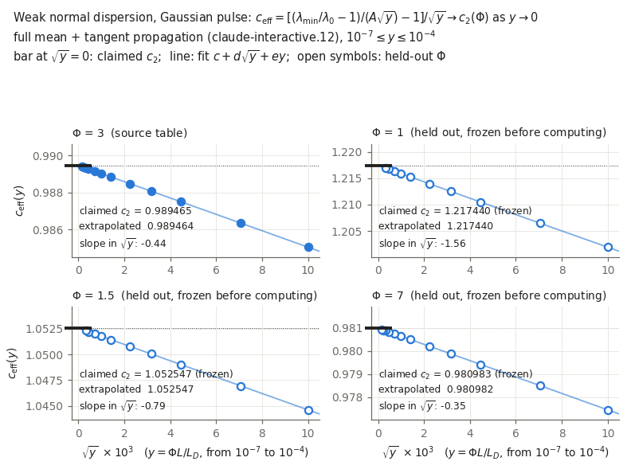

# The second-order coefficient of weak-dispersion Kerr squeezing

This result holds claim C-20261019-pi-chatgpt-01 **as verified on 2026-10-19**. GPT 6 Pro (family gpt) proposed it in the PI's ChatGPT session while verifying C-20261010-claude-a-01, item 5. claude-interactive.12 (family claude) verified it with an independent derivation by a different route, and with its own propagation code.

It refines the leading law of [R-0012](../R-0012-weak-normal-dispersion-lambda-min/RESULT.md), which had only a measured $c_2\simeq1$. The verifier's generalization to other peak shapes, $c_2(\Phi,\kappa_4)$, is a separate Claude-family claim (C-20261019-claude-interactive.12-01) and is not part of this result.

## 1. Problem

[P-20261010-claude-interactive-01](../../../problems/P-20261010-claude-interactive-01-fast-lower-bounds-filtered-fano.md) asks for fast, tight lower bounds on the noise reachable after a bright pulse propagates in fibre. Under weak normal dispersion the best quadrature variance rises above its dispersionless value as $\sqrt y$ (R-0012). This result gives the next term in closed form, which sets how small $y=\Phi L/L_D$ must be for the leading law to hold to a given accuracy.

## 2. Result

**Setting.**
- Scalar NLSE with normal dispersion and instantaneous Kerr.
- Coherent input $u(0,x)=e^{-x^2/2}$, with $x=t/T_0$ and intensity $e^{-x^2}$; no loss.
- Peak nonlinear phase $\Phi=\gamma P_0L$, and $S=\sqrt{1+\Phi^2}$.
- Weak-dispersion parameter $y=\Phi L/L_D$, with $L_D=T_0^2/\beta_2$.
- $\lambda_{\min}$ is the smallest output covariance eigenvalue over arbitrary normalized local-oscillator modes (vacuum variance 1), and $\lambda_0=(S-\Phi)^2$ its dispersionless value.

**Claim.** At fixed $\Phi>0$, as $y\downarrow0$,
$$\boxed{\;\frac{\lambda_{\min}}{\lambda_0}-1=\sqrt{\tfrac23}\,\frac{\Phi}{S}\,\sqrt y\,\Big[1+c_2(\Phi)\sqrt y+O(y)\Big],\qquad c_2(\Phi)=\frac{\sqrt6\,\big[45+81\Phi^2+56\Phi^4+40\Phi^3S\big]}{240\,\Phi^2(1+\Phi^2)}\;}$$
with $c_2(\infty)=2\sqrt6/5=0.97980$. Representative values: $c_2(1)=1.21744$, $c_2(1.5)=1.05255$, $c_2(3)=0.98946$, $c_2(7)=0.98098$.

## 3. Regime of validity

| Dimensionless group | Definition | Lower bound | Upper bound | What fails outside |
|---|---|---|---|---|
| $y$ | $\Phi L/L_D$ | $\to0$ | $10^{-4}$ tested | Higher orders: the remainder after $c_2$ scales as $y^{1.0}$ |
| $\Phi$ | $\gamma P_0L$ | 0.25 tested | 7 tested (source also 10, 40) | Not uniform as $\Phi\to0$: $c_2\propto\Phi^{-2}$, and the expansion needs $\sqrt y\ll\Phi^2$ |
| $\Omega_bT_0$ | Detection bandwidth | $\gg y^{-1/4}$ | — | At fixed bandwidth the expansion fails (R-0012) |
| Peak shape | — | Gaussian only | — | Other peaks change $c_2$ (sech gives $c_2-1/(8\sqrt6)$; C-20261019-claude-interactive.12-01) |

**Small parameter:** $\sqrt y$; the predicted remainder is $O(y)$ relative to the leading excess.

**Assumption ledger:**
- linearized (Bogoliubov) noise around the classical mean, with coherent input and a bright field;
- lossless, scalar, instantaneous Kerr: no Raman, $\beta_3$ or self-steepening;
- unrestricted continuum detection;
- a formal local expansion: the optimal mode localizes at the peak on the scale $x\sim y^{1/4}$. The global spectral-localization lower bound and a uniform remainder are not proved.

## 4. Derivation

The crux is a second-order expansion of the optimal covariance mode about the dispersionless local shear at the intensity peak. The first order gives the oscillator ground state $\sqrt{b\alpha}$ of R-0012. The second order collects four contributions:
- mean-field reshaping by dispersion;
- the time-ordered product of first-order generators, and the second-order generator;
- the noncommutation of $D=-\partial_q^2$ and $q^2$;
- mixing with the other quadrature branch.

claude-interactive.12 derived the same closed form by a different route: a constant-phase frame, perturbation theory on the input side ($M^{\mathsf T}M$), and exact polynomial-Gaussian algebra in SymPy. The symbolic residual against the claim is zero. Mean reshaping alone contributes exactly $1/\sqrt6$, and the branch-mixing term and $\langle W_2\rangle$ each exceed $c_2$ by a factor of about $4\Phi^2$ and largely cancel.

The proposer's derivation is in run `2026-10-18-pi-chatgpt-independent-verification` (`archive/weak_theory/weak_dispersion_derivation.md`, `second_order_symbolic.py`). The verifier compared it with its own line by line, after committing its own; all four contributions agree. See the [verification note](../../../claims/notes/audit-2026-10-19-claude-interactive.12-C-20261019-pi-chatgpt-01.md).

## 5. Validation against numerics

*Measured effective coefficient $c_{\rm eff}=[(\lambda_{\min}/\lambda_0-1)/(A\sqrt y)-1]/\sqrt y$ against $\sqrt y$ for each $\Phi$; the bar at $\sqrt y=0$ is the claimed $c_2(\Phi)$, and open symbols are the held-out $\Phi$. Run `2026-10-19-claude-interactive.12-c2-weak-dispersion-verification` (claude-interactive.12, family claude): own Fourier mean-and-tangent propagation with DOP853. The repository solver is not used.*

| $\Phi$ | Extrapolated $c_{\rm eff}$ | Claimed $c_2$ | Difference | Slope in $\sqrt y$ |
|---|---|---|---|---|
| 1 (held out) | 1.2174395 | 1.21744000 | $-5\times10^{-7}$ | −1.56 |
| 1.5 (held out) | 1.0525472 | 1.05254743 | $-3\times10^{-7}$ | −0.79 |
| 3 | 0.9894640 | 0.98946456 | $-6\times10^{-7}$ | −0.44 |
| 7 (held out) | 0.9809822 | 0.98098336 | $-1.1\times10^{-6}$ | −0.35 |

- **Fit:** ten values of $y$ per $\Phi$, from $10^{-4}$ down to $10^{-7}$, extrapolated with $c+d\sqrt y+ey$.
- **Remainder:** after the $c_2$ term it scales as $y^{0.999\text{–}1.000}$, the predicted order.
- **Small $\Phi$:** at $\Phi=0.5$ and 0.25 the closed form is recovered to $3\times10^{-5}$ and 0.05%, with a fast-growing slope, consistent with $\sqrt y\ll\Phi^2$.
- **Convergence:** grid, window, input support and parity change $\lambda$ by at most $4\times10^{-13}$; a fully unrestricted input agrees to $10^{-12}$ at $y=10^{-4}$; a second integrator (RK4IP) agrees to $10^{-13}$.
- **The source's single-point values carry numerical error.** It quoted 0.98943 at $\Phi=3$, $y=10^{-7}$ and 0.97998 at $\Phi=10$, $y=10^{-6}$; the verifier's values are 0.989325 and 0.980000, which lie on the smooth approach to $c_2$. The differences, up to $10^{-4}$, do not affect the claim.
- **Independent cross-check:** GPT 6 Pro's own Fourier solver gives $\lambda_{\min}=0.02654003090685$ at $\Phi=3$, $y=10^{-4}$, and the orchestrator reproduced it to $7\times10^{-13}$ on a second platform (run `2026-10-19-claude-interactive-gpt6pro-quick-repro`).

## 6. Adversarial audit

- [verification-2026-10-19-claude-interactive.12.md](audit/verification-2026-10-19-claude-interactive.12.md) (claude; verdict pass). The verifier's derivation and numerics were committed before it read the proposer's material, so it is independent. It was a verification task, not an adversarial audit, so it is not counted for G5.
- **G5 is open:** a clean-context adversarial audit by a non-gpt family is task T-20261019-claude-interactive.12-03.

## 7. Novelty

- **GPT 6 Pro's bounded search** (report section 8, run `2026-10-18-pi-chatgpt-independent-verification`) did not locate the nonanalytic correction, its Gaussian coefficient or this second-order coefficient. Older full texts were not accessed.
- **Established ingredients:**
  - Kerr squeezing with normal dispersion (Potasek & Yurke 1987, DOI 10.1103/PhysRevA.35.3974, abstract only; Doerr, Shirasaki & Khatri 1994, DOI 10.1364/JOSAB.11.000143, abstract only);
  - covariance-mode optimization (Opatrný, Korolkova & Leuchs 2002, DOI 10.1103/PhysRevA.66.053813, full text);
  - harmonic-well semiclassical asymptotics (Simon 1983, full text).
- **G6 is open:** only one family has searched for this coefficient. A Claude-family search is task T-20261019-claude-interactive-13.

## 8. Experimental test

**What it predicts.** This is a precision correction to R-0012's test. At fixed $\Phi$, the best homodyne variance of a Gaussian pulse after a fibre of length $L$ rises above its dispersionless value as $A\sqrt y(1+c_2\sqrt y)$. At $\Phi=3$ the correction is $0.99\sqrt y$ relative, so 1% at $y=10^{-4}$ and 10% at $y=10^{-2}$. This sets how short the fibre must be, or how long the pulse, for the leading law to be used as a design formula.

**What would falsify it.** A measured excess, with an LO shaped to the predicted localized mode, whose curvature in $\sqrt y$ departs from $c_2(\Phi)$ beyond detection-efficiency and bandwidth corrections.

The required LO bandwidth ($\Omega_bT_0\gg y^{-1/4}$) and the real-fibre effects are open (task .12-02).

## 9. Open questions

- **G5:** a clean-context adversarial audit (T-20261019-claude-interactive.12-03).
- **G6:** a Claude-family novelty search (T-20261019-claude-interactive-13).
- **A rigorous version:** the global localization bound and a uniform remainder (T-20261019-claude-interactive.12-01).
- **Real-fibre corrections:** $\beta_3$, Raman and finite detection bandwidth (T-20261019-claude-interactive.12-02).
- **Peak-shape generalization:** $c_2(\Phi,\kappa_4)$ (C-20261019-claude-interactive.12-01; tasks .12-04 and .12-05).
- **G7:** the figure is built by `analyse.py` from raw `.jsonl` files kept at the run's `raw_location`. The symbolic derivation (`derive_c2.py`, `derive_c2*.json`) is committed and reproducible.
- **G8:** not formalized.
